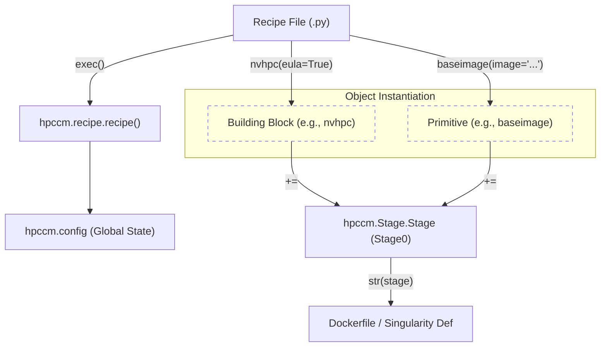
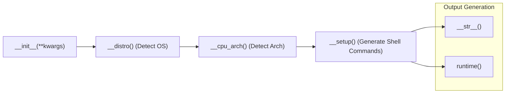

<!-- source: DeepWiki mcp.deepwiki.com · repo NVIDIA/hpc-container-maker · page 8 Glossary · fetched 2026-10-26 -->

# Glossary

Relevant source files

The following files were used as context for generating this wiki page:

- [CHANGELOG.md](CHANGELOG.md)
- [docs/building_blocks.md](docs/building_blocks.md)
- [docs/misc_api.md](docs/misc_api.md)
- [hpccm/__init__.py](hpccm/__init__.py)
- [hpccm/building_blocks/__init__.py](hpccm/building_blocks/__init__.py)
- [hpccm/building_blocks/doca_ofed.py](hpccm/building_blocks/doca_ofed.py)
- [hpccm/building_blocks/hpcx.py](hpccm/building_blocks/hpcx.py)
- [hpccm/building_blocks/mlnx_ofed.py](hpccm/building_blocks/mlnx_ofed.py)
- [hpccm/building_blocks/nvhpc.py](hpccm/building_blocks/nvhpc.py)
- [hpccm/building_blocks/ofed.py](hpccm/building_blocks/ofed.py)
- [hpccm/config.py](hpccm/config.py)
- [hpccm/primitives/baseimage.py](hpccm/primitives/baseimage.py)
- [hpccm/recipe.py](hpccm/recipe.py)
- [hpccm/templates/ConfigureMake.py](hpccm/templates/ConfigureMake.py)
- [hpccm/toolchain.py](hpccm/toolchain.py)
- [hpccm/version.py](hpccm/version.py)
- [pydocmd.yml](pydocmd.yml)
- [setup.py](setup.py)
- [test/helpers.py](test/helpers.py)
- [test/test_ConfigureMake.py](test/test_ConfigureMake.py)
- [test/test_baseimage.py](test/test_baseimage.py)
- [test/test_doca_ofed.py](test/test_doca_ofed.py)
- [test/test_hpcx.py](test/test_hpcx.py)
- [test/test_kokkos.py](test/test_kokkos.py)
- [test/test_mlnx_ofed.py](test/test_mlnx_ofed.py)
- [test/test_multi_ofed.py](test/test_multi_ofed.py)
- [test/test_nvhpc.py](test/test_nvhpc.py)
- [test/test_ofed.py](test/test_ofed.py)
- [test/test_toolchain.py](test/test_toolchain.py)
- [test/test_user.py](test/test_user.py)

This page provides definitions for codebase-specific terms, jargon, and domain concepts used within the HPC Container Maker (HPCCM) project. It serves as a reference for developers to understand the mapping between conceptual terminology and the underlying Python implementation.

## Core Concepts

### Building Block
A high-level Python class that encapsulates the logic for installing a specific software component (e.g., OpenMPI, FFTW, or a compiler). Building blocks handle complex tasks like dependency resolution, OS-specific package naming, and multi-stage build optimization.
*   **Implementation**: Inherit from `bb_base` [hpccm/building_blocks/base.py:27-28]().
*   **Registry**: All available blocks are exposed via `hpccm.building_blocks` [hpccm/building_blocks/__init__.py:16-70]().

### Primitive
The lowest level of abstraction in HPCCM. Primitives correspond directly to container engine instructions (e.g., `RUN`, `COPY`, `ENV`). They handle the syntactic translation between Dockerfile and Singularity definition file formats.
*   **Examples**: `baseimage` [hpccm/primitives/baseimage.py:30](), `shell` [hpccm/primitives/shell.py:25](), `environment` [hpccm/primitives/environment.py:26]().

### Stage
A collection of primitives and building blocks that represent a single phase of a container build. In Docker, these map to multi-stage builds (`FROM ... AS ...`). In Singularity, HPCCM manages these to facilitate artifact transfer between build and runtime environments.
*   **Implementation**: `hpccm.Stage.Stage` [hpccm/Stage.py:28]().
*   **Data Flow**: Primitives are added to a stage using the `+=` operator [hpccm/recipe.py:133-135]().

### Toolchain
An object used to pass compiler and flag information between building blocks. It ensures that if you install a specific compiler (like `nvhpc`), subsequent libraries (like `openmpi`) use that compiler instead of the system default.
*   **Implementation**: `hpccm.toolchain.toolchain` [hpccm/toolchain.py:26]().
*   **Key Attributes**: `CC`, `CXX`, `FC`, `CFLAGS`, `LDFLAGS` [hpccm/toolchain.py:44-50]().

---

## Technical Jargon & Abbreviations

| Term | Definition | Code Pointer |
| :--- | :--- | :--- |
| **ctype** | Container Type: An internal enum indicating the target output format (Docker, Singularity, or Bash). | `hpccm.common.container_type` [hpccm/common.py:24]() |
| **g_cpu_arch** | Global state variable tracking the target CPU architecture (x86_64, aarch64, etc.). | `hpccm.config.g_cpu_arch` [hpccm/config.py:37]() |
| **g_linux_distro** | Global state variable tracking the target Linux distribution and version. | `hpccm.config.g_linux_distro` [hpccm/config.py:43]() |
| **Runtime Method** | A method in building blocks that returns only the instructions needed to run the software, excluding build-time dependencies. | `bb.runtime()` [docs/building_blocks.md:58-60]() |
| **USERARG** | A dictionary used to pass CLI arguments into a recipe for parameterization. | `hpccm.recipe.recipe(userarg=...)` [hpccm/recipe.py:128-130]() |

---

## System Architecture Diagrams

### From Natural Language to Code Entities: The Recipe Lifecycle
This diagram illustrates how a user's intent in a recipe file is processed by the HPCCM engine into specific class instances.

**Recipe Execution Flow**

**Sources**: [hpccm/recipe.py:86-192](), [hpccm/building_blocks/nvhpc.py:39-40](), [hpccm/primitives/baseimage.py:30]()

### The Building Block Lifecycle
Building blocks follow a strict internal flow to generate instructions based on the detected environment.

**Internal Building Block Logic**

**Sources**: [hpccm/building_blocks/nvhpc.py:147-175](), [hpccm/building_blocks/hpcx.py:136-161]()

---

## Domain Concepts

### Archspec Integration
HPCCM uses the `archspec` library to provide microarchitecture-specific optimization flags. This allows recipes to target specific CPU generations (e.g., `zen2`, `cascadelake`).
*   **Reference**: `hpccm.config.set_cpu_target` [hpccm/config.py:180-182]() and `hpccm.config.get_cpu_optimization_flags` [hpccm/config.py:108-110]().

### Multi-Stage Propagation
The pattern where a build stage contains compilers and development headers, while a runtime stage only contains shared libraries and binaries.
*   **Logic**: The `Stage.runtime()` method iterates through all blocks in a stage and calls their respective `runtime()` methods [hpccm/Stage.py:110-128]().
*   **Example**: `Stage1 += Stage0.runtime()` [docs/misc_api.md:254-255]().

### Environment Templates
Mix-in classes used by building blocks to handle common tasks like setting environment variables or managing the dynamic linker cache.
*   **Templates**: `hpccm.templates.envvars` [hpccm/templates/envvars.py:22](), `hpccm.templates.ldconfig` [hpccm/templates/ldconfig.py:22](), `hpccm.templates.rm` [hpccm/templates/rm.py:22]().

**Sources**: [hpccm/Stage.py:1-136](), [hpccm/config.py:1-294](), [hpccm/recipe.py:1-192](), [docs/building_blocks.md:1-200](), [docs/misc_api.md:1-258]()