# Page: Overview

# Overview

<details>
<summary>Relevant source files</summary>

The following files were used as context for generating this wiki page:

- [.github/workflows/python3.yml](.github/workflows/python3.yml)
- [CHANGELOG.md](CHANGELOG.md)
- [README.md](README.md)
- [docs/README.md](docs/README.md)
- [docs/citation.md](docs/citation.md)
- [docs/getting_started.md](docs/getting_started.md)
- [hpccm/version.py](hpccm/version.py)
- [setup.py](setup.py)
- [test/test_user.py](test/test_user.py)

</details>


HPC Container Maker (HPCCM - pronounced H-P-see-M) is an open-source Python-based tool designed to simplify the generation of container specification files, specifically targeting High-Performance Computing (HPC) environments [README.md:8-9](). It abstracts the complexities of container syntax (Docker and Singularity) into high-level Python components, allowing developers to focus on the software stack rather than the underlying specification format [README.md:29-32]().

### Purpose and Value Proposition

HPCCM addresses several challenges in the HPC container ecosystem:
*   **Format Agnosticism**: Generate either `Dockerfiles` or Singularity definition files (`.def`) from a single Python recipe [README.md:39-41]().
*   **Best Practices**: Encapsulates expert knowledge for installing complex HPC components (like MPI, OFED, and Math libraries) into reusable "Building Blocks" [README.md:29-32]().
*   **Flexibility**: Leverages Python to provide dynamic recipe logic, such as input validation, branching based on user arguments, and modular includes [README.md:34-37]().

### System Architecture

The HPCCM codebase is organized into a hierarchical structure that bridges high-level intent with low-level container instructions.

#### Core Subsystems

| Subsystem | Responsibility | Key Code Entities |
| :--- | :--- | :--- |
| **CLI / Engine** | Entry point and recipe execution. | `hpccm.cli` [setup.py:46](), `hpccm.config` |
| **Primitives** | Low-level mapping to Docker/Singularity syntax. | `hpccm.primitives` |
| **Building Blocks** | High-level software installation logic. | `hpccm.building_blocks` |
| **Templates** | Reusable logic for build systems (CMake, Autotools). | `hpccm.templates` |

#### Data Flow: Recipe to Specification
The following diagram illustrates how a recipe is processed by the CLI and converted into a container specification.

**HPCCM Execution Flow**
```mermaid
graph TD
    Recipe["Recipe (.py)"] --> CLI["hpccm.cli:main"]
    CLI --> Config["hpccm.config"]
    CLI --> Engine["Recipe Execution (exec)"]
    Engine --> BB["Building Blocks (hpccm.building_blocks)"]
    BB --> Prim["Primitives (hpccm.primitives)"]
    Prim --> Output["Dockerfile / Singularity.def"]

    subgraph "Natural Language Space"
    "I want to install OpenMPI"
    end

    subgraph "Code Entity Space"
    BB_OMPI["hpccm.building_blocks.openmpi"]
    PRIM_SHELL["hpccm.primitives.shell"]
    end

    "I want to install OpenMPI" -.-> BB_OMPI
    BB_OMPI --> PRIM_SHELL
```
Sources: [README.md:25-41](), [setup.py:44-46](), [docs/getting_started.md:18-53]()

### Key Concepts

HPCCM operates on a "Stage" model where container layers are accumulated. 

*   **Stages**: Representing a multi-stage build, recipes typically append components to `Stage0`, `Stage1`, etc. [docs/getting_started.md:47-50]().
*   **Building Blocks**: High-level classes that handle the installation of specific software packages (e.g., `gnu()`, `openmpi()`). They automatically handle dependencies and environment variables [README.md:29-32]().
*   **Primitives**: Direct mappings to container instructions like `baseimage` (FROM), `shell` (RUN), and `copy` (COPY) [docs/getting_started.md:35]().
*   **Toolchains**: Objects used to pass compiler and flag information between different building blocks.

For a deep dive into these terms and the architectural layers, see [Key Concepts and Terminology](#1.2).

### Getting Started

HPCCM can be installed via `pip` or `conda` [docs/getting_started.md:8-14](). It can be used as a standalone command-line tool to process recipes or imported as a Python module for advanced workflows [docs/getting_started.md:18-24]().

**Basic CLI Usage:**
```bash
hpccm --recipe recipe.py --format docker > Dockerfile
hpccm --recipe recipe.py --format singularity > Singularity.def
```
Sources: [docs/getting_started.md:54-60]()

For installation instructions and your first recipe walkthrough, see [Getting Started](#1.1).

### Code Entity Mapping

The relationship between user-facing commands and internal Python modules is mapped below:

**Command to Module Mapping**
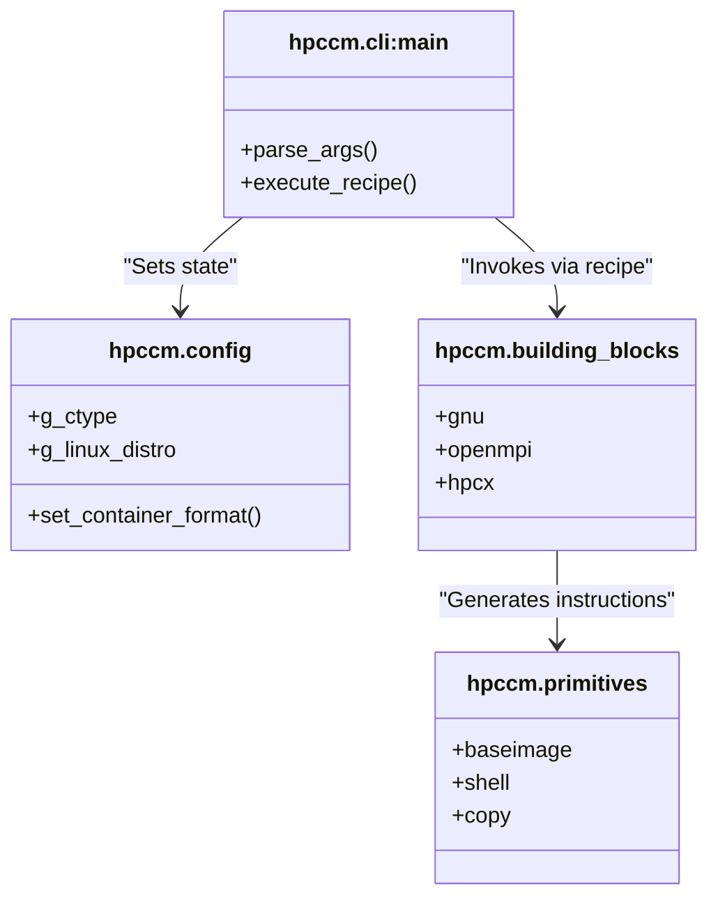
Sources: [setup.py:44-46](), [hpccm/version.py:16](), [docs/getting_started.md:33-37]()

---

# Page: Getting Started

# Getting Started

<details>
<summary>Relevant source files</summary>

The following files were used as context for generating this wiki page:

- [.github/workflows/python3.yml](.github/workflows/python3.yml)
- [README.md](README.md)
- [docs/README.md](docs/README.md)
- [docs/getting_started.md](docs/getting_started.md)
- [hpccm/cli.py](hpccm/cli.py)
- [hpccm/primitives/copy.py](hpccm/primitives/copy.py)
- [test/test_copy.py](test/test_copy.py)

</details>


HPC Container Maker (HPCCM) is an open-source tool designed to simplify the generation of container specification files, such as Dockerfiles and Singularity definition files, using high-level Python recipes [README.md:8-9](). By leveraging Python, HPCCM allows for programmable logic, input validation, and the reuse of optimized HPC "building blocks" that encapsulate best practices for scientific software stacks [README.md:25-37]().

## Installation

HPCCM is compatible with Python 3.8 through 3.12 [.github/workflows/python3.yml:11]() and can be installed via standard Python package managers.

### Using pip
To install from [PyPI](https://pypi.org/project/hpccm/):
```bash
pip install hpccm
```
Sources: [docs/getting_started.md:5-10](), [.github/workflows/python3.yml:28]()

### Using conda
To install from [Conda-forge](https://anaconda.org/conda-forge/hpccm):
```bash
conda install -c conda-forge hpccm
```
Sources: [docs/getting_started.md:12-14]()

---

## Usage Modes

HPCCM can be utilized either as a standalone Command Line Interface (CLI) tool or as a Python module integrated into larger workflows.

### 1. Command Line Interface (CLI)
The `hpccm` command processes a recipe file and prints the resulting container specification to standard output.

**Basic Syntax:**
```bash
hpccm --recipe <recipe.py> --format <docker|singularity|bash>
```

**Common Arguments:**
| Argument | Description |
| :--- | :--- |
| `--recipe` | Path to the Python recipe file [hpccm/cli.py:52-53](). |
| `--format` | Output format: `docker` (default), `singularity`, or `bash` [hpccm/cli.py:46-48](). |
| `--userarg` | Pass key-value pairs to the recipe for parameterization [hpccm/cli.py:59-60](). |
| `--cpu-target` | Optimize for specific CPU microarchitectures via `archspec` [hpccm/cli.py:43-45](). |
| `--single-stage` | Process only the first stage of a multi-stage recipe [hpccm/cli.py:54-56](). |

Sources: [hpccm/cli.py:42-71](), [docs/getting_started.md:44-60]()

### 2. Python Module
Using HPCCM as a module provides maximum control. You manually configure the global state and call primitives or building blocks.

```python
import hpccm

# Configure global output format
hpccm.config.set_container_format('docker')

# Generate primitives
print(hpccm.primitives.baseimage(image='ubuntu:22.04'))

# Generate building blocks
print(hpccm.building_blocks.gnu(version='11'))
```
Sources: [docs/getting_started.md:23-37]()

---

## Generating and Building Images

The output of HPCCM is the **specification**, not the image itself. Users must pipe the output to a file and use the respective container engine to build the image.

### Docker Workflow
```bash
hpccm --recipe recipe.py --format docker > Dockerfile
docker build -t my_hpc_image:latest -f Dockerfile .
```
Sources: [docs/getting_started.md:73-78]()

### Singularity Workflow
```bash
hpccm --recipe recipe.py --format singularity > Singularity.def
singularity build my_hpc_image.sif Singularity.def
```
Sources: [docs/getting_started.md:80-84]()

---

## Technical Implementation Overview

### Data Flow: From Recipe to Specification
The following diagram illustrates how the `hpccm` CLI coordinates the transformation of a Python recipe into a formatted specification.

**CLI Execution Flow**
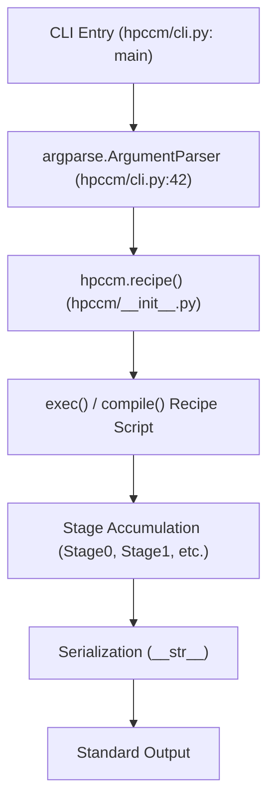
Sources: [hpccm/cli.py:41-88](), [docs/getting_started.md:44-56]()

### Entity Mapping: Primitives and Building Blocks
HPCCM abstracts container instructions into `primitives` and high-level software installations into `building_blocks`.

**Code Entity Mapping**
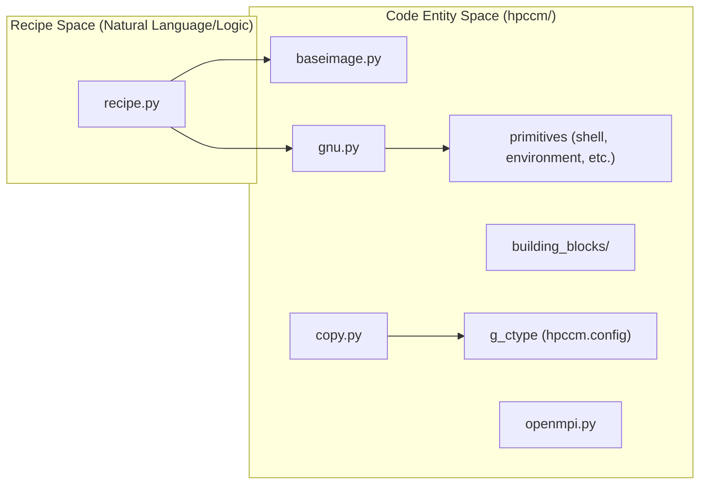
Sources: [hpccm/primitives/copy.py:24-29](), [docs/getting_started.md:35-36](), [hpccm/cli.py:76-84]()

---

## First Steps for New Users

1.  **Explore Examples**: The `recipes/` directory contains complete application recipes for GROMACS, MILC, and MPI Bandwidth [docs/getting_started.md:113-115]().
2.  **Use "hpcbase" Recipes**: Start with the bundled `hpcbase` recipes which provide a validated stack of compilers (GNU, NVHPC) and MPI libraries (OpenMPI, HPC-X) [docs/getting_started.md:106-111]().
3.  **Understand Primitives**: Familiarize yourself with how HPCCM handles standard operations like `copy`. For instance, the `copy` primitive automatically handles differences between Docker's `COPY` and Singularity's `%files` or `%setup` blocks [hpccm/primitives/copy.py:159-216]().

### Example: The `copy` Primitive
The `copy` primitive demonstrates HPCCM's translation logic. It accepts standard Python arguments and renders format-specific syntax based on the global `hpccm.config.g_ctype` [hpccm/primitives/copy.py:159]().

| Feature | Docker Output | Singularity Output |
| :--- | :--- | :--- |
| **Single File** | `COPY a b` | `%files \n a b` |
| **Stage Transfer** | `COPY --from=stage a b` | `%files from stage \n a b` |
| **Directory Creation** | N/A (Automatic) | `%setup \n mkdir -p ...` (if `_mkdir=True`) |

Sources: [hpccm/primitives/copy.py:29-111](), [test/test_copy.py:48-159]()

---

# Page: Key Concepts and Terminology

# Key Concepts and Terminology

<details>
<summary>Relevant source files</summary>

The following files were used as context for generating this wiki page:

- [CHANGELOG.md](CHANGELOG.md)
- [hpccm/Stage.py](hpccm/Stage.py)
- [hpccm/__init__.py](hpccm/__init__.py)
- [hpccm/recipe.py](hpccm/recipe.py)
- [hpccm/templates/ConfigureMake.py](hpccm/templates/ConfigureMake.py)
- [hpccm/toolchain.py](hpccm/toolchain.py)
- [hpccm/version.py](hpccm/version.py)
- [setup.py](setup.py)
- [test/test_ConfigureMake.py](test/test_ConfigureMake.py)
- [test/test_Stage.py](test/test_Stage.py)
- [test/test_toolchain.py](test/test_toolchain.py)
- [test/test_user.py](test/test_user.py)

</details>


This page explains the fundamental architectural patterns, domain concepts, and terminology used throughout the HPC Container Maker (HPCCM) codebase. HPCCM is designed to abstract the complexities of container specification formats (Docker and Singularity/Apptainer) into a modular, Python-based framework.

## Three-Layer Architecture

HPCCM is organized into three distinct layers of abstraction that facilitate code reuse and cross-format compatibility.

| Layer | Code Path | Description |
| :--- | :--- | :--- |
| **Primitives** | `hpccm/primitives/` | Low-level building blocks that map directly to container instructions (e.g., `RUN`, `COPY`, `ENV`). |
| **Building Blocks** | `hpccm/building_blocks/` | High-level components that install software (e.g., `openmpi`, `gnu`). They encapsulate best practices and multi-step installation logic. |
| **Templates** | `hpccm/templates/` | Python mixins that provide common behaviors (e.g., `git` cloning, `wget` downloading, `ConfigureMake` workflows) to Building Blocks. |

### Data Flow and Interaction
The following diagram illustrates how a Recipe interacts with these layers to produce a container specification.

**Recipe Processing Flow**
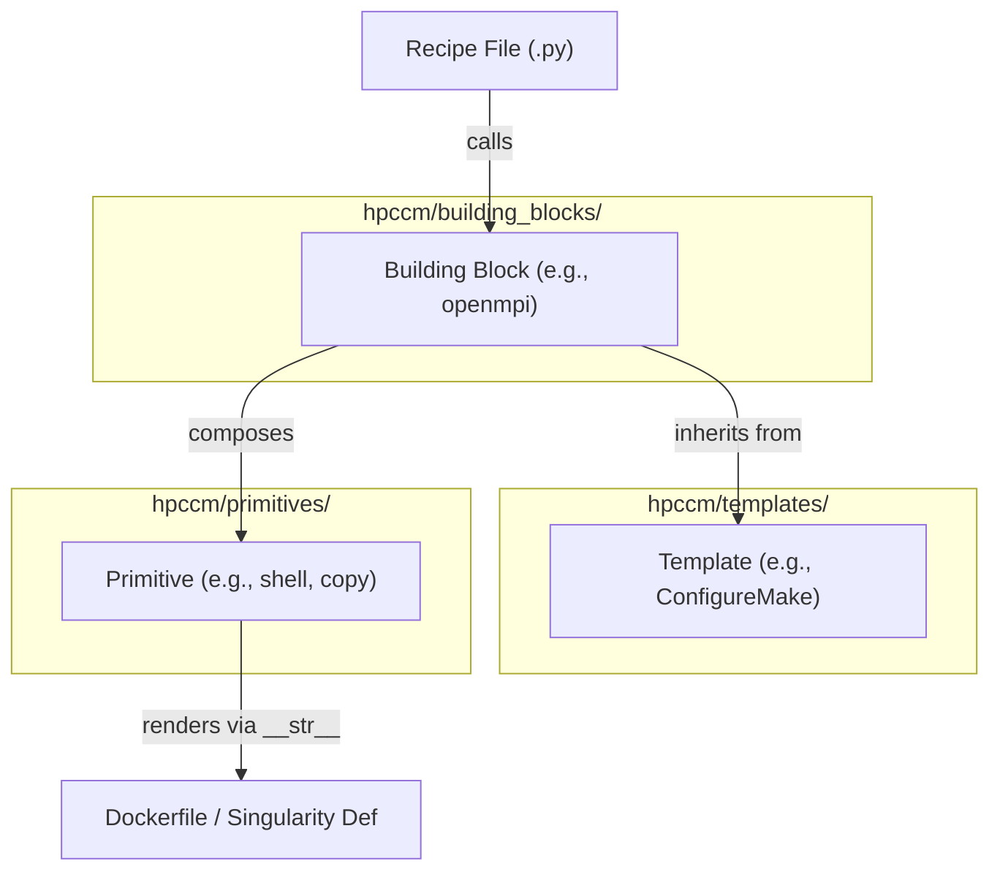
Sources: [hpccm/__init__.py:29-31](), [hpccm/recipe.py:33-35]()

## The Stage Model

A `Stage` represents a discrete phase in a container build. In Docker, this corresponds to a build stage starting with `FROM`. In Singularity (3.2+), this corresponds to a multi-stage definition.

*   **Accumulation**: Layers (Primitives or Building Blocks) are added to a stage using the `+=` operator, implemented via `Stage.__iadd__` [hpccm/Stage.py:50-63]().
*   **Serialization**: When a `Stage` is converted to a string (`__str__`), it iterates through its internal `__layers` list and calls `str()` on each, joining them with a separator [hpccm/Stage.py:69-71]().
*   **Multi-stage Builds**: Recipes typically define `Stage0` (build stage) and `Stage1` (deployment stage). The `Stage.runtime()` method is the key mechanism for extracting only the necessary runtime artifacts from a build stage to a deployment stage [hpccm/Stage.py:88-136]().

### Stage Implementation Detail
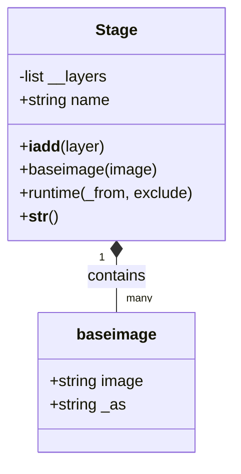
Sources: [hpccm/Stage.py:27-49](), [hpccm/primitives/baseimage.py:1-20]() (implied by [hpccm/Stage.py:25]())

## Toolchain

The `toolchain` class is a data structure used to pass compiler and linker information between building blocks. It ensures that if you install a specific version of GCC, subsequent libraries (like OpenMPI or FFTW) use that exact compiler and the appropriate optimization flags.

*   **Attributes**: Includes standard environment variables like `CC`, `CXX`, `FC`, `CFLAGS`, and `LDFLAGS` [hpccm/toolchain.py:25-27]().
*   **Propagation**: Building blocks often accept a `toolchain` object in their constructor and return a modified version of it to be used by the next block.
*   **Serialization**: The `__dict__` property is overridden to return only non-null values, allowing it to be easily converted into container environment variables [hpccm/toolchain.py:65-70]().

Sources: [hpccm/toolchain.py:20-46]()

## Container Types

HPCCM supports multiple output formats defined in `hpccm.common.container_type`:
1.  **DOCKER**: Generates a `Dockerfile`.
2.  **SINGULARITY**: Generates a Singularity/Apptainer definition file.
3.  **BASH**: Generates a shell script for "bare metal" installation.

The global state for the target format is stored in `hpccm.config.g_ctype` [hpccm/recipe.py:141](). Primitives use this global variable to determine which syntax to render in their `__str__` methods. For example, the `user` primitive renders `USER` for Docker but returns an empty string for Singularity and Bash [test/test_user.py:47-63]().

## Build System Templates

Templates provide the logic for common software installation patterns. The `ConfigureMake` template, for example, automates the `./configure && make && make install` workflow.

*   **Logic Encapsulation**: It handles the generation of the shell commands for building, including directory management (`mkdir -p` and `cd`) [hpccm/templates/ConfigureMake.py:75-83]().
*   **Toolchain Integration**: It automatically injects `toolchain` attributes into the configure environment [hpccm/templates/ConfigureMake.py:86-137]().
*   **Option Management**: It provides a standardized way to handle `--enable-feature` and `--with-package` flags via keyword arguments [hpccm/templates/ConfigureMake.py:45-56]().

Sources: [hpccm/templates/ConfigureMake.py:25-57](), [test/test_ConfigureMake.py:53-65]()

## Recipe Execution Engine

A "Recipe" is a Python script that describes the container. The `hpccm.recipe.recipe()` function is the entry point for processing these files.

1.  **Context Injection**: It sets up `Stage0` and `Stage1` objects and makes them available to the recipe [hpccm/recipe.py:133-135]().
2.  **USERARG**: It injects user-provided arguments into a `USERARG` dictionary, allowing recipes to be parameterized [hpccm/recipe.py:128-130]().
3.  **Execution**: It uses Python's `exec(compile(...))` to run the recipe code within a specific global and local scope [hpccm/recipe.py:75-78]().
4.  **Serialization**: Finally, it joins the string representations of all stages to produce the final output [hpccm/recipe.py:187-192]().

Sources: [hpccm/recipe.py:86-125](), [hpccm/recipe.py:158-159]()

---

# Page: Core Architecture

# Core Architecture

<details>
<summary>Relevant source files</summary>

The following files were used as context for generating this wiki page:

- [docs/misc_api.md](docs/misc_api.md)
- [hpccm/Stage.py](hpccm/Stage.py)
- [hpccm/__init__.py](hpccm/__init__.py)
- [hpccm/base_object.py](hpccm/base_object.py)
- [hpccm/building_blocks/base.py](hpccm/building_blocks/base.py)
- [hpccm/config.py](hpccm/config.py)
- [hpccm/recipe.py](hpccm/recipe.py)
- [test/test_Stage.py](test/test_Stage.py)

</details>


HPC Container Maker (HPCCM) is organized into a hierarchical structure that translates high-level Python descriptions into low-level container specifications (Dockerfiles, Singularity definition files, or Bash scripts). The architecture is designed to decouple the intent of a software installation (e.g., "install OpenMPI with GCC") from the specific syntax of the container format or the package manager of the underlying Linux distribution.

### System Overview

The following diagram illustrates the relationship between the core components, from the CLI entry point down to the primitive instructions.

**HPCCM Component Relationship**
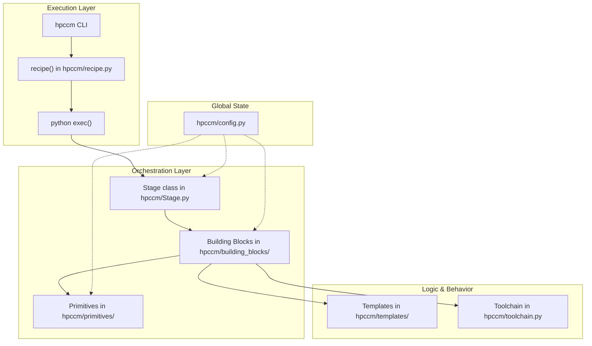
**Sources:** [hpccm/recipe.py:86-192](), [hpccm/Stage.py:27-136](), [hpccm/config.py:35-46]().

---

### Recipe Engine and CLI
The engine is responsible for executing the user's recipe file. It utilizes Python's `exec` and `compile` functions to process recipes as live Python code [hpccm/recipe.py:75-78]().

*   **`recipe()` function**: The primary entry point that sets global state (container type, CPU target) and executes the recipe [hpccm/recipe.py:86-192]().
*   **USERARG**: A mechanism to pass command-line arguments directly into the recipe's Python scope [hpccm/recipe.py:127-130]().
*   **Modular Recipes**: The `include()` function allows recipes to be composed of other recipe files [hpccm/recipe.py:36-84]().

For details, see [Recipe Engine and CLI](#2.1).

---

### Global Configuration (`hpccm.config`)
HPCCM maintains a global state that influences how primitives and building blocks render their output. This state is managed in `hpccm/config.py`.

| Variable | Purpose | Default |
| :--- | :--- | :--- |
| `g_ctype` | The output format (Docker, Singularity, Bash) | `container_type.DOCKER` |
| `g_cpu_arch` | Target processor architecture (x86_64, aarch64, etc.) | Detected from host |
| `g_linux_distro` | The Linux distribution of the container | `linux_distro.UBUNTU` |
| `g_cpu_target` | Specific microarchitecture (via `archspec`) | `None` |

**Sources:** [hpccm/config.py:35-46](), [hpccm/config.py:110-130]().

For details, see [Global Configuration (hpccm.config)](#2.2).

---

### Stage and Multi-Stage Builds
The `Stage` class represents a single stage in a container build. In Docker, this corresponds to a `FROM` instruction and its subsequent layers. In Singularity, it represents the primary definition blocks.

*   **Layer Accumulation**: Layers (primitives or building blocks) are added to a stage using the `+=` operator [hpccm/Stage.py:50-63]().
*   **Runtime Propagation**: The `Stage.runtime()` method is the core of HPCCM's multi-stage support. It iterates through all building blocks in a "build" stage and extracts only the components (libraries, environment variables) necessary for the "deployment" stage [hpccm/Stage.py:88-136]().

**Stage Serialization Flow**
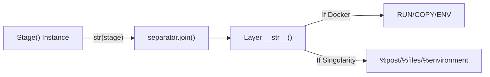
**Sources:** [hpccm/Stage.py:69-71](), [hpccm/Stage.py:88-136]().

For details, see [Stage and Multi-Stage Builds](#2.3).

---

### Base Class Hierarchy
HPCCM uses a strict class hierarchy to ensure that building blocks can inherit complex behaviors from templates using Method Resolution Order (MRO).

*   **`base_object`**: The root class in `hpccm/base_object.py`. It provides a `**kwargs` compatible `__init__` that terminates the `super()` chain, allowing multiple inheritance from templates [hpccm/base_object.py:20-36]().
*   **`bb_instructions`**: A base class for managing lists of container instructions [hpccm/building_blocks/base.py:22-53]().
*   **`bb_base`**: The standard base for all building blocks, which separates "build-time" instructions from "runtime" instructions (`self.rt`) [hpccm/building_blocks/base.py:54-62]().

For details, see [Building Blocks](#4).

---

### Toolchain
The `toolchain` class (`hpccm/toolchain.py`) acts as a messenger between building blocks. It carries information about compilers (`CC`, `CXX`, `FC`) and flags (`CFLAGS`, `LDFLAGS`).

*   **Optimization**: It integrates with `archspec` to automatically provide CPU-specific optimization flags based on the `g_cpu_target` [hpccm/config.py:67-93]().
*   **Consumption**: A building block (like OpenMPI) can consume a toolchain object produced by a compiler building block (like GNU) to ensure it is built with the correct compiler and flags.

For details, see [Toolchain](#2.4).

---

# Page: Recipe Engine and CLI

# Recipe Engine and CLI

<details>
<summary>Relevant source files</summary>

The following files were used as context for generating this wiki page:

- [MANIFEST.in](MANIFEST.in)
- [hpccm/__init__.py](hpccm/__init__.py)
- [hpccm/cli.py](hpccm/cli.py)
- [hpccm/primitives/copy.py](hpccm/primitives/copy.py)
- [hpccm/recipe.py](hpccm/recipe.py)
- [recipes/examples/cloverleaf.py](recipes/examples/cloverleaf.py)
- [recipes/examples/gnu-devel.py](recipes/examples/gnu-devel.py)
- [test/include1.py](test/include1.py)
- [test/include2.py](test/include2.py)
- [test/include3.py](test/include3.py)
- [test/test_copy.py](test/test_copy.py)
- [test/test_openmpi.py](test/test_openmpi.py)
- [test/test_recipe.py](test/test_recipe.py)

</details>


The Recipe Engine is the core execution environment of HPCCM. It is responsible for parsing command-line arguments, configuring the global state, and executing Python-based recipe files to generate container specifications.

## CLI Entry Point and Argument Parsing

The `hpccm` command-line interface is implemented in `hpccm/cli.py`. It uses the standard `argparse` library to handle user input [hpccm/cli.py:42-71]().

### Custom Argument Handling
A specialized `KeyValue` class extends `argparse.Action` to process the `--userarg` flag [hpccm/cli.py:27-40](). This allows users to pass arbitrary key-value pairs (e.g., `--userarg version=1.2.3`) which are converted into a Python dictionary and injected into the recipe's execution context [hpccm/cli.py:33-39]().

### Data Flow: CLI to Recipe
The `main()` function in `hpccm/cli.py` acts as a bridge, collecting arguments and passing them to the `hpccm.recipe()` function [hpccm/cli.py:76-84]().

**CLI Argument Mapping**
| CLI Flag | `recipe()` Argument | Internal Config Impact |
| :--- | :--- | :--- |
| `--cpu-target` | `cpu_target` | `hpccm.config.set_cpu_target()` |
| `--format` | `ctype` | `hpccm.config.g_ctype` |
| `--singularity-version` | `singularity_version` | `hpccm.config.g_singularity_version` |
| `--userarg` | `userarg` | Local `USERARG` dict in recipe |
| `--wd` | `working_directory` | `hpccm.config.g_wd` |

**Sources:** [hpccm/cli.py:27-84](), [hpccm/recipe.py:137-150]()

## The `recipe()` Function

The `recipe()` function in `hpccm/recipe.py` is the primary orchestrator for building container specifications [hpccm/recipe.py:86-125]().

### Execution Lifecycle
1.  **State Initialization**: It initializes two `Stage` objects, `Stage0` and `Stage1`, and makes them available as local variables [hpccm/recipe.py:133-135]().
2.  **Global Configuration**: It updates `hpccm.config` variables based on the arguments provided (e.g., container type, CPU architecture) [hpccm/recipe.py:138-150]().
3.  **USERARG Injection**: The `userarg` dictionary is assigned to a local variable `USERARG`, allowing recipes to access parameters via `USERARG.get('key')` [hpccm/recipe.py:128-130]().
4.  **Recipe Execution**: It calls `include()` to execute the recipe file [hpccm/recipe.py:158-159]().
5.  **Serialization**: It iterates through the stages and calls `str(stage)` on each to generate the final output string [hpccm/recipe.py:187-190]().

**Sources:** [hpccm/recipe.py:86-192]()

## Recipe Execution and `include()`

HPCCM treats recipes as Python scripts. The `include()` function is used to load and execute these scripts within a controlled scope [hpccm/recipe.py:36-55]().

### Execution Mechanism
The engine uses Python's `compile()` and `exec()` functions to execute recipe code [hpccm/recipe.py:78]().
*   **Globals/Locals**: By default, `include()` inherits the caller's symbol table, allowing nested recipes to share variables like `Stage0` or `compiler` [hpccm/recipe.py:57-62]().
*   **Path Resolution**: To support relative paths in modular recipes, the engine maintains `include.prepend_path` [hpccm/recipe.py:71-73](). This ensures that if `recipe_A.py` includes `subdir/recipe_B.py`, any further includes inside `recipe_B.py` are resolved relative to `subdir/` [hpccm/recipe.py:155]().

### Modular Recipes
Recipes can be split into multiple files. For example, a main recipe can include a base configuration:
```python
# main_recipe.py
include('base_image.py')
Stage0 += packages(ospackages=['vim'])
```

**Sources:** [hpccm/recipe.py:36-85](), [test/include2.py:1-2](), [test/include3.py:1-2]()

## Output Modes and Multi-stage Handling

HPCCM supports different output behaviors based on the requested container type and stage configuration.

### Multi-stage Output
If a recipe populates `Stage1`, the engine treats it as a multi-stage build [hpccm/recipe.py:164](). 
*   **Docker**: Always supports multi-stage.
*   **Singularity**: Requires version >= 3.2. If a lower version is specified, the engine logs a warning and truncates the output to only `Stage0` [hpccm/recipe.py:165-178]().
*   **Bash**: Does not support multi-stage; only `Stage0` is processed [hpccm/recipe.py:179-184]().

### Single-stage Override
The `--single-stage` CLI flag (or `single_stage=True` argument) forces the engine to ignore everything except `Stage0`, which is useful for debugging or generating simplified builds [hpccm/recipe.py:162-163]().

**Sources:** [hpccm/recipe.py:161-185](), [hpccm/cli.py:54-56]()

## Architectural Diagrams

### CLI to Recipe Execution Flow
This diagram illustrates how a CLI command moves through the parsing logic into the Python execution engine.

Title: HPCCM Execution Data Flow
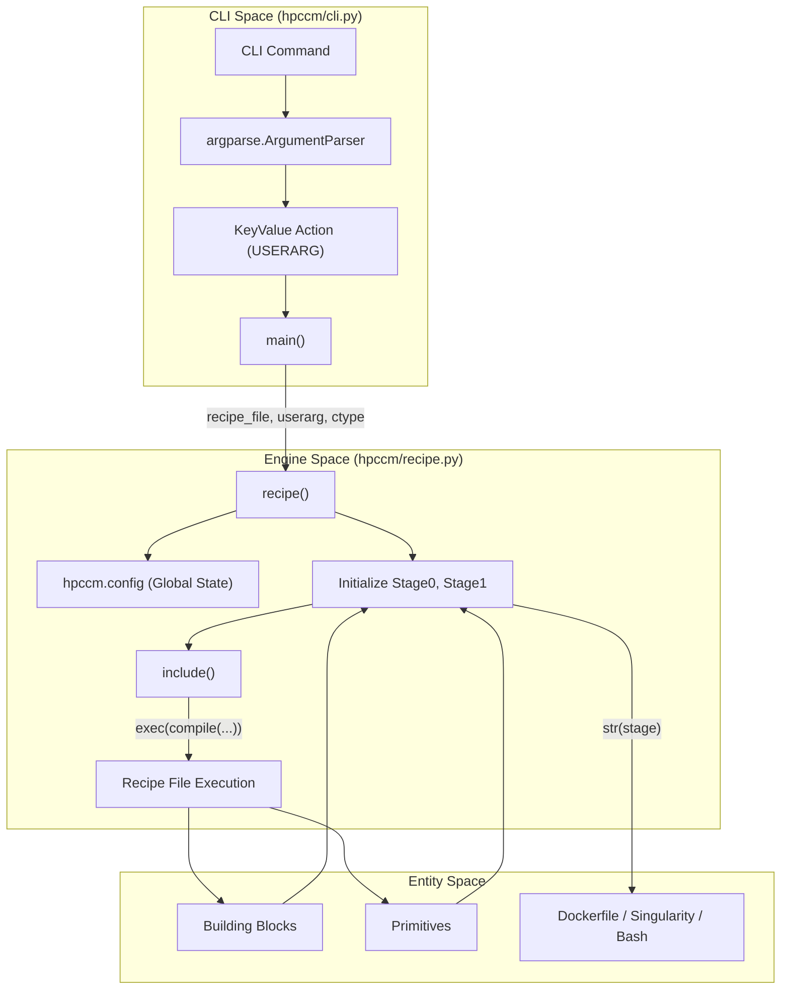
**Sources:** [hpccm/cli.py:41-85](), [hpccm/recipe.py:86-192]()

### Recipe Modularization Logic
This diagram shows how the `include()` function manages symbol tables and path resolution for nested recipes.

Title: Recursive Recipe Inclusion Logic
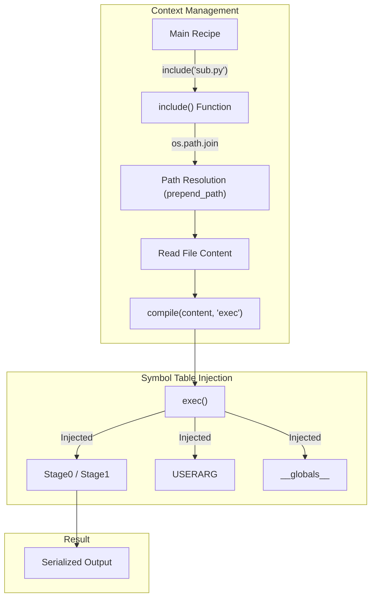
**Sources:** [hpccm/recipe.py:36-85](), [test/include3.py:1-2]()

---

# Page: Global Configuration (hpccm.config)

# Global Configuration (hpccm.config)

<details>
<summary>Relevant source files</summary>

The following files were used as context for generating this wiki page:

- [docs/misc_api.md](docs/misc_api.md)
- [hpccm/common.py](hpccm/common.py)
- [hpccm/config.py](hpccm/config.py)
- [hpccm/primitives/baseimage.py](hpccm/primitives/baseimage.py)
- [test/test_baseimage.py](test/test_baseimage.py)
- [test/test_blob.py](test/test_blob.py)
- [test/test_config.py](test/test_config.py)
- [test/test_raw.py](test/test_raw.py)

</details>


The `hpccm.config` module serves as the central authority for global state within HPC Container Maker. It manages environment-wide settings that influence how primitives and building blocks generate their output, including target CPU architectures, Linux distributions, and container formats.

## Global State Variables

The module defines several internal global variables (prefixed with `g_`) that store the current configuration state. These are initialized based on the host system's properties but can be overridden via setter functions or the `baseimage` primitive.

| Variable | Type | Default Value | Description |
| :--- | :--- | :--- | :--- |
| `g_cpu_arch` | `cpu_arch` | Host Arch | The target instruction set (e.g., `X86_64`, `AARCH64`). [hpccm/config.py:35-39]() |
| `g_cpu_target` | `string` | `None` | Specific microarchitecture for `archspec` (e.g., `broadwell`, `zen2`). [hpccm/config.py:40]() |
| `g_ctype` | `container_type` | `DOCKER` | The output format: Docker, Singularity, or Bash. [hpccm/config.py:41]() |
| `g_linux_distro` | `linux_distro` | `UBUNTU` | The target Linux distribution family. [hpccm/config.py:42]() |
| `g_linux_version` | `Version` | `16.04` | The specific version of the Linux distribution. [hpccm/config.py:43]() |
| `g_singularity_version`| `Version` | `2.6` | Target Singularity version (affects multi-stage support). [hpccm/config.py:44]() |
| `g_wd` | `string` | `/var/tmp` | The default working directory for build stages. [hpccm/config.py:45]() |

**Sources:** [hpccm/config.py:34-47](), [hpccm/common.py:21-39]()

## Configuration Flow and Code Entities

The following diagram illustrates how the `hpccm.config` module mediates between the high-level recipe requirements and the low-level output generation.

### Configuration State Management
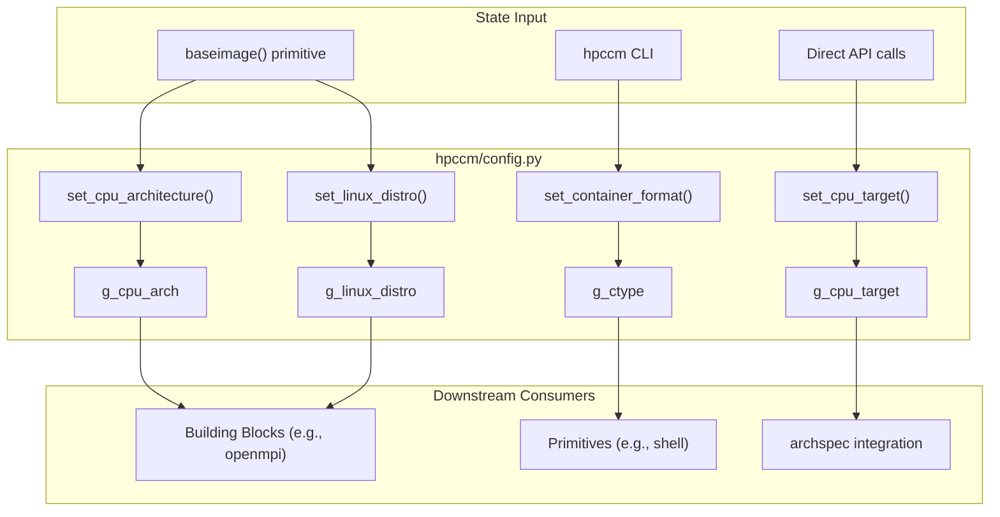
**Sources:** [hpccm/config.py:110-220](), [hpccm/primitives/baseimage.py:87-185]()

## Automatic Detection via `baseimage`

The `baseimage` primitive is the primary mechanism for updating `hpccm.config`. When a `baseimage` is instantiated in a recipe, it parses the `image` string using regular expressions to automatically detect the architecture and distribution.

1.  **Architecture Detection**: Searches for patterns like `aarch64`, `arm64`, or `ppc64le` in the image name. [hpccm/primitives/baseimage.py:90-105]()
2.  **Distro Detection**: Searches for keywords like `ubuntu`, `centos`, `rhel`, `ubi`, or `rockylinux`, including version tags (e.g., `ubuntu:22.04`). [hpccm/primitives/baseimage.py:110-185]()

If detection fails, it defaults to the host's architecture and `ubuntu16`.

**Sources:** [hpccm/primitives/baseimage.py:74-185](), [test/test_baseimage.py:143-205]()

## Archspec Integration

HPCCM integrates with the `archspec` library to provide compiler-specific optimization flags based on a microarchitecture target.

### `get_cpu_optimization_flags`
This function bridges HPCCM's global state with `archspec`. It takes a compiler name (e.g., `gcc`, `clang`) and version, looks up the `g_cpu_target` in `archspec.cpu.TARGETS`, and returns the appropriate flag string (e.g., `-march=broadwell`).

[hpccm/config.py:67-93]()

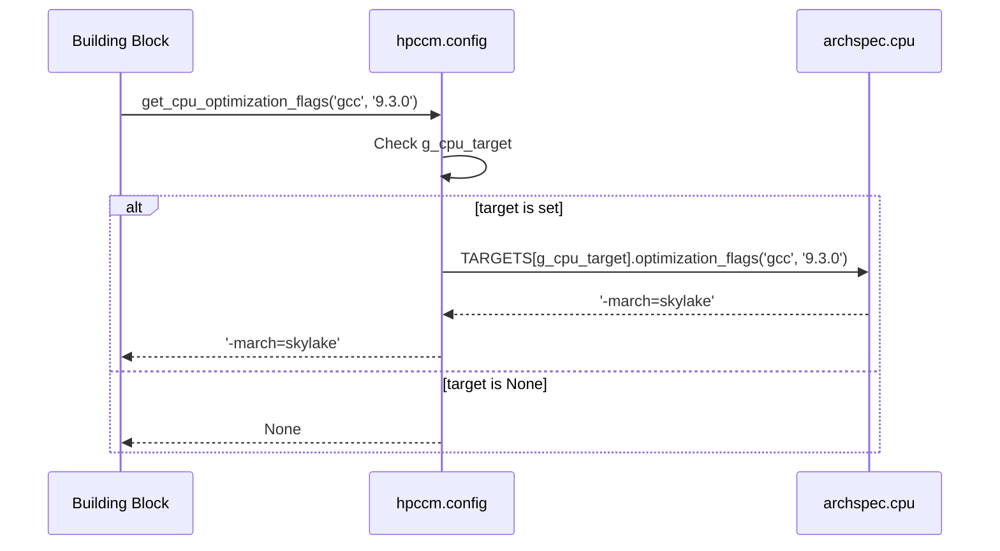
**Sources:** [hpccm/config.py:67-93](), [docs/misc_api.md:11-26]()

## Key Setter Functions

While `baseimage` handles most configuration, the following functions allow manual control:

*   **`set_container_format(ctype)`**: Accepts `'docker'`, `'singularity'`, or `'bash'`. It updates `g_ctype`, which dictates whether `str(primitive)` returns Dockerfile syntax or Singularity `%post` blocks. [hpccm/config.py:110-129]()
*   **`set_cpu_architecture(arch)`**: Sets `g_cpu_arch`. It supports aliases (e.g., `amd64` maps to `x86_64`, `arm` maps to `aarch64`). [hpccm/config.py:131-154]()
*   **`set_linux_distro(distro)`**: Sets both `g_linux_distro` and `g_linux_version`. For example, `set_linux_distro('ubuntu20')` sets the distro to `UBUNTU` and version to `20.04`. [hpccm/config.py:166-220]()
*   **`set_singularity_version(ver)`**: Updates `g_singularity_version`. If the version is `< 3.2`, multi-stage build features are disabled or rendered in a legacy-compatible way. [hpccm/config.py:222-234]()

**Sources:** [hpccm/config.py:110-234](), [docs/misc_api.md:33-114]()

---

# Page: Stage and Multi-Stage Builds

# Stage and Multi-Stage Builds

<details>
<summary>Relevant source files</summary>

The following files were used as context for generating this wiki page:

- [docs/misc_api.md](docs/misc_api.md)
- [hpccm/Stage.py](hpccm/Stage.py)
- [hpccm/config.py](hpccm/config.py)
- [test/test_Stage.py](test/test_Stage.py)

</details>


The `Stage` class is the primary container for layers (primitives and building blocks) in HPCCM. It facilitates the construction of both single-stage and multi-stage container specifications by managing the accumulation of instructions and providing mechanisms to propagate runtime artifacts between stages.

## The Stage Class

The `Stage` class [hpccm/Stage.py:27-41]() acts as an ordered collection of container layers. While Docker supports multiple stages in a single Dockerfile, HPCCM represents each as a discrete `Stage` object. For Singularity, which traditionally has a single stage, HPCCM uses the `Stage` model to manage the translation of multi-stage logic into compatible formats (e.g., using `%files from` in Singularity 3.2+).

### Layer Accumulation
Layers are added to a stage using the `+=` operator, implemented via the `__iadd__` method [hpccm/Stage.py:50-63](). This method accepts either a single layer object or a list of objects.

- **Naming Logic**: If a `baseimage` primitive is added to a stage and the stage does not yet have a name, the stage inherits the name specified in the `baseimage`'s `_as` parameter [hpccm/Stage.py:56-57]().
- **Base Image Placement**: The `baseimage()` method [hpccm/Stage.py:73-86]() ensures that the `FROM` (Docker) or `Bootstrap` (Singularity) instruction is inserted at index 0 of the layer list, even if other layers were added previously [test/test_Stage.py:61-67]().

### Serialization
The `__str__` method [hpccm/Stage.py:69-71]() handles the serialization of the stage into the final container specification. It iterates through all stored layers, calls their respective `__str__` methods (which dispatch to Docker or Singularity syntax based on `hpccm.config.g_ctype`), and joins them using a configurable separator (defaulting to `\n\n`) [hpccm/Stage.py:48]().

### Data Flow: Recipe to Serialization

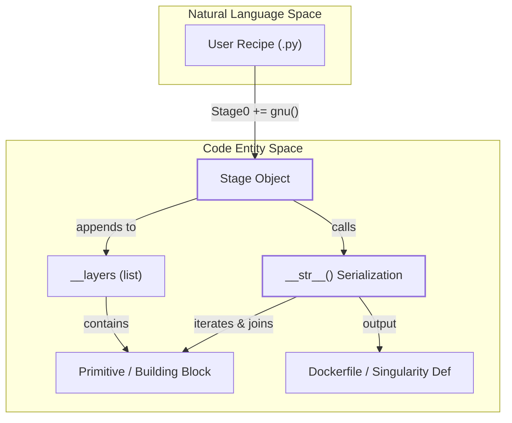
**Sources:** [hpccm/Stage.py:46-71](), [test/test_Stage.py:38-59]()

## Multi-Stage Builds and `runtime()`

Multi-stage builds allow users to separate the build environment (compilers, source code, build tools) from the deployment environment (runtime libraries, binaries). The `Stage.runtime()` method [hpccm/Stage.py:88-136]() is the core mechanism for this transition.

### The `runtime()` Method
When `Stage.runtime()` is called on a "build stage" (e.g., `Stage0`), it iterates through every layer in that stage. If a layer (typically a Building Block) has a defined `runtime()` method, it is invoked to generate the instructions necessary to include that component in a subsequent "deployment stage" [hpccm/Stage.py:129-134]().

- **`_from` Argument**: Specifies the source stage for artifacts. In Docker, this populates `COPY --from=...`. In Singularity 3.2+, this populates `%files from ...` [test/test_Stage.py:101-159]().
- **`exclude` Argument**: A list of class names to skip. This is useful if a specific library from the build stage is not desired in the final image [hpccm/Stage.py:101-102]().
- **Default Naming**: If `_from` is not provided, HPCCM uses the `Stage.name`. If no name exists, it defaults to `0` (Docker's default index) [hpccm/Stage.py:121-126]().

### Runtime Propagation Logic

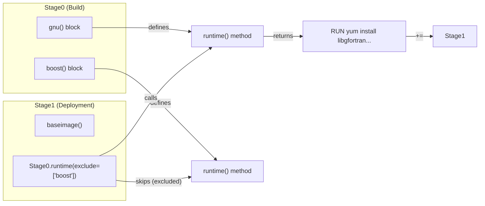
**Sources:** [hpccm/Stage.py:88-136](), [test/test_Stage.py:87-99]()

## Implementation Details

### Stage Class Summary
| Attribute / Method | Purpose | Source |
| :--- | :--- | :--- |
| `self.__layers` | Internal list storing primitives and building blocks. | [hpccm/Stage.py:46]() |
| `__iadd__(layer)` | Overloads `+=` to append layers or extend lists. | [hpccm/Stage.py:50]() |
| `baseimage(image)` | Forces a base image primitive to the start of the stage. | [hpccm/Stage.py:73]() |
| `runtime(_from, exclude)` | Collects runtime instructions from all layers in the stage. | [hpccm/Stage.py:88]() |
| `__str__()` | Serializes the stage based on `hpccm.config.g_ctype`. | [hpccm/Stage.py:69]() |

### Multi-Stage Example Comparison
The following table illustrates how `Stage.runtime()` translates to different formats based on global configuration.

| Format | Stage 0 (Build) | Stage 1 (Runtime) Output |
| :--- | :--- | :--- |
| **Docker** | `Stage0 += boost()` | `COPY --from=0 /usr/local/boost /usr/local/boost` [test/test_Stage.py:111]() |
| **Singularity** | `Stage0 += boost()` | `%files from 0` <br> `    /usr/local/boost /usr/local/boost` [test/test_Stage.py:124-125]() |

**Sources:** [hpccm/Stage.py:1-136](), [test/test_Stage.py:1-189](), [docs/misc_api.md:191-258]()

---

# Page: Toolchain

# Toolchain

<details>
<summary>Relevant source files</summary>

The following files were used as context for generating this wiki page:

- [docs/building_blocks.md](docs/building_blocks.md)
- [docs/misc_api.md](docs/misc_api.md)
- [hpccm/building_blocks/nvhpc.py](hpccm/building_blocks/nvhpc.py)
- [hpccm/config.py](hpccm/config.py)
- [hpccm/templates/ConfigureMake.py](hpccm/templates/ConfigureMake.py)
- [hpccm/toolchain.py](hpccm/toolchain.py)
- [test/test_ConfigureMake.py](test/test_ConfigureMake.py)
- [test/test_nvhpc.py](test/test_nvhpc.py)
- [test/test_toolchain.py](test/test_toolchain.py)

</details>


The `toolchain` class in HPCCM provides a standardized way to manage and propagate compiler information, linker flags, and library paths throughout a container recipe. It acts as a data transport object between building blocks that provide compilers (e.g., `gnu`, `nvhpc`) and building blocks that consume them to build software (e.g., `openmpi`, `fftw`).

## The toolchain Class

The `toolchain` class, defined in `hpccm/toolchain.py`, encapsulates commonly used environment variables for building HPC software. [hpccm/toolchain.py:20-23]().

### Attributes
The class supports a specific set of attributes defined in `__attrs__`. [hpccm/toolchain.py:25-27](). These attributes are initialized via keyword arguments in the constructor. [hpccm/toolchain.py:29-46]().

| Attribute | Description |
| :--- | :--- |
| `CC` | C compiler executable |
| `CXX` | C++ compiler executable |
| `FC`, `F77`, `F90` | Fortran compiler executables |
| `CFLAGS` | C compiler flags |
| `CXXFLAGS` | C++ compiler flags |
| `FCFLAGS`, `FFLAGS` | Fortran compiler flags |
| `CPPFLAGS` | C preprocessor flags |
| `LDFLAGS` | Linker flags |
| `LD_LIBRARY_PATH` | Shared library search path |
| `LIBS` | Libraries to link against |
| `FLIBS` | Fortran-specific libraries |
| `CUDA_HOME` | Path to the CUDA installation |

### Implementation Details
*   **Dictionary Conversion**: The class overrides the `__dict__` property to return only attributes with non-null values. This allows the toolchain to be passed directly to the `environment` primitive using `vars(toolchain_object)`. [hpccm/toolchain.py:65-70]().
*   **Copying**: The class implements `__copy__` and `__deepcopy__` to ensure that toolchain states can be duplicated without maintaining references to the original object, which is critical when one building block needs to modify a toolchain without affecting others. [hpccm/toolchain.py:48-63]().

### Code Entity Space: Toolchain Structure
This diagram shows how the `toolchain` class is structured and how it exposes its internal state.

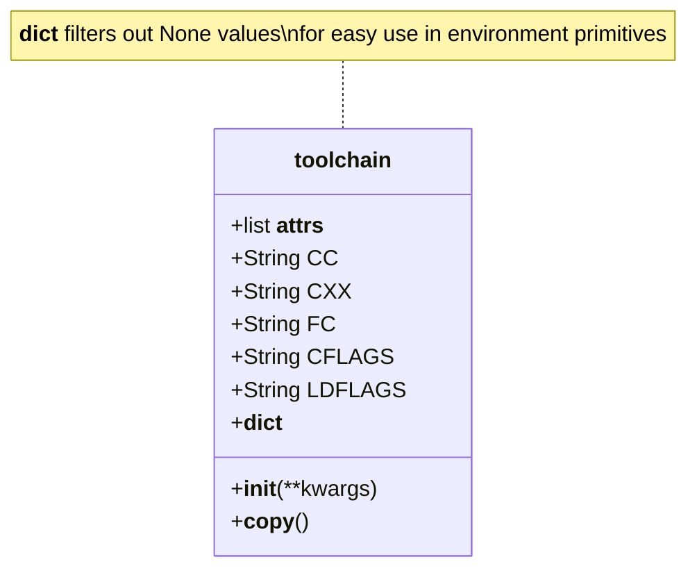
Sources: [hpccm/toolchain.py:20-70]()

---

## Toolchain Flow in Building Blocks

Building blocks typically interact with toolchains in two ways:
1.  **Providers**: Compilers building blocks (like `nvhpc` or `gnu`) create a `toolchain` object as a member variable (`self.toolchain`) that reflects the compilers they just installed. [hpccm/building_blocks/nvhpc.py:51-53]().
2.  **Consumers**: Software building blocks (like `openmpi` or `amgx`) accept a `toolchain` object as a parameter to know which compilers to use during their configuration phase. [docs/building_blocks.md:45-48]().

### Data Flow Diagram
The following diagram illustrates the flow of compiler information from an installer block to a consumer block via the `toolchain` object.

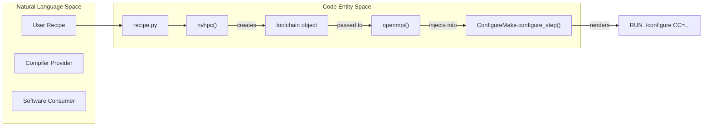
Sources: [hpccm/building_blocks/nvhpc.py:141-143](), [hpccm/templates/ConfigureMake.py:86-137](), [docs/building_blocks.md:45-48]()

---

## CPU Optimization Integration

HPCCM integrates with `archspec` to automatically provide CPU-specific optimization flags through the toolchain.

### Global Configuration
The `hpccm.config` module provides functions to set and retrieve optimization targets:
*   `set_cpu_target(target)`: Sets the microarchitecture (e.g., `zen2`, `skylake`). [hpccm/config.py:155-164]().
*   `get_cpu_optimization_flags(compiler, version)`: Queries `archspec` for the appropriate flags for the current `g_cpu_target`. [hpccm/config.py:67-93]().

### Integration with Build Templates
The `ConfigureMake` template consumes the `toolchain` object during the `configure_step`. If the toolchain contains flags (like `CFLAGS`), they are appended to the environment string of the generated shell command. [hpccm/templates/ConfigureMake.py:90-93]().

### Example: Toolchain with Archspec
When a user sets a CPU target in a recipe, building blocks can use the toolchain to propagate those flags:

```python
# In a recipe
hpccm.config.set_cpu_target('zen2')
compiler = gnu()
# compiler.toolchain.CFLAGS will now include archspec flags for zen2
Stage0 += compiler
Stage0 += openmpi(toolchain=compiler.toolchain)
```

Sources: [hpccm/config.py:67-93](), [hpccm/templates/ConfigureMake.py:86-137](), [docs/misc_api.md:11-26]()

---

## Usage in Templates

The `ConfigureMake` template demonstrates how the toolchain attributes are mapped to shell environment variables during the build process.

```python
# hpccm/templates/ConfigureMake.py
if toolchain:
    if toolchain.CC and self.toolchain_control.get('CC'):
        e.append('CC={}'.format(toolchain.CC))
    if toolchain.CFLAGS:
        e.append('CFLAGS={}'.format(shlex_quote(toolchain.CFLAGS)))
    # ... mapping continues for CXX, FC, LDFLAGS, etc.
```
Sources: [hpccm/templates/ConfigureMake.py:87-132]()

---

# Page: Primitives

# Primitives

<details>
<summary>Relevant source files</summary>

The following files were used as context for generating this wiki page:

- [docs/primitives.md](docs/primitives.md)
- [hpccm/primitives/baseimage.py](hpccm/primitives/baseimage.py)
- [hpccm/primitives/comment.py](hpccm/primitives/comment.py)
- [hpccm/primitives/environment.py](hpccm/primitives/environment.py)
- [hpccm/primitives/label.py](hpccm/primitives/label.py)
- [hpccm/primitives/runscript.py](hpccm/primitives/runscript.py)
- [hpccm/primitives/user.py](hpccm/primitives/user.py)
- [hpccm/primitives/workdir.py](hpccm/primitives/workdir.py)
- [test/test_baseimage.py](test/test_baseimage.py)

</details>


The **Primitives** layer in HPCCM (found in `hpccm/primitives/`) represents the lowest level of the container abstraction [docs/primitives.md:1-12](). These Python classes map directly to native container specification instructions, such as Dockerfile commands (`RUN`, `COPY`, `ENV`) or Singularity/Apptainer definition file sections (`%post`, `%files`, `%environment`) [hpccm/primitives/environment.py:81-114]().

Primitives are responsible for the "translation" logic that ensures a single Python recipe can generate valid syntax for multiple container runtimes or even shell scripts [hpccm/primitives/baseimage.py:195-208]().

### Primitive Translation Architecture

The following diagram illustrates how Primitives bridge the gap between Pythonic definitions and the generated output for different container engines.

**Primitive to Specification Mapping**
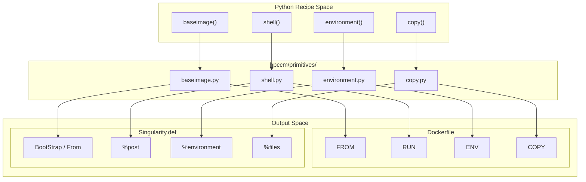
Sources: [hpccm/primitives/baseimage.py:30-72](), [hpccm/primitives/environment.py:74-118](), [hpccm/primitives/runscript.py:72-116]()

---

## 3.1. baseimage Primitive

The `baseimage` primitive is the starting point of every container stage [hpccm/primitives/baseimage.py:30-31](). It manages the `FROM` instruction in Docker and the `BootStrap`/`From` headers in Singularity [test/test_baseimage.py:57-71]().

Beyond simple syntax generation, `baseimage` performs critical environment detection:
*   **Architecture Detection**: It uses regex to inspect the image name (e.g., searching for `aarch64` or `ppc64le`) to automatically set the global `hpccm.config.g_cpu_arch` [hpccm/primitives/baseimage.py:87-105]().
*   **Distro Detection**: It identifies the Linux distribution (Ubuntu, CentOS, RHEL, Rocky Linux) and version to configure package managers in higher-level building blocks [hpccm/primitives/baseimage.py:107-190]().
*   **Multi-stage Support**: It handles stage naming via the `_as` parameter, which translates to `FROM ... AS name` in Docker and `Stage: name` in Singularity 3.2+ [test/test_baseimage.py:103-130]().

For details, see [baseimage Primitive](#3.1).

**Sources**: [hpccm/primitives/baseimage.py:30-190](), [test/test_baseimage.py:57-130]()

---

## 3.2. Shell, Copy, and Environment Primitives

These primitives handle the core operations of modifying a container's filesystem and runtime environment.

### Core Primitives Table

| Primitive | Docker Equivalent | Singularity Equivalent | Key Role |
| :--- | :--- | :--- | :--- |
| `shell` | `RUN` | `%post` | Executes commands during build [docs/primitives.md:237-240]() |
| `copy` | `COPY` | `%files` / `rsync` | Transfers files from host to image [hpccm/primitives/copy.py:109-112]() |
| `environment`| `ENV` | `%environment` | Sets runtime environment variables [hpccm/primitives/environment.py:27-32]() |
| `label` | `LABEL` | `%labels` | Adds metadata to the image [hpccm/primitives/label.py:27-28]() |
| `workdir` | `WORKDIR` | `mkdir && cd` | Sets the current working directory [hpccm/primitives/workdir.py:28-30]() |
| `runscript` | `ENTRYPOINT` | `%runscript` | Defines default container execution [hpccm/primitives/runscript.py:29-31]() |

### Implementation Details
*   **`shell`**: Provides the foundation for building blocks to install software [docs/primitives.md:237]().
*   **`copy`**: Includes specialized logic for Singularity to work around destination directory limitations using `%setup` and `rsync` with `_exclude_from` [docs/primitives.md:126-155]().
*   **`environment`**: For Singularity, it can optionally generate a `%post` section (via `_export=True`) to ensure variables are available during the build itself, not just at runtime [hpccm/primitives/environment.py:40-48]().
*   **`user`**: Sets the active user in Docker (`USER`); however, it is a null operation in Singularity as Singularity containers typically run as the host user [hpccm/primitives/user.py:27-31]().

**Entity Association Diagram**
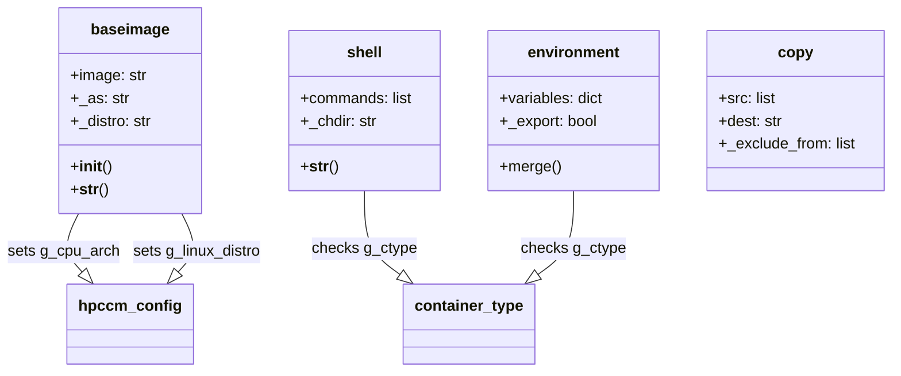
Sources: [hpccm/primitives/baseimage.py:30-190](), [hpccm/primitives/environment.py:26-58](), [hpccm/primitives/shell.py:27-50](), [hpccm/primitives/copy.py:109-155]()

For details, see [Shell, Copy, and Environment Primitives](#3.2).

**Sources**: [docs/primitives.md:108-235](), [hpccm/primitives/environment.py:74-118](), [hpccm/primitives/runscript.py:72-116](), [hpccm/primitives/workdir.py:51-64](), [hpccm/primitives/user.py:48-61]()

---

# Page: baseimage Primitive

# baseimage Primitive

<details>
<summary>Relevant source files</summary>

The following files were used as context for generating this wiki page:

- [hpccm/primitives/baseimage.py](hpccm/primitives/baseimage.py)
- [test/test_baseimage.py](test/test_baseimage.py)

</details>


The `baseimage` primitive is a foundational component of HPC Container Maker (HPCCM). It defines the starting point of a container stage, translating to the `FROM` instruction in Dockerfiles or the `BootStrap` and `From` headers in Singularity definition files [hpccm/primitives/baseimage.py:30-31](). Beyond simple string generation, it serves as the primary mechanism for automatic environment discovery, using regex patterns to detect CPU architectures and Linux distributions from image identifiers to configure global state [hpccm/primitives/baseimage.py:87-109]().

### Core Implementation and Logic Flow

The `baseimage` class handles initialization of the container environment. When instantiated, it updates the global configuration in `hpccm.config`, which subsequently influences the behavior of downstream building blocks (e.g., determining whether to use `apt-get` or `yum`) [hpccm/primitives/baseimage.py:110-185]().

#### Data Flow: Detection to Global Config

The following diagram illustrates how the `baseimage` primitive processes input parameters to set global state variables.

**System Discovery Data Flow**
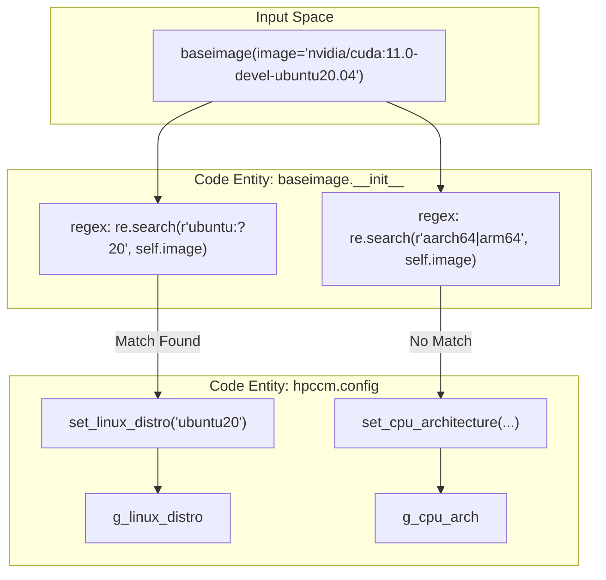
Sources: [hpccm/primitives/baseimage.py:74-185](), [hpccm/primitives/baseimage.py:24-24]()

### Parameter Mapping and Translation

The primitive supports parameters that bridge the syntax differences between Docker and Singularity.

| Parameter | Type | Default | Description |
| :--- | :--- | :--- | :--- |
| `image` | `str` | `ubuntu:18.04` | The base image identifier [hpccm/primitives/baseimage.py:83-83](). |
| `_as` | `str` | `''` | Name for the stage. Maps to `AS` in Docker and `Stage` in Singularity (3.2+) [hpccm/primitives/baseimage.py:81-81](). |
| `_arch` | `str` | `''` | Explicit CPU architecture override (`aarch64`, `ppc64le`, `x86_64`) [hpccm/primitives/baseimage.py:79-79](). |
| `_distro` | `str` | `''` | Explicit Linux distribution override [hpccm/primitives/baseimage.py:84-84](). |
| `_bootstrap` | `str` | `docker` | Singularity-specific bootstrap agent (e.g., `localimage`, `library`) [hpccm/primitives/baseimage.py:82-82](). |
| `_docker_env` | `bool` | `True` | Singularity-specific: source Docker environment scripts in `%post` [hpccm/primitives/baseimage.py:85-85](). |

Sources: [hpccm/primitives/baseimage.py:79-86]()

### Output Generation (`__str__`)

The `__str__` method performs the translation from Python state to container engine syntax based on `hpccm.config.g_ctype` [hpccm/primitives/baseimage.py:202-205]().

#### Docker Translation
For Docker, it produces a standard `FROM` instruction. If `_as` is provided, it appends `AS <name>` [hpccm/primitives/baseimage.py:207-208]().

#### Singularity Translation
Singularity output is more complex:
1.  **Headers**: Generates `BootStrap` and `From` lines [hpccm/primitives/baseimage.py:208]().
2.  **Multi-stage**: If `_as` is used and Singularity version is $\ge$ 3.2, it adds a `Stage: <name>` header [hpccm/primitives/baseimage.py:208]().
3.  **Docker Bridge**: If `_docker_env` is True, it adds a `%post` section to source `/.singularity.d/env/10-docker*.sh`, ensuring environment variables defined in the Docker base image are available during the Singularity build [hpccm/primitives/baseimage.py:208]().

**Code Entity Mapping: Output Generation**
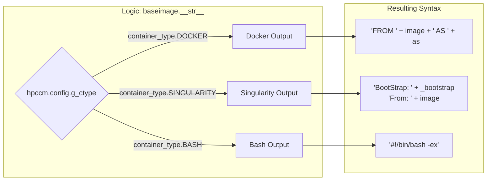
Sources: [hpccm/primitives/baseimage.py:202-208](), [test/test_baseimage.py:58-78]()

### Automatic Detection Logic

The primitive uses extensive regex matching on the `image` string to infer the operating system and version. This is critical for building blocks that rely on specific package managers.

*   **Ubuntu Detection**: Recognizes versions like `16.04`, `18.04`, `20.04`, `22.04`, `24.04`, and `26.04` via patterns like `ubuntu:?20` [hpccm/primitives/baseimage.py:163-176]().
*   **RHEL/CentOS/Rocky Detection**: Recognizes `centos:?7`, `rockylinux:?8`, and Red Hat Universal Base Images `ubi:?8` [hpccm/primitives/baseimage.py:143-158]().
*   **Architecture Detection**: Searches for `aarch64`, `arm64`, or `ppc64le` in the image name [hpccm/primitives/baseimage.py:97-100]().

Sources: [hpccm/primitives/baseimage.py:97-185](), [test/test_baseimage.py:143-205]()

---

# Page: Shell, Copy, and Environment Primitives

# Shell, Copy, and Environment Primitives

<details>
<summary>Relevant source files</summary>

The following files were used as context for generating this wiki page:

- [CHANGELOG.md](CHANGELOG.md)
- [hpccm/building_blocks/scif.py](hpccm/building_blocks/scif.py)
- [hpccm/cli.py](hpccm/cli.py)
- [hpccm/primitives/blob.py](hpccm/primitives/blob.py)
- [hpccm/primitives/comment.py](hpccm/primitives/comment.py)
- [hpccm/primitives/copy.py](hpccm/primitives/copy.py)
- [hpccm/primitives/environment.py](hpccm/primitives/environment.py)
- [hpccm/primitives/label.py](hpccm/primitives/label.py)
- [hpccm/primitives/raw.py](hpccm/primitives/raw.py)
- [hpccm/primitives/runscript.py](hpccm/primitives/runscript.py)
- [hpccm/primitives/shell.py](hpccm/primitives/shell.py)
- [hpccm/primitives/user.py](hpccm/primitives/user.py)
- [hpccm/primitives/workdir.py](hpccm/primitives/workdir.py)
- [hpccm/version.py](hpccm/version.py)
- [setup.py](setup.py)
- [test/test_copy.py](test/test_copy.py)
- [test/test_environment.py](test/test_environment.py)
- [test/test_label.py](test/test_label.py)
- [test/test_runscript.py](test/test_runscript.py)
- [test/test_scif.py](test/test_scif.py)
- [test/test_shell.py](test/test_shell.py)
- [test/test_user.py](test/test_user.py)
- [test/test_workdir.py](test/test_workdir.py)

</details>


This section covers the low-level primitives in `hpccm/primitives/` that represent individual container instructions. These classes are responsible for translating Pythonic definitions into specific Dockerfile or Singularity definition file syntax based on the global `hpccm.config.g_ctype` setting.

## Architecture and Data Flow

Primitives are the most basic units of a container recipe. Unlike Building Blocks, which encapsulate complex installation logic, primitives map almost one-to-one with container engine instructions.

### Primitive Transformation Flow
The following diagram illustrates how a primitive object (e.g., `shell`) is transformed into target-specific syntax through its `__str__` method.

**Instruction Generation Logic**
```mermaid
graph TD
    subgraph "Natural Language Space"
        A["'Run these commands'"]
        B["'Copy these files'"]
        C["'Set these variables'"]
    end

    subgraph "Code Entity Space"
        A --> ShellObj["shell(commands=[...])"]
        B --> CopyObj["copy(src=..., dest=...)"]
        C --> EnvObj["environment(variables={...})"]

        ShellObj -- "__str__()" --> Dispatcher{{"hpccm.config.g_ctype"}}
        CopyObj -- "__str__()" --> Dispatcher
        EnvObj -- "__str__()" --> Dispatcher

        Dispatcher -- "DOCKER" --> DockerOut["RUN / COPY / ENV"]
        Dispatcher -- "SINGULARITY" --> SingOut["%post / %files / %environment"]
        Dispatcher -- "BASH" --> BashOut["Shell Script"]
    end
```
**Sources:** [hpccm/primitives/shell.py:82-154](), [hpccm/primitives/copy.py:142-284](), [hpccm/primitives/environment.py:74-120]()

---

## Shell Primitive (`shell.py`)

The `shell` class [hpccm/primitives/shell.py:26-173]() handles the execution of commands.

| Feature | Docker Mapping | Singularity Mapping | Bash Mapping |
| :--- | :--- | :--- | :--- |
| **Basic Commands** | `RUN cmd1 && cmd2` | `%post` block | Sequential commands |
| **Working Dir** | Ignored (Docker resets) | `cd /` (if `chdir=True`) | `cd /` (if `chdir=True`) |
| **SCI-F Support** | Regular `RUN` | `%appinstall` or `%apptest` | N/A |
| **Arguments** | `_arguments` (e.g. `--mount`) | Ignored | Ignored |

### Key Implementation Details
- **Chdir Behavior**: By default, `shell` includes `cd /` in Singularity and Bash to mimic Docker's behavior where each `RUN` starts from the root [hpccm/primitives/shell.py:139-141]().
- **Merging**: Multiple `shell` instances can be merged into a single layer to reduce image layers in Docker [hpccm/primitives/shell.py:155-173]().
- **App Environment**: In Singularity, `%appinstall` does not automatically load the container environment. The `_appenv=True` flag injects a loop to source environment files from `/.singularity.d/env/*` [hpccm/primitives/shell.py:125-127]().

**Sources:** [hpccm/primitives/shell.py:70-81](), [hpccm/primitives/shell.py:101-106](), [hpccm/primitives/shell.py:116-143]()

---

## Copy Primitive (`copy.py`)

The `copy` class [hpccm/primitives/copy.py:29-338]() handles file transfers from the host or other stages.

### Singularity Fallback Logic
Singularity (3.6+) restricts staging files directly to `/tmp` or `/var/tmp` via `%files`. HPCCM automatically detects these destinations and redirects the operation to a `%setup` block using `rsync` or `cp` [hpccm/primitives/copy.py:79-86]().

**Copy Execution Path**
```mermaid
graph TD
    subgraph "copy.__str__"
        Start["Check Destination"]
        IsSingularity{"g_ctype == SINGULARITY?"}
        IsTmp{"Dest in /tmp or /var/tmp?"}
        UseRsync{"_exclude_from provided?"}
        
        Start --> IsSingularity
        IsSingularity -- "Yes" --> IsTmp
        IsSingularity -- "No (Docker)" --> DockerInst["COPY --from... --chown..."]
        
        IsTmp -- "Yes" --> SetupBlock["%setup: cp/rsync to SINGULARITY_ROOTFS"]
        IsTmp -- "No" --> UseRsync
        
        UseRsync -- "Yes" --> RsyncSetup["%setup: rsync --exclude-from"]
        UseRsync -- "No" --> FilesBlock["%files section"]
    end
```
**Sources:** [hpccm/primitives/copy.py:159-284](), [hpccm/primitives/copy.py:228-250](), [CHANGELOG.md:15-16]()

---

## Environment and Metadata Primitives

### Environment (`environment.py`)
Sets variables via `ENV` (Docker) or `%environment` (Singularity).
- **Exporting**: Singularity's `%environment` section variables are only available at runtime. HPCCM's `_export=True` (default) also generates a `%post` block to `export` them for subsequent build steps [hpccm/primitives/environment.py:40-48]().
- **Merging**: Merges dictionary updates deterministicly by sorting keys [hpccm/primitives/environment.py:78-79]().

### Label (`label.py`)
Sets metadata via `LABEL` (Docker) or `%labels` (Singularity).
- **Mapping**: Does not map to Bash output (logs a warning) [hpccm/primitives/label.py:90-92]().

**Sources:** [hpccm/primitives/environment.py:26-58](), [hpccm/primitives/environment.py:104-114](), [hpccm/primitives/label.py:26-43]()

---

## Miscellaneous Primitives

| Primitive | Purpose | Key Implementation |
| :--- | :--- | :--- |
| **`workdir`** | Sets the working directory. | Docker: `WORKDIR`. Singularity: `cd` in `%post` (simulated). |
| **`user`** | Sets the active user. | Docker: `USER`. Singularity: Ignored (runs as host user). |
| **`runscript`** | Defines the default execution command. | Docker: `ENTRYPOINT`. Singularity: `%runscript`. |
| **`comment`** | Injects comments into the spec file. | Docker: `#`. Singularity: `%help` or `#`. |
| **`raw`** | Escape hatch for arbitrary text. | Injects string directly into output without modification. |
| **`blob`** | Injects multi-line content into a file. | Typically used for creating configuration files via heredocs. |

**Sources:** [hpccm/primitives/workdir.py](), [hpccm/primitives/user.py](), [hpccm/primitives/runscript.py](), [hpccm/primitives/comment.py](), [hpccm/primitives/raw.py](), [hpccm/primitives/blob.py]()

---

## SCI-F Integration

Primitives include an `_app` parameter [hpccm/primitives/shell.py:75](), [hpccm/primitives/copy.py:118]() to support the **Scientific Filesystem (SCI-F)**. When `_app` is set, Singularity output switches to app-specific sections:

- `shell` -> `%appinstall <name>` or `%apptest <name>` [hpccm/primitives/shell.py:117-119]()
- `copy` -> `%appfiles <name>` [hpccm/primitives/copy.py:217]()
- `environment` -> `%appenv <name>` [hpccm/primitives/environment.py:105]()
- `label` -> `%applabels <name>` [hpccm/primitives/label.py:85]()

**Sources:** [hpccm/building_blocks/scif.py:112-130](), [hpccm/building_blocks/scif.py:132-175]()

---

# Page: Building Blocks

# Building Blocks

<details>
<summary>Relevant source files</summary>

The following files were used as context for generating this wiki page:

- [docs/building_blocks.md](docs/building_blocks.md)
- [hpccm/building_blocks/__init__.py](hpccm/building_blocks/__init__.py)
- [hpccm/building_blocks/base.py](hpccm/building_blocks/base.py)
- [hpccm/building_blocks/doca_ofed.py](hpccm/building_blocks/doca_ofed.py)
- [hpccm/building_blocks/nvhpc.py](hpccm/building_blocks/nvhpc.py)
- [pydocmd.yml](pydocmd.yml)
- [test/test_doca_ofed.py](test/test_doca_ofed.py)
- [test/test_nvhpc.py](test/test_nvhpc.py)

</details>


Building blocks are the mid-level abstraction layer in HPCCM, residing between low-level [Primitives](#3) and high-level [Recipes and Examples](#6). They represent complete software components (e.g., a specific MPI implementation or a compiler suite) and encapsulate the domain expertise required to install them across different Linux distributions and CPU architectures.

### The `bb_base` Class and Registry

All building blocks inherit from the `bb_base` class [hpccm/building_blocks/base.py:54-62](), which provides a container for both build-time and runtime instructions. The `bb_instructions` parent class [hpccm/building_blocks/base.py:22-53]() implements the `+=` operator, allowing building blocks to compose multiple primitives into a single logical unit.

All available building blocks are registered in `hpccm/building_blocks/__init__.py` [hpccm/building_blocks/__init__.py:16-126](), making them accessible to recipes via simple function calls.

**Building Block Architecture**

```mermaid
graph TD
    subgraph "Code Entity Space"
        BB_BASE["class bb_base"]
        BB_INST["class bb_instructions"]
        INIT_PY["__init__.py Registry"]
        PRIMS["hpccm.primitives"]
    end

    subgraph "Natural Language Space"
        Comp["Composition Logic"]
        Reg["Component Discovery"]
        State["Build vs Runtime State"]
    end

    BB_BASE -- "inherits" --> BB_INST
    BB_INST -- "contains" --> PRIMS
    INIT_PY -- "exposes" --> BB_BASE
    
    Comp -.-> BB_INST
    Reg -.-> INIT_PY
    State -.-> BB_BASE
```

**Sources:** [hpccm/building_blocks/base.py:22-62](), [hpccm/building_blocks/__init__.py:16-126]()

---

### Building Block Lifecycle

A building block follows a standard internal lifecycle during instantiation to transform user parameters into container instructions.

1.  **`__init__`**: The entry point where user arguments (`**kwargs`) are processed [hpccm/building_blocks/nvhpc.py:147-150]().
2.  **`__setup` (Internal Logic)**: Blocks typically perform internal environment detection, such as identifying the CPU architecture via `hpccm.config.g_cpu_arch` [hpccm/building_blocks/doca_ofed.py:118-129]() or Linux distribution via `hpccm.config.g_linux_distro` [hpccm/building_blocks/doca_ofed.py:130-148]().
3.  **`__instructions`**: The block populates its internal list by appending primitives (like `shell`, `copy`, or `environment`) using the `self +=` syntax [hpccm/building_blocks/doca_ofed.py:101-116]().
4.  **`runtime()`**: A specialized method that returns only the instructions necessary for a deployment stage, typically leveraging `copy --from` to pull binaries from a build stage [docs/building_blocks.md:58-62]().

**Lifecycle Sequence**

```mermaid
sequenceDiagram
    participant R as Recipe
    participant BB as Building Block Instance
    participant C as hpccm.config
    participant P as Primitives

    R->>BB: __init__(**kwargs)
    activate BB
    BB->>C: Query g_cpu_arch / g_linux_distro
    BB->>BB: __instructions()
    loop Composition
        BB->>P: Instantiate Primitive
        P-->>BB: Instruction Object
        BB->>BB: self += instruction
    end
    deactivate BB
    R->>BB: str(instance)
    BB-->>R: Serialized Dockerfile/Singularity string
```

**Sources:** [hpccm/building_blocks/nvhpc.py:147-175](), [hpccm/building_blocks/doca_ofed.py:101-160](), [hpccm/building_blocks/base.py:32-40]()

---

### Building Block Categories

Building blocks are organized by their functional role in an HPC environment.

#### Compiler Building Blocks
These blocks handle the installation of compiler suites and automatically generate `toolchain` objects [hpccm/building_blocks/nvhpc.py:51-53](). Supported suites include GNU (GCC), LLVM, NVIDIA HPC SDK, and Arm Allinea Studio.
For details, see [Compiler Building Blocks](#4.1).

#### MPI and Communication Libraries
Covers the complex configuration of MPI stacks (OpenMPI, MPICH, MVAPICH2, Intel MPI) and their underlying transport layers like UCX, NCCL, and NVSHMEM.
For details, see [MPI and Communication Libraries](#4.2).

#### OFED and Networking Building Blocks
Handles RDMA and interconnect drivers, including Mellanox/NVIDIA OFED and DOCA. These blocks often involve complex GPG key management and repository configuration [hpccm/building_blocks/doca_ofed.py:81-87]().
For details, see [OFED and Networking Building Blocks](#4.3).

#### Math and Science Libraries
Encapsulates the build logic for standard HPC libraries such as FFTW, HDF5, NetCDF, Boost, and MKL. Many of these blocks use templates to handle standard `CMake` or `Autotools` workflows.
For details, see [Math and Science Libraries](#4.4).

#### Package Managers and Utilities
Provides abstractions for system package managers (`apt_get`, `yum`, and the cross-distro `packages` block) as well as language-specific managers like `pip` and `conda`.
For details, see [Package Managers and Utilities](#4.5).

#### Generic Build System Building Blocks
The "escape hatches" for software not covered by a dedicated block. `generic_cmake` and `generic_autotools` allow users to build arbitrary source code by simply providing a URL and configuration options.
For details, see [Generic Build System Building Blocks](#4.6).

**Sources:** [hpccm/building_blocks/__init__.py:16-70](), [docs/building_blocks.md:1-123]()

---

# Page: Compiler Building Blocks

# Compiler Building Blocks

<details>
<summary>Relevant source files</summary>

The following files were used as context for generating this wiki page:

- [docs/building_blocks.md](docs/building_blocks.md)
- [hpccm/building_blocks/arm_allinea_studio.py](hpccm/building_blocks/arm_allinea_studio.py)
- [hpccm/building_blocks/conda.py](hpccm/building_blocks/conda.py)
- [hpccm/building_blocks/gnu.py](hpccm/building_blocks/gnu.py)
- [hpccm/building_blocks/llvm.py](hpccm/building_blocks/llvm.py)
- [hpccm/building_blocks/nvhpc.py](hpccm/building_blocks/nvhpc.py)
- [hpccm/building_blocks/pgi.py](hpccm/building_blocks/pgi.py)
- [test/test_arm_allinea_studio.py](test/test_arm_allinea_studio.py)
- [test/test_catalyst.py](test/test_catalyst.py)
- [test/test_conda.py](test/test_conda.py)
- [test/test_gnu.py](test/test_gnu.py)
- [test/test_julia.py](test/test_julia.py)
- [test/test_libsim.py](test/test_libsim.py)
- [test/test_llvm.py](test/test_llvm.py)
- [test/test_mvapich2_gdr.py](test/test_mvapich2_gdr.py)
- [test/test_nvhpc.py](test/test_nvhpc.py)
- [test/test_pgi.py](test/test_pgi.py)

</details>


Compiler building blocks in HPCCM automate the installation and configuration of toolchains required for HPC application development. These blocks not only install the compiler binaries but also manage system dependencies, configure environment variables (e.g., `PATH`, `LD_LIBRARY_PATH`), and produce `toolchain` objects that can be passed to subsequent building blocks (like MPI or math libraries) to ensure consistent build environments.

## Architecture and Data Flow

Compiler building blocks follow a standardized lifecycle within the HPCCM framework. They typically inherit from `bb_base` and various templates (e.g., `envvars`, `rm`, `downloader`) to handle common tasks.

### Code Entity Mapping
The following diagram illustrates how the logical compiler types map to specific Python classes and their internal setup methods.

**Compiler Class and Setup Mapping**
```mermaid
graph TD
    subgraph "Natural Language Space"
        GCC["GNU Compiler Collection"]
        LLVM["LLVM/Clang"]
        NVHPC["NVIDIA HPC SDK"]
        PGI["Legacy PGI"]
        ARM["Arm Allinea Studio"]
    end

    subgraph "Code Entity Space (hpccm/building_blocks/)"
        GNU_BB["class gnu"]
        LLVM_BB["class llvm"]
        NVHPC_BB["class nvhpc"]
        PGI_BB["class pgi"]
        ARM_BB["class arm_allinea_studio"]
        
        GNU_BB --> GNU_INIT["__init__()"]
        GNU_INIT --> GNU_REPO["__repository()"]
        GNU_INIT --> GNU_BUILD["__build()"]
        
        LLVM_BB --> LLVM_SETUP["__setup()"]
        NVHPC_BB --> NVHPC_DISTRO["__distro()"]
    end

    GCC --- GNU_BB
    LLVM --- LLVM_BB
    NVHPC --- NVHPC_BB
    PGI --- PGI_BB
    ARM --- ARM_BB
```
Sources: `[hpccm/building_blocks/gnu.py:41-43]()`, `[hpccm/building_blocks/llvm.py:34-34]()`, `[hpccm/building_blocks/nvhpc.py:39-40]()`, `[hpccm/building_blocks/arm_allinea_studio.py:41-42]()`.

---

## GNU (gnu)
The `gnu` building block installs the GCC suite. It supports two primary modes: installation from OS repositories (including SCL/PPA) and building from source.

### Key Features
*   **Repository Support**: On Ubuntu, it can enable `ppa:ubuntu-toolchain-r/test` `[hpccm/building_blocks/gnu.py:69-70]()`. On RHEL-based systems, it supports Software Collections (SCL) via `devtoolset` or `gcc-toolset` `[hpccm/building_blocks/gnu.py:109-112]()`.
*   **Source Builds**: When `source=True` is passed, it handles downloading prerequisites, configuring with `--disable-multilib`, and compiling using `make -j$(nproc)` `[hpccm/building_blocks/gnu.py:148-151]()`.
*   **Toolchain Integration**: Automatically populates a `toolchain` object with `gcc`, `g++`, and `gfortran` paths `[hpccm/building_blocks/gnu.py:182-195]()`.

Sources: `[hpccm/building_blocks/gnu.py:41-195]()`, `[test/test_gnu.py:38-116]()`.

---

## LLVM (llvm)
The `llvm` building block manages Clang and related tools. It is highly configurable for different Linux distributions and upstream repository access.

### Implementation Details
*   **Upstream Support**: Can be configured to use `apt.llvm.org` for the latest LLVM versions on Ubuntu by setting `upstream=True` `[hpccm/building_blocks/llvm.py:155-161]()`.
*   **Toolsets**: Supports installing `clang-format`, `clang-tidy`, and `lldb` via the `extra_tools` or `toolset` parameters `[hpccm/building_blocks/llvm.py:178-182]()`.
*   **RHEL SCL**: On CentOS 7, it utilizes the `llvm-toolset` from SCL `[hpccm/building_blocks/llvm.py:223-228]()`.

**LLVM Setup Logic**
```mermaid
graph TD
    START["llvm.__init__()"] --> DISTRO{"Check Distro"}
    DISTRO -- Ubuntu --> UBUNTU_VER{"Version specified?"}
    UBUNTU_VER -- Yes --> UPSTREAM{"upstream=True?"}
    UPSTREAM -- Yes --> APT_REPO["Add apt.llvm.org repo"]
    DISTRO -- RHEL/CentOS --> RHEL_VER{"Version 8+?"}
    RHEL_VER -- No --> SCL["Enable centos-release-scl"]
    RHEL_VER -- Yes --> APPSTREAM["Use AppStream packages"]
```
Sources: `[hpccm/building_blocks/llvm.py:122-260]()`.

---

## NVIDIA HPC SDK (nvhpc)
The `nvhpc` building block installs the NVIDIA HPC SDK, which includes C, C++, and Fortran compilers with support for GPU acceleration (OpenACC, OpenMP, CUDA).

### Key Features
*   **Installation Methods**: Supports network repository (default), local `package`, or `tarball` download `[hpccm/building_blocks/nvhpc.py:41-46]()`.
*   **CUDA Mapping**: Handles multi-CUDA installations and environment configuration for specific CUDA versions `[hpccm/building_blocks/nvhpc.py:57-64]()`.
*   **HPC-X Integration**: Can optionally include Mellanox HPC-X environment settings if requested `[hpccm/building_blocks/nvhpc.py:164-165]()`.
*   **Runtime Support**: The `runtime()` method extracts redistributable libraries (e.g., `libnvidia-ml.so`) for deployment stages `[hpccm/building_blocks/nvhpc.py:465-515]()`.

Sources: `[hpccm/building_blocks/nvhpc.py:39-175]()`, `[test/test_nvhpc.py:38-110]()`.

---

## Arm Allinea Studio (arm_allinea_studio)
Tailored for AArch64 architectures, this block installs the Arm compiler suite (armclang, armflang).

### Technical Detail
*   **Microarchitecture Tuning**: Allows specifying targets like `generic`, `neoverse-n1`, or `thunderx2t99` for optimized binary installation `[hpccm/building_blocks/arm_allinea_studio.py:67-73]()`.
*   **Environment Modules**: Unlike other blocks that use `environment` primitives directly, Arm Allinea Studio often relies on `Lmod` or `Environment Modules` to manage the compiler environment `[hpccm/building_blocks/arm_allinea_studio.py:53-56]()`.
*   **EULA Requirement**: Explicitly requires `eula=True` to proceed with installation `[hpccm/building_blocks/arm_allinea_studio.py:136-137]()`.

Sources: `[hpccm/building_blocks/arm_allinea_studio.py:41-137]()`, `[docs/building_blocks.md:123-175]()`.

---

## Legacy PGI (pgi)
The `pgi` building block provides support for legacy PGI compilers. Users are generally encouraged to migrate to `nvhpc`.

### Implementation
*   **Local Context**: Requires a manually downloaded tarball via the `tarball` parameter `[hpccm/building_blocks/pgi.py:97-99]()`.
*   **Configuration**: Includes a unique `siterc` modification step to ensure `LIBRARY_PATH` environment variables are correctly handled by the PGI driver `[hpccm/building_blocks/pgi.py:277-282]()`.

Sources: `[hpccm/building_blocks/pgi.py:40-142]()`, `[test/test_pgi.py:46-68]()`.

---

## Summary of Compiler Toolchains

The building blocks define the following toolchain attributes which are consumed by downstream blocks:

| Building Block | CC | CXX | FC | Default Prefix |
| :--- | :--- | :--- | :--- | :--- |
| `gnu` | `gcc` | `g++` | `gfortran` | `/usr/local/gnu` (source) |
| `llvm` | `clang` | `clang++` | N/A | System Path |
| `nvhpc` | `nvc` | `nvc++` | `nvfortran` | `/opt/nvidia/hpc_sdk` |
| `pgi` | `pgcc` | `pgc++` | `pgfortran` | `/opt/pgi` |
| `arm_allinea_studio` | `armclang` | `armclang++` | `armflang` | `/opt/arm` |

Sources: `[hpccm/building_blocks/gnu.py:169-170]()`, `[hpccm/building_blocks/llvm.py:109-114]()`, `[hpccm/building_blocks/nvhpc.py:372-385]()`, `[hpccm/building_blocks/pgi.py:136-137]()`, `[hpccm/building_blocks/arm_allinea_studio.py:127-129]()`.

---

# Page: MPI and Communication Libraries

# MPI and Communication Libraries

<details>
<summary>Relevant source files</summary>

The following files were used as context for generating this wiki page:

- [hpccm/building_blocks/cgns.py](hpccm/building_blocks/cgns.py)
- [hpccm/building_blocks/hpcx.py](hpccm/building_blocks/hpcx.py)
- [hpccm/building_blocks/mpich.py](hpccm/building_blocks/mpich.py)
- [hpccm/building_blocks/multi_ofed.py](hpccm/building_blocks/multi_ofed.py)
- [hpccm/building_blocks/mvapich2.py](hpccm/building_blocks/mvapich2.py)
- [hpccm/building_blocks/nccl.py](hpccm/building_blocks/nccl.py)
- [hpccm/building_blocks/nvshmem.py](hpccm/building_blocks/nvshmem.py)
- [hpccm/building_blocks/openmpi.py](hpccm/building_blocks/openmpi.py)
- [hpccm/building_blocks/pmix.py](hpccm/building_blocks/pmix.py)
- [hpccm/building_blocks/slurm_pmi2.py](hpccm/building_blocks/slurm_pmi2.py)
- [hpccm/building_blocks/ucx.py](hpccm/building_blocks/ucx.py)
- [hpccm/templates/downloader.py](hpccm/templates/downloader.py)
- [hpccm/templates/wget.py](hpccm/templates/wget.py)
- [recipes/osu_benchmarks/common.py](recipes/osu_benchmarks/common.py)
- [test/test_downloader.py](test/test_downloader.py)
- [test/test_fftw.py](test/test_fftw.py)
- [test/test_hpcx.py](test/test_hpcx.py)
- [test/test_mvapich2.py](test/test_mvapich2.py)
- [test/test_nccl.py](test/test_nccl.py)
- [test/test_nvshmem.py](test/test_nvshmem.py)
- [test/test_pmix.py](test/test_pmix.py)
- [test/test_slurm_pmi2.py](test/test_slurm_pmi2.py)
- [test/test_ucx.py](test/test_ucx.py)

</details>


This section covers the building blocks responsible for high-performance communication in HPC containers. These blocks handle the installation of Message Passing Interface (MPI) implementations, low-level communication protocols (UCX), collective communication libraries (NCCL), and partitioned global address space (PGAS) libraries (NVSHMEM).

## Implementation Overview

MPI building blocks in HPCCM generally follow a common pattern:
1.  **Toolchain Integration**: They accept a `toolchain` object to determine the underlying compilers (e.g., GCC, NVIDIA HPC SDK) and produce a new `toolchain` object containing the generated MPI wrappers (`mpicc`, `mpicxx`, etc.) [hpccm/building_blocks/openmpi.py:41-43](), [hpccm/building_blocks/mvapich2.py:49-51]().
2.  **Feature Negotiation**: They provide parameters to enable or disable specific features like CUDA awareness, InfiniBand support (via verbs), and process management interfaces (PMI/PMIx) [hpccm/building_blocks/openmpi.py:65-114]().
3.  **Template Usage**: Most leverage `hpccm.templates.downloader` for source acquisition and `hpccm.templates.envvars` for managing runtime paths [hpccm/building_blocks/openmpi.py:36-37](), [hpccm/building_blocks/ucx.py:37-38]().

### Communication Library Relationship
The following diagram illustrates how different communication layers interact within HPCCM building blocks.

**Communication Library Stack Mapping**
```mermaid
graph TD
    subgraph "Application Layer"
        "App"["HPC Application"]
    end

    subgraph "MPI Layer"
        "OMPI"["openmpi"]
        "MV2"["mvapich2"]
        "MPICH"["mpich"]
    end

    subgraph "Acceleration & Transport"
        "UCX"["ucx"]
        "NCCL"["nccl"]
        "NVSHMEM"["nvshmem"]
    end

    subgraph "Hardware Interface"
        "OFED"["mlnx_ofed / rdma-core"]
        "CUDA"["cuda (via nvhpc/compiler)"]
    end

    "App" --> "OMPI"
    "App" --> "NVSHMEM"
    "OMPI" --> "UCX"
    "MV2" --> "OFED"
    "UCX" --> "OFED"
    "NCCL" --> "UCX"
    "NVSHMEM" --> "NCCL"
    "NVSHMEM" --> "UCX"
```
**Sources:** [hpccm/building_blocks/openmpi.py:127-131](), [hpccm/building_blocks/ucx.py:42-46](), [hpccm/building_blocks/nvshmem.py:73-78]()

---

## MPI Implementations

### OpenMPI
The `openmpi` building block handles the configuration and compilation of OpenMPI. It defaults to a CUDA-aware and InfiniBand-enabled build [hpccm/building_blocks/openmpi.py:69-88]().

*   **Key Logic**: It automatically detects the CPU architecture to determine if certain optimization flags are applicable [hpccm/building_blocks/openmpi.py:24]().
*   **PMI Support**: Supports integration with Slurm via `pmi` and `pmix` parameters, allowing paths to external installations [hpccm/building_blocks/openmpi.py:104-114]().

**Sources:** [hpccm/building_blocks/openmpi.py:36-177]()

### MVAPICH2 and MVAPICH2-GDR
The `mvapich2` block manages the Ohio State University MPI implementation. A notable feature is its handling of CUDA stubs during the build process to ensure the build succeeds even if the base image lacks the full NVIDIA driver [hpccm/building_blocks/mvapich2.py:228-237]().

*   **GDR Support**: `mvapich2_gdr` (available in the codebase) provides support for GPUDirect RDMA by installing pre-built binaries often provided as RPMs or DEBs.
*   **Toolchain Modification**: It specifically disables `F90` in the toolchain control as MVAPICH2 uses `FC` for Fortran 90/95+ [hpccm/building_blocks/mvapich2.py:167-168]().

**Sources:** [hpccm/building_blocks/mvapich2.py:37-182](), [test/test_mvapich2.py:54-56]()

### HPC-X (Mellanox HPC-X)
The `hpcx` building block is unique because it manages a complex, pre-compiled software stack from NVIDIA/Mellanox that includes OpenMPI, UCX, and Sharp.

*   **Complex URL Construction**: HPC-X URLs are built dynamically based on `version`, `cuda` version, `oslabel` (e.g., ubuntu22.04), and `ofed` version [hpccm/building_blocks/hpcx.py:105-114]().
*   **Environment Management**: It provides a `hpcxinit` parameter. If `True`, it modifies `.bashrc` to source `hpcx-init.sh` [hpccm/building_blocks/hpcx.py:67-79](). If `False`, HPCCM manually extracts and sets `PATH`, `LD_LIBRARY_PATH`, and `CPATH` to make the environment available during the container build steps [hpccm/building_blocks/hpcx.py:87-89]().

**Sources:** [hpccm/building_blocks/hpcx.py:40-156](), [test/test_hpcx.py:50-55]()

---

## Communication Support Libraries

### UCX (Unified Communication X)
The `ucx` building block provides the point-to-point communication framework used by OpenMPI and NCCL.

*   **Dependencies**: It expects InfiniBand (OFED) and optionally `gdrcopy`, `knem`, or `xpmem` to be present [hpccm/building_blocks/ucx.py:42-46]().
*   **Configure Logic**: The `__init__` method translates Python boolean flags (e.g., `cuda=True`) into the corresponding `./configure` arguments (e.g., `--with-cuda=/usr/local/cuda`) [hpccm/building_blocks/ucx.py:66-71]().

**Sources:** [hpccm/building_blocks/ucx.py:37-145](), [test/test_ucx.py:106-106]()

### NCCL (NVIDIA Collective Communications Library)
The `nccl` building block supports two modes:
1.  **Package Mode (Default)**: Downloads and installs `libnccl2` and `libnccl-dev` from the NVIDIA CUDA repositories using the system package manager [hpccm/building_blocks/nccl.py:116-161]().
2.  **Build Mode**: Clones the GitHub repository and builds from source using `make` [hpccm/building_blocks/nccl.py:163-182]().

**Sources:** [hpccm/building_blocks/nccl.py:37-113](), [test/test_nccl.py:68-69]()

### NVSHMEM
The `nvshmem` building block implements the OpenSHMEM standard for NVIDIA GPUs.
*   **Build System**: It uses `generic_cmake` internally to handle the build process [hpccm/building_blocks/nvshmem.py:159-166]().
*   **Build Environment**: It injects `LD_LIBRARY_PATH` pointing to CUDA libraries during the build phase to ensure CMake can successfully run `dlopen` on CUDA runtime components [hpccm/building_blocks/nvshmem.py:151-157]().

**Sources:** [hpccm/building_blocks/nvshmem.py:40-166](), [test/test_nvshmem.py:48-48]()

---

## Process Management Interfaces (PMI)

HPCCM provides dedicated blocks for Slurm integration:
*   **slurm_pmi2**: Installs the Slurm PMI2 client libraries, often required by MPI implementations to launch under Slurm `srun`.
*   **pmix**: Installs the Process Management Interface Exascale (PMIx) library.

**Sources:** [hpccm/building_blocks/slurm_pmi2.py](), [hpccm/building_blocks/pmix.py]()

---

## Entity Mapping: Code to System

The following diagram maps the logical HPC components to their corresponding Python classes and primary configuration methods.

**MPI Subsystem Entity Mapping**
```mermaid
classDiagram
    class MPI_Implementation {
        <<Interface>>
        +toolchain
        +runtime()
    }
    
    class openmpi {
        +__init__(cuda, infiniband, pmi)
        +__setup()
    }
    
    class hpcx {
        +__init__(hpcxinit, mlnx_ofed)
        +__distro()
    }
    
    class ucx {
        +__init__(gdrcopy, knem, xpmem)
    }

    class nccl {
        +__init__(build, cuda)
        +__repo()
    }

    MPI_Implementation <|-- openmpi : [hpccm/building_blocks/openmpi.py:36]()
    MPI_Implementation <|-- hpcx : [hpccm/building_blocks/hpcx.py:40]()
    openmpi ..> ucx : "uses"
    nccl ..> ucx : "uses"
    hpcx ..> ucx : "includes"
```
**Sources:** [hpccm/building_blocks/openmpi.py:36-40](), [hpccm/building_blocks/hpcx.py:40-44](), [hpccm/building_blocks/ucx.py:37-40](), [hpccm/building_blocks/nccl.py:37-42]()

---

# Page: OFED and Networking Building Blocks

# OFED and Networking Building Blocks

<details>
<summary>Relevant source files</summary>

The following files were used as context for generating this wiki page:

- [hpccm/building_blocks/__init__.py](hpccm/building_blocks/__init__.py)
- [hpccm/building_blocks/doca_ofed.py](hpccm/building_blocks/doca_ofed.py)
- [hpccm/building_blocks/gdrcopy.py](hpccm/building_blocks/gdrcopy.py)
- [hpccm/building_blocks/knem.py](hpccm/building_blocks/knem.py)
- [hpccm/building_blocks/mlnx_ofed.py](hpccm/building_blocks/mlnx_ofed.py)
- [hpccm/building_blocks/multi_ofed.py](hpccm/building_blocks/multi_ofed.py)
- [hpccm/building_blocks/ofed.py](hpccm/building_blocks/ofed.py)
- [hpccm/building_blocks/rdma_core.py](hpccm/building_blocks/rdma_core.py)
- [hpccm/building_blocks/ucx.py](hpccm/building_blocks/ucx.py)
- [pydocmd.yml](pydocmd.yml)
- [test/helpers.py](test/helpers.py)
- [test/test_doca_ofed.py](test/test_doca_ofed.py)
- [test/test_gdrcopy.py](test/test_gdrcopy.py)
- [test/test_kokkos.py](test/test_kokkos.py)
- [test/test_mlnx_ofed.py](test/test_mlnx_ofed.py)
- [test/test_multi_ofed.py](test/test_multi_ofed.py)
- [test/test_ofed.py](test/test_ofed.py)
- [test/test_ucx.py](test/test_ucx.py)

</details>


This section covers building blocks responsible for InfiniBand, RDMA, and specialized networking technologies. These components provide the low-level communication interface required by high-performance messaging layers like MPI and UCX.

## Overview of Networking Architecture

HPCCM provides several ways to install the OpenFabrics Enterprise Distribution (OFED). The choice depends on whether the user requires vendor-specific features (Mellanox/NVIDIA), generic distribution-provided stacks, or side-by-side installations of multiple versions.

### Networking Component Relationship
The following diagram illustrates how networking building blocks relate to the underlying OS and higher-level communication libraries.

**Diagram: Networking Stack Integration**
```mermaid
graph TD
    subgraph "Communication Libraries"
        UCX["ucx"]
        MPI["openmpi / hpcx"]
    end

    subgraph "Networking Building Blocks"
        MOFED["mlnx_ofed"]
        DOCA["doca_ofed"]
        OFED["ofed"]
        RDMA["rdma_core"]
    end

    subgraph "Kernel Helpers"
        GDR["gdrcopy"]
        KNEM["knem"]
    end

    UCX --> MOFED
    UCX --> GDR
    UCX --> KNEM
    MPI --> MOFED
    MOFED --> RDMA
    DOCA --> MOFED
```
**Sources:** [hpccm/building_blocks/ucx.py:42-46](), [hpccm/building_blocks/doca_ofed.py:34-35]()

---

## mlnx_ofed (Mellanox OFED)

The `mlnx_ofed` building block installs the Mellanox OpenFabrics Enterprise Distribution. It is highly configurable, supporting standard package manager installations or prefix-based installations for multi-stage builds.

### Key Implementation Details
- **Distribution Detection**: The class automatically maps the global Linux distribution (`g_linux_distro`) and version (`g_linux_version`) to Mellanox-specific repository labels (e.g., `ubuntu18.04`, `rhel7.2`) [hpccm/building_blocks/mlnx_ofed.py:160-170]().
- **Prefix Installation**: If a `prefix` is provided, the block downloads packages via `apt-get download` or `yumdownloader` and extracts them into the specified directory instead of installing them to `/usr` [hpccm/building_blocks/mlnx_ofed.py:127-140]().
- **Symlinking**: When using a `prefix`, the `symlink` parameter (default `False`) can be used to create a standard directory structure (`bin`, `include`, `lib`) within the prefix to facilitate toolchain integration [hpccm/building_blocks/mlnx_ofed.py:144-152]().

### Code Entity Mapping
**Diagram: mlnx_ofed Implementation Flow**
```mermaid
graph LR
    BB["mlnx_ofed Class"] --> INIT["__init__"]
    INIT --> DISTRO["__distro()"]
    INIT --> INST["__instructions()"]
    
    DISTRO --> ARCH_CHECK["Check g_cpu_arch"]
    DISTRO --> VER_CHECK["Check g_linux_version"]
    
    INST --> PKG_BB["packages Building Block"]
    PKG_BB --> APT["apt_repositories"]
    PKG_BB --> YUM["yum_repositories"]
    
    subgraph "Prefix Logic"
        INST --> SHELL["shell primitive"]
        SHELL --> LN["ln -s (Symlinks)"]
    end
```
**Sources:** [hpccm/building_blocks/mlnx_ofed.py:98-159]()

---

## doca_ofed (NVIDIA DOCA)

The `doca_ofed` building block installs the NVIDIA DOCA (Data Center Infrastructure-on-a-Chip Architecture) software framework, which includes modern OFED support for NVIDIA BlueField DPUs and ConnectX adapters [hpccm/building_blocks/doca_ofed.py:34-35]().

### Features
- **GPG Handling**: Includes specific logic to handle GPG key security policies for newer distributions like Rocky Linux 9 and 10, where the Mellanox GPG key might be rejected by default system policies [hpccm/building_blocks/doca_ofed.py:150-170]().
- **Architecture Mapping**: Maps architectures to DOCA-specific labels, such as `arm64-sbsa` for aarch64 [hpccm/building_blocks/doca_ofed.py:123-126]().

**Sources:** [hpccm/building_blocks/doca_ofed.py:74-117]()

---

## ofed (Generic)

The `ofed` building block installs the standard OpenFabrics Enterprise Distribution packages provided by the Linux distribution's official repositories (e.g., Ubuntu Main or RHEL BaseOS) [hpccm/building_blocks/ofed.py:33-34]().

### Distribution-Specific Package Sets
| Distro | Key Packages |
| :--- | :--- |
| **Ubuntu 18.04+** | `ibverbs-providers`, `ibverbs-utils`, `librdmacm1`, `rdmacm-utils` |
| **RHEL 7.x** | `dapl`, `libibcm`, `libibverbs`, `rdma-core` |
| **RHEL 8.x+** | `libibverbs`, `libibverbs-utils`, `rdma-core` |

**Sources:** [hpccm/building_blocks/ofed.py:48-63]()

---

## gdrcopy

`gdrcopy` is a low-latency GPU-Direct RDMA copy library. The building block compiles the user-space library from source [hpccm/building_blocks/gdrcopy.py:35-37]().

### Implementation Highlights
- **Build System**: Unlike many blocks, `gdrcopy` uses a raw `Makefile`. The building block translates the `toolchain` object into `make` variables (e.g., mapping `CFLAGS` to `COMMONCFLAGS`) [hpccm/building_blocks/gdrcopy.py:93-108]().
- **Multi-stage Support**: Implements the `runtime()` method to allow copying the compiled library and headers from a build stage to a deployment stage [hpccm/building_blocks/gdrcopy.py:141-155]().

**Sources:** [hpccm/building_blocks/gdrcopy.py:77-139]()

---

## Specialized Networking Blocks

### multi_ofed
Allows side-by-side installation of multiple Mellanox OFED versions. This is achieved by leveraging the `prefix` support in the `mlnx_ofed` building block for each version requested.

### rdma_core
Provides the core userspace RDMA components. This is typically a dependency of `ofed` or `mlnx_ofed` but can be installed independently if only the core infrastructure is required.

### knem and xpmem
- **knem**: A kernel module and userspace library for efficient intra-node MPI communication [hpccm/building_blocks/knem.py]().
- **xpmem**: A Linux kernel module that allows a process to map the memory of another process into its own address space, used for high-speed cross-process communication.

**Sources:** [hpccm/building_blocks/__init__.py:16-70](), [hpccm/building_blocks/ucx.py:44-46]()

---

# Page: Math and Science Libraries

# Math and Science Libraries

<details>
<summary>Relevant source files</summary>

The following files were used as context for generating this wiki page:

- [hpccm/building_blocks/boost.py](hpccm/building_blocks/boost.py)
- [hpccm/building_blocks/charm.py](hpccm/building_blocks/charm.py)
- [hpccm/building_blocks/fftw.py](hpccm/building_blocks/fftw.py)
- [hpccm/building_blocks/hdf5.py](hpccm/building_blocks/hdf5.py)
- [hpccm/building_blocks/intel_mpi.py](hpccm/building_blocks/intel_mpi.py)
- [hpccm/building_blocks/intel_psxe.py](hpccm/building_blocks/intel_psxe.py)
- [hpccm/building_blocks/intel_psxe_runtime.py](hpccm/building_blocks/intel_psxe_runtime.py)
- [hpccm/building_blocks/kokkos.py](hpccm/building_blocks/kokkos.py)
- [hpccm/building_blocks/magma.py](hpccm/building_blocks/magma.py)
- [hpccm/building_blocks/mkl.py](hpccm/building_blocks/mkl.py)
- [hpccm/building_blocks/netcdf.py](hpccm/building_blocks/netcdf.py)
- [hpccm/building_blocks/openblas.py](hpccm/building_blocks/openblas.py)
- [hpccm/building_blocks/pnetcdf.py](hpccm/building_blocks/pnetcdf.py)
- [hpccm/building_blocks/sensei.py](hpccm/building_blocks/sensei.py)
- [hpccm/building_blocks/xpmem.py](hpccm/building_blocks/xpmem.py)
- [test/test_boost.py](test/test_boost.py)
- [test/test_cgns.py](test/test_cgns.py)
- [test/test_charm.py](test/test_charm.py)
- [test/test_hdf5.py](test/test_hdf5.py)
- [test/test_intel_mpi.py](test/test_intel_mpi.py)
- [test/test_intel_psxe.py](test/test_intel_psxe.py)
- [test/test_intel_psxe_runtime.py](test/test_intel_psxe_runtime.py)
- [test/test_mkl.py](test/test_mkl.py)
- [test/test_netcdf.py](test/test_netcdf.py)
- [test/test_openblas.py](test/test_openblas.py)
- [test/test_pnetcdf.py](test/test_pnetcdf.py)

</details>


This section covers the building blocks responsible for installing high-performance math and science libraries. These libraries provide the computational foundation for HPC applications, ranging from linear algebra and FFTs to I/O and data management frameworks.

The building blocks in this category typically leverage the `ConfigureMake` or `CMakeBuild` templates, but often require specialized logic for handling toolchain-specific optimizations, such as MKL's environment scripts or NetCDF's multi-language library dependencies.

## Architecture Overview

Math and science libraries in HPCCM follow a pattern where they consume a `toolchain` object to ensure consistent compilation across the software stack. Many of these blocks (like `hdf5`, `netcdf`, and `pnetcdf`) are inter-dependent, requiring specific installation orders to satisfy linker requirements.

### Library Dependency and Data Flow

The following diagram illustrates how science libraries like `netcdf` and `pnetcdf` interact with underlying I/O libraries and toolchains.

**Science Library Dependency Graph**
```mermaid
graph TD
    subgraph "I/O Layer"
        HDF5["hdf5 (hpccm/building_blocks/hdf5.py)"]
    end

    subgraph "High-Level Science Libraries"
        NetCDF["netcdf (hpccm/building_blocks/netcdf.py)"]
        PnetCDF["pnetcdf (hpccm/building_blocks/pnetcdf.py)"]
    end

    subgraph "Toolchain & MPI"
        TC["toolchain (hpccm/toolchain.py)"]
        MPI["intel_mpi / openmpi"]
    end

    TC --> HDF5
    TC --> NetCDF
    HDF5 --> NetCDF
    MPI --> PnetCDF
    TC --> PnetCDF

    NetCDF -- "uses" --> generic_autotools["generic_autotools (hpccm/building_blocks/generic_autotools.py)"]
    PnetCDF -- "uses" --> generic_autotools
```
**Sources:** [hpccm/building_blocks/netcdf.py:37-43](), [hpccm/building_blocks/pnetcdf.py:78-80]()

---

## Core Math Libraries

### OpenBLAS
The `openblas` building block builds and installs the OpenBLAS linear algebra library [hpccm/building_blocks/openblas.py:34-36](). It automatically detects the CPU architecture (`AARCH64`, `PPC64LE`, or `X86_64`) to set appropriate `TARGET` and `USE_OPENMP` flags for the build [hpccm/building_blocks/openblas.py:129-136]().

*   **Implementation:** It uses `generic_build` to handle the `make` and `make install` workflow [hpccm/building_blocks/openblas.py:101-112]().
*   **Environment:** Sets `LD_LIBRARY_PATH` and `LIBRARY_PATH` to include the prefix `lib` directory [hpccm/building_blocks/openblas.py:97-98]().

### Boost
The `boost` building block manages the installation of the Boost C++ libraries [hpccm/building_blocks/boost.py:39-42](). Unlike most Autotools-based blocks, it uses Boost's custom `bootstrap.sh` and `b2` build system [hpccm/building_blocks/boost.py:180-185]().

*   **Key Feature:** Support for Python headers via the `python` parameter [hpccm/building_blocks/boost.py:108]().
*   **Legacy Support:** The `sourceforge` flag allows downloading versions older than 1.63.0 from SourceForge [hpccm/building_blocks/boost.py:115-116]().

**Sources:** [hpccm/building_blocks/openblas.py:1-153](), [hpccm/building_blocks/boost.py:1-185]()

---

## I/O and Data Libraries

### HDF5
The `hdf5` building block installs the Hierarchical Data Format library [hpccm/building_blocks/hdf5.py:38-43](). It is often a prerequisite for NetCDF.

*   **Toolchain Integration:** It includes a specific workaround for NVIDIA compilers, adding `-fpic -DPIC` to `FCFLAGS` if `nvfortran` is detected [hpccm/building_blocks/hdf5.py:171-175]().
*   **Multi-stage Support:** The `runtime()` method copies the installation prefix and installs only the necessary runtime OS packages (e.g., `zlib1g`) [hpccm/building_blocks/hdf5.py:118-131]().

### NetCDF and PnetCDF
These blocks handle the Network Common Data Form libraries.
*   **`netcdf`**: Installs C, C++, and Fortran interfaces sequentially using `generic_autotools` [hpccm/building_blocks/netcdf.py:162-180]().
*   **`pnetcdf`**: Specifically for parallel I/O, requiring an MPI-enabled toolchain [hpccm/building_blocks/pnetcdf.py:121-124](). It includes a `sed` post-configure step to ensure `pic_flag` is correctly set in the generated `libtool` [hpccm/building_blocks/pnetcdf.py:151-156]().

**Sources:** [hpccm/building_blocks/hdf5.py:1-180](), [hpccm/building_blocks/netcdf.py:1-180](), [hpccm/building_blocks/pnetcdf.py:1-167]()

---

## Intel Library Suite

HPCCM provides deep integration for Intel's math and science stack, handling complex environment scripts and EULA requirements.

### MKL and Intel MPI
The `mkl` and `intel_mpi` blocks share a similar pattern for environment management:
*   **`mpivars` / `mklvars`**: If set to `True`, the block modifies `/etc/bash.bashrc` (or equivalent) to source Intel's environment scripts [hpccm/building_blocks/intel_mpi.py:134-138](), [hpccm/building_blocks/mkl.py:126-130]().
*   **Manual Environment**: If `False`, HPCCM manually defines `CPATH`, `LD_LIBRARY_PATH`, and `PATH` so they are available during subsequent container build stages [hpccm/building_blocks/mkl.py:136-141]().

### Intel Parallel Studio XE (PSXE)
The `intel_psxe` block is a comprehensive installer that requires a local tarball and license [hpccm/building_blocks/intel_psxe.py:42-46](). It can install specific components like `intel-icc__x86_64` or `intel-ifort__x86_64` [hpccm/building_blocks/intel_psxe.py:50-55]().

**Intel Environment Management Flow**
```mermaid
graph LR
    subgraph "hpccm/building_blocks/intel_mpi.py"
        IMPI_INIT["intel_mpi.__init__"]
        IMPI_INSTR["intel_mpi.__instructions"]
    end

    subgraph "hpccm/building_blocks/mkl.py"
        MKL_INIT["mkl.__init__"]
        MKL_INSTR["mkl.__instructions"]
    end

    IMPI_INIT -- "checks" --> EULA_CHECK["EULA Accepted?"]
    MKL_INIT -- "checks" --> EULA_CHECK
    
    EULA_CHECK -- "Yes" --> VARS_MODE{"mpivars/mklvars?"}
    
    VARS_MODE -- "True" --> BASHRC["Append source to bashrc"]
    VARS_MODE -- "False" --> ENV_PRIM["environment() Primitive"]
    
    ENV_PRIM -- "sets" --> I_MPI_ROOT["I_MPI_ROOT"]
    ENV_PRIM -- "sets" --> MKLROOT["MKLROOT"]
```
**Sources:** [hpccm/building_blocks/intel_mpi.py:122-156](), [hpccm/building_blocks/mkl.py:114-141]()

---

## Summary of Math and Science Blocks

| Building Block | Base Class | Build System | Key Dependencies |
| :--- | :--- | :--- | :--- |
| `fftw` | `bb_base` | Autotools | Toolchain |
| `hdf5` | `bb_base` | Autotools | `zlib` |
| `netcdf` | `bb_base` | Autotools | `hdf5` |
| `pnetcdf` | `bb_base` | Autotools | MPI Toolchain |
| `openblas` | `bb_base` | Make | Toolchain |
| `boost` | `bb_base` | `b2` | Python (optional) |
| `kokkos` | `bb_base` | CMake | Toolchain, CUDA (optional) |
| `mkl` | `bb_base` | Apt/Yum | Intel EULA |
| `intel_psxe` | `bb_base` | Tarball/Installer | License file |

**Sources:** [hpccm/building_blocks/netcdf.py:37](), [hpccm/building_blocks/hdf5.py:38](), [hpccm/building_blocks/openblas.py:34](), [hpccm/building_blocks/intel_psxe.py:40]()

---

# Page: Package Managers and Utilities

# Package Managers and Utilities

<details>
<summary>Relevant source files</summary>

The following files were used as context for generating this wiki page:

- [hpccm/building_blocks/apt_get.py](hpccm/building_blocks/apt_get.py)
- [hpccm/building_blocks/arm_allinea_studio.py](hpccm/building_blocks/arm_allinea_studio.py)
- [hpccm/building_blocks/cmake.py](hpccm/building_blocks/cmake.py)
- [hpccm/building_blocks/conda.py](hpccm/building_blocks/conda.py)
- [hpccm/building_blocks/julia.py](hpccm/building_blocks/julia.py)
- [hpccm/building_blocks/mvapich2_gdr.py](hpccm/building_blocks/mvapich2_gdr.py)
- [hpccm/building_blocks/nsight_compute.py](hpccm/building_blocks/nsight_compute.py)
- [hpccm/building_blocks/nsight_systems.py](hpccm/building_blocks/nsight_systems.py)
- [hpccm/building_blocks/packages.py](hpccm/building_blocks/packages.py)
- [hpccm/building_blocks/pip.py](hpccm/building_blocks/pip.py)
- [hpccm/building_blocks/python.py](hpccm/building_blocks/python.py)
- [hpccm/building_blocks/scif.py](hpccm/building_blocks/scif.py)
- [hpccm/building_blocks/yum.py](hpccm/building_blocks/yum.py)
- [hpccm/primitives/shell.py](hpccm/primitives/shell.py)
- [test/test_apt_get.py](test/test_apt_get.py)
- [test/test_arm_allinea_studio.py](test/test_arm_allinea_studio.py)
- [test/test_cmake.py](test/test_cmake.py)
- [test/test_conda.py](test/test_conda.py)
- [test/test_julia.py](test/test_julia.py)
- [test/test_nsight_compute.py](test/test_nsight_compute.py)
- [test/test_nsight_systems.py](test/test_nsight_systems.py)
- [test/test_pip.py](test/test_pip.py)
- [test/test_python.py](test/test_python.py)
- [test/test_scif.py](test/test_scif.py)

</details>


The **Package Managers and Utilities** building blocks provide a cross-distribution abstraction for installing system packages, managing language-specific environments (Python, Julia, Conda), and deploying essential build tools like CMake. These blocks leverage `hpccm.config` to automatically detect the target Linux distribution and architecture, ensuring that the generated container instructions use the correct syntax and package names.

## Cross-Distro Package Abstraction

HPCCM provides a unified interface for system package management through the `packages` building block. This block acts as a router, delegating to distribution-specific building blocks based on the global configuration.

### Implementation Logic: `packages`, `apt_get`, and `yum`

The `packages` building block [hpccm/building_blocks/packages.py:29-126]() allows users to specify package lists for different distributions simultaneously. It checks `hpccm.config.g_linux_distro` [hpccm/building_blocks/packages.py:161-177]() to decide whether to instantiate `apt_get` or `yum`.

| Class | Supported Distros | Key Functionality |
| :--- | :--- | :--- |
| `apt_get` | Ubuntu, Debian | Handles `ppa`, GPG keys, and `apt-get update` [hpccm/building_blocks/apt_get.py:32-76](). |
| `yum` | CentOS, RHEL, Rocky | Handles EPEL, PowerTools, SCL, and `rpm --import` [hpccm/building_blocks/yum.py:30-92](). |
| `packages` | All | Abstraction layer that selects `apt_get` or `yum` [hpccm/building_blocks/packages.py:29-155](). |

#### Data Flow for Package Installation

The following diagram illustrates how a call to `packages()` results in distribution-specific shell commands.

**Diagram: Package Management Resolution**
```mermaid
graph TD
    User["Recipe: packages(ospackages=['wget'])"] --> BB_Packages["hpccm.building_blocks.packages"]
    BB_Packages --> Config{"hpccm.config.g_linux_distro"}
    
    Config -- "linux_distro.UBUNTU" --> BB_Apt["hpccm.building_blocks.apt_get"]
    Config -- "linux_distro.CENTOS" --> BB_Yum["hpccm.building_blocks.yum"]
    
    BB_Apt --> Shell_Apt["shell(commands=['apt-get update', 'apt-get install wget'])"]
    BB_Yum --> Shell_Yum["shell(commands=['yum install wget'])"]
    
    Shell_Apt --> Output["Dockerfile/Singularity Output"]
    Shell_Yum --> Output
```
**Sources:** [hpccm/building_blocks/packages.py:161-185](), [hpccm/building_blocks/apt_get.py:113-159](), [hpccm/building_blocks/yum.py:143-182]().

## Language and Environment Managers

### Python and Pip
The `pip` building block manages Python package installation. It handles the bootstrapping of `pip` itself and `setuptools` via system packages before executing `pip install` commands [hpccm/building_blocks/pip.py:36-83]().
*   **Alternatives:** On RHEL-based 8.x systems, it can configure `alternatives` to set the default `python` and `pip` versions [hpccm/building_blocks/pip.py:136-139]().
*   **Requirements:** Supports `requirements.txt` by using the `copy` primitive to move the file into the container context [hpccm/building_blocks/pip.py:156-167]().

### Conda
The `conda` building block installs Miniconda and allows for environment creation via `environment.yml` or direct package lists [hpccm/building_blocks/conda.py:36-85]().
*   **EULA:** Requires explicit acceptance of the Anaconda EULA [hpccm/building_blocks/conda.py:115-116]().
*   **Architecture Support:** Maps `hpccm.config.g_cpu_arch` to Conda-specific architecture strings (e.g., `x86_64`, `aarch64`, `ppc64le`) [hpccm/building_blocks/conda.py:141-148]().

### Julia
The `julia` building block downloads and installs the Julia language. It supports versioning and architecture-specific binary downloads, setting up the `PATH` environment variable automatically.

**Sources:** [hpccm/building_blocks/pip.py:85-177](), [hpccm/building_blocks/conda.py:87-188](), [hpccm/building_blocks/julia.py:1-100]().

## Build Utilities

### CMake
The `cmake` building block is highly flexible, supporting both pre-compiled binary installation and building from source [hpccm/building_blocks/cmake.py:38-77]().
*   **Binary Mode:** For `x86_64` and `aarch64` (v3.20+), it downloads `.sh` runfiles from Kitware's GitHub [hpccm/building_blocks/cmake.py:119-124]().
*   **Source Mode:** For other architectures or when requested, it performs a `bootstrap` followed by `make install` [hpccm/building_blocks/cmake.py:172-200]().
*   **32-bit Compatibility:** Automatically handles legacy 32-bit dependencies (e.g., `libc6-i386`) for CMake versions < 3.1 [hpccm/building_blocks/cmake.py:139-148]().

**Sources:** [hpccm/building_blocks/cmake.py:79-200](), [test/test_cmake.py:37-186]().

## NVIDIA Profiling Tools

HPCCM includes dedicated blocks for NVIDIA's Nsight suite, which are essential for HPC performance analysis.

### Nsight Compute and Nsight Systems
Both `nsight_compute` and `nsight_systems` support installation via NVIDIA's official package repositories or via standalone `.run` files.
*   **Repository Logic:** They construct repository URLs by combining the distribution label (e.g., `ubuntu2004`, `rhel8`) and architecture label (e.g., `amd64`, `arm64`) [hpccm/building_blocks/nsight_compute.py:118-177]().
*   **Environment:** `nsight_compute` sets `NV_COMPUTE_PROFILER_DISABLE_STOCK_FILE_DEPLOYMENT=1` to ensure the profiler functions correctly in read-only container environments [hpccm/building_blocks/nsight_compute.py:98-100]().

**Diagram: Nsight Repository URL Construction**
```mermaid
graph LR
    BB_Nsight["nsight_systems.__init__"] --> Arch["__cpu_arch()"]
    BB_Nsight --> Distro["__distro()"]
    
    Arch --> ALab["self.__arch_label: 'arm64'"]
    Distro --> DLab["self.__distro_label: 'ubuntu2004'"]
    
    ALab --> Repo["apt_repositories: .../repos/{distro}/{arch}/"]
    DLab --> Repo
    
    Repo --> BB_Pkg["packages()"]
```
**Sources:** [hpccm/building_blocks/nsight_compute.py:35-116](), [hpccm/building_blocks/nsight_systems.py:30-93]().

## Scientific Filesystem (SCIF)

The `scif` building block implements the [Scientific Filesystem](https://sci-f.github.io/), which provides an internal organizational structure for containers.
*   **App Creation:** It uses the `shell` primitive to create SCIF recipes and install them using the `scif` Python package.
*   **Integration:** Often used in conjunction with the `pip` building block to ensure the `scif` tool is available.

**Sources:** [hpccm/building_blocks/scif.py:1-120]().

---

# Page: Generic Build System Building Blocks

# Generic Build System Building Blocks

<details>
<summary>Relevant source files</summary>

The following files were used as context for generating this wiki page:

- [.gitignore](.gitignore)
- [hpccm/building_blocks/catalyst.py](hpccm/building_blocks/catalyst.py)
- [hpccm/building_blocks/generic_autotools.py](hpccm/building_blocks/generic_autotools.py)
- [hpccm/building_blocks/generic_build.py](hpccm/building_blocks/generic_build.py)
- [hpccm/building_blocks/generic_cmake.py](hpccm/building_blocks/generic_cmake.py)
- [hpccm/building_blocks/libsim.py](hpccm/building_blocks/libsim.py)
- [hpccm/templates/CMakeBuild.py](hpccm/templates/CMakeBuild.py)
- [hpccm/templates/ConfigureMake.py](hpccm/templates/ConfigureMake.py)
- [hpccm/toolchain.py](hpccm/toolchain.py)
- [test/test_CMakeBuild.py](test/test_CMakeBuild.py)
- [test/test_ConfigureMake.py](test/test_ConfigureMake.py)
- [test/test_generic_autotools.py](test/test_generic_autotools.py)
- [test/test_generic_build.py](test/test_generic_build.py)
- [test/test_generic_cmake.py](test/test_generic_cmake.py)
- [test/test_toolchain.py](test/test_toolchain.py)

</details>


The generic build system building blocks serve as "escape hatches" within HPCCM. They provide a standardized way to build and install software packages that do not have a dedicated building block (like `openmpi` or `hdf5`) by wrapping common build patterns. These blocks leverage the `hpccm.templates` system to handle source acquisition, environment configuration, and multi-stage build logic.

## Overview of Generic Blocks

HPCCM provides three primary generic building blocks, each targeting a specific build methodology:

| Building Block | Primary Use Case | Underlying Template |
| :--- | :--- | :--- |
| `generic_autotools` | Software using `./configure && make && make install` | `ConfigureMake` |
| `generic_cmake` | Software using `cmake && make && make install` | `CMakeBuild` |
| `generic_build` | Software with arbitrary or custom shell commands | N/A (Direct `shell` usage) |

All three blocks inherit from `bb_base` and common templates such as `downloader`, `envvars`, `ldconfig`, and `rm` to provide a consistent interface for source handling and container optimization [hpccm/building_blocks/generic_autotools.py:39-42](), [hpccm/building_blocks/generic_cmake.py:39-42](), [hpccm/building_blocks/generic_build.py:37-39]().

### Data Flow and Template Integration

The following diagram illustrates how user-provided parameters flow through the generic building blocks into the template system to generate container instructions.

**Diagram: Generic Build Data Flow**
```mermaid
graph TD
    User["User Recipe"] -- "Parameters (url, prefix, opts)" --> BB["Generic Building Block<br/>(e.g., generic_cmake)"]
    
    subgraph Templates ["hpccm.templates"]
        DL["downloader.download_step()"]
        BS["BuildSystem.configure_step()"]
        EV["envvars.environment_step()"]
    end
    
    BB -- "Inherits & Calls" --> DL
    BB -- "Inherits & Calls" --> BS
    BB -- "Inherits & Calls" --> EV
    
    DL -- "Shell Commands" --> BB
    BS -- "Shell Commands" --> BB
    EV -- "Env Dict" --> BB
    
    BB -- "Accumulates" --> Instructions["self.__commands"]
    Instructions -- "Renders to" --> Shell["hpccm.primitives.shell"]
    Shell -- "Output" --> Dockerfile["Dockerfile / Singularity"]
```
Sources: [hpccm/building_blocks/generic_autotools.py:174-205](), [hpccm/building_blocks/generic_cmake.py:177-208](), [hpccm/building_blocks/generic_build.py:174-203]()

---

## generic_autotools

The `generic_autotools` block is designed for GNU Autotools projects. It wraps the `ConfigureMake` template to manage the standard configuration and compilation workflow [hpccm/building_blocks/generic_autotools.py:39-44]().

### Key Features
*   **Option Generation**: Automatically converts keyword arguments like `enable_foo=True` into `--enable-foo` or `with_lib='/path'` into `--with-lib=/path` [hpccm/templates/ConfigureMake.py:47-56]().
*   **Toolchain Integration**: Passes compilers (`CC`, `CXX`, `FC`) and flags (`CFLAGS`, `LDFLAGS`) from a `toolchain` object directly into the `configure` environment [hpccm/templates/ConfigureMake.py:86-137]().
*   **Build Control**: Supports `preconfigure` and `postinstall` hooks for custom logic like running `./autogen.sh` [hpccm/building_blocks/generic_autotools.py:121-125]().

### Implementation Detail
The `__setup()` method orchestrates the sequence of commands:
1.  `download_step()`: Fetches and unpacks source [hpccm/building_blocks/generic_autotools.py:179]().
2.  `preconfigure`: Executes custom shell commands [hpccm/building_blocks/generic_autotools.py:186]().
3.  `configure_step()`: Generates the `./configure` string with prefix and options [hpccm/building_blocks/generic_autotools.py:192]().
4.  `build_step()`: Generates `make -j$(nproc)` [hpccm/building_blocks/generic_autotools.py:196]().
5.  `install_step()`: Generates `make install` [hpccm/building_blocks/generic_autotools.py:202]().

Sources: [hpccm/building_blocks/generic_autotools.py:39-205](), [hpccm/templates/ConfigureMake.py:25-177]()

---

## generic_cmake

The `generic_cmake` block wraps the `CMakeBuild` template. It is functionally similar to the autotools block but specialized for the CMake workflow, including out-of-source builds [hpccm/building_blocks/generic_cmake.py:39-44]().

### Key Features
*   **Out-of-Source Builds**: Defaults to creating a `build` directory within the source tree [hpccm/templates/CMakeBuild.py:55-68]().
*   **Build Targets**: Allows specifying specific targets for the build and install phases (defaulting to `all` and `install`) [hpccm/templates/CMakeBuild.py:48-53]().
*   **CMake Options**: Passes a list of `-D` definitions via the `cmake_opts` parameter [hpccm/building_blocks/generic_cmake.py:68-69]().

**Diagram: CMake Template Mapping**
```mermaid
graph LR
    subgraph Class ["generic_cmake"]
        BB_INIT["__init__(**kwargs)"]
        BB_SETUP["__setup()"]
    end

    subgraph Template ["CMakeBuild"]
        CONF["configure_step()"]
        BUILD["build_step()"]
    end

    subgraph Output ["Container Primitive"]
        SH["hpccm.primitives.shell"]
    end

    BB_INIT --> BB_SETUP
    BB_SETUP -- "opts=cmake_opts" --> CONF
    CONF -- "cmake -DCMAKE_INSTALL_PREFIX=..." --> SH
    BB_SETUP -- "target='all'" --> BUILD
    BUILD -- "cmake --build . --target all" --> SH
```
Sources: [hpccm/building_blocks/generic_cmake.py:177-208](), [hpccm/templates/CMakeBuild.py:27-143]()

---

## generic_build

The `generic_build` block is the most flexible "escape hatch." It does not assume a specific build system but provides the structure for downloading, building, and installing using arbitrary shell commands [hpccm/building_blocks/generic_build.py:40-42]().

### Parameters
*   **build**: A list of strings representing shell commands to compile the software [hpccm/building_blocks/generic_build.py:51-53]().
*   **install**: A list of strings representing shell commands to install the software [hpccm/building_blocks/generic_build.py:76-79]().
*   **prefix**: If defined, the block ensures the directory exists before running `install` commands and handles multi-stage copying [hpccm/building_blocks/generic_build.py:91-93]().

### Usage Example
```python
generic_build(build=['make ARCH=sm_70'],
              install=['cp stream /usr/local/bin/cuda-stream'],
              repository='https://github.com/bcumming/cuda-stream')
```
*Source: [hpccm/building_blocks/generic_build.py:120-123]()*

---

## Multi-Stage Support and Runtime Methods

All generic building blocks implement a `runtime()` method, enabling the "Build-and-Copy" pattern common in multi-stage Dockerfiles.

1.  **Build Stage**: The block installs the software into a specific `prefix`.
2.  **Runtime Stage**: The `runtime()` method generates a `copy` primitive to transfer the `prefix` from the build stage to the deployment stage [hpccm/building_blocks/generic_autotools.py:217-226]().
3.  **Environment Propagation**: Variables defined in `runtime_environment` are automatically added to the deployment stage via the `envvars` template [hpccm/building_blocks/generic_build.py:108-111]().

### Runtime Logic Implementation
The blocks check if a `prefix` is defined. If so, they generate a `copy` instruction using `self.prefix` as the source from the build stage [hpccm/building_blocks/generic_autotools.py:221-223](). They also include `ldconfig` updates and environment variable settings in the runtime stage if configured [hpccm/building_blocks/generic_cmake.py:225-233]().

Sources: [hpccm/building_blocks/generic_autotools.py:207-235](), [hpccm/building_blocks/generic_cmake.py:210-238](), [hpccm/building_blocks/generic_build.py:205-233]()

---

# Page: Templates

# Templates

<details>
<summary>Relevant source files</summary>

The following files were used as context for generating this wiki page:

- [.gitignore](.gitignore)
- [hpccm/building_blocks/catalyst.py](hpccm/building_blocks/catalyst.py)
- [hpccm/building_blocks/libsim.py](hpccm/building_blocks/libsim.py)
- [hpccm/building_blocks/nvshmem.py](hpccm/building_blocks/nvshmem.py)
- [hpccm/primitives/__init__.py](hpccm/primitives/__init__.py)
- [hpccm/templates/CMakeBuild.py](hpccm/templates/CMakeBuild.py)
- [hpccm/templates/ConfigureMake.py](hpccm/templates/ConfigureMake.py)
- [hpccm/templates/__init__.py](hpccm/templates/__init__.py)
- [hpccm/templates/annotate.py](hpccm/templates/annotate.py)
- [hpccm/templates/downloader.py](hpccm/templates/downloader.py)
- [hpccm/templates/envvars.py](hpccm/templates/envvars.py)
- [hpccm/templates/ldconfig.py](hpccm/templates/ldconfig.py)
- [hpccm/templates/rm.py](hpccm/templates/rm.py)
- [hpccm/templates/sed.py](hpccm/templates/sed.py)
- [hpccm/templates/tar.py](hpccm/templates/tar.py)
- [hpccm/templates/wget.py](hpccm/templates/wget.py)
- [hpccm/toolchain.py](hpccm/toolchain.py)
- [test/test_CMakeBuild.py](test/test_CMakeBuild.py)
- [test/test_ConfigureMake.py](test/test_ConfigureMake.py)
- [test/test_downloader.py](test/test_downloader.py)
- [test/test_nvshmem.py](test/test_nvshmem.py)
- [test/test_tar.py](test/test_tar.py)
- [test/test_toolchain.py](test/test_toolchain.py)

</details>


Templates in HPCCM provide a mixin layer that encapsulates reusable behaviors and logic common to many building blocks. By leveraging Python's Multiple Inheritance and Method Resolution Order (MRO), building blocks can inherit complex capabilities—such as build system workflows, download management, and environment variable manipulation—without duplicating code.

### Inheritance and Composition

Building blocks typically inherit from `bb_base` and one or more templates found in the `hpccm/templates/` directory [[hpccm/building_blocks/nvshmem.py:40-42](), [hpccm/building_blocks/libsim.py:37-38]()]. This structure allows a building block to "mix in" specific functionalities. For example, the `nvshmem` building block inherits from `downloader`, `envvars`, `ldconfig`, `rm`, and `tar` to manage its entire lifecycle from source acquisition to environment setup [[hpccm/building_blocks/nvshmem.py:40-42]()].

#### Template Interaction Diagram

This diagram illustrates how a specific building block (`nvshmem`) bridges the gap between high-level behaviors and the underlying template implementations.

```mermaid
graph TD
    subgraph "Code Entity Space: Templates & Building Blocks"
        nvshmem["class nvshmem"]
        bb_base["class bb_base"]
        downloader["class downloader"]
        envvars["class envvars"]
        ldconfig["class ldconfig"]
        ConfigureMake["class ConfigureMake"]
        CMakeBuild["class CMakeBuild"]
    end

    nvshmem -- "inherits from" --> bb_base
    nvshmem -- "inherits from" --> downloader
    nvshmem -- "inherits from" --> envvars
    nvshmem -- "inherits from" --> ldconfig
    
    nvshmem -- "composes" --> generic_cmake["generic_cmake"]
    generic_cmake -- "inherits from" --> CMakeBuild
    
    subgraph "Natural Language Space: Reusable Behaviors"
        BuildBehavior["Build System Logic"]
        DownBehavior["Source Acquisition"]
        EnvBehavior["Runtime Environment"]
    end

    ConfigureMake -.-> BuildBehavior
    CMakeBuild -.-> BuildBehavior
    downloader -.-> DownBehavior
    envvars -.-> EnvBehavior
```
**Sources:** [hpccm/building_blocks/nvshmem.py:40-42](), [hpccm/templates/__init__.py:16-27](), [hpccm/building_blocks/nvshmem.py:159-166]()

---

### Build System Templates

The build system templates encapsulate the logic for standard software compilation workflows. They handle the translation of toolchain information (compilers, flags) into shell commands compatible with the target build system.

| Template | Purpose | Key Methods |
| :--- | :--- | :--- |
| `ConfigureMake` | Autotools (`./configure && make`) | `configure_step()`, `build_step()`, `install_step()` |
| `CMakeBuild` | CMake workflow | `configure_step()`, `build_step()` |

These templates are often used via composition (where a building block creates an internal instance of `generic_cmake` or `generic_autotools`) or direct inheritance [[hpccm/building_blocks/nvshmem.py:159-166](), [hpccm/building_blocks/catalyst.py:42-44]()].

For details, see [Build System Templates (ConfigureMake and CMakeBuild)](#5.1).

**Sources:** [hpccm/templates/ConfigureMake.py:25-26](), [hpccm/templates/CMakeBuild.py:27-28]()

---

### Download and Extraction Templates

The `downloader` template acts as a high-level dispatcher for acquiring source code or binaries [[hpccm/templates/downloader.py:29-30]()]. It coordinates specialized templates to handle different protocols and archive formats.

#### Source Acquisition Workflow

```mermaid
graph LR
    BB["Building Block"] --> DL["downloader.download_step()"]
    DL -- "if url" --> W["wget template"]
    DL -- "if repository" --> G["git template"]
    DL -- "if package" --> P["Local COPY"]
    
    W --> U["Unpack Logic"]
    P --> U
    
    U -- ".tar/.tgz" --> T["tar template"]
    U -- ".zip" --> Z["zipfile template"]
```

The `downloader` automatically detects the appropriate tool based on the provided parameters (`url`, `repository`, or `package`) and handles the directory structure for subsequent build steps [[hpccm/templates/downloader.py:62-90]()].

For details, see [Download and Extraction Templates](#5.2).

**Sources:** [hpccm/templates/downloader.py:46-55](), [hpccm/templates/tar.py:33-67]()

---

### Environment and Runtime Templates

These templates manage how the building block affects the final container's runtime state. They ensure that libraries are discoverable and that the container remains efficient by cleaning up temporary files.

*   **`envvars`**: Manages the accumulation of `PATH`, `LD_LIBRARY_PATH`, and other environment variables [[hpccm/building_blocks/nvshmem.py:129-136]()].
*   **`ldconfig`**: Provides logic to update the dynamic linker cache, often used as an alternative to setting `LD_LIBRARY_PATH` [[hpccm/templates/ldconfig.py:1-20]()].
*   **`rm`**: Handles the removal of temporary build directories and source archives to reduce image size [[hpccm/building_blocks/nvshmem.py:51]()].
*   **`annotate`**: Allows building blocks to inject metadata (labels or comments) describing how the software was configured [[hpccm/templates/ConfigureMake.py:165-171]()].

For details, see [Environment and Runtime Templates](#5.3).

**Sources:** [hpccm/templates/envvars.py:1-20](), [hpccm/templates/rm.py:1-20](), [hpccm/templates/annotate.py:1-20]()

---

# Page: Build System Templates (ConfigureMake and CMakeBuild)

# Build System Templates (ConfigureMake and CMakeBuild)

<details>
<summary>Relevant source files</summary>

The following files were used as context for generating this wiki page:

- [.gitignore](.gitignore)
- [hpccm/building_blocks/catalyst.py](hpccm/building_blocks/catalyst.py)
- [hpccm/building_blocks/libsim.py](hpccm/building_blocks/libsim.py)
- [hpccm/templates/CMakeBuild.py](hpccm/templates/CMakeBuild.py)
- [hpccm/templates/ConfigureMake.py](hpccm/templates/ConfigureMake.py)
- [hpccm/toolchain.py](hpccm/toolchain.py)
- [test/test_CMakeBuild.py](test/test_CMakeBuild.py)
- [test/test_ConfigureMake.py](test/test_ConfigureMake.py)
- [test/test_toolchain.py](test/test_toolchain.py)

</details>


This page provides a technical deep dive into the `ConfigureMake` and `CMakeBuild` templates. These templates serve as mixin classes for building blocks, providing standardized methods to generate the shell commands required for common software build workflows (Autotools and CMake).

## Overview

Building blocks in HPCCM often need to compile source code. To avoid duplicating the logic for handling compiler flags, installation prefixes, and parallel build counts, HPCCM uses template classes located in `hpccm/templates/`. These templates bridge the gap between high-level Python configuration and the specific command-line strings required by build systems like GNU Autotools (`./configure && make`) and CMake.

### Data Flow and Entity Mapping

The following diagram illustrates how user-provided arguments in a building block are processed by the templates to produce shell commands.

**Build System Template Entity Map**
```mermaid
graph TD
    subgraph "Natural Language Space"
        A["'Build with 8 threads'"]
        B["'Install to /opt/sw'"]
        C["'Use GCC 9'"]
    end

    subgraph "Code Entity Space (hpccm/templates/)"
        direction TB
        D["ConfigureMake.__init__(parallel=8)"]
        E["CMakeBuild.prefix = '/opt/sw'"]
        F["toolchain(CC='gcc-9')"]
        
        G["ConfigureMake.configure_step()"]
        H["CMakeBuild.build_step()"]
        
        I["shell(commands=[...])"]
    end

    A --> D
    B --> E
    C --> F
    D --> G
    E --> G
    F --> G
    G --> I
    H --> I
```
**Sources:** `[hpccm/templates/ConfigureMake.py:28-57]()`, `[hpccm/templates/CMakeBuild.py:30-46]()`, `[hpccm/toolchain.py:29-47]()`

---

## ConfigureMake Template

The `ConfigureMake` class implements the standard Autotools workflow. It handles the generation of `./configure`, `make`, and `make install` commands while integrating with the HPCCM `toolchain` for compiler selection and flag management.

### Key Implementation Details

1.  **Option Generation**: The constructor automatically converts keyword arguments starting with `enable_`, `disable_`, `with_`, or `without_` into their corresponding CLI flags (e.g., `enable_foo=True` becomes `--enable-foo`) `[hpccm/templates/ConfigureMake.py:45-57]()`.
2.  **Toolchain Control**: The `toolchain_control` dictionary allows building blocks to selectively enable or disable specific compiler variables (CC, CXX, F77, F90, FC) if the underlying software is sensitive to them `[hpccm/templates/ConfigureMake.py:40-43]()`.
3.  **Environment Handling**: The `configure_step` function can either prepend environment variables to the command or use `export` statements if `export_environment=True` is passed `[hpccm/templates/ConfigureMake.py:138-141]()`.

### ConfigureMake Workflow

| Method | Purpose | Key Parameters | Output Example |
| :--- | :--- | :--- | :--- |
| `configure_step()` | Generate configuration command | `toolchain`, `opts`, `directory` | `CC=gcc ./configure --prefix=/usr/local` |
| `build_step()` | Generate build command | `parallel` | `make -j$(nproc)` |
| `check_step()` | Generate test command | `parallel` | `make -j$(nproc) check` |
| `install_step()` | Generate install command | `parallel` | `make -j$(nproc) install` |

**Sources:** `[hpccm/templates/ConfigureMake.py:58-177]()`, `[test/test_ConfigureMake.py:33-52]()`

---

## CMakeBuild Template

The `CMakeBuild` class manages the CMake workflow, which typically involves creating a separate build directory and using the `cmake --build` abstraction.

### Build Directory Logic
Unlike `ConfigureMake`, `CMakeBuild` caches the build directory path during the `configure_step` to ensure subsequent `build_step` calls reference the correct location `[hpccm/templates/CMakeBuild.py:70-71]()`. If no directory is provided, it assumes a default subdirectory named `build` `[hpccm/templates/CMakeBuild.py:55]()`.

### Integration Logic
The following diagram shows the sequence of operations when a building block (e.g., `catalyst`) uses the `CMakeBuild` template.

**CMakeBuild Implementation Sequence**
```mermaid
sequenceDiagram
    participant BB as Building Block (e.g. catalyst)
    participant TC as toolchain object
    participant CM as CMakeBuild Template
    
    BB->>CM: configure_step(directory='/src', toolchain=TC)
    activate CM
    CM->>CM: Construct CC/CXX/CFLAGS from TC
    CM->>CM: Append -DCMAKE_INSTALL_PREFIX
    CM-->>BB: "mkdir -p /src/build && cd /src/build && cmake ..."
    deactivate CM
    
    BB->>CM: build_step(target='install')
    activate CM
    CM-->>BB: "cmake --build /src/build --target install -- -j$(nproc)"
    deactivate CM
```
**Sources:** `[hpccm/templates/CMakeBuild.py:48-53]()`, `[hpccm/templates/CMakeBuild.py:55-143]()`, `[hpccm/building_blocks/catalyst.py:42-44]()`

---

## Toolchain Integration

Both templates rely heavily on the `hpccm.toolchain` class to populate compiler and flag variables. The templates iterate through the toolchain attributes and append them as environment variables to the build commands.

### Toolchain Attributes Mapping
The templates map the following `toolchain` attributes to build system variables:

*   **Compilers**: `CC`, `CXX`, `F77`, `F90`, `FC` `[hpccm/toolchain.py:25-27]()`.
*   **Flags**: `CFLAGS`, `CPPFLAGS`, `CXXFLAGS`, `FCFLAGS`, `FFLAGS`, `LDFLAGS` `[hpccm/toolchain.py:25-27]()`.
*   **Libraries**: `LIBS`, `FLIBS`, `LD_LIBRARY_PATH` `[hpccm/toolchain.py:25-27]()`.

When a template processes these, it uses `shlex.quote` to ensure that complex flags (like those containing spaces or quotes) are safely handled in the resulting shell script `[hpccm/templates/ConfigureMake.py:90-92]()`, `[hpccm/templates/CMakeBuild.py:78-79]()`.

**Sources:** `[hpccm/toolchain.py:20-27]()`, `[hpccm/templates/ConfigureMake.py:86-137]()`, `[hpccm/templates/CMakeBuild.py:74-118]()`

---

## Example: Building Block Inheritance

Building blocks like `catalyst` or `libsim` inherit from these templates to gain their functionality. This allows the building block to focus on metadata and dependencies while the templates handle the command generation.

```python
# Simplified example from catalyst.py
class catalyst(bb_base, hpccm.templates.CMakeBuild, ...):
    def __init__(self, **kwargs):
        super(catalyst, self).__init__(**kwargs)
        # ... setup code ...
        self.__setup()

    def __setup(self):
        # The template provides configure_step and build_step
        self.__commands.append(self.configure_step(
            directory=self.__wd,
            toolchain=self.__toolchain))
        self.__commands.append(self.build_step())
```
**Sources:** `[hpccm/building_blocks/catalyst.py:42-44]()`, `[hpccm/building_blocks/catalyst.py:112-148]()`

---

# Page: Download and Extraction Templates

# Download and Extraction Templates

<details>
<summary>Relevant source files</summary>

The following files were used as context for generating this wiki page:

- [hpccm/building_blocks/nvshmem.py](hpccm/building_blocks/nvshmem.py)
- [hpccm/primitives/__init__.py](hpccm/primitives/__init__.py)
- [hpccm/templates/__init__.py](hpccm/templates/__init__.py)
- [hpccm/templates/downloader.py](hpccm/templates/downloader.py)
- [hpccm/templates/git.py](hpccm/templates/git.py)
- [hpccm/templates/tar.py](hpccm/templates/tar.py)
- [hpccm/templates/wget.py](hpccm/templates/wget.py)
- [hpccm/templates/zipfile.py](hpccm/templates/zipfile.py)
- [test/test_downloader.py](test/test_downloader.py)
- [test/test_git.py](test/test_git.py)
- [test/test_nvshmem.py](test/test_nvshmem.py)
- [test/test_tar.py](test/test_tar.py)
- [test/test_wget.py](test/test_wget.py)

</details>


The download and extraction templates in HPCCM provide a standardized mechanism for building blocks to acquire source code or binaries and prepare them for compilation within a container image. These templates abstract the differences between tools like `wget` and `git`, and handle various archive formats such as `.tar.gz`, `.tar.xz`, and `.zip`.

## The Downloader Template

The `downloader` class acts as a high-level orchestrator that chooses the appropriate acquisition method based on the provided parameters. It supports three primary modes: downloading via a URL, cloning a Git repository, or using a local package already present in the build context.

### Logic Flow
The `download_step` method [hpccm/templates/downloader.py:46-112]() enforces that exactly one of `url`, `repository`, or `package` is provided. Depending on the input, it delegates to specific sub-templates:

1.  **URL Mode**: Calls `wget.download_step()` [hpccm/templates/downloader.py:64-66]() and then performs an extraction step if `unpack=True`.
2.  **Repository Mode**: Calls `git.clone_step()` [hpccm/templates/downloader.py:88-90]() and sets the `src_directory` based on the repository name.
3.  **Package Mode**: Assumes the file is already available (e.g., via a `copy` primitive) and proceeds directly to extraction [hpccm/templates/downloader.py:78-81]().

### Source Acquisition Logic
Title: Downloader Delegation and Unpacking Logic
```mermaid
graph TD
    BB["Building Block"] -- "calls" --> DS["downloader.download_step()"]
    DS -- "if url" --> WG["wget.download_step()"]
    DS -- "if repository" --> GT["git.clone_step()"]
    DS -- "if package" --> UN["downloader.__unpack()"]
    
    WG -- "if unpack=True" --> UN
    
    UN -- ".tar / .tgz / .txz" --> TR["tar.untar_step()"]
    UN -- ".zip" --> ZP["zipfile.unzip_step()"]
    UN -- "unknown" --> TR_UNK["tar.untar_step() (fallback)"]
    
    TR --> CMD["Shell Commands String"]
    ZP --> CMD
    GT --> CMD
```
**Sources:** [hpccm/templates/downloader.py:46-112](), [hpccm/templates/downloader.py:113-145]()

## Git Template

The `git` template manages repository cloning. It defaults to shallow clones (`--depth=1`) to minimize container layer size [hpccm/templates/git.py:35]().

### Key Capabilities
*   **Branch vs. Commit**: If a `commit` is specified, the template removes the `--depth` flag to ensure the commit is reachable and performs a `git checkout` after cloning [hpccm/templates/git.py:85-88]().
*   **Verification**: The `__verify` method [hpccm/templates/git.py:37-51]() uses `ls-remote` to check if a repository or branch exists on the host before generating container instructions. This can be set to `fatal` to stop the build early if the source is missing [hpccm/templates/git.py:91-97]().
*   **LFS Support**: If `lfs=True`, it uses `git lfs clone` [hpccm/templates/git.py:101-102]().

**Sources:** [hpccm/templates/git.py:27-126]()

## Wget Template

The `wget` template generates commands to download files. By default, it uses `-q` (quiet) and `-nc` (no-clobber) flags [hpccm/templates/wget.py:32]().

*   **Instruction Generation**: The `download_step` ensures the target directory exists (`mkdir -p`) before executing `wget` [hpccm/templates/wget.py:61-62]().
*   **SSL/TLS**: Supports `--no-check-certificate` for environments with internal CA issues [hpccm/templates/wget.py:45-46]().

**Sources:** [hpccm/templates/wget.py:24-62]()

## Extraction Templates (`tar` and `zipfile`)

These templates handle the decompression of archives into the filesystem.

### Tar Template
The `tar` template automatically detects compression formats by inspecting file extensions:
*   `.tar.gz` / `.tgz`: Adds `-z` [hpccm/templates/tar.py:46-49]().
*   `.tar.bz2` / `.tbz`: Adds `-j` [hpccm/templates/tar.py:44-45]().
*   `.tar.xz` / `.txz`: Adds `-J` [hpccm/templates/tar.py:50-53]().

If the extension is unrecognized, it logs a warning but attempts a standard `tar -x` [hpccm/templates/tar.py:58-60]().

### Zipfile Template
A simpler template that generates `unzip` commands. It uses the `-d` flag to specify the output directory [hpccm/templates/zipfile.py:39-41]().

**Sources:** [hpccm/templates/tar.py:25-67](), [hpccm/templates/zipfile.py:24-43]()

## Implementation in Building Blocks

Building blocks typically inherit from these templates to gain download capabilities. A prominent example is the `nvshmem` building block.

### nvshmem Integration Example
The `nvshmem` block inherits from `downloader` and `tar` [hpccm/building_blocks/nvshmem.py:40-42](). During initialization, it constructs the download URL based on the version and passes it to the `downloader` logic.

Title: Building Block Integration with Templates
```mermaid
classDiagram
    class bb_base {
        <<abstract>>
    }
    class downloader {
        +download_step()
    }
    class tar {
        +untar_step()
    }
    class nvshmem {
        -__download()
        -__configure()
        +runtime()
    }

    bb_base <|-- nvshmem
    downloader <|-- nvshmem
    tar <|-- nvshmem
    
    nvshmem ..> generic_cmake : uses for build
```
**Sources:** [hpccm/building_blocks/nvshmem.py:40-42](), [hpccm/building_blocks/nvshmem.py:159-166]()

### Data Flow Table

| Input Parameter | Template Used | Key Function | Output Action |
| :--- | :--- | :--- | :--- |
| `repository` | `git` | `clone_step` | `git clone ...` |
| `url` | `wget` | `download_step` | `wget ...` |
| `.tar.gz` | `tar` | `untar_step` | `tar -xzvf ...` |
| `.zip` | `zipfile` | `unzip_step` | `unzip ...` |

**Sources:** [hpccm/templates/downloader.py:62-90](), [hpccm/templates/downloader.py:113-131]()

---

# Page: Environment and Runtime Templates

# Environment and Runtime Templates

<details>
<summary>Relevant source files</summary>

The following files were used as context for generating this wiki page:

- [hpccm/templates/annotate.py](hpccm/templates/annotate.py)
- [hpccm/templates/envvars.py](hpccm/templates/envvars.py)
- [hpccm/templates/ldconfig.py](hpccm/templates/ldconfig.py)
- [hpccm/templates/rm.py](hpccm/templates/rm.py)
- [hpccm/templates/sed.py](hpccm/templates/sed.py)
- [test/test_envvars.py](test/test_envvars.py)

</details>


The Environment and Runtime templates provide reusable behaviors for managing container state beyond simple package installation. These templates handle environment variable accumulation, shared library configuration, file system cleanup, in-place text editing, and metadata annotation. Building blocks inherit these templates via Python's Multiple Inheritance (MRO) to provide consistent interfaces for generating complex container instructions.

## Environment Variables (`envvars`)

The `envvars` template manages the collection and filtering of environment variables. It distinguishes between build-time and runtime environments, allowing building blocks to specify different variables depending on whether the block is in a build stage or a deployment stage [hpccm/templates/envvars.py:22-35]().

### Data Flow and Filtering
The template stores variables in two dictionaries: `environment_variables` and `runtime_environment_variables` [hpccm/templates/envvars.py:31-35](). When `environment_step()` is called, it can return the full set or a filtered subset based on inclusion or exclusion lists [hpccm/templates/envvars.py:46-51]().

| Attribute | Type | Description |
| :--- | :--- | :--- |
| `environment` | bool | Global toggle to enable/disable environment generation (default: `True`) [hpccm/templates/envvars.py:30]() |
| `environment_variables` | dict | Standard environment variables for the current stage [hpccm/templates/envvars.py:31]() |
| `runtime_environment_variables` | dict | Variables intended specifically for runtime stages [hpccm/templates/envvars.py:35]() |

**Sources:** [hpccm/templates/envvars.py:22-53](), [test/test_envvars.py:38-70]()

## Shared Library Management (`ldconfig`)

The `ldconfig` template provides a mechanism to update the dynamic linker cache. This is critical for HPC software installed in non-standard prefixes (e.g., `/usr/local/openmpi`).

The `ldcache_step()` method generates a shell command that appends a directory path to a configuration file in `/etc/ld.so.conf.d/` and then executes the `ldconfig` binary [hpccm/templates/ldconfig.py:35-43]().

### Dynamic Linker Logic
```mermaid
graph TD
    subgraph "Code Entity Space"
        A["ldconfig Class"] --> B["ldcache_step(conf, directory)"]
        B --> C["posixpath.join('/etc/ld.so.conf.d', conf)"]
    end
    
    subgraph "Natural Language Space (Shell Output)"
        C --> D["echo '/path/to/lib' >> /etc/ld.so.conf.d/hpccm.conf"]
        D --> E["ldconfig"]
    end
```
**Sources:** [hpccm/templates/ldconfig.py:25-43]()

## Cleanup and File Editing (`rm` and `sed`)

These templates provide utility functions for common shell-based file manipulations during the container build process.

### The `rm` Template
Used primarily for reducing image size by removing source code or temporary build artifacts after installation is complete. The `cleanup_step()` method takes a list of items and returns a `rm -rf` command [hpccm/templates/rm.py:32-39]().

### The `sed` Template
Provides a wrapper for the `sed` stream editor to perform in-place file editing. It handles proper shell quoting of patterns using `shlex.quote` to ensure complex regular expressions do not break the container specification [hpccm/templates/sed.py:19, 54-56]().

| Method | Argument | Description |
| :--- | :--- | :--- |
| `sed_step` | `file` | The target file to edit [hpccm/templates/sed.py:35]() |
| `sed_step` | `in_place` | If `True`, adds the `-i` flag (default: `True`) [hpccm/templates/sed.py:49-51]() |
| `sed_step` | `patterns` | A list of sed expressions (e.g., `'s/old/new/g'`) [hpccm/templates/sed.py:54-56]() |

**Sources:** [hpccm/templates/rm.py:24-39](), [hpccm/templates/sed.py:25-58]()

## Metadata Annotation (`annotate`)

The `annotate` template allows building blocks to inject metadata (labels) into the container image. This is often used to track which versions of building blocks were used to construct the image.

### Annotation Namespace Logic
The template automatically prefixes keys to prevent collisions between different building blocks. If `base_annotation` is `True`, it uses the class name of the building block as the namespace [hpccm/templates/annotate.py:38-39]().

```mermaid
graph LR
    subgraph "annotate.add_annotation(key, value)"
        direction TB
        Input["Key: 'version', Value: '1.2.3'"]
        Logic{"base_annotation type?"}
        StrPrefix["hpccm.CUSTOM.version"]
        ClassPrefix["hpccm.BuildingBlockName.version"]
        
        Input --> Logic
        Logic -- "is string ('CUSTOM')" --> StrPrefix
        Logic -- "is True" --> ClassPrefix
    end
```

**Sources:** [hpccm/templates/annotate.py:23-49]()

## Implementation Summary

| Template | Primary Function | Key Method |
| :--- | :--- | :--- |
| `envvars` | Accumulate and filter ENV variables | `environment_step()` |
| `ldconfig` | Update dynamic linker cache | `ldcache_step()` |
| `rm` | Remove files/directories | `cleanup_step()` |
| `sed` | In-place file string replacement | `sed_step()` |
| `annotate` | Inject metadata labels | `annotate_step()` |

**Sources:** [hpccm/templates/envvars.py:22-53](), [hpccm/templates/ldconfig.py:25-43](), [hpccm/templates/rm.py:24-39](), [hpccm/templates/sed.py:25-58](), [hpccm/templates/annotate.py:23-49]()

---

# Page: Recipes and Examples

# Recipes and Examples

<details>
<summary>Relevant source files</summary>

The following files were used as context for generating this wiki page:

- [.github/workflows/docker_build.yml](.github/workflows/docker_build.yml)
- [.github/workflows/singularity_build.yml](.github/workflows/singularity_build.yml)
- [docs/recipes.md](docs/recipes.md)
- [docs/tutorial.md](docs/tutorial.md)
- [docs/workflows.md](docs/workflows.md)
- [recipes/easybuild.py](recipes/easybuild.py)
- [recipes/examples/basic.py](recipes/examples/basic.py)
- [recipes/examples/multistage.py](recipes/examples/multistage.py)
- [recipes/examples/userargs.py](recipes/examples/userargs.py)
- [recipes/hpcbase-gnu-hpcx.py](recipes/hpcbase-gnu-hpcx.py)
- [recipes/hpcbase-nvhpc-hpcx.py](recipes/hpcbase-nvhpc-hpcx.py)
- [recipes/jupyter/.gitignore](recipes/jupyter/.gitignore)
- [recipes/jupyter/README.md](recipes/jupyter/README.md)
- [recipes/jupyter/environment.yml](recipes/jupyter/environment.yml)
- [recipes/jupyter/jupyter.py](recipes/jupyter/jupyter.py)
- [recipes/jupyter/notebook.ipynb](recipes/jupyter/notebook.ipynb)
- [recipes/jupyter/requirements.txt](recipes/jupyter/requirements.txt)
- [recipes/mpi_bandwidth.py](recipes/mpi_bandwidth.py)

</details>


HPCCM recipes are Python scripts that define the construction of container images in a format-neutral way. By using a single recipe, users can generate both Dockerfiles and Singularity definition files [docs/recipes.md:3-6](). The `recipes/` directory contains a collection of reference implementations, ranging from minimal examples to complex HPC application stacks.

### Recipe Structure and Concepts

A recipe typically consists of one or more **Stages** (e.g., `Stage0`, `Stage1`). These stages represent steps in a multi-stage build, a technique used to minimize the final container size by separating the build environment from the runtime environment [docs/recipes.md:25-31]().

*   **Primitives**: Low-level wrappers for container instructions like `baseimage`, `shell`, and `copy` [docs/recipes.md:138-149]().
*   **Building Blocks**: High-level abstractions for HPC software (e.g., `gnu()`, `openmpi()`) that handle complex configuration and Linux distribution differences automatically [docs/recipes.md:86-100]().
*   **USERARG**: A mechanism to parameterize recipes at runtime via the CLI [recipes/examples/userargs.py:13-20]().

For detailed guidance on syntax and multi-stage patterns, see **[Writing Recipes](#6.1)**.

### The HPC Base Recipes

HPCCM provides "HPC Base" recipes that serve as production-ready starting points for HPC environments. These recipes include common libraries like FFTW, HDF5, and NetCDF, paired with specific compiler and MPI stacks.

| Recipe | Compiler Stack | MPI / Communication | Distro Support |
| :--- | :--- | :--- | :--- |
| `hpcbase-gnu-hpcx.py` | GNU (`gnu`) | HPC-X (`hpcx`) | Ubuntu, Rocky Linux [recipes/hpcbase-gnu-hpcx.py:1-15]() |
| `hpcbase-nvhpc-hpcx.py` | NVIDIA HPC (`nvhpc`) | HPC-X (`hpcx`) | Ubuntu, Rocky Linux [recipes/hpcbase-nvhpc-hpcx.py:1-14]() |

These recipes extensively use `USERARG` to allow users to toggle between development and runtime-only images [recipes/hpcbase-gnu-hpcx.py:20-74]().

### Application Examples

The codebase includes several application-specific recipes that demonstrate how to containerize real-world HPC workloads.

*   **MPI Bandwidth**: A proxy application demonstrating multi-stage builds and runtime optimization [recipes/mpi_bandwidth.py:33-56]().
*   **Scientific Workflows**: Examples for GROMACS, MILC, and LAMMPS demonstrate complex dependency management [docs/workflows.md:8-28]().
*   **Package Managers**: Integration with `EasyBuild` and `Spack` for automated software installation [recipes/easybuild.py:1-49]().
*   **Interactive Environments**: The `jupyter/` directory provides a specialized recipe for notebook environments using `pip` or `conda` [recipes/jupyter/README.md:1-54]().

For a walkthrough of these bundled examples, see **[Example Recipes](#6.2)**.

### Logic Flow: From Recipe to Image

The following diagram illustrates how a recipe is processed by the HPCCM engine to produce different container formats.

**Recipe Processing Workflow**
```mermaid
graph TD
    subgraph "Input Space"
        R["Recipe (.py)"]
        UA["USERARG (--userarg)"]
    end

    subgraph "HPCCM Engine"
        CLI["hpccm CLI"]
        RE["Recipe Execution (exec)"]
        STG["Stage Objects (Stage0, Stage1)"]
    end

    subgraph "Output Space"
        DF["Dockerfile"]
        SDEF["Singularity.def"]
    end

    R --> CLI
    UA --> CLI
    CLI --> RE
    RE --> STG
    STG -- "--format docker" --> DF
    STG -- "--format singularity" --> SDEF
```
**Sources:** [docs/recipes.md:33-68](), [recipes/examples/userargs.py:9-10]()

### Entity Mapping: Building Blocks to Recipes

This diagram maps specific code entities (Building Blocks) to their usage in reference recipes.

**Code Entity Association**
```mermaid
graph LR
    subgraph "hpccm.building_blocks"
        GNU["gnu()"]
        HPCX["hpcx()"]
        OMPI["openmpi()"]
        EB["pip(packages=['easybuild'])"]
    end

    subgraph "recipes/"
        R_BASE["hpcbase-gnu-hpcx.py"]
        R_BW["mpi_bandwidth.py"]
        R_EB["easybuild.py"]
    end

    GNU --> R_BASE
    HPCX --> R_BASE
    GNU --> R_BW
    HPCX --> R_BW
    EB --> R_EB
```
**Sources:** [recipes/hpcbase-gnu-hpcx.py:44-54](), [recipes/mpi_bandwidth.py:39-45](), [recipes/easybuild.py:34]()

---
**Sources:**
- [.github/workflows/docker_build.yml:13-58]()
- [.github/workflows/singularity_build.yml:13-59]()
- [docs/recipes.md:1-158]()
- [docs/tutorial.md:1-195]()
- [docs/workflows.md:1-89]()
- [recipes/easybuild.py:1-49]()
- [recipes/hpcbase-gnu-hpcx.py:1-74]()
- [recipes/hpcbase-nvhpc-hpcx.py:1-38]()
- [recipes/jupyter/README.md:1-54]()
- [recipes/mpi_bandwidth.py:1-56]()
- [recipes/examples/multistage.py:1-31]()
- [recipes/examples/userargs.py:1-20]()

---

# Page: Writing Recipes

# Writing Recipes

<details>
<summary>Relevant source files</summary>

The following files were used as context for generating this wiki page:

- [MANIFEST.in](MANIFEST.in)
- [docs/tutorial.md](docs/tutorial.md)
- [hpccm/__init__.py](hpccm/__init__.py)
- [hpccm/recipe.py](hpccm/recipe.py)
- [recipes/examples/cloverleaf.py](recipes/examples/cloverleaf.py)
- [recipes/examples/gnu-devel.py](recipes/examples/gnu-devel.py)
- [recipes/examples/script.py](recipes/examples/script.py)
- [recipes/jupyter/.gitignore](recipes/jupyter/.gitignore)
- [recipes/jupyter/README.md](recipes/jupyter/README.md)
- [recipes/jupyter/environment.yml](recipes/jupyter/environment.yml)
- [recipes/jupyter/jupyter.py](recipes/jupyter/jupyter.py)
- [recipes/jupyter/notebook.ipynb](recipes/jupyter/notebook.ipynb)
- [recipes/jupyter/requirements.txt](recipes/jupyter/requirements.txt)
- [test/global_vars_recipe.py](test/global_vars_recipe.py)
- [test/include1.py](test/include1.py)
- [test/include2.py](test/include2.py)
- [test/include3.py](test/include3.py)
- [test/test_global_vars.py](test/test_global_vars.py)

</details>


HPC Container Maker (HPCCM) recipes are Python scripts that describe the steps to build a container image. Unlike standard Dockerfiles or Singularity definition files, HPCCM recipes are programmable, modular, and format-agnostic. This page details the technical implementation of the recipe engine, the conventions for structuring recipes, and the mechanisms for parameterization and modularity.

## Recipe Execution Engine

The core of the recipe system is the `recipe()` function in `hpccm/recipe.py`. This function acts as the entry point when using the `hpccm` CLI tool. It initializes the build environment, sets global configuration states, and executes the recipe file within a controlled Python environment.

### Data Flow and Execution
When a recipe is processed, the engine follows these steps:
1.  **Context Initialization**: It creates a list of `Stage` objects (typically `Stage0` and `Stage1`) [hpccm/recipe.py:133-135]().
2.  **Argument Injection**: If user arguments are provided via the CLI (`--userarg`), they are injected into a `USERARG` dictionary available to the recipe [hpccm/recipe.py:128-130]().
3.  **Global Configuration**: It updates `hpccm.config` with the target container format, CPU architecture, and working directory [hpccm/recipe.py:138-150]().
4.  **Compilation and Execution**: The recipe file is read, compiled into bytecode, and executed using the `exec()` function [hpccm/recipe.py:76-78]().

### Recipe Execution Logic
The following diagram illustrates how the `recipe()` function orchestrates the transformation from a Python recipe to a container specification.

**Diagram: Recipe Engine Workflow**
```mermaid
graph TD
    CLI["hpccm CLI"] --> REC["recipe() Function"]
    subgraph "hpccm/recipe.py"
        REC --> CONF["Set hpccm.config (g_ctype, g_cpu_arch)"]
        REC --> STG["Initialize Stage0, Stage1 Objects"]
        REC --> INC["include() Function"]
        INC --> EXEC["exec(compile(recipe_file))"]
    end
    EXEC --> OBJ["Stage Objects Populated"]
    OBJ --> STR["Stage.__str__() Serialization"]
    STR --> OUT["Dockerfile / Singularity.def"]
```
Sources: [hpccm/recipe.py:86-192](), [hpccm/recipe.py:36-85]()

## Stage Conventions and Multi-Stage Builds

HPCCM uses the concept of "Stages" to manage container layers. By default, the `recipe()` function provides `Stage0` and `Stage1` as predefined symbols [hpccm/recipe.py:133-135]().

### Single-Stage vs. Multi-Stage
*   **Single-Stage**: Most simple recipes only use `Stage0`. Instructions are added to the stage using the `+=` operator, which appends primitives or building blocks to the stage's internal list [docs/tutorial.md:44-45]().
*   **Multi-Stage**: Used to create smaller production images by separating the build environment from the runtime environment. Tools are installed in `Stage0`, and only the resulting binaries and runtime libraries are copied to `Stage1`.

### Implementation of Multi-Stage Logic
The engine handles the transition between stages by iterating through the `stages` list and calling `str()` on each stage [hpccm/recipe.py:187-190](). If the output format is `BASH` or an older version of `Singularity` (< 3.2), the engine automatically collapses the build to a single stage and issues a warning [hpccm/recipe.py:164-184]().

| Feature | Docker | Singularity (>= 3.2) | Bash |
| :--- | :--- | :--- | :--- |
| **Multi-stage Support** | Full | Full | Not supported (Stage0 only) |
| **Stage Reference** | `AS stage_name` | `stage_name` | N/A |
| **Copy from Stage** | `COPY --from=...` | `%files from ...` | N/A |

Sources: [hpccm/recipe.py:162-185](), [hpccm/Stage.py:24-24]()

## Parameterization with USERARG

The `USERARG` dictionary is the primary mechanism for making recipes dynamic. It allows users to pass variables from the command line into the recipe execution context.

### Usage Pattern
1.  **CLI**: `hpccm --recipe my_recipe.py --userarg version='1.2.3' --userarg compiler='gnu'`
2.  **Recipe**: The recipe accesses these values via the `USERARG` variable.

```python
# Example Recipe snippet
version = USERARG.get('version', '1.0.0') # Default to 1.0.0
if USERARG.get('compiler') == 'gnu':
    Stage0 += gnu()
```

The `recipe()` function explicitly initializes `USERARG` as an empty dictionary if no arguments are provided, ensuring the recipe does not throw a `NameError` [hpccm/recipe.py:128-130]().

Sources: [hpccm/recipe.py:112-114](), [hpccm/recipe.py:127-130]()

## Modular Recipes with include()

HPCCM supports modularity through the `include()` function, which allows one recipe to execute another. This is useful for sharing common base configurations (e.g., a standard development environment) across multiple application recipes.

### Functionality
*   **Symbol Sharing**: By default, `include()` passes the caller's `_globals` and `_locals` to the included script, allowing the included file to modify `Stage0` or access `USERARG` [hpccm/recipe.py:57-62]().
*   **Path Resolution**: The engine tracks the path of the main recipe and can prepend it to relative paths in `include()` calls, making it easier to organize sub-recipes in directories [hpccm/recipe.py:71-73]().

**Example Implementation in Code:**
[hpccm/recipe.py:36-55]() defines the `include` function. It uses `sys._getframe(1).f_locals` to automatically capture the environment of the recipe calling it [hpccm/recipe.py:59]().

**Diagram: Code Entity Mapping for Modularity**
This diagram maps the natural language concept of "Modular Inclusion" to the specific code entities in the `hpccm` package.

```mermaid
classDiagram
    class recipe_py {
        <<Module>>
        recipe(recipe_file, userarg)
        include(recipe_file, _globals, _locals)
    }
    class Stage {
        <<Class>>
        __iadd__(item)
        __str__()
    }
    class USERARG {
        <<Dictionary>>
        get(key, default)
    }

    recipe_py --> include : "calls for modularity"
    include --> recipe_py : "executes within context"
    recipe_py --> Stage : "initializes Stage0/Stage1"
    recipe_py --> USERARG : "populates from CLI"
```
Sources: [hpccm/recipe.py:36-85](), [hpccm/recipe.py:127-135]()

## Generating Docker vs. Singularity Output

A key strength of HPCCM is the ability to generate different container formats from the same recipe logic. This is achieved through the `hpccm.config.g_ctype` global variable.

### Configuration and Primitives
When a recipe calls a primitive like `shell()` or `baseimage()`, the primitive checks `hpccm.config.g_ctype` to decide which string representation to return.

1.  **Docker**: Generates `RUN`, `FROM`, `ENV`, etc.
2.  **Singularity**: Generates `%post`, `Bootstrap:`, `%environment`, etc.
3.  **Bash**: Generates standard shell scripts.

The `recipe()` function sets this global state based on the `--format` argument before executing the recipe [hpccm/recipe.py:141]().

### Example Comparison
| Recipe Code | Docker Output | Singularity Output |
| :--- | :--- | :--- |
| `Stage0 += baseimage(image='ubuntu:18.04')` | `FROM ubuntu:18.04` | `Bootstrap: docker`, `From: ubuntu:18.04` |
| `Stage0 += shell(commands=['ls'])` | `RUN ls` | `%post`, `    ls` |

Sources: [hpccm/recipe.py:86-101](), [hpccm/recipe.py:141](), [hpccm/common.py:21-21]()

---

# Page: Example Recipes

# Example Recipes

<details>
<summary>Relevant source files</summary>

The following files were used as context for generating this wiki page:

- [.github/workflows/docker_build.yml](.github/workflows/docker_build.yml)
- [.github/workflows/singularity_build.yml](.github/workflows/singularity_build.yml)
- [docs/tutorial.md](docs/tutorial.md)
- [docs/workflows.md](docs/workflows.md)
- [recipes/easybuild.py](recipes/easybuild.py)
- [recipes/examples/basic.py](recipes/examples/basic.py)
- [recipes/examples/multistage.py](recipes/examples/multistage.py)
- [recipes/examples/scif.py](recipes/examples/scif.py)
- [recipes/examples/userargs.py](recipes/examples/userargs.py)
- [recipes/gromacs/gromacs.py](recipes/gromacs/gromacs.py)
- [recipes/hpcbase-gnu-hpcx.py](recipes/hpcbase-gnu-hpcx.py)
- [recipes/hpcbase-nvhpc-hpcx.py](recipes/hpcbase-nvhpc-hpcx.py)
- [recipes/hpccm/Dockerfile](recipes/hpccm/Dockerfile)
- [recipes/hpccm/README.md](recipes/hpccm/README.md)
- [recipes/hpccm/Singularity.def](recipes/hpccm/Singularity.def)
- [recipes/hpccm/bootstrap.py](recipes/hpccm/bootstrap.py)
- [recipes/jupyter/.gitignore](recipes/jupyter/.gitignore)
- [recipes/jupyter/README.md](recipes/jupyter/README.md)
- [recipes/jupyter/environment.yml](recipes/jupyter/environment.yml)
- [recipes/jupyter/jupyter.py](recipes/jupyter/jupyter.py)
- [recipes/jupyter/notebook.ipynb](recipes/jupyter/notebook.ipynb)
- [recipes/jupyter/requirements.txt](recipes/jupyter/requirements.txt)
- [recipes/lammps/lammps.py](recipes/lammps/lammps.py)
- [recipes/milc/milc.py](recipes/milc/milc.py)
- [recipes/mpi_bandwidth.py](recipes/mpi_bandwidth.py)
- [recipes/osu_benchmarks/README.md](recipes/osu_benchmarks/README.md)
- [recipes/osu_benchmarks/entrypoint.sh](recipes/osu_benchmarks/entrypoint.sh)
- [recipes/osu_benchmarks/osu_benchmarks.py](recipes/osu_benchmarks/osu_benchmarks.py)
- [recipes/spack.py](recipes/spack.py)
- [test/test_yum.py](test/test_yum.py)

</details>


This page provides a technical walkthrough of the example recipes bundled with HPC Container Maker (HPCCM). These recipes serve as both functional templates for high-performance computing (HPC) applications and demonstrations of advanced HPCCM features such as multi-stage builds, user argument parameterization, and cross-recipe inclusion.

## Overview of Bundled Recipes

The `recipes/` directory contains a variety of examples ranging from simple building block demonstrations to complex, production-ready HPC application stacks.

### Recipe Structure and Flow
HPCCM recipes are Python scripts that manipulate `Stage` objects. The standard convention uses `Stage0` for building and `Stage1` for the final runtime image [docs/tutorial.md:47-52]().

```mermaid
graph TD
    subgraph "Recipe Execution Flow"
    A["hpccm CLI"] -- "exec()" --> B["Recipe Script (.py)"]
    B --> C["USERARG.get()"]
    C --> D["Building Blocks (gnu, openmpi, etc.)"]
    D --> E["Stage0 (Build)"]
    E -- "Stage0.runtime()" --> F["Stage1 (Runtime)"]
    F --> G["hpccm.config.set_container_format()"]
    G --> H["Output (Dockerfile / Singularity.def)"]
    end
```
**Sources:** [recipes/milc/milc.py:15-88](), [docs/tutorial.md:158-172]()

---

## Basic and Multi-stage Patterns

### Basic Recipe
The `recipes/examples/basic.py` demonstrates the simplest usage of HPCCM: defining a base image and adding a compiler and MPI stack. This pattern mimics the `module load` workflow found on bare-metal HPC systems [docs/tutorial.md:9-24]().

### Multi-stage Deployment
Multi-stage recipes, such as `recipes/examples/multistage.py`, utilize the `runtime()` method of building blocks and the `Stage.runtime()` method to separate build-time dependencies (compilers, development headers) from runtime artifacts (shared libraries, binaries).

**Example: MPI Bandwidth**
The `recipes/mpi_bandwidth.py` recipe builds a sample program and then creates a slim runtime image by copying only the resulting binary [recipes/mpi_bandwidth.py:33-56]().

| Stage | Components | Key Action |
| :--- | :--- | :--- |
| **Stage0** | `gnu()`, `ofed()`, `hpcx()`, `shell()` | Compiles `mpi_bandwidth.c` [recipes/mpi_bandwidth.py:36-50]() |
| **Stage1** | `baseimage()`, `Stage0.runtime()` | Copies binary from `Stage0` [recipes/mpi_bandwidth.py:53-56]() |

**Sources:** [recipes/mpi_bandwidth.py:1-56](), [docs/tutorial.md:47-52]()

---

## Parameterized Recipes (USERARG)

Recipes often use the `USERARG` object to allow users to modify the build at generation time via the `--userarg` CLI flag.

### GROMACS Example
The GROMACS recipe [recipes/gromacs/gromacs.py]() uses `USERARG` to specify the software version.
*   **Implementation:** `gromacs_version = USERARG.get('gromacs', '2020')` [recipes/gromacs/gromacs.py:12]()
*   **Usage:** The version is then passed to the `url` parameter of `generic_cmake` [recipes/gromacs/gromacs.py:37]() and used in `label` metadata [recipes/gromacs/gromacs.py:41]().

### MILC Example
The MILC recipe uses `USERARG` to target specific GPU architectures.
*   **Implementation:** `gpu_arch = USERARG.get('GPU_ARCH', 'sm_60')` [recipes/milc/milc.py:15]()
*   **Usage:** Injected into `QUDA_GPU_ARCH` CMake options [recipes/milc/milc.py:43]().

**Sources:** [recipes/gromacs/gromacs.py:12-41](), [recipes/milc/milc.py:15-43]()

---

## Application-Specific Recipes

### OSU Benchmarks (Modular Recipes)
The OSU Benchmarks recipe demonstrates modularity using `hpccm.include()`.
1.  **common.py**: Contains the base environment (OFED, UCX, OpenMPI).
2.  **osu_benchmarks.py**: Includes the common base and adds the application-specific build [recipes/osu_benchmarks/osu_benchmarks.py:2-10]().

It also features a portable OFED entrypoint (`entrypoint.sh`) that detects the host kernel's Mellanox OFED version and adjusts `LD_LIBRARY_PATH` at runtime to ensure InfiniBand compatibility [recipes/osu_benchmarks/entrypoint.sh:23-67]().

### EasyBuild and Spack
These recipes provide base images for popular HPC package managers.
*   **EasyBuild**: Installs `Lmod` and `easybuild` via `pip`. It can optionally build a specific "easyconfig" if provided via `USERARG` [recipes/easybuild.py:34-49]().
*   **Spack**: Clones the Spack repository and configures the environment. It uses the `git` template for cloning [recipes/spack.py:33-37]().

### Jupyter
The Jupyter example (`recipes/jupyter/jupyter.py`) is a specialized script rather than a standard recipe. It provides a CLI to generate containers for notebooks, supporting both `pip` and `anaconda` as backend packagers [recipes/jupyter/README.md:15-25]().

---

## Technical Data Flow: Building MILC

The following diagram illustrates the data flow within the MILC recipe, showing how multiple building blocks interact to form the final multi-stage image.

```mermaid
graph TD
    subgraph "Stage0 (Devel)"
    S0_Base["baseimage(cuda:11.2.0-devel)"]
    S0_GNU["gnu()"]
    S0_OMPI["openmpi(version='3.1.4')"]
    S0_QUDA["generic_cmake(QUDA)"]
    S0_MILC["generic_build(MILC)"]
    
    S0_Base --> S0_GNU --> S0_OMPI --> S0_QUDA --> S0_MILC
    end

    subgraph "Stage1 (Runtime)"
    S1_Base["baseimage(cuda:11.2.0-base)"]
    S1_RT["Stage0.runtime()"]
    S1_Env["environment(PATH)"]
    
    S1_Base --> S1_RT --> S1_Env
    end

    S0_MILC -- "provides binaries" --> S1_RT
    S0_QUDA -- "provides libs" --> S1_RT
    S0_OMPI -- "provides mpirun" --> S1_RT
```
**Sources:** [recipes/milc/milc.py:23-88]()

---

## Summary of Example Recipes

| Recipe File | Focus Area | Key Features Used |
| :--- | :--- | :--- |
| `basic.py` | Getting Started | Simple `Stage0` building blocks |
| `multistage.py` | Optimization | `Stage.runtime()` propagation |
| `userargs.py` | Flexibility | `USERARG.get()` for CUDA/MPI versions |
| `cloverleaf.py` | Mini-app | `generic_build` with Makefiles |
| `scif.py` | Interoperability | `scif` (Scientific Filesystem) block |
| `mpi_bandwidth.py` | Networking | `hpcx()`, `ofed()`, `copy(_from='build')` |
| `gromacs.py` | Production App | `generic_cmake()`, `label()` metadata |
| `osu_benchmarks.py` | Portability | `hpccm.include()`, dynamic OFED entrypoint |
| `easybuild.py` | Package Mgmt | `yum`, `pip`, `Lmod` integration |
| `spack.py` | Package Mgmt | `git` template, `apt_get` dependencies |

**Sources:** [recipes/mpi_bandwidth.py:1-56](), [recipes/gromacs/gromacs.py:1-54](), [recipes/osu_benchmarks/osu_benchmarks.py:1-17](), [recipes/easybuild.py:1-49](), [recipes/spack.py:1-44]()

---

# Page: Testing Infrastructure

# Testing Infrastructure

<details>
<summary>Relevant source files</summary>

The following files were used as context for generating this wiki page:

- [.github/workflows/python3.yml](.github/workflows/python3.yml)
- [README.md](README.md)
- [docs/README.md](docs/README.md)
- [hpccm/building_blocks/amgx.py](hpccm/building_blocks/amgx.py)
- [hpccm/building_blocks/ofed.py](hpccm/building_blocks/ofed.py)
- [runtests.sh](runtests.sh)
- [test/helpers.py](test/helpers.py)
- [test/test_amgx.py](test/test_amgx.py)
- [test/test_cli.py](test/test_cli.py)
- [test/test_ofed.py](test/test_ofed.py)

</details>


The HPC Container Maker (HPCCM) testing infrastructure is designed to ensure cross-platform compatibility and correct generation of container specifications (Docker and Singularity) without requiring the actual container runtimes to be installed on the host. The suite primarily consists of unit tests that validate the string output of primitives and building blocks against expected values.

## Test Suite Organization

The test suite is located in the `test/` directory. Each major component (primitive, building block, or CLI module) typically has a corresponding test file prefixed with `test_`.

*   **Unit Tests**: Individual tests for building blocks (e.g., `test/test_ofed.py` [test/test_ofed.py:17-29]()) and primitives.
*   **CLI Tests**: Tests for command-line argument parsing and recipe execution (e.g., `test/test_cli.py` [test/test_cli.py:17-28]()).
*   **Helpers**: A shared utility module `test/helpers.py` that provides the simulation environment [test/helpers.py:17-27]().

### Code Entity Mapping: Test Discovery
The following diagram illustrates how the testing tools interact with the codebase to discover and execute tests.

Test Discovery and Execution Flow
```mermaid
graph TD
    subgraph "Execution Space"
        RUN["runtests.sh"] -- "calls" --> PY["python -m unittest"]
    end

    subgraph "Code Entity Space"
        PY -- "scans" --> DIR["test/ directory"]
        DIR -- "loads" --> HELPERS["test/helpers.py"]
        DIR -- "executes" --> TC_OFED["test/test_ofed.py"]
        DIR -- "executes" --> TC_AMGX["test/test_amgx.py"]
        
        TC_OFED -- "imports" --> BB_OFED["hpccm/building_blocks/ofed.py"]
        TC_AMGX -- "imports" --> BB_AMGX["hpccm/building_blocks/amgx.py"]
    end
    
    style RUN stroke-dasharray: 5 5
```
Sources: [runtests.sh:31-41](), [test/test_ofed.py:25-27](), [test/test_amgx.py:25-27]()

## Environment Simulation (Helpers)

A critical part of the infrastructure is the decorator-based system in `test/helpers.py`. Because HPCCM relies on global state in `hpccm.config` (such as the target Linux distribution or container format), these decorators allow tests to "mock" an environment by setting these global variables before a test function runs.

Commonly used decorators include:
*   **Container Types**: `@docker`, `@singularity` [test/helpers.py:79-85, 145-151]().
*   **Distributions**: `@ubuntu`, `@centos`, `@rockylinux9` [test/helpers.py:188-195, 53-60, 127-134]().
*   **Architectures**: `@x86_64`, `@aarch64`, `@ppc64le` [test/helpers.py:228-234, 29-35, 119-125]().

For details on implementing new environment mocks, see [Test Helpers and Decorator Pattern](#7.1).

### Code Entity Mapping: Decorator Pattern
This diagram shows how decorators in `test/helpers.py` manipulate the global `hpccm.config` state to simulate different build environments.

Environment Mocking Mechanism
```mermaid
graph LR
    subgraph "Test Helper Decorators"
        D_DOCKER["@docker"]
        D_UBUNTU["@ubuntu"]
        D_ARM["@aarch64"]
    end

    subgraph "Global State (hpccm.config)"
        CTYPE["g_ctype"]
        DISTRO["g_linux_distro"]
        ARCH["g_cpu_arch"]
    end

    D_DOCKER -- "sets" --> CTYPE
    D_UBUNTU -- "sets" --> DISTRO
    D_ARM -- "sets" --> ARCH

    CTYPE -. "read by" .-> BB["Building Block __init__"]
    DISTRO -. "read by" .-> BB
```
Sources: [test/helpers.py:32](), [test/helpers.py:82](), [test/helpers.py:191](), [hpccm/building_blocks/ofed.py:106-160]()

## Test Execution (runtests.sh)

The `runtests.sh` script is the primary entry point for running the test suite locally. It wraps `unittest` discovery and provides options for coverage and specific test filtering.

| Argument | Description |
| :--- | :--- |
| `--coverage` | Runs tests with the `coverage` tool and generates a report [runtests.sh:10-12, 33-35](). |
| `--python3` | Forces the use of `python3` and `coverage3` [runtests.sh:17-20](). |
| `--test=<name>` | Filters tests by pattern (e.g., `--test=ofed` runs only OFED tests) [runtests.sh:24-26, 36-38](). |
| `--verbose` | Enables verbose output from `unittest` [runtests.sh:21-23](). |

Sources: [runtests.sh:8-31]()

## CI/CD Workflows

HPCCM uses GitHub Actions for continuous integration. The workflows ensure that changes do not break the generation logic across different Python versions and host operating systems.

*   **Python 3 Workflow**: Runs the unit test suite via `runtests.sh` on Ubuntu, macOS, and Windows for Python versions 3.8 through 3.12 [.github/workflows/python3.yml:5-11, 31-32]().
*   **Build Workflows**: Periodically attempt to build actual container images from example recipes to ensure the generated code remains functional in real-world environments.

For details on the CI configuration, see [CI/CD Workflows](#7.2).

Sources: [.github/workflows/python3.yml:1-32](), [README.md:1]()

---

# Page: Test Helpers and Decorator Pattern

# Test Helpers and Decorator Pattern

<details>
<summary>Relevant source files</summary>

The following files were used as context for generating this wiki page:

- [hpccm/building_blocks/ofed.py](hpccm/building_blocks/ofed.py)
- [hpccm/common.py](hpccm/common.py)
- [test/helpers.py](test/helpers.py)
- [test/test_bb_base.py](test/test_bb_base.py)
- [test/test_blob.py](test/test_blob.py)
- [test/test_config.py](test/test_config.py)
- [test/test_ofed.py](test/test_ofed.py)
- [test/test_openmpi.py](test/test_openmpi.py)
- [test/test_raw.py](test/test_raw.py)
- [test/test_recipe.py](test/test_recipe.py)

</details>


The HPCCM test suite utilizes a sophisticated decorator-based environment simulation system defined in `test/helpers.py`. This system allows unit tests to validate the generation of container instructions for various operating systems, CPU architectures, and container formats without requiring a live container runtime or a specific host environment.

## Overview and Purpose

The primary role of these helpers is to manipulate the global state stored in `hpccm.config` [test/helpers.py:25](). By wrapping test methods with these decorators, the testing framework ensures that when a building block or primitive is instantiated, it "sees" the environment specified by the decorator rather than the actual host system's configuration.

This approach enables:
*   **Cross-platform validation**: Testing `aarch64` or `ppc64le` logic on an `x86_64` CI runner.
*   **Distro-specific logic**: Verifying that the `ofed` building block correctly switches between `apt-get` for Ubuntu and `yum` for CentOS [hpccm/building_blocks/ofed.py:106-160]().
*   **Format parity**: Ensuring the same recipe produces valid `Dockerfile` and Singularity `%post` sections [test/test_recipe.py:56-89]().

## Decorator Implementation Pattern

Every helper follows a standard Python decorator pattern. They intercept the test function call, modify the `hpccm.config` global variables, and then execute the original function.

### Data Flow Diagram
This diagram illustrates how a decorator mediates between the Test Case and the Global Configuration.

**Environment Simulation Flow**
```mermaid
graph TD
    subgraph "Test Execution Space"
        T["Test_openmpi.test_defaults_ubuntu"]
        D["@ubuntu Decorator"]
        C["@docker Decorator"]
    end

    subgraph "Global Configuration (hpccm.config)"
        G_DIST["g_linux_distro"]
        G_VER["g_linux_version"]
        G_CTYPE["g_ctype"]
    end

    subgraph "Code Entity Space"
        BB["hpccm.building_blocks.openmpi"]
    end

    T --> D
    D --> C
    C -- "Sets g_ctype = DOCKER" --> G_CTYPE
    D -- "Sets g_linux_distro = UBUNTU" --> G_DIST
    D -- "Sets g_linux_version = 16.04" --> G_VER
    
    T -- "Instantiates" --> BB
    BB -- "Reads State" --> G_DIST
    BB -- "Reads State" --> G_CTYPE
```
**Sources:** [test/helpers.py:79-85](), [test/helpers.py:188-195](), [test/test_openmpi.py:35-39]()

## Available Decorators

The helpers are categorized by the configuration axis they control.

### Container Formats
These decorators set `hpccm.config.g_ctype` using the `container_type` enum [hpccm/common.py:21-25]().

| Decorator | Effect on `hpccm.config` | Source |
| :--- | :--- | :--- |
| `@docker` | `g_ctype = container_type.DOCKER` | [test/helpers.py:79-85]() |
| `@singularity` | `g_ctype = container_type.SINGULARITY` | [test/helpers.py:145-151]() |
| `@bash` | `g_ctype = container_type.BASH` | [test/helpers.py:37-43]() |
| `@singularity32` | `g_ctype = SINGULARITY`, `g_singularity_version = Version('3.2')` | [test/helpers.py:162-169]() |

### Linux Distributions
These decorators set both `g_linux_distro` and `g_linux_version` [test/helpers.py:53-70]().

| Decorator | Distro Enum | Version | Source |
| :--- | :--- | :--- | :--- |
| `@ubuntu` | `linux_distro.UBUNTU` | `16.04` | [test/helpers.py:188-195]() |
| `@ubuntu22` | `linux_distro.UBUNTU` | `22.04` | [test/helpers.py:215-222]() |
| `@centos` | `linux_distro.CENTOS` | `7.0` | [test/helpers.py:53-60]() |
| `@centos8` | `linux_distro.CENTOS` | `8.0` | [test/helpers.py:62-69]() |
| `@rockylinux9` | `linux_distro.CENTOS` | `9.0` | [test/helpers.py:127-134]() |

### CPU Architectures and Targets
These decorators simulate different hardware environments, influencing compiler flags and package availability [test/helpers.py:29-35]().

| Decorator | Effect | Source |
| :--- | :--- | :--- |
| `@x86_64` | `g_cpu_arch = cpu_arch.X86_64` | [test/helpers.py:224-230]() |
| `@aarch64` | `g_cpu_arch = cpu_arch.AARCH64` | [test/helpers.py:29-35]() |
| `@ppc64le` | `g_cpu_arch = cpu_arch.PPC64LE` | [test/helpers.py:119-125]() |
| `@broadwell` | `g_cpu_target = 'broadwell'` | [test/helpers.py:45-51]() |

## Usage in Unit Tests

A typical test case stacks multiple decorators to define a specific environment. For example, testing the `ofed` building block for Ubuntu 18.04 on x86_64 requires three decorators [test/test_ofed.py:65-68]().

```python
@x86_64
@ubuntu18
@docker
def test_defaults_ubuntu18(self):
    o = ofed()
    self.assertIn('apt-get install', str(o))
```

### Component Interaction Diagram
This diagram shows how the `ofed` building block consumes the configuration set by the helpers to decide which packages to install.

**Building Block Decision Logic**
```mermaid
graph LR
    subgraph "test/helpers.py"
        H1["@ubuntu"]
        H2["@aarch64"]
    end

    subgraph "hpccm/config.py"
        CONF["g_linux_distro: UBUNTU<br/>g_cpu_arch: AARCH64"]
    end

    subgraph "hpccm/building_blocks/ofed.py"
        DIST["ofed.__distro()"]
        INST["ofed.__instructions()"]
    end

    H1 -.-> CONF
    H2 -.-> CONF
    CONF --> DIST
    DIST -- "Check Distro & Arch" --> PKG{"Filter Packages"}
    PKG -- "Exclude libibcm1" --> INST
```
**Sources:** [hpccm/building_blocks/ofed.py:102-158](), [test/helpers.py:29-35](), [test/helpers.py:188-195]()

## Error Simulation
The helper module also includes "invalid" decorators like `@invalid_ctype` [test/helpers.py:103-109]() and `@invalid_distro` [test/helpers.py:111-117](). These are used to verify that HPCCM components correctly raise `RuntimeError` or `TypeError` when the configuration is corrupted or unsupported [test/test_raw.py:40-45]().

**Sources:**
*   `test/helpers.py`: [29-230]()
*   `test/test_config.py`: [35-175]()
*   `hpccm/common.py`: [21-40]()
*   `hpccm/building_blocks/ofed.py`: [102-160]()

---

# Page: CI/CD Workflows

# CI/CD Workflows

<details>
<summary>Relevant source files</summary>

The following files were used as context for generating this wiki page:

- [.github/pull_request_template.md](.github/pull_request_template.md)
- [.github/workflows/docker_build.yml](.github/workflows/docker_build.yml)
- [.github/workflows/python3.yml](.github/workflows/python3.yml)
- [.github/workflows/singularity_build.yml](.github/workflows/singularity_build.yml)
- [README.md](README.md)
- [docs/README.md](docs/README.md)
- [docs/workflows.md](docs/workflows.md)
- [recipes/hpcbase-gnu-hpcx.py](recipes/hpcbase-gnu-hpcx.py)
- [recipes/hpcbase-nvhpc-hpcx.py](recipes/hpcbase-nvhpc-hpcx.py)
- [recipes/mpi_bandwidth.py](recipes/mpi_bandwidth.py)

</details>


HPC Container Maker (HPCCM) utilizes GitHub Actions to ensure cross-platform compatibility, functional correctness of generated container specifications, and the viability of example recipes. The CI infrastructure is divided into unit testing across multiple Python environments and automated weekly builds of container images.

## 1. Unit Testing (python3.yml)

The `Python 3` workflow is the primary gatekeeper for code quality, triggered on every `push` and `pull_request` [ .github/workflows/python3.yml:1-3 ](). It validates the core engine, building blocks, and primitives across a diverse matrix of operating systems and Python versions.

### Implementation Details
- **Platform Matrix**: The workflow executes on `ubuntu-latest`, `macos-latest`, and `windows-latest` [ .github/workflows/python3.yml:10-10 ]().
- **Python Versions**: It tests compatibility for Python 3.8 through 3.12 [ .github/workflows/python3.yml:11-11 ]().
- **Dependencies**: The workflow installs core requirements including `six`, `archspec`, and `packaging` [ .github/workflows/python3.yml:28-28 ]().
- **Execution**: Tests are triggered via the `runtests.sh` script [ .github/workflows/python3.yml:32-32 ]().

### Data Flow: Unit Test Execution
The following diagram illustrates how the GitHub Action environment prepares the system to run the HPCCM test suite.

```mermaid
graph TD
    subgraph "GitHub Actions Runner"
        A["Checkout Code"] --> B["actions/setup-python"]
        B --> C["Install pip dependencies"]
        C --> D["bash ./runtests.sh"]
    end

    subgraph "HPCCM Test Suite"
        D --> E["unittest Discovery"]
        E --> F["hpccm.config state simulation"]
        F --> G["Primitive/BB Validation"]
    end
```
**Sources:** [ .github/workflows/python3.yml:13-32 ]()

## 2. Automated Container Builds

To ensure that the recipes provided in the repository remain functional as upstream dependencies (like Mellanox OFED or NVIDIA HPC SDK) change, HPCCM runs weekly scheduled builds. These workflows test the end-to-end process: Recipe -> Specification -> Image Build.

### 2.1 Docker Build Workflow (docker_build.yml)
This workflow runs every Wednesday at 12:00 UTC [ .github/workflows/docker_build.yml:5-5 ](). It uses a build matrix to iterate through significant example recipes.

| Feature | Implementation |
| :--- | :--- |
| **Trigger** | `cron: '0 12 * * 3'` [ .github/workflows/docker_build.yml:5-5 ]() |
| **Build Engine** | `docker build` [ .github/workflows/docker_build.yml:74-74 ]() |
| **CLI Usage** | `./hpccm.sh --recipe <file> --userarg <args>` [ .github/workflows/docker_build.yml:73-73 ]() |

**Sources:** [ .github/workflows/docker_build.yml:1-75 ]()

### 2.2 Singularity Build Workflow (singularity_build.yml)
Scheduled for Wednesdays at 13:00 UTC [ .github/workflows/singularity_build.yml:5-5 ](), this workflow handles the complexities of installing Singularity within a GitHub Runner before attempting image builds.

- **Environment Setup**: The runner installs `build-essential`, `libseccomp-dev`, and `squashfs-tools` [ .github/workflows/singularity_build.yml:75-75 ]().
- **Singularity Installation**: It compiles Singularity v3.7.4 from source [ .github/workflows/singularity_build.yml:77-83 ]().
- **HPCCM Integration**: The CLI is invoked with `--format singularity` and specific `--singularity-version` flags [ .github/workflows/singularity_build.yml:87-87 ]().

**Sources:** [ .github/workflows/singularity_build.yml:71-89 ]()

## 3. Workflow Logic and Matrix Strategy

The build workflows use a `strategy: matrix` to define which recipes are tested. This ensures that complex scenarios like multi-stage builds and user-defined arguments (`USERARG`) are exercised.

### Mapping Code Entities to CI Logic
This diagram bridges the YAML configuration to the HPCCM execution components.

```mermaid
graph LR
    subgraph "CI Matrix Configuration"
        M1["matrix.recipe"] 
        M2["matrix.userargs"]
    end

    subgraph "HPCCM Execution Engine"
        CLI["hpccm.sh (CLI)"]
        UA["USERARG.get()"]
        ST0["Stage0"]
        ST1["Stage1"]
    end

    M1 -->|Input to| CLI
    M2 -->|Injected into| UA
    CLI -->|Executes| ST0
    ST0 -->|runtime()| ST1
    ST1 -->|Output| OUT[".def or Dockerfile"]
```
**Sources:** [ .github/workflows/docker_build.yml:17-58 ](), [ recipes/mpi_bandwidth.py:33-57 ](), [ recipes/hpcbase-gnu-hpcx.py:18-75 ]()

### Tested Recipes
The following table highlights key recipes included in the CI matrix to ensure coverage of specific HPCCM features:

| Recipe Path | Feature Tested | Source |
| :--- | :--- | :--- |
| `recipes/examples/multistage.py` | Multi-stage build logic | [ .github/workflows/docker_build.yml:23-25 ]() |
| `recipes/mpi_bandwidth.py` | MPI, OFED, and UCX integration | [ .github/workflows/docker_build.yml:50-52 ]() |
| `recipes/hpcbase-gnu-hpcx.py` | Complex toolchain and `packages` abstraction | [ .github/workflows/docker_build.yml:38-40 ]() |
| `recipes/hpccm/bootstrap.py` | Self-hosting HPCCM in a container | [ .github/workflows/docker_build.yml:41-43 ]() |

**Sources:** [ .github/workflows/docker_build.yml:13-58 ](), [ recipes/mpi_bandwidth.py:1-57 ]()

## 4. Maintenance and Contributions
The `pull_request_template.md` enforces that contributors verify their changes against these workflows before submission:
1. **Documentation**: Updates via `pydocmd generate` [ .github/pull_request_template.md:4-4 ]().
2. **Unit Tests**: Requirement to pass the `python3.yml` suite [ .github/pull_request_template.md:5-5 ]().

**Sources:** [ .github/pull_request_template.md:1-6 ]()

---

# Page: Glossary

# Glossary

<details>
<summary>Relevant source files</summary>

The following files were used as context for generating this wiki page:

- [CHANGELOG.md](CHANGELOG.md)
- [docs/building_blocks.md](docs/building_blocks.md)
- [docs/misc_api.md](docs/misc_api.md)
- [hpccm/__init__.py](hpccm/__init__.py)
- [hpccm/building_blocks/__init__.py](hpccm/building_blocks/__init__.py)
- [hpccm/building_blocks/doca_ofed.py](hpccm/building_blocks/doca_ofed.py)
- [hpccm/building_blocks/hpcx.py](hpccm/building_blocks/hpcx.py)
- [hpccm/building_blocks/mlnx_ofed.py](hpccm/building_blocks/mlnx_ofed.py)
- [hpccm/building_blocks/nvhpc.py](hpccm/building_blocks/nvhpc.py)
- [hpccm/building_blocks/ofed.py](hpccm/building_blocks/ofed.py)
- [hpccm/config.py](hpccm/config.py)
- [hpccm/primitives/baseimage.py](hpccm/primitives/baseimage.py)
- [hpccm/recipe.py](hpccm/recipe.py)
- [hpccm/templates/ConfigureMake.py](hpccm/templates/ConfigureMake.py)
- [hpccm/toolchain.py](hpccm/toolchain.py)
- [hpccm/version.py](hpccm/version.py)
- [pydocmd.yml](pydocmd.yml)
- [setup.py](setup.py)
- [test/helpers.py](test/helpers.py)
- [test/test_ConfigureMake.py](test/test_ConfigureMake.py)
- [test/test_baseimage.py](test/test_baseimage.py)
- [test/test_doca_ofed.py](test/test_doca_ofed.py)
- [test/test_hpcx.py](test/test_hpcx.py)
- [test/test_kokkos.py](test/test_kokkos.py)
- [test/test_mlnx_ofed.py](test/test_mlnx_ofed.py)
- [test/test_multi_ofed.py](test/test_multi_ofed.py)
- [test/test_nvhpc.py](test/test_nvhpc.py)
- [test/test_ofed.py](test/test_ofed.py)
- [test/test_toolchain.py](test/test_toolchain.py)
- [test/test_user.py](test/test_user.py)

</details>


This page provides definitions for codebase-specific terms, jargon, and domain concepts used within the HPC Container Maker (HPCCM) project. It serves as a reference for developers to understand the mapping between conceptual terminology and the underlying Python implementation.

## Core Concepts

### Building Block
A high-level Python class that encapsulates the logic for installing a specific software component (e.g., OpenMPI, FFTW, or a compiler). Building blocks handle complex tasks like dependency resolution, OS-specific package naming, and multi-stage build optimization.
*   **Implementation**: Inherit from `bb_base` [hpccm/building_blocks/base.py:27-28]().
*   **Registry**: All available blocks are exposed via `hpccm.building_blocks` [hpccm/building_blocks/__init__.py:16-70]().

### Primitive
The lowest level of abstraction in HPCCM. Primitives correspond directly to container engine instructions (e.g., `RUN`, `COPY`, `ENV`). They handle the syntactic translation between Dockerfile and Singularity definition file formats.
*   **Examples**: `baseimage` [hpccm/primitives/baseimage.py:30](), `shell` [hpccm/primitives/shell.py:25](), `environment` [hpccm/primitives/environment.py:26]().

### Stage
A collection of primitives and building blocks that represent a single phase of a container build. In Docker, these map to multi-stage builds (`FROM ... AS ...`). In Singularity, HPCCM manages these to facilitate artifact transfer between build and runtime environments.
*   **Implementation**: `hpccm.Stage.Stage` [hpccm/Stage.py:28]().
*   **Data Flow**: Primitives are added to a stage using the `+=` operator [hpccm/recipe.py:133-135]().

### Toolchain
An object used to pass compiler and flag information between building blocks. It ensures that if you install a specific compiler (like `nvhpc`), subsequent libraries (like `openmpi`) use that compiler instead of the system default.
*   **Implementation**: `hpccm.toolchain.toolchain` [hpccm/toolchain.py:26]().
*   **Key Attributes**: `CC`, `CXX`, `FC`, `CFLAGS`, `LDFLAGS` [hpccm/toolchain.py:44-50]().

---

## Technical Jargon & Abbreviations

| Term | Definition | Code Pointer |
| :--- | :--- | :--- |
| **ctype** | Container Type: An internal enum indicating the target output format (Docker, Singularity, or Bash). | `hpccm.common.container_type` [hpccm/common.py:24]() |
| **g_cpu_arch** | Global state variable tracking the target CPU architecture (x86_64, aarch64, etc.). | `hpccm.config.g_cpu_arch` [hpccm/config.py:37]() |
| **g_linux_distro** | Global state variable tracking the target Linux distribution and version. | `hpccm.config.g_linux_distro` [hpccm/config.py:43]() |
| **Runtime Method** | A method in building blocks that returns only the instructions needed to run the software, excluding build-time dependencies. | `bb.runtime()` [docs/building_blocks.md:58-60]() |
| **USERARG** | A dictionary used to pass CLI arguments into a recipe for parameterization. | `hpccm.recipe.recipe(userarg=...)` [hpccm/recipe.py:128-130]() |

---

## System Architecture Diagrams

### From Natural Language to Code Entities: The Recipe Lifecycle
This diagram illustrates how a user's intent in a recipe file is processed by the HPCCM engine into specific class instances.

**Recipe Execution Flow**
```mermaid
graph TD
    UserRecipe["Recipe File (.py)"] -- "exec()" --> RecipeFunc["hpccm.recipe.recipe()"]
    RecipeFunc --> Config["hpccm.config (Global State)"]
    
    subgraph "Object Instantiation"
        BB["Building Block (e.g., nvhpc)"]
        Prim["Primitive (e.g., baseimage)"]
    end
    
    UserRecipe -- "nvhpc(eula=True)" --> BB
    UserRecipe -- "baseimage(image='...') " --> Prim
    
    BB -- "+=" --> S0["hpccm.Stage.Stage (Stage0)"]
    Prim -- "+=" --> S0
    
    S0 -- "str(stage)" --> Output["Dockerfile / Singularity Def"]

    style BB fill:none,stroke-dasharray: 5 5
    style Prim fill:none,stroke-dasharray: 5 5
```
**Sources**: [hpccm/recipe.py:86-192](), [hpccm/building_blocks/nvhpc.py:39-40](), [hpccm/primitives/baseimage.py:30]()

### The Building Block Lifecycle
Building blocks follow a strict internal flow to generate instructions based on the detected environment.

**Internal Building Block Logic**
```mermaid
graph LR
    Init["__init__(**kwargs)"] --> DistroDet["__distro() (Detect OS)"]
    DistroDet --> ArchDet["__cpu_arch() (Detect Arch)"]
    ArchDet --> Setup["__setup() (Generate Shell Commands)"]
    
    subgraph "Output Generation"
        Str["__str__()"]
        Run["runtime()"]
    end
    
    Setup --> Str
    Setup --> Run
```
**Sources**: [hpccm/building_blocks/nvhpc.py:147-175](), [hpccm/building_blocks/hpcx.py:136-161]()

---

## Domain Concepts

### Archspec Integration
HPCCM uses the `archspec` library to provide microarchitecture-specific optimization flags. This allows recipes to target specific CPU generations (e.g., `zen2`, `cascadelake`).
*   **Reference**: `hpccm.config.set_cpu_target` [hpccm/config.py:180-182]() and `hpccm.config.get_cpu_optimization_flags` [hpccm/config.py:108-110]().

### Multi-Stage Propagation
The pattern where a build stage contains compilers and development headers, while a runtime stage only contains shared libraries and binaries.
*   **Logic**: The `Stage.runtime()` method iterates through all blocks in a stage and calls their respective `runtime()` methods [hpccm/Stage.py:110-128]().
*   **Example**: `Stage1 += Stage0.runtime()` [docs/misc_api.md:254-255]().

### Environment Templates
Mix-in classes used by building blocks to handle common tasks like setting environment variables or managing the dynamic linker cache.
*   **Templates**: `hpccm.templates.envvars` [hpccm/templates/envvars.py:22](), `hpccm.templates.ldconfig` [hpccm/templates/ldconfig.py:22](), `hpccm.templates.rm` [hpccm/templates/rm.py:22]().

**Sources**: [hpccm/Stage.py:1-136](), [hpccm/config.py:1-294](), [hpccm/recipe.py:1-192](), [docs/building_blocks.md:1-200](), [docs/misc_api.md:1-258]()