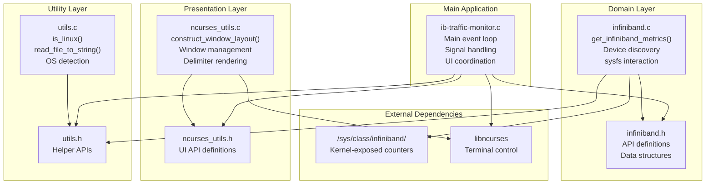
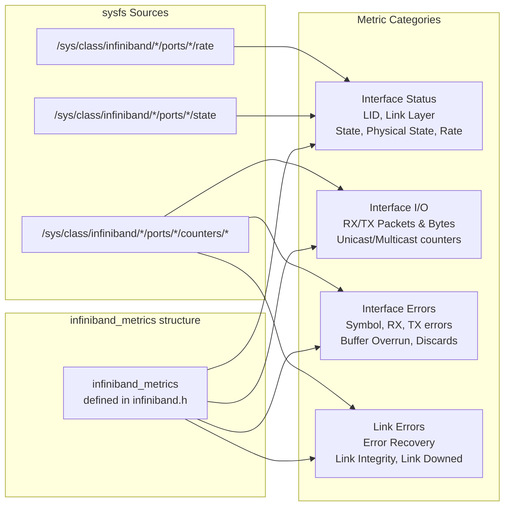
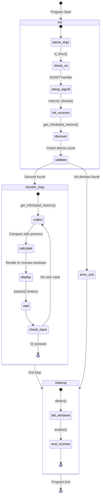

<!-- source: DeepWiki mcp.deepwiki.com · repo NVIDIA/ib-traffic-monitor · page 1 Home · fetched 2026-10-26 -->

# Home

<details>
<summary>Relevant source files</summary>

The following files were used as context for generating this wiki page:

- [README.md](README.md)
- [screenshots/ib-traffic-monitor.png](screenshots/ib-traffic-monitor.png)

</details>


## Purpose and Scope

This wiki documents the **ib-traffic-monitor** system, a command-line tool for monitoring InfiniBand and Ethernet device metrics on Linux systems. This page provides an overview of the tool's purpose, architecture, and key components. For build instructions, see [Building and Installation](#2.1). For usage details, see [Command-Line Usage](#2.2). For comprehensive metric definitions, see [Metrics Reference](#5).

**Sources:** [README.md:1-111]()

## Overview

**ib-traffic-monitor** is a C-based monitoring utility that collects and displays real-time performance metrics from InfiniBand network interface cards. The tool reads hardware counters from the Linux sysfs virtual filesystem and presents them in a terminal-based user interface powered by ncurses.

### Primary Capabilities

| Capability | Description |
|------------|-------------|
| Device Discovery | Automatically enumerates all InfiniBand devices and ports via `/sys/class/infiniband/` |
| Real-Time Monitoring | Collects and displays metrics at configurable intervals (default: 5 seconds) |
| Rate Calculation | Computes per-second rates by comparing consecutive counter snapshots |
| Link Layer Filtering | Supports filtering by InfiniBand or Ethernet link layer types |
| Non-Blocking UI | Responds to user input and signals while maintaining periodic updates |

The tool is designed for system administrators and network engineers who need to diagnose performance issues, verify link health, and monitor traffic patterns on InfiniBand networks.

**Sources:** [README.md:3-6](), [README.md:54-72]()

## System Components

The codebase is organized into four primary modules plus a main application orchestrator:



**Core Component Mapping**

| Component | Purpose | Key Functions/Structures |
|-----------|---------|--------------------------|
| `ib-traffic-monitor.c` | Main application logic, event loop | `main()`, signal handlers |
| `infiniband.c/h` | InfiniBand metrics collection | `get_infiniband_metrics()`, `infiniband_metrics` struct |
| `ncurses_utils.c/h` | TUI layout and rendering | `construct_window_layout()`, `print_delimiter()` |
| `utils.c/h` | OS detection and file I/O | `is_linux()`, `read_file_to_string()` |

**Sources:** [README.md:1-6](), Diagram 1 and Diagram 2 from high-level architecture

## Metric Categories

ib-traffic-monitor organizes collected metrics into four distinct categories, each displayed in a separate section of the terminal interface:



### Metric Category Details

| Category | Metric Count | Display Format | Data Source |
|----------|--------------|----------------|-------------|
| **Interface Status** | 5 metrics | Static values | `/sys/class/infiniband/*/ports/*/state`, `rate`, `lid` |
| **Interface I/O** | 8 metrics | Rates (per second) | `/sys/class/infiniband/*/ports/*/counters/port_*` |
| **Interface Errors** | 8 metrics | Cumulative counts | `/sys/class/infiniband/*/ports/*/counters/*_errors` |
| **Link Errors** | 3 metrics | Cumulative counts | `/sys/class/infiniband/*/ports/*/counters/link_*` |

Rate calculations for I/O metrics are performed by comparing counter deltas between consecutive sampling intervals. The first iteration displays only status metrics since rate calculation requires a previous baseline.

**Sources:** [README.md:11-41](), Diagram 5 from high-level architecture

## Architecture Overview

### Execution Flow

The application follows a predictable lifecycle from initialization through monitoring to graceful shutdown:



### Data Pipeline

The system implements a polling-based data pipeline that refreshes at user-configurable intervals:

1. **Discovery Phase** (first iteration): `get_infiniband_metrics()` scans `/sys/class/infiniband/` to enumerate devices and ports
2. **Collection Phase** (each iteration): Reads counter values from sysfs files for each active port
3. **Calculation Phase** (subsequent iterations): Computes deltas and rates by comparing current counters with previous snapshot
4. **Display Phase** (each iteration): Updates ncurses windows with formatted metric values using `construct_window_layout()`
5. **Wait Phase** (each iteration): Uses `pselect()` with refresh interval timeout while monitoring for user input

**Sources:** [README.md:54-72](), Diagram 3 and Diagram 6 from high-level architecture

## Key Design Decisions

### Single-Threaded Event Loop

The application uses a single-threaded design with non-blocking I/O. User input is handled via `pselect()` with a timeout matching the refresh interval, avoiding the complexity of multi-threading while maintaining responsiveness.

### sysfs as Data Source

Rather than using InfiniBand verbs libraries (libibverbs), the tool directly reads kernel-exposed metrics from sysfs. This approach:
- Eliminates external library dependencies beyond ncurses
- Works on any Linux system with InfiniBand kernel drivers
- Provides access to all hardware counters exposed by the kernel

### Memory Management

Device and port data is dynamically allocated during discovery. The `infiniband_metrics` structure maintains two snapshots (current and previous) to enable rate calculations without persistent storage.

**Sources:** [README.md:3-6](), [README.md:106-110](), Diagram 4 from high-level architecture

## Command-Line Interface

```
$ ./ib-traffic-monitor [-r|--refresh <seconds>] [-e|--ethernet] [-h|--help]
```

| Option | Purpose | Default |
|--------|---------|---------|
| `-r`, `--refresh` | Set refresh interval in seconds | 5 seconds |
| `-e`, `--ethernet` | Include Ethernet link layer devices | InfiniBand only |
| `-h`, `--help` | Display version and usage information | N/A |

The tool exits immediately if no compatible devices are detected. Press `Q` to quit during operation. `SIGINT` (Ctrl+C) is handled gracefully with proper ncurses cleanup.

**Sources:** [README.md:54-72]()

## Build System

The project uses a Makefile-based build system with strict compiler settings:

| Aspect | Details |
|--------|---------|
| Compiler | `gcc` |
| Warning Flags | `-Wall -Wextra -Wpedantic -Wconversion -Wdouble-promotion -Wunused -Wshadow -Wsign-conversion` |
| Sanitizers | `-fsanitize=undefined` |
| Linking | `-lncurses` |
| Output | Single executable: `ib-traffic-monitor` |

The build process compiles four object files (`ib-traffic-monitor.o`, `infiniband.o`, `utils.o`, `ncurses_utils.o`) and links them with the ncurses library. For detailed build instructions, see [Building and Installation](#2.1).

**Sources:** [README.md:43-52]()

## Getting Started

To build and run ib-traffic-monitor:

1. Ensure you have `gcc` and `ncurses-dev` (or equivalent) installed
2. Clone the repository: `https://github.com/NVIDIA/ib-traffic-monitor`
3. Build: `make`
4. Run: `./ib-traffic-monitor`

For detailed setup instructions, see [Getting Started](#2). For architecture details, see [Architecture](#3). For component documentation, see [Core Components](#4).

**Sources:** [README.md:43-72]()

## Version History

The current version is **1.3.3** (as of September 2025). Key milestones include:

- **1.0.0** (March 2025): Initial release
- **1.1.0** (March 2025): Added Ethernet link layer support (`-e` flag)
- **1.2.0** (May 2025): Optimized non-blocking quit mechanism
- **1.3.0** (May 2025): SIGINT graceful handling
- **1.3.3** (September 2025): Fixed variable shadowing issues

**Sources:** [README.md:74-90]()

## External Resources

- **Linux Kernel Documentation**: [sysfs-class-infiniband](https://www.kernel.org/doc/Documentation/ABI/stable/sysfs-class-infiniband)
- **NVIDIA Reference**: [Understanding mlx5 Linux Counters and Status Parameters](https://enterprise-support.nvidia.com/s/article/understanding-mlx5-linux-counters-and-status-parameters)
- **Use Case**: Demonstrated at SC25 by GNA-G Community for monitoring production InfiniBand links during multi-site data transfers

**Sources:** [README.md:92-110]()

---

