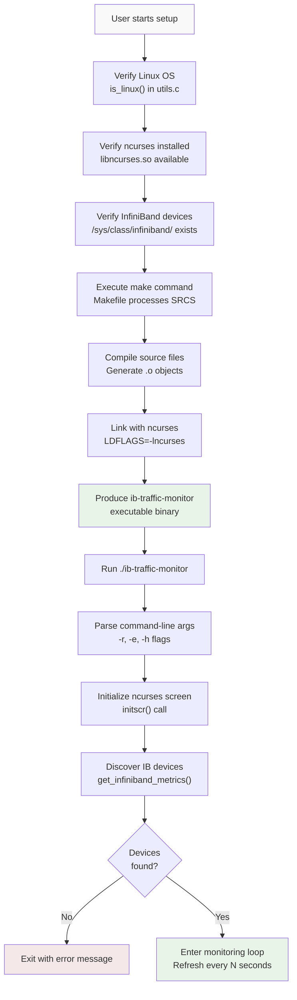
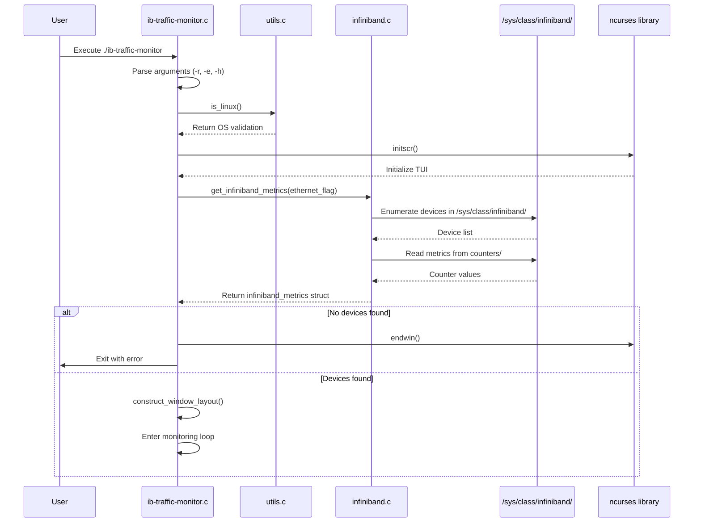
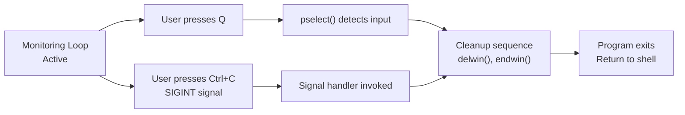

<!-- source: DeepWiki mcp.deepwiki.com · repo NVIDIA/ib-traffic-monitor · page 2 Getting Started · fetched 2026-10-26 -->

# Getting Started

<details>
<summary>Relevant source files</summary>

The following files were used as context for generating this wiki page:

- [Makefile](Makefile)
- [README.md](README.md)

</details>


This page provides a quick-start guide for building and running `ib-traffic-monitor` for the first time. It covers system prerequisites, basic compilation, and initial execution. For detailed information about build configuration and compiler flags, see [Building and Installation](#2.1). For comprehensive command-line options and usage patterns, see [Command-Line Usage](#2.2).

## Prerequisites

Before building `ib-traffic-monitor`, ensure your system meets the following requirements:

| Requirement | Description | Verification |
|-------------|-------------|--------------|
| Operating System | Linux kernel with sysfs support | `uname -s` should return "Linux" |
| Compiler | GCC with C11 support | `gcc --version` |
| ncurses Library | Development headers and library | Check for `/usr/include/ncurses.h` or install `libncurses-dev` |
| InfiniBand Hardware | At least one InfiniBand or Ethernet device exposed via sysfs | Check `/sys/class/infiniband/` directory exists |

The tool reads InfiniBand metrics from the Linux sysfs virtual filesystem at `/sys/class/infiniband/`. Without accessible InfiniBand devices, the program will detect no devices and exit with an error message.

**Sources:** [README.md:5-5](), [README.md:58-58]()

## Quick Start

### Step 1: Clone and Navigate to Repository

```bash
git clone https://github.com/NVIDIA/ib-traffic-monitor
cd ib-traffic-monitor
```

### Step 2: Build the Executable

```bash
make
```

This compiles all source files ([ib-traffic-monitor.c](), [infiniband.c](), [utils.c](), [ncurses_utils.c]()) and links them with the ncurses library to produce the `ib-traffic-monitor` executable.

**Sources:** [README.md:43-52](), [Makefile:16-29]()

### Step 3: Run the Monitor

```bash
./ib-traffic-monitor
```

The program launches an ncurses-based terminal UI that refreshes every 5 seconds by default.

**Sources:** [README.md:56-56]()

## Setup and Execution Flow

The following diagram illustrates the complete process from prerequisites through runtime execution:



**Sources:** [README.md:43-66](), [Makefile:19-29]()

## First Run Experience

When you first execute `ib-traffic-monitor`, the program performs the following sequence:

### Initialization Phase



**Sources:** [README.md:56-58]()

### Display Layout

On successful initialization, the screen displays four metric sections:

| Section | Purpose | Update Frequency |
|---------|---------|------------------|
| Interface Status | Shows LID, link layer type, state, physical state, and rate | Static (on state change) |
| Interface I/O | Displays packet/second and MB/second for RX/TX including unicast/multicast | Every refresh interval |
| Interface Errors | Reports error counters for symbol errors, buffer overruns, discards | Cumulative counts |
| Interface Link Errors | Shows link recovery, link downed, and integrity error counts | Cumulative counts |

The default refresh interval is 5 seconds. During the first iteration, only static metrics appear because rate calculations require data from a previous collection cycle.

**Sources:** [README.md:11-41]()

## Basic Usage Patterns

### Default Behavior

```bash
./ib-traffic-monitor
```

- Monitors InfiniBand link layer devices only
- Refreshes display every 5 seconds
- Continues until user presses 'Q' or sends SIGINT (Ctrl+C)

### Custom Refresh Interval

```bash
./ib-traffic-monitor -r 10
```

Sets refresh interval to 10 seconds instead of the default 5 seconds.

### Include Ethernet Devices

```bash
./ib-traffic-monitor -e
```

By default, only InfiniBand link layer devices are shown. The `-e` flag includes Ethernet link layer type devices.

### Display Help

```bash
./ib-traffic-monitor -h
```

Shows version information and usage syntax.

**Sources:** [README.md:54-72]()

## Troubleshooting Common Issues

### No Devices Found

**Symptom:** Program exits immediately with error message "cannot detect any valid InfiniBand device"

**Causes and Solutions:**

| Cause | Verification | Solution |
|-------|--------------|----------|
| No InfiniBand hardware | `ls /sys/class/infiniband/` is empty | Install InfiniBand adapter or use system with IB hardware |
| InfiniBand drivers not loaded | `lsmod \| grep ib` shows no modules | Load appropriate kernel modules (e.g., `mlx5_ib`) |
| Only Ethernet devices present | Devices exist but link layer is Ethernet | Run with `-e` flag: `./ib-traffic-monitor -e` |
| Insufficient permissions | Cannot read sysfs files | Run as root or ensure user has sysfs read permissions |

**Sources:** [README.md:58-58](), [README.md:70-70]()

### Build Failures

**Symptom:** Compilation errors during `make`

**Common Issues:**

| Error Pattern | Cause | Solution |
|---------------|-------|----------|
| `ncurses.h: No such file` | ncurses development headers missing | Install `libncurses-dev` (Debian/Ubuntu) or `ncurses-devel` (RHEL/CentOS) |
| `undefined reference to 'initscr'` | ncurses library not linked | Verify `LDFLAGS = -lncurses` in [Makefile:22]() |
| Compiler warnings treated as errors | Strict compiler flags | Flags include `-Wall -Wextra -Wpedantic` per [Makefile:17]() |

**Sources:** [Makefile:17-22]()

### Terminal Display Issues

**Symptom:** Garbled output or incorrect formatting

**Solutions:**
- Ensure terminal supports ncurses (most modern terminals do)
- Verify terminal size is sufficient for the display layout
- Check `TERM` environment variable is set correctly (e.g., `export TERM=xterm-256color`)

## Exit and Cleanup

To exit the monitor, press `Q` or send SIGINT (Ctrl+C). The program handles both methods gracefully:



The cleanup sequence ensures ncurses windows are properly deallocated and the terminal is restored to its original state.

**Sources:** [README.md:82-83]()

## Next Steps

After successfully running `ib-traffic-monitor` for the first time:

- For detailed build configuration, compiler flags, and installation options, see [Building and Installation](#2.1)
- For comprehensive command-line options and usage patterns, see [Command-Line Usage](#2.2)
- To understand the system architecture and design, see [Architecture](#3)
- For detailed metric definitions and interpretations, see [Metrics Reference](#5)

---

