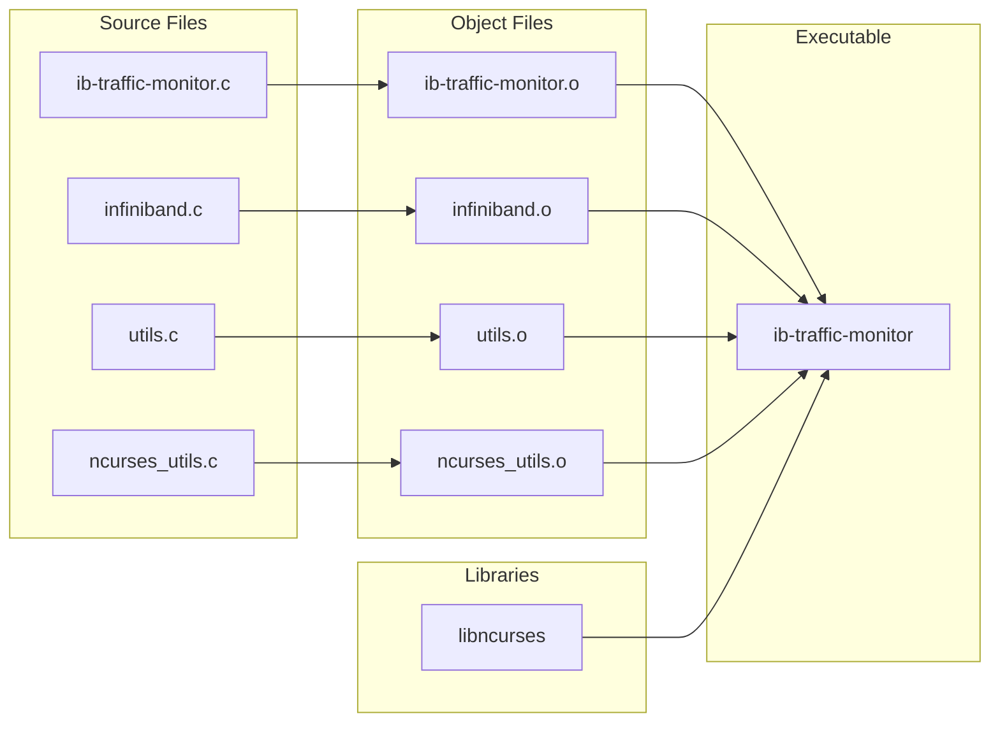
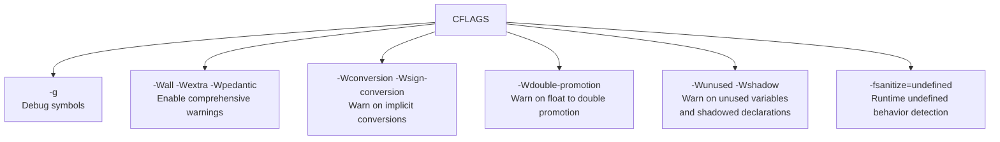
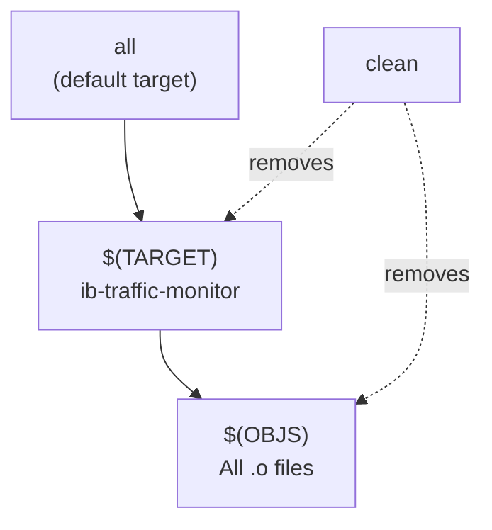
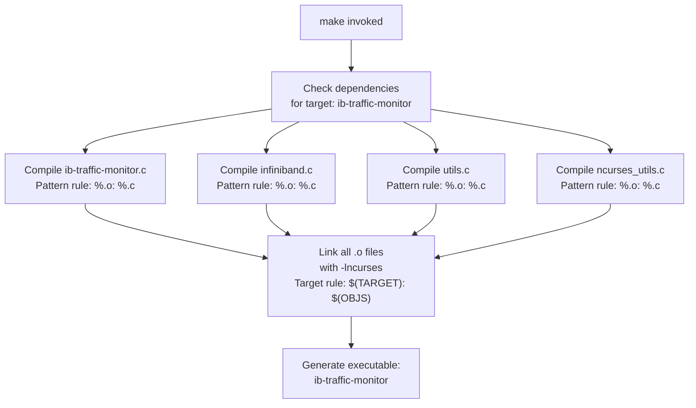

<!-- source: DeepWiki mcp.deepwiki.com · repo NVIDIA/ib-traffic-monitor · page 2.1 Building and Installation · fetched 2026-10-26 -->

# Building and Installation

<details>
<summary>Relevant source files</summary>

The following files were used as context for generating this wiki page:

- [Makefile](Makefile)
- [README.md](README.md)

</details>


This page provides detailed instructions for building and installing `ib-traffic-monitor` from source. It covers prerequisite software, the compilation process, compiler flags, and post-build verification steps.

For information about running the compiled executable and command-line options, see [Command-Line Usage](#2.2). For details about the build system implementation, see [Build System](#6).

---

## Prerequisites

### Operating System Requirements

`ib-traffic-monitor` is designed exclusively for Linux systems. The application requires access to the Linux sysfs virtual filesystem at `/sys/class/infiniband/` to read InfiniBand device metrics.

The operating system check is performed at runtime by the `is_linux()` function in [utils.c:24-31](), which verifies the system is running on Linux before proceeding with device discovery.

| Requirement | Description |
|-------------|-------------|
| **Operating System** | Linux (any distribution) |
| **sysfs Access** | Read access to `/sys/class/infiniband/` |
| **Terminal** | Terminal supporting ncurses |

### Build Tools

The build process requires a C compiler and the Make build automation tool.

| Tool | Version | Purpose |
|------|---------|---------|
| **gcc** | Any modern version | C compiler used by [Makefile:16]() |
| **make** | GNU Make or compatible | Build automation |

### Runtime Dependencies

The application links against the ncurses library for terminal user interface functionality.

| Library | Package Name (Debian/Ubuntu) | Package Name (RHEL/Fedora) |
|---------|------------------------------|----------------------------|
| **ncurses** | `libncurses-dev` | `ncurses-devel` |

**Sources:** [README.md:1-111](), [Makefile:16-22](), [utils.c:24-31]()

---

## Build Process Overview

The build system compiles four source files into object files, then links them with the ncurses library to produce a single executable.



**Build Process: Source to Executable Transformation**

**Sources:** [Makefile:16-35](), [README.md:43-52]()

---

## Compilation Details

### Compiler Flags

The [Makefile:17]() defines extensive compiler flags to ensure code quality and catch potential issues:



**Compiler Flags Configuration**

| Flag | Purpose |
|------|---------|
| `-g` | Include debug symbols for debugging with gdb or similar tools |
| `-Wall -Wextra -Wpedantic` | Enable comprehensive warning sets |
| `-Wconversion` | Warn on implicit type conversions that may alter values |
| `-Wdouble-promotion` | Warn when float is implicitly promoted to double |
| `-Wunused` | Warn on unused variables, functions, and parameters |
| `-Wshadow` | Warn when local variable shadows another variable |
| `-Wsign-conversion` | Warn on conversions between signed and unsigned types |
| `-fsanitize=undefined` | Enable runtime checks for undefined behavior |

The undefined behavior sanitizer (`-fsanitize=undefined`) adds runtime instrumentation to detect issues such as:
- Integer overflow
- Division by zero
- Null pointer dereference
- Out-of-bounds array access

**Sources:** [Makefile:17](), [README.md:47-51]()

### Linking

The linker stage combines all object files with the ncurses library using the `-lncurses` flag specified in [Makefile:22]().

**Sources:** [Makefile:22](), [Makefile:28-29]()

---

## Building from Source

### Step 1: Obtain Source Code

Clone the repository or extract the source archive:

```bash
git clone https://github.com/NVIDIA/ib-traffic-monitor
cd ib-traffic-monitor
```

### Step 2: Compile

Execute the default `make` target to build the executable:

```bash
make
```

The build system will compile each source file and link the result. The compilation output shows the exact commands executed:

```
gcc -g -Wall -Wextra -Wpedantic -Wconversion -Wdouble-promotion -Wunused -Wshadow -Wsign-conversion -fsanitize=undefined -I. -c -o ib-traffic-monitor.o ib-traffic-monitor.c
gcc -g -Wall -Wextra -Wpedantic -Wconversion -Wdouble-promotion -Wunused -Wshadow -Wsign-conversion -fsanitize=undefined -I. -c -o infiniband.o infiniband.c
gcc -g -Wall -Wextra -Wpedantic -Wconversion -Wdouble-promotion -Wunused -Wshadow -Wsign-conversion -fsanitize=undefined -I. -c -o utils.o utils.c
gcc -g -Wall -Wextra -Wpedantic -Wconversion -Wdouble-promotion -Wunused -Wshadow -Wsign-conversion -fsanitize=undefined -I. -c -o ncurses_utils.o ncurses_utils.c
gcc -g -Wall -Wextra -Wpedantic -Wconversion -Wdouble-promotion -Wunused -Wshadow -Wsign-conversion -fsanitize=undefined -I. -o ib-traffic-monitor ib-traffic-monitor.o infiniband.o utils.o ncurses_utils.o -lncurses
```

### Step 3: Clean Build (Optional)

To remove all build artifacts and rebuild from scratch:

```bash
make clean
make
```

The `clean` target defined in [Makefile:34-35]() removes all object files and the executable.

**Sources:** [README.md:43-52](), [Makefile:24-35]()

---

## Build Targets

The Makefile defines the following phony targets:



**Makefile Targets**

| Target | Description | Command |
|--------|-------------|---------|
| `all` | Default target; builds the executable | `make` or `make all` |
| `$(TARGET)` | Builds `ib-traffic-monitor` executable | `make ib-traffic-monitor` |
| `clean` | Removes all object files and executable | `make clean` |

**Sources:** [Makefile:24-35]()

---

## Compilation Flow

The following diagram shows how the Makefile coordinates the build process:



**Compilation Workflow**

Each source file is compiled independently using the pattern rule defined in [Makefile:31-32](). The compilation uses `$(CFLAGS)` and `$(INCLUDES)` variables. After all object files are generated, the target rule [Makefile:28-29]() links them with `$(LDFLAGS)` to produce the final executable.

**Sources:** [Makefile:16-35]()

---

## Installation

The Makefile does not include an installation target. To use the executable:

1. **Run in place:** Execute the program from the build directory:
   ```bash
   ./ib-traffic-monitor
   ```

2. **Manual installation:** Copy the executable to a system directory:
   ```bash
   sudo cp ib-traffic-monitor /usr/local/bin/
   ```

3. **Local user installation:** Copy to a user binary directory:
   ```bash
   mkdir -p ~/bin
   cp ib-traffic-monitor ~/bin/
   # Ensure ~/bin is in PATH
   ```

**Sources:** [README.md:54-59](), [Makefile:1-35]()

---

## Build Verification

### Verify Build Success

After compilation, verify the executable exists and has correct permissions:

```bash
ls -lh ib-traffic-monitor
```

Expected output:
```
-rwxr-xr-x 1 user group 123K Jan 1 12:00 ib-traffic-monitor
```

### Test Execution

Run the executable with the help flag to verify it executes correctly:

```bash
./ib-traffic-monitor -h
```

Expected output:
```
InfiniBand Traffic Monitor - Version 1.3.3
usage: ib-traffic-monitor [-r|--refresh <second(s)>]
                          [-e|--ethernet]
                          [-h|--help]
```

If the system is not running Linux, the program will exit with an error message before initializing ncurses, as verified by [utils.c:24-31]().

### Verify Runtime Dependencies

Use `ldd` to confirm the executable is properly linked against ncurses:

```bash
ldd ib-traffic-monitor | grep ncurses
```

Expected output:
```
libncurses.so.6 => /lib/x86_64-linux-gnu/libncurses.so.6 (0x00007f...)
```

**Sources:** [README.md:54-72](), [utils.c:24-31]()

---

## Troubleshooting

### Missing ncurses Library

**Error:**
```
fatal error: ncurses.h: No such file or directory
```

**Solution:** Install the ncurses development package:
```bash
# Debian/Ubuntu
sudo apt-get install libncurses-dev

# RHEL/Fedora/CentOS
sudo yum install ncurses-devel
```

### Linker Error: ncurses Not Found

**Error:**
```
/usr/bin/ld: cannot find -lncurses
```

**Solution:** Ensure the ncurses library is installed:
```bash
# Debian/Ubuntu
sudo apt-get install libncurses6

# RHEL/Fedora/CentOS
sudo yum install ncurses
```

### Compilation Warnings

The extensive compiler flags may produce warnings for strict code quality checks. All warnings should be addressed before merging code changes.

**Sources:** [Makefile:17](), [Makefile:22]()

---

## Build Artifacts

After a successful build, the following files are created:

| File | Type | Purpose |
|------|------|---------|
| `ib-traffic-monitor.o` | Object file | Compiled main application code |
| `infiniband.o` | Object file | Compiled InfiniBand metrics module |
| `utils.o` | Object file | Compiled utility functions |
| `ncurses_utils.o` | Object file | Compiled ncurses utilities |
| `ib-traffic-monitor` | Executable | Final linked executable |

These artifacts are removed by the `make clean` command as defined in [Makefile:34-35]().

**Sources:** [Makefile:19-21](), [Makefile:34-35]()

---

