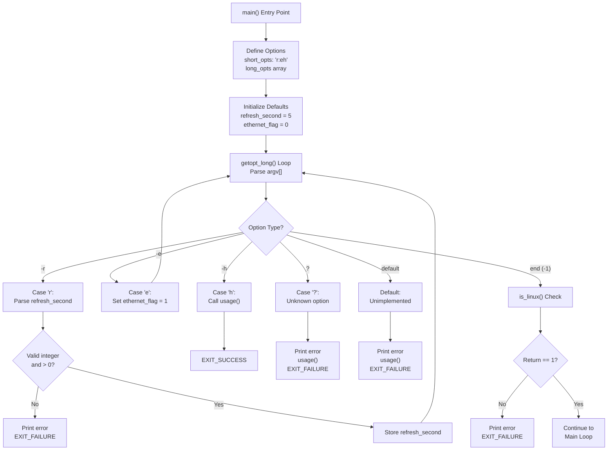
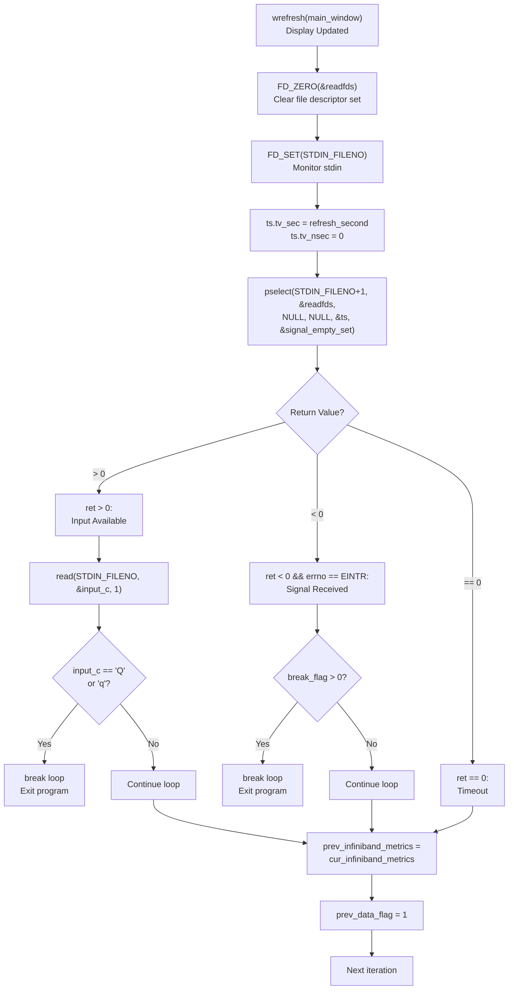
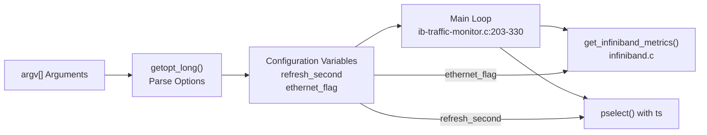

<!-- source: DeepWiki mcp.deepwiki.com · repo NVIDIA/ib-traffic-monitor · page 2.2 Command-Line Usage · fetched 2026-10-26 -->

# Command-Line Usage

<details>
<summary>Relevant source files</summary>

The following files were used as context for generating this wiki page:

- [README.md](README.md)
- [ib-traffic-monitor.c](ib-traffic-monitor.c)

</details>


This document explains all command-line arguments, options, and usage patterns for the `ib-traffic-monitor` executable. It covers how to invoke the tool, configure its behavior through command-line flags, and interact with it during execution. For information about building the executable, see [Building and Installation](#2.1). For details about the metrics displayed, see [Metrics Reference](#5).

---

## Overview

The `ib-traffic-monitor` tool is a command-line utility that monitors InfiniBand device metrics in real-time. It accepts optional arguments to customize the refresh interval and device filtering behavior. The tool operates in an interactive terminal user interface (TUI) mode using ncurses and exits gracefully when the user presses 'Q' or sends a SIGINT signal (Ctrl+C).

**Sources:** [README.md:54-73](), [ib-traffic-monitor.c:52-118]()

---

## Basic Invocation

The simplest way to run `ib-traffic-monitor` is without any arguments:

```bash
./ib-traffic-monitor
```

This launches the tool with default settings:
- **Refresh interval:** 5 seconds
- **Device filter:** InfiniBand link layer only (excludes Ethernet devices)

The tool will immediately discover available InfiniBand devices and display their metrics in a four-section layout. If no valid InfiniBand devices are detected, the program exits with an error message.

**Sources:** [README.md:56-59](), [ib-traffic-monitor.c:62-66]()

---

## Command-Line Options

The `ib-traffic-monitor` executable supports three command-line options, each available in both short and long form:

| Short Form | Long Form | Argument | Description | Default |
|------------|-----------|----------|-------------|---------|
| `-r` | `--refresh` | `<second(s)>` | Specifies the refresh period in seconds. Must be a positive integer. | 5 |
| `-e` | `--ethernet` | None | Includes Ethernet link layer type devices in the display. | Disabled (InfiniBand only) |
| `-h` | `--help` | None | Displays help message with version and usage information, then exits. | N/A |

### Option Details

#### Refresh Interval (`-r`, `--refresh`)

Controls how frequently the tool collects and updates metrics. The value must be a positive integer representing seconds.

```bash
./ib-traffic-monitor -r 10
./ib-traffic-monitor --refresh 10
```

The implementation validates that:
- The value can be converted to a long integer ([ib-traffic-monitor.c:82-88]())
- The value is greater than zero ([ib-traffic-monitor.c:90-94]())

Invalid values result in program termination with an error message and usage display.

#### Ethernet Flag (`-e`, `--ethernet`)

By default, `ib-traffic-monitor` only displays devices with InfiniBand link layer type. This flag enables display of Ethernet link layer devices as well.

```bash
./ib-traffic-monitor -e
./ib-traffic-monitor --ethernet
```

This flag sets the `ethernet_flag` variable to 1, which is passed to the `get_infiniband_metrics()` function to control device filtering ([ib-traffic-monitor.c:98](), [ib-traffic-monitor.c:221]()).

#### Help (`-h`, `--help`)

Displays the usage message and exits immediately with `EXIT_SUCCESS`.

```bash
./ib-traffic-monitor -h
./ib-traffic-monitor --help
```

The output format is defined in the `usage()` function and includes the version string:

```
InfiniBand Traffic Monitor - Version 1.3.3
usage: ib-traffic-monitor [-r|--refresh <second(s)>]
                          [-e|--ethernet]
                          [-h|--help]
```

**Sources:** [README.md:61-72](), [ib-traffic-monitor.c:53-112](), [ib-traffic-monitor.c:35-42]()

---

## Option Parsing Flow

The following diagram shows how command-line arguments are parsed and validated:



**Diagram: Command-Line Argument Processing Pipeline**

**Sources:** [ib-traffic-monitor.c:53-118]()

---

## Operating System Validation

Before proceeding to device discovery, `ib-traffic-monitor` verifies it is running on a Linux operating system by calling `is_linux()` from the utils module. This check is mandatory because the tool relies on Linux-specific sysfs interfaces for InfiniBand metrics.

If the check fails, the program prints an error message and exits:

```
ERROR: InfiniBand Traffic Monitor can be only running on Linux operating system
```

**Sources:** [ib-traffic-monitor.c:114-118](), [README.md:5]()

---

## Exit Conditions and Codes

The `ib-traffic-monitor` executable exits under the following conditions:

### Successful Exit (`EXIT_SUCCESS`)

- Help flag (`-h` or `--help`) is used ([ib-traffic-monitor.c:100-102]())
- User presses 'Q' or 'q' during execution ([ib-traffic-monitor.c:310-315]())
- SIGINT signal (Ctrl+C) is received and handled gracefully ([ib-traffic-monitor.c:318-322]())
- Normal program completion without errors

### Failure Exit (`EXIT_FAILURE`)

| Condition | Error Message | Code Reference |
|-----------|--------------|----------------|
| Invalid refresh value (non-integer) | `ERROR: failed to convert refresh second value` | [ib-traffic-monitor.c:85-88]() |
| Refresh value ≤ 0 | `ERROR: refresh second must be an integer and greater than 0` | [ib-traffic-monitor.c:90-94]() |
| Unknown command-line option | `ERROR: Unknown option` | [ib-traffic-monitor.c:103-106]() |
| Unimplemented option | `ERROR: Unimplemented option` | [ib-traffic-monitor.c:107-111]() |
| Not running on Linux | `ERROR: InfiniBand Traffic Monitor can be only running on Linux operating system` | [ib-traffic-monitor.c:116-117]() |
| Signal handling initialization fails | Various signal-related error messages | [ib-traffic-monitor.c:141-175]() |
| ncurses window creation fails | `ERROR: failed to create ncurses window` | [ib-traffic-monitor.c:193-197]() |
| Unable to retrieve metrics | `ERROR: unable to retrieve InfiniBand metrics` | [ib-traffic-monitor.c:223-226]() |
| No InfiniBand devices found | `ERROR: no InfiniBand device found` | [ib-traffic-monitor.c:229-232]() |

**Sources:** [ib-traffic-monitor.c:66](), [ib-traffic-monitor.c:80-118](), [ib-traffic-monitor.c:337-341]()

---

## Interactive User Input

Once the TUI is running, `ib-traffic-monitor` accepts the following user inputs:

### Quit Commands

The program supports two methods to exit gracefully:

1. **Keyboard Input:** Pressing 'Q' or 'q' ([ib-traffic-monitor.c:312-314]())
2. **Signal:** Sending SIGINT (Ctrl+C) ([ib-traffic-monitor.c:318-322]())

Both methods trigger the same cleanup sequence, ensuring proper ncurses termination before exit.

### Input Handling Mechanism

The tool uses a non-blocking input mechanism combined with `pselect()` for efficient event handling:



**Diagram: User Input and Event Handling Loop**

The `pselect()` call blocks for `refresh_second` duration with the empty signal set (`signal_empty_set`), allowing SIGINT to interrupt the wait. This enables responsive signal handling without busy-waiting.

**Sources:** [ib-traffic-monitor.c:199-201](), [ib-traffic-monitor.c:299-330]()

---

## Signal Handling Configuration

The tool configures POSIX signal handling to ensure graceful shutdown:

| Signal Construct | Purpose | Code Reference |
|------------------|---------|----------------|
| `signal_empty_set` | Empty signal set for pselect() | [ib-traffic-monitor.c:138](), [ib-traffic-monitor.c:141-144]() |
| `signal_block_set` | Block SIGINT during initialization | [ib-traffic-monitor.c:139](), [ib-traffic-monitor.c:146-149]() |
| `sigint_handler()` | Sets `break_flag` to 1 | [ib-traffic-monitor.c:45-50]() |
| `break_flag` | `volatile sig_atomic_t` flag for loop termination | [ib-traffic-monitor.c:45]() |
| `sa` | `struct sigaction` for SIGINT handler | [ib-traffic-monitor.c:137](), [ib-traffic-monitor.c:164-175]() |

The SIGINT signal is blocked during program initialization ([ib-traffic-monitor.c:152-161]()) and only unblocked during the `pselect()` call, ensuring atomic signal handling without race conditions.

**Sources:** [ib-traffic-monitor.c:45-50](), [ib-traffic-monitor.c:136-175](), [ib-traffic-monitor.c:307](), [ib-traffic-monitor.c:318-322]()

---

## Usage Examples

### Example 1: Default Behavior

Monitor InfiniBand devices with 5-second refresh:

```bash
./ib-traffic-monitor
```

**Expected behavior:** Displays all InfiniBand link layer devices, updates every 5 seconds.

### Example 2: Custom Refresh Interval

Monitor with 2-second refresh:

```bash
./ib-traffic-monitor -r 2
```

**Expected behavior:** More frequent updates, higher CPU usage.

### Example 3: Include Ethernet Devices

Monitor both InfiniBand and Ethernet devices:

```bash
./ib-traffic-monitor -e
```

**Expected behavior:** Additional interfaces with `Link Layer: Ethernet` are displayed.

### Example 4: Combined Options

Custom refresh with Ethernet devices:

```bash
./ib-traffic-monitor --refresh 10 --ethernet
```

**Expected behavior:** Displays all device types, refreshes every 10 seconds.

### Example 5: Display Help

```bash
./ib-traffic-monitor -h
```

**Output:**
```
InfiniBand Traffic Monitor - Version 1.3.3
usage: ib-traffic-monitor [-r|--refresh <second(s)>]
                          [-e|--ethernet]
                          [-h|--help]
```

**Sources:** [README.md:54-72]()

---

## Relationship to Other Components

The command-line parsing is the entry point that configures the entire monitoring system:



**Diagram: Command-Line Configuration Flow to Core Components**

- The `refresh_second` variable controls the timeout in `pselect()` ([ib-traffic-monitor.c:304-305]())
- The `ethernet_flag` variable is passed to `get_infiniband_metrics()` to filter devices ([ib-traffic-monitor.c:221]())

**Sources:** [ib-traffic-monitor.c:62-66](), [ib-traffic-monitor.c:203-330]()

---

