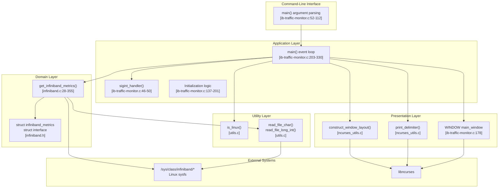
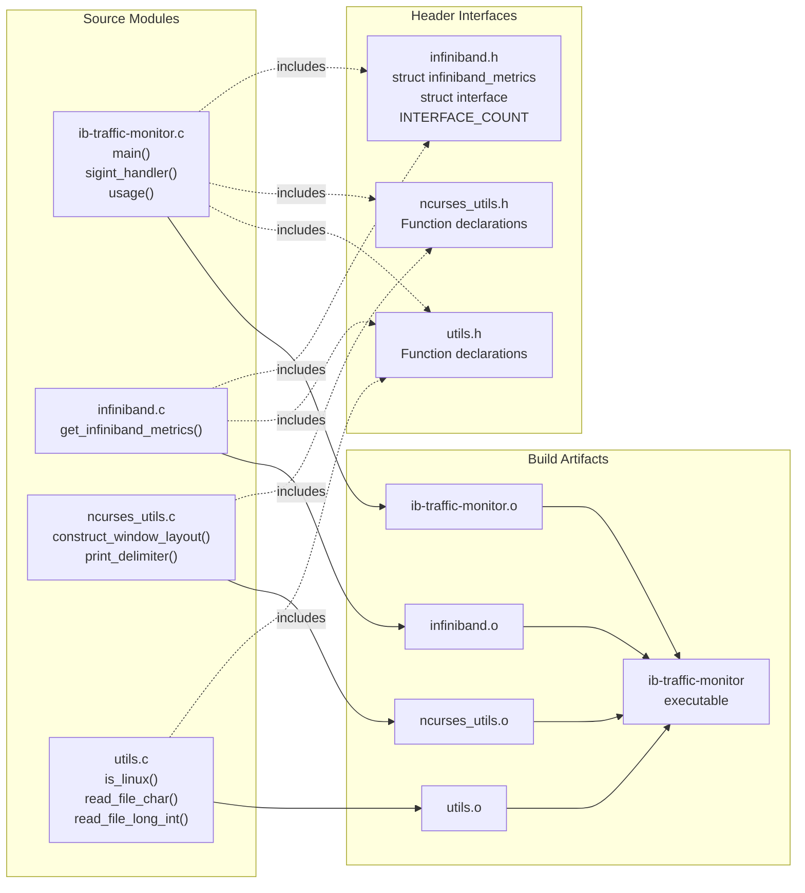
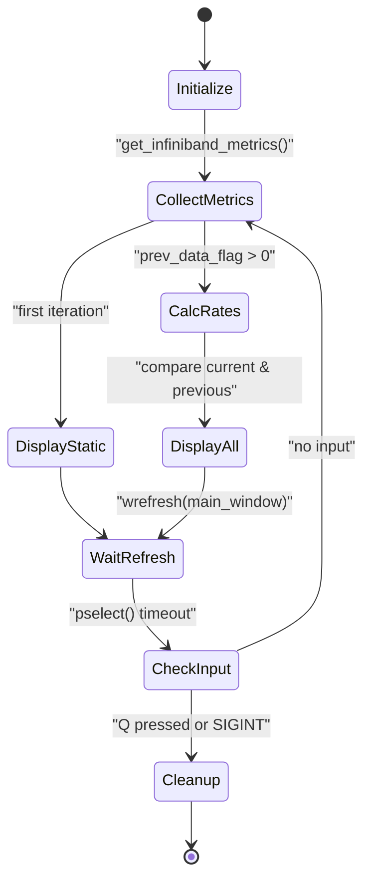
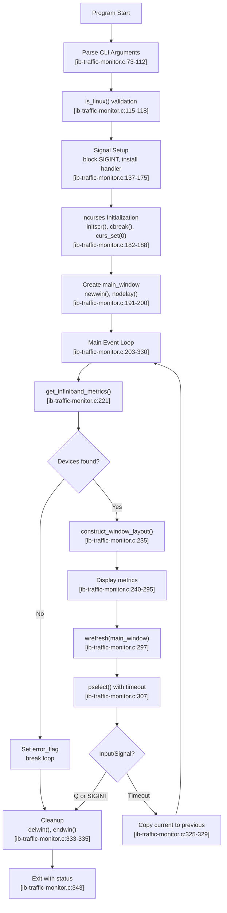

<!-- source: DeepWiki mcp.deepwiki.com · repo NVIDIA/ib-traffic-monitor · page 3 Architecture · fetched 2026-10-26 -->

# Architecture

<details>
<summary>Relevant source files</summary>

The following files were used as context for generating this wiki page:

- [README.md](README.md)
- [ib-traffic-monitor.c](ib-traffic-monitor.c)
- [infiniband.c](infiniband.c)

</details>


This document describes the high-level architecture of `ib-traffic-monitor`, including its component organization, layering strategy, design patterns, and execution model. For detailed information about individual modules and their implementations, see [Core Components](#4). For specifics on how data flows through the system from hardware to display, see [Data Flow](#3.2).

## Overview

`ib-traffic-monitor` follows a **layered architecture** pattern with clear separation between application orchestration, domain logic, presentation, and utilities. The application is a single-threaded, polling-based monitoring tool that reads InfiniBand metrics from the Linux sysfs filesystem and displays them in a terminal UI using ncurses.

The system consists of four source modules compiled into a single executable:

| Module | Purpose | Primary Files |
|--------|---------|---------------|
| Application Layer | Event loop, initialization, signal handling | `ib-traffic-monitor.c` |
| Domain Layer | InfiniBand device discovery and metrics collection | `infiniband.c`, `infiniband.h` |
| Presentation Layer | Terminal UI layout and rendering | `ncurses_utils.c`, `ncurses_utils.h` |
| Utility Layer | OS detection and file I/O helpers | `utils.c`, `utils.h` |

**Sources:** [README.md:1-111](), [ib-traffic-monitor.c:1-345]()

## Layered Architecture



**Layering Principles:**

- **Application Layer** (`ib-traffic-monitor.c`) orchestrates the entire program lifecycle, including initialization, event loop management, signal handling, and cleanup. It depends on all other internal layers.
- **Domain Layer** (`infiniband.c`, `infiniband.h`) encapsulates InfiniBand-specific knowledge, including device discovery, port enumeration, and metric reading. It depends only on the utility layer.
- **Presentation Layer** (`ncurses_utils.c`, `ncurses_utils.h`) handles terminal UI concerns, including window layout construction and delimiter printing. It depends only on ncurses.
- **Utility Layer** (`utils.c`, `utils.h`) provides reusable, domain-agnostic helpers. It has no internal dependencies.

**Sources:** [ib-traffic-monitor.c:1-345](), [infiniband.c:1-355](), [infiniband.h]()

## Component Organization



**Dependency Rules:**

- No circular dependencies exist between modules
- The main application (`ib-traffic-monitor.c`) is the only module that includes all three subsystem headers
- Domain logic (`infiniband.c`) depends only on utilities, ensuring reusability
- Presentation logic (`ncurses_utils.c`) is self-contained except for ncurses library

**Sources:** [Makefile](), [README.md:43-52]()

## Key Design Patterns

### Polling Architecture

The application uses a **polling model** with configurable refresh intervals. The main event loop at [ib-traffic-monitor.c:203-330]() repeatedly:

1. Collects current metrics via `get_infiniband_metrics()`
2. Calculates rates by comparing with previous iteration's data
3. Renders metrics to the ncurses window
4. Blocks for the refresh interval using `pselect()`



The refresh interval defaults to 5 seconds but can be configured via the `-r` command-line flag [ib-traffic-monitor.c:81-95]().

**Sources:** [ib-traffic-monitor.c:203-330](), [ib-traffic-monitor.c:62]()

### Data Structure Lifecycle

The application maintains two instances of `struct infiniband_metrics`:

- `cur_infiniband_metrics`: Current iteration's metrics [ib-traffic-monitor.c:121]()
- `prev_infiniband_metrics`: Previous iteration's metrics [ib-traffic-monitor.c:122]()

At the end of each loop iteration, current metrics are copied to previous [ib-traffic-monitor.c:325-326](), enabling delta calculations for rate-based metrics (packets/second, MB/second). A flag `prev_data_flag` tracks whether previous data exists [ib-traffic-monitor.c:131]().

**Sources:** [ib-traffic-monitor.c:121-122](), [ib-traffic-monitor.c:325-329]()

### Interface Matching Strategy

Since InfiniBand interfaces can be added or removed between iterations, the application matches interfaces by name. For rate calculations, it performs a nested loop [ib-traffic-monitor.c:274-293]():

```c
for (int i = 0; i < ret_get_infiniband_metrics; ++i) {
    for (int j = 0; j < prev_ret_get_infiniband_metrics; ++j) {
        if (strcmp(cur_infiniband_metrics.infiniband[i].interface_name,
                   prev_infiniband_metrics.infiniband[j].interface_name) == 0) {
            // Calculate and display rates
        }
    }
}
```

This ensures rate metrics are only displayed for interfaces present in both iterations.

**Sources:** [ib-traffic-monitor.c:272-295]()

## Execution Model



### Signal Handling

The application handles SIGINT (Ctrl+C) gracefully using a combination of signal masking and `pselect()`:

1. SIGINT is blocked during normal operation [ib-traffic-monitor.c:158-161]()
2. A signal handler sets `break_flag` when SIGINT arrives [ib-traffic-monitor.c:46-50]()
3. `pselect()` atomically unblocks SIGINT during sleep [ib-traffic-monitor.c:307]()
4. After `pselect()` returns with EINTR, the main loop checks `break_flag` and exits [ib-traffic-monitor.c:318-322]()

This ensures clean ncurses cleanup occurs even when interrupted.

**Sources:** [ib-traffic-monitor.c:137-175](), [ib-traffic-monitor.c:307](), [ib-traffic-monitor.c:318-322]()

### Non-Blocking Input

User input ('Q' to quit) is handled non-blockingly:

1. `nodelay(main_window, TRUE)` enables non-blocking reads [ib-traffic-monitor.c:200]()
2. `pselect()` monitors stdin with a timeout [ib-traffic-monitor.c:307]()
3. If input is available, a single character is read and checked [ib-traffic-monitor.c:310-314]()

This allows the application to respond immediately to user input without polling.

**Sources:** [ib-traffic-monitor.c:200](), [ib-traffic-monitor.c:299-315]()

## External Dependencies

### Linux sysfs

The application reads metrics from `/sys/class/infiniband/` and its subdirectories:

| Path Pattern | Content |
|--------------|---------|
| `/sys/class/infiniband/` | Device discovery |
| `/sys/class/infiniband/{device}/ports/` | Port enumeration |
| `/sys/class/infiniband/{device}/ports/{port}/` | Port status (state, phys_state, rate, lid, link_layer) |
| `/sys/class/infiniband/{device}/ports/{port}/counters/` | Counter metrics |

The application validates sysfs accessibility using `opendir()` [infiniband.c:45-49]() and gracefully handles missing files.

**Sources:** [infiniband.c:28-355](), [README.md:108]()

### ncurses Library

The application links against `libncurses` [README.md:51]() and uses these primary functions:

| Function | Purpose | Usage |
|----------|---------|-------|
| `initscr()` | Initialize ncurses | [ib-traffic-monitor.c:182]() |
| `newwin()` | Create window | [ib-traffic-monitor.c:191]() |
| `mvwprintw()` | Print formatted text at position | [ib-traffic-monitor.c:243-268]() |
| `wrefresh()` | Update display | [ib-traffic-monitor.c:297]() |
| `endwin()` | Cleanup ncurses | [ib-traffic-monitor.c:335]() |

The application uses `cbreak()` to disable line buffering [ib-traffic-monitor.c:185]() and `curs_set(0)` to hide the cursor [ib-traffic-monitor.c:188]().

**Sources:** [ib-traffic-monitor.c:182-200](), [ib-traffic-monitor.c:333-335](), [README.md:5]()

## Compilation and Linking

The build process compiles four source files into object files with strict compiler flags, then links them with ncurses:

```
gcc [flags] -c -o ib-traffic-monitor.o ib-traffic-monitor.c
gcc [flags] -c -o infiniband.o infiniband.c
gcc [flags] -c -o utils.o utils.c
gcc [flags] -c -o ncurses_utils.o ncurses_utils.c
gcc [flags] -o ib-traffic-monitor *.o -lncurses
```

Compiler flags include `-Wall -Wextra -Wpedantic -fsanitize=undefined` for robust error detection during development.

**Sources:** [README.md:43-52]()

---

