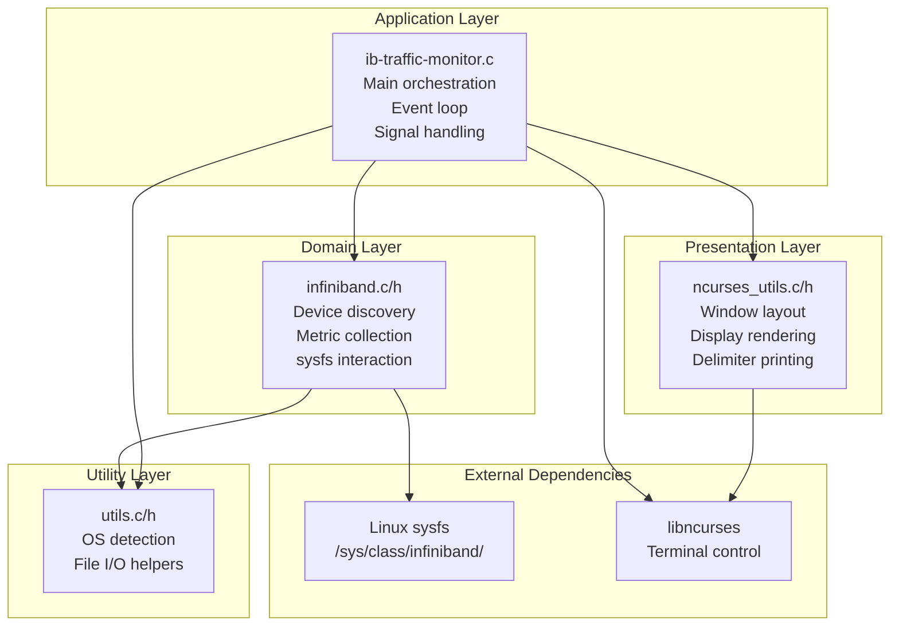
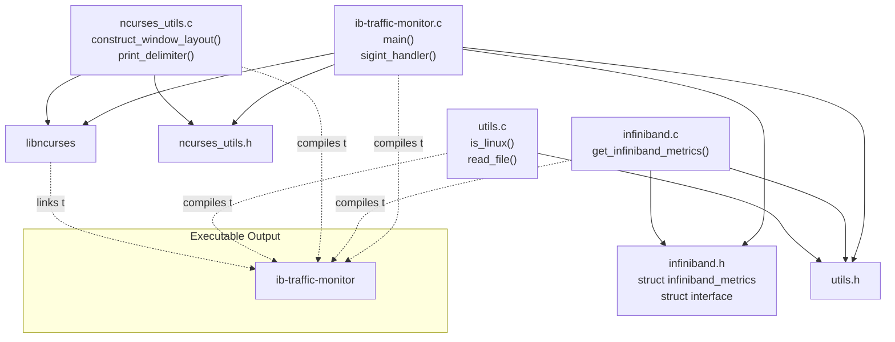
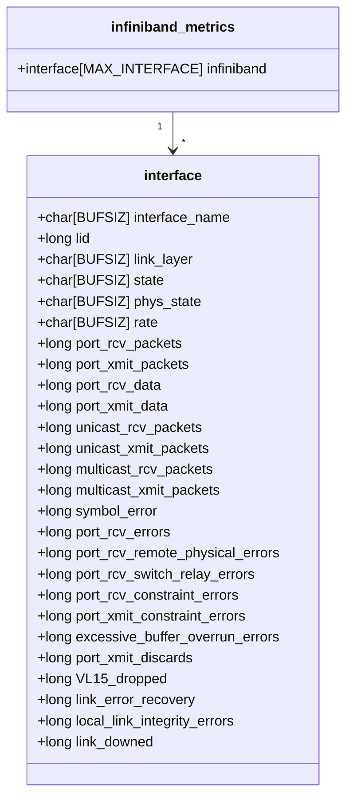
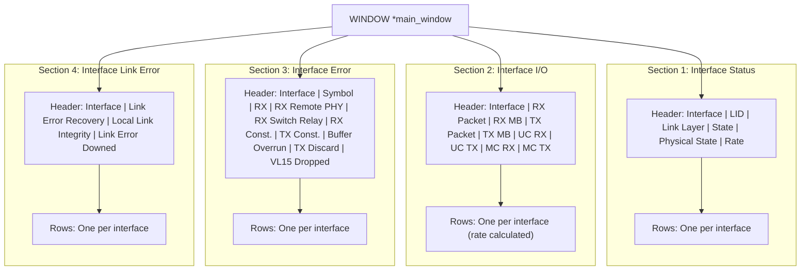
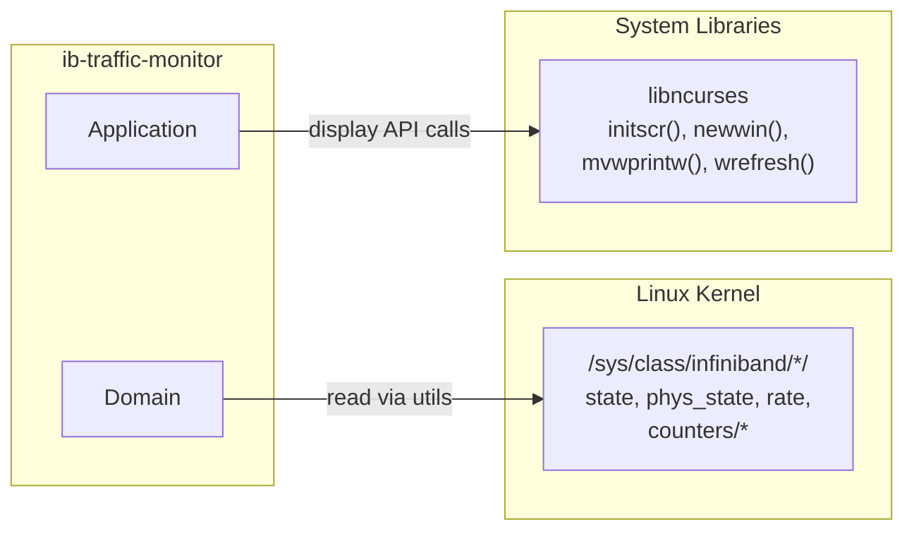
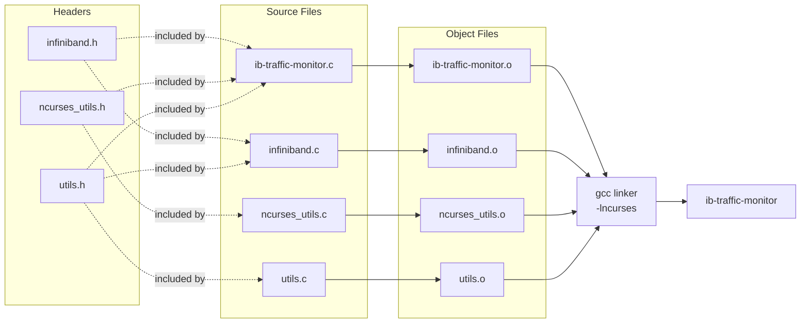
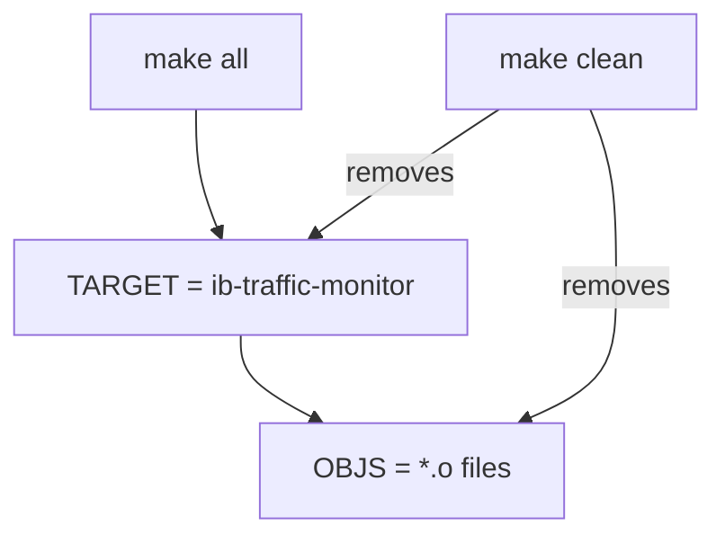

<!-- source: DeepWiki mcp.deepwiki.com · repo NVIDIA/ib-traffic-monitor · page 3.1 System Architecture · fetched 2026-10-26 -->

# System Architecture

Relevant source files

The following files were used as context for generating this wiki page:

- [Makefile](Makefile)
- [README.md](README.md)
- [ib-traffic-monitor.c](ib-traffic-monitor.c)

## Purpose and Scope

This page describes the overall architecture of ib-traffic-monitor, including its layered design, module organization, component responsibilities, and dependency relationships. The architecture follows a clean separation of concerns with distinct layers for application logic, domain operations, presentation, and utilities.

For details on how data flows through the system from hardware to display, see [Data Flow](#3.2). For implementation details of individual components, see [Core Components](#4).

---

## Architectural Overview

ib-traffic-monitor is organized as a **layered architecture** with clear boundaries between components. The system consists of four primary modules that compile into a single executable, with two external dependencies.

### Layer Structure

**Sources:** [ib-traffic-monitor.c:1-344](), [README.md:1-111](), [Makefile:16-36]()

---

## Module Organization

The codebase is organized into four distinct modules, each with specific responsibilities. The module structure avoids circular dependencies and maintains clear interfaces through header files.

### Module Dependency Graph

**Sources:** [Makefile:19-29](), [ib-traffic-monitor.c:28-30]()

### Module Listing

| Module | Source Files | Key Responsibilities | Dependencies |
|--------|-------------|---------------------|--------------|
| **Application** | `ib-traffic-monitor.c` | Main event loop, signal handling, orchestration, user input processing | `infiniband.h`, `ncurses_utils.h`, `utils.h`, `libncurses` |
| **Domain** | `infiniband.c`, `infiniband.h` | InfiniBand device discovery, metric collection, sysfs parsing | `utils.h` |
| **Presentation** | `ncurses_utils.c`, `ncurses_utils.h` | Window layout, display formatting, delimiter rendering | `libncurses` |
| **Utilities** | `utils.c`, `utils.h` | OS detection, file I/O operations | None |

**Sources:** [Makefile:19](), [ib-traffic-monitor.c:1-344]()

---

## Component Responsibilities

### Application Module (`ib-traffic-monitor.c`)

The application module serves as the orchestration layer and contains the following responsibilities:

**Primary Functions:**
- `main()` - Program entry point [ib-traffic-monitor.c:52-344]()
- `sigint_handler()` - SIGINT signal handler [ib-traffic-monitor.c:46-50]()
- `usage()` - Display help message [ib-traffic-monitor.c:35-42]()

**Core Responsibilities:**

| Responsibility | Implementation Details |
|---------------|------------------------|
| **Command-Line Parsing** | Uses `getopt_long()` to parse `-r`, `-e`, `-h` options [ib-traffic-monitor.c:54-112]() |
| **Signal Management** | Configures SIGINT handler with `sigaction()`, uses signal masks for safe handling [ib-traffic-monitor.c:137-175]() |
| **ncurses Initialization** | Calls `initscr()`, `cbreak()`, `curs_set()`, `newwin()` [ib-traffic-monitor.c:182-201]() |
| **Event Loop** | Infinite loop collecting metrics, rendering display, handling input [ib-traffic-monitor.c:203-330]() |
| **Timing Control** | Uses `pselect()` with `timespec` for configurable refresh intervals [ib-traffic-monitor.c:307]() |
| **Resource Cleanup** | Properly terminates ncurses with `delwin()` and `endwin()` [ib-traffic-monitor.c:333-335]() |

**State Management:**

The application maintains two instances of `struct infiniband_metrics`:
- `cur_infiniband_metrics` - Current reading [ib-traffic-monitor.c:121]()
- `prev_infiniband_metrics` - Previous reading for rate calculations [ib-traffic-monitor.c:122]()

**Sources:** [ib-traffic-monitor.c:1-344]()

### Domain Module (`infiniband.c`, `infiniband.h`)

The domain module encapsulates all InfiniBand-specific operations and sysfs interactions.

**Key Function:**
- `get_infiniband_metrics()` - Device discovery and metric collection

**Data Structures:**

**Responsibilities:**

| Responsibility | Description |
|---------------|-------------|
| **Device Discovery** | Enumerates InfiniBand devices under `/sys/class/infiniband/` |
| **Port Enumeration** | Discovers available ports for each device |
| **Link Layer Filtering** | Filters devices by link layer type (InfiniBand vs Ethernet) based on `ethernet_flag` |
| **Metric Reading** | Reads counter values from sysfs files under `counters/` subdirectory |
| **Status Parsing** | Reads state, physical state, rate, LID from device/port sysfs files |
| **Error Handling** | Returns error codes for missing devices or read failures |

**Sources:** [infiniband.h]() (referenced in ib-traffic-monitor.c), [ib-traffic-monitor.c:221-232]()

### Presentation Module (`ncurses_utils.c`, `ncurses_utils.h`)

The presentation module handles all display-related operations using the ncurses library.

**Key Functions:**
- `construct_window_layout()` - Creates the four-section display layout
- `print_delimiter()` - Prints vertical delimiters to separate columns

**Display Layout Structure:**

**Delimiter Positioning:**

The module uses predefined delimiter position arrays to maintain column alignment:
- `interface_status_positions[]` - 5 delimiters [ib-traffic-monitor.c:125]()
- `interface_io_positions[]` - 8 delimiters [ib-traffic-monitor.c:126]()
- `interface_error_positions[]` - 9 delimiters [ib-traffic-monitor.c:127]()
- `interface_link_error_positions[]` - 3 delimiters [ib-traffic-monitor.c:128]()

**Sources:** [ib-traffic-monitor.c:125-128](), [ib-traffic-monitor.c:235-269]()

### Utility Module (`utils.c`, `utils.h`)

The utility module provides general-purpose helper functions used by other modules.

**Key Functions:**

| Function | Purpose | Usage |
|----------|---------|-------|
| `is_linux()` | Detects if running on Linux | Called at startup to validate OS [ib-traffic-monitor.c:115-118]() |
| `read_file()` | Reads content from file path | Used by infiniband module to read sysfs files |

**Design Pattern:**

The utility module follows a **shared service** pattern, providing common functionality to upper layers without depending on any application-specific logic. It has no dependencies on other application modules.

**Sources:** [ib-traffic-monitor.c:115-118](), [ib-traffic-monitor.c:28-30]()

---

## Dependency Analysis

### Dependency Rules

The architecture enforces the following dependency constraints:

1. **Application Layer** depends on all other modules
2. **Domain Layer** depends only on Utility Layer
3. **Presentation Layer** depends only on external ncurses library
4. **Utility Layer** has no internal dependencies
5. **No circular dependencies** exist between modules

### External Dependencies

**External Dependency Requirements:**

| Dependency | Purpose | API Surface |
|-----------|---------|-------------|
| **Linux sysfs** | InfiniBand metrics source | Read-only file access to `/sys/class/infiniband/` hierarchy |
| **libncurses** | Terminal UI rendering | Window management, text positioning, screen refresh functions |

**Sources:** [Makefile:22](), [ib-traffic-monitor.c:20](), [README.md:108]()

---

## Build Architecture

### Compilation Process

The build system uses a standard C compilation pipeline managed by Make:

### Compiler Flags

The build system applies strict compiler flags to ensure code quality:

| Flag Category | Flags | Purpose |
|--------------|-------|---------|
| **Debugging** | `-g` | Include debug symbols [Makefile:17]() |
| **Warnings** | `-Wall -Wextra -Wpedantic` | Enable comprehensive warnings [Makefile:17]() |
| **Type Safety** | `-Wconversion -Wdouble-promotion -Wsign-conversion` | Catch implicit type conversions [Makefile:17]() |
| **Code Quality** | `-Wunused -Wshadow` | Detect unused variables and shadowing [Makefile:17]() |
| **Runtime Safety** | `-fsanitize=undefined` | Detect undefined behavior at runtime [Makefile:17]() |

### Build Targets

**Makefile Targets:**
- `all` (default) - Builds the executable [Makefile:26]()
- `clean` - Removes object files and executable [Makefile:34-35]()

**Sources:** [Makefile:16-36](), [README.md:43-52]()

---

## Architectural Patterns

### Event Loop Pattern

The application implements a **polling-based event loop** with the following characteristics:

1. **Metric Collection Phase**: Call `get_infiniband_metrics()` [ib-traffic-monitor.c:221]()
2. **Layout Construction Phase**: Call `construct_window_layout()` [ib-traffic-monitor.c:235]()
3. **Display Rendering Phase**: Print metrics using `mvwprintw()` [ib-traffic-monitor.c:240-269]()
4. **Screen Refresh Phase**: Call `wrefresh()` [ib-traffic-monitor.c:297]()
5. **Wait Phase**: Block on `pselect()` with timeout [ib-traffic-monitor.c:307]()
6. **Input Check Phase**: Process keyboard input or signals [ib-traffic-monitor.c:310-322]()

### Rate Calculation Pattern

The system implements a **delta-based rate calculation** pattern:

1. Store current metrics in `cur_infiniband_metrics`
2. Compare with previous iteration stored in `prev_infiniband_metrics`
3. Calculate rate: `(current - previous) / refresh_interval`
4. Only display rates when `prev_data_flag` is set [ib-traffic-monitor.c:272-295]()

This pattern ensures rates are only calculated after the second iteration when valid previous data exists.

**Sources:** [ib-traffic-monitor.c:203-330]()

---

## Summary Table

| Aspect | Implementation |
|--------|---------------|
| **Architecture Style** | Layered architecture with clear separation of concerns |
| **Module Count** | 4 modules (Application, Domain, Presentation, Utilities) |
| **External Dependencies** | 2 (Linux sysfs, libncurses) |
| **Compilation Output** | Single statically-linked executable |
| **Dependency Pattern** | Acyclic, hierarchical dependencies |
| **Primary Design Pattern** | Event loop with polling and rate calculation |
| **Configuration Method** | Command-line arguments parsed at startup |

**Sources:** [ib-traffic-monitor.c:1-344](), [Makefile:16-36](), [README.md:1-111]()

---

