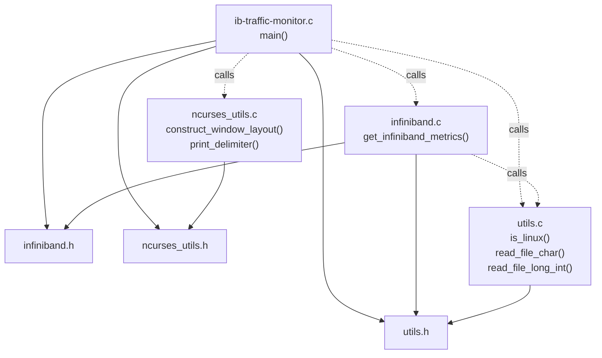
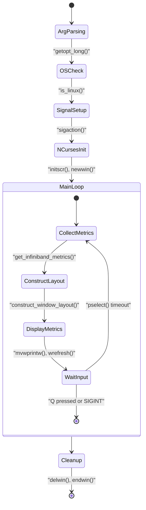
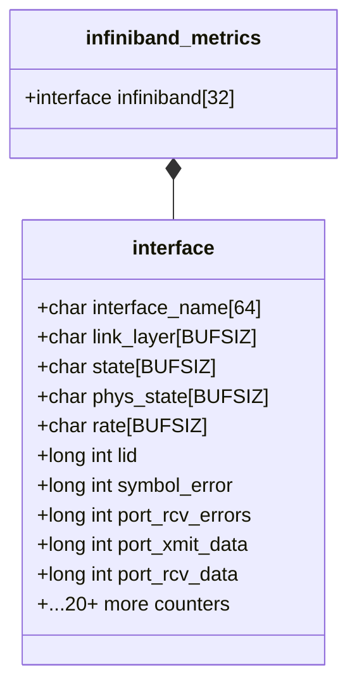
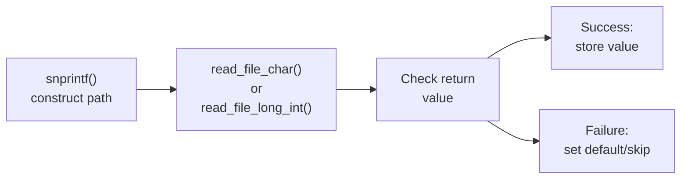
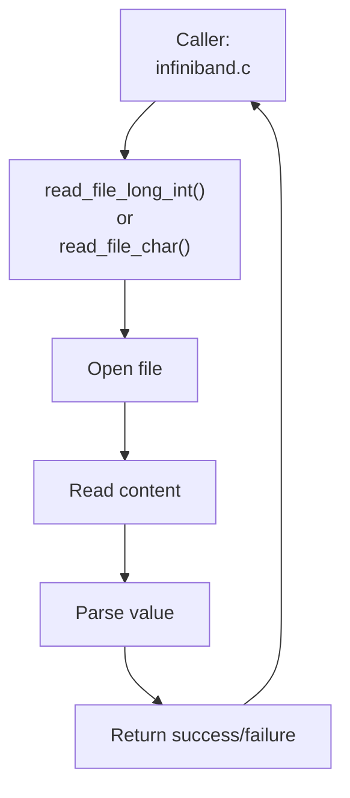
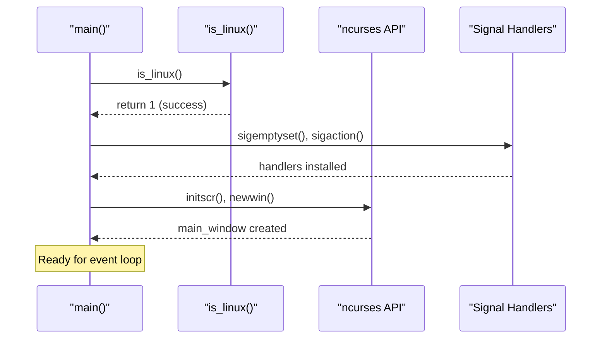
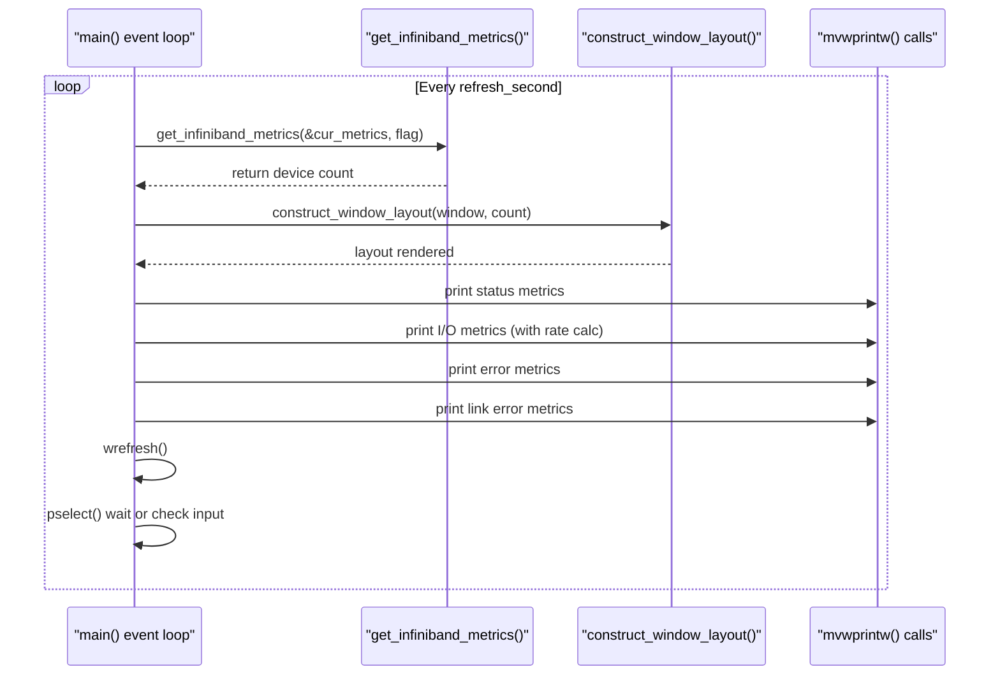

<!-- source: DeepWiki mcp.deepwiki.com · repo NVIDIA/ib-traffic-monitor · page 4 Core Components · fetched 2026-10-26 -->

# Core Components

<details>
<summary>Relevant source files</summary>

The following files were used as context for generating this wiki page:

- [ib-traffic-monitor.c](ib-traffic-monitor.c)
- [infiniband.c](infiniband.c)
- [infiniband.h](infiniband.h)

</details>


This document provides an overview of the primary code modules that comprise the ib-traffic-monitor system. It describes the architectural organization, module responsibilities, and interaction patterns between components. For detailed implementation specifics, see the child pages: [Main Application](#4.1), [InfiniBand Metrics System](#4.2), [User Interface System](#4.3), and [Utility Functions](#4.4). For broader architectural context, see [Architecture](#3).

## Component Overview

The codebase is organized into four distinct functional modules, each with clearly defined responsibilities. The system follows a layered architecture where the main application orchestrates interactions between the domain logic (InfiniBand metrics), presentation layer (ncurses UI), and utility functions.

### Module Structure

The following table summarizes the core modules and their primary files:

| Module | Files | Primary Responsibility |
|--------|-------|------------------------|
| **Main Application** | `ib-traffic-monitor.c` | Event loop orchestration, signal handling, program lifecycle management |
| **InfiniBand Metrics** | `infiniband.c`, `infiniband.h` | Device discovery, sysfs interaction, metric data collection |
| **User Interface** | `ncurses_utils.c`, `ncurses_utils.h` | Window layout construction, visual rendering utilities |
| **Utilities** | `utils.c`, `utils.h` | OS detection, file I/O operations, general-purpose helpers |

**Sources:** [ib-traffic-monitor.c:1-344](), [infiniband.c:1-356](), [infiniband.h:1-63]()

### Component Dependency Graph



**Sources:** [ib-traffic-monitor.c:28-30](), [infiniband.c:25-26]()

## Main Application Component

The main application component resides in `ib-traffic-monitor.c` and serves as the entry point and orchestration layer for the entire system. It implements the event loop, handles user input and signals, and coordinates data flow between all other components.

### Key Functions and Responsibilities

| Function | Lines | Purpose |
|----------|-------|---------|
| `main()` | [52-344]() | Program entry point, initialization, and main event loop |
| `usage()` | [35-42]() | Display command-line help information |
| `sigint_handler()` | [46-50]() | Handle SIGINT (Ctrl+C) gracefully |

### Main Event Loop Structure



**Sources:** [ib-traffic-monitor.c:52-344](), [ib-traffic-monitor.c:203-330]()

### Configuration Variables

The main application manages several key configuration parameters:

- `refresh_second` [62](): Interval between metric updates (default: 5 seconds, configurable via `-r` flag)
- `ethernet_flag` [63](): Whether to include Ethernet devices (default: false, enabled via `-e` flag)
- `break_flag` [45](): Signal flag for graceful shutdown via SIGINT

**Sources:** [ib-traffic-monitor.c:45-66](), [ib-traffic-monitor.c:80-98]()

## InfiniBand Metrics Component

The InfiniBand metrics component is responsible for all interaction with the Linux sysfs filesystem to discover InfiniBand devices and collect performance counters. It is implemented across `infiniband.h` and `infiniband.c`.

### Data Structures

The component defines two primary structures:



**Sources:** [infiniband.h:26-58]()

### Core Function

The module exposes a single public function:

**`get_infiniband_metrics(struct infiniband_metrics *input_infiniband_metrics, int show_ethernet_flag)`** [infiniband.c:28]()

- **Returns:** Number of interfaces found (>0), 0 if none found, or -1 on error
- **Purpose:** Discovers InfiniBand devices and populates the `infiniband_metrics` structure with current counter values
- **Process:**
  1. Opens `/sys/class/infiniband` directory [45]()
  2. Enumerates device directories [52]()
  3. Iterates through port subdirectories [73]()
  4. Filters by link layer type (InfiniBand vs Ethernet) [97-102]()
  5. Reads status attributes from sysfs [130-176]()
  6. Reads performance counters from `counters/` subdirectory [179-339]()

**Sources:** [infiniband.c:28-355]()

### sysfs Interaction Pattern

The component follows a consistent pattern for reading sysfs attributes:



For example, reading the link layer attribute:
- Construct path: `/sys/class/infiniband/{device}/ports/{port}/link_layer` [88-91]()
- Read string value via `read_file_char()` [92]()
- Store in structure: `strcpy(input_infiniband_metrics->infiniband[count].link_layer, char_value)` [128]()

**Sources:** [infiniband.c:88-95](), [infiniband.c:179-339]()

## User Interface Component

The user interface component provides ncurses-based terminal display functionality through `ncurses_utils.h` and `ncurses_utils.c`. This component is responsible for creating the visual layout and rendering utilities.

### Key Functions

| Function | Purpose |
|----------|---------|
| `construct_window_layout()` | Creates the four-section metric display with headers |
| `print_delimiter()` | Draws vertical delimiters at specified column positions |

### Display Layout Structure

The UI is divided into four sections, each displaying a category of metrics:

1. **Interface Status** (rows 3-4+n): LID, link layer, state, physical state, rate
2. **Interface I/O** (rows 7+n - 8+2n): Packet and data transfer metrics
3. **Interface Errors** (rows 11+2n - 12+3n): Error counters
4. **Link Errors** (rows 15+3n - 16+4n): Link-specific error metrics

Where `n` is the number of interfaces detected.

**Sources:** [ib-traffic-monitor.c:125-128](), [ib-traffic-monitor.c:235-268]()

### Delimiter Position Arrays

The main application defines column positions for vertical delimiters in each section:

```c
int interface_status_positions[] = {17, 27, 44, 62, 81};
int interface_io_positions[] = {17, 31, 43, 57, 69, 86, 103, 120};
int interface_error_positions[] = {17, 26, 35, 51, 69, 81, 93, 110, 123};
int interface_link_error_positions[] = {17, 39, 62};
```

These arrays are passed to `print_delimiter()` to create column separators in the tabular display.

**Sources:** [ib-traffic-monitor.c:125-128](), [ib-traffic-monitor.c:237-268]()

## Utility Component

The utility component provides general-purpose helper functions used by other modules. It is implemented in `utils.h` and `utils.c`.

### Core Utilities

| Function Category | Functions | Purpose |
|------------------|-----------|---------|
| **OS Detection** | `is_linux()` | Verify the host OS is Linux (required for sysfs access) |
| **File I/O** | `read_file_char()` | Read string values from sysfs files |
| **File I/O** | `read_file_long_int()` | Read integer values from sysfs files |

### File I/O Pattern

The file reading utilities abstract the common pattern of opening sysfs files, reading values, and handling errors. The InfiniBand metrics component uses these extensively:



Error handling is delegated to the caller, allowing the InfiniBand component to decide whether to skip a metric (setting it to 0) or abort device enumeration.

**Sources:** [infiniband.c:92](), [infiniband.c:135](), [infiniband.c:181-339]()

## Component Interaction Patterns

### Initialization Sequence



**Sources:** [ib-traffic-monitor.c:114-201]()

### Data Collection and Display Cycle



**Sources:** [ib-traffic-monitor.c:203-330]()

### Rate Calculation Logic

The main application implements rate calculation for I/O metrics by maintaining previous and current metric snapshots:

1. First iteration: Display only static metrics (status, errors) [272]()
2. Subsequent iterations:
   - Match current interfaces with previous by name [276]()
   - Calculate delta: `(current - previous) / refresh_second` [282-289]()
   - Display rate-based metrics [280-289]()

This approach requires maintaining two `infiniband_metrics` structures (`cur_infiniband_metrics` and `prev_infiniband_metrics`) and a flag (`prev_data_flag`) to track initialization state.

**Sources:** [ib-traffic-monitor.c:121-122](), [ib-traffic-monitor.c:131](), [ib-traffic-monitor.c:272-295](), [ib-traffic-monitor.c:325-329]()

## Key Design Decisions

### Polling vs Event-Driven

The system uses a polling architecture with `pselect()` [307]() rather than an event-driven model. This design choice enables:
- Periodic metric refresh at configurable intervals
- Non-blocking check for user input (Q to quit)
- Proper signal handling (SIGINT) during sleep periods

**Sources:** [ib-traffic-monitor.c:215-218](), [ib-traffic-monitor.c:307-322]()

### Error Handling Strategy

The InfiniBand metrics component implements graceful degradation:
- Missing counter files result in 0 values rather than errors [184-339]()
- Individual port enumeration failures are skipped, continuing to the next port [continue statements]()
- Only critical failures (unable to open `/sys/class/infiniband`) return error status [46-49]()

This approach maximizes compatibility across different InfiniBand hardware and kernel versions.

**Sources:** [infiniband.c:181-339](), [infiniband.c:45-49]()

### Static vs Dynamic Allocation

The system uses static allocation for the metrics structures:
- Maximum of 32 interfaces (`INTERFACE_COUNT`) [infiniband.h:23]()
- Fixed buffer sizes (`IB_DEVICE_NAME_MAX`, `BUFSIZ`) [infiniband.h:24-31]()

This design eliminates dynamic memory allocation overhead and simplifies error handling, at the cost of a fixed maximum capacity.

**Sources:** [infiniband.h:23-58](), [ib-traffic-monitor.c:121-122]()

### Signal Safety

The SIGINT handler uses only async-signal-safe operations:
- Sets a single `volatile sig_atomic_t` variable [45-50]()
- Main loop checks flag after `pselect()` returns with EINTR [318-322]()
- Signals are blocked during metric collection, only unblocked in `pselect()` [157-161](), [307]()

This ensures safe and predictable shutdown behavior.

**Sources:** [ib-traffic-monitor.c:44-50](), [ib-traffic-monitor.c:136-175](), [ib-traffic-monitor.c:307-322]()

---

