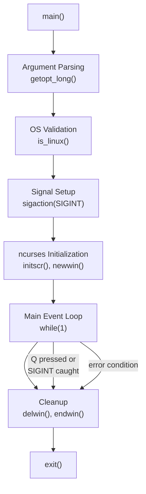
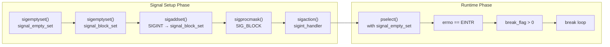
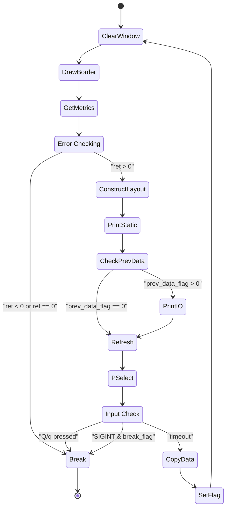
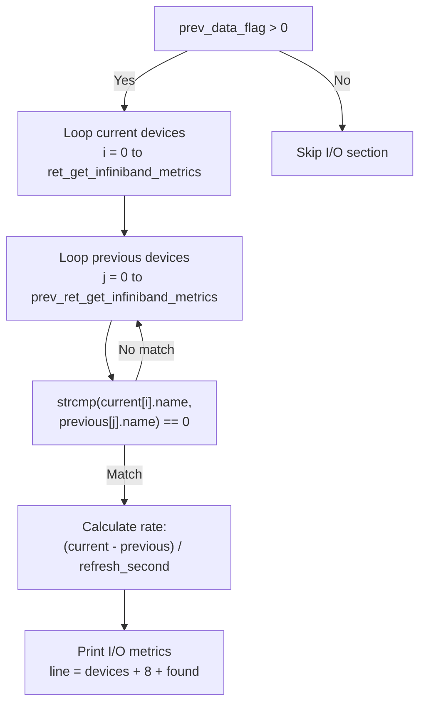

<!-- source: DeepWiki mcp.deepwiki.com · repo NVIDIA/ib-traffic-monitor · page 4.1 Main Application · fetched 2026-10-26 -->

# Main Application

<details>
<summary>Relevant source files</summary>

The following files were used as context for generating this wiki page:

- [README.md](README.md)
- [ib-traffic-monitor.c](ib-traffic-monitor.c)

</details>


## Purpose and Scope

This page documents the main application orchestration implemented in `ib-traffic-monitor.c`, which serves as the entry point and central coordinator for the ib-traffic-monitor system. It covers program lifecycle management, command-line argument parsing, signal handling, ncurses initialization, and the main event loop that drives metric collection and display updates.

For details about the InfiniBand metrics collection subsystem, see [InfiniBand Metrics System](#4.2). For information about the ncurses display implementation, see [User Interface System](#4.3). For command-line usage patterns, see [Command-Line Usage](#2.2).

**Sources:** [ib-traffic-monitor.c:1-344]()

---

## Program Architecture Overview

The main application follows a sequential initialization pattern followed by a continuous monitoring loop. The architecture can be visualized as follows:



**Sources:** [ib-traffic-monitor.c:52-344]()

---

## Program Entry and Initialization

### Main Function Signature

The application entry point is defined at [ib-traffic-monitor.c:52]():

```c
int main(int argc, char *argv[])
```

### Command-Line Argument Parsing

The application uses `getopt_long()` to parse command-line options defined in the `short_opts` and `long_opts` structures:

| Variable | Type | Purpose |
|----------|------|---------|
| `short_opts` | `char*` | Short option string: `"r:eh"` |
| `long_opts` | `struct option[]` | Long option definitions for `--refresh`, `--ethernet`, `--help` |
| `refresh_second` | `long int` | Refresh interval in seconds (default: 5) |
| `ethernet_flag` | `int` | Whether to show Ethernet link layer devices (default: 0) |

The parsing loop at [ib-traffic-monitor.c:73-112]() handles three options:

- **`-r|--refresh`**: Sets the refresh interval, validated to be a positive integer
- **`-e|--ethernet`**: Enables display of Ethernet link layer type devices
- **`-h|--help`**: Displays usage information via `usage()` function and exits

Invalid options or conversion errors result in immediate program termination with `EXIT_FAILURE`.

**Sources:** [ib-traffic-monitor.c:53-112]()

---

## Signal Handling Configuration

The application implements graceful shutdown handling for `SIGINT` (Ctrl+C) using a signal handler and signal masking pattern:



### Signal Handler Implementation

The signal handler is defined at [ib-traffic-monitor.c:45-50]():

```c
static volatile sig_atomic_t break_flag = 0;
static void sigint_handler(int signo)
```

The handler sets the `break_flag` atomic variable, which is checked in the main loop after `pselect()` returns with `EINTR`. The signal blocking pattern ensures `SIGINT` is only processed during `pselect()` when `signal_empty_set` temporarily unblocks it.

**Key variables:**
- `break_flag`: Volatile atomic flag set by signal handler
- `signal_empty_set`: Empty signal set for `pselect()`
- `signal_block_set`: Contains `SIGINT` for blocking
- `sa`: `struct sigaction` for handler installation

**Sources:** [ib-traffic-monitor.c:45-50](), [ib-traffic-monitor.c:137-175](), [ib-traffic-monitor.c:307-322]()

---

## ncurses Initialization

The ncurses terminal UI is initialized in a specific sequence at [ib-traffic-monitor.c:177-201]():

| Step | Function | Purpose |
|------|----------|---------|
| 1 | `initscr()` | Initialize the ncurses screen |
| 2 | `cbreak()` | Disable line buffering for immediate input |
| 3 | `curs_set(0)` | Make cursor invisible |
| 4 | `newwin(0, 0, 0, 0)` | Create full-screen window stored in `main_window` |
| 5 | `nodelay(main_window, TRUE)` | Enable non-blocking input mode |

The `main_window` variable (type `WINDOW*`) is used throughout the application for all display operations. If window creation fails, the program calls `endwin()` and exits with `EXIT_FAILURE`.

**Sources:** [ib-traffic-monitor.c:177-201]()

---

## Main Event Loop Architecture

The main event loop begins at [ib-traffic-monitor.c:203]() and runs until a termination condition is met. The loop structure can be visualized as:



### Loop Variables and State

The loop maintains several critical state variables:

| Variable | Type | Purpose |
|----------|------|---------|
| `cur_infiniband_metrics` | `struct infiniband_metrics` | Current iteration metrics |
| `prev_infiniband_metrics` | `struct infiniband_metrics` | Previous iteration metrics for rate calculation |
| `prev_data_flag` | `int` | Indicates if previous data exists (0 = first iteration) |
| `ret_get_infiniband_metrics` | `int` | Number of devices found in current iteration |
| `prev_ret_get_infiniband_metrics` | `int` | Number of devices from previous iteration |

**Sources:** [ib-traffic-monitor.c:121-134](), [ib-traffic-monitor.c:203-330]()

---

## Metric Collection and Display

### Device Discovery Phase

Each loop iteration calls `get_infiniband_metrics()` at [ib-traffic-monitor.c:221]():

```c
ret_get_infiniband_metrics = get_infiniband_metrics(&cur_infiniband_metrics, ethernet_flag);
```

The return value handling:
- **< 0**: Error retrieving metrics → set error message and break
- **== 0**: No devices found → set error message and break
- **> 0**: Number of devices found → continue processing

### Window Layout Construction

After successful device discovery, the window layout is constructed at [ib-traffic-monitor.c:235]():

```c
construct_window_layout(main_window, ret_get_infiniband_metrics);
```

This function (from `ncurses_utils.h`) creates the four-section display layout with headers.

### Static Metrics Display

The loop prints static metrics that don't require rate calculations at [ib-traffic-monitor.c:240-269]():

```mermaid
graph TD
    LOOP["Loop over devices<br/>i = 0 to ret_get_infiniband_metrics"]
    
    STATUS["Interface Status Section<br/>line = 4 + i"]
    ERROR["Interface Error Section<br/>line = 2*devices + 14 + i"]
    LINKERR["Interface Link Error Section<br/>line = 3*devices + 19 + i"]
    
    LOOP --> STATUS
    LOOP --> ERROR
    LOOP --> LINKERR
    
    STATUS --> PRINTLID["lid"]
    STATUS --> PRINTLL["link_layer"]
    STATUS --> PRINTSTATE["state"]
    STATUS --> PRINTPHYS["phys_state"]
    STATUS --> PRINTRATE["rate"]
    
    ERROR --> PRINTSYM["symbol_error"]
    ERROR --> PRINTRCVERR["port_rcv_errors"]
    ERROR --> PRINTREMPHY["port_rcv_remote_physical_errors"]
    ERROR --> PRINTSWR["port_rcv_switch_relay_errors"]
    ERROR --> PRINTCONS["port_rcv/xmit_constraint_errors"]
    ERROR --> PRINTBUF["excessive_buffer_overrun_errors"]
    ERROR --> PRINTDISC["port_xmit_discards"]
    ERROR --> PRINTVL15["VL15_dropped"]
    
    LINKERR --> PRINTREC["link_error_recovery"]
    LINKERR --> PRINTINT["local_link_integrity_errors"]
    LINKERR --> PRINTDOWN["link_downed"]
```



**Delimiter positions arrays** defined at [ib-traffic-monitor.c:125-128]() control column alignment:
- `interface_status_positions[]`: 5 columns
- `interface_io_positions[]`: 8 columns
- `interface_error_positions[]`: 9 columns
- `interface_link_error_positions[]`: 3 columns

**Sources:** [ib-traffic-monitor.c:125-128](), [ib-traffic-monitor.c:235-269]()

---

## Rate Calculation and I/O Metrics

### Rate Calculation Logic

I/O metrics require rate calculations based on counter deltas between iterations. This is only performed when `prev_data_flag > 0` (not the first iteration):



### Interface Matching Algorithm

The nested loop at [ib-traffic-monitor.c:273-294]() implements interface matching:

1. Outer loop iterates through current devices
2. Inner loop searches previous devices for matching `interface_name`
3. When match found (via `strcmp()`), increments `infiniband_name_found` counter
4. Calculates rate metrics: `(current_value - previous_value) / refresh_second`
5. For data counters, applies conversion: `* 4 / 1024 / 1024` (4-byte words → MB)

**Rate calculation examples:**
- RX Packets/sec: `(cur.port_rcv_packets - prev.port_rcv_packets) / refresh_second`
- RX MB/sec: `(cur.port_rcv_data - prev.port_rcv_data) * 4 / 1024 / 1024 / refresh_second`

**Sources:** [ib-traffic-monitor.c:272-295]()

---

## Input Handling and Timing Control

### pselect() Based Timing

The application uses `pselect()` for both timing control and interrupt-safe input handling at [ib-traffic-monitor.c:307]():

```c
ret_pselect = pselect(STDIN_FILENO + 1, &readfds, NULL, NULL, &ts, &signal_empty_set);
```

**pselect() arguments:**
- `nfds`: `STDIN_FILENO + 1` (monitor stdin only)
- `readfds`: File descriptor set with stdin added via `FD_SET()`
- `timeout`: `ts.tv_sec = refresh_second`, `ts.tv_nsec = 0`
- `sigmask`: `signal_empty_set` (temporarily unblocks `SIGINT`)

### Return Value Handling

| Return Value | Condition | Action |
|--------------|-----------|--------|
| `> 0` | Input available on stdin | Read character, check for 'Q' or 'q' at [ib-traffic-monitor.c:310-315]() |
| `0` | Timeout expired | Continue to next iteration |
| `< 0` with `errno == EINTR` | Signal caught | Check `break_flag` at [ib-traffic-monitor.c:318-322]() |

### Loop Termination Conditions

The loop breaks under three conditions:

1. **User input**: 'Q' or 'q' pressed
2. **Signal**: `SIGINT` caught and `break_flag` set
3. **Error**: Device discovery or metric retrieval fails

**Sources:** [ib-traffic-monitor.c:299-330]()

---

## State Management Between Iterations

At the end of each successful iteration, current state is saved for the next iteration at [ib-traffic-monitor.c:324-329]():

```c
prev_infiniband_metrics = cur_infiniband_metrics;
prev_ret_get_infiniband_metrics = ret_get_infiniband_metrics;
prev_data_flag = 1;
```

This enables rate calculations in subsequent iterations by providing the "previous" baseline for counter deltas.

**Sources:** [ib-traffic-monitor.c:324-329]()

---

## Cleanup and Program Termination

### ncurses Cleanup

Upon loop exit, ncurses resources are properly released at [ib-traffic-monitor.c:332-335]():

1. `wstandend(main_window)`: Turn off all attributes
2. `delwin(main_window)`: Delete the window
3. `endwin()`: Restore terminal to normal mode

### Error Reporting

If `error_flag` was set during execution, the error message stored in `error_msg` is printed to stderr at [ib-traffic-monitor.c:337-341]():

```c
if (error_flag > 0) {
    fprintf(stderr, "%s\n", error_msg);
    exit_code = EXIT_FAILURE;
}
```

The program exits with `EXIT_SUCCESS` (0) for normal termination or `EXIT_FAILURE` (1) for error conditions.

**Sources:** [ib-traffic-monitor.c:332-344]()

---

## Version Information

The application version is defined as a preprocessor constant at [ib-traffic-monitor.c:32]():

```c
#define VERSION "1.3.3"
```

This version string is displayed by the `usage()` function at [ib-traffic-monitor.c:35-42]().

**Sources:** [ib-traffic-monitor.c:32](), [ib-traffic-monitor.c:35-42]()

---

## Key Data Flow Summary

```mermaid
flowchart LR
    subgraph "Initialization"
        ARGS["Parse Arguments<br/>refresh_second<br/>ethernet_flag"]
        OS["Validate OS<br/>is_linux()"]
        SIG["Setup Signals<br/>sigaction()"]
        NC["Init ncurses<br/>initscr(), newwin()"]
    end
    
    subgraph "Loop Iteration"
        GET["get_infiniband_metrics()<br/>→ cur_infiniband_metrics"]
        LAYOUT["construct_window_layout()"]
        STATIC["Print Static Metrics<br/>Status, Errors, Link Errors"]
        MATCH["Match Interfaces<br/>strcmp(current, previous)"]
        RATE["Calculate Rates<br/>(delta / refresh_second)"]
        IO["Print I/O Metrics"]
        WAIT["pselect()<br/>wait refresh_second"]
    end
    
    subgraph "State Update"
        COPY["prev = cur<br/>prev_data_flag = 1"]
    end
    
    ARGS --> OS
    OS --> SIG
    SIG --> NC
    NC --> GET
    GET --> LAYOUT
    LAYOUT --> STATIC
    STATIC --> MATCH
    MATCH --> RATE
    RATE --> IO
    IO --> WAIT
    WAIT --> COPY
    COPY --> GET
```



**Sources:** [ib-traffic-monitor.c:52-344]()

---

