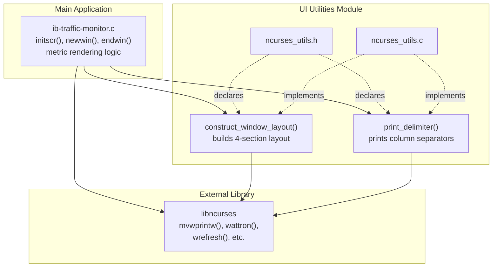
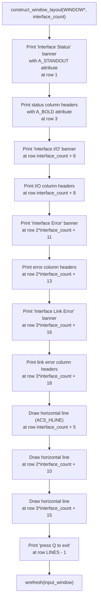
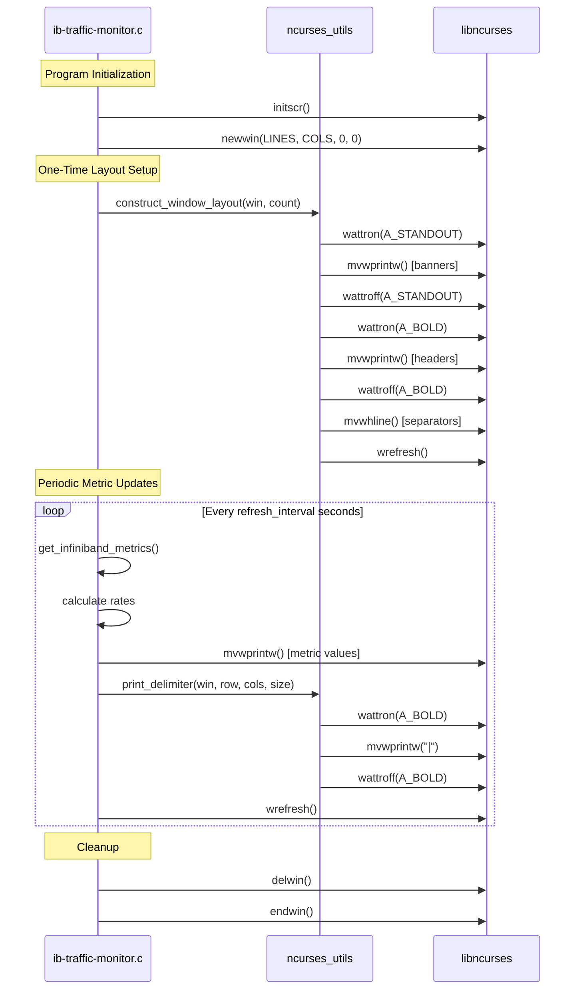
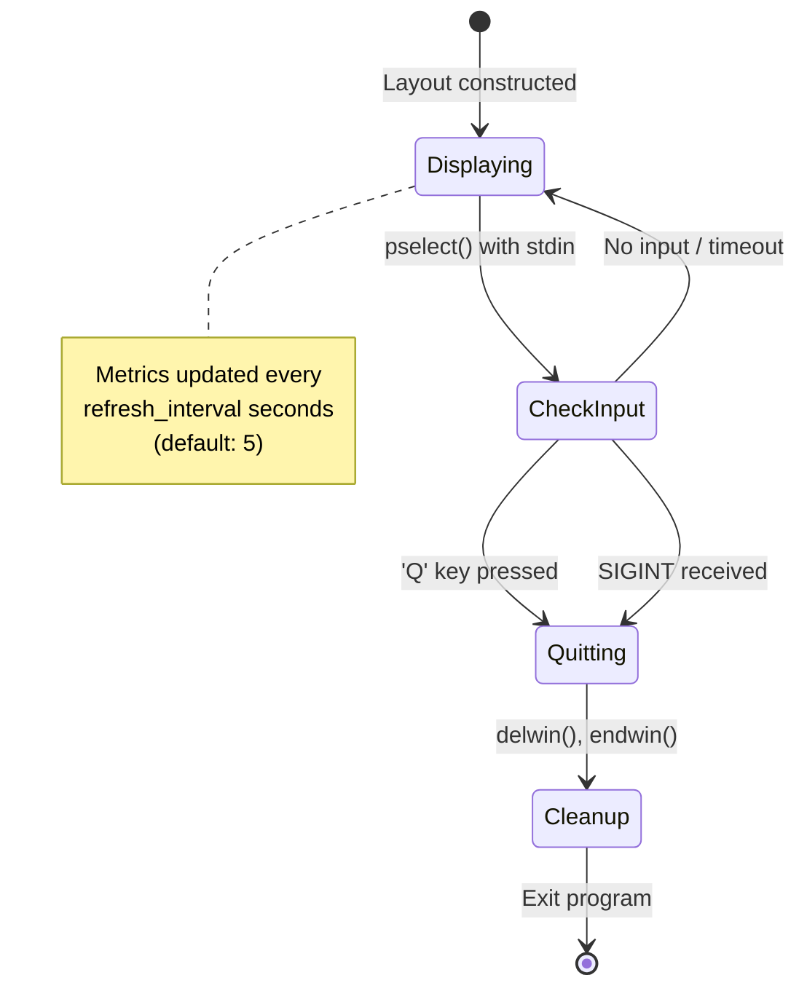
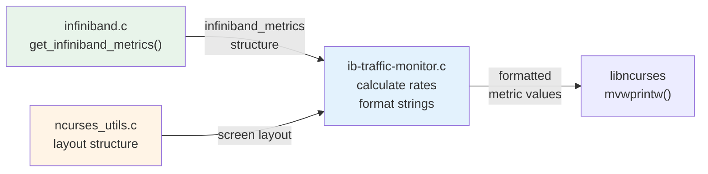

<!-- source: DeepWiki mcp.deepwiki.com · repo NVIDIA/ib-traffic-monitor · page 4.3 User Interface System · fetched 2026-10-26 -->

# User Interface System

<details>
<summary>Relevant source files</summary>

The following files were used as context for generating this wiki page:

- [ncurses_utils.c](ncurses_utils.c)
- [ncurses_utils.h](ncurses_utils.h)
- [screen_layout](screen_layout)

</details>


## Purpose and Scope

This document describes the User Interface System of ib-traffic-monitor, which provides a text-based terminal interface for displaying InfiniBand metrics in real-time. The UI system is built on the ncurses library and is responsible for organizing metrics into a structured screen layout, managing window rendering, and handling user input.

For detailed information about the specific utility functions used to construct the display, see [ncurses Utilities](#4.3.1). For information about the visual organization and metric sections, see [Display Layout](#4.3.2). For information about the main application event loop that drives the UI updates, see [Main Application](#4.1).

**Sources:** High-level architecture diagrams, ncurses_utils.h, ib-traffic-monitor.c

---

## System Overview

The User Interface System consists of two primary source files that work together to create and maintain the terminal display:

| Component | File | Responsibility |
|-----------|------|----------------|
| **UI Utilities** | [ncurses_utils.c]() | Window layout construction, delimiter printing |
| **UI Interface** | [ncurses_utils.h]() | Function declarations and API |
| **Main Display Loop** | [ib-traffic-monitor.c]() | ncurses initialization, metric rendering, input handling |

The UI system depends on the external ncurses library for all terminal control operations, including window management, cursor positioning, text attributes (bold, standout), and character rendering.

**Sources:** ncurses_utils.c, ncurses_utils.h, Diagram 1 and 2 from high-level architecture

---

## Architecture and Component Relationships

The following diagram shows how the UI system integrates with other components and the ncurses library:



**Sources:** ncurses_utils.h:23-24, ncurses_utils.c:21-71, Diagram 1 and 2 from high-level architecture

---

## ncurses Integration

The UI system uses the ncurses library for all terminal operations. The main application handles the core ncurses lifecycle:

| Phase | Operation | Location |
|-------|-----------|----------|
| **Initialization** | `initscr()` - initialize ncurses mode | [ib-traffic-monitor.c]() |
| **Window Creation** | `newwin()` - create main display window | [ib-traffic-monitor.c]() |
| **Layout Setup** | `construct_window_layout()` - build static layout | [ncurses_utils.c:21-61]() |
| **Metric Rendering** | `mvwprintw()` - write metric values | [ib-traffic-monitor.c]() |
| **Refresh** | `wrefresh()` - update terminal display | [ncurses_utils.c:60]() |
| **Input Handling** | `pselect()` with stdin - check for 'Q' key | [ib-traffic-monitor.c]() |
| **Cleanup** | `delwin()`, `endwin()` - restore terminal | [ib-traffic-monitor.c]() |

The ncurses library provides terminal independence, allowing the application to run on various terminal types without modification.

**Sources:** ncurses_utils.c:18, High-level architecture Diagram 6 (Runtime State Machine)

---

## Window Management and Layout Construction

The `construct_window_layout()` function [ncurses_utils.c:21-61]() creates the static structure of the display. This function is called once after device discovery to establish the layout.

### Layout Construction Process



The layout dynamically adjusts row positions based on the `interface_count` parameter, ensuring proper spacing regardless of the number of discovered interfaces.

**Sources:** ncurses_utils.c:21-61, screen_layout

---

## Display Rendering Process

The rendering process occurs in two phases: static layout construction (one-time) and dynamic metric rendering (periodic).



**Sources:** ncurses_utils.c:21-71, High-level architecture Diagram 3 (Data Flow Pipeline) and Diagram 6 (Runtime State Machine)

---

## Screen Layout Organization

The screen is divided into four primary sections, each displaying a specific category of metrics:

### Section Layout Table

| Section # | Banner Text | Row Position | Column Headers |
|-----------|-------------|--------------|----------------|
| **1** | Interface Status | 1 | Interface Name, LID, Link Layer, State, Physical State, Rate |
| **2** | Interface I/O (per second) | `interface_count + 6` | Interface Name, RX Packet, RX MB, TX Packet, TX MB, UC RX Packet, UC TX Packet, MC RX Packet, MC TX Packet |
| **3** | Interface Error (cumulative) | `2 * interface_count + 11` | Interface Name, Symbol, RX, RX Remote PHY, RX Switch Relay, RX Const., TX Const., Buffer Overrun, TX Discard, VL15 Dropped |
| **4** | Interface Link Error (cumulative) | `3 * interface_count + 16` | Interface Name, Link Error Recovery, Local Link Integrity, Link Downed |

### Visual Attributes

The UI uses ncurses text attributes to create visual hierarchy:

| Element | Attribute | Purpose |
|---------|-----------|---------|
| **Section Banners** | `A_STANDOUT` | Highlight section headers (reverse video) |
| **Column Headers** | `A_BOLD` | Emphasize column names |
| **Delimiters** | `A_BOLD` | Make column separators visible |
| **Section Separators** | `ACS_HLINE` | Draw horizontal lines between sections |
| **Metric Values** | Normal | Standard text for data display |

**Sources:** ncurses_utils.c:23-34, 38-50, screen_layout:16-43

---

## Delimiter Printing

The `print_delimiter()` function [ncurses_utils.c:63-71]() renders column delimiters ("|" characters) to visually separate metric values in table rows.

### Function Signature
```
void print_delimiter(WINDOW *input_window, int row_number, 
                     int *column_positions, size_t column_size)
```

### Parameters

| Parameter | Type | Description |
|-----------|------|-------------|
| `input_window` | `WINDOW*` | ncurses window to draw in |
| `row_number` | `int` | Terminal row for delimiter placement |
| `column_positions` | `int*` | Array of column positions for "|" characters |
| `column_size` | `size_t` | Number of delimiters to print |

The function iterates through the `column_positions` array and prints a bold "|" character at each specified column position on the given row.

**Sources:** ncurses_utils.c:63-71, ncurses_utils.h:24

---

## User Interaction Model

The UI system supports minimal user interaction:



### Input Handling

- **Exit Command**: Pressing 'Q' (or 'q') terminates the program
- **Signal Handling**: SIGINT (Ctrl+C) triggers graceful shutdown
- **No Interactive Controls**: The UI is read-only; no scrolling, sorting, or filtering

The main application uses `pselect()` to wait for the refresh interval while simultaneously checking for user input on stdin. This allows the program to respond immediately to the 'Q' key without busy-waiting.

**Sources:** High-level architecture Diagram 6 (Runtime State Machine), ncurses_utils.c:57

---

## Window Dimensions and Constraints

The UI uses global ncurses macros for terminal dimensions:

| Macro | Description | Usage |
|-------|-------------|-------|
| `LINES` | Terminal height in rows | Footer positioning [ncurses_utils.c:57]() |
| `COLS` | Terminal width in columns | Horizontal line width [ncurses_utils.c:52-54]() |

### Layout Constraints

- **Minimum Height**: `4 * interface_count + 20` rows (approximately)
  - Each section requires `interface_count + 5` rows
- **Minimum Width**: ~145 characters for full column headers
- **No Scrolling**: If content exceeds terminal size, display may be truncated
- **No Dynamic Resize**: Terminal resizing during execution not supported

**Sources:** ncurses_utils.c:52-57, screen_layout:47

---

## Error Handling and Edge Cases

The UI system handles several edge cases:

| Scenario | Behavior |
|----------|----------|
| **No Devices Found** | Program exits before ncurses initialization |
| **Terminal Too Small** | Content may overlap or truncate (no validation) |
| **ncurses Init Failure** | Program exits with error (handled by main app) |
| **Invalid Window Pointer** | Undefined behavior (no null checks in utilities) |

The ncurses_utils module assumes valid inputs; validation and error handling occur in the main application.

**Sources:** ncurses_utils.c, High-level architecture Diagram 6

---

## Integration with Metrics Collection

The UI system does not directly access InfiniBand metrics. Instead, it provides a presentation layer that the main application populates:



The main application acts as the controller, fetching metrics from the InfiniBand module and rendering them using the layout provided by ncurses_utils.

**Sources:** High-level architecture Diagrams 1 and 3, ncurses_utils.c

---

## Summary

The User Interface System provides a clean separation between layout construction and metric rendering. Key characteristics:

- **Two-Function API**: `construct_window_layout()` and `print_delimiter()`
- **Static Layout**: Screen structure is built once, then populated repeatedly
- **Four-Section Design**: Status, I/O, Errors, Link Errors
- **ncurses Dependency**: All terminal operations use libncurses
- **Minimal Interaction**: Read-only display with 'Q' to quit
- **No Validation**: Assumes valid inputs from main application

For implementation details of the utility functions, see [ncurses Utilities](#4.3.1). For visual organization and metric section specifications, see [Display Layout](#4.3.2).

**Sources:** All files in this document, High-level architecture diagrams

---

