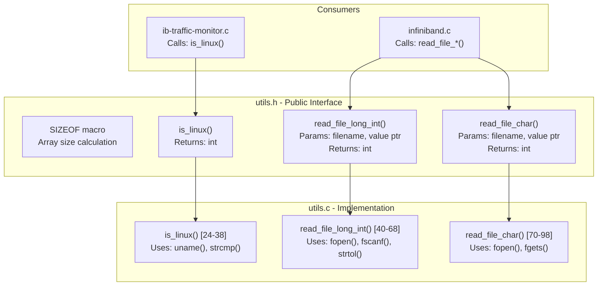
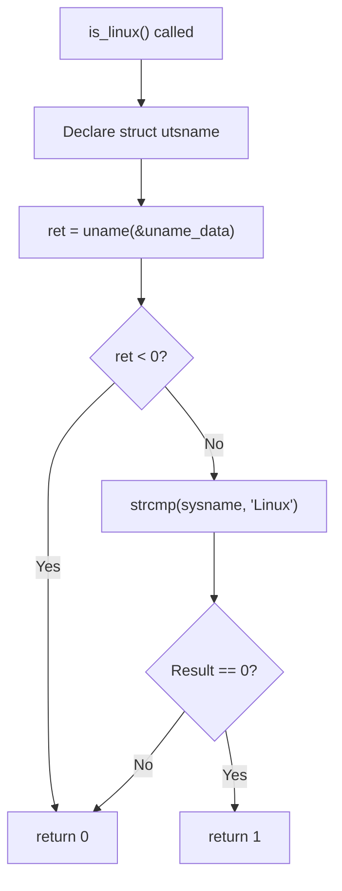
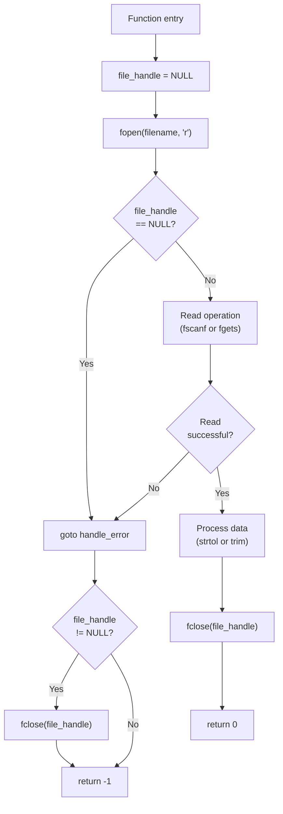
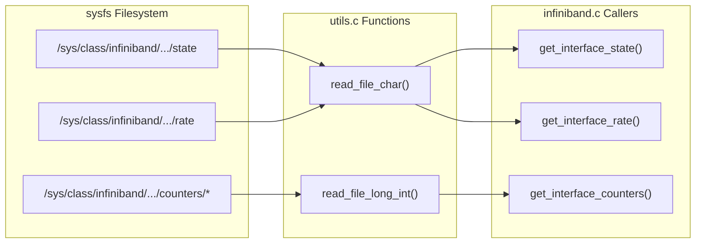

<!-- source: DeepWiki mcp.deepwiki.com · repo NVIDIA/ib-traffic-monitor · page 4.4 Utility Functions · fetched 2026-10-26 -->

# Utility Functions

<details>
<summary>Relevant source files</summary>

The following files were used as context for generating this wiki page:

- [utils.c](utils.c)
- [utils.h](utils.h)

</details>


## Purpose and Scope

This page documents the general-purpose utility functions provided by the `utils.c` and `utils.h` modules. These utilities support the core application logic by providing OS detection capabilities and standardized file I/O operations for reading data from the Linux sysfs filesystem.

For information about InfiniBand-specific functionality that uses these utilities, see [InfiniBand Metrics System](#4.2). For ncurses-specific utilities, see [ncurses Utilities](#4.3.1).

**Sources:** [utils.h:1-28](), [utils.c:1-99]()

## Module Overview

The utilities module consists of two files that provide three primary functions and one convenience macro:

| Component | Type | Purpose |
|-----------|------|---------|
| `is_linux()` | Function | Validates the operating system is Linux |
| `read_file_long_int()` | Function | Reads a numeric value from a file |
| `read_file_char()` | Function | Reads a string value from a file |
| `SIZEOF()` | Macro | Calculates the number of elements in an array |

These utilities are consumed by both the main application [ib-traffic-monitor.c]() and the InfiniBand metrics collection module [infiniband.c]().

**Sources:** [utils.h:18-27](), [utils.c:18-99]()

## Module Structure and Exports



**Sources:** [utils.h:18-27](), [utils.c:24-98]()

## OS Detection Function

### is_linux()

The `is_linux()` function validates that the program is running on a Linux operating system by querying the kernel through the `uname()` system call.

**Function Signature:**
```c
int is_linux(void)
```

**Return Values:**
| Value | Meaning |
|-------|---------|
| `1` | System is running Linux |
| `0` | System is not Linux or uname() failed |

**Implementation Details:**

The function uses the `uname()` POSIX system call to populate a `struct utsname` structure, then compares the `sysname` field against the string `"Linux"`. This check is critical because the application depends on the Linux sysfs filesystem structure at `/sys/class/infiniband/`.



**Sources:** [utils.c:24-38]()

## File I/O Functions

The utilities module provides two specialized file reading functions designed for interacting with sysfs. Both functions follow a consistent error handling pattern using goto labels and ensure proper resource cleanup.

### read_file_long_int()

Reads a numeric value from a file and converts it to a `long int`. This function is primarily used to read InfiniBand counter values from sysfs files.

**Function Signature:**
```c
int read_file_long_int(char *filename, long int *value)
```

**Parameters:**
| Parameter | Type | Description |
|-----------|------|-------------|
| `filename` | `char *` | Path to the file to read |
| `value` | `long int *` | Output parameter for the parsed value |

**Return Values:**
| Value | Meaning |
|-------|---------|
| `0` | Success - value was read and parsed |
| `-1` | Failure - file could not be opened or parsed |

**Implementation Process:**

1. Opens the file using `fopen()` in read mode [utils.c:46]()
2. Reads a line using `fscanf()` into a buffer [utils.c:51]()
3. Converts the string to `long int` using `strtol()` with base 0 (auto-detect) [utils.c:56]()
4. Stores result in the output parameter
5. Closes the file handle
6. On any error, jumps to cleanup handler that safely closes the file if open [utils.c:62-67]()

**Sources:** [utils.c:40-68]()

### read_file_char()

Reads a string value from a file, removing any trailing newline character. This function is used to read textual sysfs attributes such as interface states and link layer types.

**Function Signature:**
```c
int read_file_char(char *filename, char *value)
```

**Parameters:**
| Parameter | Type | Description |
|-----------|------|-------------|
| `filename` | `char *` | Path to the file to read |
| `value` | `char *` | Buffer to store the string (must be at least `BUFSIZ`) |

**Return Values:**
| Value | Meaning |
|-------|---------|
| `0` | Success - string was read |
| `-1` | Failure - file could not be opened or read |

**Implementation Process:**

1. Opens the file using `fopen()` in read mode [utils.c:74]()
2. Reads the first line using `fgets()` with buffer size `BUFSIZ` [utils.c:79]()
3. Strips the trailing newline character if present [utils.c:80-83]()
4. Closes the file handle
5. On any error, jumps to cleanup handler [utils.c:92-96]()

The newline stripping logic checks if the last character is `'\n'` and replaces it with the null terminator `'\0'`, ensuring the output string is clean for comparison and display operations.

**Sources:** [utils.c:70-98]()

## Error Handling Pattern

Both file I/O functions implement a consistent error handling strategy using goto-based cleanup:



This pattern ensures:
- File handles are always closed, even on error paths
- No resource leaks occur
- Error conditions result in a consistent `-1` return value
- The caller can detect failures and handle them appropriately

**Sources:** [utils.c:40-98]()

## Utility Macros

### SIZEOF

The `SIZEOF` macro provides a convenient way to calculate the number of elements in a statically-allocated array.

**Macro Definition:**
```c
#define SIZEOF(x) (sizeof(x) / sizeof(x[0]))
```

This macro divides the total size of the array by the size of a single element, yielding the element count. It is only valid for array types, not pointers.

**Sources:** [utils.h:21]()

## Usage in InfiniBand Metrics Collection

The file I/O utilities are extensively used by the InfiniBand metrics collection module to read counter values and status information from sysfs:



The InfiniBand module constructs file paths to specific sysfs locations and uses these utilities to extract the data. Error returns from the utilities propagate upward, allowing the metrics collection to gracefully handle missing or unreadable files.

**Sources:** [utils.h:24-25](), [utils.c:40-98]()

## Function Call Matrix

The following table summarizes which functions call the utility functions:

| Utility Function | Called By | Purpose |
|------------------|-----------|---------|
| `is_linux()` | `main()` in ib-traffic-monitor.c | Pre-execution OS validation |
| `read_file_long_int()` | `get_interface_counters()` in infiniband.c | Read numeric counter values |
| `read_file_long_int()` | `get_interface_lid()` in infiniband.c | Read local identifier (LID) |
| `read_file_char()` | `get_interface_state()` in infiniband.c | Read interface state strings |
| `read_file_char()` | `get_interface_phys_state()` in infiniband.c | Read physical state strings |
| `read_file_char()` | `get_interface_rate()` in infiniband.c | Read data rate strings |
| `read_file_char()` | `get_interface_link_layer()` in infiniband.c | Read link layer type |
| `SIZEOF()` | Various locations | Array size calculations |

**Sources:** [utils.h:21-25]()

## Buffer Size Constant

Both file reading functions use the `BUFSIZ` constant from the standard library, which is typically 8192 bytes on Linux systems. This provides sufficient buffer space for reading sysfs files, which typically contain short strings or numeric values.

The `read_file_char()` function expects the caller to provide a buffer of at least `BUFSIZ` bytes to avoid buffer overflow issues.

**Sources:** [utils.c:44](), [utils.c:79]()

## Dependencies

The utilities module has minimal external dependencies:

| Header | Purpose |
|--------|---------|
| `<stdio.h>` | File I/O operations (`fopen`, `fclose`, `fscanf`, `fgets`) |
| `<stdlib.h>` | String conversion (`strtol`) |
| `<string.h>` | String operations (`strcmp`, `strlen`) |
| `<sys/utsname.h>` | OS information (`uname`, `struct utsname`) |

These are all standard POSIX interfaces, making the utilities module highly portable across Unix-like systems, although the application itself is Linux-specific due to its sysfs dependencies.

**Sources:** [utils.c:18-22]()

---

