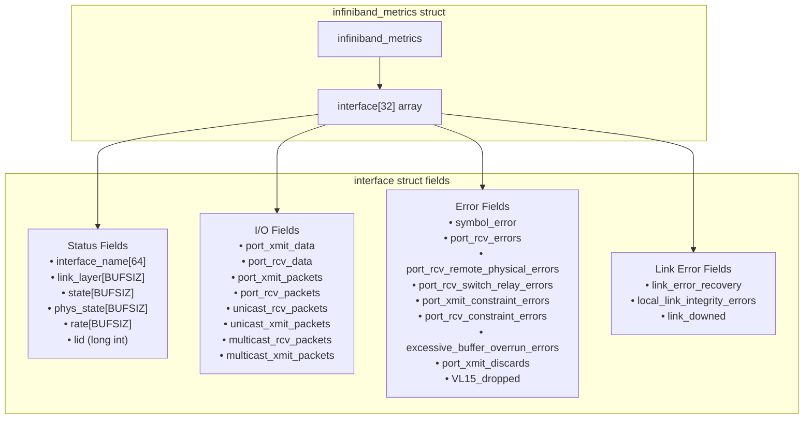
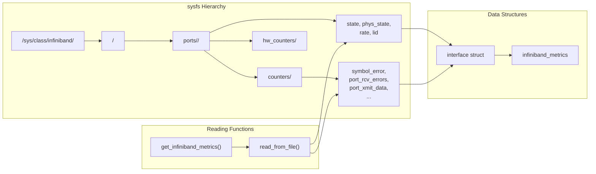
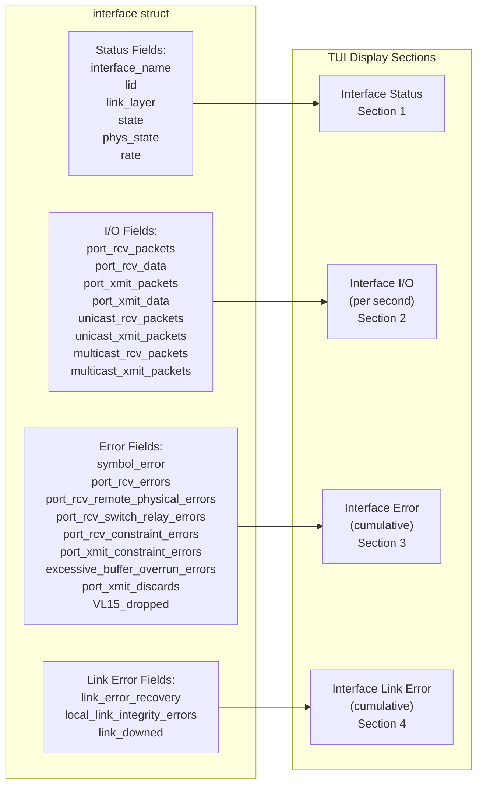

<!-- source: DeepWiki mcp.deepwiki.com · repo NVIDIA/ib-traffic-monitor · page 5 Metrics Reference · fetched 2026-10-26 -->

# Metrics Reference

<details>
<summary>Relevant source files</summary>

The following files were used as context for generating this wiki page:

- [README.md](README.md)
- [infiniband.h](infiniband.h)
- [screen_layout](screen_layout)

</details>


This page provides a comprehensive reference for all InfiniBand metrics collected and displayed by `ib-traffic-monitor`. Each metric is documented with its data type, unit, source location in sysfs, and semantic meaning. 

The metrics are organized into four categories that correspond to the four display sections in the TUI: Interface Status, I/O, Error, and Link Error metrics. For detailed implementation information about how these metrics are collected from sysfs, see [Metrics Collection](#4.2.1). For information about the data structures that store these metrics, see [Data Structures](#4.2.2).

**Sources:** [README.md:11-41](), [infiniband.h:26-53]()

---

## Metric Organization

All metrics for a single InfiniBand port are stored in the `interface` struct defined in [infiniband.h:26-53](). The application supports up to 32 interfaces simultaneously (defined by `INTERFACE_COUNT` in [infiniband.h:23]()).



**Diagram: Metric Storage Structure**

The `infiniband_metrics` struct contains an array of `interface` structs, each representing a single InfiniBand port. The struct fields are organized by metric category.

**Sources:** [infiniband.h:26-58]()

---

## Metric Collection Pipeline

Metrics are read from the Linux sysfs virtual filesystem at `/sys/class/infiniband/`. Each InfiniBand device exposes metrics through a standardized directory structure.



**Diagram: Metric Collection from sysfs**

The `get_infiniband_metrics()` function iterates through devices in sysfs, reading metrics from standardized file locations and populating the `interface` struct fields.

**Sources:** [README.md:108](), [infiniband.h:60]()

---

## Complete Metrics Reference

The following table provides a comprehensive reference for all metrics collected by `ib-traffic-monitor`. Each metric includes its category, display name, unit, data type, corresponding struct field, and description.

### Interface Status Metrics

| Display Name | Unit | Struct Field | Data Type | sysfs Path | Description |
|--------------|------|--------------|-----------|------------|-------------|
| Interface Name | n/a | `interface_name` | `char[64]` | Device/port enumeration | Identifier in format `device_name:port_number` (e.g., `mlx5_1:0`) |
| LID | n/a | `lid` | `long int` | `lid` | Local Identifier assigned to the port by the subnet manager |
| Link Layer | n/a | `link_layer` | `char[BUFSIZ]` | `link_layer` | Link layer protocol type (`InfiniBand` or `Ethernet`) |
| State | n/a | `state` | `char[BUFSIZ]` | `state` | Port logical state (e.g., `ACTIVE`, `DOWN`, `INIT`) |
| Physical State | n/a | `phys_state` | `char[BUFSIZ]` | `phys_state` | Port physical layer state (e.g., `5: LinkUp`, `3: Disabled`) |
| Rate | n/a | `rate` | `char[BUFSIZ]` | `rate` | Port data rate specification (e.g., `400 Gb/sec (4X NDR)`) |

**Sources:** [README.md:17-21](), [infiniband.h:27-32]()

### I/O Metrics

These metrics track data transfer activity. Rate calculations (packets/second, MB/second) are computed by comparing counter values between successive refresh intervals.

| Display Name | Unit | Struct Field | Data Type | sysfs Path | Description |
|--------------|------|--------------|-----------|------------|-------------|
| RX Packet | packet/second | `port_rcv_packets` | `long int` | `counters/port_rcv_packets` | Number of packets received per second |
| RX MB | MB/second | `port_rcv_data` | `long int` | `counters/port_rcv_data` | Data received per second (raw counter is in 4-byte units) |
| TX Packet | packet/second | `port_xmit_packets` | `long int` | `counters/port_xmit_packets` | Number of packets transmitted per second |
| TX MB | MB/second | `port_xmit_data` | `long int` | `counters/port_xmit_data` | Data transmitted per second (raw counter is in 4-byte units) |
| UC RX Packet | packet/second | `unicast_rcv_packets` | `long int` | `counters/unicast_rcv_packets` | Unicast packets received per second |
| UC TX Packet | packet/second | `unicast_xmit_packets` | `long int` | `counters/unicast_xmit_packets` | Unicast packets transmitted per second |
| MC RX Packet | packet/second | `multicast_rcv_packets` | `long int` | `counters/multicast_rcv_packets` | Multicast packets received per second |
| MC TX Packet | packet/second | `multicast_xmit_packets` | `long int` | `counters/multicast_xmit_packets` | Multicast packets transmitted per second |

**Note:** The raw `port_rcv_data` and `port_xmit_data` counters in sysfs represent the number of 4-byte words transferred. The application converts these to megabytes for display.

**Sources:** [README.md:22-29](), [infiniband.h:42-49]()

### Error Metrics

Error metrics are cumulative counters that increment when specific error conditions occur. These are not rate-calculated; the raw counter values are displayed.

| Display Name | Unit | Struct Field | Data Type | sysfs Path | Description |
|--------------|------|--------------|-----------|------------|-------------|
| Symbol | count | `symbol_error` | `long int` | `counters/symbol_error` | Number of minor link errors detected on physical lanes |
| RX | packet | `port_rcv_errors` | `long int` | `counters/port_rcv_errors` | Packets containing errors that were received on the port |
| RX Remote PHY | packet | `port_rcv_remote_physical_errors` | `long int` | `counters/port_rcv_remote_physical_errors` | Packets marked with the EBP delimiter received on the port |
| RX Switch Relay | packet | `port_rcv_switch_relay_errors` | `long int` | `counters/port_rcv_switch_relay_errors` | Packets received on the port that were discarded |
| RX Const. | packet | `port_rcv_constraint_errors` | `long int` | `counters/port_rcv_constraint_errors` | Packets received on switch physical port that are discarded due to constraints |
| TX Const. | packet | `port_xmit_constraint_errors` | `long int` | `counters/port_xmit_constraint_errors` | Packets not transmitted from switch physical port due to constraints |
| Buffer Overrun | count | `excessive_buffer_overrun_errors` | `long int` | `counters/excessive_buffer_overrun_errors` | Number of times input buffer overrun occurred |
| TX Discard | packet | `port_xmit_discards` | `long int` | `counters/port_xmit_discards` | Outbound packets discarded by the port |
| VL15 Dropped | packet | `VL15_dropped` | `long int` | `counters/VL15_dropped` | Incoming VL15 packets dropped due to resource limitations |

**Sources:** [README.md:30-38](), [infiniband.h:33-41,51-52]()

### Link Error Metrics

Link error metrics track issues with the physical link and link training process. These are cumulative counters.

| Display Name | Unit | Struct Field | Data Type | sysfs Path | Description |
|--------------|------|--------------|-----------|------------|-------------|
| Link Error Recovery | count | `link_error_recovery` | `long int` | `counters/link_error_recovery` | Number of times the Port Training state machine successfully completed link error recovery |
| Link Downed | count | `link_downed` | `long int` | `counters/link_downed` | Number of times the Port Training state machine failed error recovery and downed the link |
| Local Link Integrity | count | `local_link_integrity_errors` | `long int` | `counters/local_link_integrity_errors` | Number of times local physical errors exceeded the threshold |

**Sources:** [README.md:39-41](), [infiniband.h:37,40,50]()

---

## Metric Display Mapping

The following diagram shows how struct fields map to display sections in the ncurses TUI:



**Diagram: Struct Field to Display Section Mapping**

Each category of struct fields corresponds to one of the four display sections rendered by the ncurses UI. Rate calculations for I/O metrics are performed before rendering.

**Sources:** [screen_layout:16-43](), [infiniband.h:26-53]()

---

## Data Type and Storage Details

### Numeric Counters

All numeric counter fields in the `interface` struct are declared as `long int` ([infiniband.h:32-52]()), which provides sufficient range for high-volume metrics on modern InfiniBand hardware.

### String Fields

Status fields that represent enumerated states or formatted strings are stored as character arrays:
- `interface_name`: Fixed size `char[IB_DEVICE_NAME_MAX]` where `IB_DEVICE_NAME_MAX` is 64 ([infiniband.h:24,27]())
- `link_layer`, `state`, `phys_state`, `rate`: Variable size `char[BUFSIZ]` ([infiniband.h:28-31]())

### Array Capacity

The `infiniband_metrics` struct can store metrics for up to `INTERFACE_COUNT` (32) interfaces simultaneously ([infiniband.h:23,55-58]()). This limit accommodates typical multi-port InfiniBand adapter configurations.

**Sources:** [infiniband.h:23-58]()

---

## Rate Calculation Methodology

For I/O metrics displayed with per-second rates, the application performs delta calculations between consecutive metric collection cycles:

1. **First Iteration**: Only static status fields are displayed; rate fields show zero or are omitted
2. **Subsequent Iterations**: Rates are calculated using the formula:
   ```
   rate = (current_counter - previous_counter) / refresh_interval_seconds
   ```

The refresh interval is configurable via the `-r` flag (default: 5 seconds). See [Command-Line Usage](#2.2) for details.

**Important:** Counter values are cumulative from device initialization. The application maintains a previous snapshot of all metrics to compute deltas. If an interface disappears and reappears between refresh cycles, rate calculations may be temporarily incorrect until the next cycle establishes a new baseline.

**Sources:** [README.md:22-29,56]()

---

## Additional Resources

For comprehensive understanding of InfiniBand metrics in the Linux kernel context, consult:

- [Linux kernel sysfs InfiniBand documentation](https://www.kernel.org/doc/Documentation/ABI/stable/sysfs-class-infiniband) - Official sysfs interface specification
- [NVIDIA MLX5 Counters Reference](https://enterprise-support.nvidia.com/s/article/understanding-mlx5-linux-counters-and-status-parameters) - Detailed explanation of Mellanox/NVIDIA adapter counters

Subsection pages provide detailed information about each metric category:
- [Interface Status Metrics](#5.1)
- [I/O Metrics](#5.2)
- [Error Metrics](#5.3)
- [Link Error Metrics](#5.4)

**Sources:** [README.md:106-110]()

---

