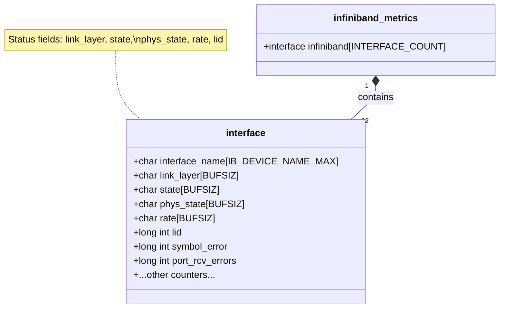
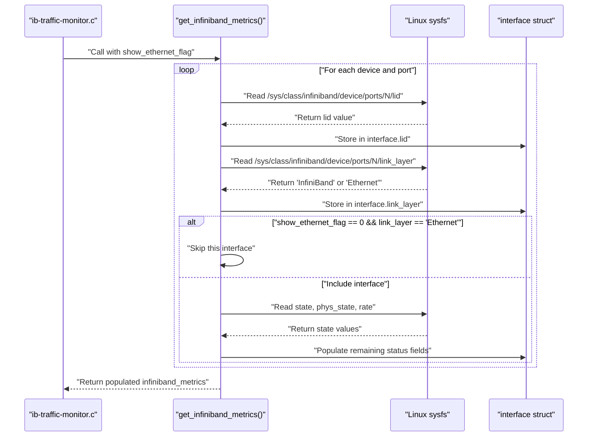
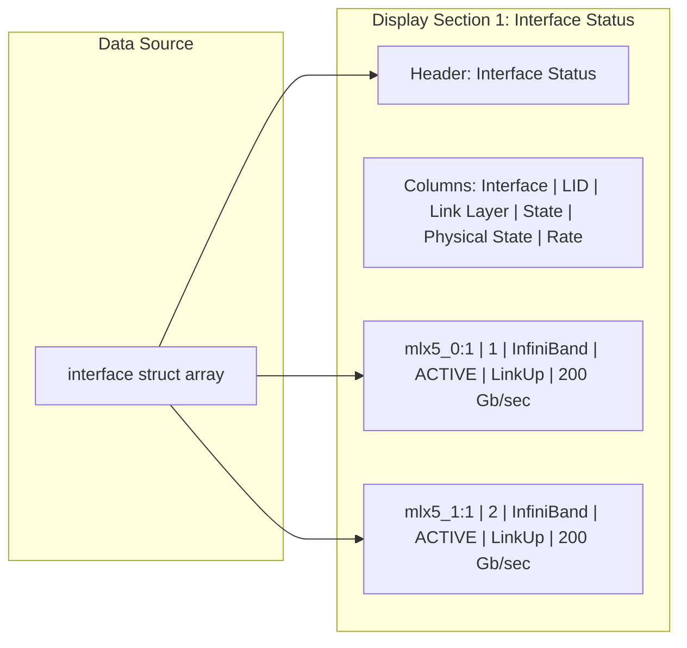
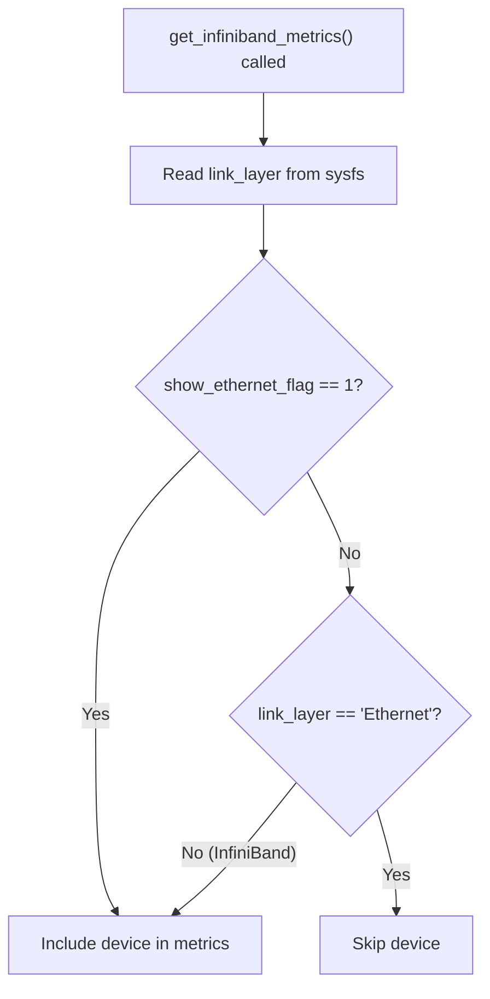

<!-- source: DeepWiki mcp.deepwiki.com · repo NVIDIA/ib-traffic-monitor · page 5.1 Interface Status Metrics · fetched 2026-10-26 -->

# Interface Status Metrics

Relevant source files

The following files were used as context for generating this wiki page:

- [README.md](README.md)
- [infiniband.h](infiniband.h)

## Purpose and Scope

This document describes the five Interface Status metrics collected and displayed by ib-traffic-monitor. These metrics provide static or slowly-changing information about the configuration and operational state of InfiniBand network interfaces. They appear in the first section of the display window and do not include rate calculations since they are state values rather than counters.

For dynamically changing traffic metrics, see [I/O Metrics](#5.2). For error-related counters, see [Error Metrics](#5.3) and [Link Error Metrics](#5.4).

**Sources:** [README.md:15-21]()

---

## Overview

Interface Status metrics provide essential identification and state information for each InfiniBand port. These five metrics are read once per refresh cycle from the Linux sysfs interface and displayed without rate calculations. They help system administrators quickly identify interface characteristics and operational readiness.

| Metric | Type | Description |
|--------|------|-------------|
| LID | Integer | Local Identifier assigned to the port |
| Link Layer | String | Physical link layer type (InfiniBand or Ethernet) |
| State | String | Logical port state (e.g., ACTIVE, DOWN, INIT) |
| Physical State | String | Physical layer state (e.g., LinkUp, Polling, Disabled) |
| Rate | String | Port data rate (e.g., 100 Gb/sec, 200 Gb/sec) |

**Sources:** [README.md:15-21](), [infiniband.h:26-53]()

---

## Data Structure Representation

Interface Status metrics are stored in the `interface` struct defined in [infiniband.h:26-53](). Each metric corresponds to a specific field in this structure:

**Diagram: Interface Status Fields in Data Structures**

The `infiniband_metrics` structure [infiniband.h:55-58]() contains an array of up to 32 `interface` structures (defined by `INTERFACE_COUNT` [infiniband.h:23]()). Each `interface` struct holds both status fields and counter fields.

**Sources:** [infiniband.h:23-58]()

---

## Metric Details

### LID (Local Identifier)

The Local Identifier is a 16-bit address assigned to each InfiniBand port by the Subnet Manager. It uniquely identifies the port within the subnet and is used for routing packets.

| Property | Value |
|----------|-------|
| Field Name | `lid` |
| Data Type | `long int` |
| Unit | n/a (numeric identifier) |
| sysfs Location | `/sys/class/infiniband/<device>/ports/<port>/lid` |
| Typical Range | 1 - 49151 (0xC000 reserved, 0xFFFF invalid) |

**Usage:** The LID is essential for understanding the port's role in the InfiniBand subnet topology. A LID of 0 typically indicates the port is not active or not configured by the Subnet Manager.

**Sources:** [infiniband.h:32](), [README.md:17]()

---

### Link Layer

The Link Layer metric identifies whether the port operates using InfiniBand or Ethernet protocols. This determines the encapsulation format and protocol semantics used by the port.

| Property | Value |
|----------|-------|
| Field Name | `link_layer` |
| Data Type | `char[BUFSIZ]` |
| Unit | n/a (string enumeration) |
| sysfs Location | `/sys/class/infiniband/<device>/ports/<port>/link_layer` |
| Possible Values | `InfiniBand`, `Ethernet` |

**Usage:** The link layer type determines which interfaces are displayed when using the `-e/--ethernet` flag [README.md:70](). By default, ib-traffic-monitor shows only InfiniBand link layer devices.

The `get_infiniband_metrics()` function [infiniband.h:60]() uses the `show_ethernet_flag` parameter to filter devices based on this metric.

**Sources:** [infiniband.h:28](), [README.md:18](), [README.md:70]()

---

### State

The State metric reports the logical operational state of the port according to the InfiniBand specification. This reflects the port's readiness to transmit and receive data.

| Property | Value |
|----------|-------|
| Field Name | `state` |
| Data Type | `char[BUFSIZ]` |
| Unit | n/a (string enumeration) |
| sysfs Location | `/sys/class/infiniband/<device>/ports/<port>/state` |
| Possible Values | `ACTIVE`, `DOWN`, `INIT`, `ARMED`, `NOP` |

**Common State Meanings:**

| State | Description |
|-------|-------------|
| `ACTIVE` | Port is fully operational and ready for data transfer |
| `DOWN` | Port is disabled or link is down |
| `INIT` | Port is initializing, Subnet Manager can configure it |
| `ARMED` | Port is ready to transition to ACTIVE state |

**Usage:** The ACTIVE state indicates the port is fully functional. Any other state suggests configuration issues, link problems, or administrative actions.

**Sources:** [infiniband.h:29](), [README.md:19]()

---

### Physical State

The Physical State metric reports the physical layer state of the port, which is more granular than the logical State metric. It reflects the actual condition of the physical link.

| Property | Value |
|----------|-------|
| Field Name | `phys_state` |
| Data Type | `char[BUFSIZ]` |
| Unit | n/a (string enumeration) |
| sysfs Location | `/sys/class/infiniband/<device>/ports/<port>/phys_state` |
| Possible Values | `LinkUp`, `Sleep`, `Polling`, `Disabled`, `PortConfigurationTraining`, `LinkErrorRecovery`, `Phy Test` |

**Common Physical State Meanings:**

| Physical State | Description |
|----------------|-------------|
| `LinkUp` | Physical link is established and operational |
| `Polling` | Port is attempting to establish physical link |
| `Disabled` | Port is administratively or operationally disabled |
| `LinkErrorRecovery` | Port is recovering from link errors |

**Usage:** Physical State provides insight into link-level issues. A mismatch between State=ACTIVE and phys_state=Polling suggests connectivity problems.

**Sources:** [infiniband.h:30](), [README.md:20]()

---

### Rate

The Rate metric reports the configured data rate for the port. This reflects the negotiated speed based on port capabilities and cable specifications.

| Property | Value |
|----------|-------|
| Field Name | `rate` |
| Data Type | `char[BUFSIZ]` |
| Unit | n/a (formatted string with units) |
| sysfs Location | `/sys/class/infiniband/<device>/ports/<port>/rate` |
| Typical Values | `100 Gb/sec`, `200 Gb/sec`, `400 Gb/sec`, `25 Gb/sec (4X)` |

**Format:** The rate string typically includes the speed in Gb/sec and may include link width information (e.g., "4X" for 4-lane wide links).

**Usage:** Rate indicates the maximum theoretical throughput of the port. Comparing actual throughput (from [I/O Metrics](#5.2)) against the rate helps identify underutilization or performance issues.

**Sources:** [infiniband.h:31](), [README.md:21]()

---

## Collection Flow

The following diagram illustrates how Interface Status metrics are collected from sysfs and populated into the data structures:

**Diagram: Interface Status Metrics Collection Sequence**

**Sources:** [infiniband.h:60](), [README.md:70]()

---

## Mapping to sysfs Paths

The table below shows the precise sysfs file paths read for each Interface Status metric:

| Metric | Structure Field | sysfs Path Pattern |
|--------|----------------|-------------------|
| LID | `interface.lid` | `/sys/class/infiniband/<device>/ports/<port>/lid` |
| Link Layer | `interface.link_layer` | `/sys/class/infiniband/<device>/ports/<port>/link_layer` |
| State | `interface.state` | `/sys/class/infiniband/<device>/ports/<port>/state` |
| Physical State | `interface.phys_state` | `/sys/class/infiniband/<device>/ports/<port>/phys_state` |
| Rate | `interface.rate` | `/sys/class/infiniband/<device>/ports/<port>/rate` |

Where:
- `<device>` is the InfiniBand device name (e.g., `mlx5_0`, `mlx5_1`)
- `<port>` is the port number (typically `1` or `2`)

The interface name stored in `interface.interface_name` [infiniband.h:27]() is constructed as `<device>:<port>` (e.g., `mlx5_0:1`).

**Sources:** [infiniband.h:27-32](), [README.md:108]()

---

## Display Characteristics

Interface Status metrics appear in the first section of the ncurses display window. Unlike I/O and Error metrics, these values are displayed directly without rate calculations or delta computations.

**Diagram: Interface Status Display Layout**

**Display Properties:**
- **Update Frequency:** Once per refresh interval (default 5 seconds)
- **Format:** Tabular, fixed-width columns
- **Rate Calculation:** None (status values, not counters)
- **First Iteration:** Displayed immediately on program start

**Sources:** [README.md:56](), [README.md:9]()

---

## Usage in Device Filtering

The Link Layer metric plays a special role in device filtering. The `show_ethernet_flag` parameter passed to `get_infiniband_metrics()` [infiniband.h:60]() controls whether Ethernet-type devices are included:

**Diagram: Device Filtering Based on Link Layer**

This filtering mechanism enables the `-e/--ethernet` command-line flag functionality described in [README.md:64-70]().

**Sources:** [infiniband.h:60](), [README.md:70]()

---

## Relationship to Other Metric Categories

Interface Status metrics are conceptually distinct from the other three metric categories:

| Category | Nature | Display Characteristics |
|----------|--------|------------------------|
| **Interface Status** (5.1) | State information | No rate calculation, updated each cycle |
| I/O Metrics (5.2) | Cumulative counters | Rate calculated as delta/interval |
| Error Metrics (5.3) | Cumulative counters | Displayed as absolute count |
| Link Error Metrics (5.4) | Cumulative counters | Displayed as absolute count |

The Status metrics provide context for interpreting the other metrics. For example:
- High error rates are only concerning if State=ACTIVE
- Zero I/O throughput is expected if Physical State≠LinkUp
- LID information helps correlate metrics across multiple monitoring points

**Sources:** [README.md:15-41]()

---

## Code Entity Reference

The following code entities are directly related to Interface Status metrics:

| Entity | Type | Location | Purpose |
|--------|------|----------|---------|
| `interface` | struct | [infiniband.h:26-53]() | Contains all per-interface metrics including status fields |
| `infiniband_metrics` | struct | [infiniband.h:55-58]() | Container for array of interface structs |
| `lid` | field | [infiniband.h:32]() | Stores Local Identifier value |
| `link_layer` | field | [infiniband.h:28]() | Stores link layer type string |
| `state` | field | [infiniband.h:29]() | Stores logical port state string |
| `phys_state` | field | [infiniband.h:30]() | Stores physical state string |
| `rate` | field | [infiniband.h:31]() | Stores port rate string |
| `interface_name` | field | [infiniband.h:27]() | Stores device:port identifier |
| `get_infiniband_metrics()` | function | [infiniband.h:60]() | Populates metrics from sysfs |
| `show_ethernet_flag` | parameter | [infiniband.h:60]() | Controls Ethernet device filtering |
| `INTERFACE_COUNT` | constant | [infiniband.h:23]() | Maximum number of interfaces (32) |
| `IB_DEVICE_NAME_MAX` | constant | [infiniband.h:24]() | Maximum device name length (64) |

**Sources:** [infiniband.h:23-60]()

---

