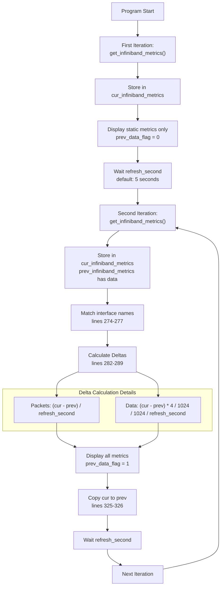
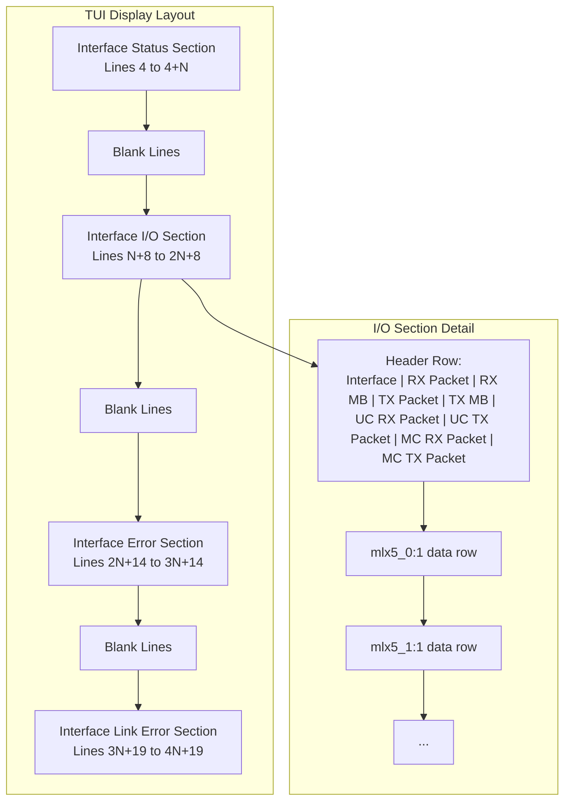
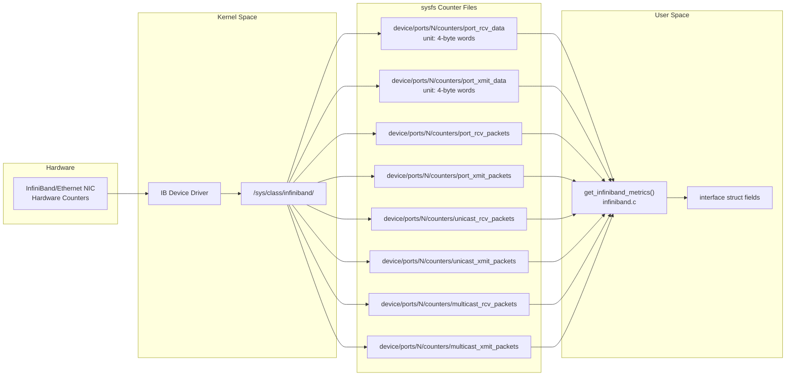
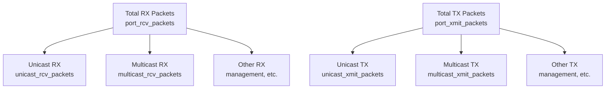

<!-- source: DeepWiki mcp.deepwiki.com · repo NVIDIA/ib-traffic-monitor · page 5.2 I/O Metrics · fetched 2026-10-26 -->

# I/O Metrics

<details>
<summary>Relevant source files</summary>

The following files were used as context for generating this wiki page:

- [README.md](README.md)
- [ib-traffic-monitor.c](ib-traffic-monitor.c)
- [infiniband.h](infiniband.h)

</details>


## Purpose and Scope

This page documents the I/O (Input/Output) metrics collected and displayed by ib-traffic-monitor. I/O metrics measure network traffic throughput and packet counts for InfiniBand and Ethernet interfaces, reporting rates per second for received and transmitted data.

I/O metrics are distinguished from other metric categories in the following ways:
- For interface status information (LID, link state, physical state, rate), see [Interface Status Metrics](#5.1)
- For error counters (symbol errors, packet errors, discards), see [Error Metrics](#5.3)
- For link-level error events (recovery, integrity errors), see [Link Error Metrics](#5.4)

I/O metrics are **rate-based** metrics calculated from cumulative counters, requiring comparison between consecutive sampling intervals to produce meaningful per-second throughput values.

**Sources:** [README.md:15-29](), [infiniband.h:42-49](), [ib-traffic-monitor.c:272-295]()

---

## Metric Categories

ib-traffic-monitor reports eight I/O metrics organized into three categories:

### General Traffic Metrics

| Metric Name | Unit | Display Column | Description |
|------------|------|----------------|-------------|
| RX Packet | packets/second | 2nd | Total received packets per second |
| RX MB | MB/second | 3rd | Total received megabytes per second |
| TX Packet | packets/second | 4th | Total transmitted packets per second |
| TX MB | MB/second | 5th | Total transmitted megabytes per second |

### Unicast Traffic Metrics

| Metric Name | Unit | Display Column | Description |
|------------|------|----------------|-------------|
| UC RX Packet | packets/second | 6th | Unicast received packets per second |
| UC TX Packet | packets/second | 7th | Unicast transmitted packets per second |

### Multicast Traffic Metrics

| Metric Name | Unit | Display Column | Description |
|------------|------|----------------|-------------|
| MC RX Packet | packets/second | 8th | Multicast received packets per second |
| MC TX Packet | packets/second | 9th | Multicast transmitted packets per second |

**Sources:** [README.md:22-29]()

---

## Data Structure Representation

```mermaid
graph TB
    subgraph "infiniband_metrics Structure"
        IB_METRICS["infiniband_metrics"]
        IB_ARRAY["interface[32]"]
    end
    
    subgraph "interface Structure - I/O Fields"
        PORT_RCV_DATA["port_rcv_data<br/>long int"]
        PORT_XMIT_DATA["port_xmit_data<br/>long int"]
        PORT_RCV_PACKETS["port_rcv_packets<br/>long int"]
        PORT_XMIT_PACKETS["port_xmit_packets<br/>long int"]
        UNICAST_RCV["unicast_rcv_packets<br/>long int"]
        UNICAST_XMIT["unicast_xmit_packets<br/>long int"]
        MULTICAST_RCV["multicast_rcv_packets<br/>long int"]
        MULTICAST_XMIT["multicast_xmit_packets<br/>long int"]
    end
    
    subgraph "sysfs Counters"
        SYSFS_RCV_DATA["/sys/class/infiniband/.../counters/port_rcv_data"]
        SYSFS_XMIT_DATA["/sys/class/infiniband/.../counters/port_xmit_data"]
        SYSFS_RCV_PKT["/sys/class/infiniband/.../counters/port_rcv_packets"]
        SYSFS_XMIT_PKT["/sys/class/infiniband/.../counters/port_xmit_packets"]
        SYSFS_UC_RCV["/sys/class/infiniband/.../counters/unicast_rcv_packets"]
        SYSFS_UC_XMIT["/sys/class/infiniband/.../counters/unicast_xmit_packets"]
        SYSFS_MC_RCV["/sys/class/infiniband/.../counters/multicast_rcv_packets"]
        SYSFS_MC_XMIT["/sys/class/infiniband/.../counters/multicast_xmit_packets"]
    end
    
    IB_METRICS --> IB_ARRAY
    IB_ARRAY --> PORT_RCV_DATA
    IB_ARRAY --> PORT_XMIT_DATA
    IB_ARRAY --> PORT_RCV_PACKETS
    IB_ARRAY --> PORT_XMIT_PACKETS
    IB_ARRAY --> UNICAST_RCV
    IB_ARRAY --> UNICAST_XMIT
    IB_ARRAY --> MULTICAST_RCV
    IB_ARRAY --> MULTICAST_XMIT
    
    SYSFS_RCV_DATA -.populated from.-> PORT_RCV_DATA
    SYSFS_XMIT_DATA -.populated from.-> PORT_XMIT_DATA
    SYSFS_RCV_PKT -.populated from.-> PORT_RCV_PACKETS
    SYSFS_XMIT_PKT -.populated from.-> PORT_XMIT_PACKETS
    SYSFS_UC_RCV -.populated from.-> UNICAST_RCV
    SYSFS_UC_XMIT -.populated from.-> UNICAST_XMIT
    SYSFS_MC_RCV -.populated from.-> MULTICAST_RCV
    SYSFS_MC_XMIT -.populated from.-> MULTICAST_XMIT
```



The I/O metrics are stored in the `interface` structure as cumulative counter values. Each `interface` instance contains eight `long int` fields that hold raw counter values read from sysfs. The `infiniband_metrics` structure contains an array of up to 32 `interface` instances, allowing monitoring of multiple InfiniBand/Ethernet ports simultaneously.

**Sources:** [infiniband.h:26-53](), [infiniband.h:55-58]()

---

## Rate Calculation Process

I/O metrics are derived from cumulative hardware counters through a delta calculation process:



### Calculation Formula

For each I/O metric, the per-second rate is calculated as:

**Packet Metrics:**
```
rate = (current_value - previous_value) / refresh_second
```

**Data Metrics:**
```
rate_MB = (current_value - previous_value) * 4 / 1024 / 1024 / refresh_second
```

The factor of 4 converts from the sysfs unit (32-bit words) to bytes, and division by 1024²  converts bytes to megabytes.

### Implementation Details

The rate calculation occurs in the main event loop at [ib-traffic-monitor.c:272-295](). Key aspects:

1. **First Iteration Handling**: When `prev_data_flag == 0` (line 272), only static metrics are displayed because no previous data exists for delta calculation.

2. **Interface Matching**: The nested loop (lines 274-277) matches current interface names with previous interface names using `strcmp()` to ensure rate calculations compare the same physical interface across time.

3. **Rate Computation**: Lines 282-289 apply the delta formulas using the `refresh_second` variable (configurable via `-r` option, default 5 seconds).

**Sources:** [ib-traffic-monitor.c:272-295](), [ib-traffic-monitor.c:325-329](), [ib-traffic-monitor.c:62-94]()

---

## Display Format and Location



### Column Positions

The I/O metrics section uses delimiter positions defined at [ib-traffic-monitor.c:126]():

```
int interface_io_positions[] = {17, 31, 43, 57, 69, 86, 103, 120};
```

These positions create vertical delimiters separating the following columns:

| Position | Column Content | Width | Format String |
|----------|---------------|-------|---------------|
| 1 | Interface Name | 16 chars | `"%-16s"` |
| 17 | Delimiter | 1 char | `│` |
| 21 | RX Packet | 10 chars | `"%10ld"` |
| 31 | Delimiter | 1 char | `│` |
| 33 | RX MB | 10 chars | `"%10ld"` |
| 43 | Delimiter | 1 char | `│` |
| 47 | TX Packet | 10 chars | `"%10ld"` |
| 57 | Delimiter | 1 char | `│` |
| 59 | TX MB | 10 chars | `"%10ld"` |
| 69 | Delimiter | 1 char | `│` |
| 76 | UC RX Packet | 10 chars | `"%10ld"` |
| 86 | Delimiter | 1 char | `│` |
| 93 | UC TX Packet | 10 chars | `"%10ld"` |
| 103 | Delimiter | 1 char | `│` |
| 110 | MC RX Packet | 10 chars | `"%10ld"` |
| 120 | Delimiter | 1 char | `│` |
| 125 | MC TX Packet | 10 chars | `"%10ld"` |

### Printing Logic

The I/O section is printed only after the first iteration when `prev_data_flag > 0` (line 272). The printing occurs at lines 280-289 using `mvwprintw()` to position each value. The row position is calculated as:

```
row = ret_get_infiniband_metrics + 8 + infiniband_name_found
```

where `ret_get_infiniband_metrics` is the total number of interfaces and `infiniband_name_found` is incremented for each matched interface.

**Sources:** [ib-traffic-monitor.c:126](), [ib-traffic-monitor.c:272-295](), [ib-traffic-monitor.c:280-289]()

---

## sysfs Counter Sources



### Counter File Paths

Each I/O metric is read from a specific sysfs file under the path:
```
/sys/class/infiniband/<device_name>/ports/<port_number>/counters/<counter_name>
```

| Counter File | Struct Field | Description |
|--------------|--------------|-------------|
| `port_rcv_data` | `port_rcv_data` | Cumulative received data in 4-byte words |
| `port_xmit_data` | `port_xmit_data` | Cumulative transmitted data in 4-byte words |
| `port_rcv_packets` | `port_rcv_packets` | Cumulative received packet count |
| `port_xmit_packets` | `port_xmit_packets` | Cumulative transmitted packet count |
| `unicast_rcv_packets` | `unicast_rcv_packets` | Cumulative received unicast packet count |
| `unicast_xmit_packets` | `unicast_xmit_packets` | Cumulative transmitted unicast packet count |
| `multicast_rcv_packets` | `multicast_rcv_packets` | Cumulative received multicast packet count |
| `multicast_xmit_packets` | `multicast_xmit_packets` | Cumulative transmitted multicast packet count |

### Counter Characteristics

All I/O counters in sysfs are:
- **Cumulative**: They monotonically increase from port initialization and never reset (except on device reset)
- **64-bit**: Stored as `unsigned long long` in hardware but read as `long int` in the application
- **Persistent**: Values persist across process restarts but reset on port state changes or device resets

The `get_infiniband_metrics()` function in `infiniband.c` handles reading these counter files using file I/O operations.

**Sources:** [README.md:108-110](), [infiniband.h:42-49]()

---

## Relationship to Total Traffic



The relationship between total and categorized traffic:

```
port_rcv_packets ≥ unicast_rcv_packets + multicast_rcv_packets
port_xmit_packets ≥ unicast_xmit_packets + multicast_xmit_packets
```

The inequality exists because total packet counts include all packet types (unicast, multicast, broadcast, management packets), while the unicast and multicast counters track only those specific categories.

**Sources:** [infiniband.h:44-49](), [README.md:22-29]()

---

