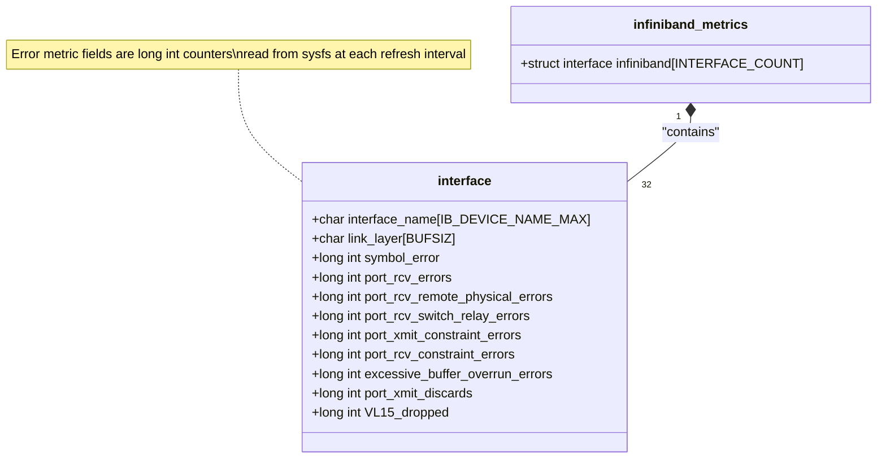
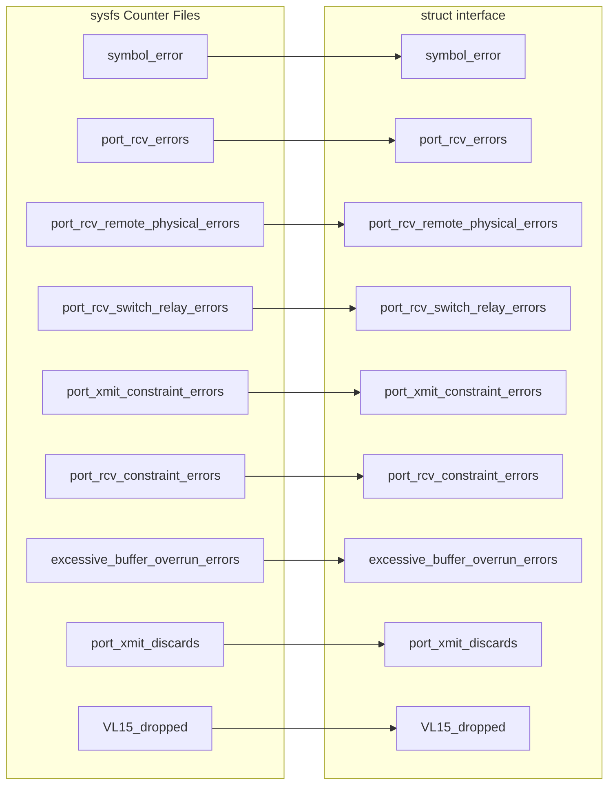
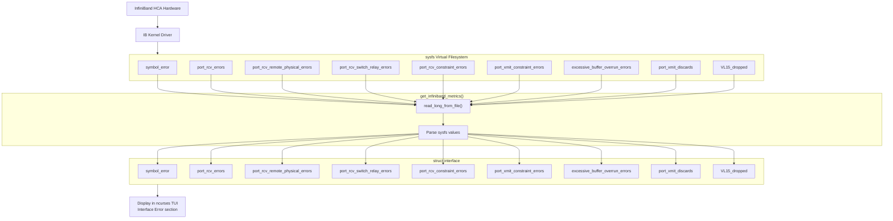
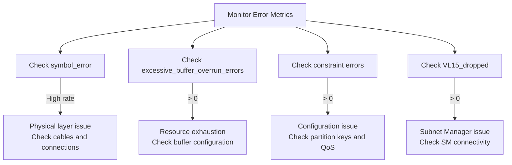

<!-- source: DeepWiki mcp.deepwiki.com · repo NVIDIA/ib-traffic-monitor · page 5.3 Error Metrics · fetched 2026-10-26 -->

# Error Metrics

Relevant source files

The following files were used as context for generating this wiki page:

- [README.md](README.md)
- [infiniband.h](infiniband.h)

## Purpose and Scope

This page documents the **Interface Error** metrics collected and displayed by `ib-traffic-monitor`. These metrics track various error conditions that occur during packet reception and transmission on InfiniBand and Ethernet interfaces.

Error metrics are distinct from **Link Error** metrics, which track link-level failures and recovery events. For link error metrics such as link error recovery, link downed, and link integrity errors, see [Link Error Metrics](#5.4). For general interface statistics on successful packet transfers, see [I/O Metrics](#5.2).

**Sources:** [README.md:30-38]()

---

## Overview

Error metrics provide visibility into packet-level and physical-layer errors that occur on InfiniBand interfaces. These counters are cumulative and increase over time as errors occur. The `ib-traffic-monitor` tool reads these counters from the Linux sysfs interface and displays them to help administrators diagnose network issues.

All error metrics are stored as `long int` values in the `struct interface` data structure and are read from sysfs files located under `/sys/class/infiniband/*/ports/*/counters/`.

**Sources:** [infiniband.h:26-53]()

---

## Error Metric Categories

The error metrics tracked by `ib-traffic-monitor` can be grouped into four functional categories:

### Symbol Errors
Physical-layer errors detected on the transmission lanes. These indicate signal quality issues.

### Receive Path Errors
Errors encountered when receiving packets, including malformed packets, remote physical errors, and switch relay errors.

### Transmit Path Errors
Errors that prevent successful packet transmission, including constraint violations and discarded packets.

### Buffer and Queue Errors
Resource exhaustion errors such as buffer overruns and dropped packets due to queue limitations.

**Sources:** [README.md:30-38](), [infiniband.h:33-42]()

---

## Data Structure Representation

The following diagram shows how error metrics are stored in the `struct interface` data structure:

**Sources:** [infiniband.h:26-53]()

---

## sysfs to Data Structure Mapping

Error metrics are read from specific sysfs counter files. The following diagram shows the mapping between sysfs file paths and `struct interface` fields:

**Sources:** [infiniband.h:33-42,51-52](), [README.md:30-38]()

---

## Detailed Metric Reference

The following table provides comprehensive details for each error metric:

| Metric Name | Display Name | struct Field | sysfs Counter | Unit | Description |
|-------------|--------------|--------------|---------------|------|-------------|
| Symbol Error | Symbol | `symbol_error` | `symbol_error` | count | Number of minor link errors detected on one or more physical lanes |
| Receive Error | RX | `port_rcv_errors` | `port_rcv_errors` | packet | Number of packets containing an error that were received on the port |
| RX Remote Physical Error | RX Remote PHY | `port_rcv_remote_physical_errors` | `port_rcv_remote_physical_errors` | packet | Number of packets marked with the EBP delimiter received on the port |
| RX Switch Relay Error | RX Switch Relay | `port_rcv_switch_relay_errors` | `port_rcv_switch_relay_errors` | packet | Number of packets received on the port that were discarded |
| RX Constraint Error | RX Const. | `port_rcv_constraint_errors` | `port_rcv_constraint_errors` | packet | Number of packets received on the switch physical port that are discarded |
| TX Constraint Error | TX Const. | `port_xmit_constraint_errors` | `port_xmit_constraint_errors` | packet | Number of packets not transmitted from the switch physical port |
| Buffer Overrun Error | Buffer Overrun | `excessive_buffer_overrun_errors` | `excessive_buffer_overrun_errors` | count | Number of input buffer overruns |
| TX Discard Error | TX Discard | `port_xmit_discards` | `port_xmit_discards` | packet | Number of outbound packets discarded |
| VL15 Dropped | VL15 Dropped | `VL15_dropped` | `VL15_dropped` | packet | Number of incoming VL15 packets dropped |

**Sources:** [README.md:30-38](), [infiniband.h:33-42,51-52]()

---

## Error Metric Details

### Symbol Errors (`symbol_error`)

**Field:** `long int symbol_error` in `struct interface`  
**sysfs Path:** `/sys/class/infiniband/<device>/ports/<port>/counters/symbol_error`  
**Unit:** count  

Symbol errors indicate minor physical-layer errors detected on one or more lanes of the link. These errors are typically caused by signal integrity issues, cable problems, or electromagnetic interference. A small number of symbol errors may be normal, but a high or increasing rate indicates potential hardware issues.

### Receive Errors (`port_rcv_errors`)

**Field:** `long int port_rcv_errors` in `struct interface`  
**sysfs Path:** `/sys/class/infiniband/<device>/ports/<port>/counters/port_rcv_errors`  
**Unit:** packet  

This counter tracks the total number of packets received that contained errors. This is a general receive error counter that encompasses various types of packet-level errors encountered during reception.

### RX Remote Physical Errors (`port_rcv_remote_physical_errors`)

**Field:** `long int port_rcv_remote_physical_errors` in `struct interface`  
**sysfs Path:** `/sys/class/infiniband/<device>/ports/<port>/counters/port_rcv_remote_physical_errors`  
**Unit:** packet  

This metric counts packets marked with the End Bad Packet (EBP) delimiter. These packets indicate that the remote transmitter detected a physical-layer error during packet transmission.

### RX Switch Relay Errors (`port_rcv_switch_relay_errors`)

**Field:** `long int port_rcv_switch_relay_errors` in `struct interface`  
**sysfs Path:** `/sys/class/infiniband/<device>/ports/<port>/counters/port_rcv_switch_relay_errors`  
**Unit:** packet  

Counts packets received on the port that were discarded by the switch relay function. This typically occurs in switch devices when packets cannot be forwarded properly.

### RX Constraint Errors (`port_rcv_constraint_errors`)

**Field:** `long int port_rcv_constraint_errors` in `struct interface`  
**sysfs Path:** `/sys/class/infiniband/<device>/ports/<port>/counters/port_rcv_constraint_errors`  
**Unit:** packet  

This counter tracks packets received on the switch physical port that are discarded due to constraint violations, such as partition key (P_Key) or QoS (Quality of Service) constraint violations.

### TX Constraint Errors (`port_xmit_constraint_errors`)

**Field:** `long int port_xmit_constraint_errors` in `struct interface`  
**sysfs Path:** `/sys/class/infiniband/<device>/ports/<port>/counters/port_xmit_constraint_errors`  
**Unit:** packet  

Counts packets that could not be transmitted from the switch physical port due to constraint violations. Similar to RX constraint errors but for the transmit path.

### Buffer Overrun Errors (`excessive_buffer_overrun_errors`)

**Field:** `long int excessive_buffer_overrun_errors` in `struct interface`  
**sysfs Path:** `/sys/class/infiniband/<device>/ports/<port>/counters/excessive_buffer_overrun_errors`  
**Unit:** count  

This metric indicates the number of times input buffers overran, typically due to the receive rate exceeding the processing capacity. This is a resource exhaustion indicator.

### TX Discard Errors (`port_xmit_discards`)

**Field:** `long int port_xmit_discards` in `struct interface`  
**sysfs Path:** `/sys/class/infiniband/<device>/ports/<port>/counters/port_xmit_discards`  
**Unit:** packet  

Counts outbound packets that were discarded before transmission. This can occur due to various reasons including queue overflows, policy violations, or congestion.

### VL15 Dropped (`VL15_dropped`)

**Field:** `long int VL15_dropped` in `struct interface`  
**sysfs Path:** `/sys/class/infiniband/<device>/ports/<port>/counters/VL15_dropped`  
**Unit:** packet  

Virtual Lane 15 (VL15) is reserved for Subnet Management Packets (SMPs). This counter tracks the number of VL15 packets that were dropped, which can indicate issues with subnet management communication.

**Sources:** [README.md:30-38](), [infiniband.h:33-42,51-52]()

---

## Data Collection Flow

The following diagram illustrates how error metrics flow from hardware through sysfs into the application data structures:

**Sources:** [infiniband.h:26-53](), [README.md:30-38]()

---

## Code Location Reference

The error metrics are defined and used in the following code locations:

| Component | File | Lines | Description |
|-----------|------|-------|-------------|
| Data Structure Definition | `infiniband.h` | 26-53 | Defines `struct interface` with error metric fields |
| Constant Definitions | `infiniband.h` | 23-24 | Defines `INTERFACE_COUNT` and `IB_DEVICE_NAME_MAX` |
| Metrics Collection | `infiniband.c` | N/A | Implements `get_infiniband_metrics()` to read error counters from sysfs |
| Display Formatting | `ib-traffic-monitor.c` | N/A | Formats and displays error metrics in the Interface Error section |

**Sources:** [infiniband.h:1-62]()

---

## Error Interpretation Guidelines

### Normal vs Abnormal Error Rates

- **Symbol Errors**: Occasional symbol errors (< 1 per minute) may be acceptable. Sustained rates indicate physical layer issues.
- **Buffer Overruns**: Should be zero in properly sized systems. Any occurrence indicates resource constraints.
- **Constraint Errors**: Should be zero in properly configured networks. Non-zero values indicate configuration problems.
- **VL15 Dropped**: Should be zero. Non-zero values indicate subnet management communication issues.

### Troubleshooting Workflow

**Sources:** [README.md:30-38]()

---

## Relationship to Other Metrics

Error metrics complement other metric categories:

- **Interface Status Metrics** ([5.1](#5.1)): Provide context for errors (e.g., port state, rate)
- **I/O Metrics** ([5.2](#5.2)): High error rates relative to traffic volume indicate problems
- **Link Error Metrics** ([5.4](#5.4)): Link-level failures may correlate with increased error counters

When diagnosing issues, administrators should examine error metrics in conjunction with these related categories for complete visibility.

**Sources:** [README.md:15-41]()

---

