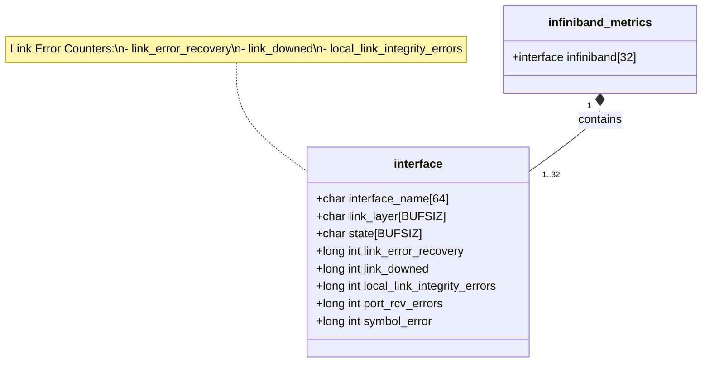
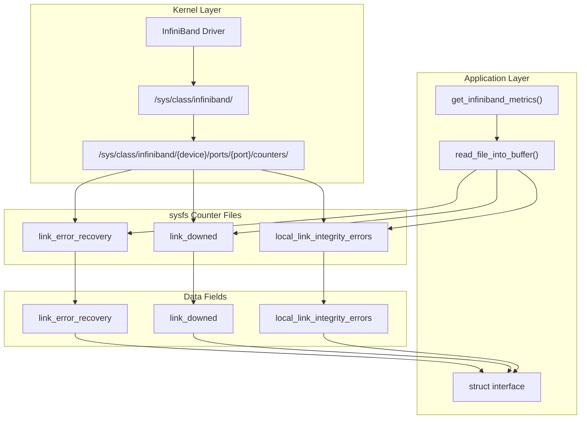
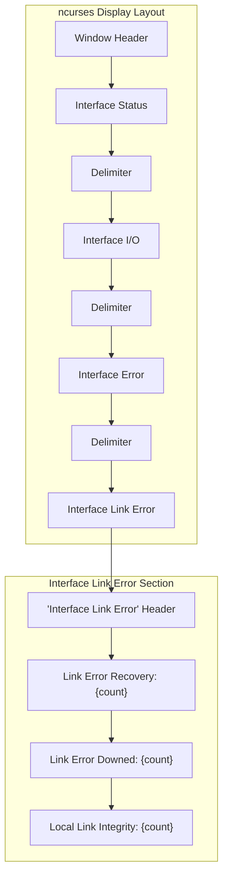
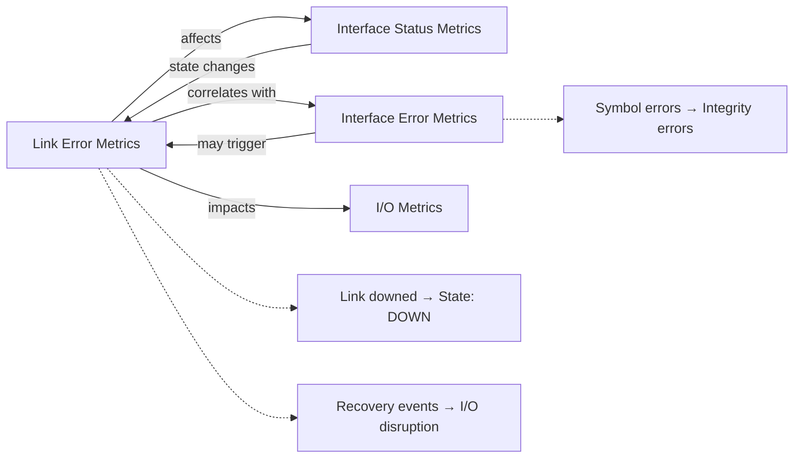
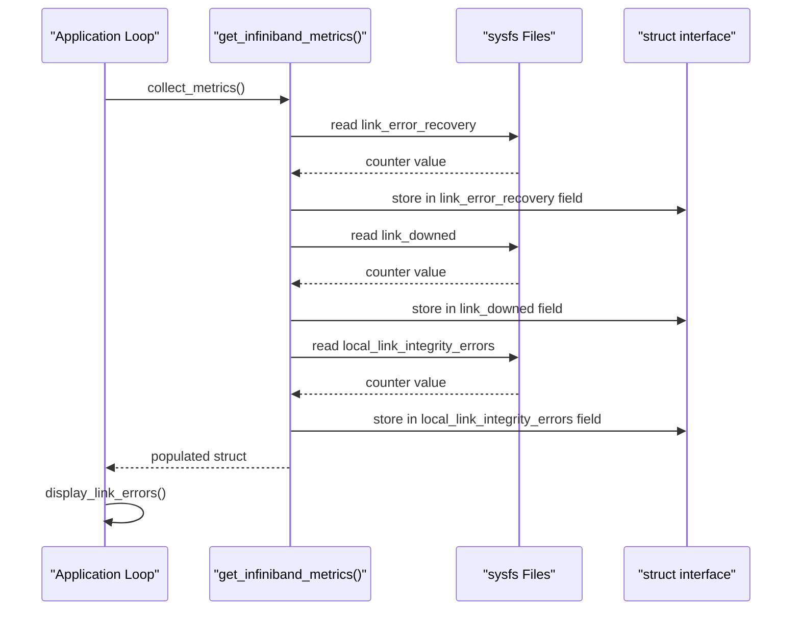

<!-- source: DeepWiki mcp.deepwiki.com · repo NVIDIA/ib-traffic-monitor · page 5.4 Link Error Metrics · fetched 2026-10-26 -->

# Link Error Metrics

<details>
<summary>Relevant source files</summary>

The following files were used as context for generating this wiki page:

- [README.md](README.md)
- [infiniband.h](infiniband.h)

</details>


## Purpose and Scope

This page documents the link-specific error metrics collected and displayed by ib-traffic-monitor. These metrics track error recovery events, link stability issues, and physical layer integrity problems at the InfiniBand link level. Link error metrics differ from general interface errors (see [Error Metrics](#5.3)) by focusing specifically on link-layer training and recovery processes.

The three link error metrics are:
- **Link Error Recovery**: Successful recovery from link errors
- **Link Downed**: Failed recovery attempts that downed the link
- **Local Link Integrity**: Physical error threshold exceedances

## Metric Categories Overview

Link error metrics represent critical indicators of network stability and physical layer health. Unlike packet-level errors, these metrics track the Port Training state machine's ability to maintain and recover link connectivity.

| Metric Name | Field Name | Unit | Description |
|-------------|-----------|------|-------------|
| Link Error Recovery | `link_error_recovery` | count | Successful completions of link error recovery process |
| Link Downed | `link_downed` | count | Failed recoveries resulting in downed link |
| Local Link Integrity | `local_link_integrity_errors` | count | Physical error threshold violations |

**Sources:** [README.md:39-41](), [infiniband.h:37-40]()

## Data Structure Representation

Link error metrics are stored as integer counters within the `interface` structure. These are cumulative counters that monotonically increase over time, representing the total count of each event type since the port was initialized.



**Diagram: Link Error Metric Fields in Data Structures**

The `interface` struct stores three link error metrics alongside general error counters. Each port interface can have multiple instances tracked in the `infiniband_metrics` structure array.

**Sources:** [infiniband.h:26-53]()

## Metric Definitions

### Link Error Recovery

**Field:** `link_error_recovery`  
**Type:** `long int`  
**Unit:** count (cumulative)

This counter tracks the number of times the Port Training state machine has successfully completed the link error recovery process. When physical layer errors occur, InfiniBand ports attempt to recover the link without bringing it down. Each successful recovery increments this counter.

**Significance:**
- Higher values indicate link instability but successful automatic recovery
- Frequent recoveries may suggest physical layer issues (cable quality, signal integrity)
- Non-zero values are normal in production environments but rapid increases warrant investigation

**Sources:** [README.md:39](), [infiniband.h:37]()

### Link Downed

**Field:** `link_downed`  
**Type:** `long int`  
**Unit:** count (cumulative)

This counter represents the number of times the Port Training state machine has failed to recover from link errors and downed the link. This is a more severe condition than link error recovery, as it indicates the link had to be brought down and re-initialized.

**Significance:**
- Critical metric indicating severe link instability
- Any increment represents a link outage event
- Frequently correlates with physical layer problems requiring immediate attention
- Should be monitored closely in production environments

**Sources:** [README.md:40](), [infiniband.h:50]()

### Local Link Integrity Errors

**Field:** `local_link_integrity_errors`  
**Type:** `long int`  
**Unit:** count (cumulative)

This counter tracks the number of times the count of local physical errors has exceeded the configured threshold. InfiniBand maintains internal counters for physical layer errors, and when these exceed a threshold within a monitoring interval, this metric increments.

**Significance:**
- Indicates degraded physical layer performance
- May precede link recovery or link down events
- Suggests physical infrastructure issues (cables, connectors, transceivers)
- Useful for predictive maintenance and early problem detection

**Sources:** [README.md:41](), [infiniband.h:40]()

## Data Collection Flow

Link error metrics follow the standard sysfs-based collection pipeline used by ib-traffic-monitor. The system reads raw counter values from kernel-exposed interfaces and stores them in the `interface` structure.



**Diagram: Link Error Metric Collection Pipeline**

The collection process reads counter files from the sysfs counters subdirectory for each port. The `get_infiniband_metrics()` function orchestrates the reading of all metrics, using utility functions to read individual counter files.

**Sources:** [infiniband.h:60](), [README.md:108]()

## sysfs Interface Mapping

Link error metrics are exposed through the Linux sysfs filesystem under the standard InfiniBand device paths. Each counter corresponds to a specific file that contains the cumulative count value.

| Metric | sysfs File Path | Data Type | Notes |
|--------|----------------|-----------|-------|
| Link Error Recovery | `/sys/class/infiniband/{device}/ports/{port}/counters/link_error_recovery` | integer | 64-bit counter |
| Link Downed | `/sys/class/infiniband/{device}/ports/{port}/counters/link_downed` | integer | 64-bit counter |
| Local Link Integrity | `/sys/class/infiniband/{device}/ports/{port}/counters/local_link_integrity_errors` | integer | 64-bit counter |

**File Path Pattern:**
```
/sys/class/infiniband/{device_name}/ports/{port_number}/counters/{counter_name}
```

**Example:**
```
/sys/class/infiniband/mlx5_0/ports/1/counters/link_error_recovery
/sys/class/infiniband/mlx5_0/ports/1/counters/link_downed
/sys/class/infiniband/mlx5_0/ports/1/counters/local_link_integrity_errors
```

**Sources:** [README.md:108]()

## Display Presentation

Link error metrics are displayed in the "Interface Link Error" section of the ncurses TUI, which is the fourth and final section of the display layout. These metrics are presented as cumulative counts, not rates, since they represent discrete events rather than continuous data transfer.



**Diagram: Link Error Metrics Display Organization**

Unlike I/O metrics which display rates calculated from counter deltas, link error metrics display raw cumulative counts. This presentation choice reflects their nature as discrete event counters rather than continuous throughput measurements.

**Sources:** [README.md:9-11](), [README.md:39-41]()

## Interpretation Guidelines

### Normal Operating Conditions

In a stable, well-configured InfiniBand network:
- **Link Error Recovery**: May show occasional non-zero values, especially during initial link training or network topology changes
- **Link Downed**: Should remain at zero or increment very rarely
- **Local Link Integrity**: Should remain at zero or show minimal increments

### Warning Indicators

Monitor these patterns that suggest potential issues:
- **Increasing Link Error Recovery**: Consistent growth indicates ongoing physical layer instability
- **Any Link Downed Events**: Each increment represents a link outage requiring investigation
- **Frequent Local Link Integrity Errors**: Predictor of more severe link issues

### Root Cause Analysis

Common causes of link error metric increments:

| Metric Pattern | Likely Causes | Investigation Steps |
|----------------|---------------|---------------------|
| High recovery, low downed | Marginal signal quality | Check cable quality, reseat connections, verify cable specifications |
| High downed counts | Severe physical issues | Replace cables, check transceiver compatibility, verify power levels |
| High local integrity | Physical layer degradation | Inspect for cable damage, check environmental factors, verify signal margins |
| All three increasing | Systemic physical problems | Comprehensive physical layer audit required |

**Sources:** [README.md:110]()

## Relationship to Other Metrics

Link error metrics interact with other metric categories to provide comprehensive network health visibility:



**Diagram: Link Error Metric Relationships**

**Key Correlations:**
- **With Status Metrics** (see [Interface Status Metrics](#5.1)): Link downed events cause state transitions to DOWN
- **With Error Metrics** (see [Error Metrics](#5.3)): Symbol errors often precede local link integrity errors
- **With I/O Metrics** (see [I/O Metrics](#5.2)): Link recovery events cause temporary throughput drops

**Sources:** [README.md:15-41](), [infiniband.h:26-53]()

## Implementation Notes

### Counter Persistence

Link error counters are managed by the InfiniBand driver and persist across application restarts. The counters reset only when:
- The port is physically reset
- The driver is reloaded
- The system is rebooted
- A manual counter reset is performed (vendor-specific)

### Reading Considerations

The `get_infiniband_metrics()` function reads these counters during each collection cycle. Since they are cumulative counts rather than rates, the application displays the raw values directly without delta calculations.



**Diagram: Link Error Metric Collection Sequence**

**Sources:** [infiniband.h:60]()

### Data Type Selection

All three link error metrics use `long int` type in the `interface` structure. This provides sufficient range for cumulative counters that may grow over extended operational periods without overflow concerns on modern 64-bit systems.

**Sources:** [infiniband.h:37-40](), [infiniband.h:50]()

## Monitoring Best Practices

### Baseline Establishment

Establish baseline values during initial deployment:
1. Monitor metrics during burn-in period
2. Document typical values for your environment
3. Set alert thresholds based on observed patterns

### Alerting Strategy

Recommended alert conditions:
- **Critical**: Any `link_downed` increment
- **Warning**: `link_error_recovery` increasing faster than baseline
- **Info**: `local_link_integrity_errors` non-zero values

### Correlation Analysis

When investigating link errors:
1. Check all three link error metrics together
2. Correlate with interface error metrics (see [Error Metrics](#5.3))
3. Review interface state changes (see [Interface Status Metrics](#5.1))
4. Analyze I/O throughput patterns (see [I/O Metrics](#5.2))

**Sources:** [README.md:39-41]()

---

