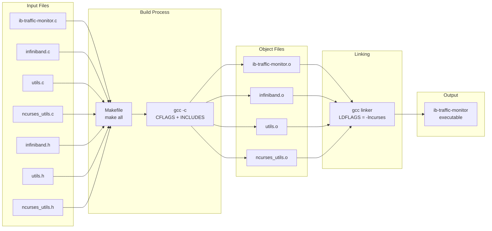
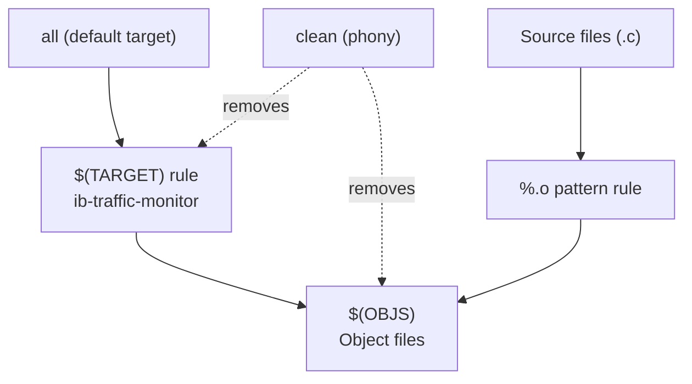
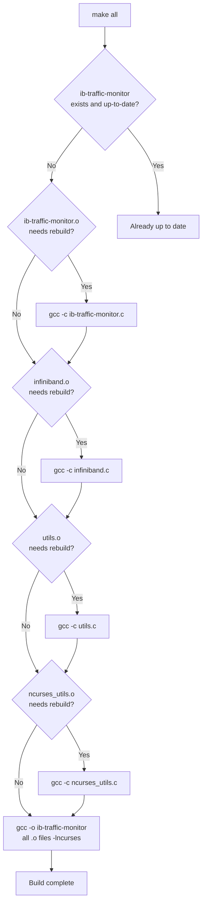
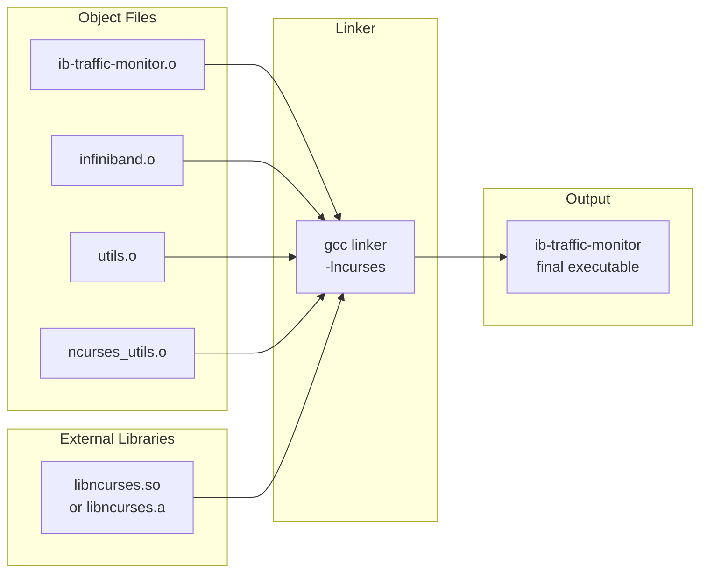
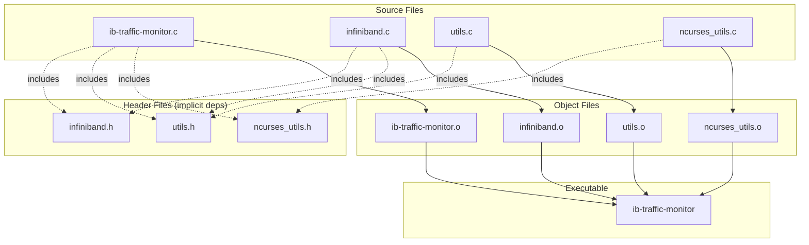

<!-- source: DeepWiki mcp.deepwiki.com · repo NVIDIA/ib-traffic-monitor · page 6 Build System · fetched 2026-10-26 -->

# Build System

<details>
<summary>Relevant source files</summary>

The following files were used as context for generating this wiki page:

- [Makefile](Makefile)

</details>


## Purpose and Scope

This document explains the build system for ib-traffic-monitor, which is implemented using GNU Make. It covers the Makefile structure, compilation process, compiler flags, and linking configuration. For information about system dependencies and installation procedures, see [Building and Installation](#2.1). For details about the runtime architecture that results from the build process, see [System Architecture](#3.1).

**Sources:** [Makefile:1-36]()

## Overview

The ib-traffic-monitor build system uses a single Makefile to compile four C source files into object files and link them with the ncurses library into a single executable. The build process employs strict compiler warnings and runtime sanitizers to catch potential bugs during development.



**Sources:** [Makefile:16-36]()

## Makefile Structure

The Makefile is organized into build variables, phony targets, and pattern rules that define the compilation and linking process.

### Build Variables

The Makefile defines seven key variables that control the build process:

| Variable | Value | Purpose |
|----------|-------|---------|
| `CC` | `gcc` | C compiler executable |
| `CFLAGS` | Multiple warning and sanitizer flags | Compiler flags for all compilations |
| `INCLUDES` | `-I.` | Include directory paths (current directory) |
| `SRCS` | Four `.c` files | List of all source files to compile |
| `OBJS` | `$(SRCS:.c=.o)` | Derived list of object files |
| `TARGET` | `ib-traffic-monitor` | Name of output executable |
| `LDFLAGS` | `-lncurses` | Linker flags and libraries |

**Sources:** [Makefile:16-22]()

### Build Targets

The Makefile defines three targets:



**Phony Targets**

The `.PHONY` declaration at [Makefile:24]() marks `all` and `clean` as phony targets, meaning they do not correspond to actual files:

- **all**: Default target that builds the executable by depending on `$(TARGET)`
- **clean**: Removes all generated files (object files and executable)

**Sources:** [Makefile:24-35]()

### Compilation Rules

#### Main Target Rule

The primary build rule at [Makefile:28-29]() creates the executable:

```
$(TARGET): $(OBJS)
	$(CC) $(CFLAGS) $(INCLUDES) -o $@ $^ $(LDFLAGS)
```

This rule:
- Depends on all object files (`$(OBJS)`)
- Links them using `gcc` with the same `CFLAGS` used for compilation
- Links against the ncurses library via `$(LDFLAGS)`
- Produces the `ib-traffic-monitor` executable

#### Pattern Rule for Object Files

The pattern rule at [Makefile:31-32]() compiles each source file:

```
%.o: %.c
	$(CC) $(CFLAGS) $(INCLUDES) -c -o $@ $<
```

This rule:
- Matches any `.c` file to produce corresponding `.o` file
- Uses `-c` flag to compile without linking
- Applies all compiler warnings and sanitizers from `CFLAGS`
- Uses `-I.` to allow includes from the current directory

**Sources:** [Makefile:28-32]()

## Compiler Flags

The `CFLAGS` variable at [Makefile:17]() contains extensive compiler flags for code quality and safety:

### Debug and Warning Flags

| Flag Category | Flags | Purpose |
|---------------|-------|---------|
| Debug | `-g` | Include debugging symbols in object files |
| Basic Warnings | `-Wall -Wextra -Wpedantic` | Enable all standard warnings plus extra checks |
| Type Conversion | `-Wconversion -Wsign-conversion` | Warn on implicit type conversions |
| Numeric Safety | `-Wdouble-promotion` | Warn when float is promoted to double |
| Code Quality | `-Wunused -Wshadow` | Warn on unused variables and shadowed declarations |

### Runtime Sanitizer

The `-fsanitize=undefined` flag enables runtime undefined behavior detection, which catches:
- Integer overflow
- Null pointer dereferences
- Out-of-bounds array access
- Invalid shifts and divisions
- Use of uninitialized variables

This sanitizer adds runtime checks during development and testing to catch bugs that static analysis might miss.

**Sources:** [Makefile:17]()

## Compilation Process

The compilation process transforms each source file into an object file through these steps:



### Dependency Checking

Make automatically checks file timestamps to determine which files need recompilation:

1. If a `.c` source file is newer than its corresponding `.o` object file, the source is recompiled
2. If any `.o` file is newer than the `ib-traffic-monitor` executable, relinking occurs
3. Header file changes require manual dependency tracking or a full `make clean && make`

**Sources:** [Makefile:28-32]()

## Linking Process

The linking step combines all object files and external libraries into the final executable:



### Library Linking

The `LDFLAGS` variable at [Makefile:22]() specifies `-lncurses`, which instructs the linker to:

1. Search for `libncurses.so` (shared library) or `libncurses.a` (static library)
2. Link the ncurses library functions used by the application
3. Add runtime dependency information to the executable

The ncurses library provides terminal UI functionality used by [ncurses_utils.c]() and the main application loop in [ib-traffic-monitor.c]().

**Sources:** [Makefile:22,28-29]()

## Build Dependencies

The following diagram maps source files to their compiled artifacts and shows implicit header dependencies:



### Source File List

The `SRCS` variable at [Makefile:19]() explicitly lists all source files:

```makefile
SRCS = ib-traffic-monitor.c infiniband.c utils.c ncurses_utils.c
```

The order does not affect compilation, as each source file is compiled independently into an object file.

### Object File Generation

The `OBJS` variable at [Makefile:20]() uses Make's substitution syntax to derive object file names:

```makefile
OBJS = $(SRCS:.c=.o)
```

This expands to: `ib-traffic-monitor.o infiniband.o utils.o ncurses_utils.o`

**Sources:** [Makefile:19-20]()

## Build Commands

### Building the Project

To compile the entire project:

```bash
make
```

or explicitly:

```bash
make all
```

This executes the default `all` target, which builds the `ib-traffic-monitor` executable.

### Cleaning Build Artifacts

To remove all generated files:

```bash
make clean
```

This executes the `clean` target at [Makefile:34-35](), which removes:
- All object files (`*.o`)
- The target executable (`ib-traffic-monitor`)

### Incremental Builds

Make automatically performs incremental builds. If you modify only one source file and run `make` again, only that file is recompiled and the executable is relinked. This saves time during development.

**Sources:** [Makefile:24-35]()

## Build Output

A successful build produces:

1. **Object Files** (`.o` files): Binary intermediate files containing compiled but unlinked code
2. **Executable** (`ib-traffic-monitor`): The final linked binary that can be executed

### Example Build Output

```
$ make
gcc -g -Wall -Wextra -Wpedantic -Wconversion -Wdouble-promotion -Wunused -Wshadow -Wsign-conversion -fsanitize=undefined -I. -c -o ib-traffic-monitor.o ib-traffic-monitor.c
gcc -g -Wall -Wextra -Wpedantic -Wconversion -Wdouble-promotion -Wunused -Wshadow -Wsign-conversion -fsanitize=undefined -I. -c -o infiniband.o infiniband.c
gcc -g -Wall -Wextra -Wpedantic -Wconversion -Wdouble-promotion -Wunused -Wshadow -Wsign-conversion -fsanitize=undefined -I. -c -o utils.o utils.c
gcc -g -Wall -Wextra -Wpedantic -Wconversion -Wdouble-promotion -Wunused -Wshadow -Wsign-conversion -fsanitize=undefined -I. -c -o ncurses_utils.o ncurses_utils.c
gcc -g -Wall -Wextra -Wpedantic -Wconversion -Wdouble-promotion -Wunused -Wshadow -Wsign-conversion -fsanitize=undefined -I. -o ib-traffic-monitor ib-traffic-monitor.o infiniband.o utils.o ncurses_utils.o -lncurses
```

**Sources:** [Makefile:28-32]()

## Build System Limitations

The current Makefile has these limitations:

1. **No Header Dependency Tracking**: Changes to `.h` files do not automatically trigger recompilation of dependent `.c` files. A `make clean && make` is required after header modifications.

2. **No Parallel Builds**: While Make supports parallel compilation with `-j`, there is no explicit configuration for it. It works by default since object files have no dependencies on each other.

3. **No Installation Target**: There is no `install` target to copy the executable to a system directory like `/usr/local/bin`. Installation must be done manually.

4. **Single Configuration**: There are no separate debug/release configurations. All builds include debug symbols (`-g`) and sanitizers.

**Sources:** [Makefile:1-36]()

---

