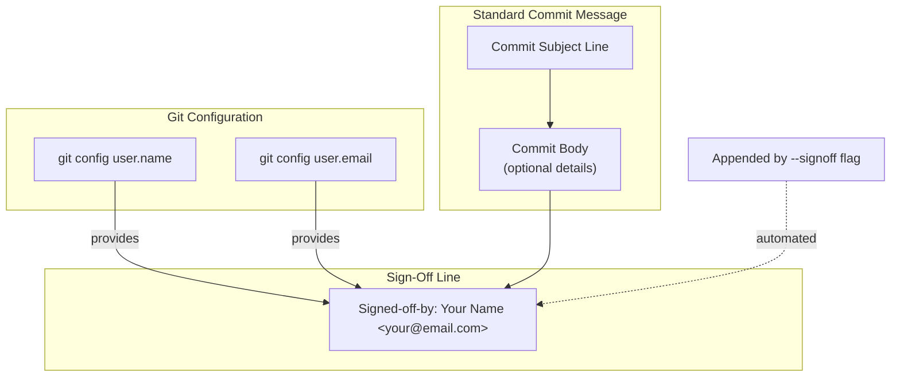
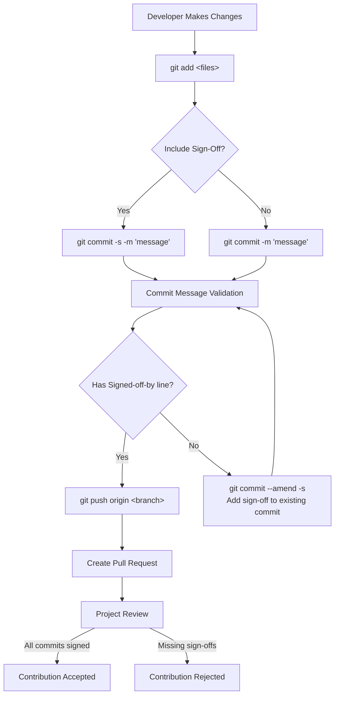
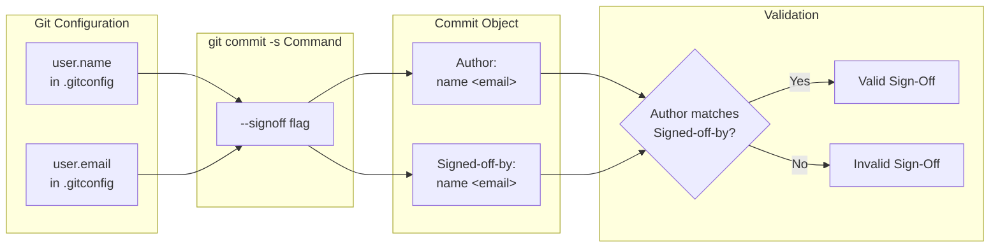

<!-- source: DeepWiki mcp.deepwiki.com · repo NVIDIA/ib-traffic-monitor · page 7.1 Contributing · fetched 2026-10-26 -->

# Contributing

<details>
<summary>Relevant source files</summary>

The following files were used as context for generating this wiki page:

- [CONTRIBUTING.md](CONTRIBUTING.md)

</details>


## Purpose and Scope

This page documents the contribution process for the ib-traffic-monitor project, including Developer Certificate of Origin (DCO) requirements, commit sign-off procedures, and contribution workflow. This covers the legal and procedural aspects of submitting code changes to the repository.

For information about the codebase structure and architectural patterns, see [Code Organization](#7.2). For build system details, see [Build System](#6).

## Contribution Requirements

All contributions to ib-traffic-monitor must meet specific requirements before they can be accepted into the codebase. These requirements ensure legal compliance and clear attribution of work.

### Developer Certificate of Origin (DCO)

The project uses the Developer Certificate of Origin (DCO) version 1.1 to manage contributions. The DCO is a legally binding statement that certifies you have the right to submit your contribution under the project's open source license.

| Requirement | Description | Mandatory |
|-------------|-------------|-----------|
| Sign-off | All commits must include a `Signed-off-by` line | Yes |
| DCO Certification | Contributors certify they have the right to submit the contribution | Yes |
| Rejection Policy | Commits without sign-off will not be accepted | Yes |

**Sources:** [CONTRIBUTING.md:1-51]()

### DCO Certification Statements

When you sign off on a commit, you certify one or more of the following statements from [CONTRIBUTING.md:28-50]():

1. **(a) Original Work**: The contribution was created in whole or in part by you, and you have the right to submit it under the open source license indicated in the file

2. **(b) Modified Work**: The contribution is based upon previous work covered under an appropriate open source license, and you have the right to submit modifications under the same license

3. **(c) Third-Party Contribution**: The contribution was provided to you by someone who certified (a), (b), or (c), and you have not modified it

4. **(d) Public Record**: You understand the contribution and all personal information submitted with it (including sign-off) will be maintained indefinitely and may be redistributed

**Sources:** [CONTRIBUTING.md:28-50]()

## Commit Sign-Off Process

### Sign-Off Mechanics

The sign-off process uses git's built-in `--signoff` flag to append certification information to commit messages. This creates a legally binding statement that associates your identity with the contribution.

#### Commit Structure with Sign-Off



**Diagram: Commit Message Structure with DCO Sign-Off**

**Sources:** [CONTRIBUTING.md:5-12]()

### Signing Commits

To add a sign-off to your commits, use the `--signoff` or `-s` flag with the `git commit` command. The sign-off line is automatically generated from your git configuration.

#### Command Syntax

```bash
# Long form
git commit --signoff -m "Add cool feature."

# Short form
git commit -s -m "Add cool feature."
```

**Sources:** [CONTRIBUTING.md:5-8]()

#### Generated Sign-Off Line

When you execute the sign-off command, git appends the following line to your commit message:

```
Signed-off-by: Your Name <your@email.com>
```

The name and email are automatically extracted from your git configuration (`user.name` and `user.email`).

**Sources:** [CONTRIBUTING.md:9-12]()

## Contribution Workflow

### End-to-End Contribution Process



**Diagram: DCO Contribution Workflow from Local Development to Acceptance**

**Sources:** [CONTRIBUTING.md:1-12]()

### Validation States

The following table describes the validation states that determine whether a contribution can be accepted:

| State | Description | Action Required | Outcome |
|-------|-------------|-----------------|---------|
| All commits signed | Every commit in the pull request contains a `Signed-off-by` line | None | Contribution proceeds to code review |
| Missing sign-offs | One or more commits lack a `Signed-off-by` line | Add sign-off to all commits using `git commit --amend -s` or rebase | Contribution cannot be accepted |
| Incorrect sign-off | Sign-off name/email does not match commit author | Fix git configuration and re-sign | Contribution cannot be accepted |

**Sources:** [CONTRIBUTING.md:1-3]()

## Practical Examples

### Example 1: Creating a New Signed Commit

```bash
# Make your code changes
vim infiniband.c

# Stage the changes
git add infiniband.c

# Commit with sign-off
git commit -s -m "Fix memory leak in get_infiniband_metrics"

# Resulting commit message:
# Fix memory leak in get_infiniband_metrics
#
# Signed-off-by: John Developer <john@example.com>
```

### Example 2: Adding Sign-Off to Last Commit

If you forgot to add sign-off to your last commit:

```bash
# Amend the last commit and add sign-off
git commit --amend -s --no-edit

# The --no-edit flag preserves the original commit message
# and appends the Signed-off-by line
```

### Example 3: Signing Multiple Commits

If you need to add sign-offs to multiple commits in your branch:

```bash
# Interactive rebase to modify commits
git rebase -i HEAD~3

# In the editor, mark commits as 'edit'
# For each commit, run:
git commit --amend -s --no-edit
git rebase --continue
```

### Example 4: Verifying Sign-Off

```bash
# View the last commit with full message
git log -1

# Output should include:
# commit abc123...
# Author: John Developer <john@example.com>
# Date:   ...
#
#     Commit message here
#
#     Signed-off-by: John Developer <john@example.com>
```

**Sources:** [CONTRIBUTING.md:5-12]()

## Git Configuration Requirements

### Configuring User Identity

Before contributing, ensure your git configuration contains valid identity information:

```bash
# Set your name
git config --global user.name "Your Name"

# Set your email
git config --global user.email "your@email.com"

# Verify configuration
git config --global user.name
git config --global user.email
```

The values configured here will be used in the `Signed-off-by` line when you use `git commit -s`.

### Identity Verification Flow



**Diagram: Identity Verification in DCO Sign-Off Process**

**Sources:** [CONTRIBUTING.md:5-12]()

## Reference Information

### DCO Full Text Location

The complete Developer Certificate of Origin version 1.1 text is available in [CONTRIBUTING.md:16-51](). This includes the full legal text and copyright information from The Linux Foundation.

### External Resources

The canonical DCO specification is maintained at https://developercertificate.org/ as referenced in [CONTRIBUTING.md:14]().

### File References

| File | Purpose | Lines |
|------|---------|-------|
| `CONTRIBUTING.md` | Complete contribution guidelines and DCO text | 1-51 |

**Sources:** [CONTRIBUTING.md:1-51]()

## Summary

### Key Requirements Checklist

Before submitting a contribution to ib-traffic-monitor:

- [ ] All commits include `Signed-off-by` line
- [ ] Git `user.name` and `user.email` are configured correctly
- [ ] Sign-off identity matches commit author identity
- [ ] You certify one of the DCO statements (a), (b), (c), or (d)
- [ ] You understand the contribution record is public and permanent

**Sources:** [CONTRIBUTING.md:1-51]()

---

