<!-- source: DeepWiki mcp.deepwiki.com · repo NVIDIA/ib-traffic-monitor · page 7.2 Code Organization · fetched 2026-10-26 -->

# Code Organization

<details>
<summary>Relevant source files</summary>

The following files were used as context for generating this wiki page:

- [Makefile](Makefile)
- [ib-traffic-monitor.c](ib-traffic-monitor.c)
- [infiniband.c](infiniband.c)

</details>


This document explains the structure of the ib-traffic-monitor codebase, including module organization, file responsibilities, dependency relationships, and architectural patterns used throughout the implementation. For information about the system architecture and component interactions, see [System Architecture](#3.1). For build system details, see [Build System](#6).

## Codebase Structure

The ib-traffic-monitor codebase follows a flat, modular organization with clear separation of concerns. All source files reside in the repository root directory.

### File Layout

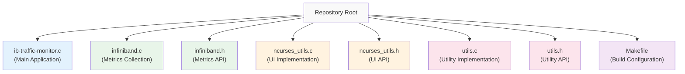

**Sources:** Repository structure, [Makefile:1-36]()

### Module Organization

The codebase is organized into four primary modules, each consisting of implementation (`.c`) and header (`.h`) files, plus a main application file:

| Module | Files | Primary Responsibility | Lines of Code |
|--------|-------|----------------------|---------------|
| Main Application | `ib-traffic-monitor.c` | Entry point, event loop, signal handling, orchestration | 345 |
| InfiniBand Metrics | `infiniband.c`, `infiniband.h` | Device discovery, sysfs interaction, counter reading | 356 + header |
| ncurses UI | `ncurses_utils.c`, `ncurses_utils.h` | Window layout, delimiter rendering, screen management | Implementation + header |
| Utilities | `utils.c`, `utils.h` | OS detection, file I/O helpers, common functions | Implementation + header |

**Sources:** [ib-traffic-monitor.c:1-345](), [infiniband.c:1-356](), [Makefile:19]()

## Module Details

### Main Application Module

**File:** `ib-traffic-monitor.c`

The main application module serves as the orchestration layer, coordinating all other modules and managing the application lifecycle.

#### Key Responsibilities

1. **Command-line argument parsing** using `getopt_long`
2. **Signal handling** for graceful shutdown (`SIGINT`)
3. **Event loop management** with periodic refresh
4. **ncurses initialization and cleanup**
5. **Metric collection coordination**
6. **Rate calculation** between successive measurements
7. **Display rendering orchestration**

#### Major Components

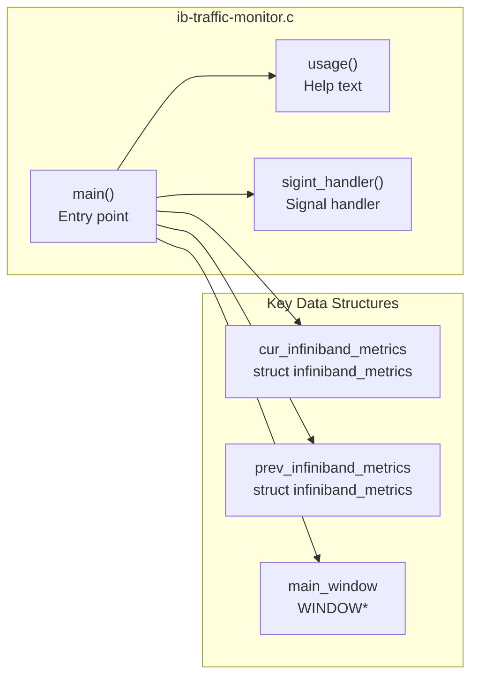

| Component | Type | Purpose |
|-----------|------|---------|
| `main()` | Function | Application entry point, orchestrates entire program flow |
| `usage()` | Function | Prints command-line help message with version |
| `sigint_handler()` | Function | Sets `break_flag` on SIGINT for graceful exit |
| `break_flag` | Global variable | `volatile sig_atomic_t`, signals loop termination |
| `cur_infiniband_metrics` | Local variable | Current iteration's metrics |
| `prev_infiniband_metrics` | Local variable | Previous iteration's metrics for rate calculation |
| `main_window` | Local variable | ncurses window handle |

**Sources:** [ib-traffic-monitor.c:35-42](), [ib-traffic-monitor.c:44-50](), [ib-traffic-monitor.c:52-344]()

#### Configuration Constants

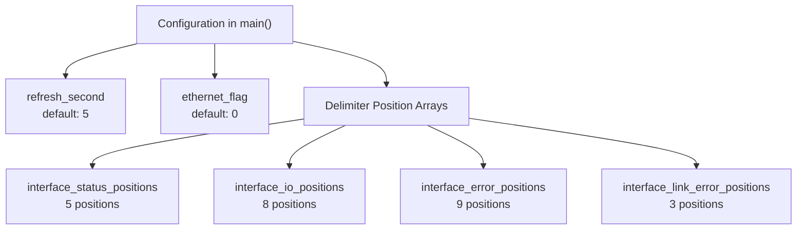

**Sources:** [ib-traffic-monitor.c:62-63](), [ib-traffic-monitor.c:125-128]()

### InfiniBand Metrics Module

**Files:** `infiniband.c`, `infiniband.h`

This module encapsulates all InfiniBand-specific functionality, including device discovery and metric collection from Linux sysfs.

#### Key Data Structures

The module defines two primary structures in `infiniband.h`:

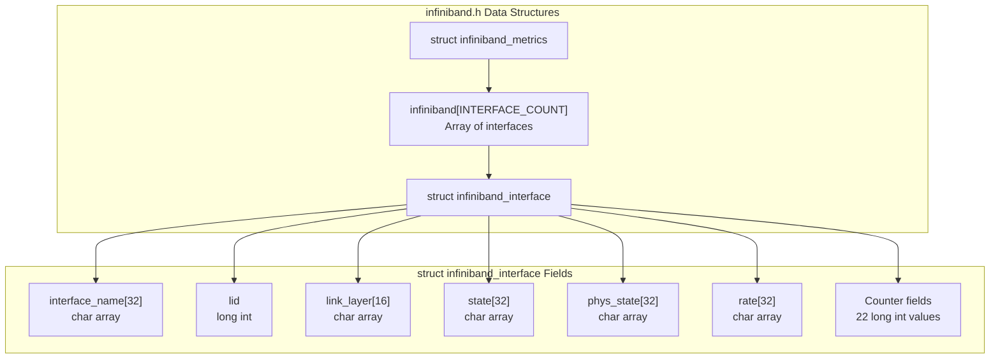

| Structure | Purpose | Size Constraint |
|-----------|---------|-----------------|
| `struct infiniband_interface` | Represents a single InfiniBand port with all metrics | Fixed-size arrays |
| `struct infiniband_metrics` | Container for all discovered interfaces | `INTERFACE_COUNT` maximum |
| `INTERFACE_COUNT` | Macro defining maximum interfaces | Defined in header |

**Sources:** [infiniband.h]() (structure definitions)

#### Core Function

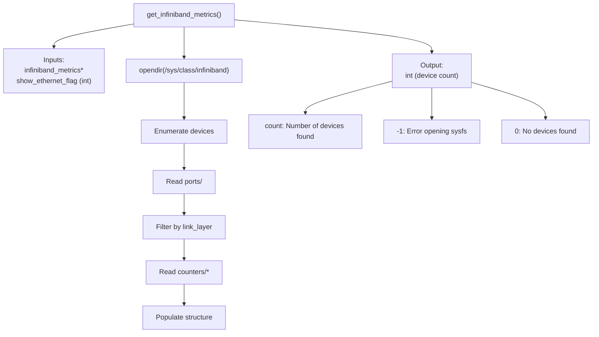

| Function | Signature | Purpose |
|----------|-----------|---------|
| `get_infiniband_metrics()` | `int get_infiniband_metrics(struct infiniband_metrics*, int)` | Discovers devices, reads all metrics from sysfs, returns device count |

**Algorithm Flow:**

1. Open `/sys/class/infiniband` directory
2. For each device directory entry:
   - Construct path to `ports/` subdirectory
   - For each port subdirectory:
     - Read `link_layer` file
     - Filter based on `show_ethernet_flag` (skip Ethernet if flag not set)
     - Verify `counters/` directory exists
     - Read status files: `state`, `phys_state`, `rate`, `lid`
     - Read all counter files from `counters/` directory
     - Populate `infiniband_interface` structure
     - Increment count
3. Return total device count

**Sources:** [infiniband.c:28-355]()

#### sysfs Path Construction Pattern

The module consistently uses this pattern for reading sysfs files:

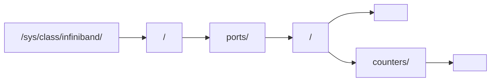

**Example paths:**
- Status: `/sys/class/infiniband/mlx5_0/ports/1/state`
- Counter: `/sys/class/infiniband/mlx5_0/ports/1/counters/port_rcv_packets`

**Sources:** [infiniband.c:58-64](), [infiniband.c:88-95](), [infiniband.c:106-117]()

#### Error Handling

The function uses defensive programming patterns:

- Returns `-1` if `/sys/class/infiniband` cannot be opened
- Uses `continue` to skip entries with errors rather than failing entirely
- Sets counter values to `0` if individual counter files cannot be read
- Checks `snprintf` return values for buffer overflow detection

**Sources:** [infiniband.c:44-49](), [infiniband.c:181-187]()

### ncurses UI Module

**Files:** `ncurses_utils.c`, `ncurses_utils.h`

This module abstracts ncurses-specific functionality for window layout and rendering.

#### Key Functions

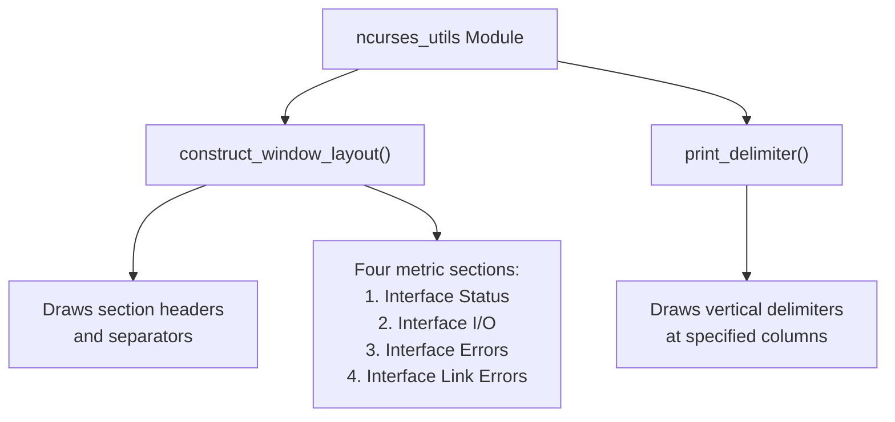

| Function | Purpose | Parameters |
|----------|---------|------------|
| `construct_window_layout()` | Creates the four-section layout with headers and horizontal separators | `WINDOW*`, device count |
| `print_delimiter()` | Draws vertical column separators at specified positions | `WINDOW*`, row, position array, array size |

**Sources:** [ncurses_utils.c](), [ncurses_utils.h]()

#### Layout Structure

The UI is organized into four distinct sections, each with its own header:

1. **Interface Status** (rows 3-4+N)
2. **Interface I/O** (rows calculated dynamically)
3. **Interface Errors** (rows calculated dynamically)
4. **Interface Link Errors** (rows calculated dynamically)

Each section uses `print_delimiter()` to create column boundaries at predefined positions.

**Sources:** [ib-traffic-monitor.c:125-128](), [ib-traffic-monitor.c:234-237]()

### Utilities Module

**Files:** `utils.c`, `utils.h`

This module provides general-purpose utility functions used across other modules.

#### Core Functions

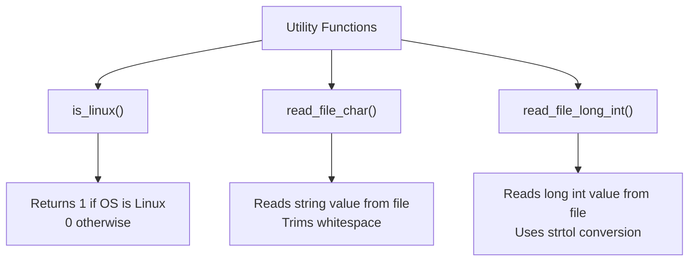

| Function | Signature | Purpose |
|----------|-----------|---------|
| `is_linux()` | `int is_linux(void)` | OS detection, verifies Linux platform |
| `read_file_char()` | `int read_file_char(const char* path, char* output)` | Reads string value from file, strips trailing whitespace |
| `read_file_long_int()` | `int read_file_long_int(const char* path, long int* output)` | Reads numeric value from file, converts to `long int` |

**Usage Pattern:**

Both file-reading functions return:
- `0` on success
- `-1` on failure (file cannot be opened or read)

This allows callers to use simple conditional checks:

```
if (read_file_long_int(path, &value) < 0) {
    // Handle error
}
```

**Sources:** [utils.c](), [utils.h](), [infiniband.c:92-95](), [infiniband.c:171-174]()

## Dependency Relationships

### Module Dependency Graph

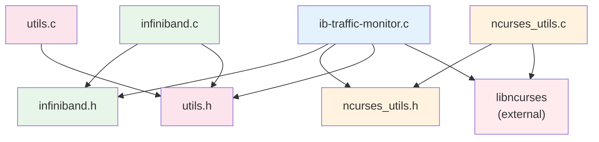

**Sources:** [ib-traffic-monitor.c:18-30](), [infiniband.c:18-26](), [Makefile:19]()

### Dependency Characteristics

| Characteristic | Details |
|----------------|---------|
| **Layering** | Clear three-tier structure: Application → Domain (InfiniBand) / Presentation (ncurses) → Utilities |
| **Circular Dependencies** | None; all dependencies flow downward |
| **External Dependencies** | Single external library: ncurses |
| **Header-Only Dependencies** | Main application only includes headers, not implementation files |
| **Shared Utilities** | `utils.h` is used by both `infiniband.c` and main application |

**Sources:** Repository structure analysis

## Architectural Patterns

### Single Responsibility Principle

Each module has a clearly defined, focused responsibility:

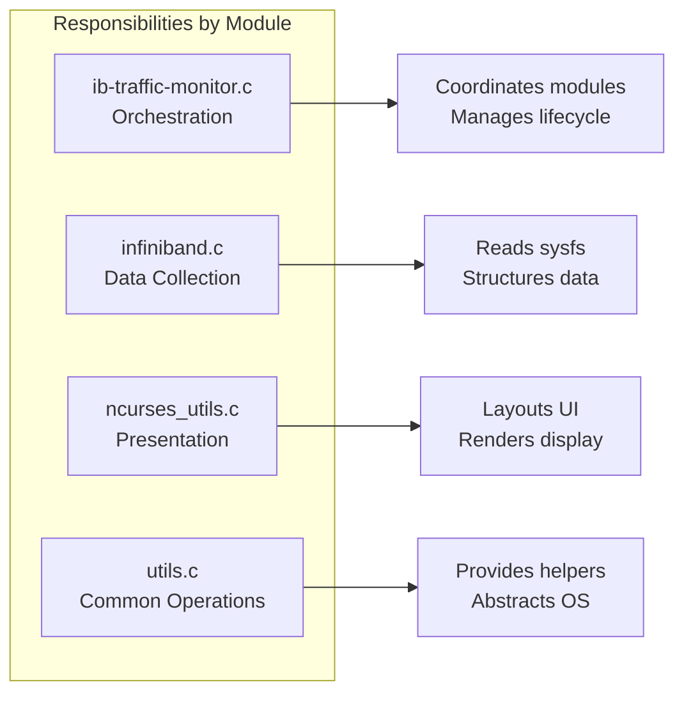

**Sources:** Module analysis

### Separation of Concerns

The codebase demonstrates clear separation across multiple dimensions:

| Concern | Location | Details |
|---------|----------|---------|
| **Business Logic** | `infiniband.c` | Device discovery, metric reading, data structuring |
| **Presentation Logic** | `ncurses_utils.c` | Window layout, delimiter drawing |
| **Application Logic** | `ib-traffic-monitor.c` | Event loop, signal handling, rate calculation |
| **Platform Abstraction** | `utils.c` | OS detection, file I/O |
| **Build Configuration** | `Makefile` | Compilation, linking, flags |

**Sources:** Codebase structure analysis

### Data Flow Architecture

The system follows a unidirectional data flow pattern:

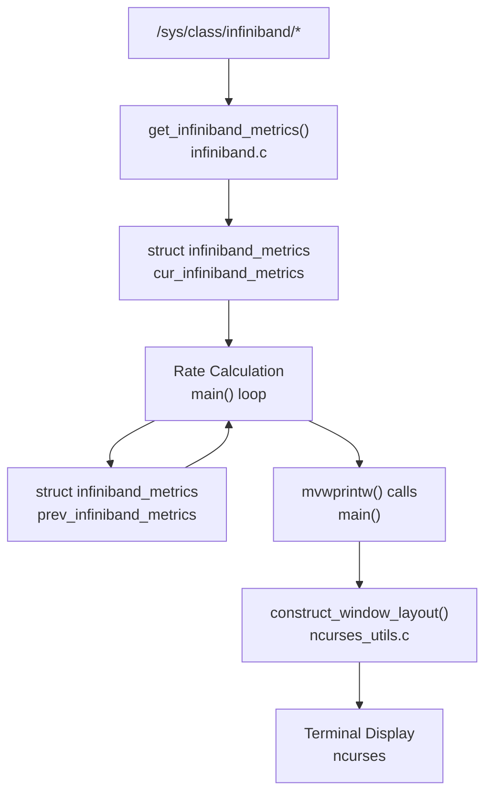

**Key Characteristics:**
- Data originates from sysfs
- Flows through structured types (`struct infiniband_metrics`)
- Transformed in main loop (rate calculations)
- Rendered through ncurses API
- No circular data flow

**Sources:** [ib-traffic-monitor.c:220-295](), [infiniband.c:28-355]()

### Error Handling Strategy

The codebase uses consistent error handling patterns:

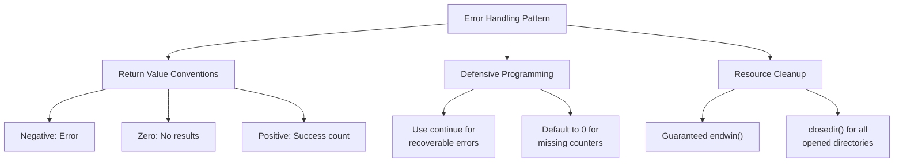

**Examples:**
- `get_infiniband_metrics()` returns `-1`, `0`, or positive count
- Individual counter read failures default to `0` rather than failing entire operation
- ncurses cleanup in all exit paths
- `closedir()` always called after `opendir()`

**Sources:** [infiniband.c:44-49](), [infiniband.c:181-187](), [ib-traffic-monitor.c:332-335](), [infiniband.c:349-352]()

## Code Organization Conventions

### File Naming

| Pattern | Purpose | Examples |
|---------|---------|----------|
| `<module>.c` | Implementation file | `infiniband.c`, `utils.c` |
| `<module>.h` | Header file with API declarations | `infiniband.h`, `utils.h` |
| `<application>.c` | Main application entry point | `ib-traffic-monitor.c` |

**Sources:** Repository file listing

### Include Guard Pattern

All header files use `#ifndef` include guards (implied by standard C practice).

### Function Naming

| Convention | Usage | Examples |
|------------|-------|----------|
| `verb_noun()` | Action functions | `get_infiniband_metrics()`, `read_file_char()` |
| `is_adjective()` | Boolean predicates | `is_linux()` |
| `print_noun()` | Output functions | `print_delimiter()` |
| `construct_noun()` | Builder functions | `construct_window_layout()` |

**Sources:** Function names throughout codebase

### Constant Definitions

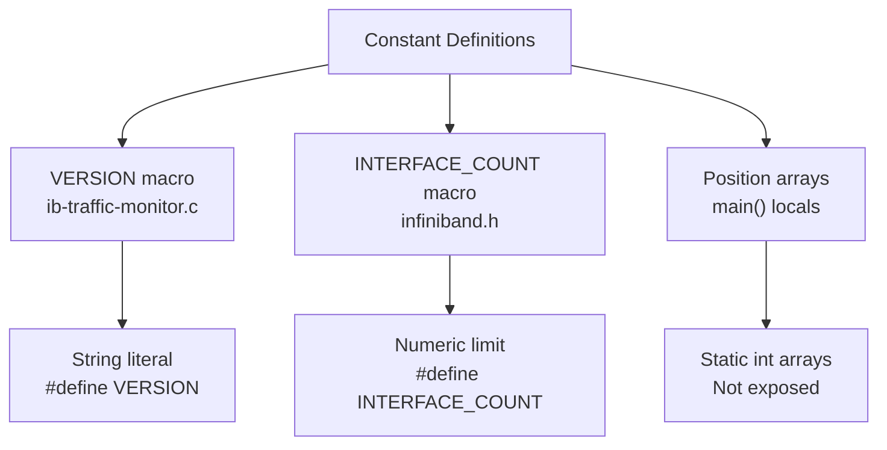

**Characteristics:**
- Macros for compile-time constants
- Local arrays for runtime configuration
- No magic numbers in algorithms (positions defined as arrays)

**Sources:** [ib-traffic-monitor.c:32](), [ib-traffic-monitor.c:125-128]()

### Memory Management

The codebase uses stack-based allocation for all data structures:

| Structure | Allocation | Lifetime |
|-----------|------------|----------|
| `cur_infiniband_metrics` | Stack (`struct infiniband_metrics`) | Duration of `main()` |
| `prev_infiniband_metrics` | Stack (`struct infiniband_metrics`) | Duration of `main()` |
| `main_window` | ncurses-managed | Freed via `delwin()` before exit |
| Path buffers | Stack (Variable Length Arrays) | Function-scoped |

**No dynamic allocation** (`malloc`, `calloc`, `realloc`) is used anywhere in the codebase.

**Sources:** [ib-traffic-monitor.c:121-122](), [infiniband.c:59](), [infiniband.c:80]()

## Build Integration

### Compilation Units

The Makefile defines four compilation units:

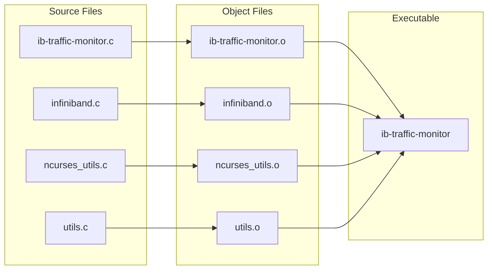

**Sources:** [Makefile:19-21](), [Makefile:28-32]()

### Compiler Flags

The build system enforces strict code quality through compiler flags:

| Flag | Purpose |
|------|---------|
| `-g` | Debug symbols |
| `-Wall` | All common warnings |
| `-Wextra` | Extra warnings |
| `-Wpedantic` | Strict ISO C compliance |
| `-Wconversion` | Implicit type conversions |
| `-Wdouble-promotion` | Float to double promotion |
| `-Wunused` | Unused entities |
| `-Wshadow` | Variable shadowing |
| `-Wsign-conversion` | Sign conversions |
| `-fsanitize=undefined` | Runtime undefined behavior detection |

This aggressive warning configuration enforces code quality at compile time.

**Sources:** [Makefile:17]()

### Link Dependencies

The executable links against a single external library:

- `-lncurses`: Terminal manipulation library

**Sources:** [Makefile:22](), [Makefile:29]()

## Summary

The ib-traffic-monitor codebase demonstrates well-organized, modular C programming:

- **Four focused modules**: Main application, InfiniBand metrics, ncurses UI, utilities
- **Clean dependencies**: No circular dependencies, clear layering
- **Consistent patterns**: Error handling, naming conventions, memory management
- **Quality enforcement**: Extensive compiler warnings, undefined behavior sanitization
- **Simple build**: Single Makefile, four compilation units, one executable

The organization prioritizes maintainability through separation of concerns, making the codebase easy to navigate, understand, and extend.

**Sources:** Complete codebase analysis

---

