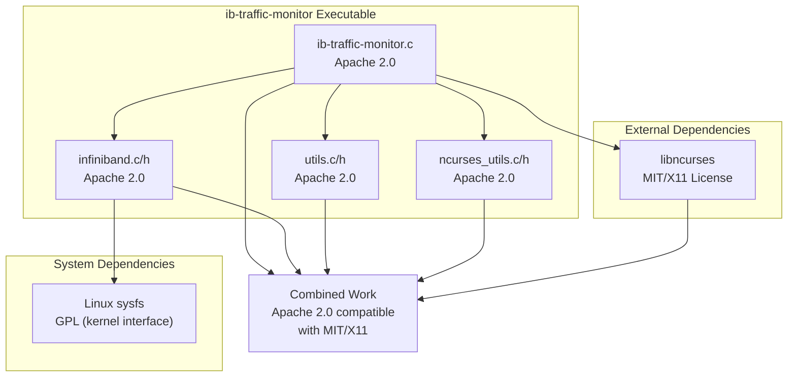
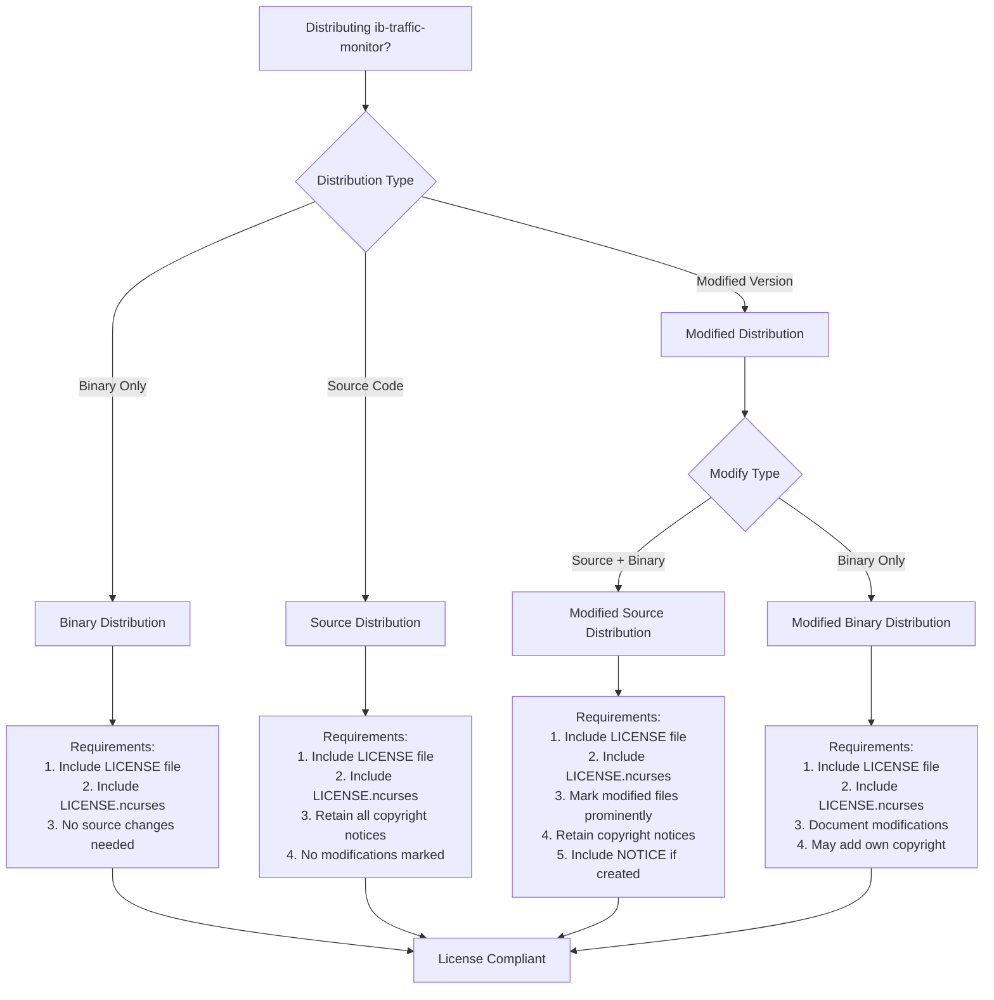
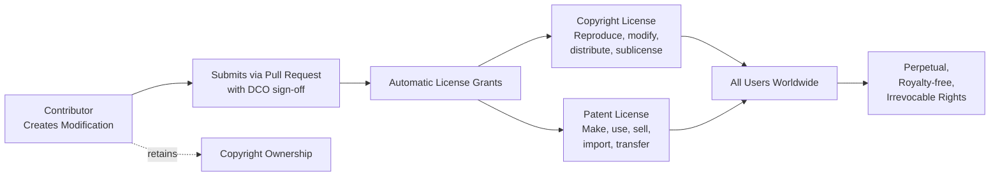

<!-- source: DeepWiki mcp.deepwiki.com · repo NVIDIA/ib-traffic-monitor · page 8 Licenses · fetched 2026-10-26 -->

# Licenses

<details>
<summary>Relevant source files</summary>

The following files were used as context for generating this wiki page:

- [LICENSE](LICENSE)
- [LICENSE.ncurses](LICENSE.ncurses)

</details>


## Purpose and Scope

This page documents the licensing terms for the ib-traffic-monitor project and its dependencies. It covers the software license under which ib-traffic-monitor is distributed, the licenses of external libraries it depends on, copyright ownership, and the implications for users and contributors. For information about contributing to the project, including the Developer Certificate of Origin (DCO) sign-off requirements, see [Contributing](#7.1).

## Main Project License

The ib-traffic-monitor project is licensed under the **Apache License, Version 2.0**, dated January 2004. The complete license text is available in [LICENSE:1-203]().

### License Summary

The Apache License 2.0 is a permissive open source license that grants the following rights:

| Permission | Description |
|------------|-------------|
| **Commercial Use** | The software may be used for commercial purposes |
| **Modification** | The software may be modified |
| **Distribution** | The software may be distributed |
| **Patent Grant** | Express grant of patent rights from contributors |
| **Private Use** | The software may be used privately |

### Key License Terms

**Copyright License Grant**: Each contributor grants users a perpetual, worldwide, non-exclusive, no-charge, royalty-free, irrevocable copyright license to reproduce, prepare derivative works, publicly display, publicly perform, sublicense, and distribute the work [LICENSE:67-72]().

**Patent License Grant**: Each contributor grants users a perpetual, worldwide, non-exclusive, no-charge, royalty-free, irrevocable patent license to make, use, offer to sell, sell, import, and transfer the work [LICENSE:74-88]().

**Redistribution Conditions**: When redistributing the software or derivative works, users must [LICENSE:90-129]():

1. Provide a copy of the Apache License 2.0
2. Include prominent notices in modified files stating the changes
3. Retain all copyright, patent, trademark, and attribution notices
4. Include a readable copy of attribution notices if a NOTICE file exists

**Trademark Restrictions**: The license does not grant permission to use trade names, trademarks, service marks, or product names of the licensor [LICENSE:139-142]().

**Warranty Disclaimer**: The software is provided "AS IS" without warranties or conditions of any kind, either express or implied [LICENSE:144-152]().

**Limitation of Liability**: Contributors are not liable for damages arising from the use or inability to use the software [LICENSE:154-164]().

**Sources**: LICENSE

## License Hierarchy

The following diagram illustrates how different licenses apply to different components of the system:



**Sources**: LICENSE, LICENSE.ncurses

## Dependency Licenses

### ncurses Library

The ib-traffic-monitor executable links against the ncurses library for terminal user interface functionality. The ncurses library is licensed under an **MIT/X11-style license**, also known as the "ncurses license." The complete license text is available in [LICENSE.ncurses:1-30]().

#### ncurses License Summary

The ncurses license is a permissive license granted by:
- **Copyright 2018-2022, 2023**: Thomas E. Dickey [LICENSE.ncurses:1]()
- **Copyright 1998-2017, 2018**: Free Software Foundation, Inc. [LICENSE.ncurses:2]()

The license permits free use, modification, and distribution of the software without restriction, subject to the following conditions [LICENSE.ncurses:4-26]():

1. The copyright notice and permission notice must be included in all copies or substantial portions of the software
2. The software is provided "as is" without warranty of any kind
3. The copyright holders are not liable for any claims or damages

#### License Compatibility

The MIT/X11-style ncurses license is **compatible** with the Apache License 2.0. Both are permissive licenses that allow:
- Combination in derivative works
- Commercial and private use
- Modification and distribution
- Integration with proprietary software

The combined work (ib-traffic-monitor executable linked with libncurses) can be distributed under the Apache 2.0 license terms, with the ncurses portions retaining their original MIT/X11 license.

**Sources**: LICENSE.ncurses

## Copyright Ownership and Notice

### Source Code Copyright

All source code files in the ib-traffic-monitor project (`ib-traffic-monitor.c`, `infiniband.c`, `infiniband.h`, `ncurses_utils.c`, `ncurses_utils.h`, `utils.c`, `utils.h`) are copyrighted works subject to the Apache License 2.0.

### Standard Copyright Notice

The Apache License provides a standard copyright notice format [LICENSE:190-202]():

```
Copyright [yyyy] [name of copyright owner]

Licensed under the Apache License, Version 2.0 (the "License");
you may not use this file except in compliance with the License.
You may obtain a copy of the License at

    http://www.apache.org/licenses/LICENSE-2.0

Unless required by applicable law or agreed to in writing, software
distributed under the License is distributed on an "AS IS" BASIS,
WITHOUT WARRANTIES OR CONDITIONS OF ANY KIND, either express or implied.
See the License for the specific language governing permissions and
limitations under the License.
```

**Sources**: LICENSE

## License Requirements for Different Use Cases

The following table summarizes the license requirements for different usage scenarios:

| Use Case | Apache 2.0 Requirements | ncurses License Requirements |
|----------|-------------------------|------------------------------|
| **Private Use** | No requirements | No requirements |
| **Binary Distribution** | Include LICENSE file | Include ncurses copyright notice |
| **Modified Source Distribution** | Include LICENSE, mark changes, retain notices | Include ncurses copyright notice |
| **Commercial Use** | Include LICENSE file | Include ncurses copyright notice |
| **Patent Grant** | Automatic patent license from contributors | No explicit patent grant |
| **Trademark Use** | Not permitted without authorization [LICENSE:139-142]() | Not addressed |
| **Contributing** | Must accept DCO (see [Contributing](#7.1)) | N/A |

**Sources**: LICENSE, LICENSE.ncurses

## Distribution Requirements Flowchart

The following diagram illustrates the decision tree for license compliance when distributing ib-traffic-monitor:



**Sources**: LICENSE

## License Implications for Users

### End Users

End users who run the ib-traffic-monitor executable without modification or redistribution have **no license obligations**. The software is provided "as is" without warranties [LICENSE:144-152]().

### System Integrators

System integrators who bundle ib-traffic-monitor in larger systems must:

1. Include both the Apache License 2.0 and ncurses license texts
2. Preserve copyright notices for both ib-traffic-monitor and ncurses
3. Not use NVIDIA trademarks without authorization [LICENSE:139-142]()
4. Accept warranty disclaimer and limitation of liability clauses

### Redistributors

Redistributors of ib-traffic-monitor (modified or unmodified) must:

| Requirement | Apache 2.0 Reference | Description |
|-------------|---------------------|-------------|
| License inclusion | [LICENSE:95-96]() | Provide copy of Apache License 2.0 |
| ncurses license | [LICENSE.ncurses:12-13]() | Include ncurses copyright notice |
| Change notices | [LICENSE:98-99]() | Mark modified files with prominent notices |
| Attribution retention | [LICENSE:101-105]() | Retain copyright, patent, trademark notices |
| NOTICE file handling | [LICENSE:107-122]() | Include NOTICE file if present |

**Sources**: LICENSE, LICENSE.ncurses

## License Implications for Contributors

### Contribution License Terms

Contributors to ib-traffic-monitor must understand the following license implications:

**Automatic License Grant**: By submitting a contribution, contributors automatically grant [LICENSE:131-135]():
- The contribution is licensed under Apache License 2.0 terms
- No additional terms or conditions apply
- Separate license agreements may supersede this default

**Copyright Retention**: Contributors retain copyright on their contributions but grant broad licenses to users [LICENSE:67-72]().

**Patent Grant**: Contributors grant an irrevocable patent license covering their contributions [LICENSE:74-88](). This license terminates if the recipient initiates patent litigation against the work.

**Developer Certificate of Origin**: Contributors must sign off commits using the DCO process documented in [Contributing](#7.1).

### Contributor License Grant Diagram



**Sources**: LICENSE

## License Text Locations

The license texts for ib-traffic-monitor and its dependencies are located in the following files in the repository root:

| File | License Type | Applies To | Lines |
|------|--------------|------------|-------|
| `LICENSE` | Apache License 2.0 | All ib-traffic-monitor source code | [LICENSE:1-203]() |
| `LICENSE.ncurses` | MIT/X11 License | ncurses library dependency | [LICENSE.ncurses:1-30]() |

These files must be preserved and distributed with any copies or derivative works of the software.

**Sources**: LICENSE, LICENSE.ncurses

## Additional License Information

### sysfs Interface

The ib-traffic-monitor reads InfiniBand metrics from the Linux sysfs interface (`/sys/class/infiniband/`). The sysfs interface is part of the Linux kernel, which is licensed under GPL. However, **userspace programs** that read from sysfs are **not** considered derivative works of the kernel and are not subject to GPL requirements. This is consistent with the Linux kernel's userspace API exception.

### No NOTICE File

The ib-traffic-monitor repository does not currently include a NOTICE file [LICENSE:107-122](). If such a file is added in the future, redistributors must include it according to Apache License 2.0 requirements.

### No Additional Restrictions

The Apache License 2.0 explicitly permits adding additional license terms for modifications [LICENSE:124-129](), provided the use, reproduction, and distribution of the base work complies with the original license terms.

**Sources**: LICENSE

## Summary

| Component | License | Type | Compatibility |
|-----------|---------|------|---------------|
| ib-traffic-monitor source | Apache License 2.0 | Permissive | N/A (base license) |
| ncurses library | MIT/X11 License | Permissive | Compatible with Apache 2.0 |
| Linux sysfs interface | GPL (kernel) | Copyleft | Userspace exception applies |
| Combined executable | Apache 2.0 + MIT/X11 | Permissive | Full compatibility |

The ib-traffic-monitor project uses a permissive licensing model that allows free use, modification, and distribution while providing patent protection and clear warranty disclaimers. All dependencies use compatible permissive licenses, ensuring the combined work can be freely used in both open source and commercial contexts.

**Sources**: LICENSE, LICENSE.ncurses