# Page: Home

# Home

<details>
<summary>Relevant source files</summary>

The following files were used as context for generating this wiki page:

- [README.md](README.md)
- [screenshots/ib-traffic-monitor.png](screenshots/ib-traffic-monitor.png)

</details>


## Purpose and Scope

This wiki documents the **ib-traffic-monitor** system, a command-line tool for monitoring InfiniBand and Ethernet device metrics on Linux systems. This page provides an overview of the tool's purpose, architecture, and key components. For build instructions, see [Building and Installation](#2.1). For usage details, see [Command-Line Usage](#2.2). For comprehensive metric definitions, see [Metrics Reference](#5).

**Sources:** [README.md:1-111]()

## Overview

**ib-traffic-monitor** is a C-based monitoring utility that collects and displays real-time performance metrics from InfiniBand network interface cards. The tool reads hardware counters from the Linux sysfs virtual filesystem and presents them in a terminal-based user interface powered by ncurses.

### Primary Capabilities

| Capability | Description |
|------------|-------------|
| Device Discovery | Automatically enumerates all InfiniBand devices and ports via `/sys/class/infiniband/` |
| Real-Time Monitoring | Collects and displays metrics at configurable intervals (default: 5 seconds) |
| Rate Calculation | Computes per-second rates by comparing consecutive counter snapshots |
| Link Layer Filtering | Supports filtering by InfiniBand or Ethernet link layer types |
| Non-Blocking UI | Responds to user input and signals while maintaining periodic updates |

The tool is designed for system administrators and network engineers who need to diagnose performance issues, verify link health, and monitor traffic patterns on InfiniBand networks.

**Sources:** [README.md:3-6](), [README.md:54-72]()

## System Components

The codebase is organized into four primary modules plus a main application orchestrator:

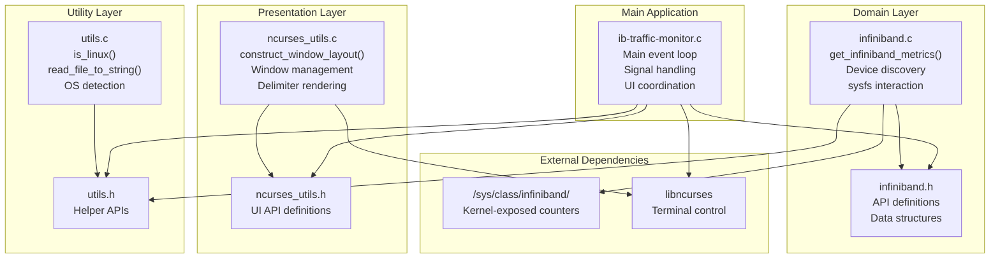

**Core Component Mapping**

| Component | Purpose | Key Functions/Structures |
|-----------|---------|--------------------------|
| `ib-traffic-monitor.c` | Main application logic, event loop | `main()`, signal handlers |
| `infiniband.c/h` | InfiniBand metrics collection | `get_infiniband_metrics()`, `infiniband_metrics` struct |
| `ncurses_utils.c/h` | TUI layout and rendering | `construct_window_layout()`, `print_delimiter()` |
| `utils.c/h` | OS detection and file I/O | `is_linux()`, `read_file_to_string()` |

**Sources:** [README.md:1-6](), Diagram 1 and Diagram 2 from high-level architecture

## Metric Categories

ib-traffic-monitor organizes collected metrics into four distinct categories, each displayed in a separate section of the terminal interface:

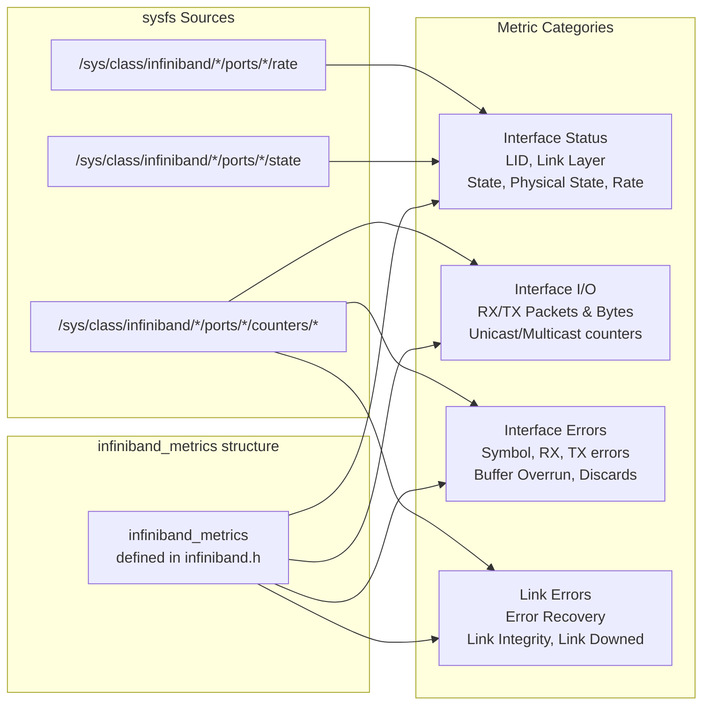

### Metric Category Details

| Category | Metric Count | Display Format | Data Source |
|----------|--------------|----------------|-------------|
| **Interface Status** | 5 metrics | Static values | `/sys/class/infiniband/*/ports/*/state`, `rate`, `lid` |
| **Interface I/O** | 8 metrics | Rates (per second) | `/sys/class/infiniband/*/ports/*/counters/port_*` |
| **Interface Errors** | 8 metrics | Cumulative counts | `/sys/class/infiniband/*/ports/*/counters/*_errors` |
| **Link Errors** | 3 metrics | Cumulative counts | `/sys/class/infiniband/*/ports/*/counters/link_*` |

Rate calculations for I/O metrics are performed by comparing counter deltas between consecutive sampling intervals. The first iteration displays only status metrics since rate calculation requires a previous baseline.

**Sources:** [README.md:11-41](), Diagram 5 from high-level architecture

## Architecture Overview

### Execution Flow

The application follows a predictable lifecycle from initialization through monitoring to graceful shutdown:

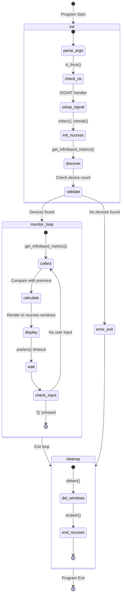

### Data Pipeline

The system implements a polling-based data pipeline that refreshes at user-configurable intervals:

1. **Discovery Phase** (first iteration): `get_infiniband_metrics()` scans `/sys/class/infiniband/` to enumerate devices and ports
2. **Collection Phase** (each iteration): Reads counter values from sysfs files for each active port
3. **Calculation Phase** (subsequent iterations): Computes deltas and rates by comparing current counters with previous snapshot
4. **Display Phase** (each iteration): Updates ncurses windows with formatted metric values using `construct_window_layout()`
5. **Wait Phase** (each iteration): Uses `pselect()` with refresh interval timeout while monitoring for user input

**Sources:** [README.md:54-72](), Diagram 3 and Diagram 6 from high-level architecture

## Key Design Decisions

### Single-Threaded Event Loop

The application uses a single-threaded design with non-blocking I/O. User input is handled via `pselect()` with a timeout matching the refresh interval, avoiding the complexity of multi-threading while maintaining responsiveness.

### sysfs as Data Source

Rather than using InfiniBand verbs libraries (libibverbs), the tool directly reads kernel-exposed metrics from sysfs. This approach:
- Eliminates external library dependencies beyond ncurses
- Works on any Linux system with InfiniBand kernel drivers
- Provides access to all hardware counters exposed by the kernel

### Memory Management

Device and port data is dynamically allocated during discovery. The `infiniband_metrics` structure maintains two snapshots (current and previous) to enable rate calculations without persistent storage.

**Sources:** [README.md:3-6](), [README.md:106-110](), Diagram 4 from high-level architecture

## Command-Line Interface

```
$ ./ib-traffic-monitor [-r|--refresh <seconds>] [-e|--ethernet] [-h|--help]
```

| Option | Purpose | Default |
|--------|---------|---------|
| `-r`, `--refresh` | Set refresh interval in seconds | 5 seconds |
| `-e`, `--ethernet` | Include Ethernet link layer devices | InfiniBand only |
| `-h`, `--help` | Display version and usage information | N/A |

The tool exits immediately if no compatible devices are detected. Press `Q` to quit during operation. `SIGINT` (Ctrl+C) is handled gracefully with proper ncurses cleanup.

**Sources:** [README.md:54-72]()

## Build System

The project uses a Makefile-based build system with strict compiler settings:

| Aspect | Details |
|--------|---------|
| Compiler | `gcc` |
| Warning Flags | `-Wall -Wextra -Wpedantic -Wconversion -Wdouble-promotion -Wunused -Wshadow -Wsign-conversion` |
| Sanitizers | `-fsanitize=undefined` |
| Linking | `-lncurses` |
| Output | Single executable: `ib-traffic-monitor` |

The build process compiles four object files (`ib-traffic-monitor.o`, `infiniband.o`, `utils.o`, `ncurses_utils.o`) and links them with the ncurses library. For detailed build instructions, see [Building and Installation](#2.1).

**Sources:** [README.md:43-52]()

## Getting Started

To build and run ib-traffic-monitor:

1. Ensure you have `gcc` and `ncurses-dev` (or equivalent) installed
2. Clone the repository: `https://github.com/NVIDIA/ib-traffic-monitor`
3. Build: `make`
4. Run: `./ib-traffic-monitor`

For detailed setup instructions, see [Getting Started](#2). For architecture details, see [Architecture](#3). For component documentation, see [Core Components](#4).

**Sources:** [README.md:43-72]()

## Version History

The current version is **1.3.3** (as of September 2025). Key milestones include:

- **1.0.0** (March 2025): Initial release
- **1.1.0** (March 2025): Added Ethernet link layer support (`-e` flag)
- **1.2.0** (May 2025): Optimized non-blocking quit mechanism
- **1.3.0** (May 2025): SIGINT graceful handling
- **1.3.3** (September 2025): Fixed variable shadowing issues

**Sources:** [README.md:74-90]()

## External Resources

- **Linux Kernel Documentation**: [sysfs-class-infiniband](https://www.kernel.org/doc/Documentation/ABI/stable/sysfs-class-infiniband)
- **NVIDIA Reference**: [Understanding mlx5 Linux Counters and Status Parameters](https://enterprise-support.nvidia.com/s/article/understanding-mlx5-linux-counters-and-status-parameters)
- **Use Case**: Demonstrated at SC25 by GNA-G Community for monitoring production InfiniBand links during multi-site data transfers

**Sources:** [README.md:92-110]()

---

# Page: Getting Started

# Getting Started

<details>
<summary>Relevant source files</summary>

The following files were used as context for generating this wiki page:

- [Makefile](Makefile)
- [README.md](README.md)

</details>


This page provides a quick-start guide for building and running `ib-traffic-monitor` for the first time. It covers system prerequisites, basic compilation, and initial execution. For detailed information about build configuration and compiler flags, see [Building and Installation](#2.1). For comprehensive command-line options and usage patterns, see [Command-Line Usage](#2.2).

## Prerequisites

Before building `ib-traffic-monitor`, ensure your system meets the following requirements:

| Requirement | Description | Verification |
|-------------|-------------|--------------|
| Operating System | Linux kernel with sysfs support | `uname -s` should return "Linux" |
| Compiler | GCC with C11 support | `gcc --version` |
| ncurses Library | Development headers and library | Check for `/usr/include/ncurses.h` or install `libncurses-dev` |
| InfiniBand Hardware | At least one InfiniBand or Ethernet device exposed via sysfs | Check `/sys/class/infiniband/` directory exists |

The tool reads InfiniBand metrics from the Linux sysfs virtual filesystem at `/sys/class/infiniband/`. Without accessible InfiniBand devices, the program will detect no devices and exit with an error message.

**Sources:** [README.md:5-5](), [README.md:58-58]()

## Quick Start

### Step 1: Clone and Navigate to Repository

```bash
git clone https://github.com/NVIDIA/ib-traffic-monitor
cd ib-traffic-monitor
```

### Step 2: Build the Executable

```bash
make
```

This compiles all source files ([ib-traffic-monitor.c](), [infiniband.c](), [utils.c](), [ncurses_utils.c]()) and links them with the ncurses library to produce the `ib-traffic-monitor` executable.

**Sources:** [README.md:43-52](), [Makefile:16-29]()

### Step 3: Run the Monitor

```bash
./ib-traffic-monitor
```

The program launches an ncurses-based terminal UI that refreshes every 5 seconds by default.

**Sources:** [README.md:56-56]()

## Setup and Execution Flow

The following diagram illustrates the complete process from prerequisites through runtime execution:

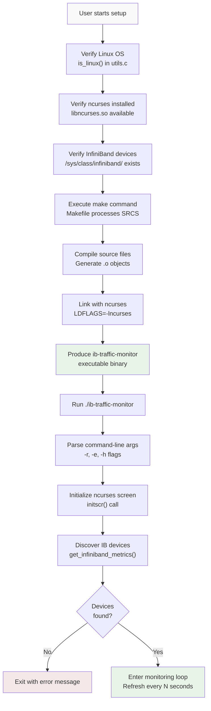

**Sources:** [README.md:43-66](), [Makefile:19-29]()

## First Run Experience

When you first execute `ib-traffic-monitor`, the program performs the following sequence:

### Initialization Phase

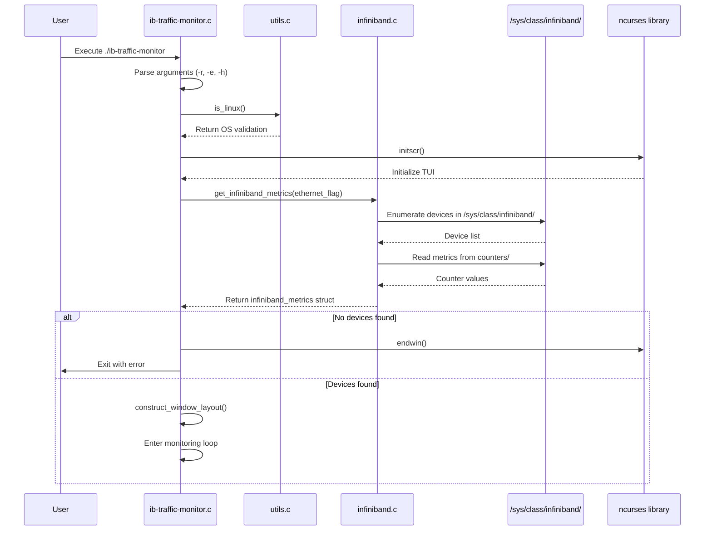

**Sources:** [README.md:56-58]()

### Display Layout

On successful initialization, the screen displays four metric sections:

| Section | Purpose | Update Frequency |
|---------|---------|------------------|
| Interface Status | Shows LID, link layer type, state, physical state, and rate | Static (on state change) |
| Interface I/O | Displays packet/second and MB/second for RX/TX including unicast/multicast | Every refresh interval |
| Interface Errors | Reports error counters for symbol errors, buffer overruns, discards | Cumulative counts |
| Interface Link Errors | Shows link recovery, link downed, and integrity error counts | Cumulative counts |

The default refresh interval is 5 seconds. During the first iteration, only static metrics appear because rate calculations require data from a previous collection cycle.

**Sources:** [README.md:11-41]()

## Basic Usage Patterns

### Default Behavior

```bash
./ib-traffic-monitor
```

- Monitors InfiniBand link layer devices only
- Refreshes display every 5 seconds
- Continues until user presses 'Q' or sends SIGINT (Ctrl+C)

### Custom Refresh Interval

```bash
./ib-traffic-monitor -r 10
```

Sets refresh interval to 10 seconds instead of the default 5 seconds.

### Include Ethernet Devices

```bash
./ib-traffic-monitor -e
```

By default, only InfiniBand link layer devices are shown. The `-e` flag includes Ethernet link layer type devices.

### Display Help

```bash
./ib-traffic-monitor -h
```

Shows version information and usage syntax.

**Sources:** [README.md:54-72]()

## Troubleshooting Common Issues

### No Devices Found

**Symptom:** Program exits immediately with error message "cannot detect any valid InfiniBand device"

**Causes and Solutions:**

| Cause | Verification | Solution |
|-------|--------------|----------|
| No InfiniBand hardware | `ls /sys/class/infiniband/` is empty | Install InfiniBand adapter or use system with IB hardware |
| InfiniBand drivers not loaded | `lsmod \| grep ib` shows no modules | Load appropriate kernel modules (e.g., `mlx5_ib`) |
| Only Ethernet devices present | Devices exist but link layer is Ethernet | Run with `-e` flag: `./ib-traffic-monitor -e` |
| Insufficient permissions | Cannot read sysfs files | Run as root or ensure user has sysfs read permissions |

**Sources:** [README.md:58-58](), [README.md:70-70]()

### Build Failures

**Symptom:** Compilation errors during `make`

**Common Issues:**

| Error Pattern | Cause | Solution |
|---------------|-------|----------|
| `ncurses.h: No such file` | ncurses development headers missing | Install `libncurses-dev` (Debian/Ubuntu) or `ncurses-devel` (RHEL/CentOS) |
| `undefined reference to 'initscr'` | ncurses library not linked | Verify `LDFLAGS = -lncurses` in [Makefile:22]() |
| Compiler warnings treated as errors | Strict compiler flags | Flags include `-Wall -Wextra -Wpedantic` per [Makefile:17]() |

**Sources:** [Makefile:17-22]()

### Terminal Display Issues

**Symptom:** Garbled output or incorrect formatting

**Solutions:**
- Ensure terminal supports ncurses (most modern terminals do)
- Verify terminal size is sufficient for the display layout
- Check `TERM` environment variable is set correctly (e.g., `export TERM=xterm-256color`)

## Exit and Cleanup

To exit the monitor, press `Q` or send SIGINT (Ctrl+C). The program handles both methods gracefully:

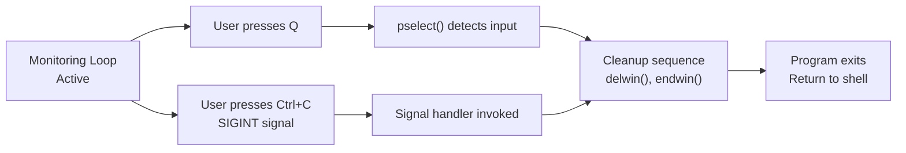

The cleanup sequence ensures ncurses windows are properly deallocated and the terminal is restored to its original state.

**Sources:** [README.md:82-83]()

## Next Steps

After successfully running `ib-traffic-monitor` for the first time:

- For detailed build configuration, compiler flags, and installation options, see [Building and Installation](#2.1)
- For comprehensive command-line options and usage patterns, see [Command-Line Usage](#2.2)
- To understand the system architecture and design, see [Architecture](#3)
- For detailed metric definitions and interpretations, see [Metrics Reference](#5)

---

# Page: Building and Installation

# Building and Installation

<details>
<summary>Relevant source files</summary>

The following files were used as context for generating this wiki page:

- [Makefile](Makefile)
- [README.md](README.md)

</details>


This page provides detailed instructions for building and installing `ib-traffic-monitor` from source. It covers prerequisite software, the compilation process, compiler flags, and post-build verification steps.

For information about running the compiled executable and command-line options, see [Command-Line Usage](#2.2). For details about the build system implementation, see [Build System](#6).

---

## Prerequisites

### Operating System Requirements

`ib-traffic-monitor` is designed exclusively for Linux systems. The application requires access to the Linux sysfs virtual filesystem at `/sys/class/infiniband/` to read InfiniBand device metrics.

The operating system check is performed at runtime by the `is_linux()` function in [utils.c:24-31](), which verifies the system is running on Linux before proceeding with device discovery.

| Requirement | Description |
|-------------|-------------|
| **Operating System** | Linux (any distribution) |
| **sysfs Access** | Read access to `/sys/class/infiniband/` |
| **Terminal** | Terminal supporting ncurses |

### Build Tools

The build process requires a C compiler and the Make build automation tool.

| Tool | Version | Purpose |
|------|---------|---------|
| **gcc** | Any modern version | C compiler used by [Makefile:16]() |
| **make** | GNU Make or compatible | Build automation |

### Runtime Dependencies

The application links against the ncurses library for terminal user interface functionality.

| Library | Package Name (Debian/Ubuntu) | Package Name (RHEL/Fedora) |
|---------|------------------------------|----------------------------|
| **ncurses** | `libncurses-dev` | `ncurses-devel` |

**Sources:** [README.md:1-111](), [Makefile:16-22](), [utils.c:24-31]()

---

## Build Process Overview

The build system compiles four source files into object files, then links them with the ncurses library to produce a single executable.

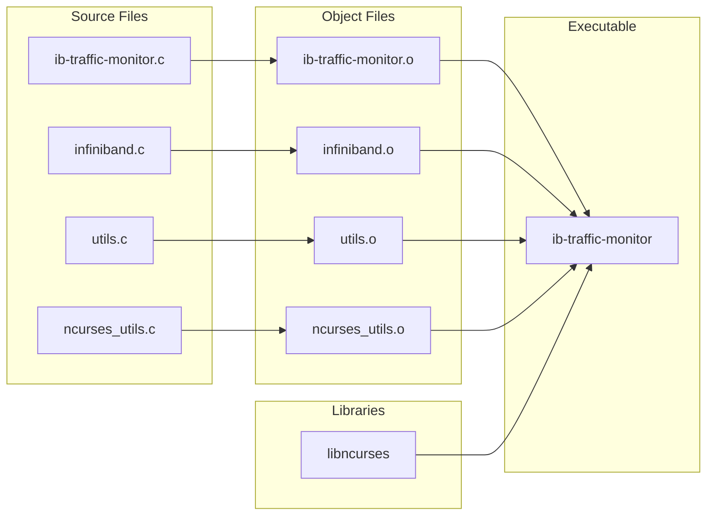

**Build Process: Source to Executable Transformation**

**Sources:** [Makefile:16-35](), [README.md:43-52]()

---

## Compilation Details

### Compiler Flags

The [Makefile:17]() defines extensive compiler flags to ensure code quality and catch potential issues:

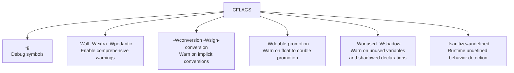

**Compiler Flags Configuration**

| Flag | Purpose |
|------|---------|
| `-g` | Include debug symbols for debugging with gdb or similar tools |
| `-Wall -Wextra -Wpedantic` | Enable comprehensive warning sets |
| `-Wconversion` | Warn on implicit type conversions that may alter values |
| `-Wdouble-promotion` | Warn when float is implicitly promoted to double |
| `-Wunused` | Warn on unused variables, functions, and parameters |
| `-Wshadow` | Warn when local variable shadows another variable |
| `-Wsign-conversion` | Warn on conversions between signed and unsigned types |
| `-fsanitize=undefined` | Enable runtime checks for undefined behavior |

The undefined behavior sanitizer (`-fsanitize=undefined`) adds runtime instrumentation to detect issues such as:
- Integer overflow
- Division by zero
- Null pointer dereference
- Out-of-bounds array access

**Sources:** [Makefile:17](), [README.md:47-51]()

### Linking

The linker stage combines all object files with the ncurses library using the `-lncurses` flag specified in [Makefile:22]().

**Sources:** [Makefile:22](), [Makefile:28-29]()

---

## Building from Source

### Step 1: Obtain Source Code

Clone the repository or extract the source archive:

```bash
git clone https://github.com/NVIDIA/ib-traffic-monitor
cd ib-traffic-monitor
```

### Step 2: Compile

Execute the default `make` target to build the executable:

```bash
make
```

The build system will compile each source file and link the result. The compilation output shows the exact commands executed:

```
gcc -g -Wall -Wextra -Wpedantic -Wconversion -Wdouble-promotion -Wunused -Wshadow -Wsign-conversion -fsanitize=undefined -I. -c -o ib-traffic-monitor.o ib-traffic-monitor.c
gcc -g -Wall -Wextra -Wpedantic -Wconversion -Wdouble-promotion -Wunused -Wshadow -Wsign-conversion -fsanitize=undefined -I. -c -o infiniband.o infiniband.c
gcc -g -Wall -Wextra -Wpedantic -Wconversion -Wdouble-promotion -Wunused -Wshadow -Wsign-conversion -fsanitize=undefined -I. -c -o utils.o utils.c
gcc -g -Wall -Wextra -Wpedantic -Wconversion -Wdouble-promotion -Wunused -Wshadow -Wsign-conversion -fsanitize=undefined -I. -c -o ncurses_utils.o ncurses_utils.c
gcc -g -Wall -Wextra -Wpedantic -Wconversion -Wdouble-promotion -Wunused -Wshadow -Wsign-conversion -fsanitize=undefined -I. -o ib-traffic-monitor ib-traffic-monitor.o infiniband.o utils.o ncurses_utils.o -lncurses
```

### Step 3: Clean Build (Optional)

To remove all build artifacts and rebuild from scratch:

```bash
make clean
make
```

The `clean` target defined in [Makefile:34-35]() removes all object files and the executable.

**Sources:** [README.md:43-52](), [Makefile:24-35]()

---

## Build Targets

The Makefile defines the following phony targets:

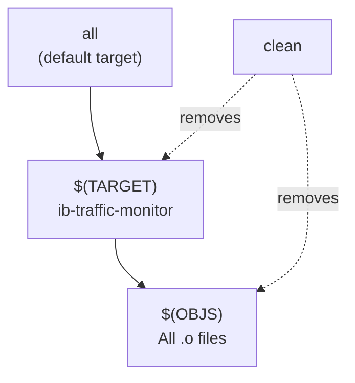

**Makefile Targets**

| Target | Description | Command |
|--------|-------------|---------|
| `all` | Default target; builds the executable | `make` or `make all` |
| `$(TARGET)` | Builds `ib-traffic-monitor` executable | `make ib-traffic-monitor` |
| `clean` | Removes all object files and executable | `make clean` |

**Sources:** [Makefile:24-35]()

---

## Compilation Flow

The following diagram shows how the Makefile coordinates the build process:

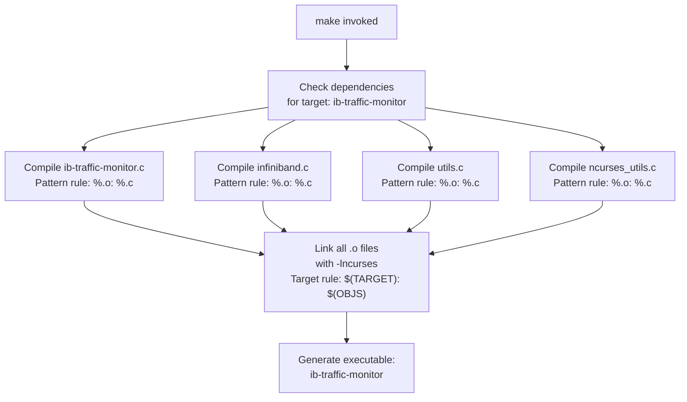

**Compilation Workflow**

Each source file is compiled independently using the pattern rule defined in [Makefile:31-32](). The compilation uses `$(CFLAGS)` and `$(INCLUDES)` variables. After all object files are generated, the target rule [Makefile:28-29]() links them with `$(LDFLAGS)` to produce the final executable.

**Sources:** [Makefile:16-35]()

---

## Installation

The Makefile does not include an installation target. To use the executable:

1. **Run in place:** Execute the program from the build directory:
   ```bash
   ./ib-traffic-monitor
   ```

2. **Manual installation:** Copy the executable to a system directory:
   ```bash
   sudo cp ib-traffic-monitor /usr/local/bin/
   ```

3. **Local user installation:** Copy to a user binary directory:
   ```bash
   mkdir -p ~/bin
   cp ib-traffic-monitor ~/bin/
   # Ensure ~/bin is in PATH
   ```

**Sources:** [README.md:54-59](), [Makefile:1-35]()

---

## Build Verification

### Verify Build Success

After compilation, verify the executable exists and has correct permissions:

```bash
ls -lh ib-traffic-monitor
```

Expected output:
```
-rwxr-xr-x 1 user group 123K Jan 1 12:00 ib-traffic-monitor
```

### Test Execution

Run the executable with the help flag to verify it executes correctly:

```bash
./ib-traffic-monitor -h
```

Expected output:
```
InfiniBand Traffic Monitor - Version 1.3.3
usage: ib-traffic-monitor [-r|--refresh <second(s)>]
                          [-e|--ethernet]
                          [-h|--help]
```

If the system is not running Linux, the program will exit with an error message before initializing ncurses, as verified by [utils.c:24-31]().

### Verify Runtime Dependencies

Use `ldd` to confirm the executable is properly linked against ncurses:

```bash
ldd ib-traffic-monitor | grep ncurses
```

Expected output:
```
libncurses.so.6 => /lib/x86_64-linux-gnu/libncurses.so.6 (0x00007f...)
```

**Sources:** [README.md:54-72](), [utils.c:24-31]()

---

## Troubleshooting

### Missing ncurses Library

**Error:**
```
fatal error: ncurses.h: No such file or directory
```

**Solution:** Install the ncurses development package:
```bash
# Debian/Ubuntu
sudo apt-get install libncurses-dev

# RHEL/Fedora/CentOS
sudo yum install ncurses-devel
```

### Linker Error: ncurses Not Found

**Error:**
```
/usr/bin/ld: cannot find -lncurses
```

**Solution:** Ensure the ncurses library is installed:
```bash
# Debian/Ubuntu
sudo apt-get install libncurses6

# RHEL/Fedora/CentOS
sudo yum install ncurses
```

### Compilation Warnings

The extensive compiler flags may produce warnings for strict code quality checks. All warnings should be addressed before merging code changes.

**Sources:** [Makefile:17](), [Makefile:22]()

---

## Build Artifacts

After a successful build, the following files are created:

| File | Type | Purpose |
|------|------|---------|
| `ib-traffic-monitor.o` | Object file | Compiled main application code |
| `infiniband.o` | Object file | Compiled InfiniBand metrics module |
| `utils.o` | Object file | Compiled utility functions |
| `ncurses_utils.o` | Object file | Compiled ncurses utilities |
| `ib-traffic-monitor` | Executable | Final linked executable |

These artifacts are removed by the `make clean` command as defined in [Makefile:34-35]().

**Sources:** [Makefile:19-21](), [Makefile:34-35]()

---

# Page: Command-Line Usage

# Command-Line Usage

<details>
<summary>Relevant source files</summary>

The following files were used as context for generating this wiki page:

- [README.md](README.md)
- [ib-traffic-monitor.c](ib-traffic-monitor.c)

</details>


This document explains all command-line arguments, options, and usage patterns for the `ib-traffic-monitor` executable. It covers how to invoke the tool, configure its behavior through command-line flags, and interact with it during execution. For information about building the executable, see [Building and Installation](#2.1). For details about the metrics displayed, see [Metrics Reference](#5).

---

## Overview

The `ib-traffic-monitor` tool is a command-line utility that monitors InfiniBand device metrics in real-time. It accepts optional arguments to customize the refresh interval and device filtering behavior. The tool operates in an interactive terminal user interface (TUI) mode using ncurses and exits gracefully when the user presses 'Q' or sends a SIGINT signal (Ctrl+C).

**Sources:** [README.md:54-73](), [ib-traffic-monitor.c:52-118]()

---

## Basic Invocation

The simplest way to run `ib-traffic-monitor` is without any arguments:

```bash
./ib-traffic-monitor
```

This launches the tool with default settings:
- **Refresh interval:** 5 seconds
- **Device filter:** InfiniBand link layer only (excludes Ethernet devices)

The tool will immediately discover available InfiniBand devices and display their metrics in a four-section layout. If no valid InfiniBand devices are detected, the program exits with an error message.

**Sources:** [README.md:56-59](), [ib-traffic-monitor.c:62-66]()

---

## Command-Line Options

The `ib-traffic-monitor` executable supports three command-line options, each available in both short and long form:

| Short Form | Long Form | Argument | Description | Default |
|------------|-----------|----------|-------------|---------|
| `-r` | `--refresh` | `<second(s)>` | Specifies the refresh period in seconds. Must be a positive integer. | 5 |
| `-e` | `--ethernet` | None | Includes Ethernet link layer type devices in the display. | Disabled (InfiniBand only) |
| `-h` | `--help` | None | Displays help message with version and usage information, then exits. | N/A |

### Option Details

#### Refresh Interval (`-r`, `--refresh`)

Controls how frequently the tool collects and updates metrics. The value must be a positive integer representing seconds.

```bash
./ib-traffic-monitor -r 10
./ib-traffic-monitor --refresh 10
```

The implementation validates that:
- The value can be converted to a long integer ([ib-traffic-monitor.c:82-88]())
- The value is greater than zero ([ib-traffic-monitor.c:90-94]())

Invalid values result in program termination with an error message and usage display.

#### Ethernet Flag (`-e`, `--ethernet`)

By default, `ib-traffic-monitor` only displays devices with InfiniBand link layer type. This flag enables display of Ethernet link layer devices as well.

```bash
./ib-traffic-monitor -e
./ib-traffic-monitor --ethernet
```

This flag sets the `ethernet_flag` variable to 1, which is passed to the `get_infiniband_metrics()` function to control device filtering ([ib-traffic-monitor.c:98](), [ib-traffic-monitor.c:221]()).

#### Help (`-h`, `--help`)

Displays the usage message and exits immediately with `EXIT_SUCCESS`.

```bash
./ib-traffic-monitor -h
./ib-traffic-monitor --help
```

The output format is defined in the `usage()` function and includes the version string:

```
InfiniBand Traffic Monitor - Version 1.3.3
usage: ib-traffic-monitor [-r|--refresh <second(s)>]
                          [-e|--ethernet]
                          [-h|--help]
```

**Sources:** [README.md:61-72](), [ib-traffic-monitor.c:53-112](), [ib-traffic-monitor.c:35-42]()

---

## Option Parsing Flow

The following diagram shows how command-line arguments are parsed and validated:

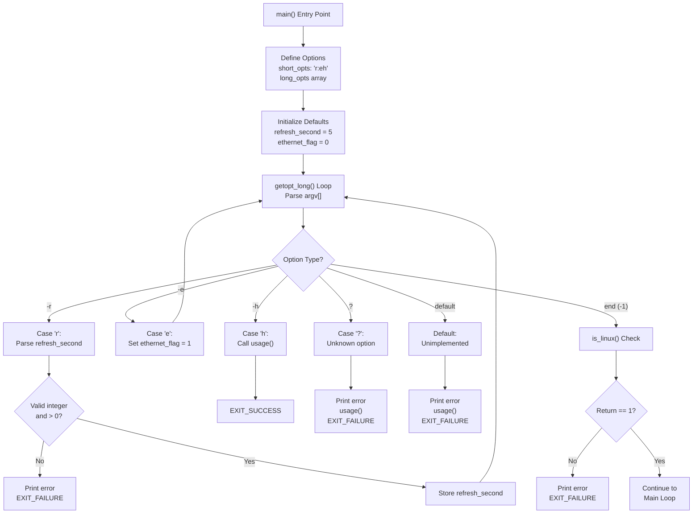

**Diagram: Command-Line Argument Processing Pipeline**

**Sources:** [ib-traffic-monitor.c:53-118]()

---

## Operating System Validation

Before proceeding to device discovery, `ib-traffic-monitor` verifies it is running on a Linux operating system by calling `is_linux()` from the utils module. This check is mandatory because the tool relies on Linux-specific sysfs interfaces for InfiniBand metrics.

If the check fails, the program prints an error message and exits:

```
ERROR: InfiniBand Traffic Monitor can be only running on Linux operating system
```

**Sources:** [ib-traffic-monitor.c:114-118](), [README.md:5]()

---

## Exit Conditions and Codes

The `ib-traffic-monitor` executable exits under the following conditions:

### Successful Exit (`EXIT_SUCCESS`)

- Help flag (`-h` or `--help`) is used ([ib-traffic-monitor.c:100-102]())
- User presses 'Q' or 'q' during execution ([ib-traffic-monitor.c:310-315]())
- SIGINT signal (Ctrl+C) is received and handled gracefully ([ib-traffic-monitor.c:318-322]())
- Normal program completion without errors

### Failure Exit (`EXIT_FAILURE`)

| Condition | Error Message | Code Reference |
|-----------|--------------|----------------|
| Invalid refresh value (non-integer) | `ERROR: failed to convert refresh second value` | [ib-traffic-monitor.c:85-88]() |
| Refresh value ≤ 0 | `ERROR: refresh second must be an integer and greater than 0` | [ib-traffic-monitor.c:90-94]() |
| Unknown command-line option | `ERROR: Unknown option` | [ib-traffic-monitor.c:103-106]() |
| Unimplemented option | `ERROR: Unimplemented option` | [ib-traffic-monitor.c:107-111]() |
| Not running on Linux | `ERROR: InfiniBand Traffic Monitor can be only running on Linux operating system` | [ib-traffic-monitor.c:116-117]() |
| Signal handling initialization fails | Various signal-related error messages | [ib-traffic-monitor.c:141-175]() |
| ncurses window creation fails | `ERROR: failed to create ncurses window` | [ib-traffic-monitor.c:193-197]() |
| Unable to retrieve metrics | `ERROR: unable to retrieve InfiniBand metrics` | [ib-traffic-monitor.c:223-226]() |
| No InfiniBand devices found | `ERROR: no InfiniBand device found` | [ib-traffic-monitor.c:229-232]() |

**Sources:** [ib-traffic-monitor.c:66](), [ib-traffic-monitor.c:80-118](), [ib-traffic-monitor.c:337-341]()

---

## Interactive User Input

Once the TUI is running, `ib-traffic-monitor` accepts the following user inputs:

### Quit Commands

The program supports two methods to exit gracefully:

1. **Keyboard Input:** Pressing 'Q' or 'q' ([ib-traffic-monitor.c:312-314]())
2. **Signal:** Sending SIGINT (Ctrl+C) ([ib-traffic-monitor.c:318-322]())

Both methods trigger the same cleanup sequence, ensuring proper ncurses termination before exit.

### Input Handling Mechanism

The tool uses a non-blocking input mechanism combined with `pselect()` for efficient event handling:

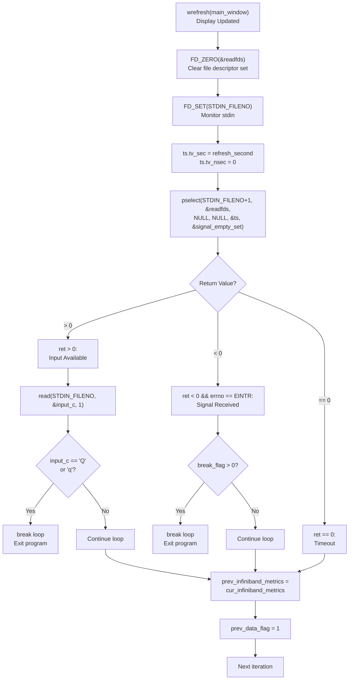

**Diagram: User Input and Event Handling Loop**

The `pselect()` call blocks for `refresh_second` duration with the empty signal set (`signal_empty_set`), allowing SIGINT to interrupt the wait. This enables responsive signal handling without busy-waiting.

**Sources:** [ib-traffic-monitor.c:199-201](), [ib-traffic-monitor.c:299-330]()

---

## Signal Handling Configuration

The tool configures POSIX signal handling to ensure graceful shutdown:

| Signal Construct | Purpose | Code Reference |
|------------------|---------|----------------|
| `signal_empty_set` | Empty signal set for pselect() | [ib-traffic-monitor.c:138](), [ib-traffic-monitor.c:141-144]() |
| `signal_block_set` | Block SIGINT during initialization | [ib-traffic-monitor.c:139](), [ib-traffic-monitor.c:146-149]() |
| `sigint_handler()` | Sets `break_flag` to 1 | [ib-traffic-monitor.c:45-50]() |
| `break_flag` | `volatile sig_atomic_t` flag for loop termination | [ib-traffic-monitor.c:45]() |
| `sa` | `struct sigaction` for SIGINT handler | [ib-traffic-monitor.c:137](), [ib-traffic-monitor.c:164-175]() |

The SIGINT signal is blocked during program initialization ([ib-traffic-monitor.c:152-161]()) and only unblocked during the `pselect()` call, ensuring atomic signal handling without race conditions.

**Sources:** [ib-traffic-monitor.c:45-50](), [ib-traffic-monitor.c:136-175](), [ib-traffic-monitor.c:307](), [ib-traffic-monitor.c:318-322]()

---

## Usage Examples

### Example 1: Default Behavior

Monitor InfiniBand devices with 5-second refresh:

```bash
./ib-traffic-monitor
```

**Expected behavior:** Displays all InfiniBand link layer devices, updates every 5 seconds.

### Example 2: Custom Refresh Interval

Monitor with 2-second refresh:

```bash
./ib-traffic-monitor -r 2
```

**Expected behavior:** More frequent updates, higher CPU usage.

### Example 3: Include Ethernet Devices

Monitor both InfiniBand and Ethernet devices:

```bash
./ib-traffic-monitor -e
```

**Expected behavior:** Additional interfaces with `Link Layer: Ethernet` are displayed.

### Example 4: Combined Options

Custom refresh with Ethernet devices:

```bash
./ib-traffic-monitor --refresh 10 --ethernet
```

**Expected behavior:** Displays all device types, refreshes every 10 seconds.

### Example 5: Display Help

```bash
./ib-traffic-monitor -h
```

**Output:**
```
InfiniBand Traffic Monitor - Version 1.3.3
usage: ib-traffic-monitor [-r|--refresh <second(s)>]
                          [-e|--ethernet]
                          [-h|--help]
```

**Sources:** [README.md:54-72]()

---

## Relationship to Other Components

The command-line parsing is the entry point that configures the entire monitoring system:

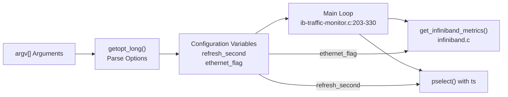

**Diagram: Command-Line Configuration Flow to Core Components**

- The `refresh_second` variable controls the timeout in `pselect()` ([ib-traffic-monitor.c:304-305]())
- The `ethernet_flag` variable is passed to `get_infiniband_metrics()` to filter devices ([ib-traffic-monitor.c:221]())

**Sources:** [ib-traffic-monitor.c:62-66](), [ib-traffic-monitor.c:203-330]()

---

# Page: Architecture

# Architecture

<details>
<summary>Relevant source files</summary>

The following files were used as context for generating this wiki page:

- [README.md](README.md)
- [ib-traffic-monitor.c](ib-traffic-monitor.c)
- [infiniband.c](infiniband.c)

</details>


This document describes the high-level architecture of `ib-traffic-monitor`, including its component organization, layering strategy, design patterns, and execution model. For detailed information about individual modules and their implementations, see [Core Components](#4). For specifics on how data flows through the system from hardware to display, see [Data Flow](#3.2).

## Overview

`ib-traffic-monitor` follows a **layered architecture** pattern with clear separation between application orchestration, domain logic, presentation, and utilities. The application is a single-threaded, polling-based monitoring tool that reads InfiniBand metrics from the Linux sysfs filesystem and displays them in a terminal UI using ncurses.

The system consists of four source modules compiled into a single executable:

| Module | Purpose | Primary Files |
|--------|---------|---------------|
| Application Layer | Event loop, initialization, signal handling | `ib-traffic-monitor.c` |
| Domain Layer | InfiniBand device discovery and metrics collection | `infiniband.c`, `infiniband.h` |
| Presentation Layer | Terminal UI layout and rendering | `ncurses_utils.c`, `ncurses_utils.h` |
| Utility Layer | OS detection and file I/O helpers | `utils.c`, `utils.h` |

**Sources:** [README.md:1-111](), [ib-traffic-monitor.c:1-345]()

## Layered Architecture

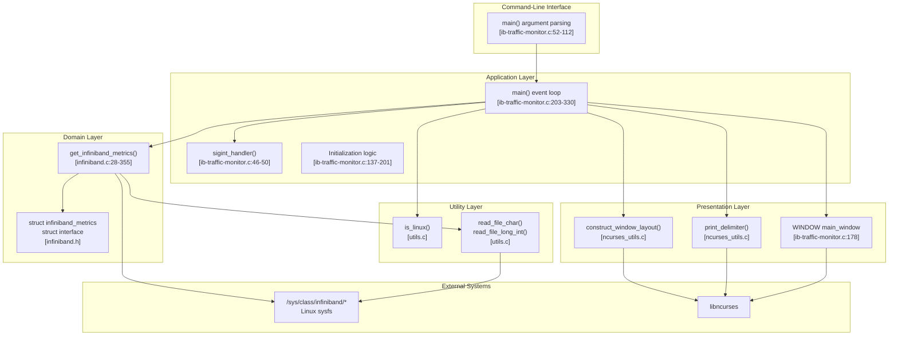

**Layering Principles:**

- **Application Layer** (`ib-traffic-monitor.c`) orchestrates the entire program lifecycle, including initialization, event loop management, signal handling, and cleanup. It depends on all other internal layers.
- **Domain Layer** (`infiniband.c`, `infiniband.h`) encapsulates InfiniBand-specific knowledge, including device discovery, port enumeration, and metric reading. It depends only on the utility layer.
- **Presentation Layer** (`ncurses_utils.c`, `ncurses_utils.h`) handles terminal UI concerns, including window layout construction and delimiter printing. It depends only on ncurses.
- **Utility Layer** (`utils.c`, `utils.h`) provides reusable, domain-agnostic helpers. It has no internal dependencies.

**Sources:** [ib-traffic-monitor.c:1-345](), [infiniband.c:1-355](), [infiniband.h]()

## Component Organization

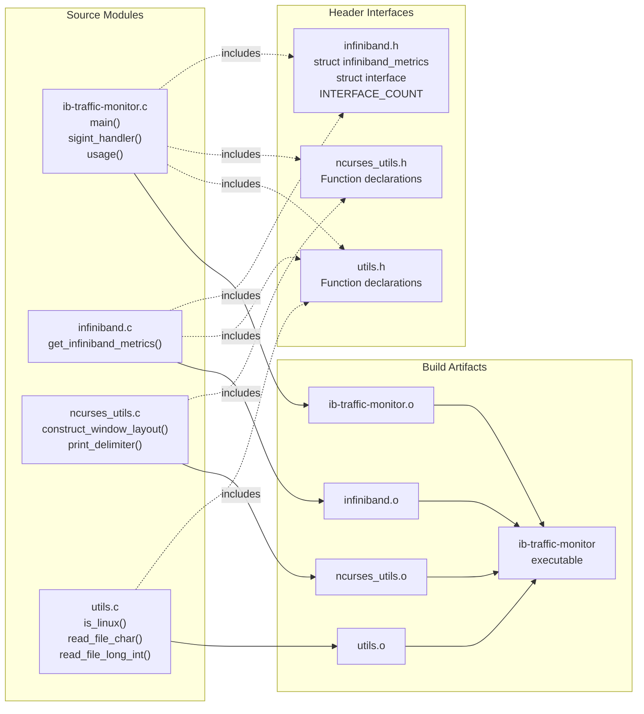

**Dependency Rules:**

- No circular dependencies exist between modules
- The main application (`ib-traffic-monitor.c`) is the only module that includes all three subsystem headers
- Domain logic (`infiniband.c`) depends only on utilities, ensuring reusability
- Presentation logic (`ncurses_utils.c`) is self-contained except for ncurses library

**Sources:** [Makefile](), [README.md:43-52]()

## Key Design Patterns

### Polling Architecture

The application uses a **polling model** with configurable refresh intervals. The main event loop at [ib-traffic-monitor.c:203-330]() repeatedly:

1. Collects current metrics via `get_infiniband_metrics()`
2. Calculates rates by comparing with previous iteration's data
3. Renders metrics to the ncurses window
4. Blocks for the refresh interval using `pselect()`

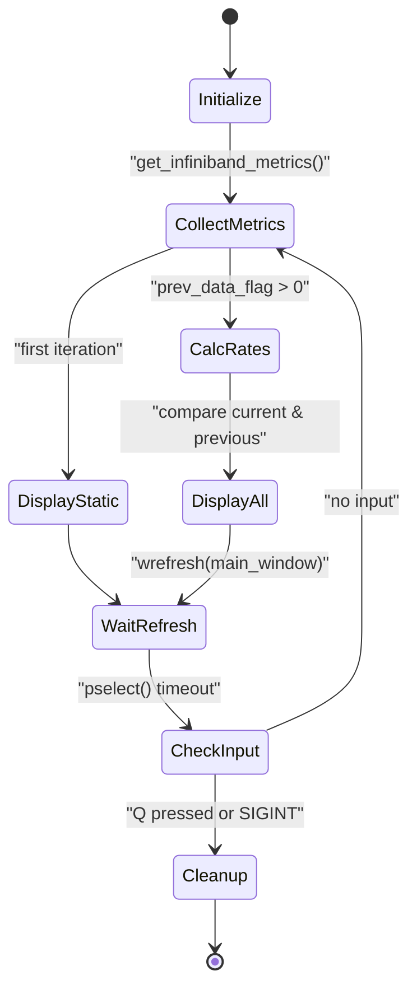

The refresh interval defaults to 5 seconds but can be configured via the `-r` command-line flag [ib-traffic-monitor.c:81-95]().

**Sources:** [ib-traffic-monitor.c:203-330](), [ib-traffic-monitor.c:62]()

### Data Structure Lifecycle

The application maintains two instances of `struct infiniband_metrics`:

- `cur_infiniband_metrics`: Current iteration's metrics [ib-traffic-monitor.c:121]()
- `prev_infiniband_metrics`: Previous iteration's metrics [ib-traffic-monitor.c:122]()

At the end of each loop iteration, current metrics are copied to previous [ib-traffic-monitor.c:325-326](), enabling delta calculations for rate-based metrics (packets/second, MB/second). A flag `prev_data_flag` tracks whether previous data exists [ib-traffic-monitor.c:131]().

**Sources:** [ib-traffic-monitor.c:121-122](), [ib-traffic-monitor.c:325-329]()

### Interface Matching Strategy

Since InfiniBand interfaces can be added or removed between iterations, the application matches interfaces by name. For rate calculations, it performs a nested loop [ib-traffic-monitor.c:274-293]():

```c
for (int i = 0; i < ret_get_infiniband_metrics; ++i) {
    for (int j = 0; j < prev_ret_get_infiniband_metrics; ++j) {
        if (strcmp(cur_infiniband_metrics.infiniband[i].interface_name,
                   prev_infiniband_metrics.infiniband[j].interface_name) == 0) {
            // Calculate and display rates
        }
    }
}
```

This ensures rate metrics are only displayed for interfaces present in both iterations.

**Sources:** [ib-traffic-monitor.c:272-295]()

## Execution Model

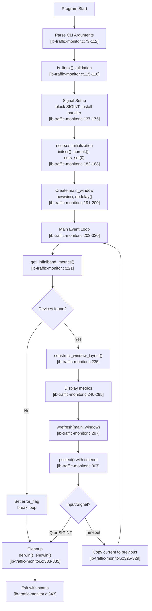

### Signal Handling

The application handles SIGINT (Ctrl+C) gracefully using a combination of signal masking and `pselect()`:

1. SIGINT is blocked during normal operation [ib-traffic-monitor.c:158-161]()
2. A signal handler sets `break_flag` when SIGINT arrives [ib-traffic-monitor.c:46-50]()
3. `pselect()` atomically unblocks SIGINT during sleep [ib-traffic-monitor.c:307]()
4. After `pselect()` returns with EINTR, the main loop checks `break_flag` and exits [ib-traffic-monitor.c:318-322]()

This ensures clean ncurses cleanup occurs even when interrupted.

**Sources:** [ib-traffic-monitor.c:137-175](), [ib-traffic-monitor.c:307](), [ib-traffic-monitor.c:318-322]()

### Non-Blocking Input

User input ('Q' to quit) is handled non-blockingly:

1. `nodelay(main_window, TRUE)` enables non-blocking reads [ib-traffic-monitor.c:200]()
2. `pselect()` monitors stdin with a timeout [ib-traffic-monitor.c:307]()
3. If input is available, a single character is read and checked [ib-traffic-monitor.c:310-314]()

This allows the application to respond immediately to user input without polling.

**Sources:** [ib-traffic-monitor.c:200](), [ib-traffic-monitor.c:299-315]()

## External Dependencies

### Linux sysfs

The application reads metrics from `/sys/class/infiniband/` and its subdirectories:

| Path Pattern | Content |
|--------------|---------|
| `/sys/class/infiniband/` | Device discovery |
| `/sys/class/infiniband/{device}/ports/` | Port enumeration |
| `/sys/class/infiniband/{device}/ports/{port}/` | Port status (state, phys_state, rate, lid, link_layer) |
| `/sys/class/infiniband/{device}/ports/{port}/counters/` | Counter metrics |

The application validates sysfs accessibility using `opendir()` [infiniband.c:45-49]() and gracefully handles missing files.

**Sources:** [infiniband.c:28-355](), [README.md:108]()

### ncurses Library

The application links against `libncurses` [README.md:51]() and uses these primary functions:

| Function | Purpose | Usage |
|----------|---------|-------|
| `initscr()` | Initialize ncurses | [ib-traffic-monitor.c:182]() |
| `newwin()` | Create window | [ib-traffic-monitor.c:191]() |
| `mvwprintw()` | Print formatted text at position | [ib-traffic-monitor.c:243-268]() |
| `wrefresh()` | Update display | [ib-traffic-monitor.c:297]() |
| `endwin()` | Cleanup ncurses | [ib-traffic-monitor.c:335]() |

The application uses `cbreak()` to disable line buffering [ib-traffic-monitor.c:185]() and `curs_set(0)` to hide the cursor [ib-traffic-monitor.c:188]().

**Sources:** [ib-traffic-monitor.c:182-200](), [ib-traffic-monitor.c:333-335](), [README.md:5]()

## Compilation and Linking

The build process compiles four source files into object files with strict compiler flags, then links them with ncurses:

```
gcc [flags] -c -o ib-traffic-monitor.o ib-traffic-monitor.c
gcc [flags] -c -o infiniband.o infiniband.c
gcc [flags] -c -o utils.o utils.c
gcc [flags] -c -o ncurses_utils.o ncurses_utils.c
gcc [flags] -o ib-traffic-monitor *.o -lncurses
```

Compiler flags include `-Wall -Wextra -Wpedantic -fsanitize=undefined` for robust error detection during development.

**Sources:** [README.md:43-52]()

---

# Page: System Architecture

# System Architecture

<details>
<summary>Relevant source files</summary>

The following files were used as context for generating this wiki page:

- [Makefile](Makefile)
- [README.md](README.md)
- [ib-traffic-monitor.c](ib-traffic-monitor.c)

</details>


## Purpose and Scope

This page describes the overall architecture of ib-traffic-monitor, including its layered design, module organization, component responsibilities, and dependency relationships. The architecture follows a clean separation of concerns with distinct layers for application logic, domain operations, presentation, and utilities.

For details on how data flows through the system from hardware to display, see [Data Flow](#3.2). For implementation details of individual components, see [Core Components](#4).

---

## Architectural Overview

ib-traffic-monitor is organized as a **layered architecture** with clear boundaries between components. The system consists of four primary modules that compile into a single executable, with two external dependencies.

### Layer Structure

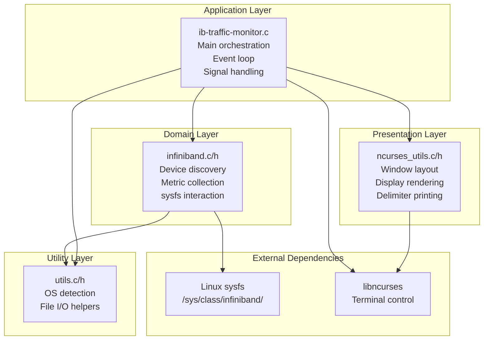

**Sources:** [ib-traffic-monitor.c:1-344](), [README.md:1-111](), [Makefile:16-36]()

---

## Module Organization

The codebase is organized into four distinct modules, each with specific responsibilities. The module structure avoids circular dependencies and maintains clear interfaces through header files.

### Module Dependency Graph

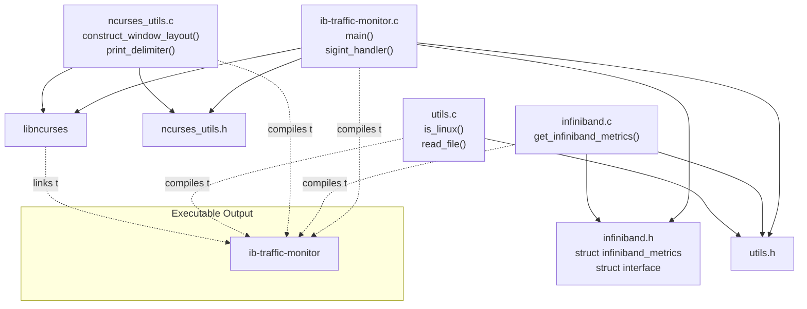

**Sources:** [Makefile:19-29](), [ib-traffic-monitor.c:28-30]()

### Module Listing

| Module | Source Files | Key Responsibilities | Dependencies |
|--------|-------------|---------------------|--------------|
| **Application** | `ib-traffic-monitor.c` | Main event loop, signal handling, orchestration, user input processing | `infiniband.h`, `ncurses_utils.h`, `utils.h`, `libncurses` |
| **Domain** | `infiniband.c`, `infiniband.h` | InfiniBand device discovery, metric collection, sysfs parsing | `utils.h` |
| **Presentation** | `ncurses_utils.c`, `ncurses_utils.h` | Window layout, display formatting, delimiter rendering | `libncurses` |
| **Utilities** | `utils.c`, `utils.h` | OS detection, file I/O operations | None |

**Sources:** [Makefile:19](), [ib-traffic-monitor.c:1-344]()

---

## Component Responsibilities

### Application Module (`ib-traffic-monitor.c`)

The application module serves as the orchestration layer and contains the following responsibilities:

**Primary Functions:**
- `main()` - Program entry point [ib-traffic-monitor.c:52-344]()
- `sigint_handler()` - SIGINT signal handler [ib-traffic-monitor.c:46-50]()
- `usage()` - Display help message [ib-traffic-monitor.c:35-42]()

**Core Responsibilities:**

| Responsibility | Implementation Details |
|---------------|------------------------|
| **Command-Line Parsing** | Uses `getopt_long()` to parse `-r`, `-e`, `-h` options [ib-traffic-monitor.c:54-112]() |
| **Signal Management** | Configures SIGINT handler with `sigaction()`, uses signal masks for safe handling [ib-traffic-monitor.c:137-175]() |
| **ncurses Initialization** | Calls `initscr()`, `cbreak()`, `curs_set()`, `newwin()` [ib-traffic-monitor.c:182-201]() |
| **Event Loop** | Infinite loop collecting metrics, rendering display, handling input [ib-traffic-monitor.c:203-330]() |
| **Timing Control** | Uses `pselect()` with `timespec` for configurable refresh intervals [ib-traffic-monitor.c:307]() |
| **Resource Cleanup** | Properly terminates ncurses with `delwin()` and `endwin()` [ib-traffic-monitor.c:333-335]() |

**State Management:**

The application maintains two instances of `struct infiniband_metrics`:
- `cur_infiniband_metrics` - Current reading [ib-traffic-monitor.c:121]()
- `prev_infiniband_metrics` - Previous reading for rate calculations [ib-traffic-monitor.c:122]()

**Sources:** [ib-traffic-monitor.c:1-344]()

### Domain Module (`infiniband.c`, `infiniband.h`)

The domain module encapsulates all InfiniBand-specific operations and sysfs interactions.

**Key Function:**
- `get_infiniband_metrics()` - Device discovery and metric collection

**Data Structures:**

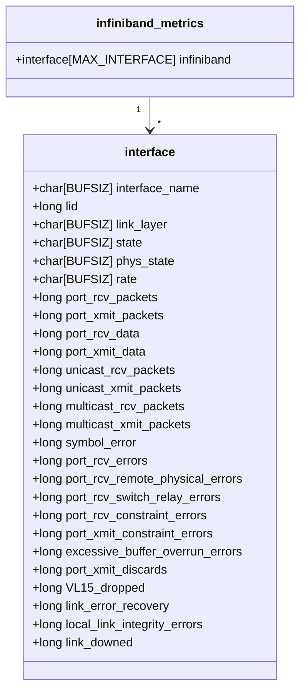

**Responsibilities:**

| Responsibility | Description |
|---------------|-------------|
| **Device Discovery** | Enumerates InfiniBand devices under `/sys/class/infiniband/` |
| **Port Enumeration** | Discovers available ports for each device |
| **Link Layer Filtering** | Filters devices by link layer type (InfiniBand vs Ethernet) based on `ethernet_flag` |
| **Metric Reading** | Reads counter values from sysfs files under `counters/` subdirectory |
| **Status Parsing** | Reads state, physical state, rate, LID from device/port sysfs files |
| **Error Handling** | Returns error codes for missing devices or read failures |

**Sources:** [infiniband.h]() (referenced in ib-traffic-monitor.c), [ib-traffic-monitor.c:221-232]()

### Presentation Module (`ncurses_utils.c`, `ncurses_utils.h`)

The presentation module handles all display-related operations using the ncurses library.

**Key Functions:**
- `construct_window_layout()` - Creates the four-section display layout
- `print_delimiter()` - Prints vertical delimiters to separate columns

**Display Layout Structure:**

```mermaid
graph TB
    WINDOW["WINDOW *main_window"]
    
    subgraph "Section 1: Interface Status"
        STATUS_HEADER["Header: Interface | LID | Link Layer | State | Physical State | Rate"]
        STATUS_ROWS["Rows: One per interface"]
    end
    
    subgraph "Section 2: Interface I/O"
        IO_HEADER["Header: Interface | RX Packet | RX MB | TX Packet | TX MB | UC RX | UC TX | MC RX | MC TX"]
        IO_ROWS["Rows: One per interface (rate calculated)"]
    end
    
    subgraph "Section 3: Interface Error"
        ERROR_HEADER["Header: Interface | Symbol | RX | RX Remote PHY | RX Switch Relay | RX Const. | TX Const. | Buffer Overrun | TX Discard | VL15 Dropped"]
        ERROR_ROWS["Rows: One per interface"]
    end
    
    subgraph "Section 4: Interface Link Error"
        LINK_HEADER["Header: Interface | Link Error Recovery | Local Link Integrity | Link Error Downed"]
        LINK_ROWS["Rows: One per interface"]
    end
    
    WINDOW --> STATUS_HEADER
    STATUS_HEADER --> STATUS_ROWS
    WINDOW --> IO_HEADER
    IO_HEADER --> IO_ROWS
    WINDOW --> ERROR_HEADER
    ERROR_HEADER --> ERROR_ROWS
    WINDOW --> LINK_HEADER
    LINK_HEADER --> LINK_ROWS
```

**Delimiter Positioning:**

The module uses predefined delimiter position arrays to maintain column alignment:
- `interface_status_positions[]` - 5 delimiters [ib-traffic-monitor.c:125]()
- `interface_io_positions[]` - 8 delimiters [ib-traffic-monitor.c:126]()
- `interface_error_positions[]` - 9 delimiters [ib-traffic-monitor.c:127]()
- `interface_link_error_positions[]` - 3 delimiters [ib-traffic-monitor.c:128]()

**Sources:** [ib-traffic-monitor.c:125-128](), [ib-traffic-monitor.c:235-269]()

### Utility Module (`utils.c`, `utils.h`)

The utility module provides general-purpose helper functions used by other modules.

**Key Functions:**

| Function | Purpose | Usage |
|----------|---------|-------|
| `is_linux()` | Detects if running on Linux | Called at startup to validate OS [ib-traffic-monitor.c:115-118]() |
| `read_file()` | Reads content from file path | Used by infiniband module to read sysfs files |

**Design Pattern:**

The utility module follows a **shared service** pattern, providing common functionality to upper layers without depending on any application-specific logic. It has no dependencies on other application modules.

**Sources:** [ib-traffic-monitor.c:115-118](), [ib-traffic-monitor.c:28-30]()

---

## Dependency Analysis

### Dependency Rules

The architecture enforces the following dependency constraints:

1. **Application Layer** depends on all other modules
2. **Domain Layer** depends only on Utility Layer
3. **Presentation Layer** depends only on external ncurses library
4. **Utility Layer** has no internal dependencies
5. **No circular dependencies** exist between modules

### External Dependencies

```mermaid
graph LR
    subgraph "ib-traffic-monitor"
        APP["Application"]
        IB["Domain"]
    end
    
    subgraph "Linux Kernel"
        SYSFS["/sys/class/infiniband/*/<br/>state, phys_state, rate,<br/>counters/*"]
    end
    
    subgraph "System Libraries"
        NCURSES["libncurses<br/>initscr(), newwin(),<br/>mvwprintw(), wrefresh()"]
    end
    
    IB -->|"read via utils"| SYSFS
    APP -->|"display API calls"| NCURSES
```

**External Dependency Requirements:**

| Dependency | Purpose | API Surface |
|-----------|---------|-------------|
| **Linux sysfs** | InfiniBand metrics source | Read-only file access to `/sys/class/infiniband/` hierarchy |
| **libncurses** | Terminal UI rendering | Window management, text positioning, screen refresh functions |

**Sources:** [Makefile:22](), [ib-traffic-monitor.c:20](), [README.md:108]()

---

## Build Architecture

### Compilation Process

The build system uses a standard C compilation pipeline managed by Make:

```mermaid
graph LR
    subgraph "Source Files"
        SRC1["ib-traffic-monitor.c"]
        SRC2["infiniband.c"]
        SRC3["ncurses_utils.c"]
        SRC4["utils.c"]
    end
    
    subgraph "Headers"
        HDR1["infiniband.h"]
        HDR2["ncurses_utils.h"]
        HDR3["utils.h"]
    end
    
    subgraph "Object Files"
        OBJ1["ib-traffic-monitor.o"]
        OBJ2["infiniband.o"]
        OBJ3["ncurses_utils.o"]
        OBJ4["utils.o"]
    end
    
    LINKER["gcc linker<br/>-lncurses"]
    
    EXE["ib-traffic-monitor"]
    
    SRC1 --> OBJ1
    SRC2 --> OBJ2
    SRC3 --> OBJ3
    SRC4 --> OBJ4
    
    HDR1 -.included by.-> SRC1
    HDR1 -.included by.-> SRC2
    HDR2 -.included by.-> SRC1
    HDR2 -.included by.-> SRC3
    HDR3 -.included by.-> SRC1
    HDR3 -.included by.-> SRC2
    HDR3 -.included by.-> SRC4
    
    OBJ1 --> LINKER
    OBJ2 --> LINKER
    OBJ3 --> LINKER
    OBJ4 --> LINKER
    
    LINKER --> EXE
```

### Compiler Flags

The build system applies strict compiler flags to ensure code quality:

| Flag Category | Flags | Purpose |
|--------------|-------|---------|
| **Debugging** | `-g` | Include debug symbols [Makefile:17]() |
| **Warnings** | `-Wall -Wextra -Wpedantic` | Enable comprehensive warnings [Makefile:17]() |
| **Type Safety** | `-Wconversion -Wdouble-promotion -Wsign-conversion` | Catch implicit type conversions [Makefile:17]() |
| **Code Quality** | `-Wunused -Wshadow` | Detect unused variables and shadowing [Makefile:17]() |
| **Runtime Safety** | `-fsanitize=undefined` | Detect undefined behavior at runtime [Makefile:17]() |

### Build Targets

```mermaid
graph TD
    ALL["make all"]
    TARGET["TARGET = ib-traffic-monitor"]
    OBJS["OBJS = *.o files"]
    CLEAN["make clean"]
    
    ALL --> TARGET
    TARGET --> OBJS
    CLEAN -->|removes| OBJS
    CLEAN -->|removes| TARGET
```

**Makefile Targets:**
- `all` (default) - Builds the executable [Makefile:26]()
- `clean` - Removes object files and executable [Makefile:34-35]()

**Sources:** [Makefile:16-36](), [README.md:43-52]()

---

## Architectural Patterns

### Event Loop Pattern

The application implements a **polling-based event loop** with the following characteristics:

1. **Metric Collection Phase**: Call `get_infiniband_metrics()` [ib-traffic-monitor.c:221]()
2. **Layout Construction Phase**: Call `construct_window_layout()` [ib-traffic-monitor.c:235]()
3. **Display Rendering Phase**: Print metrics using `mvwprintw()` [ib-traffic-monitor.c:240-269]()
4. **Screen Refresh Phase**: Call `wrefresh()` [ib-traffic-monitor.c:297]()
5. **Wait Phase**: Block on `pselect()` with timeout [ib-traffic-monitor.c:307]()
6. **Input Check Phase**: Process keyboard input or signals [ib-traffic-monitor.c:310-322]()

### Rate Calculation Pattern

The system implements a **delta-based rate calculation** pattern:

1. Store current metrics in `cur_infiniband_metrics`
2. Compare with previous iteration stored in `prev_infiniband_metrics`
3. Calculate rate: `(current - previous) / refresh_interval`
4. Only display rates when `prev_data_flag` is set [ib-traffic-monitor.c:272-295]()

This pattern ensures rates are only calculated after the second iteration when valid previous data exists.

**Sources:** [ib-traffic-monitor.c:203-330]()

---

## Summary Table

| Aspect | Implementation |
|--------|---------------|
| **Architecture Style** | Layered architecture with clear separation of concerns |
| **Module Count** | 4 modules (Application, Domain, Presentation, Utilities) |
| **External Dependencies** | 2 (Linux sysfs, libncurses) |
| **Compilation Output** | Single statically-linked executable |
| **Dependency Pattern** | Acyclic, hierarchical dependencies |
| **Primary Design Pattern** | Event loop with polling and rate calculation |
| **Configuration Method** | Command-line arguments parsed at startup |

**Sources:** [ib-traffic-monitor.c:1-344](), [Makefile:16-36](), [README.md:1-111]()

---

# Page: Data Flow

# Data Flow

<details>
<summary>Relevant source files</summary>

The following files were used as context for generating this wiki page:

- [ib-traffic-monitor.c](ib-traffic-monitor.c)
- [infiniband.c](infiniband.c)
- [ncurses_utils.c](ncurses_utils.c)

</details>


This page explains how data flows through ib-traffic-monitor from InfiniBand hardware to the terminal display. It covers the complete pipeline including device discovery, metric collection from sysfs, rate calculation, and display rendering.

For detailed information about the data structures that hold metrics, see [Data Structures](#4.2.2). For implementation details of metrics collection functions, see [Metrics Collection](#4.2.1). For the screen layout and rendering, see [Display Layout](#4.3.2).

## Overview

The data flow in ib-traffic-monitor follows a periodic polling model where the application repeatedly collects metrics, calculates rates, and updates the display at a configurable refresh interval (default: 5 seconds). The flow can be divided into six distinct stages:

1. **Hardware Exposure**: InfiniBand HCAs expose performance counters through kernel drivers
2. **sysfs Presentation**: Linux kernel presents counters via sysfs virtual filesystem
3. **Device Discovery**: Application enumerates devices and ports from `/sys/class/infiniband/`
4. **Metric Collection**: Application reads counter values from sysfs files
5. **Rate Calculation**: Application computes per-second rates by comparing snapshots
6. **Display Rendering**: Application renders formatted data via ncurses

## Complete Data Flow Pipeline

```mermaid
flowchart TB
    subgraph Hardware["Hardware Layer"]
        HCA["InfiniBand HCA<br/>Network Interface Cards"]
    end
    
    subgraph Kernel["Kernel Layer"]
        Driver["IB Kernel Drivers"]
        Sysfs["/sys/class/infiniband/<br/>&lt;device&gt;/ports/&lt;port&gt;/"]
    end
    
    subgraph Discovery["Discovery Stage<br/>get_infiniband_metrics()"]
        OpenDir["opendir()<br/>/sys/class/infiniband/"]
        EnumDev["Enumerate Devices<br/>readdir()"]
        EnumPorts["Enumerate Ports<br/>readdir(ports/)"]
        CheckLayer["read_file_char()<br/>link_layer"]
        Filter["Filter by link_layer<br/>InfiniBand or Ethernet"]
    end
    
    subgraph Collection["Collection Stage<br/>infiniband.c:130-339"]
        ReadStatus["Read Status Files<br/>state, phys_state, rate, lid"]
        ReadCounters["Read Counter Files<br/>counters/*"]
        PopulateStruct["Populate<br/>struct infiniband_metrics"]
    end
    
    subgraph Processing["Processing Stage<br/>ib-traffic-monitor.c:272-295"]
        StoreMetrics["Store in cur_infiniband_metrics"]
        MatchInterfaces["Match Interfaces<br/>strcmp(interface_name)"]
        CalcRates["Calculate Rates<br/>(current - previous) / refresh_second"]
    end
    
    subgraph Display["Display Stage"]
        ConstructLayout["construct_window_layout()"]
        PrintStatic["Print Status & Error Metrics<br/>mvwprintw()"]
        PrintRates["Print I/O Rate Metrics<br/>mvwprintw()"]
        Refresh["wrefresh(main_window)"]
    end
    
    subgraph Control["Control Loop"]
        Wait["pselect()<br/>wait refresh_second"]
        CopyMetrics["prev_infiniband_metrics =<br/>cur_infiniband_metrics"]
        CheckExit["Check for 'Q' or SIGINT"]
    end
    
    HCA --> Driver
    Driver --> Sysfs
    Sysfs --> OpenDir
    OpenDir --> EnumDev
    EnumDev --> EnumPorts
    EnumPorts --> CheckLayer
    CheckLayer --> Filter
    Filter --> ReadStatus
    ReadStatus --> ReadCounters
    ReadCounters --> PopulateStruct
    PopulateStruct --> StoreMetrics
    StoreMetrics --> MatchInterfaces
    MatchInterfaces --> CalcRates
    CalcRates --> ConstructLayout
    ConstructLayout --> PrintStatic
    PrintStatic --> PrintRates
    PrintRates --> Refresh
    Refresh --> Wait
    Wait --> CheckExit
    CheckExit -->|Continue| CopyMetrics
    CopyMetrics --> OpenDir
    CheckExit -->|Exit| End["Program Termination"]
```

**Sources:** [ib-traffic-monitor.c:203-330](), [infiniband.c:28-355]()

## Data Structures and Transformations

Data passes through several transformations as it flows through the system. The primary data structures are defined in `infiniband.h`:

```mermaid
graph LR
    subgraph Sysfs["sysfs Files"]
        File1["state<br/>(string)"]
        File2["lid<br/>(integer)"]
        File3["port_rcv_packets<br/>(integer)"]
        File4["symbol_error<br/>(integer)"]
    end
    
    subgraph Structures["C Structures"]
        Interface["struct interface<br/>- interface_name[64]<br/>- state[32]<br/>- lid (long int)<br/>- port_rcv_packets (long int)<br/>- symbol_error (long int)<br/>..."]
        Metrics["struct infiniband_metrics<br/>- infiniband[INTERFACE_COUNT]"]
    end
    
    subgraph Memory["In-Memory State"]
        Current["cur_infiniband_metrics"]
        Previous["prev_infiniband_metrics"]
    end
    
    subgraph Calculated["Calculated Values"]
        Rate["RX Packet Rate =<br/>(current.port_rcv_packets -<br/>previous.port_rcv_packets) /<br/>refresh_second"]
    end
    
    File1 --> Interface
    File2 --> Interface
    File3 --> Interface
    File4 --> Interface
    Interface --> Metrics
    Metrics --> Current
    Current --> Rate
    Previous --> Rate
    Current -->|Copied after refresh| Previous
```

**Sources:** [infiniband.h](), [ib-traffic-monitor.c:121-122](), [ib-traffic-monitor.c:325-326]()

## Stage 1: Device Discovery

Device discovery occurs in the `get_infiniband_metrics()` function, which enumerates all InfiniBand devices and their ports from sysfs.

### Discovery Process

```mermaid
flowchart TD
    Start["get_infiniband_metrics()"]
    OpenSysfs["opendir('/sys/class/infiniband/')"]
    CheckOpen{opendir<br/>success?}
    ReadDevice["readdir() device name"]
    CheckDevice{More<br/>devices?}
    BuildPath["Construct path:<br/>/sys/class/infiniband/&lt;device&gt;/ports"]
    OpenPorts["opendir(ports path)"]
    ReadPort["readdir() port number"]
    CheckPort{More<br/>ports?}
    ReadLinkLayer["read_file_char(link_layer)"]
    FilterCheck{Link layer<br/>matches filter?}
    CheckCounters["stat(counters/) directory"]
    CountersExist{Counters<br/>directory exists?}
    ProcessMetrics["Read all metrics for port"]
    IncrementCount["count++"]
    CheckLimit{count >=<br/>INTERFACE_COUNT?}
    ClosePorts["closedir(ports)"]
    ReturnCount["return count"]
    ReturnError["return -1"]
    
    Start --> OpenSysfs
    OpenSysfs --> CheckOpen
    CheckOpen -->|No| ReturnError
    CheckOpen -->|Yes| ReadDevice
    ReadDevice --> CheckDevice
    CheckDevice -->|No| ClosePorts
    CheckDevice -->|Yes| BuildPath
    BuildPath --> OpenPorts
    OpenPorts --> ReadPort
    ReadPort --> CheckPort
    CheckPort -->|No| ReadDevice
    CheckPort -->|Yes| ReadLinkLayer
    ReadLinkLayer --> FilterCheck
    FilterCheck -->|No| ReadPort
    FilterCheck -->|Yes| CheckCounters
    CheckCounters --> CountersExist
    CountersExist -->|No| ReadPort
    CountersExist -->|Yes| ProcessMetrics
    ProcessMetrics --> IncrementCount
    IncrementCount --> CheckLimit
    CheckLimit -->|Yes| ClosePorts
    CheckLimit -->|No| ReadPort
    ClosePorts --> ReturnCount
```

**Key Functions:**
- `opendir()`: Opens directory handles for filesystem traversal
- `readdir()`: Reads directory entries
- `read_file_char()`: Utility function to read string values from sysfs files
- `stat()`: Verifies counters directory exists

**Link Layer Filtering:**
The `show_ethernet_flag` parameter controls which devices are included. When set to 0 (default), only devices with `link_layer == "InfiniBand"` are processed. When set to 1 (via `-e` flag), both InfiniBand and Ethernet devices are included.

**Sources:** [infiniband.c:28-355](), [infiniband.c:97-102]()

## Stage 2: Metric Collection from sysfs

Once a valid device and port are identified, the function reads multiple sysfs files to populate the `interface` structure.

### sysfs File Organization

| Metric Category | sysfs Location | Example Files |
|----------------|----------------|---------------|
| Interface Status | `/sys/class/infiniband/<device>/ports/<port>/` | `state`, `phys_state`, `rate`, `lid`, `link_layer` |
| Counters | `/sys/class/infiniband/<device>/ports/<port>/counters/` | `port_rcv_packets`, `port_xmit_packets`, `symbol_error`, etc. |

### Reading Strategy

The collection process reads two types of values:

1. **String values** (via `read_file_char()`): `state`, `phys_state`, `rate`, `link_layer`
2. **Integer values** (via `read_file_long_int()`): `lid`, all counter metrics

```mermaid
flowchart LR
    subgraph FileReads["File Read Operations"]
        ReadState["read_file_char()<br/>state file"]
        ReadLID["read_file_long_int()<br/>lid file"]
        ReadPackets["read_file_long_int()<br/>port_rcv_packets"]
        ReadErrors["read_file_long_int()<br/>symbol_error"]
    end
    
    subgraph Structure["struct interface"]
        StateField["state[32]"]
        LIDField["lid"]
        PacketsField["port_rcv_packets"]
        ErrorField["symbol_error"]
    end
    
    ReadState -->|strcpy| StateField
    ReadLID -->|Direct assignment| LIDField
    ReadPackets -->|Direct assignment| PacketsField
    ReadErrors -->|Direct assignment| ErrorField
```

**Error Handling:**
If any counter file cannot be read (file doesn't exist or read error), the corresponding field is set to 0 rather than failing the entire collection. This allows the tool to work with devices that may not expose all counter types.

**Sources:** [infiniband.c:130-339](), [utils.c]()

## Stage 3: Rate Calculation

Rate calculation occurs in the main loop after metrics have been collected. The application maintains two copies of metrics: current and previous.

### First Iteration Behavior

On the first iteration (`prev_data_flag == 0`), only static metrics are displayed:
- Interface Status (LID, Link Layer, State, Physical State, Rate)
- Interface Errors (cumulative counters)
- Interface Link Errors (cumulative counters)

I/O metrics requiring rate calculation are **not displayed** because there is no previous data for comparison.

### Subsequent Iterations

Starting from the second iteration (`prev_data_flag > 0`), the application:

1. **Matches interfaces** by comparing `interface_name` strings between current and previous snapshots
2. **Calculates deltas** by subtracting previous counter values from current values
3. **Computes rates** by dividing deltas by `refresh_second`

```mermaid
flowchart TD
    CheckFlag{prev_data_flag<br/>> 0?}
    LoopCurrent["for i in cur_infiniband_metrics"]
    LoopPrevious["for j in prev_infiniband_metrics"]
    CompareNames["strcmp(cur[i].interface_name,<br/>prev[j].interface_name)"]
    NamesMatch{Names<br/>match?}
    CalcDelta["delta = current - previous"]
    CalcRate["rate = delta / refresh_second"]
    DisplayRate["mvwprintw(rate value)"]
    NextPrevious["j++"]
    NextCurrent["i++"]
    
    CheckFlag -->|No| DisplayStatic["Display only static metrics"]
    CheckFlag -->|Yes| LoopCurrent
    LoopCurrent --> LoopPrevious
    LoopPrevious --> CompareNames
    CompareNames --> NamesMatch
    NamesMatch -->|No| NextPrevious
    NamesMatch -->|Yes| CalcDelta
    CalcDelta --> CalcRate
    CalcRate --> DisplayRate
    DisplayRate --> NextPrevious
    NextPrevious --> LoopPrevious
    LoopPrevious -->|All checked| NextCurrent
    NextCurrent --> LoopCurrent
```

### Rate Calculation Formulas

The following formulas are applied for I/O metrics:

| Metric | Formula | Unit |
|--------|---------|------|
| RX Packets/sec | `(cur.port_rcv_packets - prev.port_rcv_packets) / refresh_second` | packets/sec |
| RX MB/sec | `(cur.port_rcv_data - prev.port_rcv_data) * 4 / 1024 / 1024 / refresh_second` | MB/sec |
| TX Packets/sec | `(cur.port_xmit_packets - prev.port_xmit_packets) / refresh_second` | packets/sec |
| TX MB/sec | `(cur.port_xmit_data - prev.port_xmit_data) * 4 / 1024 / 1024 / refresh_second` | MB/sec |
| UC RX Packets/sec | `(cur.unicast_rcv_packets - prev.unicast_rcv_packets) / refresh_second` | packets/sec |
| UC TX Packets/sec | `(cur.unicast_xmit_packets - prev.unicast_xmit_packets) / refresh_second` | packets/sec |
| MC RX Packets/sec | `(cur.multicast_rcv_packets - prev.multicast_rcv_packets) / refresh_second` | packets/sec |
| MC TX Packets/sec | `(cur.multicast_xmit_packets - prev.multicast_xmit_packets) / refresh_second` | packets/sec |

**Note on Data Conversion:**
The `port_rcv_data` and `port_xmit_data` counters are stored in units of 4-byte words. The multiplication by 4 converts to bytes, followed by division by `1024 * 1024` to convert to megabytes.

**Sources:** [ib-traffic-monitor.c:272-295](), [ib-traffic-monitor.c:282-289]()

## Stage 4: Display Rendering

After metrics are collected and rates calculated, the data is rendered to the terminal via ncurses.

### Display Pipeline

```mermaid
flowchart LR
    subgraph Layout["Layout Construction"]
        Clear["wclear(main_window)"]
        Box["box(main_window, 0, 0)"]
        Construct["construct_window_layout()"]
    end
    
    subgraph StaticDisplay["Static Metric Display"]
        StatusDelim["print_delimiter()<br/>interface_status_positions"]
        StatusPrint["mvwprintw()<br/>LID, state, rate, etc."]
        ErrorDelim["print_delimiter()<br/>interface_error_positions"]
        ErrorPrint["mvwprintw()<br/>symbol_error, etc."]
        LinkErrorDelim["print_delimiter()<br/>interface_link_error_positions"]
        LinkErrorPrint["mvwprintw()<br/>link_error_recovery, etc."]
    end
    
    subgraph RateDisplay["Rate Metric Display"]
        CheckPrev{prev_data_flag<br/>> 0?}
        IODelim["print_delimiter()<br/>interface_io_positions"]
        IOPrint["mvwprintw()<br/>calculated rates"]
    end
    
    subgraph Refresh["Screen Update"]
        WRefresh["wrefresh(main_window)"]
    end
    
    Clear --> Box
    Box --> Construct
    Construct --> StatusDelim
    StatusDelim --> StatusPrint
    StatusPrint --> ErrorDelim
    ErrorDelim --> ErrorPrint
    ErrorPrint --> LinkErrorDelim
    LinkErrorDelim --> LinkErrorPrint
    LinkErrorPrint --> CheckPrev
    CheckPrev -->|Yes| IODelim
    CheckPrev -->|No| WRefresh
    IODelim --> IOPrint
    IOPrint --> WRefresh
```

### Display Order and Positioning

The display is organized into four sections, each with its own banner, header row, and data rows:

1. **Interface Status** (lines 1-4+N): Static metrics, always displayed
2. **Interface I/O** (lines N+6 to N+8+M): Rate metrics, displayed after first iteration
3. **Interface Error** (lines 2N+11 to 2N+13+N): Cumulative counters, always displayed
4. **Interface Link Error** (lines 3N+16 to 3N+18+N): Cumulative counters, always displayed

Where N is the number of interfaces and M is the number of matched interfaces (for rate calculation).

**Key Functions:**
- `construct_window_layout()`: Prints section banners, column headers, and horizontal dividers
- `print_delimiter()`: Prints vertical delimiter '|' characters at specified column positions
- `mvwprintw()`: ncurses function to print formatted text at specific row/column coordinates
- `wrefresh()`: Updates the physical screen with buffered changes

**Sources:** [ib-traffic-monitor.c:234-297](), [ncurses_utils.c:21-61]()

## Stage 5: Refresh Cycle

The refresh cycle controls the timing of data collection iterations and handles user input.

### Cycle Control Flow

```mermaid
flowchart TD
    CollectMetrics["Collect current metrics<br/>get_infiniband_metrics()"]
    DisplayAll["Render all metrics to window"]
    SetupSelect["FD_ZERO(&readfds)<br/>FD_SET(STDIN_FILENO, &readfds)"]
    SetTimer["ts.tv_sec = refresh_second<br/>ts.tv_nsec = 0"]
    PSelect["pselect(STDIN_FILENO + 1, &readfds,<br/>NULL, NULL, &ts, &signal_empty_set)"]
    CheckReturn{pselect<br/>return value}
    ReadInput["read(STDIN_FILENO, &input_c, 1)"]
    CheckChar{input_c ==<br/>'Q' or 'q'?}
    CheckSignal{break_flag<br/>> 0?}
    CopyMetrics["prev_infiniband_metrics =<br/>cur_infiniband_metrics"]
    SetFlag["prev_data_flag = 1"]
    Exit["Break loop and cleanup"]
    
    CollectMetrics --> DisplayAll
    DisplayAll --> SetupSelect
    SetupSelect --> SetTimer
    SetTimer --> PSelect
    PSelect --> CheckReturn
    CheckReturn -->|"> 0 (input ready)"| ReadInput
    CheckReturn -->|"< 0 && errno == EINTR"| CheckSignal
    CheckReturn -->|"0 (timeout)"| CopyMetrics
    ReadInput --> CheckChar
    CheckChar -->|Yes| Exit
    CheckChar -->|No| CopyMetrics
    CheckSignal -->|Yes| Exit
    CheckSignal -->|No| CopyMetrics
    CopyMetrics --> SetFlag
    SetFlag --> CollectMetrics
```

### Timing Mechanism

The application uses `pselect()` rather than `sleep()` for several important reasons:

1. **Non-blocking Input**: `pselect()` monitors `STDIN_FILENO` so the application can respond immediately to 'Q' key presses
2. **Signal Safety**: `pselect()` atomically unblocks signals during the wait period, allowing proper SIGINT (Ctrl+C) handling
3. **Precise Timing**: The timeout is specified in `struct timespec` with nanosecond precision

**Configuration:**
The refresh interval is controlled by:
- Default: 5 seconds
- Command-line override: `-r <seconds>` or `--refresh <seconds>`
- Must be > 0 (validated at startup)

**Sources:** [ib-traffic-monitor.c:299-330](), [ib-traffic-monitor.c:62](), [ib-traffic-monitor.c:81-95]()

## State Management

The application maintains state across iterations to enable rate calculations and handle dynamic device changes.

### State Variables

| Variable | Type | Purpose |
|----------|------|---------|
| `cur_infiniband_metrics` | `struct infiniband_metrics` | Current snapshot of all metrics |
| `prev_infiniband_metrics` | `struct infiniband_metrics` | Previous snapshot for delta calculation |
| `prev_data_flag` | `int` | Indicates if previous data exists (0 = first iteration) |
| `prev_ret_get_infiniband_metrics` | `int` | Number of interfaces in previous iteration |
| `break_flag` | `volatile sig_atomic_t` | Set by SIGINT handler to trigger exit |

### Interface Matching Logic

When calculating rates, the application must match interfaces between current and previous snapshots because:
- Devices may be added or removed between iterations
- The order of enumeration may change
- Port states may transition (e.g., DOWN → UP)

The matching is performed by nested loop [ib-traffic-monitor.c:273-294]():
```c
for (int i = 0; i < ret_get_infiniband_metrics; ++i) {
    for (int j = 0; j < prev_ret_get_infiniband_metrics; ++j) {
        if (strcmp(cur_infiniband_metrics.infiniband[i].interface_name,
                   prev_infiniband_metrics.infiniband[j].interface_name) == 0) {
            // Calculate and display rates
            break;
        }
    }
}
```

**Behavior on Interface Changes:**
- **New interface added**: Appears in Interface Status/Error sections immediately, but I/O section only after next iteration
- **Interface removed**: Disappears from all sections; no error generated
- **Interface name changed**: Treated as remove + add (loses rate history)

**Sources:** [ib-traffic-monitor.c:121-134](), [ib-traffic-monitor.c:273-294](), [ib-traffic-monitor.c:325-329]()

## Error Handling in Data Flow

The data flow pipeline includes error handling at multiple stages:

### Collection Stage Errors

| Error Condition | Handler | Behavior |
|----------------|---------|----------|
| `/sys/class/infiniband/` doesn't exist | `opendir()` returns NULL | Function returns -1, main loop breaks, error message displayed |
| Individual counter file missing | `read_file_long_int()` returns -1 | Counter set to 0, collection continues |
| Device port missing counters directory | `stat()` fails | Port skipped, collection continues with other ports |

### Display Stage Errors

| Error Condition | Handler | Behavior |
|----------------|---------|----------|
| No devices found | `ret_get_infiniband_metrics == 0` | Main loop breaks, "no InfiniBand device found" error displayed |
| ncurses window creation fails | `newwin()` returns NULL | `endwin()` called, program exits with EXIT_FAILURE |

### Graceful Degradation

The design prioritizes availability over completeness:
- Missing counter files don't prevent display of other metrics
- Devices without full counter support can still be monitored
- Interface matching failures (name mismatch) only affect rate display for that specific interface

**Sources:** [infiniband.c:44-49](), [infiniband.c:181-339](), [ib-traffic-monitor.c:221-232]()

## Performance Considerations

### sysfs Read Operations

Each iteration performs numerous file reads:
- 5 files per port (state, phys_state, rate, lid, link_layer)
- 19 counter files per port (if all exist)
- Total: ~24 file reads per port per iteration

For a system with 4 ports, this results in ~96 file operations every refresh interval. The kernel presents these as virtual files, so there is minimal I/O overhead.

### Memory Usage

The application uses stack-allocated structures:
- `struct infiniband_metrics` contains a fixed-size array of 64 `interface` structures
- Each `interface` structure is ~600 bytes
- Total memory for both current and previous: ~76 KB

This fixed allocation means memory usage is constant regardless of the actual number of interfaces discovered (up to the `INTERFACE_COUNT` limit of 64).

**Sources:** [infiniband.h](), [ib-traffic-monitor.c:121-122]()

---

# Page: Core Components

# Core Components

<details>
<summary>Relevant source files</summary>

The following files were used as context for generating this wiki page:

- [ib-traffic-monitor.c](ib-traffic-monitor.c)
- [infiniband.c](infiniband.c)
- [infiniband.h](infiniband.h)

</details>


This document provides an overview of the primary code modules that comprise the ib-traffic-monitor system. It describes the architectural organization, module responsibilities, and interaction patterns between components. For detailed implementation specifics, see the child pages: [Main Application](#4.1), [InfiniBand Metrics System](#4.2), [User Interface System](#4.3), and [Utility Functions](#4.4). For broader architectural context, see [Architecture](#3).

## Component Overview

The codebase is organized into four distinct functional modules, each with clearly defined responsibilities. The system follows a layered architecture where the main application orchestrates interactions between the domain logic (InfiniBand metrics), presentation layer (ncurses UI), and utility functions.

### Module Structure

The following table summarizes the core modules and their primary files:

| Module | Files | Primary Responsibility |
|--------|-------|------------------------|
| **Main Application** | `ib-traffic-monitor.c` | Event loop orchestration, signal handling, program lifecycle management |
| **InfiniBand Metrics** | `infiniband.c`, `infiniband.h` | Device discovery, sysfs interaction, metric data collection |
| **User Interface** | `ncurses_utils.c`, `ncurses_utils.h` | Window layout construction, visual rendering utilities |
| **Utilities** | `utils.c`, `utils.h` | OS detection, file I/O operations, general-purpose helpers |

**Sources:** [ib-traffic-monitor.c:1-344](), [infiniband.c:1-356](), [infiniband.h:1-63]()

### Component Dependency Graph

```mermaid
graph TD
    Main["ib-traffic-monitor.c<br/>main()"]
    IB_H["infiniband.h"]
    IB_C["infiniband.c<br/>get_infiniband_metrics()"]
    NC_H["ncurses_utils.h"]
    NC_C["ncurses_utils.c<br/>construct_window_layout()<br/>print_delimiter()"]
    UTIL_H["utils.h"]
    UTIL_C["utils.c<br/>is_linux()<br/>read_file_char()<br/>read_file_long_int()"]
    
    Main --> IB_H
    Main --> NC_H
    Main --> UTIL_H
    IB_C --> IB_H
    IB_C --> UTIL_H
    NC_C --> NC_H
    UTIL_C --> UTIL_H
    
    Main -.calls.-> IB_C
    Main -.calls.-> NC_C
    Main -.calls.-> UTIL_C
    IB_C -.calls.-> UTIL_C
```

**Sources:** [ib-traffic-monitor.c:28-30](), [infiniband.c:25-26]()

## Main Application Component

The main application component resides in `ib-traffic-monitor.c` and serves as the entry point and orchestration layer for the entire system. It implements the event loop, handles user input and signals, and coordinates data flow between all other components.

### Key Functions and Responsibilities

| Function | Lines | Purpose |
|----------|-------|---------|
| `main()` | [52-344]() | Program entry point, initialization, and main event loop |
| `usage()` | [35-42]() | Display command-line help information |
| `sigint_handler()` | [46-50]() | Handle SIGINT (Ctrl+C) gracefully |

### Main Event Loop Structure

```mermaid
stateDiagram-v2
    [*] --> ArgParsing
    ArgParsing --> OSCheck: "getopt_long()"
    OSCheck --> SignalSetup: "is_linux()"
    SignalSetup --> NCursesInit: "sigaction()"
    NCursesInit --> MainLoop: "initscr(), newwin()"
    
    state MainLoop {
        [*] --> CollectMetrics
        CollectMetrics --> ConstructLayout: "get_infiniband_metrics()"
        ConstructLayout --> DisplayMetrics: "construct_window_layout()"
        DisplayMetrics --> WaitInput: "mvwprintw(), wrefresh()"
        WaitInput --> CollectMetrics: "pselect() timeout"
        WaitInput --> [*]: "Q pressed or SIGINT"
    }
    
    MainLoop --> Cleanup
    Cleanup --> [*]: "delwin(), endwin()"
```

**Sources:** [ib-traffic-monitor.c:52-344](), [ib-traffic-monitor.c:203-330]()

### Configuration Variables

The main application manages several key configuration parameters:

- `refresh_second` [62](): Interval between metric updates (default: 5 seconds, configurable via `-r` flag)
- `ethernet_flag` [63](): Whether to include Ethernet devices (default: false, enabled via `-e` flag)
- `break_flag` [45](): Signal flag for graceful shutdown via SIGINT

**Sources:** [ib-traffic-monitor.c:45-66](), [ib-traffic-monitor.c:80-98]()

## InfiniBand Metrics Component

The InfiniBand metrics component is responsible for all interaction with the Linux sysfs filesystem to discover InfiniBand devices and collect performance counters. It is implemented across `infiniband.h` and `infiniband.c`.

### Data Structures

The component defines two primary structures:

```mermaid
classDiagram
    class interface {
        +char interface_name[64]
        +char link_layer[BUFSIZ]
        +char state[BUFSIZ]
        +char phys_state[BUFSIZ]
        +char rate[BUFSIZ]
        +long int lid
        +long int symbol_error
        +long int port_rcv_errors
        +long int port_xmit_data
        +long int port_rcv_data
        +...20+ more counters
    }
    
    class infiniband_metrics {
        +interface infiniband[32]
    }
    
    infiniband_metrics *-- interface
```

**Sources:** [infiniband.h:26-58]()

### Core Function

The module exposes a single public function:

**`get_infiniband_metrics(struct infiniband_metrics *input_infiniband_metrics, int show_ethernet_flag)`** [infiniband.c:28]()

- **Returns:** Number of interfaces found (>0), 0 if none found, or -1 on error
- **Purpose:** Discovers InfiniBand devices and populates the `infiniband_metrics` structure with current counter values
- **Process:**
  1. Opens `/sys/class/infiniband` directory [45]()
  2. Enumerates device directories [52]()
  3. Iterates through port subdirectories [73]()
  4. Filters by link layer type (InfiniBand vs Ethernet) [97-102]()
  5. Reads status attributes from sysfs [130-176]()
  6. Reads performance counters from `counters/` subdirectory [179-339]()

**Sources:** [infiniband.c:28-355]()

### sysfs Interaction Pattern

The component follows a consistent pattern for reading sysfs attributes:

```mermaid
flowchart LR
    A["snprintf()<br/>construct path"] --> B["read_file_char()<br/>or<br/>read_file_long_int()"]
    B --> C["Check return<br/>value"]
    C --> D1["Success:<br/>store value"]
    C --> D2["Failure:<br/>set default/skip"]
```

For example, reading the link layer attribute:
- Construct path: `/sys/class/infiniband/{device}/ports/{port}/link_layer` [88-91]()
- Read string value via `read_file_char()` [92]()
- Store in structure: `strcpy(input_infiniband_metrics->infiniband[count].link_layer, char_value)` [128]()

**Sources:** [infiniband.c:88-95](), [infiniband.c:179-339]()

## User Interface Component

The user interface component provides ncurses-based terminal display functionality through `ncurses_utils.h` and `ncurses_utils.c`. This component is responsible for creating the visual layout and rendering utilities.

### Key Functions

| Function | Purpose |
|----------|---------|
| `construct_window_layout()` | Creates the four-section metric display with headers |
| `print_delimiter()` | Draws vertical delimiters at specified column positions |

### Display Layout Structure

The UI is divided into four sections, each displaying a category of metrics:

1. **Interface Status** (rows 3-4+n): LID, link layer, state, physical state, rate
2. **Interface I/O** (rows 7+n - 8+2n): Packet and data transfer metrics
3. **Interface Errors** (rows 11+2n - 12+3n): Error counters
4. **Link Errors** (rows 15+3n - 16+4n): Link-specific error metrics

Where `n` is the number of interfaces detected.

**Sources:** [ib-traffic-monitor.c:125-128](), [ib-traffic-monitor.c:235-268]()

### Delimiter Position Arrays

The main application defines column positions for vertical delimiters in each section:

```c
int interface_status_positions[] = {17, 27, 44, 62, 81};
int interface_io_positions[] = {17, 31, 43, 57, 69, 86, 103, 120};
int interface_error_positions[] = {17, 26, 35, 51, 69, 81, 93, 110, 123};
int interface_link_error_positions[] = {17, 39, 62};
```

These arrays are passed to `print_delimiter()` to create column separators in the tabular display.

**Sources:** [ib-traffic-monitor.c:125-128](), [ib-traffic-monitor.c:237-268]()

## Utility Component

The utility component provides general-purpose helper functions used by other modules. It is implemented in `utils.h` and `utils.c`.

### Core Utilities

| Function Category | Functions | Purpose |
|------------------|-----------|---------|
| **OS Detection** | `is_linux()` | Verify the host OS is Linux (required for sysfs access) |
| **File I/O** | `read_file_char()` | Read string values from sysfs files |
| **File I/O** | `read_file_long_int()` | Read integer values from sysfs files |

### File I/O Pattern

The file reading utilities abstract the common pattern of opening sysfs files, reading values, and handling errors. The InfiniBand metrics component uses these extensively:

```mermaid
flowchart TD
    A["Caller:<br/>infiniband.c"] --> B["read_file_long_int()<br/>or<br/>read_file_char()"]
    B --> C["Open file"]
    C --> D["Read content"]
    D --> E["Parse value"]
    E --> F["Return success/failure"]
    F --> A
```

Error handling is delegated to the caller, allowing the InfiniBand component to decide whether to skip a metric (setting it to 0) or abort device enumeration.

**Sources:** [infiniband.c:92](), [infiniband.c:135](), [infiniband.c:181-339]()

## Component Interaction Patterns

### Initialization Sequence

```mermaid
sequenceDiagram
    participant main as "main()"
    participant utils as "is_linux()"
    participant ncurses as "ncurses API"
    participant signals as "Signal Handlers"
    
    main->>utils: is_linux()
    utils-->>main: return 1 (success)
    main->>signals: sigemptyset(), sigaction()
    signals-->>main: handlers installed
    main->>ncurses: initscr(), newwin()
    ncurses-->>main: main_window created
    Note over main: Ready for event loop
```

**Sources:** [ib-traffic-monitor.c:114-201]()

### Data Collection and Display Cycle

```mermaid
sequenceDiagram
    participant main as "main() event loop"
    participant ib as "get_infiniband_metrics()"
    participant nc as "construct_window_layout()"
    participant display as "mvwprintw() calls"
    
    loop Every refresh_second
        main->>ib: get_infiniband_metrics(&cur_metrics, flag)
        ib-->>main: return device count
        main->>nc: construct_window_layout(window, count)
        nc-->>main: layout rendered
        main->>display: print status metrics
        main->>display: print I/O metrics (with rate calc)
        main->>display: print error metrics
        main->>display: print link error metrics
        main->>main: wrefresh()
        main->>main: pselect() wait or check input
    end
```

**Sources:** [ib-traffic-monitor.c:203-330]()

### Rate Calculation Logic

The main application implements rate calculation for I/O metrics by maintaining previous and current metric snapshots:

1. First iteration: Display only static metrics (status, errors) [272]()
2. Subsequent iterations:
   - Match current interfaces with previous by name [276]()
   - Calculate delta: `(current - previous) / refresh_second` [282-289]()
   - Display rate-based metrics [280-289]()

This approach requires maintaining two `infiniband_metrics` structures (`cur_infiniband_metrics` and `prev_infiniband_metrics`) and a flag (`prev_data_flag`) to track initialization state.

**Sources:** [ib-traffic-monitor.c:121-122](), [ib-traffic-monitor.c:131](), [ib-traffic-monitor.c:272-295](), [ib-traffic-monitor.c:325-329]()

## Key Design Decisions

### Polling vs Event-Driven

The system uses a polling architecture with `pselect()` [307]() rather than an event-driven model. This design choice enables:
- Periodic metric refresh at configurable intervals
- Non-blocking check for user input (Q to quit)
- Proper signal handling (SIGINT) during sleep periods

**Sources:** [ib-traffic-monitor.c:215-218](), [ib-traffic-monitor.c:307-322]()

### Error Handling Strategy

The InfiniBand metrics component implements graceful degradation:
- Missing counter files result in 0 values rather than errors [184-339]()
- Individual port enumeration failures are skipped, continuing to the next port [continue statements]()
- Only critical failures (unable to open `/sys/class/infiniband`) return error status [46-49]()

This approach maximizes compatibility across different InfiniBand hardware and kernel versions.

**Sources:** [infiniband.c:181-339](), [infiniband.c:45-49]()

### Static vs Dynamic Allocation

The system uses static allocation for the metrics structures:
- Maximum of 32 interfaces (`INTERFACE_COUNT`) [infiniband.h:23]()
- Fixed buffer sizes (`IB_DEVICE_NAME_MAX`, `BUFSIZ`) [infiniband.h:24-31]()

This design eliminates dynamic memory allocation overhead and simplifies error handling, at the cost of a fixed maximum capacity.

**Sources:** [infiniband.h:23-58](), [ib-traffic-monitor.c:121-122]()

### Signal Safety

The SIGINT handler uses only async-signal-safe operations:
- Sets a single `volatile sig_atomic_t` variable [45-50]()
- Main loop checks flag after `pselect()` returns with EINTR [318-322]()
- Signals are blocked during metric collection, only unblocked in `pselect()` [157-161](), [307]()

This ensures safe and predictable shutdown behavior.

**Sources:** [ib-traffic-monitor.c:44-50](), [ib-traffic-monitor.c:136-175](), [ib-traffic-monitor.c:307-322]()

---

# Page: Main Application

# Main Application

<details>
<summary>Relevant source files</summary>

The following files were used as context for generating this wiki page:

- [README.md](README.md)
- [ib-traffic-monitor.c](ib-traffic-monitor.c)

</details>


## Purpose and Scope

This page documents the main application orchestration implemented in `ib-traffic-monitor.c`, which serves as the entry point and central coordinator for the ib-traffic-monitor system. It covers program lifecycle management, command-line argument parsing, signal handling, ncurses initialization, and the main event loop that drives metric collection and display updates.

For details about the InfiniBand metrics collection subsystem, see [InfiniBand Metrics System](#4.2). For information about the ncurses display implementation, see [User Interface System](#4.3). For command-line usage patterns, see [Command-Line Usage](#2.2).

**Sources:** [ib-traffic-monitor.c:1-344]()

---

## Program Architecture Overview

The main application follows a sequential initialization pattern followed by a continuous monitoring loop. The architecture can be visualized as follows:

```mermaid
graph TB
    ENTRY["main()"]
    PARSE["Argument Parsing<br/>getopt_long()"]
    VALIDATE["OS Validation<br/>is_linux()"]
    SIGINIT["Signal Setup<br/>sigaction(SIGINT)"]
    NCURSINIT["ncurses Initialization<br/>initscr(), newwin()"]
    LOOP["Main Event Loop<br/>while(1)"]
    CLEANUP["Cleanup<br/>delwin(), endwin()"]
    EXIT["exit()"]
    
    ENTRY --> PARSE
    PARSE --> VALIDATE
    VALIDATE --> SIGINIT
    SIGINIT --> NCURSINIT
    NCURSINIT --> LOOP
    LOOP --> CLEANUP
    CLEANUP --> EXIT
    
    LOOP -->|"Q pressed or<br/>SIGINT caught"| CLEANUP
    LOOP -->|"error condition"| CLEANUP
```

**Sources:** [ib-traffic-monitor.c:52-344]()

---

## Program Entry and Initialization

### Main Function Signature

The application entry point is defined at [ib-traffic-monitor.c:52]():

```c
int main(int argc, char *argv[])
```

### Command-Line Argument Parsing

The application uses `getopt_long()` to parse command-line options defined in the `short_opts` and `long_opts` structures:

| Variable | Type | Purpose |
|----------|------|---------|
| `short_opts` | `char*` | Short option string: `"r:eh"` |
| `long_opts` | `struct option[]` | Long option definitions for `--refresh`, `--ethernet`, `--help` |
| `refresh_second` | `long int` | Refresh interval in seconds (default: 5) |
| `ethernet_flag` | `int` | Whether to show Ethernet link layer devices (default: 0) |

The parsing loop at [ib-traffic-monitor.c:73-112]() handles three options:

- **`-r|--refresh`**: Sets the refresh interval, validated to be a positive integer
- **`-e|--ethernet`**: Enables display of Ethernet link layer type devices
- **`-h|--help`**: Displays usage information via `usage()` function and exits

Invalid options or conversion errors result in immediate program termination with `EXIT_FAILURE`.

**Sources:** [ib-traffic-monitor.c:53-112]()

---

## Signal Handling Configuration

The application implements graceful shutdown handling for `SIGINT` (Ctrl+C) using a signal handler and signal masking pattern:

```mermaid
graph LR
    subgraph "Signal Setup Phase"
        EMPTY["sigemptyset()<br/>signal_empty_set"]
        BLOCK["sigemptyset()<br/>signal_block_set"]
        ADD["sigaddset()<br/>SIGINT → signal_block_set"]
        MASK["sigprocmask()<br/>SIG_BLOCK"]
        HANDLER["sigaction()<br/>sigint_handler"]
    end
    
    subgraph "Runtime Phase"
        PSELECT["pselect()<br/>with signal_empty_set"]
        EINTR["errno == EINTR"]
        CHECKFLAG["break_flag > 0"]
        BREAK["break loop"]
    end
    
    EMPTY --> BLOCK
    BLOCK --> ADD
    ADD --> MASK
    MASK --> HANDLER
    HANDLER --> PSELECT
    PSELECT --> EINTR
    EINTR --> CHECKFLAG
    CHECKFLAG --> BREAK
```

### Signal Handler Implementation

The signal handler is defined at [ib-traffic-monitor.c:45-50]():

```c
static volatile sig_atomic_t break_flag = 0;
static void sigint_handler(int signo)
```

The handler sets the `break_flag` atomic variable, which is checked in the main loop after `pselect()` returns with `EINTR`. The signal blocking pattern ensures `SIGINT` is only processed during `pselect()` when `signal_empty_set` temporarily unblocks it.

**Key variables:**
- `break_flag`: Volatile atomic flag set by signal handler
- `signal_empty_set`: Empty signal set for `pselect()`
- `signal_block_set`: Contains `SIGINT` for blocking
- `sa`: `struct sigaction` for handler installation

**Sources:** [ib-traffic-monitor.c:45-50](), [ib-traffic-monitor.c:137-175](), [ib-traffic-monitor.c:307-322]()

---

## ncurses Initialization

The ncurses terminal UI is initialized in a specific sequence at [ib-traffic-monitor.c:177-201]():

| Step | Function | Purpose |
|------|----------|---------|
| 1 | `initscr()` | Initialize the ncurses screen |
| 2 | `cbreak()` | Disable line buffering for immediate input |
| 3 | `curs_set(0)` | Make cursor invisible |
| 4 | `newwin(0, 0, 0, 0)` | Create full-screen window stored in `main_window` |
| 5 | `nodelay(main_window, TRUE)` | Enable non-blocking input mode |

The `main_window` variable (type `WINDOW*`) is used throughout the application for all display operations. If window creation fails, the program calls `endwin()` and exits with `EXIT_FAILURE`.

**Sources:** [ib-traffic-monitor.c:177-201]()

---

## Main Event Loop Architecture

The main event loop begins at [ib-traffic-monitor.c:203]() and runs until a termination condition is met. The loop structure can be visualized as:

```mermaid
stateDiagram-v2
    [*] --> ClearWindow
    
    ClearWindow --> DrawBorder
    DrawBorder --> GetMetrics
    
    state "Error Checking" as ErrorCheck
    GetMetrics --> ErrorCheck
    ErrorCheck --> Break: "ret < 0 or ret == 0"
    ErrorCheck --> ConstructLayout: "ret > 0"
    
    ConstructLayout --> PrintStatic
    PrintStatic --> CheckPrevData
    
    CheckPrevData --> PrintIO: "prev_data_flag > 0"
    CheckPrevData --> Refresh: "prev_data_flag == 0"
    
    PrintIO --> Refresh
    Refresh --> PSelect
    
    state "Input Check" as InputCheck
    PSelect --> InputCheck
    
    InputCheck --> Break: "Q/q pressed"
    InputCheck --> Break: "SIGINT & break_flag"
    InputCheck --> CopyData: "timeout"
    
    CopyData --> SetFlag
    SetFlag --> ClearWindow
    
    Break --> [*]
```

### Loop Variables and State

The loop maintains several critical state variables:

| Variable | Type | Purpose |
|----------|------|---------|
| `cur_infiniband_metrics` | `struct infiniband_metrics` | Current iteration metrics |
| `prev_infiniband_metrics` | `struct infiniband_metrics` | Previous iteration metrics for rate calculation |
| `prev_data_flag` | `int` | Indicates if previous data exists (0 = first iteration) |
| `ret_get_infiniband_metrics` | `int` | Number of devices found in current iteration |
| `prev_ret_get_infiniband_metrics` | `int` | Number of devices from previous iteration |

**Sources:** [ib-traffic-monitor.c:121-134](), [ib-traffic-monitor.c:203-330]()

---

## Metric Collection and Display

### Device Discovery Phase

Each loop iteration calls `get_infiniband_metrics()` at [ib-traffic-monitor.c:221]():

```c
ret_get_infiniband_metrics = get_infiniband_metrics(&cur_infiniband_metrics, ethernet_flag);
```

The return value handling:
- **< 0**: Error retrieving metrics → set error message and break
- **== 0**: No devices found → set error message and break
- **> 0**: Number of devices found → continue processing

### Window Layout Construction

After successful device discovery, the window layout is constructed at [ib-traffic-monitor.c:235]():

```c
construct_window_layout(main_window, ret_get_infiniband_metrics);
```

This function (from `ncurses_utils.h`) creates the four-section display layout with headers.

### Static Metrics Display

The loop prints static metrics that don't require rate calculations at [ib-traffic-monitor.c:240-269]():

```mermaid
graph TD
    LOOP["Loop over devices<br/>i = 0 to ret_get_infiniband_metrics"]
    
    STATUS["Interface Status Section<br/>line = 4 + i"]
    ERROR["Interface Error Section<br/>line = 2*devices + 14 + i"]
    LINKERR["Interface Link Error Section<br/>line = 3*devices + 19 + i"]
    
    LOOP --> STATUS
    LOOP --> ERROR
    LOOP --> LINKERR
    
    STATUS --> PRINTLID["lid"]
    STATUS --> PRINTLL["link_layer"]
    STATUS --> PRINTSTATE["state"]
    STATUS --> PRINTPHYS["phys_state"]
    STATUS --> PRINTRATE["rate"]
    
    ERROR --> PRINTSYM["symbol_error"]
    ERROR --> PRINTRCVERR["port_rcv_errors"]
    ERROR --> PRINTREMPHY["port_rcv_remote_physical_errors"]
    ERROR --> PRINTSWR["port_rcv_switch_relay_errors"]
    ERROR --> PRINTCONS["port_rcv/xmit_constraint_errors"]
    ERROR --> PRINTBUF["excessive_buffer_overrun_errors"]
    ERROR --> PRINTDISC["port_xmit_discards"]
    ERROR --> PRINTVL15["VL15_dropped"]
    
    LINKERR --> PRINTREC["link_error_recovery"]
    LINKERR --> PRINTINT["local_link_integrity_errors"]
    LINKERR --> PRINTDOWN["link_downed"]
```

**Delimiter positions arrays** defined at [ib-traffic-monitor.c:125-128]() control column alignment:
- `interface_status_positions[]`: 5 columns
- `interface_io_positions[]`: 8 columns
- `interface_error_positions[]`: 9 columns
- `interface_link_error_positions[]`: 3 columns

**Sources:** [ib-traffic-monitor.c:125-128](), [ib-traffic-monitor.c:235-269]()

---

## Rate Calculation and I/O Metrics

### Rate Calculation Logic

I/O metrics require rate calculations based on counter deltas between iterations. This is only performed when `prev_data_flag > 0` (not the first iteration):

```mermaid
graph TB
    CHECK["prev_data_flag > 0"]
    OUTERLOOP["Loop current devices<br/>i = 0 to ret_get_infiniband_metrics"]
    INNERLOOP["Loop previous devices<br/>j = 0 to prev_ret_get_infiniband_metrics"]
    STRCMP["strcmp(current[i].name,<br/>previous[j].name) == 0"]
    CALC["Calculate rate:<br/>(current - previous) / refresh_second"]
    PRINT["Print I/O metrics<br/>line = devices + 8 + found"]
    
    CHECK -->|"Yes"| OUTERLOOP
    CHECK -->|"No"| SKIP["Skip I/O section"]
    OUTERLOOP --> INNERLOOP
    INNERLOOP --> STRCMP
    STRCMP -->|"Match"| CALC
    STRCMP -->|"No match"| INNERLOOP
    CALC --> PRINT
```

### Interface Matching Algorithm

The nested loop at [ib-traffic-monitor.c:273-294]() implements interface matching:

1. Outer loop iterates through current devices
2. Inner loop searches previous devices for matching `interface_name`
3. When match found (via `strcmp()`), increments `infiniband_name_found` counter
4. Calculates rate metrics: `(current_value - previous_value) / refresh_second`
5. For data counters, applies conversion: `* 4 / 1024 / 1024` (4-byte words → MB)

**Rate calculation examples:**
- RX Packets/sec: `(cur.port_rcv_packets - prev.port_rcv_packets) / refresh_second`
- RX MB/sec: `(cur.port_rcv_data - prev.port_rcv_data) * 4 / 1024 / 1024 / refresh_second`

**Sources:** [ib-traffic-monitor.c:272-295]()

---

## Input Handling and Timing Control

### pselect() Based Timing

The application uses `pselect()` for both timing control and interrupt-safe input handling at [ib-traffic-monitor.c:307]():

```c
ret_pselect = pselect(STDIN_FILENO + 1, &readfds, NULL, NULL, &ts, &signal_empty_set);
```

**pselect() arguments:**
- `nfds`: `STDIN_FILENO + 1` (monitor stdin only)
- `readfds`: File descriptor set with stdin added via `FD_SET()`
- `timeout`: `ts.tv_sec = refresh_second`, `ts.tv_nsec = 0`
- `sigmask`: `signal_empty_set` (temporarily unblocks `SIGINT`)

### Return Value Handling

| Return Value | Condition | Action |
|--------------|-----------|--------|
| `> 0` | Input available on stdin | Read character, check for 'Q' or 'q' at [ib-traffic-monitor.c:310-315]() |
| `0` | Timeout expired | Continue to next iteration |
| `< 0` with `errno == EINTR` | Signal caught | Check `break_flag` at [ib-traffic-monitor.c:318-322]() |

### Loop Termination Conditions

The loop breaks under three conditions:

1. **User input**: 'Q' or 'q' pressed
2. **Signal**: `SIGINT` caught and `break_flag` set
3. **Error**: Device discovery or metric retrieval fails

**Sources:** [ib-traffic-monitor.c:299-330]()

---

## State Management Between Iterations

At the end of each successful iteration, current state is saved for the next iteration at [ib-traffic-monitor.c:324-329]():

```c
prev_infiniband_metrics = cur_infiniband_metrics;
prev_ret_get_infiniband_metrics = ret_get_infiniband_metrics;
prev_data_flag = 1;
```

This enables rate calculations in subsequent iterations by providing the "previous" baseline for counter deltas.

**Sources:** [ib-traffic-monitor.c:324-329]()

---

## Cleanup and Program Termination

### ncurses Cleanup

Upon loop exit, ncurses resources are properly released at [ib-traffic-monitor.c:332-335]():

1. `wstandend(main_window)`: Turn off all attributes
2. `delwin(main_window)`: Delete the window
3. `endwin()`: Restore terminal to normal mode

### Error Reporting

If `error_flag` was set during execution, the error message stored in `error_msg` is printed to stderr at [ib-traffic-monitor.c:337-341]():

```c
if (error_flag > 0) {
    fprintf(stderr, "%s\n", error_msg);
    exit_code = EXIT_FAILURE;
}
```

The program exits with `EXIT_SUCCESS` (0) for normal termination or `EXIT_FAILURE` (1) for error conditions.

**Sources:** [ib-traffic-monitor.c:332-344]()

---

## Version Information

The application version is defined as a preprocessor constant at [ib-traffic-monitor.c:32]():

```c
#define VERSION "1.3.3"
```

This version string is displayed by the `usage()` function at [ib-traffic-monitor.c:35-42]().

**Sources:** [ib-traffic-monitor.c:32](), [ib-traffic-monitor.c:35-42]()

---

## Key Data Flow Summary

```mermaid
flowchart LR
    subgraph "Initialization"
        ARGS["Parse Arguments<br/>refresh_second<br/>ethernet_flag"]
        OS["Validate OS<br/>is_linux()"]
        SIG["Setup Signals<br/>sigaction()"]
        NC["Init ncurses<br/>initscr(), newwin()"]
    end
    
    subgraph "Loop Iteration"
        GET["get_infiniband_metrics()<br/>→ cur_infiniband_metrics"]
        LAYOUT["construct_window_layout()"]
        STATIC["Print Static Metrics<br/>Status, Errors, Link Errors"]
        MATCH["Match Interfaces<br/>strcmp(current, previous)"]
        RATE["Calculate Rates<br/>(delta / refresh_second)"]
        IO["Print I/O Metrics"]
        WAIT["pselect()<br/>wait refresh_second"]
    end
    
    subgraph "State Update"
        COPY["prev = cur<br/>prev_data_flag = 1"]
    end
    
    ARGS --> OS
    OS --> SIG
    SIG --> NC
    NC --> GET
    GET --> LAYOUT
    LAYOUT --> STATIC
    STATIC --> MATCH
    MATCH --> RATE
    RATE --> IO
    IO --> WAIT
    WAIT --> COPY
    COPY --> GET
```

**Sources:** [ib-traffic-monitor.c:52-344]()

---

# Page: InfiniBand Metrics System

# InfiniBand Metrics System

<details>
<summary>Relevant source files</summary>

The following files were used as context for generating this wiki page:

- [infiniband.c](infiniband.c)
- [infiniband.h](infiniband.h)

</details>


## Purpose and Scope

The InfiniBand Metrics System is responsible for discovering InfiniBand and Ethernet devices on the system and collecting performance metrics from them via the Linux sysfs filesystem. This subsystem provides the core data collection functionality that feeds the monitoring display.

This page provides an overview of the metrics collection architecture, its components, and how they interact with the Linux kernel's sysfs interface. For detailed implementation of the collection logic, see [Metrics Collection](#4.2.1). For complete documentation of the data structures, see [Data Structures](#4.2.2). For information about specific metrics collected, see the [Metrics Reference](#5) section.

**Sources:** [infiniband.h:1-63](), [infiniband.c:1-356]()

## System Architecture

The InfiniBand Metrics System consists of two primary files that implement device discovery and metrics collection:

```mermaid
graph TB
    subgraph "InfiniBand Metrics System"
        IB_H["infiniband.h<br/>Data Structure Definitions"]
        IB_C["infiniband.c<br/>Metrics Collection Implementation"]
    end
    
    subgraph "Data Structures"
        STRUCT_IFACE["struct interface<br/>Per-port metrics"]
        STRUCT_METRICS["struct infiniband_metrics<br/>Array of 32 interfaces"]
    end
    
    subgraph "Core Functions"
        GET_METRICS["get_infiniband_metrics()<br/>Main collection function"]
    end
    
    subgraph "Utility Dependencies"
        UTILS_H["utils.h<br/>File I/O helpers"]
        READ_CHAR["read_file_char()"]
        READ_LONG["read_file_long_int()"]
    end
    
    subgraph "External System"
        SYSFS["/sys/class/infiniband/<br/>Kernel sysfs interface"]
    end
    
    IB_H --> STRUCT_IFACE
    IB_H --> STRUCT_METRICS
    IB_H --> GET_METRICS
    
    IB_C --> GET_METRICS
    IB_C --> UTILS_H
    
    UTILS_H --> READ_CHAR
    UTILS_H --> READ_LONG
    
    GET_METRICS --> READ_CHAR
    GET_METRICS --> READ_LONG
    GET_METRICS --> SYSFS
    
    STRUCT_METRICS --> STRUCT_IFACE
```

**Sources:** [infiniband.h:18-62](), [infiniband.c:18-27]()

## Data Flow

The metrics collection process follows a hierarchical traversal of the sysfs filesystem, reading device properties and counter values:

```mermaid
flowchart TD
    START["get_infiniband_metrics()"]
    OPEN_SYSFS["opendir(/sys/class/infiniband)"]
    
    subgraph "Device Discovery Loop"
        READ_DEVICE["readdir() device name"]
        BUILD_PATH["Build path:<br/>/sys/class/infiniband/{device}/ports"]
        OPEN_PORTS["opendir(ports)"]
        
        subgraph "Port Enumeration Loop"
            READ_PORT["readdir() port number"]
            CHECK_LINK["read_file_char(link_layer)"]
            FILTER{"Filter by link layer<br/>(IB vs Ethernet)"}
            CHECK_COUNTERS["stat(counters/) directory exists?"]
            
            subgraph "Metric Collection"
                READ_STATUS["Read status metrics:<br/>state, phys_state, rate, lid"]
                READ_IO["Read I/O counters:<br/>port_xmit_data, port_rcv_data<br/>packets, unicast, multicast"]
                READ_ERRORS["Read error counters:<br/>symbol_error, port_rcv_errors<br/>buffer_overrun, discards"]
                READ_LINK_ERR["Read link error counters:<br/>link_error_recovery<br/>link_downed, integrity_errors"]
            end
            
            POPULATE["Populate struct interface<br/>infiniband[count]"]
            INCREMENT["count++"]
        end
    end
    
    CLOSE_DIRS["closedir() all handles"]
    RETURN["return count"]
    
    START --> OPEN_SYSFS
    OPEN_SYSFS --> READ_DEVICE
    READ_DEVICE --> BUILD_PATH
    BUILD_PATH --> OPEN_PORTS
    OPEN_PORTS --> READ_PORT
    READ_PORT --> CHECK_LINK
    CHECK_LINK --> FILTER
    FILTER -->|Pass| CHECK_COUNTERS
    FILTER -->|Fail| READ_PORT
    CHECK_COUNTERS -->|Exists| READ_STATUS
    CHECK_COUNTERS -->|Missing| READ_PORT
    READ_STATUS --> READ_IO
    READ_IO --> READ_ERRORS
    READ_ERRORS --> READ_LINK_ERR
    READ_LINK_ERR --> POPULATE
    POPULATE --> INCREMENT
    INCREMENT --> READ_PORT
    READ_PORT -->|No more ports| READ_DEVICE
    READ_DEVICE -->|No more devices| CLOSE_DIRS
    CLOSE_DIRS --> RETURN
```

**Sources:** [infiniband.c:28-355]()

## Key Components

### Main Function

The system exposes a single public function declared in [infiniband.h:60]():

```c
int get_infiniband_metrics(struct infiniband_metrics *input_infiniband_metrics, 
                          int show_ethernet_flag);
```

This function performs the complete metrics collection workflow and returns the count of interfaces discovered.

**Sources:** [infiniband.h:60](), [infiniband.c:28]()

### Data Structures

The system defines two primary data structures:

| Structure | Purpose | Capacity |
|-----------|---------|----------|
| `struct interface` | Holds metrics for a single device port | 23 metric fields |
| `struct infiniband_metrics` | Contains array of all interfaces | Up to 32 interfaces (`INTERFACE_COUNT`) |

Each `struct interface` contains:
- **Identification**: `interface_name` (format: `device:port`)
- **Status fields**: `link_layer`, `state`, `phys_state`, `rate`, `lid`
- **Counter fields**: 18 numeric metrics for I/O, errors, and link events

For complete structure definitions, see [Data Structures](#4.2.2).

**Sources:** [infiniband.h:23-58]()

## sysfs Integration

The metrics system reads data exclusively from the Linux sysfs virtual filesystem. The primary integration points are:

### Directory Structure

```mermaid
graph TB
    ROOT["/sys/class/infiniband/"]
    DEVICE["/{device}/"]
    PORTS["/ports/"]
    PORT["/{port_number}/"]
    
    subgraph "Status Files"
        LINK_LAYER["link_layer"]
        STATE["state"]
        PHYS_STATE["phys_state"]
        RATE["rate"]
        LID["lid"]
    end
    
    subgraph "Counters Directory"
        COUNTERS["/counters/"]
        SYM_ERR["symbol_error"]
        RCV_ERR["port_rcv_errors"]
        XMIT_DATA["port_xmit_data"]
        RCV_DATA["port_rcv_data"]
        XMIT_PKT["port_xmit_packets"]
        RCV_PKT["port_rcv_packets"]
        UNICAST_RCV["unicast_rcv_packets"]
        UNICAST_XMIT["unicast_xmit_packets"]
        MCAST_RCV["multicast_rcv_packets"]
        MCAST_XMIT["multicast_xmit_packets"]
        LINK_REC["link_error_recovery"]
        LINK_DOWN["link_downed"]
        DISCARDS["port_xmit_discards"]
        MORE["... (13 more counters)"]
    end
    
    ROOT --> DEVICE
    DEVICE --> PORTS
    PORTS --> PORT
    
    PORT --> LINK_LAYER
    PORT --> STATE
    PORT --> PHYS_STATE
    PORT --> RATE
    PORT --> LID
    PORT --> COUNTERS
    
    COUNTERS --> SYM_ERR
    COUNTERS --> RCV_ERR
    COUNTERS --> XMIT_DATA
    COUNTERS --> RCV_DATA
    COUNTERS --> XMIT_PKT
    COUNTERS --> RCV_PKT
    COUNTERS --> UNICAST_RCV
    COUNTERS --> UNICAST_XMIT
    COUNTERS --> MCAST_RCV
    COUNTERS --> MCAST_XMIT
    COUNTERS --> LINK_REC
    COUNTERS --> LINK_DOWN
    COUNTERS --> DISCARDS
    COUNTERS --> MORE
```

**Sources:** [infiniband.c:45-355]()

### File Reading Operations

The system uses two utility functions from `utils.h` to read sysfs files:

| Function | Purpose | Example Usage |
|----------|---------|---------------|
| `read_file_char()` | Read string values | Link layer type, state, physical state |
| `read_file_long_int()` | Read numeric counters | LID, packet counts, error counters |

Each read operation follows this pattern:
1. Construct the full file path using `snprintf()`
2. Call the appropriate read function
3. Handle errors by setting default values (typically 0 for counters)
4. Store the result in the `struct interface` member

**Sources:** [infiniband.c:92-339]()

## Device Filtering

The system supports filtering devices by link layer type via the `show_ethernet_flag` parameter:

| Flag Value | Behavior |
|------------|----------|
| `<= 0` | Show only InfiniBand devices (default) |
| `> 0` | Show both InfiniBand and Ethernet devices |

The filtering is implemented at [infiniband.c:97-102]() by checking the `link_layer` sysfs value against the string `"InfiniBand"`.

**Sources:** [infiniband.c:97-102]()

## Error Handling

The metrics collection function implements defensive error handling:

### Critical Errors
- **Directory not found**: Returns `-1` if `/sys/class/infiniband` cannot be opened [infiniband.c:45-49]()
- **Soft RoCE devices**: Skips devices without a `counters/` directory [infiniband.c:114-117]()

### Non-Critical Errors
For individual metric reads, the system:
1. Checks `snprintf()` return values for formatting errors
2. Checks file read return values
3. Sets default values (typically `0`) if read fails
4. Continues processing remaining metrics

This approach ensures partial data collection succeeds even when some metrics are unavailable.

**Sources:** [infiniband.c:181-339]()

## Interface Limits

The system enforces a maximum of `INTERFACE_COUNT` (32) interfaces [infiniband.h:23](). When this limit is reached, the collection loop terminates early at [infiniband.c:344-346]().

This limit is a compile-time constant defined in the header file.

**Sources:** [infiniband.h:23](), [infiniband.c:344-346]()

## Integration with Main Application

The InfiniBand Metrics System is invoked by the main application (see [Main Application](#4.1)) as part of the monitoring loop:

```mermaid
graph LR
    MAIN["ib-traffic-monitor.c<br/>Main event loop"]
    GET_METRICS["get_infiniband_metrics()"]
    METRICS_STRUCT["struct infiniband_metrics"]
    DISPLAY["Display rendering"]
    
    MAIN -->|"Calls periodically"| GET_METRICS
    GET_METRICS -->|"Populates"| METRICS_STRUCT
    METRICS_STRUCT -->|"Used by"| DISPLAY
    DISPLAY -->|"Calculates rates from"| METRICS_STRUCT
```

The function is called at initialization to discover devices and then periodically (default every 5 seconds) to collect updated counter values. The main application compares current and previous values to calculate rates.

**Sources:** [infiniband.h:55-61]()

## Subsystem Pages

For detailed information about specific aspects of the InfiniBand Metrics System:

- **[Metrics Collection](#4.2.1)**: Implementation details of device discovery and counter reading
- **[Data Structures](#4.2.2)**: Complete documentation of `struct interface` and `struct infiniband_metrics`

For information about the specific metrics collected and their meanings:

- **[Interface Status Metrics](#5.1)**: LID, link layer, state, physical state, and rate
- **[I/O Metrics](#5.2)**: Packet and data transfer counters
- **[Error Metrics](#5.3)**: Interface error counters
- **[Link Error Metrics](#5.4)**: Link-specific error and recovery counters

---

# Page: Metrics Collection

# Metrics Collection

<details>
<summary>Relevant source files</summary>

The following files were used as context for generating this wiki page:

- [infiniband.c](infiniband.c)
- [utils.c](utils.c)

</details>


## Purpose and Scope

This page documents the implementation of InfiniBand metrics collection in `infiniband.c`, specifically the `get_infiniband_metrics` function and its interaction with the Linux sysfs virtual filesystem. The collection process includes device discovery, port enumeration, link layer filtering, and reading raw counter values from sysfs.

For information about the data structures that store collected metrics, see [Data Structures](#4.2.2). For detailed definitions of individual metrics, refer to the Metrics Reference sections ([5.1](#5.1), [5.2](#5.2), [5.3](#5.3), [5.4](#5.4)).

## Overview

The metrics collection subsystem is implemented as a single primary function that performs a complete scan of InfiniBand devices on the system. The collection process reads values directly from the Linux kernel's sysfs interface at `/sys/class/infiniband/`, which exposes InfiniBand hardware counters and status information.

**Sources:** [infiniband.c:28-355]()

### Collection Function Signature

The main entry point for metrics collection is:

```c
int get_infiniband_metrics(struct infiniband_metrics *input_infiniband_metrics, 
                          int show_ethernet_flag)
```

This function:
- Returns the count of discovered interfaces (or -1 on error)
- Populates the provided `infiniband_metrics` structure
- Optionally filters devices based on link layer type (InfiniBand vs Ethernet)

**Sources:** [infiniband.c:28]()

## Device Discovery Workflow

The device discovery process follows a hierarchical traversal of the sysfs filesystem structure. The system discovers devices, enumerates their ports, validates their configuration, and collects metrics for each valid port.

### Discovery Flow Diagram

```mermaid
flowchart TD
    Start["get_infiniband_metrics()"] --> OpenSysfs["opendir('/sys/class/infiniband')"]
    OpenSysfs --> CheckOpen{"sysfs_dir_handle<br/>!= NULL?"}
    CheckOpen -->|No| ReturnError["fprintf(stderr)<br/>return -1"]
    CheckOpen -->|Yes| ReadDevices["readdir(sysfs_dir_handle)<br/>Loop through devices"]
    
    ReadDevices --> SkipDots{"d_name == '.' or '..'?"}
    SkipDots -->|Yes| ReadDevices
    SkipDots -->|No| BuildDevPath["snprintf(sysfs_device_path)<br/>/sys/class/infiniband/DEVICE/ports"]
    
    BuildDevPath --> OpenPorts["opendir(sysfs_device_path)"]
    OpenPorts --> CheckPortOpen{"device_dir_handle<br/>!= NULL?"}
    CheckPortOpen -->|No| ReadDevices
    CheckPortOpen -->|Yes| ReadPorts["readdir(device_dir_handle)<br/>Loop through ports"]
    
    ReadPorts --> SkipPortDots{"d_name == '.' or '..'?"}
    SkipPortDots -->|Yes| ReadPorts
    SkipPortDots -->|No| BuildPortPath["snprintf(sysfs_device_port_path)<br/>DEVICE/ports/PORT"]
    
    BuildPortPath --> ReadLinkLayer["read_file_char(link_layer_file_path)"]
    ReadLinkLayer --> CheckEthFlag{"show_ethernet_flag<br/><= 0?"}
    CheckEthFlag -->|Yes| CheckIB{"link_layer ==<br/>'InfiniBand'?"}
    CheckEthFlag -->|No| CheckCounters
    CheckIB -->|No| ReadPorts
    CheckIB -->|Yes| CheckCounters["stat(counters_dir)<br/>Verify counters/ exists"]
    
    CheckCounters --> CountersExist{"S_ISDIR?"}
    CountersExist -->|No| ReadPorts
    CountersExist -->|Yes| CollectMetrics["Collect all metrics<br/>for this port"]
    
    CollectMetrics --> IncrCount["count++"]
    IncrCount --> CheckLimit{"count >=<br/>INTERFACE_COUNT?"}
    CheckLimit -->|Yes| CloseAndReturn
    CheckLimit -->|No| ReadPorts
    
    ReadPorts --> NoMorePorts{"More ports?"}
    NoMorePorts -->|No| ClosePorts["closedir(device_dir_handle)"]
    ClosePorts --> ReadDevices
    
    ReadDevices --> NoMoreDevs{"More devices?"}
    NoMoreDevs -->|No| CloseAndReturn["closedir(sysfs_dir_handle)<br/>return count"]
    
    ReturnError --> End["End"]
    CloseAndReturn --> End
```

**Sources:** [infiniband.c:36-354]()

### Key Discovery Steps

| Step | Implementation | Purpose |
|------|---------------|---------|
| **1. Open sysfs root** | `opendir("/sys/class/infiniband")` at [infiniband.c:45]() | Access the InfiniBand device hierarchy |
| **2. Enumerate devices** | `readdir(sysfs_dir_handle)` loop at [infiniband.c:52-55]() | Find all InfiniBand devices (e.g., `mlx5_0`, `mlx5_1`) |
| **3. Enumerate ports** | `opendir(sysfs_device_path)` at [infiniband.c:67]() | Access ports subdirectory for each device |
| **4. Read link layer** | `read_file_char(link_layer_file_path)` at [infiniband.c:92]() | Determine if port is InfiniBand or Ethernet |
| **5. Filter by type** | Conditional at [infiniband.c:97-102]() | Skip non-InfiniBand devices if Ethernet flag is not set |
| **6. Validate counters** | `stat()` check at [infiniband.c:114-117]() | Ensure counters directory exists (excludes soft RoCE) |
| **7. Collect metrics** | Metric reading loops at [infiniband.c:119-340]() | Read all status and counter values |

**Sources:** [infiniband.c:45-340]()

## sysfs Filesystem Structure

The metrics collection process navigates a specific sysfs hierarchy. Understanding this structure is essential for comprehending how the code maps to hardware resources.

### sysfs Navigation Map

```mermaid
graph TD
    Root["/sys/class/infiniband/"]
    
    Dev1["mlx5_0/"]
    Dev2["mlx5_1/"]
    
    Ports1["ports/"]
    Ports2["ports/"]
    
    Port1_1["1/"]
    Port1_2["2/"]
    Port2_1["1/"]
    
    Root --> Dev1
    Root --> Dev2
    Dev1 --> Ports1
    Dev2 --> Ports2
    Ports1 --> Port1_1
    Ports1 --> Port1_2
    Ports2 --> Port2_1
    
    subgraph PortFiles["Port Files (e.g., ports/1/)"]
        LL["link_layer"]
        State["state"]
        PhysState["phys_state"]
        Rate["rate"]
        LID["lid"]
        CountersDir["counters/"]
    end
    
    Port1_1 --> LL
    Port1_1 --> State
    Port1_1 --> PhysState
    Port1_1 --> Rate
    Port1_1 --> LID
    Port1_1 --> CountersDir
    
    subgraph CounterFiles["Counter Files (counters/)"]
        SE["symbol_error"]
        PRE["port_rcv_errors"]
        PRPE["port_rcv_remote_physical_errors"]
        LER["link_error_recovery"]
        PXD["port_xmit_data"]
        PRD["port_rcv_data"]
        PXP["port_xmit_packets"]
        PRP["port_rcv_packets"]
        MoreCounters["... (21 total counters)"]
    end
    
    CountersDir --> SE
    CountersDir --> PRE
    CountersDir --> PRPE
    CountersDir --> LER
    CountersDir --> PXD
    CountersDir --> PRD
    CountersDir --> PXP
    CountersDir --> PRP
    CountersDir --> MoreCounters
```

**Sources:** [infiniband.c:45-340]()

### Path Construction Pattern

The code builds sysfs paths dynamically using `snprintf` to construct file paths for reading. The pattern follows this structure:

| Path Level | Template | Example | Code Reference |
|------------|----------|---------|----------------|
| **Device directory** | `/sys/class/infiniband/{device}/ports` | `/sys/class/infiniband/mlx5_0/ports` | [infiniband.c:58-61]() |
| **Port directory** | `{device_path}/{port}` | `/sys/class/infiniband/mlx5_0/ports/1` | [infiniband.c:79-82]() |
| **Status files** | `{port_path}/{file}` | `.../ports/1/link_layer` | [infiniband.c:88-92]() |
| **Counter directory** | `{port_path}/counters` | `.../ports/1/counters` | [infiniband.c:106-109]() |
| **Counter files** | `{counters_path}/{counter}` | `.../counters/symbol_error` | [infiniband.c:181-182]() |

**Sources:** [infiniband.c:58-334]()

## Metric Reading Implementation

The metric reading process distinguishes between two types of data: string-valued status attributes and numeric counter values. Each type uses a different utility function from `utils.c`.

### Data Type Handlers

```mermaid
graph LR
    subgraph "String Metrics"
        Files1["link_layer<br/>state<br/>phys_state<br/>rate"]
        ReadChar["read_file_char()"]
        Dest1["strcpy() to struct<br/>char arrays"]
    end
    
    subgraph "Numeric Metrics"
        Files2["lid<br/>symbol_error<br/>port_rcv_errors<br/>port_xmit_data<br/>... (all counters)"]
        ReadLong["read_file_long_int()"]
        Dest2["Direct assignment<br/>to struct fields"]
    end
    
    Files1 --> ReadChar
    ReadChar --> Dest1
    
    Files2 --> ReadLong
    ReadLong --> Dest2
```

**Sources:** [infiniband.c:92-339](), [utils.c:40-98]()

### String Metric Collection

String-valued metrics are read using `read_file_char` from `utils.c`. This function:

1. Opens the file using `fopen`
2. Reads the first line using `fgets`
3. Strips the trailing newline character
4. Returns the string in the provided buffer

The implementation handles four string metrics per port:

| Metric | sysfs File | Destination Field | Code Location |
|--------|-----------|-------------------|---------------|
| Link Layer | `link_layer` | `infiniband[count].link_layer` | [infiniband.c:87-95]() |
| State | `state` | `infiniband[count].state` | [infiniband.c:130-140]() |
| Physical State | `phys_state` | `infiniband[count].phys_state` | [infiniband.c:142-152]() |
| Rate | `rate` | `infiniband[count].rate` | [infiniband.c:154-164]() |

**Sources:** [infiniband.c:87-164](), [utils.c:70-98]()

### Numeric Metric Collection

Numeric metrics use `read_file_long_int` from `utils.c`, which:

1. Opens the file using `fopen`
2. Reads the value using `fscanf`
3. Converts the string to `long int` using `strtol`
4. Returns the value through a pointer parameter

The function reads 22 numeric metrics per port, including:

**Status Metrics:**
- `lid` (Local Identifier) - [infiniband.c:166-176]()

**Counter Metrics (21 total):**
- Error counters: `symbol_error`, `port_rcv_errors`, `port_rcv_remote_physical_errors`, etc.
- Traffic counters: `port_xmit_data`, `port_rcv_data`, `port_xmit_packets`, `port_rcv_packets`
- Unicast/Multicast counters: `unicast_rcv_packets`, `unicast_xmit_packets`, etc.
- Link error counters: `link_error_recovery`, `link_downed`, `local_link_integrity_errors`

**Sources:** [infiniband.c:166-339](), [utils.c:40-68]()

### Counter Reading Pattern

All counter metrics follow an identical reading pattern implemented as a repeated code block:

```mermaid
flowchart LR
    ConstructPath["snprintf(counter_metric_file_path,<br/>PATH_MAX,<br/>'%s/COUNTER_NAME',<br/>sysfs_device_port_counters)"]
    ReadFile["read_file_long_int(<br/>counter_metric_file_path,<br/>&long_int_value)"]
    CheckError{"ret_snprintf < 0<br/>or<br/>ret_read_file < 0?"}
    SetZero["infiniband[count].COUNTER = 0"]
    SetValue["infiniband[count].COUNTER =<br/>long_int_value"]
    
    ConstructPath --> ReadFile
    ReadFile --> CheckError
    CheckError -->|Yes| SetZero
    CheckError -->|No| SetValue
```

This pattern is repeated for each of the 21 counter metrics at [infiniband.c:178-340](). Each counter follows the same steps:

1. Construct the full file path to the counter file
2. Attempt to read the counter value
3. If successful, store the value; if failed, store 0

**Sources:** [infiniband.c:178-340]()

### Complete Counter Collection Sequence

The counters are collected in this specific order:

| Order | Counter Name | Code Lines | Metric Category |
|-------|-------------|------------|-----------------|
| 1 | `symbol_error` | [181-187]() | Error |
| 2 | `port_rcv_errors` | [189-195]() | Error |
| 3 | `port_rcv_remote_physical_errors` | [197-203]() | Error |
| 4 | `port_rcv_switch_relay_errors` | [205-211]() | Error |
| 5 | `link_error_recovery` | [213-219]() | Link Error |
| 6 | `port_xmit_constraint_errors` | [221-227]() | Error |
| 7 | `port_rcv_constraint_errors` | [229-235]() | Error |
| 8 | `local_link_integrity_errors` | [237-243]() | Link Error |
| 9 | `excessive_buffer_overrun_errors` | [245-251]() | Error |
| 10 | `port_xmit_data` | [253-259]() | I/O |
| 11 | `port_rcv_data` | [261-267]() | I/O |
| 12 | `port_xmit_packets` | [269-275]() | I/O |
| 13 | `port_rcv_packets` | [277-283]() | I/O |
| 14 | `unicast_rcv_packets` | [285-291]() | I/O |
| 15 | `unicast_xmit_packets` | [293-299]() | I/O |
| 16 | `multicast_rcv_packets` | [301-307]() | I/O |
| 17 | `multicast_xmit_packets` | [309-315]() | I/O |
| 18 | `link_downed` | [317-323]() | Link Error |
| 19 | `port_xmit_discards` | [325-331]() | Error |
| 20 | `VL15_dropped` | [333-339]() | Error |

**Sources:** [infiniband.c:178-340]()

## Error Handling Strategy

The metrics collection implementation employs defensive error handling at multiple levels to ensure robustness when interacting with the sysfs filesystem.

### Error Handling Layers

```mermaid
flowchart TD
    L1["Layer 1:<br/>Directory Opening"]
    L2["Layer 2:<br/>Path Construction"]
    L3["Layer 3:<br/>File Reading"]
    L4["Layer 4:<br/>Counter Reading"]
    
    L1 --> L1A["opendir() failure"]
    L1A --> L1B["Return -1 or continue"]
    
    L2 --> L2A["snprintf() failure"]
    L2A --> L2B["Skip device/port/metric"]
    
    L3 --> L3A["read_file_char() failure"]
    L3A --> L3B["Skip entire port"]
    
    L4 --> L4A["read_file_long_int() failure"]
    L4A --> L4B["Set counter to 0<br/>Continue with other counters"]
```

**Sources:** [infiniband.c:45-340]()

### Error Handling Policies

The function implements different error policies depending on the criticality of the failure:

| Failure Type | Detection | Response | Code Location |
|--------------|-----------|----------|---------------|
| **sysfs root unavailable** | `opendir() == NULL` | Print error, return -1 | [infiniband.c:45-49]() |
| **Device directory error** | `opendir() == NULL` | Skip device, continue | [infiniband.c:67-70]() |
| **Path construction error** | `snprintf() < 0` | Skip current item, continue | [infiniband.c:62-64]() |
| **Link layer read error** | `read_file_char() < 0` | Skip port, continue | [infiniband.c:92-95]() |
| **Status metric error** | `read_file_char() < 0` | Skip port, continue | [infiniband.c:135-138]() |
| **Counter read error** | `read_file_long_int() < 0` | Set to 0, continue | [infiniband.c:183-187]() |
| **Interface limit reached** | `count >= INTERFACE_COUNT` | Stop collection, return count | [infiniband.c:344-346]() |

The key distinction is:

- **Critical errors** (sysfs root, status metrics): Halt processing of that port
- **Non-critical errors** (individual counters): Default to 0, continue collecting other metrics

**Sources:** [infiniband.c:45-346]()

## Interface Naming Convention

Each discovered port is assigned a unique interface name constructed from the device name and port number:

```
interface_name = "{device_name}:{port_number}"
```

For example:
- `mlx5_0:1` (device mlx5_0, port 1)
- `mlx5_0:2` (device mlx5_0, port 2)
- `mlx5_1:1` (device mlx5_1, port 1)

This naming is implemented at [infiniband.c:120-127]():

```c
snprintf(interface_name, interface_name_length, "%s:%s", 
         sysfs_entry->d_name,    // device name
         device_entry->d_name);  // port number
strcpy(input_infiniband_metrics->infiniband[count].interface_name, interface_name);
```

**Sources:** [infiniband.c:120-127]()

## Link Layer Filtering

The `show_ethernet_flag` parameter controls which devices are collected based on their link layer type. The filtering logic is implemented at [infiniband.c:97-102]():

```mermaid
flowchart LR
    ReadLL["Read link_layer file"]
    CheckFlag{"show_ethernet_flag<br/><= 0?"}
    CheckIB{"link_layer ==<br/>'InfiniBand'?"}
    Include["Include device"]
    Skip["Skip device"]
    
    ReadLL --> CheckFlag
    CheckFlag -->|No| Include
    CheckFlag -->|Yes| CheckIB
    CheckIB -->|Yes| Include
    CheckIB -->|No| Skip
```

**Behavior:**
- If `show_ethernet_flag > 0`: Collect all devices (both InfiniBand and Ethernet)
- If `show_ethernet_flag <= 0`: Collect only devices where `link_layer == "InfiniBand"`

This allows the application to be invoked with the `-e` flag to include Ethernet-based devices (RoCE).

**Sources:** [infiniband.c:87-102]()

## Soft RoCE Exclusion

The collection process explicitly excludes software RoCE devices by checking for the existence of the `counters/` directory:

```c
struct stat sb;
if (stat(sysfs_device_port_counters, &sb) != 0 || !S_ISDIR(sb.st_mode)) {
    continue;  // Skip this port
}
```

This check at [infiniband.c:114-117]() ensures that only hardware devices with actual counter support are included. Soft RoCE devices implemented in software typically lack the counters directory in their sysfs structure.

**Sources:** [infiniband.c:104-117]()

## Collection Limits

The function enforces a maximum number of interfaces that can be collected, defined by the `INTERFACE_COUNT` constant. When this limit is reached, collection stops immediately:

```c
++count;

/* stop processing if number of interfaces is greater than INTERFACE_COUNT */
if (count >= INTERFACE_COUNT) {
    break;
}
```

This limit check at [infiniband.c:341-346]() prevents buffer overflow in the `infiniband_metrics` structure. The actual value of `INTERFACE_COUNT` is defined in the header file (see [Data Structures](#4.2.2)).

**Sources:** [infiniband.c:341-346]()

## Return Value Semantics

The `get_infiniband_metrics` function returns an integer with the following semantics:

| Return Value | Meaning | Scenario |
|--------------|---------|----------|
| `-1` | Error | Cannot open `/sys/class/infiniband` directory |
| `0` | Success, no devices | No valid InfiniBand/Ethernet ports found |
| `> 0` | Success | Number of interfaces successfully collected |

The return value is used by the main application to determine whether any devices were found and how many entries in the metrics array are valid.

**Sources:** [infiniband.c:28-354]()

---

# Page: Data Structures

# Data Structures

<details>
<summary>Relevant source files</summary>

The following files were used as context for generating this wiki page:

- [README.md](README.md)
- [infiniband.h](infiniband.h)

</details>


## Purpose and Scope

This page documents the data structures defined in [infiniband.h]() that store InfiniBand device metrics collected from sysfs. These structures serve as the primary data containers for the entire monitoring system, holding both static port configuration (link layer, state, rate) and dynamic performance counters (packets, bytes, errors).

For information about how these structures are populated with data, see [Metrics Collection](#4.2.1). For details on how the collected metrics are displayed, see [User Interface System](#4.3).

**Sources:** [infiniband.h:1-63]()

---

## Overview

The InfiniBand metrics system uses two primary structures:

| Structure | Purpose | Defined At |
|-----------|---------|------------|
| `struct interface` | Represents a single InfiniBand/Ethernet port with all associated metrics | [infiniband.h:26-53]() |
| `struct infiniband_metrics` | Container for all detected interfaces in the system | [infiniband.h:55-58]() |

These structures are designed to hold complete snapshots of device state at a point in time, enabling rate calculations by comparing consecutive snapshots.

**Sources:** [infiniband.h:26-58]()

---

## Constants

The header defines two critical constants that govern structure sizing and buffer allocations:

```c
#define INTERFACE_COUNT 32
#define IB_DEVICE_NAME_MAX 64
```

| Constant | Value | Purpose |
|----------|-------|---------|
| `INTERFACE_COUNT` | 32 | Maximum number of InfiniBand/Ethernet ports that can be monitored simultaneously |
| `IB_DEVICE_NAME_MAX` | 64 | Maximum length for interface names (e.g., "mlx5_0 port 1") |

These constants are used to statically allocate arrays, avoiding dynamic memory allocation during runtime metric collection.

**Sources:** [infiniband.h:23-24]()

---

## Structure: `struct interface`

### Definition and Purpose

The `interface` structure represents a single InfiniBand or Ethernet port with complete metric data. Each instance stores both static port information (configuration and state) and dynamic counters (performance metrics and errors).

```mermaid
graph TB
    subgraph "struct interface"
        NAME["interface_name[64]<br/>Port identifier"]
        
        subgraph "Static Port Configuration"
            LAYER["link_layer[BUFSIZ]"]
            STATE["state[BUFSIZ]"]
            PHYS["phys_state[BUFSIZ]"]
            RATE["rate[BUFSIZ]"]
            LID["lid (long int)"]
        end
        
        subgraph "I/O Counters"
            XDATA["port_xmit_data"]
            RDATA["port_rcv_data"]
            XPKT["port_xmit_packets"]
            RPKT["port_rcv_packets"]
            UCRX["unicast_rcv_packets"]
            UCTX["unicast_xmit_packets"]
            MCRX["multicast_rcv_packets"]
            MCTX["multicast_xmit_packets"]
        end
        
        subgraph "Error Counters"
            SYM["symbol_error"]
            RCVERR["port_rcv_errors"]
            RCVPHY["port_rcv_remote_physical_errors"]
            RCVSW["port_rcv_switch_relay_errors"]
            XCONST["port_xmit_constraint_errors"]
            RCONST["port_rcv_constraint_errors"]
            BUF["excessive_buffer_overrun_errors"]
            XDISC["port_xmit_discards"]
            VL15["VL15_dropped"]
        end
        
        subgraph "Link Error Counters"
            RECOV["link_error_recovery"]
            DOWN["link_downed"]
            LOCAL["local_link_integrity_errors"]
        end
    end
    
    NAME --> LAYER
    NAME --> XDATA
    NAME --> SYM
    NAME --> RECOV
```

**Sources:** [infiniband.h:26-53]()

---

### Field Categories

The 25 fields in `struct interface` are organized into four functional categories that correspond to the four display sections in the user interface:

#### 1. Interface Identification and Status (7 fields)

| Field | Type | Purpose | Maps to sysfs |
|-------|------|---------|---------------|
| `interface_name` | `char[64]` | Device and port identifier (e.g., "mlx5_0 port 1") | Constructed from device enumeration |
| `link_layer` | `char[BUFSIZ]` | Link layer type ("InfiniBand" or "Ethernet") | `/sys/class/infiniband/<dev>/ports/<port>/link_layer` |
| `state` | `char[BUFSIZ]` | Port state (e.g., "ACTIVE", "DOWN") | `/sys/class/infiniband/<dev>/ports/<port>/state` |
| `phys_state` | `char[BUFSIZ]` | Physical state (e.g., "LinkUp", "Polling") | `/sys/class/infiniband/<dev>/ports/<port>/phys_state` |
| `rate` | `char[BUFSIZ]` | Data rate (e.g., "200 Gb/sec") | `/sys/class/infiniband/<dev>/ports/<port>/rate` |
| `lid` | `long int` | Local Identifier for InfiniBand addressing | `/sys/class/infiniband/<dev>/ports/<port>/lid` |

These fields provide static or slowly-changing configuration information about the port.

**Sources:** [infiniband.h:27-32](), [README.md:17-21]()

---

#### 2. Interface I/O Counters (8 fields)

| Field | Type | Purpose | Maps to sysfs Counter |
|-------|------|---------|------------------------|
| `port_xmit_data` | `long int` | Total bytes transmitted | `port_xmit_data` |
| `port_rcv_data` | `long int` | Total bytes received | `port_rcv_data` |
| `port_xmit_packets` | `long int` | Total packets transmitted | `port_xmit_packets` |
| `port_rcv_packets` | `long int` | Total packets received | `port_rcv_packets` |
| `unicast_xmit_packets` | `long int` | Unicast packets transmitted | `unicast_xmit_packets` |
| `unicast_rcv_packets` | `long int` | Unicast packets received | `unicast_rcv_packets` |
| `multicast_xmit_packets` | `long int` | Multicast packets transmitted | `multicast_xmit_packets` |
| `multicast_rcv_packets` | `long int` | Multicast packets received | `multicast_rcv_packets` |

These counters are cumulative and monotonically increasing. Rate calculations are performed by taking deltas between consecutive reads.

**Sources:** [infiniband.h:42-49](), [README.md:22-29]()

---

#### 3. Interface Error Counters (9 fields)

| Field | Type | Purpose | Maps to sysfs Counter |
|-------|------|---------|------------------------|
| `symbol_error` | `long int` | Minor link errors on physical lanes | `symbol_error` |
| `port_rcv_errors` | `long int` | Packets with errors received | `port_rcv_errors` |
| `port_rcv_remote_physical_errors` | `long int` | Packets marked with EBP delimiter | `port_rcv_remote_physical_errors` |
| `port_rcv_switch_relay_errors` | `long int` | Packets discarded by switch relay | `port_rcv_switch_relay_errors` |
| `port_rcv_constraint_errors` | `long int` | Received packets discarded by constraints | `port_rcv_constraint_errors` |
| `port_xmit_constraint_errors` | `long int` | Transmitted packets not sent due to constraints | `port_xmit_constraint_errors` |
| `excessive_buffer_overrun_errors` | `long int` | Input buffer overruns | `excessive_buffer_overrun_errors` |
| `port_xmit_discards` | `long int` | Outbound packets discarded | `port_xmit_discards` |
| `VL15_dropped` | `long int` | VL15 packets dropped | `VL15_dropped` |

These counters track various error conditions that can affect data transmission quality and reliability.

**Sources:** [infiniband.h:33-41](), [infiniband.h:51-52](), [README.md:30-38]()

---

#### 4. Link Error Counters (3 fields)

| Field | Type | Purpose | Maps to sysfs Counter |
|-------|------|---------|------------------------|
| `link_error_recovery` | `long int` | Successful link error recovery completions | `link_error_recovery` |
| `link_downed` | `long int` | Failed link error recovery attempts | `link_downed` |
| `local_link_integrity_errors` | `long int` | Local physical error threshold exceedances | `local_link_integrity_errors` |

These counters track link-level stability issues that may indicate cabling or signal integrity problems.

**Sources:** [infiniband.h:37](), [infiniband.h:40](), [infiniband.h:50](), [README.md:39-41]()

---

### Field Layout and Memory Considerations

The structure uses a mix of fixed-size character arrays and long integers. The memory layout is:

```mermaid
graph LR
    subgraph "Memory Layout of struct interface"
        A["interface_name<br/>64 bytes"]
        B["link_layer<br/>BUFSIZ bytes"]
        C["state<br/>BUFSIZ bytes"]
        D["phys_state<br/>BUFSIZ bytes"]
        E["rate<br/>BUFSIZ bytes"]
        F["18 x long int<br/>18 x 8 bytes<br/>= 144 bytes"]
    end
    
    A --> B
    B --> C
    C --> D
    D --> E
    E --> F
```

**Size Calculation:**
- Character arrays: 64 + 4×BUFSIZ bytes (BUFSIZ typically 8192 on Linux)
- Long integers: 18 × 8 bytes = 144 bytes (on 64-bit systems)
- Total: Approximately 33 KB per interface (dominated by BUFSIZ arrays)

The use of `BUFSIZ` for string fields provides generous buffer space to handle variable-length sysfs output without truncation.

**Sources:** [infiniband.h:26-53]()

---

## Structure: `struct infiniband_metrics`

### Definition and Purpose

The `infiniband_metrics` structure is a simple container that holds an array of all detected interfaces in the system.

```c
struct infiniband_metrics {
    /* interface metrics */
    struct interface infiniband[INTERFACE_COUNT];
};
```

This structure serves as the top-level data container passed between the metrics collection functions and the display rendering code.

**Sources:** [infiniband.h:55-58]()

---

### Structure Relationships

```mermaid
graph TB
    subgraph "Data Structure Hierarchy"
        METRICS["struct infiniband_metrics<br/>Container for all interfaces"]
        ARRAY["infiniband[32]<br/>Fixed-size array"]
        INT0["interface[0]<br/>First port"]
        INT1["interface[1]<br/>Second port"]
        INTN["interface[N]<br/>Additional ports"]
        
        METRICS --> ARRAY
        ARRAY --> INT0
        ARRAY --> INT1
        ARRAY --> INTN
    end
    
    subgraph "struct interface fields"
        NAME["interface_name"]
        STATIC["Status fields:<br/>link_layer, state,<br/>phys_state, rate, lid"]
        IO["I/O counters:<br/>8 fields"]
        ERR["Error counters:<br/>9 fields"]
        LINK["Link error counters:<br/>3 fields"]
    end
    
    INT0 -.contains.-> NAME
    INT0 -.contains.-> STATIC
    INT0 -.contains.-> IO
    INT0 -.contains.-> ERR
    INT0 -.contains.-> LINK
```

**Sources:** [infiniband.h:26-58]()

---

### Usage Pattern

The `infiniband_metrics` structure is used in a dual-buffer pattern for rate calculations:

```mermaid
sequenceDiagram
    participant Main as "Main Loop"
    participant Collect as "get_infiniband_metrics()"
    participant Current as "current_metrics"
    participant Previous as "prev_metrics"
    participant Display as "Display Functions"
    
    Note over Main: First iteration
    Main->>Collect: get_infiniband_metrics(&current_metrics, flag)
    Collect->>Current: Populate with current counters
    Main->>Display: Display static metrics only
    Main->>Previous: Copy current_metrics to prev_metrics
    
    Note over Main: Wait for refresh interval
    
    Note over Main: Subsequent iterations
    Main->>Collect: get_infiniband_metrics(&current_metrics, flag)
    Collect->>Current: Populate with current counters
    Main->>Main: Calculate rates:<br/>(current - previous) / time_delta
    Main->>Display: Display rates and counters
    Main->>Previous: Copy current_metrics to prev_metrics
    
    Note over Main: Loop continues...
```

This pattern allows the application to calculate throughput rates and detect counter changes between polling intervals.

**Sources:** [infiniband.h:60]()

---

## Mapping to Display Categories

The fields in `struct interface` map directly to the four sections displayed in the ncurses UI:

```mermaid
graph TB
    subgraph "struct interface fields"
        F1["interface_name<br/>link_layer<br/>state<br/>phys_state<br/>rate<br/>lid"]
        F2["port_xmit_data<br/>port_rcv_data<br/>port_xmit_packets<br/>port_rcv_packets<br/>unicast_*_packets<br/>multicast_*_packets"]
        F3["symbol_error<br/>port_rcv_errors<br/>port_rcv_remote_physical_errors<br/>port_rcv_switch_relay_errors<br/>port_*_constraint_errors<br/>excessive_buffer_overrun_errors<br/>port_xmit_discards<br/>VL15_dropped"]
        F4["link_error_recovery<br/>link_downed<br/>local_link_integrity_errors"]
    end
    
    subgraph "Display Sections"
        D1["Interface Status<br/>Section"]
        D2["Interface I/O<br/>Section"]
        D3["Interface Errors<br/>Section"]
        D4["Interface Link Errors<br/>Section"]
    end
    
    F1 --> D1
    F2 --> D2
    F3 --> D3
    F4 --> D4
```

This one-to-one mapping between data structure organization and display layout simplifies the rendering code and makes the system architecture easier to understand.

**Sources:** [infiniband.h:26-53](), [README.md:15-41]()

---

## Public Interface

The header exposes a single public function for populating these structures:

```c
extern int get_infiniband_metrics(struct infiniband_metrics *input_infiniband_metrics, 
                                   int show_ethernet_flag);
```

| Parameter | Type | Purpose |
|-----------|------|---------|
| `input_infiniband_metrics` | `struct infiniband_metrics *` | Pointer to structure to populate with metrics |
| `show_ethernet_flag` | `int` | If non-zero, include Ethernet link layer devices; otherwise InfiniBand only |
| **Return Value** | `int` | Number of interfaces discovered and populated (0 if none found) |

The function implementation is documented in [Metrics Collection](#4.2.1).

**Sources:** [infiniband.h:60]()

---

## Data Type Considerations

### String Fields

All string fields use either fixed-size arrays (`interface_name`) or `BUFSIZ`-sized arrays. This design:
- Avoids dynamic memory allocation
- Prevents buffer overflows with generous sizing
- Simplifies memory management (no malloc/free needed)
- Enables stack allocation of structures

### Integer Fields

All numeric counters use `long int` (typically 64 bits on modern systems), which:
- Prevents overflow for cumulative counters that can grow very large
- Matches the data type of values read from sysfs
- Provides sufficient range for high-speed network counters (e.g., 200 Gb/sec links can accumulate billions of packets quickly)

**Sources:** [infiniband.h:26-53]()

---

## Summary

The data structures defined in [infiniband.h]() provide a clean, type-safe representation of InfiniBand device metrics organized into logical categories:

| Category | Field Count | Purpose |
|----------|-------------|---------|
| Status | 6 | Port identification and configuration |
| I/O Counters | 8 | Traffic volume and throughput |
| Error Counters | 9 | Data integrity and reliability issues |
| Link Errors | 3 | Physical layer problems |

The structures use static allocation and generous buffer sizing to ensure robustness without dynamic memory management overhead. The organization directly mirrors both the sysfs layout and the display sections, creating a coherent data flow from hardware through kernel to user interface.

**Sources:** [infiniband.h:1-63](), [README.md:15-41]()

---

# Page: User Interface System

# User Interface System

<details>
<summary>Relevant source files</summary>

The following files were used as context for generating this wiki page:

- [ncurses_utils.c](ncurses_utils.c)
- [ncurses_utils.h](ncurses_utils.h)
- [screen_layout](screen_layout)

</details>


## Purpose and Scope

This document describes the User Interface System of ib-traffic-monitor, which provides a text-based terminal interface for displaying InfiniBand metrics in real-time. The UI system is built on the ncurses library and is responsible for organizing metrics into a structured screen layout, managing window rendering, and handling user input.

For detailed information about the specific utility functions used to construct the display, see [ncurses Utilities](#4.3.1). For information about the visual organization and metric sections, see [Display Layout](#4.3.2). For information about the main application event loop that drives the UI updates, see [Main Application](#4.1).

**Sources:** High-level architecture diagrams, ncurses_utils.h, ib-traffic-monitor.c

---

## System Overview

The User Interface System consists of two primary source files that work together to create and maintain the terminal display:

| Component | File | Responsibility |
|-----------|------|----------------|
| **UI Utilities** | [ncurses_utils.c]() | Window layout construction, delimiter printing |
| **UI Interface** | [ncurses_utils.h]() | Function declarations and API |
| **Main Display Loop** | [ib-traffic-monitor.c]() | ncurses initialization, metric rendering, input handling |

The UI system depends on the external ncurses library for all terminal control operations, including window management, cursor positioning, text attributes (bold, standout), and character rendering.

**Sources:** ncurses_utils.c, ncurses_utils.h, Diagram 1 and 2 from high-level architecture

---

## Architecture and Component Relationships

The following diagram shows how the UI system integrates with other components and the ncurses library:

```mermaid
graph TB
    subgraph "Main Application"
        MAIN["ib-traffic-monitor.c<br/>initscr(), newwin(), endwin()<br/>metric rendering logic"]
    end
    
    subgraph "UI Utilities Module"
        NC_C["ncurses_utils.c"]
        NC_H["ncurses_utils.h"]
        
        CONSTRUCT["construct_window_layout()<br/>builds 4-section layout"]
        DELIM["print_delimiter()<br/>prints column separators"]
    end
    
    subgraph "External Library"
        NCURSES["libncurses<br/>mvwprintw(), wattron(),<br/>wrefresh(), etc."]
    end
    
    MAIN --> CONSTRUCT
    MAIN --> DELIM
    MAIN --> NCURSES
    
    NC_H -.declares.-> CONSTRUCT
    NC_H -.declares.-> DELIM
    NC_C -.implements.-> CONSTRUCT
    NC_C -.implements.-> DELIM
    
    CONSTRUCT --> NCURSES
    DELIM --> NCURSES
```

**Sources:** ncurses_utils.h:23-24, ncurses_utils.c:21-71, Diagram 1 and 2 from high-level architecture

---

## ncurses Integration

The UI system uses the ncurses library for all terminal operations. The main application handles the core ncurses lifecycle:

| Phase | Operation | Location |
|-------|-----------|----------|
| **Initialization** | `initscr()` - initialize ncurses mode | [ib-traffic-monitor.c]() |
| **Window Creation** | `newwin()` - create main display window | [ib-traffic-monitor.c]() |
| **Layout Setup** | `construct_window_layout()` - build static layout | [ncurses_utils.c:21-61]() |
| **Metric Rendering** | `mvwprintw()` - write metric values | [ib-traffic-monitor.c]() |
| **Refresh** | `wrefresh()` - update terminal display | [ncurses_utils.c:60]() |
| **Input Handling** | `pselect()` with stdin - check for 'Q' key | [ib-traffic-monitor.c]() |
| **Cleanup** | `delwin()`, `endwin()` - restore terminal | [ib-traffic-monitor.c]() |

The ncurses library provides terminal independence, allowing the application to run on various terminal types without modification.

**Sources:** ncurses_utils.c:18, High-level architecture Diagram 6 (Runtime State Machine)

---

## Window Management and Layout Construction

The `construct_window_layout()` function [ncurses_utils.c:21-61]() creates the static structure of the display. This function is called once after device discovery to establish the layout.

### Layout Construction Process

```mermaid
flowchart TD
    START["construct_window_layout(WINDOW*, interface_count)"]
    
    BANNER1["Print 'Interface Status' banner<br/>with A_STANDOUT attribute<br/>at row 1"]
    HEADER1["Print status column headers<br/>with A_BOLD attribute<br/>at row 3"]
    
    BANNER2["Print 'Interface I/O' banner<br/>at row interface_count + 6"]
    HEADER2["Print I/O column headers<br/>at row interface_count + 8"]
    
    BANNER3["Print 'Interface Error' banner<br/>at row 2*interface_count + 11"]
    HEADER3["Print error column headers<br/>at row 2*interface_count + 13"]
    
    BANNER4["Print 'Interface Link Error' banner<br/>at row 3*interface_count + 16"]
    HEADER4["Print link error column headers<br/>at row 3*interface_count + 18"]
    
    SEP1["Draw horizontal line (ACS_HLINE)<br/>at row interface_count + 5"]
    SEP2["Draw horizontal line<br/>at row 2*interface_count + 10"]
    SEP3["Draw horizontal line<br/>at row 3*interface_count + 15"]
    
    FOOTER["Print 'press Q to exit'<br/>at row LINES - 1"]
    
    REFRESH["wrefresh(input_window)"]
    
    START --> BANNER1
    BANNER1 --> HEADER1
    HEADER1 --> BANNER2
    BANNER2 --> HEADER2
    HEADER2 --> BANNER3
    BANNER3 --> HEADER3
    HEADER3 --> BANNER4
    BANNER4 --> HEADER4
    HEADER4 --> SEP1
    SEP1 --> SEP2
    SEP2 --> SEP3
    SEP3 --> FOOTER
    FOOTER --> REFRESH
```

The layout dynamically adjusts row positions based on the `interface_count` parameter, ensuring proper spacing regardless of the number of discovered interfaces.

**Sources:** ncurses_utils.c:21-61, screen_layout

---

## Display Rendering Process

The rendering process occurs in two phases: static layout construction (one-time) and dynamic metric rendering (periodic).

```mermaid
sequenceDiagram
    participant Main as ib-traffic-monitor.c
    participant NC_Utils as ncurses_utils
    participant NCurses as libncurses
    
    Note over Main: Program Initialization
    Main->>NCurses: initscr()
    Main->>NCurses: newwin(LINES, COLS, 0, 0)
    
    Note over Main: One-Time Layout Setup
    Main->>NC_Utils: construct_window_layout(win, count)
    NC_Utils->>NCurses: wattron(A_STANDOUT)
    NC_Utils->>NCurses: mvwprintw() [banners]
    NC_Utils->>NCurses: wattroff(A_STANDOUT)
    NC_Utils->>NCurses: wattron(A_BOLD)
    NC_Utils->>NCurses: mvwprintw() [headers]
    NC_Utils->>NCurses: wattroff(A_BOLD)
    NC_Utils->>NCurses: mvwhline() [separators]
    NC_Utils->>NCurses: wrefresh()
    
    Note over Main: Periodic Metric Updates
    loop Every refresh_interval seconds
        Main->>Main: get_infiniband_metrics()
        Main->>Main: calculate rates
        Main->>NCurses: mvwprintw() [metric values]
        Main->>NC_Utils: print_delimiter(win, row, cols, size)
        NC_Utils->>NCurses: wattron(A_BOLD)
        NC_Utils->>NCurses: mvwprintw("|")
        NC_Utils->>NCurses: wattroff(A_BOLD)
        Main->>NCurses: wrefresh()
    end
    
    Note over Main: Cleanup
    Main->>NCurses: delwin()
    Main->>NCurses: endwin()
```

**Sources:** ncurses_utils.c:21-71, High-level architecture Diagram 3 (Data Flow Pipeline) and Diagram 6 (Runtime State Machine)

---

## Screen Layout Organization

The screen is divided into four primary sections, each displaying a specific category of metrics:

### Section Layout Table

| Section # | Banner Text | Row Position | Column Headers |
|-----------|-------------|--------------|----------------|
| **1** | Interface Status | 1 | Interface Name, LID, Link Layer, State, Physical State, Rate |
| **2** | Interface I/O (per second) | `interface_count + 6` | Interface Name, RX Packet, RX MB, TX Packet, TX MB, UC RX Packet, UC TX Packet, MC RX Packet, MC TX Packet |
| **3** | Interface Error (cumulative) | `2 * interface_count + 11` | Interface Name, Symbol, RX, RX Remote PHY, RX Switch Relay, RX Const., TX Const., Buffer Overrun, TX Discard, VL15 Dropped |
| **4** | Interface Link Error (cumulative) | `3 * interface_count + 16` | Interface Name, Link Error Recovery, Local Link Integrity, Link Downed |

### Visual Attributes

The UI uses ncurses text attributes to create visual hierarchy:

| Element | Attribute | Purpose |
|---------|-----------|---------|
| **Section Banners** | `A_STANDOUT` | Highlight section headers (reverse video) |
| **Column Headers** | `A_BOLD` | Emphasize column names |
| **Delimiters** | `A_BOLD` | Make column separators visible |
| **Section Separators** | `ACS_HLINE` | Draw horizontal lines between sections |
| **Metric Values** | Normal | Standard text for data display |

**Sources:** ncurses_utils.c:23-34, 38-50, screen_layout:16-43

---

## Delimiter Printing

The `print_delimiter()` function [ncurses_utils.c:63-71]() renders column delimiters ("|" characters) to visually separate metric values in table rows.

### Function Signature
```
void print_delimiter(WINDOW *input_window, int row_number, 
                     int *column_positions, size_t column_size)
```

### Parameters

| Parameter | Type | Description |
|-----------|------|-------------|
| `input_window` | `WINDOW*` | ncurses window to draw in |
| `row_number` | `int` | Terminal row for delimiter placement |
| `column_positions` | `int*` | Array of column positions for "|" characters |
| `column_size` | `size_t` | Number of delimiters to print |

The function iterates through the `column_positions` array and prints a bold "|" character at each specified column position on the given row.

**Sources:** ncurses_utils.c:63-71, ncurses_utils.h:24

---

## User Interaction Model

The UI system supports minimal user interaction:

```mermaid
stateDiagram-v2
    [*] --> Displaying: Layout constructed
    
    Displaying --> CheckInput: pselect() with stdin
    CheckInput --> Displaying: No input / timeout
    CheckInput --> Quitting: 'Q' key pressed
    CheckInput --> Quitting: SIGINT received
    
    Quitting --> Cleanup: delwin(), endwin()
    Cleanup --> [*]: Exit program
    
    note right of Displaying
        Metrics updated every
        refresh_interval seconds
        (default: 5)
    end note
```

### Input Handling

- **Exit Command**: Pressing 'Q' (or 'q') terminates the program
- **Signal Handling**: SIGINT (Ctrl+C) triggers graceful shutdown
- **No Interactive Controls**: The UI is read-only; no scrolling, sorting, or filtering

The main application uses `pselect()` to wait for the refresh interval while simultaneously checking for user input on stdin. This allows the program to respond immediately to the 'Q' key without busy-waiting.

**Sources:** High-level architecture Diagram 6 (Runtime State Machine), ncurses_utils.c:57

---

## Window Dimensions and Constraints

The UI uses global ncurses macros for terminal dimensions:

| Macro | Description | Usage |
|-------|-------------|-------|
| `LINES` | Terminal height in rows | Footer positioning [ncurses_utils.c:57]() |
| `COLS` | Terminal width in columns | Horizontal line width [ncurses_utils.c:52-54]() |

### Layout Constraints

- **Minimum Height**: `4 * interface_count + 20` rows (approximately)
  - Each section requires `interface_count + 5` rows
- **Minimum Width**: ~145 characters for full column headers
- **No Scrolling**: If content exceeds terminal size, display may be truncated
- **No Dynamic Resize**: Terminal resizing during execution not supported

**Sources:** ncurses_utils.c:52-57, screen_layout:47

---

## Error Handling and Edge Cases

The UI system handles several edge cases:

| Scenario | Behavior |
|----------|----------|
| **No Devices Found** | Program exits before ncurses initialization |
| **Terminal Too Small** | Content may overlap or truncate (no validation) |
| **ncurses Init Failure** | Program exits with error (handled by main app) |
| **Invalid Window Pointer** | Undefined behavior (no null checks in utilities) |

The ncurses_utils module assumes valid inputs; validation and error handling occur in the main application.

**Sources:** ncurses_utils.c, High-level architecture Diagram 6

---

## Integration with Metrics Collection

The UI system does not directly access InfiniBand metrics. Instead, it provides a presentation layer that the main application populates:

```mermaid
graph LR
    IB["infiniband.c<br/>get_infiniband_metrics()"]
    MAIN["ib-traffic-monitor.c<br/>calculate rates<br/>format strings"]
    UI["ncurses_utils.c<br/>layout structure"]
    NCURSES["libncurses<br/>mvwprintw()"]
    
    IB -->|"infiniband_metrics<br/>structure"| MAIN
    UI -->|"screen layout"| MAIN
    MAIN -->|"formatted<br/>metric values"| NCURSES
    
    style IB fill:#e8f4ea
    style UI fill:#fff4e6
    style MAIN fill:#e3f2fd
```

The main application acts as the controller, fetching metrics from the InfiniBand module and rendering them using the layout provided by ncurses_utils.

**Sources:** High-level architecture Diagrams 1 and 3, ncurses_utils.c

---

## Summary

The User Interface System provides a clean separation between layout construction and metric rendering. Key characteristics:

- **Two-Function API**: `construct_window_layout()` and `print_delimiter()`
- **Static Layout**: Screen structure is built once, then populated repeatedly
- **Four-Section Design**: Status, I/O, Errors, Link Errors
- **ncurses Dependency**: All terminal operations use libncurses
- **Minimal Interaction**: Read-only display with 'Q' to quit
- **No Validation**: Assumes valid inputs from main application

For implementation details of the utility functions, see [ncurses Utilities](#4.3.1). For visual organization and metric section specifications, see [Display Layout](#4.3.2).

**Sources:** All files in this document, High-level architecture diagrams

---

# Page: ncurses Utilities

# ncurses Utilities

<details>
<summary>Relevant source files</summary>

The following files were used as context for generating this wiki page:

- [ncurses_utils.c](ncurses_utils.c)
- [ncurses_utils.h](ncurses_utils.h)

</details>


## Purpose and Scope

This document describes the ncurses utility functions implemented in `ncurses_utils.c` and defined in `ncurses_utils.h`. These utilities provide core presentation layer functionality for constructing the terminal user interface layout and rendering formatted output. The module contains two primary functions that handle window layout construction and column delimiter printing.

For information about how these utilities are invoked from the main application loop, see [Main Application](#4.1). For details on the overall display structure and metric rendering, see [Display Layout](#4.3.2).

**Sources:** [ncurses_utils.h:1-27](), [ncurses_utils.c:1-72]()

## Module Overview

The ncurses utilities module is a minimal presentation helper layer that abstracts two specific UI operations:

| Function | Purpose | Parameters |
|----------|---------|------------|
| `construct_window_layout()` | Creates the four-section layout with banners, headers, and delimiters | `WINDOW *`, `int interface_count` |
| `print_delimiter()` | Prints vertical bar delimiters at specified column positions | `WINDOW *`, `int row_number`, `int *column_positions`, `size_t column_size` |

The module has a single external dependency on the ncurses library and provides functionality to the main application layer.

**Sources:** [ncurses_utils.h:18-27](), [ncurses_utils.c:18-72]()

## Function Relationships

```mermaid
graph TB
    subgraph "External Library"
        NCURSES["ncurses library<br/>wattron, wattroff<br/>mvwprintw, mvwhline<br/>wrefresh"]
    end
    
    subgraph "ncurses_utils.c"
        CONSTRUCT["construct_window_layout()<br/>WINDOW*, int interface_count"]
        PRINT_DELIM["print_delimiter()<br/>WINDOW*, int row_number<br/>int* column_positions<br/>size_t column_size"]
    end
    
    subgraph "Main Application"
        MAIN_LOOP["ib-traffic-monitor.c<br/>main event loop"]
    end
    
    MAIN_LOOP -->|"calls once at startup"| CONSTRUCT
    MAIN_LOOP -->|"calls per row per refresh"| PRINT_DELIM
    
    CONSTRUCT --> NCURSES
    PRINT_DELIM --> NCURSES
    
    CONSTRUCT -->|"uses constants"| BANNERS["Banner strings:<br/>interface_status_banner<br/>interface_io_banner<br/>interface_error_banner<br/>interface_link_error_banner"]
    
    CONSTRUCT -->|"uses constants"| LAYOUTS["Layout strings:<br/>interface_status_layout<br/>interface_io_layout<br/>interface_error_layout<br/>interface_link_error_layout"]
```

**Sources:** [ncurses_utils.c:21-61](), [ncurses_utils.h:23-24]()

## construct_window_layout Function

The `construct_window_layout()` function establishes the complete screen layout structure with four distinct metric sections. It is called once during application initialization and does not handle dynamic content updates.

### Function Signature

```c
void construct_window_layout(WINDOW *input_window, int interface_count)
```

### Parameters

| Parameter | Type | Description |
|-----------|------|-------------|
| `input_window` | `WINDOW *` | ncurses window pointer for rendering |
| `interface_count` | `int` | Number of InfiniBand interfaces to display, used for calculating row positions |

### Layout Constants

The function defines eight string constants that control the visual structure:

| Constant | Type | Content | Purpose |
|----------|------|---------|---------|
| `interface_status_banner` | `char *` | "Interface Status" | Section 1 title |
| `interface_status_layout` | `char *` | Column headers for LID, Link Layer, State, etc. | Section 1 header row |
| `interface_io_banner` | `char *` | "Interface I/O (per second)" | Section 2 title |
| `interface_io_layout` | `char *` | Column headers for RX/TX packets and MB | Section 2 header row |
| `interface_error_banner` | `char *` | "Interface Error (cumulative)" | Section 3 title |
| `interface_error_layout` | `char *` | Column headers for Symbol, RX, TX errors | Section 3 header row |
| `interface_link_error_banner` | `char *` | "Interface Link Error (cumulative)" | Section 4 title |
| `interface_link_error_layout` | `char *` | Column headers for Link Error Recovery, Link Integrity | Section 4 header row |

**Sources:** [ncurses_utils.c:21-34]()

### Layout Structure and Row Calculation

The function uses a mathematical formula to position each section based on `interface_count`:

```mermaid
graph TD
    START["Row 1: Section 1 Banner"]
    
    START --> S1_HEADER["Row 3: Section 1 Header<br/>interface_status_layout"]
    S1_HEADER --> S1_DATA["Rows 4 to 3+interface_count:<br/>Interface Status Data"]
    S1_DATA --> S1_LINE["Row interface_count+5:<br/>Horizontal Line (ACS_HLINE)"]
    
    S1_LINE --> S2_BANNER["Row interface_count+6:<br/>Section 2 Banner"]
    S2_BANNER --> S2_HEADER["Row interface_count+8:<br/>Section 2 Header"]
    S2_HEADER --> S2_DATA["Rows interface_count+9 to<br/>2*interface_count+8:<br/>Interface I/O Data"]
    S2_DATA --> S2_LINE["Row 2*interface_count+10:<br/>Horizontal Line"]
    
    S2_LINE --> S3_BANNER["Row 2*interface_count+11:<br/>Section 3 Banner"]
    S3_BANNER --> S3_HEADER["Row 2*interface_count+13:<br/>Section 3 Header"]
    S3_HEADER --> S3_DATA["Rows 2*interface_count+14 to<br/>3*interface_count+13:<br/>Interface Error Data"]
    S3_DATA --> S3_LINE["Row 3*interface_count+15:<br/>Horizontal Line"]
    
    S3_LINE --> S4_BANNER["Row 3*interface_count+16:<br/>Section 4 Banner"]
    S4_BANNER --> S4_HEADER["Row 3*interface_count+18:<br/>Section 4 Header"]
    S4_HEADER --> S4_DATA["Rows 3*interface_count+19 to<br/>4*interface_count+18:<br/>Link Error Data"]
    
    S4_DATA --> FOOTER["Row LINES-1:<br/>Footer with exit instruction"]
```

**Sources:** [ncurses_utils.c:38-60]()

### Text Attributes

The function applies two ncurses text attributes to differentiate visual elements:

| Attribute | Applied To | Lines | Purpose |
|-----------|------------|-------|---------|
| `A_STANDOUT` | Section banners | [ncurses_utils.c:38-43]() | Reverse video highlighting for section titles |
| `A_BOLD` | Column headers | [ncurses_utils.c:45-50]() | Bold text for metric column names |
| `A_BOLD` | Delimiters (via `print_delimiter`) | [ncurses_utils.c:66-70]() | Bold vertical bars for column separation |

The function uses `wattron()` to enable attributes before printing and `wattroff()` to disable them afterward, following the standard ncurses attribute management pattern.

**Sources:** [ncurses_utils.c:38-50](), [ncurses_utils.c:66-70]()

### Rendering Sequence

```mermaid
sequenceDiagram
    participant MAIN as "main()"
    participant CONSTRUCT as "construct_window_layout()"
    participant NCURSES as "ncurses library"
    
    MAIN->>CONSTRUCT: construct_window_layout(win, count)
    
    CONSTRUCT->>NCURSES: wattron(win, A_STANDOUT)
    CONSTRUCT->>NCURSES: mvwprintw(win, 1, 1, banner1)
    CONSTRUCT->>NCURSES: mvwprintw(win, count+6, 1, banner2)
    CONSTRUCT->>NCURSES: mvwprintw(win, 2*count+11, 1, banner3)
    CONSTRUCT->>NCURSES: mvwprintw(win, 3*count+16, 1, banner4)
    CONSTRUCT->>NCURSES: wattroff(win, A_STANDOUT)
    
    CONSTRUCT->>NCURSES: wattron(win, A_BOLD)
    CONSTRUCT->>NCURSES: mvwprintw(win, 3, 1, layout1)
    CONSTRUCT->>NCURSES: mvwprintw(win, count+8, 1, layout2)
    CONSTRUCT->>NCURSES: mvwprintw(win, 2*count+13, 1, layout3)
    CONSTRUCT->>NCURSES: mvwprintw(win, 3*count+18, 1, layout4)
    CONSTRUCT->>NCURSES: wattroff(win, A_BOLD)
    
    CONSTRUCT->>NCURSES: mvwhline(win, count+5, 1, ACS_HLINE, COLS-2)
    CONSTRUCT->>NCURSES: mvwhline(win, 2*count+10, 1, ACS_HLINE, COLS-2)
    CONSTRUCT->>NCURSES: mvwhline(win, 3*count+15, 1, ACS_HLINE, COLS-2)
    
    CONSTRUCT->>NCURSES: mvwprintw(win, LINES-1, 10, "press 'Q' to exit")
    CONSTRUCT->>NCURSES: wrefresh(win)
    
    NCURSES-->>CONSTRUCT: return
    CONSTRUCT-->>MAIN: return
```

**Sources:** [ncurses_utils.c:38-60]()

## print_delimiter Function

The `print_delimiter()` function renders vertical bar characters (`|`) at specified column positions to visually separate metric columns. It is called repeatedly during each screen refresh cycle to maintain column alignment.

### Function Signature

```c
void print_delimiter(WINDOW *input_window, int row_number, int *column_positions, size_t column_size)
```

### Parameters

| Parameter | Type | Description |
|-----------|------|-------------|
| `input_window` | `WINDOW *` | ncurses window pointer for rendering |
| `row_number` | `int` | Row coordinate where delimiters should be printed |
| `column_positions` | `int *` | Array of column coordinates for delimiter placement |
| `column_size` | `size_t` | Number of elements in the `column_positions` array |

### Implementation Details

The function iterates through the `column_positions` array and prints a single pipe character (`|`) at each specified column coordinate. All delimiters are rendered with the `A_BOLD` attribute for visual consistency with the column headers.

**Sources:** [ncurses_utils.c:63-71]()

### Delimiter Rendering Pattern

```mermaid
graph LR
    INPUT["print_delimiter() called<br/>with column_positions array"]
    
    INPUT --> ENABLE["wattron(win, A_BOLD)"]
    
    ENABLE --> LOOP_START["for i = 0 to column_size-1"]
    
    LOOP_START --> PRINT["mvwprintw(win, row,<br/>column_positions[i], '|')"]
    
    PRINT --> NEXT{"i < column_size-1?"}
    NEXT -->|Yes| PRINT
    NEXT -->|No| DISABLE["wattroff(win, A_BOLD)"]
    
    DISABLE --> RETURN["return"]
```

**Sources:** [ncurses_utils.c:63-71]()

## Coordinate System

The module uses the ncurses coordinate system where:

- **Origin (0, 0)**: Top-left corner of the terminal window
- **Y-axis (rows)**: Increases downward
- **X-axis (columns)**: Increases rightward
- **Global macros**: `LINES` (terminal height), `COLS` (terminal width)

### Fixed Column Position

All section banners, headers, and the footer message are positioned at column 1 (one character from the left edge).

### Dynamic Row Calculation

Row positions are calculated dynamically based on `interface_count` to accommodate varying numbers of interfaces. The spacing formula ensures each section has sufficient rows for interface data plus visual separators.

**Formula Pattern:**
- Section 1 starts at row 1
- Section 2 starts at row `interface_count + 6`
- Section 3 starts at row `2 * interface_count + 11`
- Section 4 starts at row `3 * interface_count + 16`

This ensures consistent 5-row spacing between sections (1 blank row, 1 banner row, 1 blank row, 1 header row, 1 separator line).

**Sources:** [ncurses_utils.c:39-42]()

## Horizontal Line Rendering

The function uses `mvwhline()` to draw horizontal separator lines between sections:

| Call | Row Position | Character | Width |
|------|--------------|-----------|-------|
| Line 1 | `interface_count + 5` | `ACS_HLINE` | `COLS - 2` |
| Line 2 | `2 * interface_count + 10` | `ACS_HLINE` | `COLS - 2` |
| Line 3 | `3 * interface_count + 15` | `ACS_HLINE` | `COLS - 2` |

The `ACS_HLINE` constant is an ncurses alternate character set symbol that renders as a horizontal line character appropriate for the terminal type.

**Sources:** [ncurses_utils.c:52-54]()

## Footer Display

A fixed footer message is rendered at the bottom of the terminal window:

```c
mvwprintw(input_window, LINES - 1, 10, "press 'Q' to exit");
```

- **Position**: Last row (`LINES - 1`), column 10
- **Content**: User instruction for program termination
- **Attributes**: No special attributes applied (default text)

**Sources:** [ncurses_utils.c:57]()

## Module Dependencies

```mermaid
graph TB
    subgraph "ncurses_utils Module"
        HEADER["ncurses_utils.h<br/>Function declarations"]
        IMPL["ncurses_utils.c<br/>Function implementations"]
    end
    
    subgraph "External"
        NCURSES_H["ncurses.h<br/>WINDOW typedef<br/>Attribute constants<br/>Function prototypes"]
        NCURSES_LIB["libncurses<br/>Terminal control functions"]
    end
    
    subgraph "Consumers"
        MAIN["ib-traffic-monitor.c<br/>Main application"]
    end
    
    HEADER -->|includes| NCURSES_H
    IMPL -->|includes| NCURSES_H
    IMPL -->|includes| HEADER
    
    IMPL -.->|links with| NCURSES_LIB
    
    MAIN -->|includes| HEADER
    MAIN -.->|calls| IMPL
```

**Sources:** [ncurses_utils.c:18-19](), [ncurses_utils.h:18-21]()

---

# Page: Display Layout

# Display Layout

<details>
<summary>Relevant source files</summary>

The following files were used as context for generating this wiki page:

- [ncurses_utils.c](ncurses_utils.c)
- [screen_layout](screen_layout)
- [screenshots/ib-traffic-monitor.png](screenshots/ib-traffic-monitor.png)

</details>


## Purpose and Scope

This document describes the screen layout structure used by ib-traffic-monitor's ncurses-based terminal user interface. It explains how the four metric sections are organized vertically, how spacing is calculated dynamically based on interface count, and how visual elements such as banners, headers, and separators are positioned on the screen.

For documentation of the ncurses utility functions that implement the layout rendering, see [ncurses Utilities](#4.3.1). For details on the individual metrics displayed in each section, see [Metrics Reference](#5).

---

## Layout Structure Overview

The display is organized into four distinct sections, each displaying a different category of InfiniBand metrics. The layout is constructed by the `construct_window_layout` function in [ncurses_utils.c:21-61]().

```mermaid
graph TD
    Screen["Screen (WINDOW *)"]
    
    Screen --> Section1["Section 1: Interface Status<br/>Lines 1-5 + interface_count"]
    Screen --> Sep1["Separator 1<br/>Horizontal line"]
    Screen --> Section2["Section 2: Interface I/O<br/>5 lines + interface_count"]
    Screen --> Sep2["Separator 2<br/>Horizontal line"]
    Screen --> Section3["Section 3: Interface Errors<br/>5 lines + interface_count"]
    Screen --> Sep3["Separator 3<br/>Horizontal line"]
    Screen --> Section4["Section 4: Link Errors<br/>4 lines + interface_count"]
    Screen --> Footer["Footer<br/>Line LINES - 1"]
    
    Section1 --> Status_Banner["Banner: 'Interface Status'<br/>A_STANDOUT attribute<br/>Row 1"]
    Section1 --> Status_Header["Header: Column names<br/>A_BOLD attribute<br/>Row 3"]
    Section1 --> Status_Data["Data rows<br/>Rows 4 to 3 + interface_count"]
    
    Section2 --> IO_Banner["Banner: 'Interface I/O (per second)'<br/>Row interface_count + 6"]
    Section2 --> IO_Header["Header: Column names<br/>Row interface_count + 8"]
    Section2 --> IO_Data["Data rows"]
    
    Section3 --> Error_Banner["Banner: 'Interface Error (cumulative)'<br/>Row 2 * interface_count + 11"]
    Section3 --> Error_Header["Header: Column names<br/>Row 2 * interface_count + 13"]
    Section3 --> Error_Data["Data rows"]
    
    Section4 --> Link_Banner["Banner: 'Interface Link Error (cumulative)'<br/>Row 3 * interface_count + 16"]
    Section4 --> Link_Header["Header: Column names<br/>Row 3 * interface_count + 18"]
    Section4 --> Link_Data["Data rows"]
```

**Sources:** [ncurses_utils.c:21-61](), [screen_layout:16-48]()

---

## Section Components

Each of the four sections follows an identical structural pattern consisting of three components:

| Component | Description | Attribute | Vertical Offset |
|-----------|-------------|-----------|-----------------|
| **Banner** | Section title with descriptive name | `A_STANDOUT` | Base row |
| **Blank Line** | Spacing separator | None | Base row + 1 |
| **Header** | Column names for metrics | `A_BOLD` | Base row + 2 |
| **Data Rows** | Actual metric values (one per interface) | None | Base row + 3 to base row + 3 + interface_count - 1 |
| **Blank Line** | Spacing after data | None | Base row + 3 + interface_count |

The banner text is highlighted using the `A_STANDOUT` attribute (typically reverse video), while the header row uses `A_BOLD` for emphasis [ncurses_utils.c:38-50]().

**Sources:** [ncurses_utils.c:21-61](), [screen_layout:17-43]()

---

## Vertical Positioning Formula

The vertical position of each section is calculated dynamically based on the number of interfaces being monitored. This ensures the layout scales appropriately regardless of how many InfiniBand devices are present.

```mermaid
graph LR
    subgraph "Section 1: Interface Status"
        S1_Banner["Banner<br/>Row = 1"]
        S1_Header["Header<br/>Row = 3"]
        S1_Sep["Separator<br/>Row = interface_count + 5"]
    end
    
    subgraph "Section 2: Interface I/O"
        S2_Banner["Banner<br/>Row = interface_count + 6"]
        S2_Header["Header<br/>Row = interface_count + 8"]
        S2_Sep["Separator<br/>Row = 2 * interface_count + 10"]
    end
    
    subgraph "Section 3: Interface Errors"
        S3_Banner["Banner<br/>Row = 2 * interface_count + 11"]
        S3_Header["Header<br/>Row = 2 * interface_count + 13"]
        S3_Sep["Separator<br/>Row = 3 * interface_count + 15"]
    end
    
    subgraph "Section 4: Link Errors"
        S4_Banner["Banner<br/>Row = 3 * interface_count + 16"]
        S4_Header["Header<br/>Row = 3 * interface_count + 18"]
    end
    
    S1_Sep --> S2_Banner
    S2_Sep --> S3_Banner
    S3_Sep --> S4_Banner
```

The positioning follows this pattern:

- **Section 1 (Status):** Banner at row 1, header at row 3
- **Section 2 (I/O):** Banner at row `interface_count + 6`, header at row `interface_count + 8`
- **Section 3 (Errors):** Banner at row `2 * interface_count + 11`, header at row `2 * interface_count + 13`
- **Section 4 (Link Errors):** Banner at row `3 * interface_count + 16`, header at row `3 * interface_count + 18`

This formula accounts for:
- The header row (2 lines below banner)
- `interface_count` data rows
- 2 blank lines (before and after data)
- 1 horizontal separator line

**Sources:** [ncurses_utils.c:39-49](), [ncurses_utils.c:52-54]()

---

## Layout Constants and Headers

The layout structure is defined by string constants stored in the `construct_window_layout` function. These constants define both the banner text and the column header layout for each section.

### Section 1: Interface Status

```c
char *interface_status_banner = "Interface Status";
char *interface_status_layout = "Interface Name  |   LID   |   Link Layer   |      State      |  Physical State  |     Rate";
```

Located at [ncurses_utils.c:23-24](). Displays basic interface identification and link status information.

### Section 2: Interface I/O

```c
char *interface_io_banner = "Interface I/O (per second)";
char *interface_io_layout = "Interface Name  |  RX Packet  |   RX MB   |  TX Packet  |   TX MB   |  UC RX Packet  |  UC TX Packet  |  MC RX Packet  |  MC TX Packet";
```

Located at [ncurses_utils.c:26-27](). Displays throughput metrics with per-second rates.

### Section 3: Interface Errors

```c
char *interface_error_banner = "Interface Error (cumulative)";
char *interface_error_layout = "Interface Name  | Symbol |   RX   | RX Remote PHY | RX Switch Relay | RX Const. | TX Const. | Buffer Overrun | TX Discard | VL15 Dropped";
```

Located at [ncurses_utils.c:29-30](). Displays cumulative error counters.

### Section 4: Link Errors

```c
char *interface_link_error_banner = "Interface Link Error (cumulative)";
char *interface_link_error_layout = "Interface Name  | Link Error Recovery | Local Link Integrity | Link Downed";
```

Located at [ncurses_utils.c:32-33](). Displays link-specific error counters.

**Sources:** [ncurses_utils.c:22-33]()

---

## Horizontal Separators

Three horizontal line separators divide the four sections. These are rendered using the ncurses `ACS_HLINE` character and `mvwhline` function.

```mermaid
graph TD
    Layout["construct_window_layout"]
    
    Layout --> Sep1["Separator 1<br/>mvwhline row=interface_count + 5<br/>Separates Status from I/O"]
    Layout --> Sep2["Separator 2<br/>mvwhline row=2 * interface_count + 10<br/>Separates I/O from Errors"]
    Layout --> Sep3["Separator 3<br/>mvwhline row=3 * interface_count + 15<br/>Separates Errors from Link Errors"]
    
    Sep1 --> HLine1["ACS_HLINE character<br/>Width: COLS - 2<br/>Starting at column 1"]
    Sep2 --> HLine2["ACS_HLINE character<br/>Width: COLS - 2<br/>Starting at column 1"]
    Sep3 --> HLine3["ACS_HLINE character<br/>Width: COLS - 2<br/>Starting at column 1"]
```

The separators are drawn from column 1 to column `COLS - 2`, leaving a one-character margin on each side of the terminal window [ncurses_utils.c:52-54]().

**Sources:** [ncurses_utils.c:52-54](), [screen_layout:23,30,37,46]()

---

## Column Delimiters

Vertical pipe characters (`|`) are used to delimit columns within each row. These are printed by the `print_delimiter` function [ncurses_utils.c:63-71]().

The function signature:
```c
void print_delimiter(WINDOW *input_window, int row_number, int *column_positions, size_t column_size)
```

The delimiter printing process:

1. Accepts an array of column positions (`column_positions`)
2. Accepts the size of that array (`column_size`)
3. Iterates through each position
4. Prints a bold `|` character at each specified column on the given row

```mermaid
graph LR
    Caller["Caller (e.g., main loop)"]
    
    Caller --> DelimFunc["print_delimiter()<br/>ncurses_utils.c:63"]
    
    DelimFunc --> Positions["column_positions[]<br/>Array of horizontal positions"]
    DelimFunc --> Attribute["A_BOLD attribute<br/>wattron/wattroff"]
    
    Positions --> Print["mvwprintw()<br/>Print '|' at each position"]
    Attribute --> Print
    
    Print --> Display["Visual column separator<br/>in terminal"]
```

The `A_BOLD` attribute is applied to make the delimiters visually distinct from the metric data [ncurses_utils.c:66-70]().

**Sources:** [ncurses_utils.c:63-71](), [screen_layout:19-42]()

---

## Footer Display

The footer is displayed at the bottom of the terminal window and provides user instructions:

```c
mvwprintw(input_window, LINES - 1, 10, "press 'Q' to exit");
```

Located at [ncurses_utils.c:57](). The footer:
- Always appears at row `LINES - 1` (last line of the terminal)
- Starts at column 10 (slightly indented from the left edge)
- Displays the text "press 'Q' to exit" without special attributes

**Sources:** [ncurses_utils.c:57]()

---

## Window Refresh

After constructing all layout elements, the window is refreshed to display the content:

```c
wrefresh(input_window);
```

Located at [ncurses_utils.c:60](). This call to `wrefresh` updates the physical terminal display with the buffered changes made during layout construction. The refresh is necessary because ncurses operates on a buffered model where drawing operations are accumulated and then rendered together for efficiency.

**Sources:** [ncurses_utils.c:60]()

---

## Layout Coordinate Reference Table

The following table summarizes the row positions for all major layout elements:

| Element | Row Formula | Example (4 interfaces) |
|---------|-------------|------------------------|
| **Section 1 Banner** | 1 | 1 |
| **Section 1 Header** | 3 | 3 |
| **Section 1 Data Start** | 4 | 4 |
| **Section 1 Data End** | 3 + interface_count | 7 |
| **Separator 1** | interface_count + 5 | 9 |
| **Section 2 Banner** | interface_count + 6 | 10 |
| **Section 2 Header** | interface_count + 8 | 12 |
| **Section 2 Data Start** | interface_count + 9 | 13 |
| **Section 2 Data End** | 2 * interface_count + 8 | 16 |
| **Separator 2** | 2 * interface_count + 10 | 18 |
| **Section 3 Banner** | 2 * interface_count + 11 | 19 |
| **Section 3 Header** | 2 * interface_count + 13 | 21 |
| **Section 3 Data Start** | 2 * interface_count + 14 | 22 |
| **Section 3 Data End** | 3 * interface_count + 13 | 25 |
| **Separator 3** | 3 * interface_count + 15 | 27 |
| **Section 4 Banner** | 3 * interface_count + 16 | 28 |
| **Section 4 Header** | 3 * interface_count + 18 | 30 |
| **Section 4 Data Start** | 3 * interface_count + 19 | 31 |
| **Section 4 Data End** | 4 * interface_count + 18 | 34 |
| **Footer** | LINES - 1 | Variable |

**Sources:** [ncurses_utils.c:39-49](), [ncurses_utils.c:52-54](), [ncurses_utils.c:57]()

---

## Visual Attributes Summary

The layout uses three ncurses visual attributes to create visual hierarchy:

| Attribute | Applied To | Purpose | Lines |
|-----------|------------|---------|-------|
| `A_STANDOUT` | Section banners | Highlight section titles (typically reverse video) | [ncurses_utils.c:38-43]() |
| `A_BOLD` | Column headers and delimiters | Emphasize structure and column names | [ncurses_utils.c:45-50](), [ncurses_utils.c:66-70]() |
| (none) | Metric data and footer | Normal text display | N/A |

The attributes are applied using `wattron` before printing and removed using `wattroff` afterward to prevent attribute bleeding into subsequent text.

**Sources:** [ncurses_utils.c:38-50](), [ncurses_utils.c:66-70]()

---

# Page: Utility Functions

# Utility Functions

<details>
<summary>Relevant source files</summary>

The following files were used as context for generating this wiki page:

- [utils.c](utils.c)
- [utils.h](utils.h)

</details>


## Purpose and Scope

This page documents the general-purpose utility functions provided by the `utils.c` and `utils.h` modules. These utilities support the core application logic by providing OS detection capabilities and standardized file I/O operations for reading data from the Linux sysfs filesystem.

For information about InfiniBand-specific functionality that uses these utilities, see [InfiniBand Metrics System](#4.2). For ncurses-specific utilities, see [ncurses Utilities](#4.3.1).

**Sources:** [utils.h:1-28](), [utils.c:1-99]()

## Module Overview

The utilities module consists of two files that provide three primary functions and one convenience macro:

| Component | Type | Purpose |
|-----------|------|---------|
| `is_linux()` | Function | Validates the operating system is Linux |
| `read_file_long_int()` | Function | Reads a numeric value from a file |
| `read_file_char()` | Function | Reads a string value from a file |
| `SIZEOF()` | Macro | Calculates the number of elements in an array |

These utilities are consumed by both the main application [ib-traffic-monitor.c]() and the InfiniBand metrics collection module [infiniband.c]().

**Sources:** [utils.h:18-27](), [utils.c:18-99]()

## Module Structure and Exports

```mermaid
graph TB
    subgraph "utils.h - Public Interface"
        MACRO["SIZEOF macro<br/>Array size calculation"]
        IS_LINUX["is_linux()<br/>Returns: int"]
        READ_LONG["read_file_long_int()<br/>Params: filename, value ptr<br/>Returns: int"]
        READ_CHAR["read_file_char()<br/>Params: filename, value ptr<br/>Returns: int"]
    end
    
    subgraph "utils.c - Implementation"
        IS_LINUX_IMPL["is_linux() [24-38]<br/>Uses: uname(), strcmp()"]
        READ_LONG_IMPL["read_file_long_int() [40-68]<br/>Uses: fopen(), fscanf(), strtol()"]
        READ_CHAR_IMPL["read_file_char() [70-98]<br/>Uses: fopen(), fgets()"]
    end
    
    subgraph "Consumers"
        MAIN["ib-traffic-monitor.c<br/>Calls: is_linux()"]
        INFINIBAND["infiniband.c<br/>Calls: read_file_*()"]
    end
    
    IS_LINUX --> IS_LINUX_IMPL
    READ_LONG --> READ_LONG_IMPL
    READ_CHAR --> READ_CHAR_IMPL
    
    MAIN --> IS_LINUX
    INFINIBAND --> READ_LONG
    INFINIBAND --> READ_CHAR
```

**Sources:** [utils.h:18-27](), [utils.c:24-98]()

## OS Detection Function

### is_linux()

The `is_linux()` function validates that the program is running on a Linux operating system by querying the kernel through the `uname()` system call.

**Function Signature:**
```c
int is_linux(void)
```

**Return Values:**
| Value | Meaning |
|-------|---------|
| `1` | System is running Linux |
| `0` | System is not Linux or uname() failed |

**Implementation Details:**

The function uses the `uname()` POSIX system call to populate a `struct utsname` structure, then compares the `sysname` field against the string `"Linux"`. This check is critical because the application depends on the Linux sysfs filesystem structure at `/sys/class/infiniband/`.

```mermaid
flowchart TD
    START["is_linux() called"]
    DECLARE["Declare struct utsname"]
    CALL_UNAME["ret = uname(&uname_data)"]
    CHECK_RET{"ret < 0?"}
    STRCMP["strcmp(sysname, 'Linux')"]
    CHECK_STRCMP{"Result == 0?"}
    RETURN_ZERO["return 0"]
    RETURN_ONE["return 1"]
    
    START --> DECLARE
    DECLARE --> CALL_UNAME
    CALL_UNAME --> CHECK_RET
    CHECK_RET -->|Yes| RETURN_ZERO
    CHECK_RET -->|No| STRCMP
    STRCMP --> CHECK_STRCMP
    CHECK_STRCMP -->|Yes| RETURN_ONE
    CHECK_STRCMP -->|No| RETURN_ZERO
```

**Sources:** [utils.c:24-38]()

## File I/O Functions

The utilities module provides two specialized file reading functions designed for interacting with sysfs. Both functions follow a consistent error handling pattern using goto labels and ensure proper resource cleanup.

### read_file_long_int()

Reads a numeric value from a file and converts it to a `long int`. This function is primarily used to read InfiniBand counter values from sysfs files.

**Function Signature:**
```c
int read_file_long_int(char *filename, long int *value)
```

**Parameters:**
| Parameter | Type | Description |
|-----------|------|-------------|
| `filename` | `char *` | Path to the file to read |
| `value` | `long int *` | Output parameter for the parsed value |

**Return Values:**
| Value | Meaning |
|-------|---------|
| `0` | Success - value was read and parsed |
| `-1` | Failure - file could not be opened or parsed |

**Implementation Process:**

1. Opens the file using `fopen()` in read mode [utils.c:46]()
2. Reads a line using `fscanf()` into a buffer [utils.c:51]()
3. Converts the string to `long int` using `strtol()` with base 0 (auto-detect) [utils.c:56]()
4. Stores result in the output parameter
5. Closes the file handle
6. On any error, jumps to cleanup handler that safely closes the file if open [utils.c:62-67]()

**Sources:** [utils.c:40-68]()

### read_file_char()

Reads a string value from a file, removing any trailing newline character. This function is used to read textual sysfs attributes such as interface states and link layer types.

**Function Signature:**
```c
int read_file_char(char *filename, char *value)
```

**Parameters:**
| Parameter | Type | Description |
|-----------|------|-------------|
| `filename` | `char *` | Path to the file to read |
| `value` | `char *` | Buffer to store the string (must be at least `BUFSIZ`) |

**Return Values:**
| Value | Meaning |
|-------|---------|
| `0` | Success - string was read |
| `-1` | Failure - file could not be opened or read |

**Implementation Process:**

1. Opens the file using `fopen()` in read mode [utils.c:74]()
2. Reads the first line using `fgets()` with buffer size `BUFSIZ` [utils.c:79]()
3. Strips the trailing newline character if present [utils.c:80-83]()
4. Closes the file handle
5. On any error, jumps to cleanup handler [utils.c:92-96]()

The newline stripping logic checks if the last character is `'\n'` and replaces it with the null terminator `'\0'`, ensuring the output string is clean for comparison and display operations.

**Sources:** [utils.c:70-98]()

## Error Handling Pattern

Both file I/O functions implement a consistent error handling strategy using goto-based cleanup:

```mermaid
flowchart TD
    START["Function entry"]
    INIT["file_handle = NULL"]
    OPEN["fopen(filename, 'r')"]
    CHECK_OPEN{"file_handle<br/>== NULL?"}
    READ_OP["Read operation<br/>(fscanf or fgets)"]
    CHECK_READ{"Read<br/>successful?"}
    PROCESS["Process data<br/>(strtol or trim)"]
    CLOSE_SUCCESS["fclose(file_handle)"]
    RETURN_SUCCESS["return 0"]
    
    GOTO_ERROR["goto handle_error"]
    CHECK_NULL{"file_handle<br/>!= NULL?"}
    CLOSE_ERROR["fclose(file_handle)"]
    RETURN_ERROR["return -1"]
    
    START --> INIT
    INIT --> OPEN
    OPEN --> CHECK_OPEN
    CHECK_OPEN -->|Yes| GOTO_ERROR
    CHECK_OPEN -->|No| READ_OP
    READ_OP --> CHECK_READ
    CHECK_READ -->|No| GOTO_ERROR
    CHECK_READ -->|Yes| PROCESS
    PROCESS --> CLOSE_SUCCESS
    CLOSE_SUCCESS --> RETURN_SUCCESS
    
    GOTO_ERROR --> CHECK_NULL
    CHECK_NULL -->|Yes| CLOSE_ERROR
    CHECK_NULL -->|No| RETURN_ERROR
    CLOSE_ERROR --> RETURN_ERROR
```

This pattern ensures:
- File handles are always closed, even on error paths
- No resource leaks occur
- Error conditions result in a consistent `-1` return value
- The caller can detect failures and handle them appropriately

**Sources:** [utils.c:40-98]()

## Utility Macros

### SIZEOF

The `SIZEOF` macro provides a convenient way to calculate the number of elements in a statically-allocated array.

**Macro Definition:**
```c
#define SIZEOF(x) (sizeof(x) / sizeof(x[0]))
```

This macro divides the total size of the array by the size of a single element, yielding the element count. It is only valid for array types, not pointers.

**Sources:** [utils.h:21]()

## Usage in InfiniBand Metrics Collection

The file I/O utilities are extensively used by the InfiniBand metrics collection module to read counter values and status information from sysfs:

```mermaid
graph LR
    subgraph "sysfs Filesystem"
        SYSFS_STATE["/sys/class/infiniband/.../state"]
        SYSFS_RATE["/sys/class/infiniband/.../rate"]
        SYSFS_COUNTER["/sys/class/infiniband/.../counters/*"]
    end
    
    subgraph "utils.c Functions"
        READ_CHAR["read_file_char()"]
        READ_LONG["read_file_long_int()"]
    end
    
    subgraph "infiniband.c Callers"
        GET_STATE["get_interface_state()"]
        GET_RATE["get_interface_rate()"]
        GET_COUNTERS["get_interface_counters()"]
    end
    
    SYSFS_STATE --> READ_CHAR
    SYSFS_RATE --> READ_CHAR
    SYSFS_COUNTER --> READ_LONG
    
    READ_CHAR --> GET_STATE
    READ_CHAR --> GET_RATE
    READ_LONG --> GET_COUNTERS
```

The InfiniBand module constructs file paths to specific sysfs locations and uses these utilities to extract the data. Error returns from the utilities propagate upward, allowing the metrics collection to gracefully handle missing or unreadable files.

**Sources:** [utils.h:24-25](), [utils.c:40-98]()

## Function Call Matrix

The following table summarizes which functions call the utility functions:

| Utility Function | Called By | Purpose |
|------------------|-----------|---------|
| `is_linux()` | `main()` in ib-traffic-monitor.c | Pre-execution OS validation |
| `read_file_long_int()` | `get_interface_counters()` in infiniband.c | Read numeric counter values |
| `read_file_long_int()` | `get_interface_lid()` in infiniband.c | Read local identifier (LID) |
| `read_file_char()` | `get_interface_state()` in infiniband.c | Read interface state strings |
| `read_file_char()` | `get_interface_phys_state()` in infiniband.c | Read physical state strings |
| `read_file_char()` | `get_interface_rate()` in infiniband.c | Read data rate strings |
| `read_file_char()` | `get_interface_link_layer()` in infiniband.c | Read link layer type |
| `SIZEOF()` | Various locations | Array size calculations |

**Sources:** [utils.h:21-25]()

## Buffer Size Constant

Both file reading functions use the `BUFSIZ` constant from the standard library, which is typically 8192 bytes on Linux systems. This provides sufficient buffer space for reading sysfs files, which typically contain short strings or numeric values.

The `read_file_char()` function expects the caller to provide a buffer of at least `BUFSIZ` bytes to avoid buffer overflow issues.

**Sources:** [utils.c:44](), [utils.c:79]()

## Dependencies

The utilities module has minimal external dependencies:

| Header | Purpose |
|--------|---------|
| `<stdio.h>` | File I/O operations (`fopen`, `fclose`, `fscanf`, `fgets`) |
| `<stdlib.h>` | String conversion (`strtol`) |
| `<string.h>` | String operations (`strcmp`, `strlen`) |
| `<sys/utsname.h>` | OS information (`uname`, `struct utsname`) |

These are all standard POSIX interfaces, making the utilities module highly portable across Unix-like systems, although the application itself is Linux-specific due to its sysfs dependencies.

**Sources:** [utils.c:18-22]()

---

# Page: Metrics Reference

# Metrics Reference

<details>
<summary>Relevant source files</summary>

The following files were used as context for generating this wiki page:

- [README.md](README.md)
- [infiniband.h](infiniband.h)
- [screen_layout](screen_layout)

</details>


This page provides a comprehensive reference for all InfiniBand metrics collected and displayed by `ib-traffic-monitor`. Each metric is documented with its data type, unit, source location in sysfs, and semantic meaning. 

The metrics are organized into four categories that correspond to the four display sections in the TUI: Interface Status, I/O, Error, and Link Error metrics. For detailed implementation information about how these metrics are collected from sysfs, see [Metrics Collection](#4.2.1). For information about the data structures that store these metrics, see [Data Structures](#4.2.2).

**Sources:** [README.md:11-41](), [infiniband.h:26-53]()

---

## Metric Organization

All metrics for a single InfiniBand port are stored in the `interface` struct defined in [infiniband.h:26-53](). The application supports up to 32 interfaces simultaneously (defined by `INTERFACE_COUNT` in [infiniband.h:23]()).

```mermaid
graph TB
    subgraph "infiniband_metrics struct"
        IB_METRICS["infiniband_metrics"]
        IB_ARRAY["interface[32] array"]
    end
    
    subgraph "interface struct fields"
        STATUS_FIELDS["Status Fields<br/>• interface_name[64]<br/>• link_layer[BUFSIZ]<br/>• state[BUFSIZ]<br/>• phys_state[BUFSIZ]<br/>• rate[BUFSIZ]<br/>• lid (long int)"]
        
        IO_FIELDS["I/O Fields<br/>• port_xmit_data<br/>• port_rcv_data<br/>• port_xmit_packets<br/>• port_rcv_packets<br/>• unicast_rcv_packets<br/>• unicast_xmit_packets<br/>• multicast_rcv_packets<br/>• multicast_xmit_packets"]
        
        ERROR_FIELDS["Error Fields<br/>• symbol_error<br/>• port_rcv_errors<br/>• port_rcv_remote_physical_errors<br/>• port_rcv_switch_relay_errors<br/>• port_xmit_constraint_errors<br/>• port_rcv_constraint_errors<br/>• excessive_buffer_overrun_errors<br/>• port_xmit_discards<br/>• VL15_dropped"]
        
        LINK_ERROR_FIELDS["Link Error Fields<br/>• link_error_recovery<br/>• local_link_integrity_errors<br/>• link_downed"]
    end
    
    IB_METRICS --> IB_ARRAY
    IB_ARRAY --> STATUS_FIELDS
    IB_ARRAY --> IO_FIELDS
    IB_ARRAY --> ERROR_FIELDS
    IB_ARRAY --> LINK_ERROR_FIELDS
```

**Diagram: Metric Storage Structure**

The `infiniband_metrics` struct contains an array of `interface` structs, each representing a single InfiniBand port. The struct fields are organized by metric category.

**Sources:** [infiniband.h:26-58]()

---

## Metric Collection Pipeline

Metrics are read from the Linux sysfs virtual filesystem at `/sys/class/infiniband/`. Each InfiniBand device exposes metrics through a standardized directory structure.

```mermaid
flowchart LR
    subgraph "sysfs Hierarchy"
        SYSFS_ROOT["/sys/class/infiniband/"]
        DEVICE_DIR["<device_name>/"]
        PORT_DIR["ports/<port_num>/"]
        COUNTERS_DIR["counters/"]
        HW_COUNTERS["hw_counters/"]
        PORT_FILES["state, phys_state,<br/>rate, lid"]
        COUNTER_FILES["symbol_error,<br/>port_rcv_errors,<br/>port_xmit_data,<br/>..."]
    end
    
    subgraph "Reading Functions"
        GET_METRICS["get_infiniband_metrics()"]
        READ_FILE["read_from_file()"]
    end
    
    subgraph "Data Structures"
        INTERFACE_STRUCT["interface struct"]
        METRICS_STRUCT["infiniband_metrics"]
    end
    
    SYSFS_ROOT --> DEVICE_DIR
    DEVICE_DIR --> PORT_DIR
    PORT_DIR --> COUNTERS_DIR
    PORT_DIR --> HW_COUNTERS
    PORT_DIR --> PORT_FILES
    COUNTERS_DIR --> COUNTER_FILES
    
    GET_METRICS --> READ_FILE
    READ_FILE --> PORT_FILES
    READ_FILE --> COUNTER_FILES
    
    PORT_FILES --> INTERFACE_STRUCT
    COUNTER_FILES --> INTERFACE_STRUCT
    INTERFACE_STRUCT --> METRICS_STRUCT
```

**Diagram: Metric Collection from sysfs**

The `get_infiniband_metrics()` function iterates through devices in sysfs, reading metrics from standardized file locations and populating the `interface` struct fields.

**Sources:** [README.md:108](), [infiniband.h:60]()

---

## Complete Metrics Reference

The following table provides a comprehensive reference for all metrics collected by `ib-traffic-monitor`. Each metric includes its category, display name, unit, data type, corresponding struct field, and description.

### Interface Status Metrics

| Display Name | Unit | Struct Field | Data Type | sysfs Path | Description |
|--------------|------|--------------|-----------|------------|-------------|
| Interface Name | n/a | `interface_name` | `char[64]` | Device/port enumeration | Identifier in format `device_name:port_number` (e.g., `mlx5_1:0`) |
| LID | n/a | `lid` | `long int` | `lid` | Local Identifier assigned to the port by the subnet manager |
| Link Layer | n/a | `link_layer` | `char[BUFSIZ]` | `link_layer` | Link layer protocol type (`InfiniBand` or `Ethernet`) |
| State | n/a | `state` | `char[BUFSIZ]` | `state` | Port logical state (e.g., `ACTIVE`, `DOWN`, `INIT`) |
| Physical State | n/a | `phys_state` | `char[BUFSIZ]` | `phys_state` | Port physical layer state (e.g., `5: LinkUp`, `3: Disabled`) |
| Rate | n/a | `rate` | `char[BUFSIZ]` | `rate` | Port data rate specification (e.g., `400 Gb/sec (4X NDR)`) |

**Sources:** [README.md:17-21](), [infiniband.h:27-32]()

### I/O Metrics

These metrics track data transfer activity. Rate calculations (packets/second, MB/second) are computed by comparing counter values between successive refresh intervals.

| Display Name | Unit | Struct Field | Data Type | sysfs Path | Description |
|--------------|------|--------------|-----------|------------|-------------|
| RX Packet | packet/second | `port_rcv_packets` | `long int` | `counters/port_rcv_packets` | Number of packets received per second |
| RX MB | MB/second | `port_rcv_data` | `long int` | `counters/port_rcv_data` | Data received per second (raw counter is in 4-byte units) |
| TX Packet | packet/second | `port_xmit_packets` | `long int` | `counters/port_xmit_packets` | Number of packets transmitted per second |
| TX MB | MB/second | `port_xmit_data` | `long int` | `counters/port_xmit_data` | Data transmitted per second (raw counter is in 4-byte units) |
| UC RX Packet | packet/second | `unicast_rcv_packets` | `long int` | `counters/unicast_rcv_packets` | Unicast packets received per second |
| UC TX Packet | packet/second | `unicast_xmit_packets` | `long int` | `counters/unicast_xmit_packets` | Unicast packets transmitted per second |
| MC RX Packet | packet/second | `multicast_rcv_packets` | `long int` | `counters/multicast_rcv_packets` | Multicast packets received per second |
| MC TX Packet | packet/second | `multicast_xmit_packets` | `long int` | `counters/multicast_xmit_packets` | Multicast packets transmitted per second |

**Note:** The raw `port_rcv_data` and `port_xmit_data` counters in sysfs represent the number of 4-byte words transferred. The application converts these to megabytes for display.

**Sources:** [README.md:22-29](), [infiniband.h:42-49]()

### Error Metrics

Error metrics are cumulative counters that increment when specific error conditions occur. These are not rate-calculated; the raw counter values are displayed.

| Display Name | Unit | Struct Field | Data Type | sysfs Path | Description |
|--------------|------|--------------|-----------|------------|-------------|
| Symbol | count | `symbol_error` | `long int` | `counters/symbol_error` | Number of minor link errors detected on physical lanes |
| RX | packet | `port_rcv_errors` | `long int` | `counters/port_rcv_errors` | Packets containing errors that were received on the port |
| RX Remote PHY | packet | `port_rcv_remote_physical_errors` | `long int` | `counters/port_rcv_remote_physical_errors` | Packets marked with the EBP delimiter received on the port |
| RX Switch Relay | packet | `port_rcv_switch_relay_errors` | `long int` | `counters/port_rcv_switch_relay_errors` | Packets received on the port that were discarded |
| RX Const. | packet | `port_rcv_constraint_errors` | `long int` | `counters/port_rcv_constraint_errors` | Packets received on switch physical port that are discarded due to constraints |
| TX Const. | packet | `port_xmit_constraint_errors` | `long int` | `counters/port_xmit_constraint_errors` | Packets not transmitted from switch physical port due to constraints |
| Buffer Overrun | count | `excessive_buffer_overrun_errors` | `long int` | `counters/excessive_buffer_overrun_errors` | Number of times input buffer overrun occurred |
| TX Discard | packet | `port_xmit_discards` | `long int` | `counters/port_xmit_discards` | Outbound packets discarded by the port |
| VL15 Dropped | packet | `VL15_dropped` | `long int` | `counters/VL15_dropped` | Incoming VL15 packets dropped due to resource limitations |

**Sources:** [README.md:30-38](), [infiniband.h:33-41,51-52]()

### Link Error Metrics

Link error metrics track issues with the physical link and link training process. These are cumulative counters.

| Display Name | Unit | Struct Field | Data Type | sysfs Path | Description |
|--------------|------|--------------|-----------|------------|-------------|
| Link Error Recovery | count | `link_error_recovery` | `long int` | `counters/link_error_recovery` | Number of times the Port Training state machine successfully completed link error recovery |
| Link Downed | count | `link_downed` | `long int` | `counters/link_downed` | Number of times the Port Training state machine failed error recovery and downed the link |
| Local Link Integrity | count | `local_link_integrity_errors` | `long int` | `counters/local_link_integrity_errors` | Number of times local physical errors exceeded the threshold |

**Sources:** [README.md:39-41](), [infiniband.h:37,40,50]()

---

## Metric Display Mapping

The following diagram shows how struct fields map to display sections in the ncurses TUI:

```mermaid
graph LR
    subgraph "interface struct"
        STRUCT_STATUS["Status Fields:<br/>interface_name<br/>lid<br/>link_layer<br/>state<br/>phys_state<br/>rate"]
        
        STRUCT_IO["I/O Fields:<br/>port_rcv_packets<br/>port_rcv_data<br/>port_xmit_packets<br/>port_xmit_data<br/>unicast_rcv_packets<br/>unicast_xmit_packets<br/>multicast_rcv_packets<br/>multicast_xmit_packets"]
        
        STRUCT_ERROR["Error Fields:<br/>symbol_error<br/>port_rcv_errors<br/>port_rcv_remote_physical_errors<br/>port_rcv_switch_relay_errors<br/>port_rcv_constraint_errors<br/>port_xmit_constraint_errors<br/>excessive_buffer_overrun_errors<br/>port_xmit_discards<br/>VL15_dropped"]
        
        STRUCT_LINK["Link Error Fields:<br/>link_error_recovery<br/>local_link_integrity_errors<br/>link_downed"]
    end
    
    subgraph "TUI Display Sections"
        DISPLAY_STATUS["Interface Status<br/>Section 1"]
        DISPLAY_IO["Interface I/O<br/>(per second)<br/>Section 2"]
        DISPLAY_ERROR["Interface Error<br/>(cumulative)<br/>Section 3"]
        DISPLAY_LINK["Interface Link Error<br/>(cumulative)<br/>Section 4"]
    end
    
    STRUCT_STATUS --> DISPLAY_STATUS
    STRUCT_IO --> DISPLAY_IO
    STRUCT_ERROR --> DISPLAY_ERROR
    STRUCT_LINK --> DISPLAY_LINK
```

**Diagram: Struct Field to Display Section Mapping**

Each category of struct fields corresponds to one of the four display sections rendered by the ncurses UI. Rate calculations for I/O metrics are performed before rendering.

**Sources:** [screen_layout:16-43](), [infiniband.h:26-53]()

---

## Data Type and Storage Details

### Numeric Counters

All numeric counter fields in the `interface` struct are declared as `long int` ([infiniband.h:32-52]()), which provides sufficient range for high-volume metrics on modern InfiniBand hardware.

### String Fields

Status fields that represent enumerated states or formatted strings are stored as character arrays:
- `interface_name`: Fixed size `char[IB_DEVICE_NAME_MAX]` where `IB_DEVICE_NAME_MAX` is 64 ([infiniband.h:24,27]())
- `link_layer`, `state`, `phys_state`, `rate`: Variable size `char[BUFSIZ]` ([infiniband.h:28-31]())

### Array Capacity

The `infiniband_metrics` struct can store metrics for up to `INTERFACE_COUNT` (32) interfaces simultaneously ([infiniband.h:23,55-58]()). This limit accommodates typical multi-port InfiniBand adapter configurations.

**Sources:** [infiniband.h:23-58]()

---

## Rate Calculation Methodology

For I/O metrics displayed with per-second rates, the application performs delta calculations between consecutive metric collection cycles:

1. **First Iteration**: Only static status fields are displayed; rate fields show zero or are omitted
2. **Subsequent Iterations**: Rates are calculated using the formula:
   ```
   rate = (current_counter - previous_counter) / refresh_interval_seconds
   ```

The refresh interval is configurable via the `-r` flag (default: 5 seconds). See [Command-Line Usage](#2.2) for details.

**Important:** Counter values are cumulative from device initialization. The application maintains a previous snapshot of all metrics to compute deltas. If an interface disappears and reappears between refresh cycles, rate calculations may be temporarily incorrect until the next cycle establishes a new baseline.

**Sources:** [README.md:22-29,56]()

---

## Additional Resources

For comprehensive understanding of InfiniBand metrics in the Linux kernel context, consult:

- [Linux kernel sysfs InfiniBand documentation](https://www.kernel.org/doc/Documentation/ABI/stable/sysfs-class-infiniband) - Official sysfs interface specification
- [NVIDIA MLX5 Counters Reference](https://enterprise-support.nvidia.com/s/article/understanding-mlx5-linux-counters-and-status-parameters) - Detailed explanation of Mellanox/NVIDIA adapter counters

Subsection pages provide detailed information about each metric category:
- [Interface Status Metrics](#5.1)
- [I/O Metrics](#5.2)
- [Error Metrics](#5.3)
- [Link Error Metrics](#5.4)

**Sources:** [README.md:106-110]()

---

# Page: Interface Status Metrics

# Interface Status Metrics

<details>
<summary>Relevant source files</summary>

The following files were used as context for generating this wiki page:

- [README.md](README.md)
- [infiniband.h](infiniband.h)

</details>


## Purpose and Scope

This document describes the five Interface Status metrics collected and displayed by ib-traffic-monitor. These metrics provide static or slowly-changing information about the configuration and operational state of InfiniBand network interfaces. They appear in the first section of the display window and do not include rate calculations since they are state values rather than counters.

For dynamically changing traffic metrics, see [I/O Metrics](#5.2). For error-related counters, see [Error Metrics](#5.3) and [Link Error Metrics](#5.4).

**Sources:** [README.md:15-21]()

---

## Overview

Interface Status metrics provide essential identification and state information for each InfiniBand port. These five metrics are read once per refresh cycle from the Linux sysfs interface and displayed without rate calculations. They help system administrators quickly identify interface characteristics and operational readiness.

| Metric | Type | Description |
|--------|------|-------------|
| LID | Integer | Local Identifier assigned to the port |
| Link Layer | String | Physical link layer type (InfiniBand or Ethernet) |
| State | String | Logical port state (e.g., ACTIVE, DOWN, INIT) |
| Physical State | String | Physical layer state (e.g., LinkUp, Polling, Disabled) |
| Rate | String | Port data rate (e.g., 100 Gb/sec, 200 Gb/sec) |

**Sources:** [README.md:15-21](), [infiniband.h:26-53]()

---

## Data Structure Representation

Interface Status metrics are stored in the `interface` struct defined in [infiniband.h:26-53](). Each metric corresponds to a specific field in this structure:

```mermaid
classDiagram
    class interface {
        +char interface_name[IB_DEVICE_NAME_MAX]
        +char link_layer[BUFSIZ]
        +char state[BUFSIZ]
        +char phys_state[BUFSIZ]
        +char rate[BUFSIZ]
        +long int lid
        +long int symbol_error
        +long int port_rcv_errors
        +...other counters...
    }
    
    class infiniband_metrics {
        +interface infiniband[INTERFACE_COUNT]
    }
    
    infiniband_metrics "1" *-- "32" interface : contains
    
    note for interface "Status fields: link_layer, state,\nphys_state, rate, lid"
```

**Diagram: Interface Status Fields in Data Structures**

The `infiniband_metrics` structure [infiniband.h:55-58]() contains an array of up to 32 `interface` structures (defined by `INTERFACE_COUNT` [infiniband.h:23]()). Each `interface` struct holds both status fields and counter fields.

**Sources:** [infiniband.h:23-58]()

---

## Metric Details

### LID (Local Identifier)

The Local Identifier is a 16-bit address assigned to each InfiniBand port by the Subnet Manager. It uniquely identifies the port within the subnet and is used for routing packets.

| Property | Value |
|----------|-------|
| Field Name | `lid` |
| Data Type | `long int` |
| Unit | n/a (numeric identifier) |
| sysfs Location | `/sys/class/infiniband/<device>/ports/<port>/lid` |
| Typical Range | 1 - 49151 (0xC000 reserved, 0xFFFF invalid) |

**Usage:** The LID is essential for understanding the port's role in the InfiniBand subnet topology. A LID of 0 typically indicates the port is not active or not configured by the Subnet Manager.

**Sources:** [infiniband.h:32](), [README.md:17]()

---

### Link Layer

The Link Layer metric identifies whether the port operates using InfiniBand or Ethernet protocols. This determines the encapsulation format and protocol semantics used by the port.

| Property | Value |
|----------|-------|
| Field Name | `link_layer` |
| Data Type | `char[BUFSIZ]` |
| Unit | n/a (string enumeration) |
| sysfs Location | `/sys/class/infiniband/<device>/ports/<port>/link_layer` |
| Possible Values | `InfiniBand`, `Ethernet` |

**Usage:** The link layer type determines which interfaces are displayed when using the `-e/--ethernet` flag [README.md:70](). By default, ib-traffic-monitor shows only InfiniBand link layer devices.

The `get_infiniband_metrics()` function [infiniband.h:60]() uses the `show_ethernet_flag` parameter to filter devices based on this metric.

**Sources:** [infiniband.h:28](), [README.md:18](), [README.md:70]()

---

### State

The State metric reports the logical operational state of the port according to the InfiniBand specification. This reflects the port's readiness to transmit and receive data.

| Property | Value |
|----------|-------|
| Field Name | `state` |
| Data Type | `char[BUFSIZ]` |
| Unit | n/a (string enumeration) |
| sysfs Location | `/sys/class/infiniband/<device>/ports/<port>/state` |
| Possible Values | `ACTIVE`, `DOWN`, `INIT`, `ARMED`, `NOP` |

**Common State Meanings:**

| State | Description |
|-------|-------------|
| `ACTIVE` | Port is fully operational and ready for data transfer |
| `DOWN` | Port is disabled or link is down |
| `INIT` | Port is initializing, Subnet Manager can configure it |
| `ARMED` | Port is ready to transition to ACTIVE state |

**Usage:** The ACTIVE state indicates the port is fully functional. Any other state suggests configuration issues, link problems, or administrative actions.

**Sources:** [infiniband.h:29](), [README.md:19]()

---

### Physical State

The Physical State metric reports the physical layer state of the port, which is more granular than the logical State metric. It reflects the actual condition of the physical link.

| Property | Value |
|----------|-------|
| Field Name | `phys_state` |
| Data Type | `char[BUFSIZ]` |
| Unit | n/a (string enumeration) |
| sysfs Location | `/sys/class/infiniband/<device>/ports/<port>/phys_state` |
| Possible Values | `LinkUp`, `Sleep`, `Polling`, `Disabled`, `PortConfigurationTraining`, `LinkErrorRecovery`, `Phy Test` |

**Common Physical State Meanings:**

| Physical State | Description |
|----------------|-------------|
| `LinkUp` | Physical link is established and operational |
| `Polling` | Port is attempting to establish physical link |
| `Disabled` | Port is administratively or operationally disabled |
| `LinkErrorRecovery` | Port is recovering from link errors |

**Usage:** Physical State provides insight into link-level issues. A mismatch between State=ACTIVE and phys_state=Polling suggests connectivity problems.

**Sources:** [infiniband.h:30](), [README.md:20]()

---

### Rate

The Rate metric reports the configured data rate for the port. This reflects the negotiated speed based on port capabilities and cable specifications.

| Property | Value |
|----------|-------|
| Field Name | `rate` |
| Data Type | `char[BUFSIZ]` |
| Unit | n/a (formatted string with units) |
| sysfs Location | `/sys/class/infiniband/<device>/ports/<port>/rate` |
| Typical Values | `100 Gb/sec`, `200 Gb/sec`, `400 Gb/sec`, `25 Gb/sec (4X)` |

**Format:** The rate string typically includes the speed in Gb/sec and may include link width information (e.g., "4X" for 4-lane wide links).

**Usage:** Rate indicates the maximum theoretical throughput of the port. Comparing actual throughput (from [I/O Metrics](#5.2)) against the rate helps identify underutilization or performance issues.

**Sources:** [infiniband.h:31](), [README.md:21]()

---

## Collection Flow

The following diagram illustrates how Interface Status metrics are collected from sysfs and populated into the data structures:

```mermaid
sequenceDiagram
    participant Main as "ib-traffic-monitor.c"
    participant GetMetrics as "get_infiniband_metrics()"
    participant Sysfs as "Linux sysfs"
    participant Struct as "interface struct"
    
    Main->>GetMetrics: "Call with show_ethernet_flag"
    
    loop "For each device and port"
        GetMetrics->>Sysfs: "Read /sys/class/infiniband/device/ports/N/lid"
        Sysfs-->>GetMetrics: "Return lid value"
        GetMetrics->>Struct: "Store in interface.lid"
        
        GetMetrics->>Sysfs: "Read /sys/class/infiniband/device/ports/N/link_layer"
        Sysfs-->>GetMetrics: "Return 'InfiniBand' or 'Ethernet'"
        GetMetrics->>Struct: "Store in interface.link_layer"
        
        alt "show_ethernet_flag == 0 && link_layer == 'Ethernet'"
            GetMetrics->>GetMetrics: "Skip this interface"
        else "Include interface"
            GetMetrics->>Sysfs: "Read state, phys_state, rate"
            Sysfs-->>GetMetrics: "Return state values"
            GetMetrics->>Struct: "Populate remaining status fields"
        end
    end
    
    GetMetrics-->>Main: "Return populated infiniband_metrics"
```

**Diagram: Interface Status Metrics Collection Sequence**

**Sources:** [infiniband.h:60](), [README.md:70]()

---

## Mapping to sysfs Paths

The table below shows the precise sysfs file paths read for each Interface Status metric:

| Metric | Structure Field | sysfs Path Pattern |
|--------|----------------|-------------------|
| LID | `interface.lid` | `/sys/class/infiniband/<device>/ports/<port>/lid` |
| Link Layer | `interface.link_layer` | `/sys/class/infiniband/<device>/ports/<port>/link_layer` |
| State | `interface.state` | `/sys/class/infiniband/<device>/ports/<port>/state` |
| Physical State | `interface.phys_state` | `/sys/class/infiniband/<device>/ports/<port>/phys_state` |
| Rate | `interface.rate` | `/sys/class/infiniband/<device>/ports/<port>/rate` |

Where:
- `<device>` is the InfiniBand device name (e.g., `mlx5_0`, `mlx5_1`)
- `<port>` is the port number (typically `1` or `2`)

The interface name stored in `interface.interface_name` [infiniband.h:27]() is constructed as `<device>:<port>` (e.g., `mlx5_0:1`).

**Sources:** [infiniband.h:27-32](), [README.md:108]()

---

## Display Characteristics

Interface Status metrics appear in the first section of the ncurses display window. Unlike I/O and Error metrics, these values are displayed directly without rate calculations or delta computations.

```mermaid
graph LR
    subgraph "Display Section 1: Interface Status"
        Header["Header: Interface Status"]
        Columns["Columns: Interface | LID | Link Layer | State | Physical State | Rate"]
        Row1["mlx5_0:1 | 1 | InfiniBand | ACTIVE | LinkUp | 200 Gb/sec"]
        Row2["mlx5_1:1 | 2 | InfiniBand | ACTIVE | LinkUp | 200 Gb/sec"]
    end
    
    subgraph "Data Source"
        InterfaceStruct["interface struct array"]
    end
    
    InterfaceStruct --> Header
    InterfaceStruct --> Row1
    InterfaceStruct --> Row2
```

**Diagram: Interface Status Display Layout**

**Display Properties:**
- **Update Frequency:** Once per refresh interval (default 5 seconds)
- **Format:** Tabular, fixed-width columns
- **Rate Calculation:** None (status values, not counters)
- **First Iteration:** Displayed immediately on program start

**Sources:** [README.md:56](), [README.md:9]()

---

## Usage in Device Filtering

The Link Layer metric plays a special role in device filtering. The `show_ethernet_flag` parameter passed to `get_infiniband_metrics()` [infiniband.h:60]() controls whether Ethernet-type devices are included:

```mermaid
flowchart TD
    Start["get_infiniband_metrics() called"]
    ReadLL["Read link_layer from sysfs"]
    CheckFlag{"show_ethernet_flag == 1?"}
    CheckLayer{"link_layer == 'Ethernet'?"}
    Include["Include device in metrics"]
    Skip["Skip device"]
    
    Start --> ReadLL
    ReadLL --> CheckFlag
    CheckFlag -->|"Yes"| Include
    CheckFlag -->|"No"| CheckLayer
    CheckLayer -->|"No (InfiniBand)"| Include
    CheckLayer -->|"Yes"| Skip
```

**Diagram: Device Filtering Based on Link Layer**

This filtering mechanism enables the `-e/--ethernet` command-line flag functionality described in [README.md:64-70]().

**Sources:** [infiniband.h:60](), [README.md:70]()

---

## Relationship to Other Metric Categories

Interface Status metrics are conceptually distinct from the other three metric categories:

| Category | Nature | Display Characteristics |
|----------|--------|------------------------|
| **Interface Status** (5.1) | State information | No rate calculation, updated each cycle |
| I/O Metrics (5.2) | Cumulative counters | Rate calculated as delta/interval |
| Error Metrics (5.3) | Cumulative counters | Displayed as absolute count |
| Link Error Metrics (5.4) | Cumulative counters | Displayed as absolute count |

The Status metrics provide context for interpreting the other metrics. For example:
- High error rates are only concerning if State=ACTIVE
- Zero I/O throughput is expected if Physical State≠LinkUp
- LID information helps correlate metrics across multiple monitoring points

**Sources:** [README.md:15-41]()

---

## Code Entity Reference

The following code entities are directly related to Interface Status metrics:

| Entity | Type | Location | Purpose |
|--------|------|----------|---------|
| `interface` | struct | [infiniband.h:26-53]() | Contains all per-interface metrics including status fields |
| `infiniband_metrics` | struct | [infiniband.h:55-58]() | Container for array of interface structs |
| `lid` | field | [infiniband.h:32]() | Stores Local Identifier value |
| `link_layer` | field | [infiniband.h:28]() | Stores link layer type string |
| `state` | field | [infiniband.h:29]() | Stores logical port state string |
| `phys_state` | field | [infiniband.h:30]() | Stores physical state string |
| `rate` | field | [infiniband.h:31]() | Stores port rate string |
| `interface_name` | field | [infiniband.h:27]() | Stores device:port identifier |
| `get_infiniband_metrics()` | function | [infiniband.h:60]() | Populates metrics from sysfs |
| `show_ethernet_flag` | parameter | [infiniband.h:60]() | Controls Ethernet device filtering |
| `INTERFACE_COUNT` | constant | [infiniband.h:23]() | Maximum number of interfaces (32) |
| `IB_DEVICE_NAME_MAX` | constant | [infiniband.h:24]() | Maximum device name length (64) |

**Sources:** [infiniband.h:23-60]()

---

# Page: I/O Metrics

# I/O Metrics

<details>
<summary>Relevant source files</summary>

The following files were used as context for generating this wiki page:

- [README.md](README.md)
- [ib-traffic-monitor.c](ib-traffic-monitor.c)
- [infiniband.h](infiniband.h)

</details>


## Purpose and Scope

This page documents the I/O (Input/Output) metrics collected and displayed by ib-traffic-monitor. I/O metrics measure network traffic throughput and packet counts for InfiniBand and Ethernet interfaces, reporting rates per second for received and transmitted data.

I/O metrics are distinguished from other metric categories in the following ways:
- For interface status information (LID, link state, physical state, rate), see [Interface Status Metrics](#5.1)
- For error counters (symbol errors, packet errors, discards), see [Error Metrics](#5.3)
- For link-level error events (recovery, integrity errors), see [Link Error Metrics](#5.4)

I/O metrics are **rate-based** metrics calculated from cumulative counters, requiring comparison between consecutive sampling intervals to produce meaningful per-second throughput values.

**Sources:** [README.md:15-29](), [infiniband.h:42-49](), [ib-traffic-monitor.c:272-295]()

---

## Metric Categories

ib-traffic-monitor reports eight I/O metrics organized into three categories:

### General Traffic Metrics

| Metric Name | Unit | Display Column | Description |
|------------|------|----------------|-------------|
| RX Packet | packets/second | 2nd | Total received packets per second |
| RX MB | MB/second | 3rd | Total received megabytes per second |
| TX Packet | packets/second | 4th | Total transmitted packets per second |
| TX MB | MB/second | 5th | Total transmitted megabytes per second |

### Unicast Traffic Metrics

| Metric Name | Unit | Display Column | Description |
|------------|------|----------------|-------------|
| UC RX Packet | packets/second | 6th | Unicast received packets per second |
| UC TX Packet | packets/second | 7th | Unicast transmitted packets per second |

### Multicast Traffic Metrics

| Metric Name | Unit | Display Column | Description |
|------------|------|----------------|-------------|
| MC RX Packet | packets/second | 8th | Multicast received packets per second |
| MC TX Packet | packets/second | 9th | Multicast transmitted packets per second |

**Sources:** [README.md:22-29]()

---

## Data Structure Representation

```mermaid
graph TB
    subgraph "infiniband_metrics Structure"
        IB_METRICS["infiniband_metrics"]
        IB_ARRAY["interface[32]"]
    end
    
    subgraph "interface Structure - I/O Fields"
        PORT_RCV_DATA["port_rcv_data<br/>long int"]
        PORT_XMIT_DATA["port_xmit_data<br/>long int"]
        PORT_RCV_PACKETS["port_rcv_packets<br/>long int"]
        PORT_XMIT_PACKETS["port_xmit_packets<br/>long int"]
        UNICAST_RCV["unicast_rcv_packets<br/>long int"]
        UNICAST_XMIT["unicast_xmit_packets<br/>long int"]
        MULTICAST_RCV["multicast_rcv_packets<br/>long int"]
        MULTICAST_XMIT["multicast_xmit_packets<br/>long int"]
    end
    
    subgraph "sysfs Counters"
        SYSFS_RCV_DATA["/sys/class/infiniband/.../counters/port_rcv_data"]
        SYSFS_XMIT_DATA["/sys/class/infiniband/.../counters/port_xmit_data"]
        SYSFS_RCV_PKT["/sys/class/infiniband/.../counters/port_rcv_packets"]
        SYSFS_XMIT_PKT["/sys/class/infiniband/.../counters/port_xmit_packets"]
        SYSFS_UC_RCV["/sys/class/infiniband/.../counters/unicast_rcv_packets"]
        SYSFS_UC_XMIT["/sys/class/infiniband/.../counters/unicast_xmit_packets"]
        SYSFS_MC_RCV["/sys/class/infiniband/.../counters/multicast_rcv_packets"]
        SYSFS_MC_XMIT["/sys/class/infiniband/.../counters/multicast_xmit_packets"]
    end
    
    IB_METRICS --> IB_ARRAY
    IB_ARRAY --> PORT_RCV_DATA
    IB_ARRAY --> PORT_XMIT_DATA
    IB_ARRAY --> PORT_RCV_PACKETS
    IB_ARRAY --> PORT_XMIT_PACKETS
    IB_ARRAY --> UNICAST_RCV
    IB_ARRAY --> UNICAST_XMIT
    IB_ARRAY --> MULTICAST_RCV
    IB_ARRAY --> MULTICAST_XMIT
    
    SYSFS_RCV_DATA -.populated from.-> PORT_RCV_DATA
    SYSFS_XMIT_DATA -.populated from.-> PORT_XMIT_DATA
    SYSFS_RCV_PKT -.populated from.-> PORT_RCV_PACKETS
    SYSFS_XMIT_PKT -.populated from.-> PORT_XMIT_PACKETS
    SYSFS_UC_RCV -.populated from.-> UNICAST_RCV
    SYSFS_UC_XMIT -.populated from.-> UNICAST_XMIT
    SYSFS_MC_RCV -.populated from.-> MULTICAST_RCV
    SYSFS_MC_XMIT -.populated from.-> MULTICAST_XMIT
```

The I/O metrics are stored in the `interface` structure as cumulative counter values. Each `interface` instance contains eight `long int` fields that hold raw counter values read from sysfs. The `infiniband_metrics` structure contains an array of up to 32 `interface` instances, allowing monitoring of multiple InfiniBand/Ethernet ports simultaneously.

**Sources:** [infiniband.h:26-53](), [infiniband.h:55-58]()

---

## Rate Calculation Process

I/O metrics are derived from cumulative hardware counters through a delta calculation process:

```mermaid
flowchart TD
    START["Program Start"] --> FIRST["First Iteration:<br/>get_infiniband_metrics()"]
    FIRST --> STORE1["Store in cur_infiniband_metrics"]
    STORE1 --> DISPLAY1["Display static metrics only<br/>prev_data_flag = 0"]
    DISPLAY1 --> WAIT1["Wait refresh_second<br/>default: 5 seconds"]
    WAIT1 --> SECOND["Second Iteration:<br/>get_infiniband_metrics()"]
    SECOND --> STORE2["Store in cur_infiniband_metrics<br/>prev_infiniband_metrics has data"]
    STORE2 --> MATCH["Match interface names<br/>lines 274-277"]
    MATCH --> CALC["Calculate Deltas<br/>lines 282-289"]
    
    subgraph "Delta Calculation Details"
        CALC_PKT["Packets: (cur - prev) / refresh_second"]
        CALC_DATA["Data: (cur - prev) * 4 / 1024 / 1024 / refresh_second"]
    end
    
    CALC --> CALC_PKT
    CALC --> CALC_DATA
    CALC_PKT --> DISPLAY2["Display all metrics<br/>prev_data_flag = 1"]
    CALC_DATA --> DISPLAY2
    DISPLAY2 --> COPY["Copy cur to prev<br/>lines 325-326"]
    COPY --> WAIT2["Wait refresh_second"]
    WAIT2 --> LOOP["Next Iteration"]
    LOOP --> SECOND
```

### Calculation Formula

For each I/O metric, the per-second rate is calculated as:

**Packet Metrics:**
```
rate = (current_value - previous_value) / refresh_second
```

**Data Metrics:**
```
rate_MB = (current_value - previous_value) * 4 / 1024 / 1024 / refresh_second
```

The factor of 4 converts from the sysfs unit (32-bit words) to bytes, and division by 1024²  converts bytes to megabytes.

### Implementation Details

The rate calculation occurs in the main event loop at [ib-traffic-monitor.c:272-295](). Key aspects:

1. **First Iteration Handling**: When `prev_data_flag == 0` (line 272), only static metrics are displayed because no previous data exists for delta calculation.

2. **Interface Matching**: The nested loop (lines 274-277) matches current interface names with previous interface names using `strcmp()` to ensure rate calculations compare the same physical interface across time.

3. **Rate Computation**: Lines 282-289 apply the delta formulas using the `refresh_second` variable (configurable via `-r` option, default 5 seconds).

**Sources:** [ib-traffic-monitor.c:272-295](), [ib-traffic-monitor.c:325-329](), [ib-traffic-monitor.c:62-94]()

---

## Display Format and Location

```mermaid
graph TB
    subgraph "TUI Display Layout"
        SECTION1["Interface Status Section<br/>Lines 4 to 4+N"]
        SPACER1["Blank Lines"]
        SECTION2["Interface I/O Section<br/>Lines N+8 to 2N+8"]
        SPACER2["Blank Lines"]
        SECTION3["Interface Error Section<br/>Lines 2N+14 to 3N+14"]
        SPACER3["Blank Lines"]
        SECTION4["Interface Link Error Section<br/>Lines 3N+19 to 4N+19"]
    end
    
    subgraph "I/O Section Detail"
        HEADER["Header Row:<br/>Interface | RX Packet | RX MB | TX Packet | TX MB | UC RX Packet | UC TX Packet | MC RX Packet | MC TX Packet"]
        DATA1["mlx5_0:1 data row"]
        DATA2["mlx5_1:1 data row"]
        DATA_N["..."]
    end
    
    SECTION1 --> SPACER1
    SPACER1 --> SECTION2
    SECTION2 --> HEADER
    HEADER --> DATA1
    DATA1 --> DATA2
    DATA2 --> DATA_N
    SECTION2 --> SPACER2
    SPACER2 --> SECTION3
    SECTION3 --> SPACER3
    SPACER3 --> SECTION4
```

### Column Positions

The I/O metrics section uses delimiter positions defined at [ib-traffic-monitor.c:126]():

```
int interface_io_positions[] = {17, 31, 43, 57, 69, 86, 103, 120};
```

These positions create vertical delimiters separating the following columns:

| Position | Column Content | Width | Format String |
|----------|---------------|-------|---------------|
| 1 | Interface Name | 16 chars | `"%-16s"` |
| 17 | Delimiter | 1 char | `│` |
| 21 | RX Packet | 10 chars | `"%10ld"` |
| 31 | Delimiter | 1 char | `│` |
| 33 | RX MB | 10 chars | `"%10ld"` |
| 43 | Delimiter | 1 char | `│` |
| 47 | TX Packet | 10 chars | `"%10ld"` |
| 57 | Delimiter | 1 char | `│` |
| 59 | TX MB | 10 chars | `"%10ld"` |
| 69 | Delimiter | 1 char | `│` |
| 76 | UC RX Packet | 10 chars | `"%10ld"` |
| 86 | Delimiter | 1 char | `│` |
| 93 | UC TX Packet | 10 chars | `"%10ld"` |
| 103 | Delimiter | 1 char | `│` |
| 110 | MC RX Packet | 10 chars | `"%10ld"` |
| 120 | Delimiter | 1 char | `│` |
| 125 | MC TX Packet | 10 chars | `"%10ld"` |

### Printing Logic

The I/O section is printed only after the first iteration when `prev_data_flag > 0` (line 272). The printing occurs at lines 280-289 using `mvwprintw()` to position each value. The row position is calculated as:

```
row = ret_get_infiniband_metrics + 8 + infiniband_name_found
```

where `ret_get_infiniband_metrics` is the total number of interfaces and `infiniband_name_found` is incremented for each matched interface.

**Sources:** [ib-traffic-monitor.c:126](), [ib-traffic-monitor.c:272-295](), [ib-traffic-monitor.c:280-289]()

---

## sysfs Counter Sources

```mermaid
graph LR
    subgraph "Hardware"
        NIC["InfiniBand/Ethernet NIC<br/>Hardware Counters"]
    end
    
    subgraph "Kernel Space"
        DRIVER["IB Device Driver"]
        SYSFS_BASE["/sys/class/infiniband/"]
    end
    
    subgraph "sysfs Counter Files"
        PORT_RCV_DATA["device/ports/N/counters/port_rcv_data<br/>unit: 4-byte words"]
        PORT_XMIT_DATA["device/ports/N/counters/port_xmit_data<br/>unit: 4-byte words"]
        PORT_RCV_PKT["device/ports/N/counters/port_rcv_packets"]
        PORT_XMIT_PKT["device/ports/N/counters/port_xmit_packets"]
        UC_RCV["device/ports/N/counters/unicast_rcv_packets"]
        UC_XMIT["device/ports/N/counters/unicast_xmit_packets"]
        MC_RCV["device/ports/N/counters/multicast_rcv_packets"]
        MC_XMIT["device/ports/N/counters/multicast_xmit_packets"]
    end
    
    subgraph "User Space"
        GET_METRICS["get_infiniband_metrics()<br/>infiniband.c"]
        INTERFACE["interface struct fields"]
    end
    
    NIC --> DRIVER
    DRIVER --> SYSFS_BASE
    SYSFS_BASE --> PORT_RCV_DATA
    SYSFS_BASE --> PORT_XMIT_DATA
    SYSFS_BASE --> PORT_RCV_PKT
    SYSFS_BASE --> PORT_XMIT_PKT
    SYSFS_BASE --> UC_RCV
    SYSFS_BASE --> UC_XMIT
    SYSFS_BASE --> MC_RCV
    SYSFS_BASE --> MC_XMIT
    
    PORT_RCV_DATA --> GET_METRICS
    PORT_XMIT_DATA --> GET_METRICS
    PORT_RCV_PKT --> GET_METRICS
    PORT_XMIT_PKT --> GET_METRICS
    UC_RCV --> GET_METRICS
    UC_XMIT --> GET_METRICS
    MC_RCV --> GET_METRICS
    MC_XMIT --> GET_METRICS
    
    GET_METRICS --> INTERFACE
```

### Counter File Paths

Each I/O metric is read from a specific sysfs file under the path:
```
/sys/class/infiniband/<device_name>/ports/<port_number>/counters/<counter_name>
```

| Counter File | Struct Field | Description |
|--------------|--------------|-------------|
| `port_rcv_data` | `port_rcv_data` | Cumulative received data in 4-byte words |
| `port_xmit_data` | `port_xmit_data` | Cumulative transmitted data in 4-byte words |
| `port_rcv_packets` | `port_rcv_packets` | Cumulative received packet count |
| `port_xmit_packets` | `port_xmit_packets` | Cumulative transmitted packet count |
| `unicast_rcv_packets` | `unicast_rcv_packets` | Cumulative received unicast packet count |
| `unicast_xmit_packets` | `unicast_xmit_packets` | Cumulative transmitted unicast packet count |
| `multicast_rcv_packets` | `multicast_rcv_packets` | Cumulative received multicast packet count |
| `multicast_xmit_packets` | `multicast_xmit_packets` | Cumulative transmitted multicast packet count |

### Counter Characteristics

All I/O counters in sysfs are:
- **Cumulative**: They monotonically increase from port initialization and never reset (except on device reset)
- **64-bit**: Stored as `unsigned long long` in hardware but read as `long int` in the application
- **Persistent**: Values persist across process restarts but reset on port state changes or device resets

The `get_infiniband_metrics()` function in `infiniband.c` handles reading these counter files using file I/O operations.

**Sources:** [README.md:108-110](), [infiniband.h:42-49]()

---

## Relationship to Total Traffic

```mermaid
graph TD
    TOTAL_RX["Total RX Packets<br/>port_rcv_packets"]
    TOTAL_TX["Total TX Packets<br/>port_xmit_packets"]
    
    UC_RX["Unicast RX<br/>unicast_rcv_packets"]
    MC_RX["Multicast RX<br/>multicast_rcv_packets"]
    OTHER_RX["Other RX<br/>management, etc."]
    
    UC_TX["Unicast TX<br/>unicast_xmit_packets"]
    MC_TX["Multicast TX<br/>multicast_xmit_packets"]
    OTHER_TX["Other TX<br/>management, etc."]
    
    TOTAL_RX --> UC_RX
    TOTAL_RX --> MC_RX
    TOTAL_RX --> OTHER_RX
    
    TOTAL_TX --> UC_TX
    TOTAL_TX --> MC_TX
    TOTAL_TX --> OTHER_TX
```

The relationship between total and categorized traffic:

```
port_rcv_packets ≥ unicast_rcv_packets + multicast_rcv_packets
port_xmit_packets ≥ unicast_xmit_packets + multicast_xmit_packets
```

The inequality exists because total packet counts include all packet types (unicast, multicast, broadcast, management packets), while the unicast and multicast counters track only those specific categories.

**Sources:** [infiniband.h:44-49](), [README.md:22-29]()

---

# Page: Error Metrics

# Error Metrics

<details>
<summary>Relevant source files</summary>

The following files were used as context for generating this wiki page:

- [README.md](README.md)
- [infiniband.h](infiniband.h)

</details>


## Purpose and Scope

This page documents the **Interface Error** metrics collected and displayed by `ib-traffic-monitor`. These metrics track various error conditions that occur during packet reception and transmission on InfiniBand and Ethernet interfaces.

Error metrics are distinct from **Link Error** metrics, which track link-level failures and recovery events. For link error metrics such as link error recovery, link downed, and link integrity errors, see [Link Error Metrics](#5.4). For general interface statistics on successful packet transfers, see [I/O Metrics](#5.2).

**Sources:** [README.md:30-38]()

---

## Overview

Error metrics provide visibility into packet-level and physical-layer errors that occur on InfiniBand interfaces. These counters are cumulative and increase over time as errors occur. The `ib-traffic-monitor` tool reads these counters from the Linux sysfs interface and displays them to help administrators diagnose network issues.

All error metrics are stored as `long int` values in the `struct interface` data structure and are read from sysfs files located under `/sys/class/infiniband/*/ports/*/counters/`.

**Sources:** [infiniband.h:26-53]()

---

## Error Metric Categories

The error metrics tracked by `ib-traffic-monitor` can be grouped into four functional categories:

### Symbol Errors
Physical-layer errors detected on the transmission lanes. These indicate signal quality issues.

### Receive Path Errors
Errors encountered when receiving packets, including malformed packets, remote physical errors, and switch relay errors.

### Transmit Path Errors
Errors that prevent successful packet transmission, including constraint violations and discarded packets.

### Buffer and Queue Errors
Resource exhaustion errors such as buffer overruns and dropped packets due to queue limitations.

**Sources:** [README.md:30-38](), [infiniband.h:33-42]()

---

## Data Structure Representation

The following diagram shows how error metrics are stored in the `struct interface` data structure:

```mermaid
classDiagram
    class interface {
        +char interface_name[IB_DEVICE_NAME_MAX]
        +char link_layer[BUFSIZ]
        +long int symbol_error
        +long int port_rcv_errors
        +long int port_rcv_remote_physical_errors
        +long int port_rcv_switch_relay_errors
        +long int port_xmit_constraint_errors
        +long int port_rcv_constraint_errors
        +long int excessive_buffer_overrun_errors
        +long int port_xmit_discards
        +long int VL15_dropped
    }
    
    class infiniband_metrics {
        +struct interface infiniband[INTERFACE_COUNT]
    }
    
    infiniband_metrics "1" *-- "32" interface : "contains"
    
    note for interface "Error metric fields are long int counters\nread from sysfs at each refresh interval"
```

**Sources:** [infiniband.h:26-53]()

---

## sysfs to Data Structure Mapping

Error metrics are read from specific sysfs counter files. The following diagram shows the mapping between sysfs file paths and `struct interface` fields:

```mermaid
graph LR
    subgraph "sysfs Counter Files"
        SF1["symbol_error"]
        SF2["port_rcv_errors"]
        SF3["port_rcv_remote_physical_errors"]
        SF4["port_rcv_switch_relay_errors"]
        SF5["port_xmit_constraint_errors"]
        SF6["port_rcv_constraint_errors"]
        SF7["excessive_buffer_overrun_errors"]
        SF8["port_xmit_discards"]
        SF9["VL15_dropped"]
    end
    
    subgraph "struct interface"
        ST1["symbol_error"]
        ST2["port_rcv_errors"]
        ST3["port_rcv_remote_physical_errors"]
        ST4["port_rcv_switch_relay_errors"]
        ST5["port_xmit_constraint_errors"]
        ST6["port_rcv_constraint_errors"]
        ST7["excessive_buffer_overrun_errors"]
        ST8["port_xmit_discards"]
        ST9["VL15_dropped"]
    end
    
    SF1 --> ST1
    SF2 --> ST2
    SF3 --> ST3
    SF4 --> ST4
    SF5 --> ST5
    SF6 --> ST6
    SF7 --> ST7
    SF8 --> ST8
    SF9 --> ST9
```

**Sources:** [infiniband.h:33-42,51-52](), [README.md:30-38]()

---

## Detailed Metric Reference

The following table provides comprehensive details for each error metric:

| Metric Name | Display Name | struct Field | sysfs Counter | Unit | Description |
|-------------|--------------|--------------|---------------|------|-------------|
| Symbol Error | Symbol | `symbol_error` | `symbol_error` | count | Number of minor link errors detected on one or more physical lanes |
| Receive Error | RX | `port_rcv_errors` | `port_rcv_errors` | packet | Number of packets containing an error that were received on the port |
| RX Remote Physical Error | RX Remote PHY | `port_rcv_remote_physical_errors` | `port_rcv_remote_physical_errors` | packet | Number of packets marked with the EBP delimiter received on the port |
| RX Switch Relay Error | RX Switch Relay | `port_rcv_switch_relay_errors` | `port_rcv_switch_relay_errors` | packet | Number of packets received on the port that were discarded |
| RX Constraint Error | RX Const. | `port_rcv_constraint_errors` | `port_rcv_constraint_errors` | packet | Number of packets received on the switch physical port that are discarded |
| TX Constraint Error | TX Const. | `port_xmit_constraint_errors` | `port_xmit_constraint_errors` | packet | Number of packets not transmitted from the switch physical port |
| Buffer Overrun Error | Buffer Overrun | `excessive_buffer_overrun_errors` | `excessive_buffer_overrun_errors` | count | Number of input buffer overruns |
| TX Discard Error | TX Discard | `port_xmit_discards` | `port_xmit_discards` | packet | Number of outbound packets discarded |
| VL15 Dropped | VL15 Dropped | `VL15_dropped` | `VL15_dropped` | packet | Number of incoming VL15 packets dropped |

**Sources:** [README.md:30-38](), [infiniband.h:33-42,51-52]()

---

## Error Metric Details

### Symbol Errors (`symbol_error`)

**Field:** `long int symbol_error` in `struct interface`  
**sysfs Path:** `/sys/class/infiniband/<device>/ports/<port>/counters/symbol_error`  
**Unit:** count  

Symbol errors indicate minor physical-layer errors detected on one or more lanes of the link. These errors are typically caused by signal integrity issues, cable problems, or electromagnetic interference. A small number of symbol errors may be normal, but a high or increasing rate indicates potential hardware issues.

### Receive Errors (`port_rcv_errors`)

**Field:** `long int port_rcv_errors` in `struct interface`  
**sysfs Path:** `/sys/class/infiniband/<device>/ports/<port>/counters/port_rcv_errors`  
**Unit:** packet  

This counter tracks the total number of packets received that contained errors. This is a general receive error counter that encompasses various types of packet-level errors encountered during reception.

### RX Remote Physical Errors (`port_rcv_remote_physical_errors`)

**Field:** `long int port_rcv_remote_physical_errors` in `struct interface`  
**sysfs Path:** `/sys/class/infiniband/<device>/ports/<port>/counters/port_rcv_remote_physical_errors`  
**Unit:** packet  

This metric counts packets marked with the End Bad Packet (EBP) delimiter. These packets indicate that the remote transmitter detected a physical-layer error during packet transmission.

### RX Switch Relay Errors (`port_rcv_switch_relay_errors`)

**Field:** `long int port_rcv_switch_relay_errors` in `struct interface`  
**sysfs Path:** `/sys/class/infiniband/<device>/ports/<port>/counters/port_rcv_switch_relay_errors`  
**Unit:** packet  

Counts packets received on the port that were discarded by the switch relay function. This typically occurs in switch devices when packets cannot be forwarded properly.

### RX Constraint Errors (`port_rcv_constraint_errors`)

**Field:** `long int port_rcv_constraint_errors` in `struct interface`  
**sysfs Path:** `/sys/class/infiniband/<device>/ports/<port>/counters/port_rcv_constraint_errors`  
**Unit:** packet  

This counter tracks packets received on the switch physical port that are discarded due to constraint violations, such as partition key (P_Key) or QoS (Quality of Service) constraint violations.

### TX Constraint Errors (`port_xmit_constraint_errors`)

**Field:** `long int port_xmit_constraint_errors` in `struct interface`  
**sysfs Path:** `/sys/class/infiniband/<device>/ports/<port>/counters/port_xmit_constraint_errors`  
**Unit:** packet  

Counts packets that could not be transmitted from the switch physical port due to constraint violations. Similar to RX constraint errors but for the transmit path.

### Buffer Overrun Errors (`excessive_buffer_overrun_errors`)

**Field:** `long int excessive_buffer_overrun_errors` in `struct interface`  
**sysfs Path:** `/sys/class/infiniband/<device>/ports/<port>/counters/excessive_buffer_overrun_errors`  
**Unit:** count  

This metric indicates the number of times input buffers overran, typically due to the receive rate exceeding the processing capacity. This is a resource exhaustion indicator.

### TX Discard Errors (`port_xmit_discards`)

**Field:** `long int port_xmit_discards` in `struct interface`  
**sysfs Path:** `/sys/class/infiniband/<device>/ports/<port>/counters/port_xmit_discards`  
**Unit:** packet  

Counts outbound packets that were discarded before transmission. This can occur due to various reasons including queue overflows, policy violations, or congestion.

### VL15 Dropped (`VL15_dropped`)

**Field:** `long int VL15_dropped` in `struct interface`  
**sysfs Path:** `/sys/class/infiniband/<device>/ports/<port>/counters/VL15_dropped`  
**Unit:** packet  

Virtual Lane 15 (VL15) is reserved for Subnet Management Packets (SMPs). This counter tracks the number of VL15 packets that were dropped, which can indicate issues with subnet management communication.

**Sources:** [README.md:30-38](), [infiniband.h:33-42,51-52]()

---

## Data Collection Flow

The following diagram illustrates how error metrics flow from hardware through sysfs into the application data structures:

```mermaid
flowchart TD
    HW["InfiniBand HCA Hardware"]
    DRIVER["IB Kernel Driver"]
    
    subgraph SYSFS["sysfs Virtual Filesystem"]
        SE["symbol_error"]
        PRE["port_rcv_errors"]
        PRPE["port_rcv_remote_physical_errors"]
        PRSE["port_rcv_switch_relay_errors"]
        PRCE["port_rcv_constraint_errors"]
        PXCE["port_xmit_constraint_errors"]
        EBOE["excessive_buffer_overrun_errors"]
        PXD["port_xmit_discards"]
        VL15["VL15_dropped"]
    end
    
    subgraph COLLECT["get_infiniband_metrics()"]
        READ["read_long_from_file()"]
        PARSE["Parse sysfs values"]
    end
    
    subgraph STRUCT["struct interface"]
        F_SE["symbol_error"]
        F_PRE["port_rcv_errors"]
        F_PRPE["port_rcv_remote_physical_errors"]
        F_PRSE["port_rcv_switch_relay_errors"]
        F_PRCE["port_rcv_constraint_errors"]
        F_PXCE["port_xmit_constraint_errors"]
        F_EBOE["excessive_buffer_overrun_errors"]
        F_PXD["port_xmit_discards"]
        F_VL15["VL15_dropped"]
    end
    
    DISPLAY["Display in ncurses TUI<br/>Interface Error section"]
    
    HW --> DRIVER
    DRIVER --> SYSFS
    
    SE --> READ
    PRE --> READ
    PRPE --> READ
    PRSE --> READ
    PRCE --> READ
    PXCE --> READ
    EBOE --> READ
    PXD --> READ
    VL15 --> READ
    
    READ --> PARSE
    
    PARSE --> F_SE
    PARSE --> F_PRE
    PARSE --> F_PRPE
    PARSE --> F_PRSE
    PARSE --> F_PRCE
    PARSE --> F_PXCE
    PARSE --> F_EBOE
    PARSE --> F_PXD
    PARSE --> F_VL15
    
    STRUCT --> DISPLAY
```

**Sources:** [infiniband.h:26-53](), [README.md:30-38]()

---

## Code Location Reference

The error metrics are defined and used in the following code locations:

| Component | File | Lines | Description |
|-----------|------|-------|-------------|
| Data Structure Definition | `infiniband.h` | 26-53 | Defines `struct interface` with error metric fields |
| Constant Definitions | `infiniband.h` | 23-24 | Defines `INTERFACE_COUNT` and `IB_DEVICE_NAME_MAX` |
| Metrics Collection | `infiniband.c` | N/A | Implements `get_infiniband_metrics()` to read error counters from sysfs |
| Display Formatting | `ib-traffic-monitor.c` | N/A | Formats and displays error metrics in the Interface Error section |

**Sources:** [infiniband.h:1-62]()

---

## Error Interpretation Guidelines

### Normal vs Abnormal Error Rates

- **Symbol Errors**: Occasional symbol errors (< 1 per minute) may be acceptable. Sustained rates indicate physical layer issues.
- **Buffer Overruns**: Should be zero in properly sized systems. Any occurrence indicates resource constraints.
- **Constraint Errors**: Should be zero in properly configured networks. Non-zero values indicate configuration problems.
- **VL15 Dropped**: Should be zero. Non-zero values indicate subnet management communication issues.

### Troubleshooting Workflow

```mermaid
flowchart TD
    MONITOR["Monitor Error Metrics"]
    
    CHECK_SYM["Check symbol_error"]
    CHECK_BUF["Check excessive_buffer_overrun_errors"]
    CHECK_CONST["Check constraint errors"]
    CHECK_VL15["Check VL15_dropped"]
    
    PHYS["Physical layer issue<br/>Check cables and connections"]
    RESOURCE["Resource exhaustion<br/>Check buffer configuration"]
    CONFIG["Configuration issue<br/>Check partition keys and QoS"]
    SM["Subnet Manager issue<br/>Check SM connectivity"]
    
    MONITOR --> CHECK_SYM
    MONITOR --> CHECK_BUF
    MONITOR --> CHECK_CONST
    MONITOR --> CHECK_VL15
    
    CHECK_SYM -->|"High rate"| PHYS
    CHECK_BUF -->|"> 0"| RESOURCE
    CHECK_CONST -->|"> 0"| CONFIG
    CHECK_VL15 -->|"> 0"| SM
```

**Sources:** [README.md:30-38]()

---

## Relationship to Other Metrics

Error metrics complement other metric categories:

- **Interface Status Metrics** ([5.1](#5.1)): Provide context for errors (e.g., port state, rate)
- **I/O Metrics** ([5.2](#5.2)): High error rates relative to traffic volume indicate problems
- **Link Error Metrics** ([5.4](#5.4)): Link-level failures may correlate with increased error counters

When diagnosing issues, administrators should examine error metrics in conjunction with these related categories for complete visibility.

**Sources:** [README.md:15-41]()

---

# Page: Link Error Metrics

# Link Error Metrics

<details>
<summary>Relevant source files</summary>

The following files were used as context for generating this wiki page:

- [README.md](README.md)
- [infiniband.h](infiniband.h)

</details>


## Purpose and Scope

This page documents the link-specific error metrics collected and displayed by ib-traffic-monitor. These metrics track error recovery events, link stability issues, and physical layer integrity problems at the InfiniBand link level. Link error metrics differ from general interface errors (see [Error Metrics](#5.3)) by focusing specifically on link-layer training and recovery processes.

The three link error metrics are:
- **Link Error Recovery**: Successful recovery from link errors
- **Link Downed**: Failed recovery attempts that downed the link
- **Local Link Integrity**: Physical error threshold exceedances

## Metric Categories Overview

Link error metrics represent critical indicators of network stability and physical layer health. Unlike packet-level errors, these metrics track the Port Training state machine's ability to maintain and recover link connectivity.

| Metric Name | Field Name | Unit | Description |
|-------------|-----------|------|-------------|
| Link Error Recovery | `link_error_recovery` | count | Successful completions of link error recovery process |
| Link Downed | `link_downed` | count | Failed recoveries resulting in downed link |
| Local Link Integrity | `local_link_integrity_errors` | count | Physical error threshold violations |

**Sources:** [README.md:39-41](), [infiniband.h:37-40]()

## Data Structure Representation

Link error metrics are stored as integer counters within the `interface` structure. These are cumulative counters that monotonically increase over time, representing the total count of each event type since the port was initialized.

```mermaid
classDiagram
    class interface {
        +char interface_name[64]
        +char link_layer[BUFSIZ]
        +char state[BUFSIZ]
        +long int link_error_recovery
        +long int link_downed
        +long int local_link_integrity_errors
        +long int port_rcv_errors
        +long int symbol_error
    }
    
    class infiniband_metrics {
        +interface infiniband[32]
    }
    
    infiniband_metrics "1" *-- "1..32" interface : contains
    
    note for interface "Link Error Counters:\n- link_error_recovery\n- link_downed\n- local_link_integrity_errors"
```

**Diagram: Link Error Metric Fields in Data Structures**

The `interface` struct stores three link error metrics alongside general error counters. Each port interface can have multiple instances tracked in the `infiniband_metrics` structure array.

**Sources:** [infiniband.h:26-53]()

## Metric Definitions

### Link Error Recovery

**Field:** `link_error_recovery`  
**Type:** `long int`  
**Unit:** count (cumulative)

This counter tracks the number of times the Port Training state machine has successfully completed the link error recovery process. When physical layer errors occur, InfiniBand ports attempt to recover the link without bringing it down. Each successful recovery increments this counter.

**Significance:**
- Higher values indicate link instability but successful automatic recovery
- Frequent recoveries may suggest physical layer issues (cable quality, signal integrity)
- Non-zero values are normal in production environments but rapid increases warrant investigation

**Sources:** [README.md:39](), [infiniband.h:37]()

### Link Downed

**Field:** `link_downed`  
**Type:** `long int`  
**Unit:** count (cumulative)

This counter represents the number of times the Port Training state machine has failed to recover from link errors and downed the link. This is a more severe condition than link error recovery, as it indicates the link had to be brought down and re-initialized.

**Significance:**
- Critical metric indicating severe link instability
- Any increment represents a link outage event
- Frequently correlates with physical layer problems requiring immediate attention
- Should be monitored closely in production environments

**Sources:** [README.md:40](), [infiniband.h:50]()

### Local Link Integrity Errors

**Field:** `local_link_integrity_errors`  
**Type:** `long int`  
**Unit:** count (cumulative)

This counter tracks the number of times the count of local physical errors has exceeded the configured threshold. InfiniBand maintains internal counters for physical layer errors, and when these exceed a threshold within a monitoring interval, this metric increments.

**Significance:**
- Indicates degraded physical layer performance
- May precede link recovery or link down events
- Suggests physical infrastructure issues (cables, connectors, transceivers)
- Useful for predictive maintenance and early problem detection

**Sources:** [README.md:41](), [infiniband.h:40]()

## Data Collection Flow

Link error metrics follow the standard sysfs-based collection pipeline used by ib-traffic-monitor. The system reads raw counter values from kernel-exposed interfaces and stores them in the `interface` structure.

```mermaid
flowchart TD
    subgraph "Kernel Layer"
        IB_DRIVER["InfiniBand Driver"]
        SYSFS_BASE["/sys/class/infiniband/"]
        SYSFS_PORT["/sys/class/infiniband/{device}/ports/{port}/counters/"]
    end
    
    subgraph "sysfs Counter Files"
        RECOVERY["link_error_recovery"]
        DOWNED["link_downed"]
        INTEGRITY["local_link_integrity_errors"]
    end
    
    subgraph "Application Layer"
        GET_METRICS["get_infiniband_metrics()"]
        READ_FILE["read_file_into_buffer()"]
        STRUCT["struct interface"]
    end
    
    subgraph "Data Fields"
        FIELD_RECOVERY["link_error_recovery"]
        FIELD_DOWNED["link_downed"]
        FIELD_INTEGRITY["local_link_integrity_errors"]
    end
    
    IB_DRIVER --> SYSFS_BASE
    SYSFS_BASE --> SYSFS_PORT
    SYSFS_PORT --> RECOVERY
    SYSFS_PORT --> DOWNED
    SYSFS_PORT --> INTEGRITY
    
    GET_METRICS --> READ_FILE
    READ_FILE --> RECOVERY
    READ_FILE --> DOWNED
    READ_FILE --> INTEGRITY
    
    RECOVERY --> FIELD_RECOVERY
    DOWNED --> FIELD_DOWNED
    INTEGRITY --> FIELD_INTEGRITY
    
    FIELD_RECOVERY --> STRUCT
    FIELD_DOWNED --> STRUCT
    FIELD_INTEGRITY --> STRUCT
```

**Diagram: Link Error Metric Collection Pipeline**

The collection process reads counter files from the sysfs counters subdirectory for each port. The `get_infiniband_metrics()` function orchestrates the reading of all metrics, using utility functions to read individual counter files.

**Sources:** [infiniband.h:60](), [README.md:108]()

## sysfs Interface Mapping

Link error metrics are exposed through the Linux sysfs filesystem under the standard InfiniBand device paths. Each counter corresponds to a specific file that contains the cumulative count value.

| Metric | sysfs File Path | Data Type | Notes |
|--------|----------------|-----------|-------|
| Link Error Recovery | `/sys/class/infiniband/{device}/ports/{port}/counters/link_error_recovery` | integer | 64-bit counter |
| Link Downed | `/sys/class/infiniband/{device}/ports/{port}/counters/link_downed` | integer | 64-bit counter |
| Local Link Integrity | `/sys/class/infiniband/{device}/ports/{port}/counters/local_link_integrity_errors` | integer | 64-bit counter |

**File Path Pattern:**
```
/sys/class/infiniband/{device_name}/ports/{port_number}/counters/{counter_name}
```

**Example:**
```
/sys/class/infiniband/mlx5_0/ports/1/counters/link_error_recovery
/sys/class/infiniband/mlx5_0/ports/1/counters/link_downed
/sys/class/infiniband/mlx5_0/ports/1/counters/local_link_integrity_errors
```

**Sources:** [README.md:108]()

## Display Presentation

Link error metrics are displayed in the "Interface Link Error" section of the ncurses TUI, which is the fourth and final section of the display layout. These metrics are presented as cumulative counts, not rates, since they represent discrete events rather than continuous data transfer.

```mermaid
graph TD
    subgraph "ncurses Display Layout"
        HEADER["Window Header"]
        SECTION1["Interface Status"]
        DELIM1["Delimiter"]
        SECTION2["Interface I/O"]
        DELIM2["Delimiter"]
        SECTION3["Interface Error"]
        DELIM3["Delimiter"]
        SECTION4["Interface Link Error"]
    end
    
    subgraph "Interface Link Error Section"
        TITLE["'Interface Link Error' Header"]
        ROW1["Link Error Recovery: {count}"]
        ROW2["Link Error Downed: {count}"]
        ROW3["Local Link Integrity: {count}"]
    end
    
    HEADER --> SECTION1
    SECTION1 --> DELIM1
    DELIM1 --> SECTION2
    SECTION2 --> DELIM2
    DELIM2 --> SECTION3
    SECTION3 --> DELIM3
    DELIM3 --> SECTION4
    
    SECTION4 --> TITLE
    TITLE --> ROW1
    ROW1 --> ROW2
    ROW2 --> ROW3
```

**Diagram: Link Error Metrics Display Organization**

Unlike I/O metrics which display rates calculated from counter deltas, link error metrics display raw cumulative counts. This presentation choice reflects their nature as discrete event counters rather than continuous throughput measurements.

**Sources:** [README.md:9-11](), [README.md:39-41]()

## Interpretation Guidelines

### Normal Operating Conditions

In a stable, well-configured InfiniBand network:
- **Link Error Recovery**: May show occasional non-zero values, especially during initial link training or network topology changes
- **Link Downed**: Should remain at zero or increment very rarely
- **Local Link Integrity**: Should remain at zero or show minimal increments

### Warning Indicators

Monitor these patterns that suggest potential issues:
- **Increasing Link Error Recovery**: Consistent growth indicates ongoing physical layer instability
- **Any Link Downed Events**: Each increment represents a link outage requiring investigation
- **Frequent Local Link Integrity Errors**: Predictor of more severe link issues

### Root Cause Analysis

Common causes of link error metric increments:

| Metric Pattern | Likely Causes | Investigation Steps |
|----------------|---------------|---------------------|
| High recovery, low downed | Marginal signal quality | Check cable quality, reseat connections, verify cable specifications |
| High downed counts | Severe physical issues | Replace cables, check transceiver compatibility, verify power levels |
| High local integrity | Physical layer degradation | Inspect for cable damage, check environmental factors, verify signal margins |
| All three increasing | Systemic physical problems | Comprehensive physical layer audit required |

**Sources:** [README.md:110]()

## Relationship to Other Metrics

Link error metrics interact with other metric categories to provide comprehensive network health visibility:

```mermaid
graph LR
    LINK_ERRORS["Link Error Metrics"]
    STATUS["Interface Status Metrics"]
    IF_ERRORS["Interface Error Metrics"]
    IO_METRICS["I/O Metrics"]
    
    LINK_ERRORS -->|"affects"| STATUS
    LINK_ERRORS -->|"correlates with"| IF_ERRORS
    LINK_ERRORS -->|"impacts"| IO_METRICS
    
    STATUS -->|"state changes"| LINK_ERRORS
    IF_ERRORS -->|"may trigger"| LINK_ERRORS
    
    note1["Link downed → State: DOWN"]
    note2["Symbol errors → Integrity errors"]
    note3["Recovery events → I/O disruption"]
    
    LINK_ERRORS -.-> note1
    IF_ERRORS -.-> note2
    LINK_ERRORS -.-> note3
```

**Diagram: Link Error Metric Relationships**

**Key Correlations:**
- **With Status Metrics** (see [Interface Status Metrics](#5.1)): Link downed events cause state transitions to DOWN
- **With Error Metrics** (see [Error Metrics](#5.3)): Symbol errors often precede local link integrity errors
- **With I/O Metrics** (see [I/O Metrics](#5.2)): Link recovery events cause temporary throughput drops

**Sources:** [README.md:15-41](), [infiniband.h:26-53]()

## Implementation Notes

### Counter Persistence

Link error counters are managed by the InfiniBand driver and persist across application restarts. The counters reset only when:
- The port is physically reset
- The driver is reloaded
- The system is rebooted
- A manual counter reset is performed (vendor-specific)

### Reading Considerations

The `get_infiniband_metrics()` function reads these counters during each collection cycle. Since they are cumulative counts rather than rates, the application displays the raw values directly without delta calculations.

```mermaid
sequenceDiagram
    participant APP as "Application Loop"
    participant GET as "get_infiniband_metrics()"
    participant SYSFS as "sysfs Files"
    participant STRUCT as "struct interface"
    
    APP->>GET: collect_metrics()
    GET->>SYSFS: read link_error_recovery
    SYSFS-->>GET: counter value
    GET->>STRUCT: store in link_error_recovery field
    
    GET->>SYSFS: read link_downed
    SYSFS-->>GET: counter value
    GET->>STRUCT: store in link_downed field
    
    GET->>SYSFS: read local_link_integrity_errors
    SYSFS-->>GET: counter value
    GET->>STRUCT: store in local_link_integrity_errors field
    
    GET-->>APP: populated struct
    APP->>APP: display_link_errors()
```

**Diagram: Link Error Metric Collection Sequence**

**Sources:** [infiniband.h:60]()

### Data Type Selection

All three link error metrics use `long int` type in the `interface` structure. This provides sufficient range for cumulative counters that may grow over extended operational periods without overflow concerns on modern 64-bit systems.

**Sources:** [infiniband.h:37-40](), [infiniband.h:50]()

## Monitoring Best Practices

### Baseline Establishment

Establish baseline values during initial deployment:
1. Monitor metrics during burn-in period
2. Document typical values for your environment
3. Set alert thresholds based on observed patterns

### Alerting Strategy

Recommended alert conditions:
- **Critical**: Any `link_downed` increment
- **Warning**: `link_error_recovery` increasing faster than baseline
- **Info**: `local_link_integrity_errors` non-zero values

### Correlation Analysis

When investigating link errors:
1. Check all three link error metrics together
2. Correlate with interface error metrics (see [Error Metrics](#5.3))
3. Review interface state changes (see [Interface Status Metrics](#5.1))
4. Analyze I/O throughput patterns (see [I/O Metrics](#5.2))

**Sources:** [README.md:39-41]()

---

# Page: Build System

# Build System

<details>
<summary>Relevant source files</summary>

The following files were used as context for generating this wiki page:

- [Makefile](Makefile)

</details>


## Purpose and Scope

This document explains the build system for ib-traffic-monitor, which is implemented using GNU Make. It covers the Makefile structure, compilation process, compiler flags, and linking configuration. For information about system dependencies and installation procedures, see [Building and Installation](#2.1). For details about the runtime architecture that results from the build process, see [System Architecture](#3.1).

**Sources:** [Makefile:1-36]()

## Overview

The ib-traffic-monitor build system uses a single Makefile to compile four C source files into object files and link them with the ncurses library into a single executable. The build process employs strict compiler warnings and runtime sanitizers to catch potential bugs during development.

```mermaid
graph LR
    subgraph "Input Files"
        SRC1["ib-traffic-monitor.c"]
        SRC2["infiniband.c"]
        SRC3["utils.c"]
        SRC4["ncurses_utils.c"]
        HDR1["infiniband.h"]
        HDR2["utils.h"]
        HDR3["ncurses_utils.h"]
    end
    
    subgraph "Build Process"
        MAKE["Makefile<br/>make all"]
        COMPILE["gcc -c<br/>CFLAGS + INCLUDES"]
    end
    
    subgraph "Object Files"
        OBJ1["ib-traffic-monitor.o"]
        OBJ2["infiniband.o"]
        OBJ3["utils.o"]
        OBJ4["ncurses_utils.o"]
    end
    
    subgraph "Linking"
        LINK["gcc linker<br/>LDFLAGS = -lncurses"]
    end
    
    subgraph "Output"
        EXE["ib-traffic-monitor<br/>executable"]
    end
    
    SRC1 --> MAKE
    SRC2 --> MAKE
    SRC3 --> MAKE
    SRC4 --> MAKE
    HDR1 --> MAKE
    HDR2 --> MAKE
    HDR3 --> MAKE
    
    MAKE --> COMPILE
    
    COMPILE --> OBJ1
    COMPILE --> OBJ2
    COMPILE --> OBJ3
    COMPILE --> OBJ4
    
    OBJ1 --> LINK
    OBJ2 --> LINK
    OBJ3 --> LINK
    OBJ4 --> LINK
    
    LINK --> EXE
```

**Sources:** [Makefile:16-36]()

## Makefile Structure

The Makefile is organized into build variables, phony targets, and pattern rules that define the compilation and linking process.

### Build Variables

The Makefile defines seven key variables that control the build process:

| Variable | Value | Purpose |
|----------|-------|---------|
| `CC` | `gcc` | C compiler executable |
| `CFLAGS` | Multiple warning and sanitizer flags | Compiler flags for all compilations |
| `INCLUDES` | `-I.` | Include directory paths (current directory) |
| `SRCS` | Four `.c` files | List of all source files to compile |
| `OBJS` | `$(SRCS:.c=.o)` | Derived list of object files |
| `TARGET` | `ib-traffic-monitor` | Name of output executable |
| `LDFLAGS` | `-lncurses` | Linker flags and libraries |

**Sources:** [Makefile:16-22]()

### Build Targets

The Makefile defines three targets:

```mermaid
graph TD
    ALL["all (default target)"]
    TARGET_RULE["$(TARGET) rule<br/>ib-traffic-monitor"]
    OBJS["$(OBJS)<br/>Object files"]
    CLEAN["clean (phony)"]
    
    ALL --> TARGET_RULE
    TARGET_RULE --> OBJS
    CLEAN -.removes.-> OBJS
    CLEAN -.removes.-> TARGET_RULE
    
    PATTERN["%.o pattern rule"]
    SRCS["Source files (.c)"]
    
    PATTERN --> OBJS
    SRCS --> PATTERN
```

**Phony Targets**

The `.PHONY` declaration at [Makefile:24]() marks `all` and `clean` as phony targets, meaning they do not correspond to actual files:

- **all**: Default target that builds the executable by depending on `$(TARGET)`
- **clean**: Removes all generated files (object files and executable)

**Sources:** [Makefile:24-35]()

### Compilation Rules

#### Main Target Rule

The primary build rule at [Makefile:28-29]() creates the executable:

```
$(TARGET): $(OBJS)
	$(CC) $(CFLAGS) $(INCLUDES) -o $@ $^ $(LDFLAGS)
```

This rule:
- Depends on all object files (`$(OBJS)`)
- Links them using `gcc` with the same `CFLAGS` used for compilation
- Links against the ncurses library via `$(LDFLAGS)`
- Produces the `ib-traffic-monitor` executable

#### Pattern Rule for Object Files

The pattern rule at [Makefile:31-32]() compiles each source file:

```
%.o: %.c
	$(CC) $(CFLAGS) $(INCLUDES) -c -o $@ $<
```

This rule:
- Matches any `.c` file to produce corresponding `.o` file
- Uses `-c` flag to compile without linking
- Applies all compiler warnings and sanitizers from `CFLAGS`
- Uses `-I.` to allow includes from the current directory

**Sources:** [Makefile:28-32]()

## Compiler Flags

The `CFLAGS` variable at [Makefile:17]() contains extensive compiler flags for code quality and safety:

### Debug and Warning Flags

| Flag Category | Flags | Purpose |
|---------------|-------|---------|
| Debug | `-g` | Include debugging symbols in object files |
| Basic Warnings | `-Wall -Wextra -Wpedantic` | Enable all standard warnings plus extra checks |
| Type Conversion | `-Wconversion -Wsign-conversion` | Warn on implicit type conversions |
| Numeric Safety | `-Wdouble-promotion` | Warn when float is promoted to double |
| Code Quality | `-Wunused -Wshadow` | Warn on unused variables and shadowed declarations |

### Runtime Sanitizer

The `-fsanitize=undefined` flag enables runtime undefined behavior detection, which catches:
- Integer overflow
- Null pointer dereferences
- Out-of-bounds array access
- Invalid shifts and divisions
- Use of uninitialized variables

This sanitizer adds runtime checks during development and testing to catch bugs that static analysis might miss.

**Sources:** [Makefile:17]()

## Compilation Process

The compilation process transforms each source file into an object file through these steps:

```mermaid
flowchart TD
    START["make all"]
    
    CHECK_TARGET{"ib-traffic-monitor<br/>exists and up-to-date?"}
    
    CHECK_OBJ1{"ib-traffic-monitor.o<br/>needs rebuild?"}
    CHECK_OBJ2{"infiniband.o<br/>needs rebuild?"}
    CHECK_OBJ3{"utils.o<br/>needs rebuild?"}
    CHECK_OBJ4{"ncurses_utils.o<br/>needs rebuild?"}
    
    COMPILE1["gcc -c ib-traffic-monitor.c"]
    COMPILE2["gcc -c infiniband.c"]
    COMPILE3["gcc -c utils.c"]
    COMPILE4["gcc -c ncurses_utils.c"]
    
    LINK["gcc -o ib-traffic-monitor<br/>all .o files -lncurses"]
    
    DONE["Build complete"]
    SKIP["Already up to date"]
    
    START --> CHECK_TARGET
    CHECK_TARGET -->|No| CHECK_OBJ1
    CHECK_TARGET -->|Yes| SKIP
    
    CHECK_OBJ1 -->|Yes| COMPILE1
    CHECK_OBJ1 -->|No| CHECK_OBJ2
    
    CHECK_OBJ2 -->|Yes| COMPILE2
    CHECK_OBJ2 -->|No| CHECK_OBJ3
    
    CHECK_OBJ3 -->|Yes| COMPILE3
    CHECK_OBJ3 -->|No| CHECK_OBJ4
    
    CHECK_OBJ4 -->|Yes| COMPILE4
    CHECK_OBJ4 -->|No| LINK
    
    COMPILE1 --> CHECK_OBJ2
    COMPILE2 --> CHECK_OBJ3
    COMPILE3 --> CHECK_OBJ4
    COMPILE4 --> LINK
    
    LINK --> DONE
```

### Dependency Checking

Make automatically checks file timestamps to determine which files need recompilation:

1. If a `.c` source file is newer than its corresponding `.o` object file, the source is recompiled
2. If any `.o` file is newer than the `ib-traffic-monitor` executable, relinking occurs
3. Header file changes require manual dependency tracking or a full `make clean && make`

**Sources:** [Makefile:28-32]()

## Linking Process

The linking step combines all object files and external libraries into the final executable:

```mermaid
graph LR
    subgraph "Object Files"
        O1["ib-traffic-monitor.o"]
        O2["infiniband.o"]
        O3["utils.o"]
        O4["ncurses_utils.o"]
    end
    
    subgraph "External Libraries"
        LIB1["libncurses.so<br/>or libncurses.a"]
    end
    
    subgraph "Linker"
        LD["gcc linker<br/>-lncurses"]
    end
    
    subgraph "Output"
        EXE["ib-traffic-monitor<br/>final executable"]
    end
    
    O1 --> LD
    O2 --> LD
    O3 --> LD
    O4 --> LD
    LIB1 --> LD
    
    LD --> EXE
```

### Library Linking

The `LDFLAGS` variable at [Makefile:22]() specifies `-lncurses`, which instructs the linker to:

1. Search for `libncurses.so` (shared library) or `libncurses.a` (static library)
2. Link the ncurses library functions used by the application
3. Add runtime dependency information to the executable

The ncurses library provides terminal UI functionality used by [ncurses_utils.c]() and the main application loop in [ib-traffic-monitor.c]().

**Sources:** [Makefile:22,28-29]()

## Build Dependencies

The following diagram maps source files to their compiled artifacts and shows implicit header dependencies:

```mermaid
graph TB
    subgraph "Source Files"
        MAIN_C["ib-traffic-monitor.c"]
        IB_C["infiniband.c"]
        UTILS_C["utils.c"]
        NC_C["ncurses_utils.c"]
    end
    
    subgraph "Header Files (implicit deps)"
        IB_H["infiniband.h"]
        UTILS_H["utils.h"]
        NC_H["ncurses_utils.h"]
    end
    
    subgraph "Object Files"
        MAIN_O["ib-traffic-monitor.o"]
        IB_O["infiniband.o"]
        UTILS_O["utils.o"]
        NC_O["ncurses_utils.o"]
    end
    
    subgraph "Executable"
        TARGET["ib-traffic-monitor"]
    end
    
    MAIN_C -.includes.-> IB_H
    MAIN_C -.includes.-> UTILS_H
    MAIN_C -.includes.-> NC_H
    
    IB_C -.includes.-> IB_H
    IB_C -.includes.-> UTILS_H
    
    NC_C -.includes.-> NC_H
    
    UTILS_C -.includes.-> UTILS_H
    
    MAIN_C --> MAIN_O
    IB_C --> IB_O
    UTILS_C --> UTILS_O
    NC_C --> NC_O
    
    MAIN_O --> TARGET
    IB_O --> TARGET
    UTILS_O --> TARGET
    NC_O --> TARGET
```

### Source File List

The `SRCS` variable at [Makefile:19]() explicitly lists all source files:

```makefile
SRCS = ib-traffic-monitor.c infiniband.c utils.c ncurses_utils.c
```

The order does not affect compilation, as each source file is compiled independently into an object file.

### Object File Generation

The `OBJS` variable at [Makefile:20]() uses Make's substitution syntax to derive object file names:

```makefile
OBJS = $(SRCS:.c=.o)
```

This expands to: `ib-traffic-monitor.o infiniband.o utils.o ncurses_utils.o`

**Sources:** [Makefile:19-20]()

## Build Commands

### Building the Project

To compile the entire project:

```bash
make
```

or explicitly:

```bash
make all
```

This executes the default `all` target, which builds the `ib-traffic-monitor` executable.

### Cleaning Build Artifacts

To remove all generated files:

```bash
make clean
```

This executes the `clean` target at [Makefile:34-35](), which removes:
- All object files (`*.o`)
- The target executable (`ib-traffic-monitor`)

### Incremental Builds

Make automatically performs incremental builds. If you modify only one source file and run `make` again, only that file is recompiled and the executable is relinked. This saves time during development.

**Sources:** [Makefile:24-35]()

## Build Output

A successful build produces:

1. **Object Files** (`.o` files): Binary intermediate files containing compiled but unlinked code
2. **Executable** (`ib-traffic-monitor`): The final linked binary that can be executed

### Example Build Output

```
$ make
gcc -g -Wall -Wextra -Wpedantic -Wconversion -Wdouble-promotion -Wunused -Wshadow -Wsign-conversion -fsanitize=undefined -I. -c -o ib-traffic-monitor.o ib-traffic-monitor.c
gcc -g -Wall -Wextra -Wpedantic -Wconversion -Wdouble-promotion -Wunused -Wshadow -Wsign-conversion -fsanitize=undefined -I. -c -o infiniband.o infiniband.c
gcc -g -Wall -Wextra -Wpedantic -Wconversion -Wdouble-promotion -Wunused -Wshadow -Wsign-conversion -fsanitize=undefined -I. -c -o utils.o utils.c
gcc -g -Wall -Wextra -Wpedantic -Wconversion -Wdouble-promotion -Wunused -Wshadow -Wsign-conversion -fsanitize=undefined -I. -c -o ncurses_utils.o ncurses_utils.c
gcc -g -Wall -Wextra -Wpedantic -Wconversion -Wdouble-promotion -Wunused -Wshadow -Wsign-conversion -fsanitize=undefined -I. -o ib-traffic-monitor ib-traffic-monitor.o infiniband.o utils.o ncurses_utils.o -lncurses
```

**Sources:** [Makefile:28-32]()

## Build System Limitations

The current Makefile has these limitations:

1. **No Header Dependency Tracking**: Changes to `.h` files do not automatically trigger recompilation of dependent `.c` files. A `make clean && make` is required after header modifications.

2. **No Parallel Builds**: While Make supports parallel compilation with `-j`, there is no explicit configuration for it. It works by default since object files have no dependencies on each other.

3. **No Installation Target**: There is no `install` target to copy the executable to a system directory like `/usr/local/bin`. Installation must be done manually.

4. **Single Configuration**: There are no separate debug/release configurations. All builds include debug symbols (`-g`) and sanitizers.

**Sources:** [Makefile:1-36]()

---

# Page: Development Guide

# Development Guide

<details>
<summary>Relevant source files</summary>

The following files were used as context for generating this wiki page:

- [CONTRIBUTING.md](CONTRIBUTING.md)
- [Makefile](Makefile)
- [ib-traffic-monitor.c](ib-traffic-monitor.c)

</details>


This guide provides information for developers who want to contribute to, modify, or extend the ib-traffic-monitor codebase. It covers development environment setup, build procedures, code organization, testing practices, and contribution guidelines.

For detailed contribution requirements and DCO sign-off procedures, see [Contributing](#7.1).  
For comprehensive code structure and architectural patterns, see [Code Organization](#7.2).

---

## Purpose and Scope

This document is intended for:
- Contributors adding features or fixing bugs
- Developers integrating ib-traffic-monitor into custom monitoring solutions
- Maintainers reviewing pull requests and managing releases

It focuses on practical development tasks: setting up your environment, building the code, understanding the module structure, and following project conventions.

---

## Prerequisites

### Required Software

| Component | Requirement | Purpose |
|-----------|-------------|---------|
| **Operating System** | Linux | Required for sysfs access to InfiniBand metrics |
| **Compiler** | GCC (GNU Compiler Collection) | Compilation of C source code |
| **ncurses Library** | libncurses development headers | Terminal UI rendering |
| **Make** | GNU Make or compatible | Build automation |
| **Git** | Version control system | Source code management |

### Verification Commands

```bash
# Check GCC version
gcc --version

# Verify ncurses development headers
pkg-config --cflags --libs ncurses

# Verify Make
make --version

# Check Linux kernel (sysfs must be available)
uname -a
ls /sys/class/infiniband/
```

The application uses the `is_linux()` function [utils.c]() to verify Linux OS at runtime [ib-traffic-monitor.c:115]().

**Sources:** [ib-traffic-monitor.c:114-118](), [Makefile:16-22]()

---

## Development Environment Setup

### Cloning the Repository

```bash
git clone https://github.com/NVIDIA/ib-traffic-monitor.git
cd ib-traffic-monitor
```

### Installing Dependencies

#### Ubuntu/Debian
```bash
sudo apt-get update
sudo apt-get install build-essential libncurses-dev
```

#### RHEL/CentOS/Rocky
```bash
sudo yum install gcc make ncurses-devel
```

### Verifying InfiniBand Hardware

While not strictly required for compilation, InfiniBand hardware (or RoCE-capable Ethernet) is needed for functional testing:

```bash
# Check for InfiniBand devices
ls /sys/class/infiniband/

# Verify device ports
ls /sys/class/infiniband/mlx5_0/ports/
```

**Sources:** Repository structure, system requirements

---

## Building from Source

### Build System Architecture

```mermaid
graph TB
    subgraph "Source Files"
        MAIN_SRC["ib-traffic-monitor.c<br/>(Main application)"]
        IB_SRC["infiniband.c<br/>(Metrics collection)"]
        NC_SRC["ncurses_utils.c<br/>(UI utilities)"]
        UTIL_SRC["utils.c<br/>(General utilities)"]
    end
    
    subgraph "Header Files"
        IB_H["infiniband.h"]
        NC_H["ncurses_utils.h"]
        UTIL_H["utils.h"]
    end
    
    subgraph "Compilation"
        MAIN_OBJ["ib-traffic-monitor.o"]
        IB_OBJ["infiniband.o"]
        NC_OBJ["ncurses_utils.o"]
        UTIL_OBJ["utils.o"]
    end
    
    subgraph "Linking"
        LINKER["gcc linker<br/>-lncurses"]
    end
    
    subgraph "Output"
        BINARY["ib-traffic-monitor<br/>(executable)"]
    end
    
    MAIN_SRC --> MAIN_OBJ
    IB_SRC --> IB_OBJ
    NC_SRC --> NC_OBJ
    UTIL_SRC --> UTIL_OBJ
    
    IB_H -.included by.-> MAIN_SRC
    NC_H -.included by.-> MAIN_SRC
    UTIL_H -.included by.-> MAIN_SRC
    UTIL_H -.included by.-> IB_SRC
    
    MAIN_OBJ --> LINKER
    IB_OBJ --> LINKER
    NC_OBJ --> LINKER
    UTIL_OBJ --> LINKER
    
    LINKER --> BINARY
```

**Sources:** [Makefile:19-32]()

### Makefile Targets

The `Makefile` defines the following targets:

| Target | Command | Description |
|--------|---------|-------------|
| `all` (default) | `make` | Builds the `ib-traffic-monitor` executable |
| `clean` | `make clean` | Removes object files and executable |
| Individual objects | `make ib-traffic-monitor.o` | Compiles specific source file |

### Compilation Process

```bash
# Build the entire project
make

# Clean build artifacts
make clean

# Rebuild from scratch
make clean && make
```

The compilation uses the following flags [Makefile:17]():

| Flag | Purpose |
|------|---------|
| `-g` | Include debug symbols |
| `-Wall -Wextra -Wpedantic` | Enable extensive warnings |
| `-Wconversion -Wdouble-promotion` | Warn about implicit type conversions |
| `-Wunused -Wshadow -Wsign-conversion` | Detect potential issues |
| `-fsanitize=undefined` | Enable undefined behavior sanitizer at runtime |

**Sources:** [Makefile:1-36]()

---

## Development Workflow

### Standard Development Cycle

```mermaid
flowchart LR
    subgraph "Development"
        EDIT["Edit Source Files<br/>*.c, *.h"]
        COMPILE["Compile<br/>make"]
        TEST["Test<br/>./ib-traffic-monitor"]
    end
    
    subgraph "Debugging"
        CHECK_UBSAN["Check UBSan Output<br/>-fsanitize=undefined"]
        CHECK_VALGRIND["Run Valgrind<br/>(optional)"]
        FIX["Fix Issues"]
    end
    
    subgraph "Quality"
        REVIEW["Code Review"]
        SIGNOFF["Sign-off Commit<br/>git commit -s"]
    end
    
    subgraph "Integration"
        PR["Submit Pull Request"]
    end
    
    EDIT --> COMPILE
    COMPILE --> TEST
    TEST --> CHECK_UBSAN
    CHECK_UBSAN --> CHECK_VALGRIND
    CHECK_VALGRIND --> FIX
    FIX --> EDIT
    CHECK_VALGRIND --> REVIEW
    REVIEW --> SIGNOFF
    SIGNOFF --> PR
```

**Sources:** Development best practices, [CONTRIBUTING.md:1-14]()

### Key Development Tasks

#### 1. Modifying Metrics Collection

If adding new InfiniBand counters:
1. Update `struct interface` in `infiniband.h`
2. Add sysfs read logic in `infiniband.c` function `get_infiniband_metrics()`
3. Update display logic in `ib-traffic-monitor.c` main loop
4. Update delimiter positions arrays [ib-traffic-monitor.c:124-128]()

#### 2. Changing Display Layout

For UI modifications:
1. Modify `construct_window_layout()` in `ncurses_utils.c`
2. Update delimiter arrays in `main()` [ib-traffic-monitor.c:124-128]()
3. Adjust `print_delimiter()` calls and `mvwprintw()` positioning

#### 3. Adding Command-Line Options

To add new CLI flags:
1. Update `short_opts` string [ib-traffic-monitor.c:54]()
2. Add entry to `long_opts` array [ib-traffic-monitor.c:55-60]()
3. Add case in `switch` statement [ib-traffic-monitor.c:80-111]()
4. Update `usage()` function [ib-traffic-monitor.c:35-42]()

**Sources:** [ib-traffic-monitor.c:52-112](), [infiniband.h](), [ncurses_utils.c]()

---

## Debugging and Testing

### Runtime Debugging

#### Undefined Behavior Sanitizer (UBSan)

The project is compiled with `-fsanitize=undefined` by default [Makefile:17](). This catches runtime errors like:
- Integer overflow
- Division by zero
- Null pointer dereference
- Array bounds violations

UBSan errors appear on stderr during execution:

```bash
./ib-traffic-monitor
# UBSan output appears if issues detected
```

#### Using GDB

Debug symbols are included with `-g` flag [Makefile:17]():

```bash
# Run under GDB
gdb ./ib-traffic-monitor

# Common GDB commands
(gdb) break main
(gdb) run -r 10
(gdb) next
(gdb) print cur_infiniband_metrics
(gdb) backtrace
```

#### Memory Debugging with Valgrind

```bash
# Check for memory leaks
valgrind --leak-check=full ./ib-traffic-monitor

# Track memory allocations
valgrind --track-origins=yes ./ib-traffic-monitor
```

**Note:** The ncurses library may report "still reachable" blocks, which are typically false positives related to library cleanup.

**Sources:** [Makefile:17](), debugging best practices

### Testing Different Configurations

#### Testing Ethernet Mode

```bash
# Monitor Ethernet/RoCE interfaces
./ib-traffic-monitor -e
```

The `ethernet_flag` is passed to `get_infiniband_metrics()` [ib-traffic-monitor.c:221]() to filter by link layer type.

#### Testing Custom Refresh Rates

```bash
# Test with different refresh intervals
./ib-traffic-monitor -r 1   # 1 second
./ib-traffic-monitor -r 30  # 30 seconds
```

Refresh validation occurs at [ib-traffic-monitor.c:82-94]().

#### Testing Signal Handling

```bash
# Start monitor
./ib-traffic-monitor

# Send SIGINT (Ctrl+C)
# Verify clean shutdown with ncurses cleanup
```

Signal handling is implemented at [ib-traffic-monitor.c:136-175]() using `sigaction()` and `pselect()`.

**Sources:** [ib-traffic-monitor.c:80-98](), [ib-traffic-monitor.c:136-175](), [ib-traffic-monitor.c:221]()

---

## Code Quality Standards

### Compiler Warnings

The project enforces strict compiler warnings [Makefile:17](). All code must compile without warnings:

```bash
# Build should produce no warnings
make
# Expected output: successful compilation with no warning messages
```

### Code Style

While the project does not use an automated formatter, follow these conventions observed in the codebase:

| Convention | Example |
|------------|---------|
| **Indentation** | 4 spaces (no tabs) |
| **Braces** | Opening brace on same line for functions and control structures |
| **Naming** | `snake_case` for functions and variables |
| **Comments** | `/* Multi-line style */` for explanations |
| **Line length** | No strict limit, but prefer readability |

### Error Handling

All system calls and library functions must check return values:

```c
// Good: Check return value
if (sigprocmask(SIG_BLOCK, &signal_block_set, NULL) < 0) {
    fprintf(stderr, "ERROR: failed to block SIGINT signal\n");
    exit(EXIT_FAILURE);
}

// Bad: Ignoring return value
sigprocmask(SIG_BLOCK, &signal_block_set, NULL);
```

Examples throughout [ib-traffic-monitor.c:136-175]().

### Memory Management

- Prefer stack allocation when possible
- All dynamic allocations should have corresponding frees
- Use `valgrind` to verify no leaks

### Signal Safety

Signal handlers must be async-signal-safe [ib-traffic-monitor.c:45-50]():
- Use only `sig_atomic_t` for shared variables
- Avoid complex operations in handlers
- Use `pselect()` to atomically unblock signals during waits

**Sources:** [ib-traffic-monitor.c:45-175](), [Makefile:17]()

---

## Module Dependencies and Build Order

```mermaid
graph TD
    subgraph "Independent Modules"
        UTIL["utils.c/h<br/>is_linux()<br/>read_sysfs_file()"]
    end
    
    subgraph "Domain Layer"
        IB["infiniband.c/h<br/>get_infiniband_metrics()<br/>struct interface"]
    end
    
    subgraph "Presentation Layer"
        NC["ncurses_utils.c/h<br/>construct_window_layout()<br/>print_delimiter()"]
    end
    
    subgraph "Application Layer"
        MAIN["ib-traffic-monitor.c<br/>main()<br/>Event loop"]
    end
    
    UTIL --> IB
    UTIL --> MAIN
    IB --> MAIN
    NC --> MAIN
    
    style UTIL fill:#e8e8e8
    style IB fill:#d4d4d4
    style NC fill:#d4d4d4
    style MAIN fill:#b8b8b8
```

Build order (automatically handled by Make):
1. **utils.o** - No dependencies
2. **infiniband.o** - Depends on utils.h
3. **ncurses_utils.o** - No internal dependencies
4. **ib-traffic-monitor.o** - Depends on all headers
5. **Linking** - Combines all objects with ncurses library

**Sources:** [Makefile:19-32](), module structure

---

## Version Management

### Version Number

The version is defined as a macro in the main application [ib-traffic-monitor.c:32]():

```c
#define VERSION "1.3.3"
```

Update this macro when releasing new versions. The version appears in the usage output [ib-traffic-monitor.c:37]().

### Release Process

1. Update `VERSION` macro in `ib-traffic-monitor.c`
2. Test all functionality
3. Ensure clean build: `make clean && make`
4. Verify no compiler warnings
5. Run runtime tests with UBSan
6. Update documentation if needed
7. Commit with sign-off: `git commit -s`
8. Tag release: `git tag -a v1.3.3 -m "Release 1.3.3"`

**Sources:** [ib-traffic-monitor.c:32-42]()

---

## Common Development Scenarios

### Scenario 1: Adding a New InfiniBand Counter

**Goal:** Display a new counter from sysfs.

**Steps:**
1. Add field to `struct interface` in `infiniband.h`
2. In `infiniband.c`, read counter using `read_sysfs_file()`
3. Store value in structure field
4. In `ib-traffic-monitor.c`, add display logic with `mvwprintw()`
5. Update delimiter positions if changing column layout
6. Test with real hardware or mock sysfs data

**Related Functions:**
- `get_infiniband_metrics()` in `infiniband.c`
- Main loop at [ib-traffic-monitor.c:203-330]()

### Scenario 2: Modifying the Display Layout

**Goal:** Change the visual organization of metrics.

**Steps:**
1. Update `construct_window_layout()` in `ncurses_utils.c` for headers
2. Modify delimiter position arrays in `main()` [ib-traffic-monitor.c:124-128]()
3. Adjust `mvwprintw()` coordinates throughout display code
4. Update `print_delimiter()` calls
5. Test with different terminal sizes

**Related Code:**
- [ncurses_utils.c]() - Layout construction
- [ib-traffic-monitor.c:234-295]() - Metric rendering

### Scenario 3: Optimizing Performance

**Goal:** Reduce overhead for high-frequency updates.

**Considerations:**
- Minimize sysfs reads per refresh cycle
- Cache unchanged static values (LID, state, rate)
- Optimize string operations in display code
- Profile with `perf` or `gprof` to identify hotspots

**Key Performance Areas:**
- sysfs file I/O in `get_infiniband_metrics()`
- String formatting with `mvwprintw()`
- Rate calculations [ib-traffic-monitor.c:272-295]()

**Sources:** Performance optimization practices, [ib-traffic-monitor.c:220-295]()

---

## Troubleshooting Development Issues

### Compilation Errors

| Error | Cause | Solution |
|-------|-------|----------|
| `ncurses.h: No such file or directory` | Missing ncurses headers | Install `libncurses-dev` or `ncurses-devel` |
| `undefined reference to 'initscr'` | ncurses library not linked | Verify `-lncurses` in `LDFLAGS` [Makefile:22]() |
| Type conversion warnings | Implicit conversions | Cast explicitly or change variable types |

### Runtime Issues

| Issue | Diagnosis | Solution |
|-------|-----------|----------|
| "no InfiniBand device found" | No devices in `/sys/class/infiniband/` | Check hardware, kernel modules, or use `-e` flag |
| Segmentation fault | Memory access violation | Run with `gdb` or `valgrind` to locate |
| ncurses display corruption | Terminal resize or cleanup issues | Verify `delwin()` and `endwin()` calls [ib-traffic-monitor.c:332-335]() |
| Rate calculation errors | First iteration has no previous data | Check `prev_data_flag` logic [ib-traffic-monitor.c:272-295]() |

### Debugging Checklist

- [ ] Code compiles without warnings
- [ ] No UBSan errors during execution
- [ ] Valgrind reports no leaks
- [ ] Signal handling works (Ctrl+C cleanup)
- [ ] Display renders correctly in 80x24 and larger terminals
- [ ] Multiple refresh cycles work without errors
- [ ] Error paths print meaningful messages

**Sources:** [ib-traffic-monitor.c:332-335](), [Makefile:17]()

---

## Contribution Guidelines Summary

Contributors must:
1. Sign-off all commits using `git commit -s` [CONTRIBUTING.md:5-12]()
2. Ensure code compiles without warnings
3. Follow existing code style conventions
4. Test changes with real or simulated hardware
5. Document significant changes

The sign-off certifies adherence to the Developer Certificate of Origin (DCO).

For complete contribution requirements, see [Contributing](#7.1).

**Sources:** [CONTRIBUTING.md:1-52]()

---

## Additional Resources

### Build System Details
For comprehensive information about the build process, compiler flags, and linking, see [Build System](#6).

### Code Architecture
For detailed explanation of module organization and architectural patterns, see [Code Organization](#7.2).

### External Dependencies
- **ncurses documentation:** [GNU ncurses](https://invisible-island.net/ncurses/)
- **Linux sysfs InfiniBand ABI:** `/sys/class/infiniband/` hierarchy
- **GCC sanitizers:** [GCC documentation on sanitizers](https://gcc.gnu.org/onlinedocs/gcc/Instrumentation-Options.html)

**Sources:** Project documentation, external references

---

# Page: Contributing

# Contributing

<details>
<summary>Relevant source files</summary>

The following files were used as context for generating this wiki page:

- [CONTRIBUTING.md](CONTRIBUTING.md)

</details>


## Purpose and Scope

This page documents the contribution process for the ib-traffic-monitor project, including Developer Certificate of Origin (DCO) requirements, commit sign-off procedures, and contribution workflow. This covers the legal and procedural aspects of submitting code changes to the repository.

For information about the codebase structure and architectural patterns, see [Code Organization](#7.2). For build system details, see [Build System](#6).

## Contribution Requirements

All contributions to ib-traffic-monitor must meet specific requirements before they can be accepted into the codebase. These requirements ensure legal compliance and clear attribution of work.

### Developer Certificate of Origin (DCO)

The project uses the Developer Certificate of Origin (DCO) version 1.1 to manage contributions. The DCO is a legally binding statement that certifies you have the right to submit your contribution under the project's open source license.

| Requirement | Description | Mandatory |
|-------------|-------------|-----------|
| Sign-off | All commits must include a `Signed-off-by` line | Yes |
| DCO Certification | Contributors certify they have the right to submit the contribution | Yes |
| Rejection Policy | Commits without sign-off will not be accepted | Yes |

**Sources:** [CONTRIBUTING.md:1-51]()

### DCO Certification Statements

When you sign off on a commit, you certify one or more of the following statements from [CONTRIBUTING.md:28-50]():

1. **(a) Original Work**: The contribution was created in whole or in part by you, and you have the right to submit it under the open source license indicated in the file

2. **(b) Modified Work**: The contribution is based upon previous work covered under an appropriate open source license, and you have the right to submit modifications under the same license

3. **(c) Third-Party Contribution**: The contribution was provided to you by someone who certified (a), (b), or (c), and you have not modified it

4. **(d) Public Record**: You understand the contribution and all personal information submitted with it (including sign-off) will be maintained indefinitely and may be redistributed

**Sources:** [CONTRIBUTING.md:28-50]()

## Commit Sign-Off Process

### Sign-Off Mechanics

The sign-off process uses git's built-in `--signoff` flag to append certification information to commit messages. This creates a legally binding statement that associates your identity with the contribution.

#### Commit Structure with Sign-Off

```mermaid
graph TB
    subgraph "Standard Commit Message"
        SUBJECT["Commit Subject Line"]
        BODY["Commit Body<br/>(optional details)"]
    end
    
    subgraph "Sign-Off Line"
        SIGNOFF["Signed-off-by: Your Name &lt;your@email.com&gt;"]
    end
    
    subgraph "Git Configuration"
        USER_NAME["git config user.name"]
        USER_EMAIL["git config user.email"]
    end
    
    USER_NAME -->|"provides"| SIGNOFF
    USER_EMAIL -->|"provides"| SIGNOFF
    
    SUBJECT --> BODY
    BODY --> SIGNOFF
    
    note1["Appended by --signoff flag"]
    note1 -.->|"automated"| SIGNOFF
```

**Diagram: Commit Message Structure with DCO Sign-Off**

**Sources:** [CONTRIBUTING.md:5-12]()

### Signing Commits

To add a sign-off to your commits, use the `--signoff` or `-s` flag with the `git commit` command. The sign-off line is automatically generated from your git configuration.

#### Command Syntax

```bash
# Long form
git commit --signoff -m "Add cool feature."

# Short form
git commit -s -m "Add cool feature."
```

**Sources:** [CONTRIBUTING.md:5-8]()

#### Generated Sign-Off Line

When you execute the sign-off command, git appends the following line to your commit message:

```
Signed-off-by: Your Name <your@email.com>
```

The name and email are automatically extracted from your git configuration (`user.name` and `user.email`).

**Sources:** [CONTRIBUTING.md:9-12]()

## Contribution Workflow

### End-to-End Contribution Process

```mermaid
flowchart TD
    START["Developer Makes Changes"]
    
    STAGE["git add &lt;files&gt;"]
    
    COMMIT_DECISION{"Include Sign-Off?"}
    
    COMMIT_SIGNOFF["git commit -s -m 'message'"]
    COMMIT_NO_SIGNOFF["git commit -m 'message'"]
    
    CHECK_MSG["Commit Message Validation"]
    
    HAS_SIGNOFF{"Has Signed-off-by line?"}
    
    PUSH["git push origin &lt;branch&gt;"]
    
    PR["Create Pull Request"]
    
    REVIEW["Project Review"]
    
    ACCEPT["Contribution Accepted"]
    REJECT["Contribution Rejected"]
    
    AMEND["git commit --amend -s<br/>Add sign-off to existing commit"]
    
    START --> STAGE
    STAGE --> COMMIT_DECISION
    
    COMMIT_DECISION -->|"Yes"| COMMIT_SIGNOFF
    COMMIT_DECISION -->|"No"| COMMIT_NO_SIGNOFF
    
    COMMIT_SIGNOFF --> CHECK_MSG
    COMMIT_NO_SIGNOFF --> CHECK_MSG
    
    CHECK_MSG --> HAS_SIGNOFF
    
    HAS_SIGNOFF -->|"Yes"| PUSH
    HAS_SIGNOFF -->|"No"| AMEND
    
    AMEND --> CHECK_MSG
    
    PUSH --> PR
    PR --> REVIEW
    
    REVIEW -->|"All commits signed"| ACCEPT
    REVIEW -->|"Missing sign-offs"| REJECT
```

**Diagram: DCO Contribution Workflow from Local Development to Acceptance**

**Sources:** [CONTRIBUTING.md:1-12]()

### Validation States

The following table describes the validation states that determine whether a contribution can be accepted:

| State | Description | Action Required | Outcome |
|-------|-------------|-----------------|---------|
| All commits signed | Every commit in the pull request contains a `Signed-off-by` line | None | Contribution proceeds to code review |
| Missing sign-offs | One or more commits lack a `Signed-off-by` line | Add sign-off to all commits using `git commit --amend -s` or rebase | Contribution cannot be accepted |
| Incorrect sign-off | Sign-off name/email does not match commit author | Fix git configuration and re-sign | Contribution cannot be accepted |

**Sources:** [CONTRIBUTING.md:1-3]()

## Practical Examples

### Example 1: Creating a New Signed Commit

```bash
# Make your code changes
vim infiniband.c

# Stage the changes
git add infiniband.c

# Commit with sign-off
git commit -s -m "Fix memory leak in get_infiniband_metrics"

# Resulting commit message:
# Fix memory leak in get_infiniband_metrics
#
# Signed-off-by: John Developer <john@example.com>
```

### Example 2: Adding Sign-Off to Last Commit

If you forgot to add sign-off to your last commit:

```bash
# Amend the last commit and add sign-off
git commit --amend -s --no-edit

# The --no-edit flag preserves the original commit message
# and appends the Signed-off-by line
```

### Example 3: Signing Multiple Commits

If you need to add sign-offs to multiple commits in your branch:

```bash
# Interactive rebase to modify commits
git rebase -i HEAD~3

# In the editor, mark commits as 'edit'
# For each commit, run:
git commit --amend -s --no-edit
git rebase --continue
```

### Example 4: Verifying Sign-Off

```bash
# View the last commit with full message
git log -1

# Output should include:
# commit abc123...
# Author: John Developer <john@example.com>
# Date:   ...
#
#     Commit message here
#
#     Signed-off-by: John Developer <john@example.com>
```

**Sources:** [CONTRIBUTING.md:5-12]()

## Git Configuration Requirements

### Configuring User Identity

Before contributing, ensure your git configuration contains valid identity information:

```bash
# Set your name
git config --global user.name "Your Name"

# Set your email
git config --global user.email "your@email.com"

# Verify configuration
git config --global user.name
git config --global user.email
```

The values configured here will be used in the `Signed-off-by` line when you use `git commit -s`.

### Identity Verification Flow

```mermaid
graph LR
    subgraph "Git Configuration"
        CONFIG_NAME["user.name<br/>in .gitconfig"]
        CONFIG_EMAIL["user.email<br/>in .gitconfig"]
    end
    
    subgraph "git commit -s Command"
        COMMIT_CMD["--signoff flag"]
    end
    
    subgraph "Commit Object"
        AUTHOR["Author:<br/>name &lt;email&gt;"]
        SIGNOFF_LINE["Signed-off-by:<br/>name &lt;email&gt;"]
    end
    
    subgraph "Validation"
        MATCH{"Author matches<br/>Signed-off-by?"}
        VALID["Valid Sign-Off"]
        INVALID["Invalid Sign-Off"]
    end
    
    CONFIG_NAME --> COMMIT_CMD
    CONFIG_EMAIL --> COMMIT_CMD
    
    COMMIT_CMD --> AUTHOR
    COMMIT_CMD --> SIGNOFF_LINE
    
    AUTHOR --> MATCH
    SIGNOFF_LINE --> MATCH
    
    MATCH -->|"Yes"| VALID
    MATCH -->|"No"| INVALID
```

**Diagram: Identity Verification in DCO Sign-Off Process**

**Sources:** [CONTRIBUTING.md:5-12]()

## Reference Information

### DCO Full Text Location

The complete Developer Certificate of Origin version 1.1 text is available in [CONTRIBUTING.md:16-51](). This includes the full legal text and copyright information from The Linux Foundation.

### External Resources

The canonical DCO specification is maintained at https://developercertificate.org/ as referenced in [CONTRIBUTING.md:14]().

### File References

| File | Purpose | Lines |
|------|---------|-------|
| `CONTRIBUTING.md` | Complete contribution guidelines and DCO text | 1-51 |

**Sources:** [CONTRIBUTING.md:1-51]()

## Summary

### Key Requirements Checklist

Before submitting a contribution to ib-traffic-monitor:

- [ ] All commits include `Signed-off-by` line
- [ ] Git `user.name` and `user.email` are configured correctly
- [ ] Sign-off identity matches commit author identity
- [ ] You certify one of the DCO statements (a), (b), (c), or (d)
- [ ] You understand the contribution record is public and permanent

**Sources:** [CONTRIBUTING.md:1-51]()

---

# Page: Code Organization

# Code Organization

<details>
<summary>Relevant source files</summary>

The following files were used as context for generating this wiki page:

- [Makefile](Makefile)
- [ib-traffic-monitor.c](ib-traffic-monitor.c)
- [infiniband.c](infiniband.c)

</details>


This document explains the structure of the ib-traffic-monitor codebase, including module organization, file responsibilities, dependency relationships, and architectural patterns used throughout the implementation. For information about the system architecture and component interactions, see [System Architecture](#3.1). For build system details, see [Build System](#6).

## Codebase Structure

The ib-traffic-monitor codebase follows a flat, modular organization with clear separation of concerns. All source files reside in the repository root directory.

### File Layout

```mermaid
graph TD
    ROOT["Repository Root"]
    
    ROOT --> MAIN["ib-traffic-monitor.c<br/>(Main Application)"]
    ROOT --> IB_C["infiniband.c<br/>(Metrics Collection)"]
    ROOT --> IB_H["infiniband.h<br/>(Metrics API)"]
    ROOT --> NC_C["ncurses_utils.c<br/>(UI Implementation)"]
    ROOT --> NC_H["ncurses_utils.h<br/>(UI API)"]
    ROOT --> UTIL_C["utils.c<br/>(Utility Implementation)"]
    ROOT --> UTIL_H["utils.h<br/>(Utility API)"]
    ROOT --> MAKE["Makefile<br/>(Build Configuration)"]
    
    style ROOT fill:#f9f9f9
    style MAIN fill:#e3f2fd
    style IB_C fill:#e8f5e9
    style IB_H fill:#e8f5e9
    style NC_C fill:#fff3e0
    style NC_H fill:#fff3e0
    style UTIL_C fill:#fce4ec
    style UTIL_H fill:#fce4ec
    style MAKE fill:#f3e5f5
```

**Sources:** Repository structure, [Makefile:1-36]()

### Module Organization

The codebase is organized into four primary modules, each consisting of implementation (`.c`) and header (`.h`) files, plus a main application file:

| Module | Files | Primary Responsibility | Lines of Code |
|--------|-------|----------------------|---------------|
| Main Application | `ib-traffic-monitor.c` | Entry point, event loop, signal handling, orchestration | 345 |
| InfiniBand Metrics | `infiniband.c`, `infiniband.h` | Device discovery, sysfs interaction, counter reading | 356 + header |
| ncurses UI | `ncurses_utils.c`, `ncurses_utils.h` | Window layout, delimiter rendering, screen management | Implementation + header |
| Utilities | `utils.c`, `utils.h` | OS detection, file I/O helpers, common functions | Implementation + header |

**Sources:** [ib-traffic-monitor.c:1-345](), [infiniband.c:1-356](), [Makefile:19]()

## Module Details

### Main Application Module

**File:** `ib-traffic-monitor.c`

The main application module serves as the orchestration layer, coordinating all other modules and managing the application lifecycle.

#### Key Responsibilities

1. **Command-line argument parsing** using `getopt_long`
2. **Signal handling** for graceful shutdown (`SIGINT`)
3. **Event loop management** with periodic refresh
4. **ncurses initialization and cleanup**
5. **Metric collection coordination**
6. **Rate calculation** between successive measurements
7. **Display rendering orchestration**

#### Major Components

```mermaid
graph LR
    subgraph "ib-traffic-monitor.c"
        MAIN["main()<br/>Entry point"]
        USAGE["usage()<br/>Help text"]
        SIGHANDLER["sigint_handler()<br/>Signal handler"]
        
        MAIN --> USAGE
        MAIN --> SIGHANDLER
    end
    
    subgraph "Key Data Structures"
        CUR["cur_infiniband_metrics<br/>struct infiniband_metrics"]
        PREV["prev_infiniband_metrics<br/>struct infiniband_metrics"]
        WINDOW["main_window<br/>WINDOW*"]
    end
    
    MAIN --> CUR
    MAIN --> PREV
    MAIN --> WINDOW
```

| Component | Type | Purpose |
|-----------|------|---------|
| `main()` | Function | Application entry point, orchestrates entire program flow |
| `usage()` | Function | Prints command-line help message with version |
| `sigint_handler()` | Function | Sets `break_flag` on SIGINT for graceful exit |
| `break_flag` | Global variable | `volatile sig_atomic_t`, signals loop termination |
| `cur_infiniband_metrics` | Local variable | Current iteration's metrics |
| `prev_infiniband_metrics` | Local variable | Previous iteration's metrics for rate calculation |
| `main_window` | Local variable | ncurses window handle |

**Sources:** [ib-traffic-monitor.c:35-42](), [ib-traffic-monitor.c:44-50](), [ib-traffic-monitor.c:52-344]()

#### Configuration Constants

```mermaid
graph TD
    CONFIG["Configuration in main()"]
    
    CONFIG --> REFRESH["refresh_second<br/>default: 5"]
    CONFIG --> ETH["ethernet_flag<br/>default: 0"]
    CONFIG --> DELIM["Delimiter Position Arrays"]
    
    DELIM --> STATUS["interface_status_positions<br/>5 positions"]
    DELIM --> IO["interface_io_positions<br/>8 positions"]
    DELIM --> ERROR["interface_error_positions<br/>9 positions"]
    DELIM --> LINK["interface_link_error_positions<br/>3 positions"]
```

**Sources:** [ib-traffic-monitor.c:62-63](), [ib-traffic-monitor.c:125-128]()

### InfiniBand Metrics Module

**Files:** `infiniband.c`, `infiniband.h`

This module encapsulates all InfiniBand-specific functionality, including device discovery and metric collection from Linux sysfs.

#### Key Data Structures

The module defines two primary structures in `infiniband.h`:

```mermaid
graph TD
    subgraph "infiniband.h Data Structures"
        METRICS["struct infiniband_metrics"]
        INTERFACE["struct infiniband_interface"]
        
        METRICS --> ARRAY["infiniband[INTERFACE_COUNT]<br/>Array of interfaces"]
        ARRAY --> INTERFACE
    end
    
    subgraph "struct infiniband_interface Fields"
        INTERFACE --> NAME["interface_name[32]<br/>char array"]
        INTERFACE --> LID["lid<br/>long int"]
        INTERFACE --> LINK["link_layer[16]<br/>char array"]
        INTERFACE --> STATE["state[32]<br/>char array"]
        INTERFACE --> PHYS["phys_state[32]<br/>char array"]
        INTERFACE --> RATE["rate[32]<br/>char array"]
        INTERFACE --> COUNTERS["Counter fields<br/>22 long int values"]
    end
```

| Structure | Purpose | Size Constraint |
|-----------|---------|-----------------|
| `struct infiniband_interface` | Represents a single InfiniBand port with all metrics | Fixed-size arrays |
| `struct infiniband_metrics` | Container for all discovered interfaces | `INTERFACE_COUNT` maximum |
| `INTERFACE_COUNT` | Macro defining maximum interfaces | Defined in header |

**Sources:** [infiniband.h]() (structure definitions)

#### Core Function

```mermaid
graph TD
    FUNC["get_infiniband_metrics()"]
    
    FUNC --> INPUTS["Inputs:<br/>infiniband_metrics*<br/>show_ethernet_flag (int)"]
    FUNC --> OUTPUT["Output:<br/>int (device count)"]
    
    FUNC --> OPEN["opendir(/sys/class/infiniband)"]
    OPEN --> ENUM["Enumerate devices"]
    ENUM --> PORTS["Read ports/"]
    PORTS --> FILTER["Filter by link_layer"]
    FILTER --> COUNTERS["Read counters/*"]
    COUNTERS --> POPULATE["Populate structure"]
    
    OUTPUT --> SUCCESS["count: Number of devices found"]
    OUTPUT --> ERROR["-1: Error opening sysfs"]
    OUTPUT --> NONE["0: No devices found"]
```

| Function | Signature | Purpose |
|----------|-----------|---------|
| `get_infiniband_metrics()` | `int get_infiniband_metrics(struct infiniband_metrics*, int)` | Discovers devices, reads all metrics from sysfs, returns device count |

**Algorithm Flow:**

1. Open `/sys/class/infiniband` directory
2. For each device directory entry:
   - Construct path to `ports/` subdirectory
   - For each port subdirectory:
     - Read `link_layer` file
     - Filter based on `show_ethernet_flag` (skip Ethernet if flag not set)
     - Verify `counters/` directory exists
     - Read status files: `state`, `phys_state`, `rate`, `lid`
     - Read all counter files from `counters/` directory
     - Populate `infiniband_interface` structure
     - Increment count
3. Return total device count

**Sources:** [infiniband.c:28-355]()

#### sysfs Path Construction Pattern

The module consistently uses this pattern for reading sysfs files:

```mermaid
graph LR
    BASE["/sys/class/infiniband/"]
    DEVICE["<device_name>/"]
    PORTS["ports/"]
    PORT["<port_number>/"]
    FILE["<metric_file>"]
    
    BASE --> DEVICE
    DEVICE --> PORTS
    PORTS --> PORT
    PORT --> FILE
    
    PORT --> COUNTERS["counters/"]
    COUNTERS --> COUNTER_FILE["<counter_name>"]
```

**Example paths:**
- Status: `/sys/class/infiniband/mlx5_0/ports/1/state`
- Counter: `/sys/class/infiniband/mlx5_0/ports/1/counters/port_rcv_packets`

**Sources:** [infiniband.c:58-64](), [infiniband.c:88-95](), [infiniband.c:106-117]()

#### Error Handling

The function uses defensive programming patterns:

- Returns `-1` if `/sys/class/infiniband` cannot be opened
- Uses `continue` to skip entries with errors rather than failing entirely
- Sets counter values to `0` if individual counter files cannot be read
- Checks `snprintf` return values for buffer overflow detection

**Sources:** [infiniband.c:44-49](), [infiniband.c:181-187]()

### ncurses UI Module

**Files:** `ncurses_utils.c`, `ncurses_utils.h`

This module abstracts ncurses-specific functionality for window layout and rendering.

#### Key Functions

```mermaid
graph TD
    UTILS["ncurses_utils Module"]
    
    UTILS --> LAYOUT["construct_window_layout()"]
    UTILS --> DELIM["print_delimiter()"]
    
    LAYOUT --> PURPOSE1["Draws section headers<br/>and separators"]
    DELIM --> PURPOSE2["Draws vertical delimiters<br/>at specified columns"]
    
    LAYOUT --> SECTIONS["Four metric sections:<br/>1. Interface Status<br/>2. Interface I/O<br/>3. Interface Errors<br/>4. Interface Link Errors"]
```

| Function | Purpose | Parameters |
|----------|---------|------------|
| `construct_window_layout()` | Creates the four-section layout with headers and horizontal separators | `WINDOW*`, device count |
| `print_delimiter()` | Draws vertical column separators at specified positions | `WINDOW*`, row, position array, array size |

**Sources:** [ncurses_utils.c](), [ncurses_utils.h]()

#### Layout Structure

The UI is organized into four distinct sections, each with its own header:

1. **Interface Status** (rows 3-4+N)
2. **Interface I/O** (rows calculated dynamically)
3. **Interface Errors** (rows calculated dynamically)
4. **Interface Link Errors** (rows calculated dynamically)

Each section uses `print_delimiter()` to create column boundaries at predefined positions.

**Sources:** [ib-traffic-monitor.c:125-128](), [ib-traffic-monitor.c:234-237]()

### Utilities Module

**Files:** `utils.c`, `utils.h`

This module provides general-purpose utility functions used across other modules.

#### Core Functions

```mermaid
graph TD
    UTILS["Utility Functions"]
    
    UTILS --> LINUX["is_linux()"]
    UTILS --> CHAR["read_file_char()"]
    UTILS --> LONG["read_file_long_int()"]
    
    LINUX --> PURPOSE1["Returns 1 if OS is Linux<br/>0 otherwise"]
    CHAR --> PURPOSE2["Reads string value from file<br/>Trims whitespace"]
    LONG --> PURPOSE3["Reads long int value from file<br/>Uses strtol conversion"]
```

| Function | Signature | Purpose |
|----------|-----------|---------|
| `is_linux()` | `int is_linux(void)` | OS detection, verifies Linux platform |
| `read_file_char()` | `int read_file_char(const char* path, char* output)` | Reads string value from file, strips trailing whitespace |
| `read_file_long_int()` | `int read_file_long_int(const char* path, long int* output)` | Reads numeric value from file, converts to `long int` |

**Usage Pattern:**

Both file-reading functions return:
- `0` on success
- `-1` on failure (file cannot be opened or read)

This allows callers to use simple conditional checks:

```
if (read_file_long_int(path, &value) < 0) {
    // Handle error
}
```

**Sources:** [utils.c](), [utils.h](), [infiniband.c:92-95](), [infiniband.c:171-174]()

## Dependency Relationships

### Module Dependency Graph

```mermaid
graph TD
    MAIN["ib-traffic-monitor.c"]
    IB_H["infiniband.h"]
    IB_C["infiniband.c"]
    NC_H["ncurses_utils.h"]
    NC_C["ncurses_utils.c"]
    UTIL_H["utils.h"]
    UTIL_C["utils.c"]
    NCURSES["libncurses<br/>(external)"]
    
    MAIN --> IB_H
    MAIN --> NC_H
    MAIN --> UTIL_H
    MAIN --> NCURSES
    
    IB_C --> IB_H
    IB_C --> UTIL_H
    
    NC_C --> NC_H
    NC_C --> NCURSES
    
    UTIL_C --> UTIL_H
    
    style MAIN fill:#e3f2fd
    style IB_C fill:#e8f5e9
    style IB_H fill:#e8f5e9
    style NC_C fill:#fff3e0
    style NC_H fill:#fff3e0
    style UTIL_C fill:#fce4ec
    style UTIL_H fill:#fce4ec
    style NCURSES fill:#ffebee
```

**Sources:** [ib-traffic-monitor.c:18-30](), [infiniband.c:18-26](), [Makefile:19]()

### Dependency Characteristics

| Characteristic | Details |
|----------------|---------|
| **Layering** | Clear three-tier structure: Application → Domain (InfiniBand) / Presentation (ncurses) → Utilities |
| **Circular Dependencies** | None; all dependencies flow downward |
| **External Dependencies** | Single external library: ncurses |
| **Header-Only Dependencies** | Main application only includes headers, not implementation files |
| **Shared Utilities** | `utils.h` is used by both `infiniband.c` and main application |

**Sources:** Repository structure analysis

## Architectural Patterns

### Single Responsibility Principle

Each module has a clearly defined, focused responsibility:

```mermaid
graph LR
    subgraph "Responsibilities by Module"
        MAIN["ib-traffic-monitor.c<br/>Orchestration"]
        IB["infiniband.c<br/>Data Collection"]
        NC["ncurses_utils.c<br/>Presentation"]
        UTIL["utils.c<br/>Common Operations"]
    end
    
    MAIN --> COORD["Coordinates modules<br/>Manages lifecycle"]
    IB --> COLLECT["Reads sysfs<br/>Structures data"]
    NC --> PRESENT["Layouts UI<br/>Renders display"]
    UTIL --> SUPPORT["Provides helpers<br/>Abstracts OS"]
```

**Sources:** Module analysis

### Separation of Concerns

The codebase demonstrates clear separation across multiple dimensions:

| Concern | Location | Details |
|---------|----------|---------|
| **Business Logic** | `infiniband.c` | Device discovery, metric reading, data structuring |
| **Presentation Logic** | `ncurses_utils.c` | Window layout, delimiter drawing |
| **Application Logic** | `ib-traffic-monitor.c` | Event loop, signal handling, rate calculation |
| **Platform Abstraction** | `utils.c` | OS detection, file I/O |
| **Build Configuration** | `Makefile` | Compilation, linking, flags |

**Sources:** Codebase structure analysis

### Data Flow Architecture

The system follows a unidirectional data flow pattern:

```mermaid
graph TD
    SYSFS["/sys/class/infiniband/*"]
    
    SYSFS --> READ["get_infiniband_metrics()<br/>infiniband.c"]
    READ --> STRUCT["struct infiniband_metrics<br/>cur_infiniband_metrics"]
    STRUCT --> COMPARE["Rate Calculation<br/>main() loop"]
    COMPARE --> PREV["struct infiniband_metrics<br/>prev_infiniband_metrics"]
    COMPARE --> RENDER["mvwprintw() calls<br/>main()"]
    RENDER --> LAYOUT["construct_window_layout()<br/>ncurses_utils.c"]
    LAYOUT --> DISPLAY["Terminal Display<br/>ncurses"]
    
    PREV --> COMPARE
```

**Key Characteristics:**
- Data originates from sysfs
- Flows through structured types (`struct infiniband_metrics`)
- Transformed in main loop (rate calculations)
- Rendered through ncurses API
- No circular data flow

**Sources:** [ib-traffic-monitor.c:220-295](), [infiniband.c:28-355]()

### Error Handling Strategy

The codebase uses consistent error handling patterns:

```mermaid
graph TD
    PATTERN["Error Handling Pattern"]
    
    PATTERN --> RETURN["Return Value Conventions"]
    PATTERN --> DEFENSIVE["Defensive Programming"]
    PATTERN --> CLEANUP["Resource Cleanup"]
    
    RETURN --> NEG["Negative: Error"]
    RETURN --> ZERO["Zero: No results"]
    RETURN --> POS["Positive: Success count"]
    
    DEFENSIVE --> CONTINUE["Use continue for<br/>recoverable errors"]
    DEFENSIVE --> DEFAULT["Default to 0 for<br/>missing counters"]
    
    CLEANUP --> NCURSES["Guaranteed endwin()"]
    CLEANUP --> CLOSEDIR["closedir() for all<br/>opened directories"]
```

**Examples:**
- `get_infiniband_metrics()` returns `-1`, `0`, or positive count
- Individual counter read failures default to `0` rather than failing entire operation
- ncurses cleanup in all exit paths
- `closedir()` always called after `opendir()`

**Sources:** [infiniband.c:44-49](), [infiniband.c:181-187](), [ib-traffic-monitor.c:332-335](), [infiniband.c:349-352]()

## Code Organization Conventions

### File Naming

| Pattern | Purpose | Examples |
|---------|---------|----------|
| `<module>.c` | Implementation file | `infiniband.c`, `utils.c` |
| `<module>.h` | Header file with API declarations | `infiniband.h`, `utils.h` |
| `<application>.c` | Main application entry point | `ib-traffic-monitor.c` |

**Sources:** Repository file listing

### Include Guard Pattern

All header files use `#ifndef` include guards (implied by standard C practice).

### Function Naming

| Convention | Usage | Examples |
|------------|-------|----------|
| `verb_noun()` | Action functions | `get_infiniband_metrics()`, `read_file_char()` |
| `is_adjective()` | Boolean predicates | `is_linux()` |
| `print_noun()` | Output functions | `print_delimiter()` |
| `construct_noun()` | Builder functions | `construct_window_layout()` |

**Sources:** Function names throughout codebase

### Constant Definitions

```mermaid
graph TD
    CONSTANTS["Constant Definitions"]
    
    CONSTANTS --> VERSION["VERSION macro<br/>ib-traffic-monitor.c"]
    CONSTANTS --> COUNT["INTERFACE_COUNT macro<br/>infiniband.h"]
    CONSTANTS --> ARRAYS["Position arrays<br/>main() locals"]
    
    VERSION --> STR["String literal<br/>#define VERSION"]
    COUNT --> NUM["Numeric limit<br/>#define INTERFACE_COUNT"]
    ARRAYS --> STATIC["Static int arrays<br/>Not exposed"]
```

**Characteristics:**
- Macros for compile-time constants
- Local arrays for runtime configuration
- No magic numbers in algorithms (positions defined as arrays)

**Sources:** [ib-traffic-monitor.c:32](), [ib-traffic-monitor.c:125-128]()

### Memory Management

The codebase uses stack-based allocation for all data structures:

| Structure | Allocation | Lifetime |
|-----------|------------|----------|
| `cur_infiniband_metrics` | Stack (`struct infiniband_metrics`) | Duration of `main()` |
| `prev_infiniband_metrics` | Stack (`struct infiniband_metrics`) | Duration of `main()` |
| `main_window` | ncurses-managed | Freed via `delwin()` before exit |
| Path buffers | Stack (Variable Length Arrays) | Function-scoped |

**No dynamic allocation** (`malloc`, `calloc`, `realloc`) is used anywhere in the codebase.

**Sources:** [ib-traffic-monitor.c:121-122](), [infiniband.c:59](), [infiniband.c:80]()

## Build Integration

### Compilation Units

The Makefile defines four compilation units:

```mermaid
graph LR
    subgraph "Source Files"
        MAIN_C["ib-traffic-monitor.c"]
        IB_C["infiniband.c"]
        NC_C["ncurses_utils.c"]
        UTIL_C["utils.c"]
    end
    
    subgraph "Object Files"
        MAIN_O["ib-traffic-monitor.o"]
        IB_O["infiniband.o"]
        NC_O["ncurses_utils.o"]
        UTIL_O["utils.o"]
    end
    
    subgraph "Executable"
        TARGET["ib-traffic-monitor"]
    end
    
    MAIN_C --> MAIN_O
    IB_C --> IB_O
    NC_C --> NC_O
    UTIL_C --> UTIL_O
    
    MAIN_O --> TARGET
    IB_O --> TARGET
    NC_O --> TARGET
    UTIL_O --> TARGET
```

**Sources:** [Makefile:19-21](), [Makefile:28-32]()

### Compiler Flags

The build system enforces strict code quality through compiler flags:

| Flag | Purpose |
|------|---------|
| `-g` | Debug symbols |
| `-Wall` | All common warnings |
| `-Wextra` | Extra warnings |
| `-Wpedantic` | Strict ISO C compliance |
| `-Wconversion` | Implicit type conversions |
| `-Wdouble-promotion` | Float to double promotion |
| `-Wunused` | Unused entities |
| `-Wshadow` | Variable shadowing |
| `-Wsign-conversion` | Sign conversions |
| `-fsanitize=undefined` | Runtime undefined behavior detection |

This aggressive warning configuration enforces code quality at compile time.

**Sources:** [Makefile:17]()

### Link Dependencies

The executable links against a single external library:

- `-lncurses`: Terminal manipulation library

**Sources:** [Makefile:22](), [Makefile:29]()

## Summary

The ib-traffic-monitor codebase demonstrates well-organized, modular C programming:

- **Four focused modules**: Main application, InfiniBand metrics, ncurses UI, utilities
- **Clean dependencies**: No circular dependencies, clear layering
- **Consistent patterns**: Error handling, naming conventions, memory management
- **Quality enforcement**: Extensive compiler warnings, undefined behavior sanitization
- **Simple build**: Single Makefile, four compilation units, one executable

The organization prioritizes maintainability through separation of concerns, making the codebase easy to navigate, understand, and extend.

**Sources:** Complete codebase analysis

---

# Page: Licenses

# Licenses

<details>
<summary>Relevant source files</summary>

The following files were used as context for generating this wiki page:

- [LICENSE](LICENSE)
- [LICENSE.ncurses](LICENSE.ncurses)

</details>


## Purpose and Scope

This page documents the licensing terms for the ib-traffic-monitor project and its dependencies. It covers the software license under which ib-traffic-monitor is distributed, the licenses of external libraries it depends on, copyright ownership, and the implications for users and contributors. For information about contributing to the project, including the Developer Certificate of Origin (DCO) sign-off requirements, see [Contributing](#7.1).

## Main Project License

The ib-traffic-monitor project is licensed under the **Apache License, Version 2.0**, dated January 2004. The complete license text is available in [LICENSE:1-203]().

### License Summary

The Apache License 2.0 is a permissive open source license that grants the following rights:

| Permission | Description |
|------------|-------------|
| **Commercial Use** | The software may be used for commercial purposes |
| **Modification** | The software may be modified |
| **Distribution** | The software may be distributed |
| **Patent Grant** | Express grant of patent rights from contributors |
| **Private Use** | The software may be used privately |

### Key License Terms

**Copyright License Grant**: Each contributor grants users a perpetual, worldwide, non-exclusive, no-charge, royalty-free, irrevocable copyright license to reproduce, prepare derivative works, publicly display, publicly perform, sublicense, and distribute the work [LICENSE:67-72]().

**Patent License Grant**: Each contributor grants users a perpetual, worldwide, non-exclusive, no-charge, royalty-free, irrevocable patent license to make, use, offer to sell, sell, import, and transfer the work [LICENSE:74-88]().

**Redistribution Conditions**: When redistributing the software or derivative works, users must [LICENSE:90-129]():

1. Provide a copy of the Apache License 2.0
2. Include prominent notices in modified files stating the changes
3. Retain all copyright, patent, trademark, and attribution notices
4. Include a readable copy of attribution notices if a NOTICE file exists

**Trademark Restrictions**: The license does not grant permission to use trade names, trademarks, service marks, or product names of the licensor [LICENSE:139-142]().

**Warranty Disclaimer**: The software is provided "AS IS" without warranties or conditions of any kind, either express or implied [LICENSE:144-152]().

**Limitation of Liability**: Contributors are not liable for damages arising from the use or inability to use the software [LICENSE:154-164]().

**Sources**: LICENSE

## License Hierarchy

The following diagram illustrates how different licenses apply to different components of the system:

```mermaid
graph TB
    subgraph "ib-traffic-monitor Executable"
        MAIN["ib-traffic-monitor.c<br/>Apache 2.0"]
        IB["infiniband.c/h<br/>Apache 2.0"]
        UTILS["utils.c/h<br/>Apache 2.0"]
        NC_UTILS["ncurses_utils.c/h<br/>Apache 2.0"]
    end
    
    subgraph "External Dependencies"
        NCURSES["libncurses<br/>MIT/X11 License"]
    end
    
    subgraph "System Dependencies"
        SYSFS["Linux sysfs<br/>GPL (kernel interface)"]
    end
    
    MAIN --> IB
    MAIN --> UTILS
    MAIN --> NC_UTILS
    MAIN --> NCURSES
    IB --> SYSFS
    
    COMBINED["Combined Work<br/>Apache 2.0 compatible<br/>with MIT/X11"]
    
    MAIN --> COMBINED
    IB --> COMBINED
    UTILS --> COMBINED
    NC_UTILS --> COMBINED
    NCURSES --> COMBINED
```

**Sources**: LICENSE, LICENSE.ncurses

## Dependency Licenses

### ncurses Library

The ib-traffic-monitor executable links against the ncurses library for terminal user interface functionality. The ncurses library is licensed under an **MIT/X11-style license**, also known as the "ncurses license." The complete license text is available in [LICENSE.ncurses:1-30]().

#### ncurses License Summary

The ncurses license is a permissive license granted by:
- **Copyright 2018-2022, 2023**: Thomas E. Dickey [LICENSE.ncurses:1]()
- **Copyright 1998-2017, 2018**: Free Software Foundation, Inc. [LICENSE.ncurses:2]()

The license permits free use, modification, and distribution of the software without restriction, subject to the following conditions [LICENSE.ncurses:4-26]():

1. The copyright notice and permission notice must be included in all copies or substantial portions of the software
2. The software is provided "as is" without warranty of any kind
3. The copyright holders are not liable for any claims or damages

#### License Compatibility

The MIT/X11-style ncurses license is **compatible** with the Apache License 2.0. Both are permissive licenses that allow:
- Combination in derivative works
- Commercial and private use
- Modification and distribution
- Integration with proprietary software

The combined work (ib-traffic-monitor executable linked with libncurses) can be distributed under the Apache 2.0 license terms, with the ncurses portions retaining their original MIT/X11 license.

**Sources**: LICENSE.ncurses

## Copyright Ownership and Notice

### Source Code Copyright

All source code files in the ib-traffic-monitor project (`ib-traffic-monitor.c`, `infiniband.c`, `infiniband.h`, `ncurses_utils.c`, `ncurses_utils.h`, `utils.c`, `utils.h`) are copyrighted works subject to the Apache License 2.0.

### Standard Copyright Notice

The Apache License provides a standard copyright notice format [LICENSE:190-202]():

```
Copyright [yyyy] [name of copyright owner]

Licensed under the Apache License, Version 2.0 (the "License");
you may not use this file except in compliance with the License.
You may obtain a copy of the License at

    http://www.apache.org/licenses/LICENSE-2.0

Unless required by applicable law or agreed to in writing, software
distributed under the License is distributed on an "AS IS" BASIS,
WITHOUT WARRANTIES OR CONDITIONS OF ANY KIND, either express or implied.
See the License for the specific language governing permissions and
limitations under the License.
```

**Sources**: LICENSE

## License Requirements for Different Use Cases

The following table summarizes the license requirements for different usage scenarios:

| Use Case | Apache 2.0 Requirements | ncurses License Requirements |
|----------|-------------------------|------------------------------|
| **Private Use** | No requirements | No requirements |
| **Binary Distribution** | Include LICENSE file | Include ncurses copyright notice |
| **Modified Source Distribution** | Include LICENSE, mark changes, retain notices | Include ncurses copyright notice |
| **Commercial Use** | Include LICENSE file | Include ncurses copyright notice |
| **Patent Grant** | Automatic patent license from contributors | No explicit patent grant |
| **Trademark Use** | Not permitted without authorization [LICENSE:139-142]() | Not addressed |
| **Contributing** | Must accept DCO (see [Contributing](#7.1)) | N/A |

**Sources**: LICENSE, LICENSE.ncurses

## Distribution Requirements Flowchart

The following diagram illustrates the decision tree for license compliance when distributing ib-traffic-monitor:

```mermaid
flowchart TD
    START["Distributing ib-traffic-monitor?"]
    
    START --> TYPE{"Distribution Type"}
    
    TYPE -->|"Binary Only"| BIN["Binary Distribution"]
    TYPE -->|"Source Code"| SRC["Source Distribution"]
    TYPE -->|"Modified Version"| MOD["Modified Distribution"]
    
    BIN --> BIN_REQ["Requirements:<br/>1. Include LICENSE file<br/>2. Include LICENSE.ncurses<br/>3. No source changes needed"]
    
    SRC --> SRC_REQ["Requirements:<br/>1. Include LICENSE file<br/>2. Include LICENSE.ncurses<br/>3. Retain all copyright notices<br/>4. No modifications marked"]
    
    MOD --> MOD_TYPE{"Modify Type"}
    
    MOD_TYPE -->|"Source + Binary"| MOD_SRC["Modified Source Distribution"]
    MOD_TYPE -->|"Binary Only"| MOD_BIN["Modified Binary Distribution"]
    
    MOD_SRC --> MOD_SRC_REQ["Requirements:<br/>1. Include LICENSE file<br/>2. Include LICENSE.ncurses<br/>3. Mark modified files prominently<br/>4. Retain copyright notices<br/>5. Include NOTICE if created"]
    
    MOD_BIN --> MOD_BIN_REQ["Requirements:<br/>1. Include LICENSE file<br/>2. Include LICENSE.ncurses<br/>3. Document modifications<br/>4. May add own copyright"]
    
    BIN_REQ --> COMPLY["License Compliant"]
    SRC_REQ --> COMPLY
    MOD_SRC_REQ --> COMPLY
    MOD_BIN_REQ --> COMPLY
```

**Sources**: LICENSE

## License Implications for Users

### End Users

End users who run the ib-traffic-monitor executable without modification or redistribution have **no license obligations**. The software is provided "as is" without warranties [LICENSE:144-152]().

### System Integrators

System integrators who bundle ib-traffic-monitor in larger systems must:

1. Include both the Apache License 2.0 and ncurses license texts
2. Preserve copyright notices for both ib-traffic-monitor and ncurses
3. Not use NVIDIA trademarks without authorization [LICENSE:139-142]()
4. Accept warranty disclaimer and limitation of liability clauses

### Redistributors

Redistributors of ib-traffic-monitor (modified or unmodified) must:

| Requirement | Apache 2.0 Reference | Description |
|-------------|---------------------|-------------|
| License inclusion | [LICENSE:95-96]() | Provide copy of Apache License 2.0 |
| ncurses license | [LICENSE.ncurses:12-13]() | Include ncurses copyright notice |
| Change notices | [LICENSE:98-99]() | Mark modified files with prominent notices |
| Attribution retention | [LICENSE:101-105]() | Retain copyright, patent, trademark notices |
| NOTICE file handling | [LICENSE:107-122]() | Include NOTICE file if present |

**Sources**: LICENSE, LICENSE.ncurses

## License Implications for Contributors

### Contribution License Terms

Contributors to ib-traffic-monitor must understand the following license implications:

**Automatic License Grant**: By submitting a contribution, contributors automatically grant [LICENSE:131-135]():
- The contribution is licensed under Apache License 2.0 terms
- No additional terms or conditions apply
- Separate license agreements may supersede this default

**Copyright Retention**: Contributors retain copyright on their contributions but grant broad licenses to users [LICENSE:67-72]().

**Patent Grant**: Contributors grant an irrevocable patent license covering their contributions [LICENSE:74-88](). This license terminates if the recipient initiates patent litigation against the work.

**Developer Certificate of Origin**: Contributors must sign off commits using the DCO process documented in [Contributing](#7.1).

### Contributor License Grant Diagram

```mermaid
graph LR
    CONTRIB["Contributor<br/>Creates Modification"]
    
    CONTRIB --> SUBMIT["Submits via Pull Request<br/>with DCO sign-off"]
    
    SUBMIT --> LICENSES["Automatic License Grants"]
    
    LICENSES --> COPYRIGHT["Copyright License<br/>Reproduce, modify,<br/>distribute, sublicense"]
    LICENSES --> PATENT["Patent License<br/>Make, use, sell,<br/>import, transfer"]
    
    COPYRIGHT --> USERS["All Users Worldwide"]
    PATENT --> USERS
    
    USERS --> RIGHTS["Perpetual,<br/>Royalty-free,<br/>Irrevocable Rights"]
    
    CONTRIB -.retains.-> OWNER["Copyright Ownership"]
```

**Sources**: LICENSE

## License Text Locations

The license texts for ib-traffic-monitor and its dependencies are located in the following files in the repository root:

| File | License Type | Applies To | Lines |
|------|--------------|------------|-------|
| `LICENSE` | Apache License 2.0 | All ib-traffic-monitor source code | [LICENSE:1-203]() |
| `LICENSE.ncurses` | MIT/X11 License | ncurses library dependency | [LICENSE.ncurses:1-30]() |

These files must be preserved and distributed with any copies or derivative works of the software.

**Sources**: LICENSE, LICENSE.ncurses

## Additional License Information

### sysfs Interface

The ib-traffic-monitor reads InfiniBand metrics from the Linux sysfs interface (`/sys/class/infiniband/`). The sysfs interface is part of the Linux kernel, which is licensed under GPL. However, **userspace programs** that read from sysfs are **not** considered derivative works of the kernel and are not subject to GPL requirements. This is consistent with the Linux kernel's userspace API exception.

### No NOTICE File

The ib-traffic-monitor repository does not currently include a NOTICE file [LICENSE:107-122](). If such a file is added in the future, redistributors must include it according to Apache License 2.0 requirements.

### No Additional Restrictions

The Apache License 2.0 explicitly permits adding additional license terms for modifications [LICENSE:124-129](), provided the use, reproduction, and distribution of the base work complies with the original license terms.

**Sources**: LICENSE

## Summary

| Component | License | Type | Compatibility |
|-----------|---------|------|---------------|
| ib-traffic-monitor source | Apache License 2.0 | Permissive | N/A (base license) |
| ncurses library | MIT/X11 License | Permissive | Compatible with Apache 2.0 |
| Linux sysfs interface | GPL (kernel) | Copyleft | Userspace exception applies |
| Combined executable | Apache 2.0 + MIT/X11 | Permissive | Full compatibility |

The ib-traffic-monitor project uses a permissive licensing model that allows free use, modification, and distribution while providing patent protection and clear warranty disclaimers. All dependencies use compatible permissive licenses, ensuring the combined work can be freely used in both open source and commercial contexts.

**Sources**: LICENSE, LICENSE.ncurses