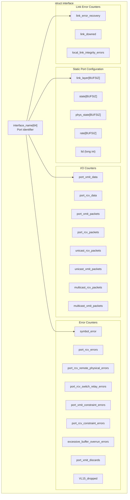
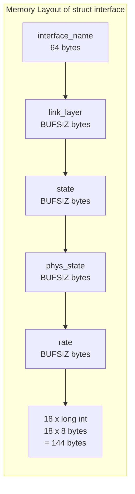
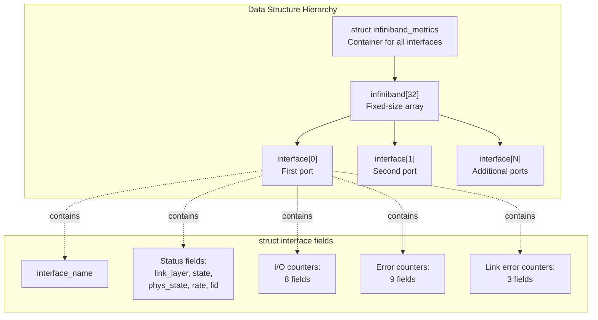
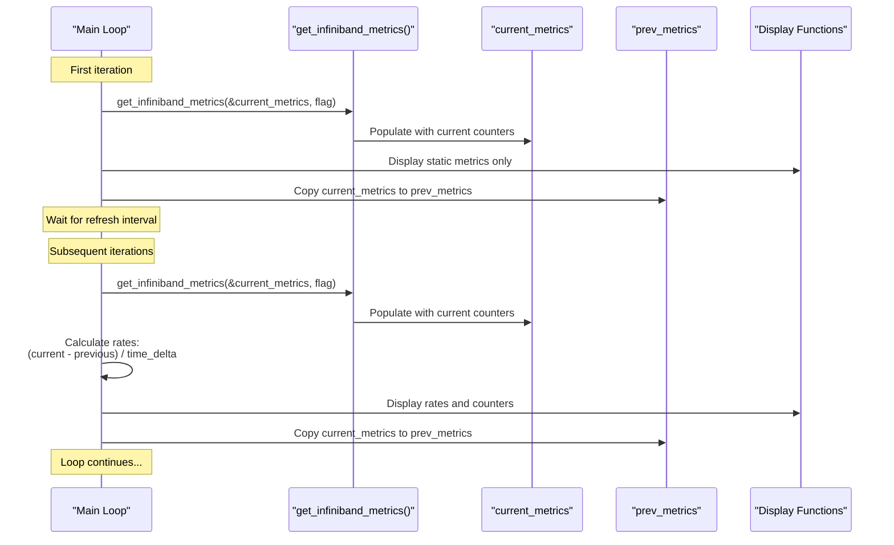
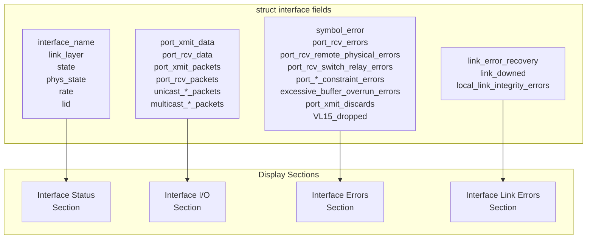

<!-- source: DeepWiki mcp.deepwiki.com · repo NVIDIA/ib-traffic-monitor · extra page Data Structures · fetched 2026-10-26 -->

# Data Structures

<details>
<summary>Relevant source files</summary>

The following files were used as context for generating this wiki page:

- [README.md](README.md)
- [infiniband.h](infiniband.h)

</details>


## Purpose and Scope

This page documents the data structures defined in [infiniband.h]() that store InfiniBand device metrics collected from sysfs. These structures serve as the primary data containers for the entire monitoring system, holding both static port configuration (link layer, state, rate) and dynamic performance counters (packets, bytes, errors).

For information about how these structures are populated with data, see [Metrics Collection](#4.2.1). For details on how the collected metrics are displayed, see [User Interface System](#4.3).

**Sources:** [infiniband.h:1-63]()

---

## Overview

The InfiniBand metrics system uses two primary structures:

| Structure | Purpose | Defined At |
|-----------|---------|------------|
| `struct interface` | Represents a single InfiniBand/Ethernet port with all associated metrics | [infiniband.h:26-53]() |
| `struct infiniband_metrics` | Container for all detected interfaces in the system | [infiniband.h:55-58]() |

These structures are designed to hold complete snapshots of device state at a point in time, enabling rate calculations by comparing consecutive snapshots.

**Sources:** [infiniband.h:26-58]()

---

## Constants

The header defines two critical constants that govern structure sizing and buffer allocations:

```c
#define INTERFACE_COUNT 32
#define IB_DEVICE_NAME_MAX 64
```

| Constant | Value | Purpose |
|----------|-------|---------|
| `INTERFACE_COUNT` | 32 | Maximum number of InfiniBand/Ethernet ports that can be monitored simultaneously |
| `IB_DEVICE_NAME_MAX` | 64 | Maximum length for interface names (e.g., "mlx5_0 port 1") |

These constants are used to statically allocate arrays, avoiding dynamic memory allocation during runtime metric collection.

**Sources:** [infiniband.h:23-24]()

---

## Structure: `struct interface`

### Definition and Purpose

The `interface` structure represents a single InfiniBand or Ethernet port with complete metric data. Each instance stores both static port information (configuration and state) and dynamic counters (performance metrics and errors).



**Sources:** [infiniband.h:26-53]()

---

### Field Categories

The 25 fields in `struct interface` are organized into four functional categories that correspond to the four display sections in the user interface:

#### 1. Interface Identification and Status (7 fields)

| Field | Type | Purpose | Maps to sysfs |
|-------|------|---------|---------------|
| `interface_name` | `char[64]` | Device and port identifier (e.g., "mlx5_0 port 1") | Constructed from device enumeration |
| `link_layer` | `char[BUFSIZ]` | Link layer type ("InfiniBand" or "Ethernet") | `/sys/class/infiniband/<dev>/ports/<port>/link_layer` |
| `state` | `char[BUFSIZ]` | Port state (e.g., "ACTIVE", "DOWN") | `/sys/class/infiniband/<dev>/ports/<port>/state` |
| `phys_state` | `char[BUFSIZ]` | Physical state (e.g., "LinkUp", "Polling") | `/sys/class/infiniband/<dev>/ports/<port>/phys_state` |
| `rate` | `char[BUFSIZ]` | Data rate (e.g., "200 Gb/sec") | `/sys/class/infiniband/<dev>/ports/<port>/rate` |
| `lid` | `long int` | Local Identifier for InfiniBand addressing | `/sys/class/infiniband/<dev>/ports/<port>/lid` |

These fields provide static or slowly-changing configuration information about the port.

**Sources:** [infiniband.h:27-32](), [README.md:17-21]()

---

#### 2. Interface I/O Counters (8 fields)

| Field | Type | Purpose | Maps to sysfs Counter |
|-------|------|---------|------------------------|
| `port_xmit_data` | `long int` | Total bytes transmitted | `port_xmit_data` |
| `port_rcv_data` | `long int` | Total bytes received | `port_rcv_data` |
| `port_xmit_packets` | `long int` | Total packets transmitted | `port_xmit_packets` |
| `port_rcv_packets` | `long int` | Total packets received | `port_rcv_packets` |
| `unicast_xmit_packets` | `long int` | Unicast packets transmitted | `unicast_xmit_packets` |
| `unicast_rcv_packets` | `long int` | Unicast packets received | `unicast_rcv_packets` |
| `multicast_xmit_packets` | `long int` | Multicast packets transmitted | `multicast_xmit_packets` |
| `multicast_rcv_packets` | `long int` | Multicast packets received | `multicast_rcv_packets` |

These counters are cumulative and monotonically increasing. Rate calculations are performed by taking deltas between consecutive reads.

**Sources:** [infiniband.h:42-49](), [README.md:22-29]()

---

#### 3. Interface Error Counters (9 fields)

| Field | Type | Purpose | Maps to sysfs Counter |
|-------|------|---------|------------------------|
| `symbol_error` | `long int` | Minor link errors on physical lanes | `symbol_error` |
| `port_rcv_errors` | `long int` | Packets with errors received | `port_rcv_errors` |
| `port_rcv_remote_physical_errors` | `long int` | Packets marked with EBP delimiter | `port_rcv_remote_physical_errors` |
| `port_rcv_switch_relay_errors` | `long int` | Packets discarded by switch relay | `port_rcv_switch_relay_errors` |
| `port_rcv_constraint_errors` | `long int` | Received packets discarded by constraints | `port_rcv_constraint_errors` |
| `port_xmit_constraint_errors` | `long int` | Transmitted packets not sent due to constraints | `port_xmit_constraint_errors` |
| `excessive_buffer_overrun_errors` | `long int` | Input buffer overruns | `excessive_buffer_overrun_errors` |
| `port_xmit_discards` | `long int` | Outbound packets discarded | `port_xmit_discards` |
| `VL15_dropped` | `long int` | VL15 packets dropped | `VL15_dropped` |

These counters track various error conditions that can affect data transmission quality and reliability.

**Sources:** [infiniband.h:33-41](), [infiniband.h:51-52](), [README.md:30-38]()

---

#### 4. Link Error Counters (3 fields)

| Field | Type | Purpose | Maps to sysfs Counter |
|-------|------|---------|------------------------|
| `link_error_recovery` | `long int` | Successful link error recovery completions | `link_error_recovery` |
| `link_downed` | `long int` | Failed link error recovery attempts | `link_downed` |
| `local_link_integrity_errors` | `long int` | Local physical error threshold exceedances | `local_link_integrity_errors` |

These counters track link-level stability issues that may indicate cabling or signal integrity problems.

**Sources:** [infiniband.h:37](), [infiniband.h:40](), [infiniband.h:50](), [README.md:39-41]()

---

### Field Layout and Memory Considerations

The structure uses a mix of fixed-size character arrays and long integers. The memory layout is:



**Size Calculation:**
- Character arrays: 64 + 4×BUFSIZ bytes (BUFSIZ typically 8192 on Linux)
- Long integers: 18 × 8 bytes = 144 bytes (on 64-bit systems)
- Total: Approximately 33 KB per interface (dominated by BUFSIZ arrays)

The use of `BUFSIZ` for string fields provides generous buffer space to handle variable-length sysfs output without truncation.

**Sources:** [infiniband.h:26-53]()

---

## Structure: `struct infiniband_metrics`

### Definition and Purpose

The `infiniband_metrics` structure is a simple container that holds an array of all detected interfaces in the system.

```c
struct infiniband_metrics {
    /* interface metrics */
    struct interface infiniband[INTERFACE_COUNT];
};
```

This structure serves as the top-level data container passed between the metrics collection functions and the display rendering code.

**Sources:** [infiniband.h:55-58]()

---

### Structure Relationships



**Sources:** [infiniband.h:26-58]()

---

### Usage Pattern

The `infiniband_metrics` structure is used in a dual-buffer pattern for rate calculations:



This pattern allows the application to calculate throughput rates and detect counter changes between polling intervals.

**Sources:** [infiniband.h:60]()

---

## Mapping to Display Categories

The fields in `struct interface` map directly to the four sections displayed in the ncurses UI:



This one-to-one mapping between data structure organization and display layout simplifies the rendering code and makes the system architecture easier to understand.

**Sources:** [infiniband.h:26-53](), [README.md:15-41]()

---

## Public Interface

The header exposes a single public function for populating these structures:

```c
extern int get_infiniband_metrics(struct infiniband_metrics *input_infiniband_metrics, 
                                   int show_ethernet_flag);
```

| Parameter | Type | Purpose |
|-----------|------|---------|
| `input_infiniband_metrics` | `struct infiniband_metrics *` | Pointer to structure to populate with metrics |
| `show_ethernet_flag` | `int` | If non-zero, include Ethernet link layer devices; otherwise InfiniBand only |
| **Return Value** | `int` | Number of interfaces discovered and populated (0 if none found) |

The function implementation is documented in [Metrics Collection](#4.2.1).

**Sources:** [infiniband.h:60]()

---

## Data Type Considerations

### String Fields

All string fields use either fixed-size arrays (`interface_name`) or `BUFSIZ`-sized arrays. This design:
- Avoids dynamic memory allocation
- Prevents buffer overflows with generous sizing
- Simplifies memory management (no malloc/free needed)
- Enables stack allocation of structures

### Integer Fields

All numeric counters use `long int` (typically 64 bits on modern systems), which:
- Prevents overflow for cumulative counters that can grow very large
- Matches the data type of values read from sysfs
- Provides sufficient range for high-speed network counters (e.g., 200 Gb/sec links can accumulate billions of packets quickly)

**Sources:** [infiniband.h:26-53]()

---

## Summary

The data structures defined in [infiniband.h]() provide a clean, type-safe representation of InfiniBand device metrics organized into logical categories:

| Category | Field Count | Purpose |
|----------|-------------|---------|
| Status | 6 | Port identification and configuration |
| I/O Counters | 8 | Traffic volume and throughput |
| Error Counters | 9 | Data integrity and reliability issues |
| Link Errors | 3 | Physical layer problems |

The structures use static allocation and generous buffer sizing to ensure robustness without dynamic memory management overhead. The organization directly mirrors both the sysfs layout and the display sections, creating a coherent data flow from hardware through kernel to user interface.

**Sources:** [infiniband.h:1-63](), [README.md:15-41]()

---

