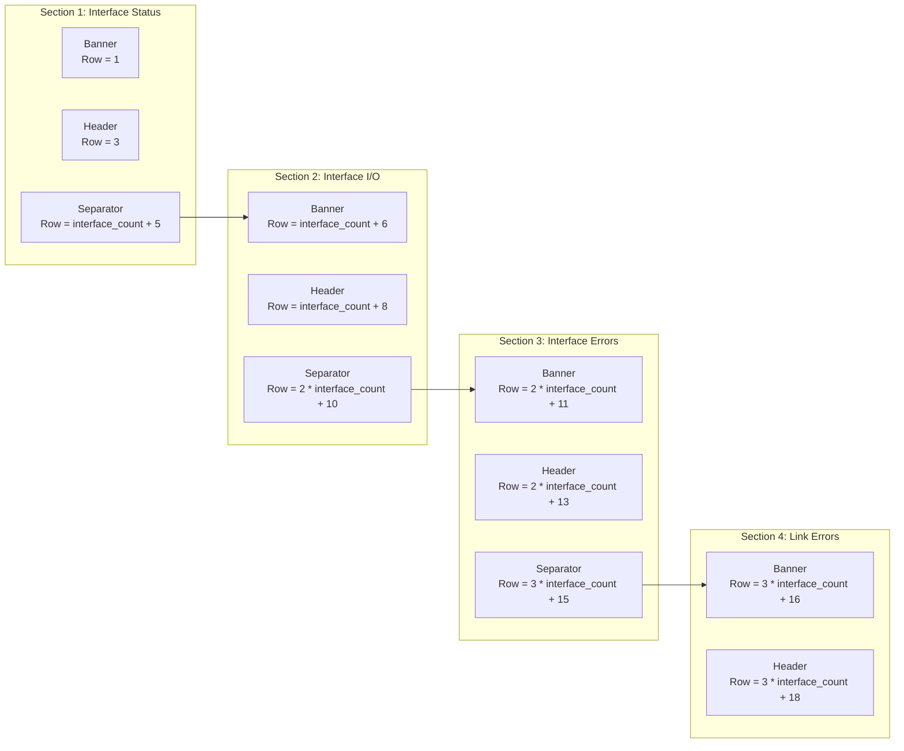
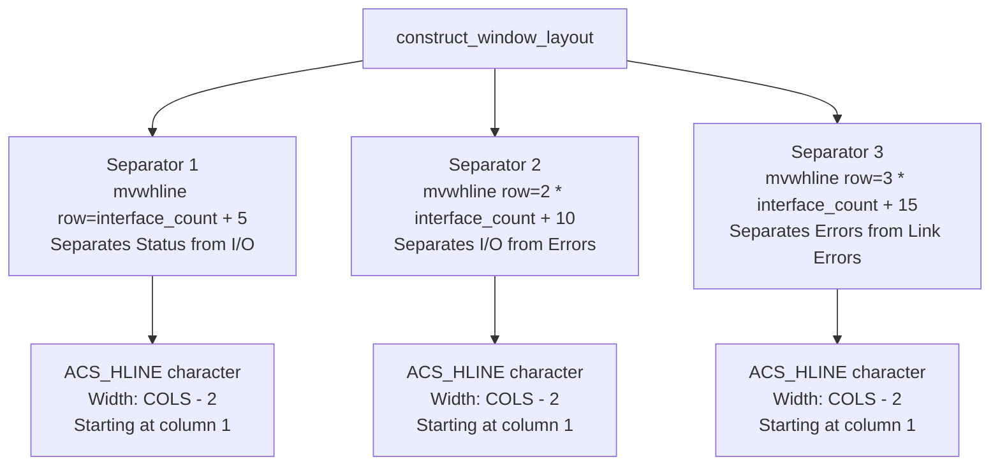
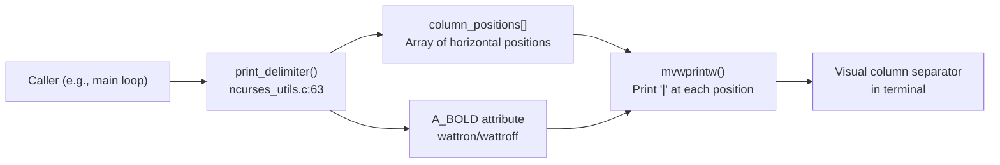

<!-- source: DeepWiki mcp.deepwiki.com · repo NVIDIA/ib-traffic-monitor · extra page Display Layout · fetched 2026-10-26 -->

# Display Layout

<details>
<summary>Relevant source files</summary>

The following files were used as context for generating this wiki page:

- [ncurses_utils.c](ncurses_utils.c)
- [screen_layout](screen_layout)
- [screenshots/ib-traffic-monitor.png](screenshots/ib-traffic-monitor.png)

</details>


## Purpose and Scope

This document describes the screen layout structure used by ib-traffic-monitor's ncurses-based terminal user interface. It explains how the four metric sections are organized vertically, how spacing is calculated dynamically based on interface count, and how visual elements such as banners, headers, and separators are positioned on the screen.

For documentation of the ncurses utility functions that implement the layout rendering, see [ncurses Utilities](#4.3.1). For details on the individual metrics displayed in each section, see [Metrics Reference](#5).

---

## Layout Structure Overview

The display is organized into four distinct sections, each displaying a different category of InfiniBand metrics. The layout is constructed by the `construct_window_layout` function in [ncurses_utils.c:21-61]().

```mermaid
graph TD
    Screen["Screen (WINDOW *)"]
    
    Screen --> Section1["Section 1: Interface Status<br/>Lines 1-5 + interface_count"]
    Screen --> Sep1["Separator 1<br/>Horizontal line"]
    Screen --> Section2["Section 2: Interface I/O<br/>5 lines + interface_count"]
    Screen --> Sep2["Separator 2<br/>Horizontal line"]
    Screen --> Section3["Section 3: Interface Errors<br/>5 lines + interface_count"]
    Screen --> Sep3["Separator 3<br/>Horizontal line"]
    Screen --> Section4["Section 4: Link Errors<br/>4 lines + interface_count"]
    Screen --> Footer["Footer<br/>Line LINES - 1"]
    
    Section1 --> Status_Banner["Banner: 'Interface Status'<br/>A_STANDOUT attribute<br/>Row 1"]
    Section1 --> Status_Header["Header: Column names<br/>A_BOLD attribute<br/>Row 3"]
    Section1 --> Status_Data["Data rows<br/>Rows 4 to 3 + interface_count"]
    
    Section2 --> IO_Banner["Banner: 'Interface I/O (per second)'<br/>Row interface_count + 6"]
    Section2 --> IO_Header["Header: Column names<br/>Row interface_count + 8"]
    Section2 --> IO_Data["Data rows"]
    
    Section3 --> Error_Banner["Banner: 'Interface Error (cumulative)'<br/>Row 2 * interface_count + 11"]
    Section3 --> Error_Header["Header: Column names<br/>Row 2 * interface_count + 13"]
    Section3 --> Error_Data["Data rows"]
    
    Section4 --> Link_Banner["Banner: 'Interface Link Error (cumulative)'<br/>Row 3 * interface_count + 16"]
    Section4 --> Link_Header["Header: Column names<br/>Row 3 * interface_count + 18"]
    Section4 --> Link_Data["Data rows"]
```



**Sources:** [ncurses_utils.c:21-61](), [screen_layout:16-48]()

---

## Section Components

Each of the four sections follows an identical structural pattern consisting of three components:

| Component | Description | Attribute | Vertical Offset |
|-----------|-------------|-----------|-----------------|
| **Banner** | Section title with descriptive name | `A_STANDOUT` | Base row |
| **Blank Line** | Spacing separator | None | Base row + 1 |
| **Header** | Column names for metrics | `A_BOLD` | Base row + 2 |
| **Data Rows** | Actual metric values (one per interface) | None | Base row + 3 to base row + 3 + interface_count - 1 |
| **Blank Line** | Spacing after data | None | Base row + 3 + interface_count |

The banner text is highlighted using the `A_STANDOUT` attribute (typically reverse video), while the header row uses `A_BOLD` for emphasis [ncurses_utils.c:38-50]().

**Sources:** [ncurses_utils.c:21-61](), [screen_layout:17-43]()

---

## Vertical Positioning Formula

The vertical position of each section is calculated dynamically based on the number of interfaces being monitored. This ensures the layout scales appropriately regardless of how many InfiniBand devices are present.



The positioning follows this pattern:

- **Section 1 (Status):** Banner at row 1, header at row 3
- **Section 2 (I/O):** Banner at row `interface_count + 6`, header at row `interface_count + 8`
- **Section 3 (Errors):** Banner at row `2 * interface_count + 11`, header at row `2 * interface_count + 13`
- **Section 4 (Link Errors):** Banner at row `3 * interface_count + 16`, header at row `3 * interface_count + 18`

This formula accounts for:
- The header row (2 lines below banner)
- `interface_count` data rows
- 2 blank lines (before and after data)
- 1 horizontal separator line

**Sources:** [ncurses_utils.c:39-49](), [ncurses_utils.c:52-54]()

---

## Layout Constants and Headers

The layout structure is defined by string constants stored in the `construct_window_layout` function. These constants define both the banner text and the column header layout for each section.

### Section 1: Interface Status

```c
char *interface_status_banner = "Interface Status";
char *interface_status_layout = "Interface Name  |   LID   |   Link Layer   |      State      |  Physical State  |     Rate";
```

Located at [ncurses_utils.c:23-24](). Displays basic interface identification and link status information.

### Section 2: Interface I/O

```c
char *interface_io_banner = "Interface I/O (per second)";
char *interface_io_layout = "Interface Name  |  RX Packet  |   RX MB   |  TX Packet  |   TX MB   |  UC RX Packet  |  UC TX Packet  |  MC RX Packet  |  MC TX Packet";
```

Located at [ncurses_utils.c:26-27](). Displays throughput metrics with per-second rates.

### Section 3: Interface Errors

```c
char *interface_error_banner = "Interface Error (cumulative)";
char *interface_error_layout = "Interface Name  | Symbol |   RX   | RX Remote PHY | RX Switch Relay | RX Const. | TX Const. | Buffer Overrun | TX Discard | VL15 Dropped";
```

Located at [ncurses_utils.c:29-30](). Displays cumulative error counters.

### Section 4: Link Errors

```c
char *interface_link_error_banner = "Interface Link Error (cumulative)";
char *interface_link_error_layout = "Interface Name  | Link Error Recovery | Local Link Integrity | Link Downed";
```

Located at [ncurses_utils.c:32-33](). Displays link-specific error counters.

**Sources:** [ncurses_utils.c:22-33]()

---

## Horizontal Separators

Three horizontal line separators divide the four sections. These are rendered using the ncurses `ACS_HLINE` character and `mvwhline` function.



The separators are drawn from column 1 to column `COLS - 2`, leaving a one-character margin on each side of the terminal window [ncurses_utils.c:52-54]().

**Sources:** [ncurses_utils.c:52-54](), [screen_layout:23,30,37,46]()

---

## Column Delimiters

Vertical pipe characters (`|`) are used to delimit columns within each row. These are printed by the `print_delimiter` function [ncurses_utils.c:63-71]().

The function signature:
```c
void print_delimiter(WINDOW *input_window, int row_number, int *column_positions, size_t column_size)
```

The delimiter printing process:

1. Accepts an array of column positions (`column_positions`)
2. Accepts the size of that array (`column_size`)
3. Iterates through each position
4. Prints a bold `|` character at each specified column on the given row



The `A_BOLD` attribute is applied to make the delimiters visually distinct from the metric data [ncurses_utils.c:66-70]().

**Sources:** [ncurses_utils.c:63-71](), [screen_layout:19-42]()

---

## Footer Display

The footer is displayed at the bottom of the terminal window and provides user instructions:

```c
mvwprintw(input_window, LINES - 1, 10, "press 'Q' to exit");
```

Located at [ncurses_utils.c:57](). The footer:
- Always appears at row `LINES - 1` (last line of the terminal)
- Starts at column 10 (slightly indented from the left edge)
- Displays the text "press 'Q' to exit" without special attributes

**Sources:** [ncurses_utils.c:57]()

---

## Window Refresh

After constructing all layout elements, the window is refreshed to display the content:

```c
wrefresh(input_window);
```

Located at [ncurses_utils.c:60](). This call to `wrefresh` updates the physical terminal display with the buffered changes made during layout construction. The refresh is necessary because ncurses operates on a buffered model where drawing operations are accumulated and then rendered together for efficiency.

**Sources:** [ncurses_utils.c:60]()

---

## Layout Coordinate Reference Table

The following table summarizes the row positions for all major layout elements:

| Element | Row Formula | Example (4 interfaces) |
|---------|-------------|------------------------|
| **Section 1 Banner** | 1 | 1 |
| **Section 1 Header** | 3 | 3 |
| **Section 1 Data Start** | 4 | 4 |
| **Section 1 Data End** | 3 + interface_count | 7 |
| **Separator 1** | interface_count + 5 | 9 |
| **Section 2 Banner** | interface_count + 6 | 10 |
| **Section 2 Header** | interface_count + 8 | 12 |
| **Section 2 Data Start** | interface_count + 9 | 13 |
| **Section 2 Data End** | 2 * interface_count + 8 | 16 |
| **Separator 2** | 2 * interface_count + 10 | 18 |
| **Section 3 Banner** | 2 * interface_count + 11 | 19 |
| **Section 3 Header** | 2 * interface_count + 13 | 21 |
| **Section 3 Data Start** | 2 * interface_count + 14 | 22 |
| **Section 3 Data End** | 3 * interface_count + 13 | 25 |
| **Separator 3** | 3 * interface_count + 15 | 27 |
| **Section 4 Banner** | 3 * interface_count + 16 | 28 |
| **Section 4 Header** | 3 * interface_count + 18 | 30 |
| **Section 4 Data Start** | 3 * interface_count + 19 | 31 |
| **Section 4 Data End** | 4 * interface_count + 18 | 34 |
| **Footer** | LINES - 1 | Variable |

**Sources:** [ncurses_utils.c:39-49](), [ncurses_utils.c:52-54](), [ncurses_utils.c:57]()

---

## Visual Attributes Summary

The layout uses three ncurses visual attributes to create visual hierarchy:

| Attribute | Applied To | Purpose | Lines |
|-----------|------------|---------|-------|
| `A_STANDOUT` | Section banners | Highlight section titles (typically reverse video) | [ncurses_utils.c:38-43]() |
| `A_BOLD` | Column headers and delimiters | Emphasize structure and column names | [ncurses_utils.c:45-50](), [ncurses_utils.c:66-70]() |
| (none) | Metric data and footer | Normal text display | N/A |

The attributes are applied using `wattron` before printing and removed using `wattroff` afterward to prevent attribute bleeding into subsequent text.

**Sources:** [ncurses_utils.c:38-50](), [ncurses_utils.c:66-70]()

---

