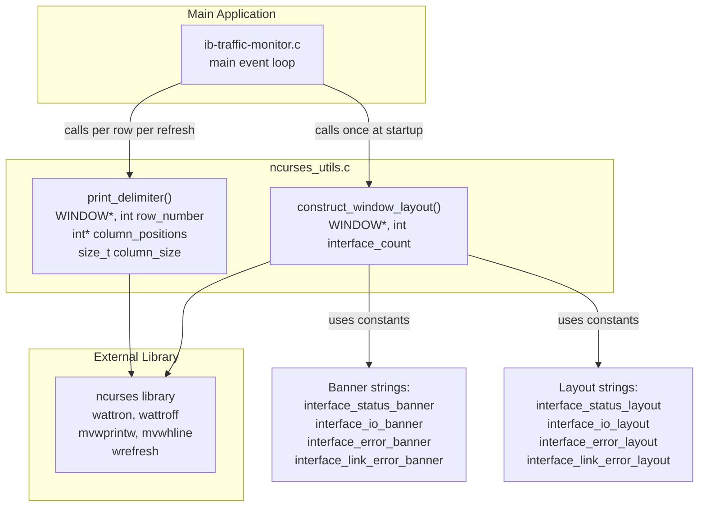
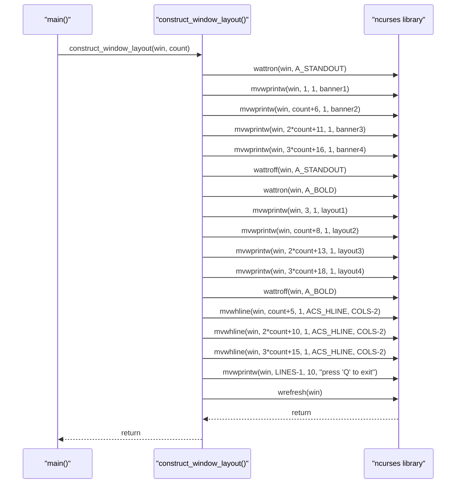
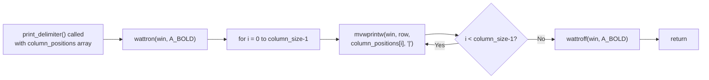
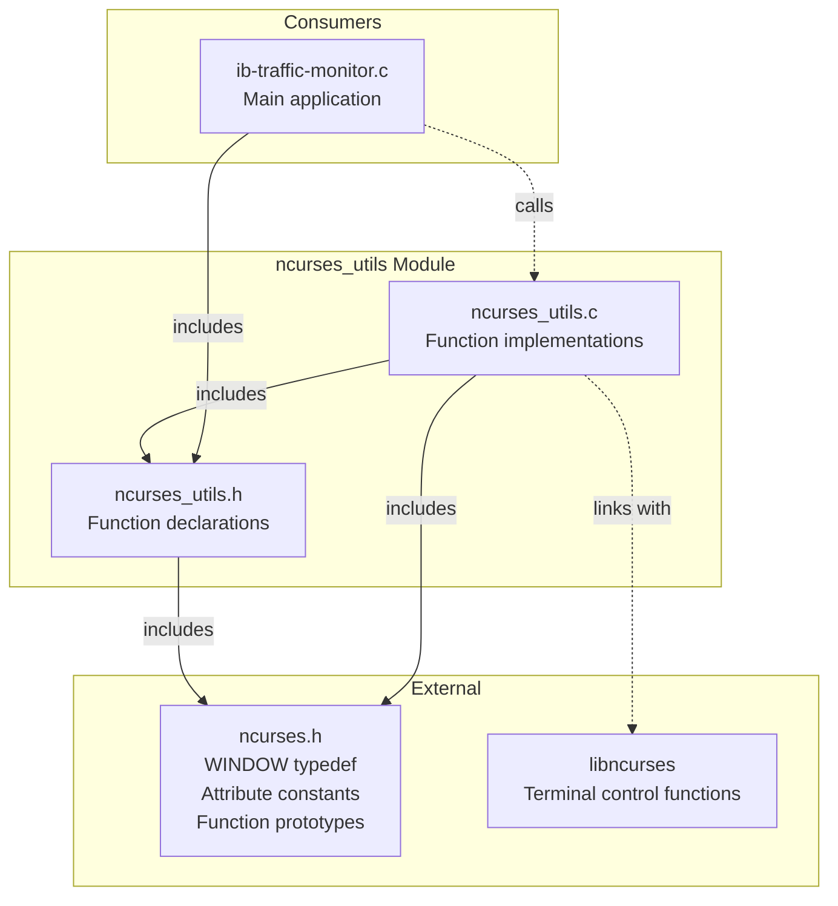

<!-- source: DeepWiki mcp.deepwiki.com · repo NVIDIA/ib-traffic-monitor · extra page ncurses Utilities · fetched 2026-10-26 -->

# ncurses Utilities

<details>
<summary>Relevant source files</summary>

The following files were used as context for generating this wiki page:

- [ncurses_utils.c](ncurses_utils.c)
- [ncurses_utils.h](ncurses_utils.h)

</details>


## Purpose and Scope

This document describes the ncurses utility functions implemented in `ncurses_utils.c` and defined in `ncurses_utils.h`. These utilities provide core presentation layer functionality for constructing the terminal user interface layout and rendering formatted output. The module contains two primary functions that handle window layout construction and column delimiter printing.

For information about how these utilities are invoked from the main application loop, see [Main Application](#4.1). For details on the overall display structure and metric rendering, see [Display Layout](#4.3.2).

**Sources:** [ncurses_utils.h:1-27](), [ncurses_utils.c:1-72]()

## Module Overview

The ncurses utilities module is a minimal presentation helper layer that abstracts two specific UI operations:

| Function | Purpose | Parameters |
|----------|---------|------------|
| `construct_window_layout()` | Creates the four-section layout with banners, headers, and delimiters | `WINDOW *`, `int interface_count` |
| `print_delimiter()` | Prints vertical bar delimiters at specified column positions | `WINDOW *`, `int row_number`, `int *column_positions`, `size_t column_size` |

The module has a single external dependency on the ncurses library and provides functionality to the main application layer.

**Sources:** [ncurses_utils.h:18-27](), [ncurses_utils.c:18-72]()

## Function Relationships



**Sources:** [ncurses_utils.c:21-61](), [ncurses_utils.h:23-24]()

## construct_window_layout Function

The `construct_window_layout()` function establishes the complete screen layout structure with four distinct metric sections. It is called once during application initialization and does not handle dynamic content updates.

### Function Signature

```c
void construct_window_layout(WINDOW *input_window, int interface_count)
```

### Parameters

| Parameter | Type | Description |
|-----------|------|-------------|
| `input_window` | `WINDOW *` | ncurses window pointer for rendering |
| `interface_count` | `int` | Number of InfiniBand interfaces to display, used for calculating row positions |

### Layout Constants

The function defines eight string constants that control the visual structure:

| Constant | Type | Content | Purpose |
|----------|------|---------|---------|
| `interface_status_banner` | `char *` | "Interface Status" | Section 1 title |
| `interface_status_layout` | `char *` | Column headers for LID, Link Layer, State, etc. | Section 1 header row |
| `interface_io_banner` | `char *` | "Interface I/O (per second)" | Section 2 title |
| `interface_io_layout` | `char *` | Column headers for RX/TX packets and MB | Section 2 header row |
| `interface_error_banner` | `char *` | "Interface Error (cumulative)" | Section 3 title |
| `interface_error_layout` | `char *` | Column headers for Symbol, RX, TX errors | Section 3 header row |
| `interface_link_error_banner` | `char *` | "Interface Link Error (cumulative)" | Section 4 title |
| `interface_link_error_layout` | `char *` | Column headers for Link Error Recovery, Link Integrity | Section 4 header row |

**Sources:** [ncurses_utils.c:21-34]()

### Layout Structure and Row Calculation

The function uses a mathematical formula to position each section based on `interface_count`:

```mermaid
graph TD
    START["Row 1: Section 1 Banner"]
    
    START --> S1_HEADER["Row 3: Section 1 Header<br/>interface_status_layout"]
    S1_HEADER --> S1_DATA["Rows 4 to 3+interface_count:<br/>Interface Status Data"]
    S1_DATA --> S1_LINE["Row interface_count+5:<br/>Horizontal Line (ACS_HLINE)"]
    
    S1_LINE --> S2_BANNER["Row interface_count+6:<br/>Section 2 Banner"]
    S2_BANNER --> S2_HEADER["Row interface_count+8:<br/>Section 2 Header"]
    S2_HEADER --> S2_DATA["Rows interface_count+9 to<br/>2*interface_count+8:<br/>Interface I/O Data"]
    S2_DATA --> S2_LINE["Row 2*interface_count+10:<br/>Horizontal Line"]
    
    S2_LINE --> S3_BANNER["Row 2*interface_count+11:<br/>Section 3 Banner"]
    S3_BANNER --> S3_HEADER["Row 2*interface_count+13:<br/>Section 3 Header"]
    S3_HEADER --> S3_DATA["Rows 2*interface_count+14 to<br/>3*interface_count+13:<br/>Interface Error Data"]
    S3_DATA --> S3_LINE["Row 3*interface_count+15:<br/>Horizontal Line"]
    
    S3_LINE --> S4_BANNER["Row 3*interface_count+16:<br/>Section 4 Banner"]
    S4_BANNER --> S4_HEADER["Row 3*interface_count+18:<br/>Section 4 Header"]
    S4_HEADER --> S4_DATA["Rows 3*interface_count+19 to<br/>4*interface_count+18:<br/>Link Error Data"]
    
    S4_DATA --> FOOTER["Row LINES-1:<br/>Footer with exit instruction"]
```



**Sources:** [ncurses_utils.c:38-60]()

### Text Attributes

The function applies two ncurses text attributes to differentiate visual elements:

| Attribute | Applied To | Lines | Purpose |
|-----------|------------|-------|---------|
| `A_STANDOUT` | Section banners | [ncurses_utils.c:38-43]() | Reverse video highlighting for section titles |
| `A_BOLD` | Column headers | [ncurses_utils.c:45-50]() | Bold text for metric column names |
| `A_BOLD` | Delimiters (via `print_delimiter`) | [ncurses_utils.c:66-70]() | Bold vertical bars for column separation |

The function uses `wattron()` to enable attributes before printing and `wattroff()` to disable them afterward, following the standard ncurses attribute management pattern.

**Sources:** [ncurses_utils.c:38-50](), [ncurses_utils.c:66-70]()

### Rendering Sequence



**Sources:** [ncurses_utils.c:38-60]()

## print_delimiter Function

The `print_delimiter()` function renders vertical bar characters (`|`) at specified column positions to visually separate metric columns. It is called repeatedly during each screen refresh cycle to maintain column alignment.

### Function Signature

```c
void print_delimiter(WINDOW *input_window, int row_number, int *column_positions, size_t column_size)
```

### Parameters

| Parameter | Type | Description |
|-----------|------|-------------|
| `input_window` | `WINDOW *` | ncurses window pointer for rendering |
| `row_number` | `int` | Row coordinate where delimiters should be printed |
| `column_positions` | `int *` | Array of column coordinates for delimiter placement |
| `column_size` | `size_t` | Number of elements in the `column_positions` array |

### Implementation Details

The function iterates through the `column_positions` array and prints a single pipe character (`|`) at each specified column coordinate. All delimiters are rendered with the `A_BOLD` attribute for visual consistency with the column headers.

**Sources:** [ncurses_utils.c:63-71]()

### Delimiter Rendering Pattern



**Sources:** [ncurses_utils.c:63-71]()

## Coordinate System

The module uses the ncurses coordinate system where:

- **Origin (0, 0)**: Top-left corner of the terminal window
- **Y-axis (rows)**: Increases downward
- **X-axis (columns)**: Increases rightward
- **Global macros**: `LINES` (terminal height), `COLS` (terminal width)

### Fixed Column Position

All section banners, headers, and the footer message are positioned at column 1 (one character from the left edge).

### Dynamic Row Calculation

Row positions are calculated dynamically based on `interface_count` to accommodate varying numbers of interfaces. The spacing formula ensures each section has sufficient rows for interface data plus visual separators.

**Formula Pattern:**
- Section 1 starts at row 1
- Section 2 starts at row `interface_count + 6`
- Section 3 starts at row `2 * interface_count + 11`
- Section 4 starts at row `3 * interface_count + 16`

This ensures consistent 5-row spacing between sections (1 blank row, 1 banner row, 1 blank row, 1 header row, 1 separator line).

**Sources:** [ncurses_utils.c:39-42]()

## Horizontal Line Rendering

The function uses `mvwhline()` to draw horizontal separator lines between sections:

| Call | Row Position | Character | Width |
|------|--------------|-----------|-------|
| Line 1 | `interface_count + 5` | `ACS_HLINE` | `COLS - 2` |
| Line 2 | `2 * interface_count + 10` | `ACS_HLINE` | `COLS - 2` |
| Line 3 | `3 * interface_count + 15` | `ACS_HLINE` | `COLS - 2` |

The `ACS_HLINE` constant is an ncurses alternate character set symbol that renders as a horizontal line character appropriate for the terminal type.

**Sources:** [ncurses_utils.c:52-54]()

## Footer Display

A fixed footer message is rendered at the bottom of the terminal window:

```c
mvwprintw(input_window, LINES - 1, 10, "press 'Q' to exit");
```

- **Position**: Last row (`LINES - 1`), column 10
- **Content**: User instruction for program termination
- **Attributes**: No special attributes applied (default text)

**Sources:** [ncurses_utils.c:57]()

## Module Dependencies



**Sources:** [ncurses_utils.c:18-19](), [ncurses_utils.h:18-21]()

---

