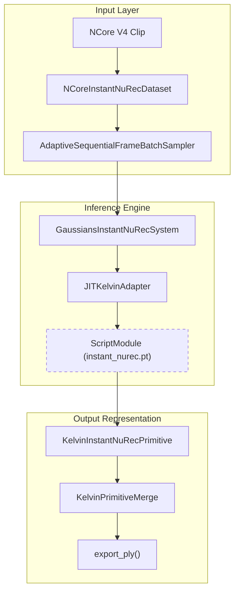
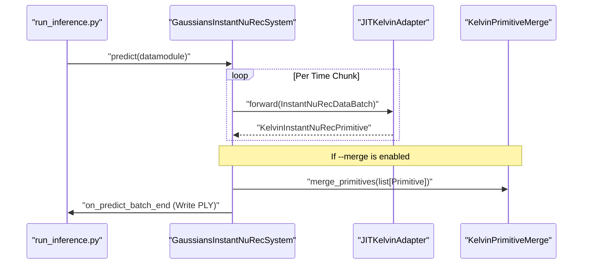

<!-- source: DeepWiki mcp.deepwiki.com · repo NVIDIA/instant-nurec · page 1 Overview · fetched 2026-10-26 -->

# Overview

Relevant source files

The following files were used as context for generating this wiki page:

- [CONTRIBUTING.md](CONTRIBUTING.md)
- [LICENSE.txt](LICENSE.txt)
- [README.md](README.md)
- [SECURITY.md](SECURITY.md)
- [docs/demo.gif](docs/demo.gif)
- [docs/demo.mp4](docs/demo.mp4)

InstantNuRec is a feed-forward reconstruction system that converts autonomous vehicle (AV) driving logs into dynamic 3D Gaussian Splatting (3DGS) representations in seconds [README.md:14-17](). Unlike traditional methods requiring per-scene optimization, InstantNuRec utilizes a vision-transformer backbone to infer geometry, appearance, and motion directly from multi-camera observations [README.md:15-21]().

The system is designed to provide a rapid "preview" of a scene, which can either be used immediately in simulation pipelines or serve as a high-quality initialization for high-fidelity refinement in the broader NuRec ecosystem [README.md:23-26]().

### System Role and Ecosystem

InstantNuRec operates within the NuRec data ecosystem, consuming **NCore V4** clips—the same input format used by the high-fidelity NuRec optimization pipeline [README.md:28-33](). While NuRec produces high-fidelity USDZ outputs via Docker-based optimization, InstantNuRec provides a native-Python, feed-forward alternative for rapid iteration [README.md:31-33]().

### High-Level Data Flow

The pipeline transforms raw driving logs into structured 3D primitives through the following stages:

1.  **Ingest**: Loading NCore V4 sequence JSONs and sensor data.
2.  **Batching**: Dividing the clip into time-synchronized "chunks" for processing.
3.  **Inference**: Executing a forward pass through a JIT-compiled Kelvin model.
4.  **Export**: Generating 3DGS PLY files, either per-chunk or merged into a global scene.

#### Logical to Code Entity Mapping

The following diagram illustrates how high-level system concepts map to specific classes and entry points within the codebase.

**System Concept to Code Entity Map**

Sources: [README.md:51-52](), [instant_nurec/dataset/ncore_dataset.py:48-52](), [instant_nurec/systems/gaussians_instant_nurec.py:30-35](), [instant_nurec/models/jit_adapter.py:30-35]()

### Key Concepts

*   **JIT Kelvin Model**: The core transformer model, typically distributed as a TorchScript archive (`instant_nurec.pt`), which performs the feed-forward inference [README.md:114-118]().
*   **Kelvin Primitives**: A specialized 3D Gaussian representation containing static layers (geometry/color) and dynamic layers (motion/keyframes) [README.md:20-21]().
*   **Voxelization**: A KL-optimal process used during the merging of multiple chunks to maintain a target Gaussian count (default 2M) while preserving visual fidelity [README.md:143-147]().

#### Inference Execution Flow

The following diagram bridges the CLI execution to the internal system calls.

**CLI to System Execution Bridge**

Sources: [run_inference.py:35-45](), [instant_nurec/systems/gaussians_instant_nurec.py:120-150](), [README.md:135-138]()

### Documentation Map

For deeper technical details, refer to the following child pages:

*   **[Getting Started](#1.1)**: Step-by-step setup using `setup.sh`, environment configuration (e.g., `INSTANT_NUREC_FULL_PT`), and running your first inference on demo clips [README.md:55-148]().
*   **[Contributing and Project Conventions](#1.2)**: Guide for developers on the `uv` package manager, `ruff` linting, `pytest` requirements, and mandatory DCO sign-offs [CONTRIBUTING.md:17-108]().

Further sections in the wiki cover the **System Architecture**, **Data Pipeline** (NCore ingestion), **Model and Inference** (JIT adapter details), **Gaussian Primitives** (PLY export and merging), and the **Utility Library** (SE3 math and sensor models).

Sources: [CONTRIBUTING.md:1-121](), [README.md:1-195]()

---

