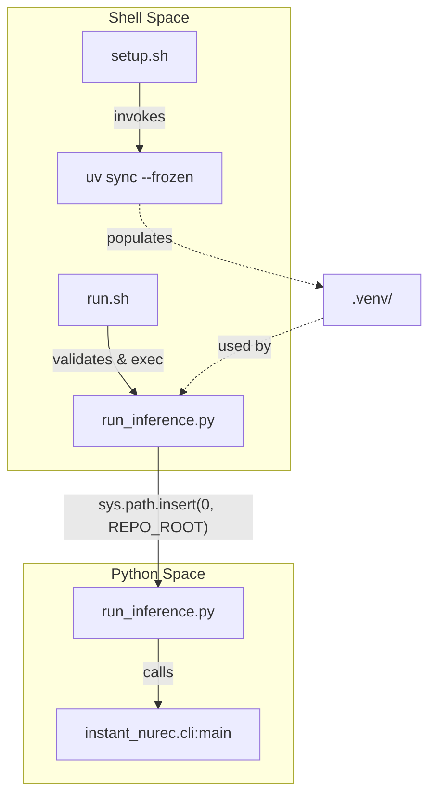
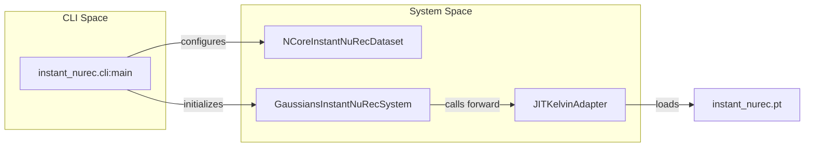

<!-- source: DeepWiki mcp.deepwiki.com · repo NVIDIA/instant-nurec · page 1.1 Getting Started · fetched 2026-10-26 -->

# Getting Started

<details>
<summary>Relevant source files</summary>

The following files were used as context for generating this wiki page:

- [.gitignore](.gitignore)
- [TROUBLESHOOTING.md](TROUBLESHOOTING.md)
- [pyproject.toml](pyproject.toml)
- [run.sh](run.sh)
- [run_inference.py](run_inference.py)
- [setup.sh](setup.sh)
- [uv.lock](uv.lock)

</details>


This page provides a step-by-step guide for setting up the InstantNuRec environment, installing necessary dependencies, and executing your first inference pipeline. InstantNuRec is designed to ingest NCore V4 driving-log data and produce 3D Gaussian Splatting (3DGS) PLY files using a JIT-compiled Kelvin model.

## Environment Setup

The project uses `uv` as its primary package manager to ensure reproducible builds through a locked dependency tree. The setup process bootstraps a virtual environment and installs pinned versions of libraries including `torch`, `nvidia-ncore`, and `huggingface_hub` [pyproject.toml:8-31]().

### Prerequisites
*   **Python**: Version 3.11.x is required [pyproject.toml:6-6]().
*   **Hardware**: An NVIDIA GPU with drivers meeting the [NuRec hardware minimums](https://docs.nvidia.com/nurec/basics/hardware.html#hardware-setup-and-requirements). There is no CPU fallback for inference [TROUBLESHOOTING.md:10-10]().
*   **uv**: If not installed, obtain it via `pip install uv` or the official install script [setup.sh:29-34]().

### Installation Steps
1.  **Clone the repository** and navigate to the root directory.
2.  **Run the setup script**:
    ```bash
    ./setup.sh
    ```
    This script executes `uv sync --frozen`, which synchronizes the local environment with the `uv.lock` file [setup.sh:40-40]().
3.  **Activate the environment**:
    ```bash
    source .venv/bin/activate
    ```

### Environment Variables
| Variable | Description |
| --- | --- |
| `INSTANT_NUREC_FULL_PT` | Optional. Absolute path to a local `instant_nurec.pt` model file to bypass Hugging Face downloads [TROUBLESHOOTING.md:5-5](). |
| `HTTPS_PROXY` | Required if your network blocks `huggingface.co` or `*.cloudfront.net` [TROUBLESHOOTING.md:5-5](). |

Sources: [setup.sh:1-58](), [pyproject.toml:1-94](), [TROUBLESHOOTING.md:1-15]()

## Running Inference

Inference is performed via the `run_inference.py` entry point, which can be invoked directly or through the `run.sh` wrapper.

### The `run.sh` Wrapper
The `run.sh` script provides a layer of validation before calling the Python engine. It ensures that:
*   `--ncore-path` points to a valid `.json` (single sequence) or `.lst` (manifest) file [run.sh:57-63]().
*   `--output-dir` is created and writable [run.sh:65-69]().

### Execution Example
```bash
./run.sh --ncore-path /path/to/sequence.json --output-dir ./results --n-gaussians 1000000 --merge
```

### Core CLI Arguments
| Argument | Description |
| --- | --- |
| `--ncore-path` | Path to NCore V4 data (JSON or LST) [run.sh:31-35](). |
| `--output-dir` | Directory where `.ply` files will be saved [run.sh:36-40](). |
| `--merge` | Boolean flag to merge per-chunk primitives into a global scene [run.sh:49-49](). |
| `--n-gaussians` | Target number of Gaussians for the output [run.sh:49-49](). |
| `--camera-id` | Filter for specific camera sensors within the NCore sequence [TROUBLESHOOTING.md:9-9](). |
| `--max-chunks` | Controls VRAM usage by limiting concurrent chunk processing [TROUBLESHOOTING.md:11-12](). |

Sources: [run.sh:1-72](), [run_inference.py:1-41](), [TROUBLESHOOTING.md:7-12]()

## Data Flow and Implementation

The following diagrams illustrate how the setup scripts and entry points transition into the core system logic.

### Setup and Entry Point Mapping
This diagram shows the relationship between the shell scripts, the Python entry point, and the primary CLI logic.


Sources: [setup.sh:40-40](), [run.sh:71-71](), [run_inference.py:32-40]()

### Inference Execution Logic
This diagram bridges the CLI command space to the internal system components that handle data ingestion and model prediction.


Sources: [run_inference.py:36-36](), [TROUBLESHOOTING.md:5-5]()

## Troubleshooting Common Issues

| Symptom | Cause | Fix |
| --- | --- | --- |
| `PretrainedModelError` | Network blocks Hugging Face or missing local file. | Set `INSTANT_NUREC_FULL_PT` to a local path [TROUBLESHOOTING.md:5-5](). |
| `ValueError: --ncore-path...` | File suffix is not `.json` or `.lst`. | Ensure the path points to an NCore JSON or LST manifest [run.sh:57-63](). |
| `RuntimeError: Found no NVIDIA driver` | Missing CUDA environment. | Verify `nvidia-smi` and ensure `torch.cuda.is_available()` is True [TROUBLESHOOTING.md:10-10](). |
| `OutOfMemoryError` | Per-chunk working set exceeds VRAM. | Lower the `--max-chunks` parameter [TROUBLESHOOTING.md:11-11](). |

Sources: [TROUBLESHOOTING.md:1-15](), [run.sh:57-63]()

---

