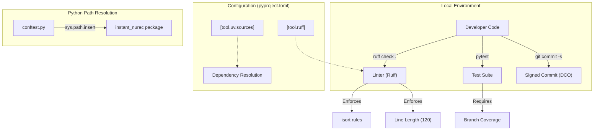
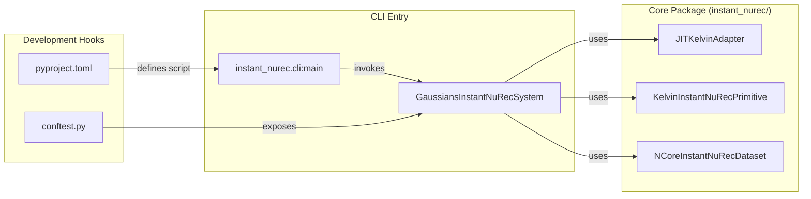

<!-- source: DeepWiki mcp.deepwiki.com · repo NVIDIA/instant-nurec · page 1.2 Contributing and Project Conventions · fetched 2026-10-26 -->

# Contributing and Project Conventions

Relevant source files

The following files were used as context for generating this wiki page:

- [CONTRIBUTING.md](CONTRIBUTING.md)
- [THIRD_PARTY_LICENSE.txt](THIRD_PARTY_LICENSE.txt)
- [conftest.py](conftest.py)
- [pyproject.toml](pyproject.toml)

This page provides a comprehensive guide for developers contributing to the `instant_nurec` codebase. It outlines the mandatory contribution workflows, technical standards for code hygiene, and the configuration of the project's development environment.

## Contribution Workflow and Signing

The project enforces strict adherence to the **Developer Certificate of Origin (DCO)**. This ensures that every contribution is legally traceable and authorized by the contributor.

### DCO Sign-off
All commits must be "signed-off" using the `-s` or `--signoff` flag in Git [CONTRIBUTING.md:23-32](). This appends a `Signed-off-by` line to the commit message, certifying that the contributor has the rights to submit the work under the project's Apache-2.0 license [CONTRIBUTING.md:33-75]().

### Commit Hygiene
The project follows a structured commit format to maintain a clean and searchable history [CONTRIBUTING.md:114-121]():
*   **One logical change per commit.**
*   **Subject Line Format:** `<type>(<area>): <imperative one-liner>`.
*   **Valid Types:** `feat`, `fix`, `refactor`, `chore`, `test`, `docs`.
*   **Fixups:** Use `git commit --fixup=<SHA>` for minor corrections to existing commits on a branch.

## Local Development Environment

The project uses `uv` for dependency management and environment isolation.

### Environment Setup
The `setup.sh` script initializes the environment by running `uv sync --frozen`, which creates a `.venv/` directory based on the locked dependency tree in `uv.lock` [CONTRIBUTING.md:77-87]().

### Dependency Management
Dependencies are strictly version-pinned in `pyproject.toml` to prevent runtime drift [pyproject.toml:8-31](). The project uses custom indices for CUDA-enabled wheels (e.g., `torch`, `torchvision`, `torch-scatter`) to ensure compatibility with the `cu128` ABI [pyproject.toml:52-67]().

| Tool | Purpose | Configuration |
| :--- | :--- | :--- |
| `uv` | Dependency resolution and locking | `uv.lock` |
| `setuptools` | Build backend | `pyproject.toml` [pyproject.toml:91-93]() |
| `ruff` | Linting and formatting | `pyproject.toml` [tool.ruff] [pyproject.toml:68-75]() |
| `pytest` | Test runner | `conftest.py` [conftest.py:1-28]() |

Sources: [CONTRIBUTING.md:77-91](), [pyproject.toml:1-94]()

## Coding Conventions and Linting

### Linting with Ruff
The project uses `ruff` for static analysis and import sorting. The configuration is defined in `pyproject.toml` with a target version of Python 3.11 and a line length limit of 120 characters [pyproject.toml:68-70]().

*   **Import Sorting:** `isort` rules are enforced, with specific section ordering: `future`, `standard-library`, `third-party`, `first-party`, `local-folder` [pyproject.toml:83-89]().
*   **Exemptions:** Certain files like `run_inference.py` and tests are allowed to bypass `E402` (module-level import position) because they manually manipulate `sys.path` to resolve the in-tree `instant_nurec` package [pyproject.toml:76-81]().

### Code Style Implementation
The following diagram illustrates how the development tools interact with the source code to maintain project standards.

**Development Workflow and Tooling Map**

Sources: [pyproject.toml:68-89](), [CONTRIBUTING.md:101-108](), [conftest.py:16-27]()

## Testing Standards

### Pytest Configuration
Tests are located in the `tests/` directory. The `conftest.py` file at the root automatically adds the repository root to `sys.path`, allowing tests to import `instant_nurec` without requiring an editable install [conftest.py:16-27]().

### Requirements for New Code
*   **Branch Coverage:** New functions must include tests covering every logical branch [CONTRIBUTING.md:98-99]().
*   **Execution:** Tests should be run using `.venv/bin/python -m pytest tests/ -q` [CONTRIBUTING.md:94-96]().
*   **Parity:** Final correctness for inference must be verified on a GPU with real `ncorev4` data [CONTRIBUTING.md:110-113]().

## Project Structure and Entry Points

The project is structured as a standard Python package with a CLI entry point.

**Code Entity to System Map**

Sources: [pyproject.toml:33-34](), [conftest.py:16-27](), [CONTRIBUTING.md:19-21]()

### Package Metadata
*   **Name:** `instant_nurec` [pyproject.toml:2]()
*   **Version:** `0.1.0` [pyproject.toml:3]()
*   **CLI Command:** `instant-nurec` (mapped to `instant_nurec.cli:main`) [pyproject.toml:33-34]()
*   **Python Version:** `>=3.11, <3.12` [pyproject.toml:6]()

Sources: [pyproject.toml:1-34]()

---

