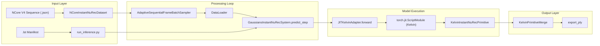
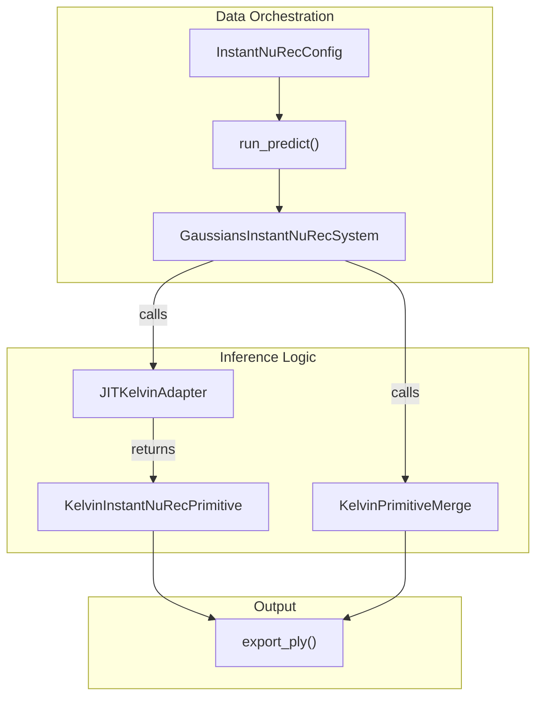

<!-- source: DeepWiki mcp.deepwiki.com · repo NVIDIA/instant-nurec · page 2 System Architecture · fetched 2026-10-26 -->

# System Architecture

Relevant source files

The following files were used as context for generating this wiki page:

- [README.md](README.md)
- [instant_nurec/__init__.py](instant_nurec/__init__.py)
- [instant_nurec/predict/run.py](instant_nurec/predict/run.py)

The InstantNuRec system is a feed-forward inference pipeline designed to convert autonomous vehicle driving logs into high-fidelity 3D Gaussian Splatting (3DGS) representations [README.md:14-21](). It bypasses the traditional per-scene optimization process by using a vision-transformer backbone to directly infer geometry, appearance, and motion from multi-camera observations [README.md:15-21]().

The pipeline is structured as a sequential flow from raw data ingestion to exported 3D assets:

1.  **Data Ingestion**: Loading NCore V4 sequence metadata and multi-view imagery.
2.  **Batching**: Partitioning temporal sequences into manageable "time-chunks."
3.  **Forward Pass**: Executing the JIT-compiled Kelvin transformer model.
4.  **Primitive Processing**: Transforming model outputs into structured 3D Gaussian primitives.
5.  **Aggregation & Export**: Optional merging of chunks and writing to 3DGS-compatible PLY files.

### End-to-End Data Flow

The following diagram illustrates the transition from the "Natural Language Space" of user requirements to the "Code Entity Space" of classes and functions.

**End-to-End Inference Pipeline**

Sources: [README.md:51-51](), [instant_nurec/predict/run.py:38-53](), [instant_nurec/model/systems/gaussians_instantnurec.py:108-142]()

---

### Core Components

#### CLI and Entry Points
The primary entry point is `run_inference.py`, which parses command-line arguments into an `InstantNuRecConfig` object [instant_nurec/predict/run.py:38-41](). It handles both single-sequence processing and batch processing via `.lst` manifests [README.md:158-190]().

For details, see [CLI and Entry Points](#2.1).

#### Configuration Schema
The system is governed by a hierarchical Pydantic configuration tree. The root `InstantNuRecConfig` encapsulates settings for the dataset, the model architecture, the sampling strategy, and the export parameters [instant_nurec/predict/run.py:25-25]().

For details, see [Configuration Schema](#2.2).

#### Pretrained Model Loading
The system uses a factory pattern via `instant_nurec.model.make(config)` to instantiate the reconstruction system [instant_nurec/predict/run.py:43-43](). This process includes resolving the `instant_nurec.pt` TorchScript archive, which may be sourced from a local path (via `INSTANT_NUREC_FULL_PT`) or auto-downloaded from the Hugging Face Hub [README.md:84-108]().

For details, see [Pretrained Model Loading](#2.3).

### System Integration Map

This diagram bridges the high-level system components with the specific code entities responsible for the data transformations.

**System Component Mapping**

Sources: [instant_nurec/predict/run.py:38-53](), [instant_nurec/model/systems/gaussians_instantnurec.py:46-52](), [instant_nurec/model/systems/gaussians_instantnurec.py:126-142]()

### Execution Lifecycle

The execution follows a strictly defined lifecycle within `instant_nurec/predict/run.py`:

| Stage | Action | Code Entity |
| :--- | :--- | :--- |
| **Initialization** | Seeds RNGs and instantiates the system. | `_seed_everything`, `instantnurec_systems.make` |
| **Data Loading** | Prepares the NCore dataloader. | `system.datamodule.predict_dataloader` |
| **Inference** | Iterates through chunks and performs forward passes. | `system.predict_step` |
| **Post-Processing** | Handles primitive merging and file export. | `system.on_predict_batch_end` |

Sources: [instant_nurec/predict/run.py:31-53]()

---

