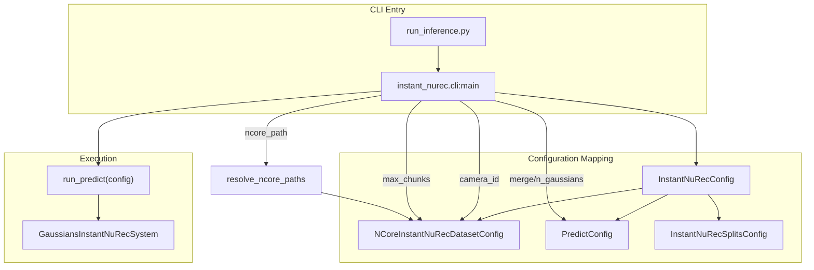
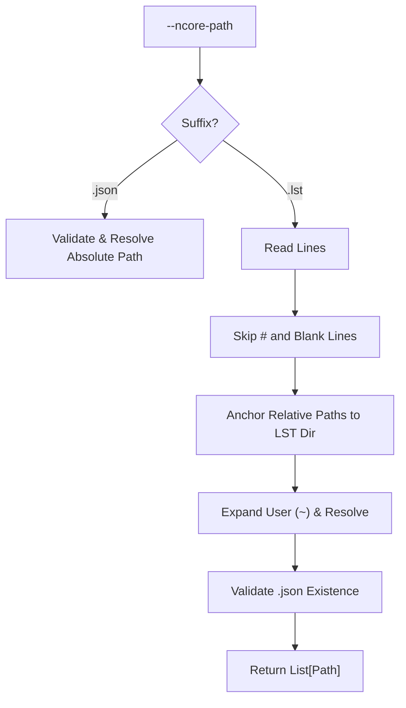

<!-- source: DeepWiki mcp.deepwiki.com · repo NVIDIA/instant-nurec · page 2.1 CLI and Entry Points · fetched 2026-10-26 -->

# CLI and Entry Points

Relevant source files

The following files were used as context for generating this wiki page:

- [instant_nurec/cli.py](instant_nurec/cli.py)
- [instant_nurec/ncore_input.py](instant_nurec/ncore_input.py)
- [run.sh](run.sh)
- [run_inference.py](run_inference.py)

The InstantNuRec command-line interface (CLI) provides a standalone entry point for executing the Kelvin model prediction pipeline on NCore V4 datasets. It handles argument parsing, dataset manifest resolution, and the instantiation of the Pydantic-based configuration system required to drive the inference engine.

## Entry Points and Execution Flow

The system provides multiple layers of entry points, ranging from shell scripts to Python modules.

1.  **`run.sh`**: A bash wrapper that performs preliminary validation of `--ncore-path` and `--output-dir`, ensures the output directory is writable, and executes `run_inference.py` [run.sh:18-71]().
2.  **`run_inference.py`**: The primary Python entry point located at the repository root. It adds the repository to `sys.path` and delegates execution to the core CLI module [run_inference.py:32-40]().
3.  **`instant_nurec.cli.main`**: The core implementation logic that translates CLI flags into structured configuration objects [instant_nurec/cli.py:115-166]().

### CLI to Pipeline Wiring

The diagram below illustrates how the CLI flags are mapped to internal code entities and the subsequent prediction pipeline.

**CLI Wiring Diagram**

**Sources:** [instant_nurec/cli.py:115-152](), [run_inference.py:36-40]()

## Command-Line Arguments

The CLI is built using `argparse` via `make_parser()` [instant_nurec/cli.py:37-112]().

### Primary Flags

| Flag | Type | Default | Description |
| :--- | :--- | :--- | :--- |
| `--ncore-path` | `Path` | **Required** | Path to a single `.json` NCore sequence or a `.lst` manifest [instant_nurec/cli.py:42-52](). |
| `--output-dir` | `Path` | **Required** | Destination directory for generated 3DGS PLY files [instant_nurec/cli.py:53-58](). |
| `--merge` | `bool` | `False` | Enables merging per-chunk primitives and performing KL-optimal voxelization [instant_nurec/cli.py:60-69](). |
| `--n-gaussians` | `int` | `2,000,000` | Target static Gaussian count for voxelization (only if `--merge` is set) [instant_nurec/cli.py:70-81](). |
| `--camera-id` | `str` | `camera_front_wide_120fov` | The NCore camera ID used for both context and supervision [instant_nurec/cli.py:83-92](). |
| `--max-chunks` | `int` | `8` | Maximum 13.5s time-chunks to process per clip [instant_nurec/cli.py:94-105](). |
| `--log-level` | `str` | `INFO` | Standard Python logging level [instant_nurec/cli.py:106-111](). |

**Sources:** [instant_nurec/cli.py:32-112]()

## Data Input Handling

The CLI supports two input formats for the `--ncore-path` argument, which are resolved by `resolve_ncore_paths` [instant_nurec/ncore_input.py:31-77]().

### LST Manifest Format
A `.lst` file allows batch processing of multiple sequences. The format rules are:
*   One path per line [instant_nurec/ncore_input.py:50]().
*   Relative paths are anchored to the directory containing the `.lst` file [instant_nurec/ncore_input.py:57-58]().
*   Lines starting with `#` and blank lines are ignored [instant_nurec/ncore_input.py:52-53]().
*   All resolved paths must exist and end in `.json` [instant_nurec/ncore_input.py:62-71]().

**Path Resolution Logic**

**Sources:** [instant_nurec/ncore_input.py:31-77]()

## Implementation Details

### Configuration Assembly
The `main` function instantiates the Pydantic configuration hierarchy [instant_nurec/cli.py:132-151](). It maps CLI flags to specific config fields:
*   `--max-chunks` is passed to `AdaptiveSequentialFrameBatchSamplerConfig.n_samples_per_sequence` [instant_nurec/cli.py:140]().
*   `--merge` controls both `enabled` and `enable_voxelization` in `PrimitiveMergeConfig` [instant_nurec/cli.py:146-147]().
*   `--camera-id` is assigned to both `context_camera_ids` and `supervision_camera_ids` [instant_nurec/cli.py:137-138]().

### Lazy Imports
To ensure that help commands (e.g., `python run_inference.py --help`) remain responsive and do not trigger heavy CUDA or Torch initializations, the CLI uses lazy imports within the `main` function [instant_nurec/cli.py:119-128]().

**Sources:** [instant_nurec/cli.py:119-152](), [instant_nurec/ncore_input.py:16-24]()

---

