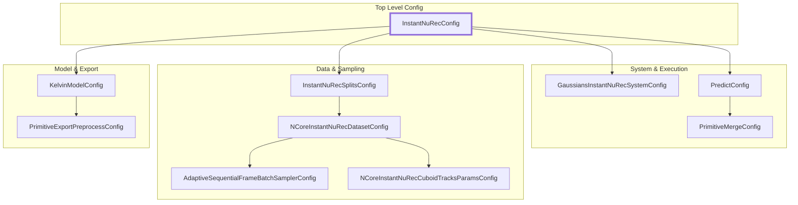
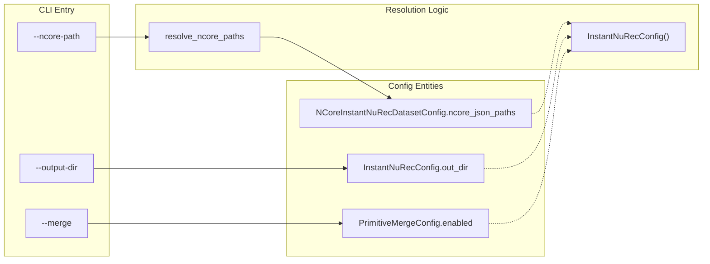

<!-- source: DeepWiki mcp.deepwiki.com · repo NVIDIA/instant-nurec · page 2.2 Configuration Schema · fetched 2026-10-26 -->

# Configuration Schema

Relevant source files

The following files were used as context for generating this wiki page:

- [instant_nurec/config_schema/README.md](instant_nurec/config_schema/README.md)
- [instant_nurec/config_schema/__init__.py](instant_nurec/config_schema/__init__.py)
- [instant_nurec/config_schema/base_schema.py](instant_nurec/config_schema/base_schema.py)
- [instant_nurec/config_schema/dataset.py](instant_nurec/config_schema/dataset.py)
- [instant_nurec/config_schema/instantnurec.py](instant_nurec/config_schema/instantnurec.py)
- [instant_nurec/config_schema/models.py](instant_nurec/config_schema/models.py)
- [instant_nurec/config_schema/predict.py](instant_nurec/config_schema/predict.py)

The configuration system in InstantNuRec is built using `pydantic` models to provide strict validation, type safety, and default value management. The schema is organized into a hierarchical structure where a top-level `InstantNuRecConfig` composes several specialized sub-configs.

## Base Configuration Architecture

All configuration classes inherit from `BaseConfigSchema`, which extends `pydantic.BaseModel` [instant_nurec/config_schema/base_schema.py:23-28](). This base class ensures strict validation and provides a stable hash for config instances based on their type and representation [instant_nurec/config_schema/base_schema.py:26-27]().

### Configuration Composition Diagram

The following diagram illustrates how the various configuration entities are composed into the final runtime object.

**Natural Language to Code Entity Mapping: Config Composition**

Sources: [instant_nurec/config_schema/instantnurec.py:35-54](), [instant_nurec/config_schema/dataset.py:68-114](), [instant_nurec/config_schema/predict.py:56-64](), [instant_nurec/config_schema/models.py:32-39]()

## Core Config Classes

### InstantNuRecConfig
The root configuration object for the inference pipeline. It aggregates system settings, dataset splits, model parameters, and prediction-specific logic.

| Field | Type | Default | Description |
| :--- | :--- | :--- | :--- |
| `seed` | `int` | `38` | Random seed for reproducibility. |
| `out_dir` | `str` | (Required) | Path where output PLY files and logs are written. |
| `system` | `GaussiansInstantNuRecSystemConfig` | Default Factory | Hardware/Dataloader worker settings. |
| `dataset` | `InstantNuRecSplitsConfig` | (Required) | Paths and parameters for the NCore dataset. |
| `model` | `KelvinModelConfig` | Default Factory | Model-specific export/pruning settings. |
| `predict` | `PredictConfig` | Default Factory | Logic for primitive merging and voxelization. |
| `run_id` | `str` | `shortuuid.uuid` | Unique ID for the run; can be overridden by `INSTANT_NUREC_RUN_ID` env var. |

Sources: [instant_nurec/config_schema/instantnurec.py:35-66]()

### GaussiansInstantNuRecSystemConfig
Controls the execution environment for the inference system.

*   `predict_num_workers` (int, default: `4`): Number of subprocesses used for data loading [instant_nurec/config_schema/instantnurec.py:31]().
*   `predict_batch_size` (int, default: `8`): Batch size for the dataloader. In the InstantNuRec predict pipeline, this is typically treated as the number of time-chunks processed [instant_nurec/config_schema/instantnurec.py:32]().

Sources: [instant_nurec/config_schema/instantnurec.py:28-32]()

## Dataset and Sampling Schema

The dataset configuration defines how NCore V4 driving logs are parsed and how time-chunks are sampled for the JIT model.

### NCoreInstantNuRecDatasetConfig
| Field | Type | Default | Description |
| :--- | :--- | :--- | :--- |
| `ncore_json_paths` | `list[str]` | (Required) | Absolute paths to NCore V4 sequence JSONs [instant_nurec/config_schema/dataset.py:77-80](). |
| `camera_max_fov_deg`| `float` | `190.0` | Max FOV used to invalidate boundary pixels for FTheta models [instant_nurec/config_schema/dataset.py:82-86](). |
| `context_camera_ids`| `list[str]` | `["camera_front_wide_120fov"]` | Cameras used as input to the model [instant_nurec/config_schema/dataset.py:89-92](). |
| `frame_batch_sampler`| `AdaptiveSequentialFrameBatchSamplerConfig` | Default | Configuration for time-chunking [instant_nurec/config_schema/dataset.py:94-96](). |

Sources: [instant_nurec/config_schema/dataset.py:68-105]()

### AdaptiveSequentialFrameBatchSamplerConfig
This class configures the `AdaptiveSequentialFrameBatchSampler`, which divides a long driving sequence into overlapping or sequential time-chunks.

*   `n_samples_per_sequence` (int, default: `8`): Maximum number of chunks to process. If a clip is longer than what these chunks cover, it is truncated [instant_nurec/config_schema/dataset.py:48-57]().
*   `max_frame_gap_timestamp_us` (int, default: `750,000`): Maximum microsecond spacing between frames in a single chunk [instant_nurec/config_schema/dataset.py:58-65]().

Sources: [instant_nurec/config_schema/dataset.py:42-65]()

## Prediction and Merging Schema

These classes control the post-processing of Kelvin primitives, specifically how multiple time-chunks are unified into a single 3DGS scene.

### PrimitiveMergeConfig
Configures the `KelvinPrimitiveMerge` logic.

*   `enabled` (bool, default: `False`): If true, per-chunk PLYs are merged into a single sequence PLY [instant_nurec/config_schema/predict.py:29]().
*   `frustum_ownership_max_diff_m` (float, default: `5.0`): Distance threshold for the de-overlap algorithm [instant_nurec/config_schema/predict.py:30-34]().
*   `enable_voxelization` (bool, default: `False`): Enables KL-optimal voxelization to reduce Gaussian count [instant_nurec/config_schema/predict.py:35-38]().
*   `target_n_gaussians` (int, default: `2,000,000`): The desired number of static Gaussians after voxelization [instant_nurec/config_schema/predict.py:44-48]().

Sources: [instant_nurec/config_schema/predict.py:21-54]()

### KelvinModelConfig & PrimitiveExportPreprocessConfig
These define the pruning applied to raw model outputs before they reach the merging or export stage.

*   `density_prune_threshold` (float, default: `0.01`): Gaussians with density below this value are discarded during `preprocess_for_export` [instant_nurec/config_schema/models.py:27-29]().

Sources: [instant_nurec/config_schema/models.py:23-39]()

## Data Flow and Config Resolution

The CLI (typically `cli.py`) is responsible for resolving high-level flags into these structured Pydantic objects.

**Natural Language to Code Entity Mapping: CLI to Config Flow**

Sources: [instant_nurec/config_schema/README.md:19-22](), [instant_nurec/config_schema/dataset.py:68-75](), [instant_nurec/config_schema/predict.py:21-29]()

---

