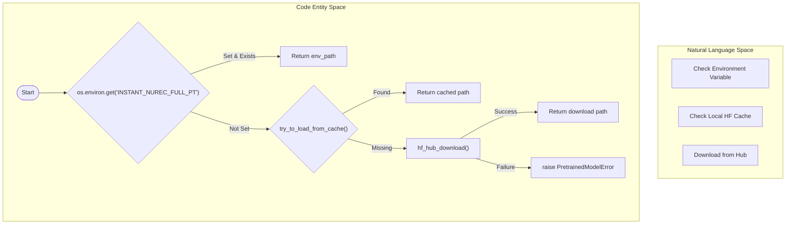
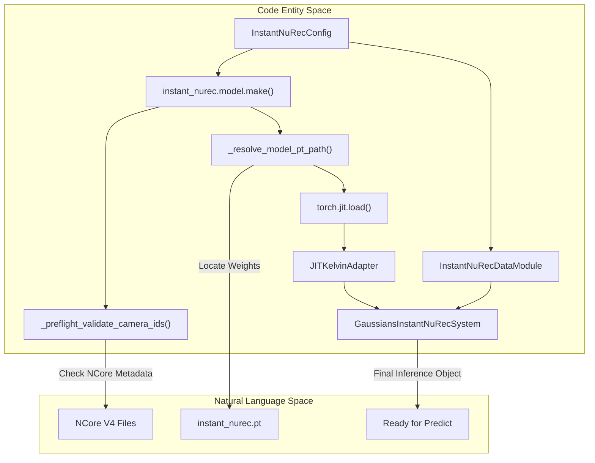

<!-- source: DeepWiki mcp.deepwiki.com · repo NVIDIA/instant-nurec · page 2.3 Pretrained Model Loading · fetched 2026-10-26 -->

# Pretrained Model Loading

Relevant source files

The following files were used as context for generating this wiki page:

- [instant_nurec/model/__init__.py](instant_nurec/model/__init__.py)
- [instant_nurec/pretrained.py](instant_nurec/pretrained.py)

The InstantNuRec system relies on a TorchScript-serialized model file, `instant_nurec.pt`, which contains the JIT Kelvin model weights and logic. This page details how the system resolves this file, the fallback mechanisms for offline use, and the factory pattern used to instantiate the inference system.

## Model Resolution Logic

The resolution of the pretrained model artifact is handled by the `instant_nurec.pretrained` module. It follows a strict priority order to ensure the model can be loaded in both internet-connected and air-gapped environments.

### Resolution Hierarchy

1.  **Environment Variable Override**: If the `INSTANT_NUREC_FULL_PT` environment variable is set and points to an existing file, it is used immediately. This is the primary method for offline usage [instant_nurec/pretrained.py:57-59]().
2.  **Hugging Face Hub Cache**: The system checks the local Hugging Face Hub cache using `try_to_load_from_cache` for the repository `nvidia/instant-nurec` and filename `instant_nurec.pt` [instant_nurec/pretrained.py:80-82]().
3.  **Hugging Face Hub Download**: If not found locally, it attempts to download the artifact from the Hub [instant_nurec/pretrained.py:85-86]().

### Error Handling
If resolution fails (e.g., no internet connection and no environment variable set), the system raises a `PretrainedModelError` [instant_nurec/pretrained.py:41-43](). At the model factory level, this is caught and re-raised as a `ModelNotFoundError` with descriptive instructions for the user [instant_nurec/model/__init__.py:37-46](), [instant_nurec/model/__init__.py:125-128]().

### Pretrained Model Resolution Flow
The following diagram illustrates the decision logic inside `download_instant_nurec_pt`.

"Model Resolution Decision Flow"

Sources: [instant_nurec/pretrained.py:45-93](), [instant_nurec/model/__init__.py:41-46]()

## The Model Factory: `instant_nurec.model.make()`

The `make()` function is the central entry point for initializing the inference system. It performs several critical "pre-flight" checks before loading the heavy TorchScript module.

### 1. Camera Validation
Before loading the model, `make()` invokes `_preflight_validate_camera_ids()`. This helper opens the first NCore sequence in the configuration to verify that all requested `context_camera_ids` and `supervision_camera_ids` actually exist in the data source [instant_nurec/model/__init__.py:72-78](). This prevents the system from failing deep inside the dataloader workers after the model has already been loaded into GPU memory [instant_nurec/model/__init__.py:58-61]().

### 2. JIT Module Loading
The model is loaded using `torch.jit.load`. To optimize performance, the fusion strategy is explicitly configured to disable certain JIT optimizations that can cause overhead in the specific Kelvin architecture [instant_nurec/model/__init__.py:135-136]().

### 3. Dimensionality Verification
The loaded `JITKelvinAdapter` exposes metadata about the model's expected input shapes (e.g., `expected_v` for the number of frames). The factory ensures that the number of context cameras provided in the config divides the model's expected frame count evenly [instant_nurec/model/__init__.py:140-147]().

### Model Initialization and System Assembly
The `GaussiansInstantNuRecSystem` is instantiated using a low-level `__new__` pattern to bypass standard Lightning/Torch initialization, allowing for manual attribute assignment from the config and the resolved model adapter [instant_nurec/model/__init__.py:149-165]().

"Model Factory and System Assembly"

Sources: [instant_nurec/model/__init__.py:114-165](), [instant_nurec/model/jit_adapter.py:23-50]()

## Summary of Key Components

| Component | Role | Source |
| :--- | :--- | :--- |
| `download_instant_nurec_pt` | Logic for resolving the `.pt` file path via env var or HF Hub. | [instant_nurec/pretrained.py:45]() |
| `make()` | Primary factory function to build the inference system. | [instant_nurec/model/__init__.py:114]() |
| `PretrainedModelError` | Exception raised when the model artifact cannot be downloaded. | [instant_nurec/pretrained.py:41]() |
| `ModelNotFoundError` | High-level exception for resolution or validation failures. | [instant_nurec/model/__init__.py:37]() |
| `_resolve_model_pt_path` | Internal wrapper for pretrained model resolution. | [instant_nurec/model/__init__.py:41]() |
| `_preflight_validate_camera_ids` | Validates dataset camera IDs before loading the model. | [instant_nurec/model/__init__.py:72]() |

Sources: [instant_nurec/pretrained.py:1-93](), [instant_nurec/model/__init__.py:1-166]()

---

