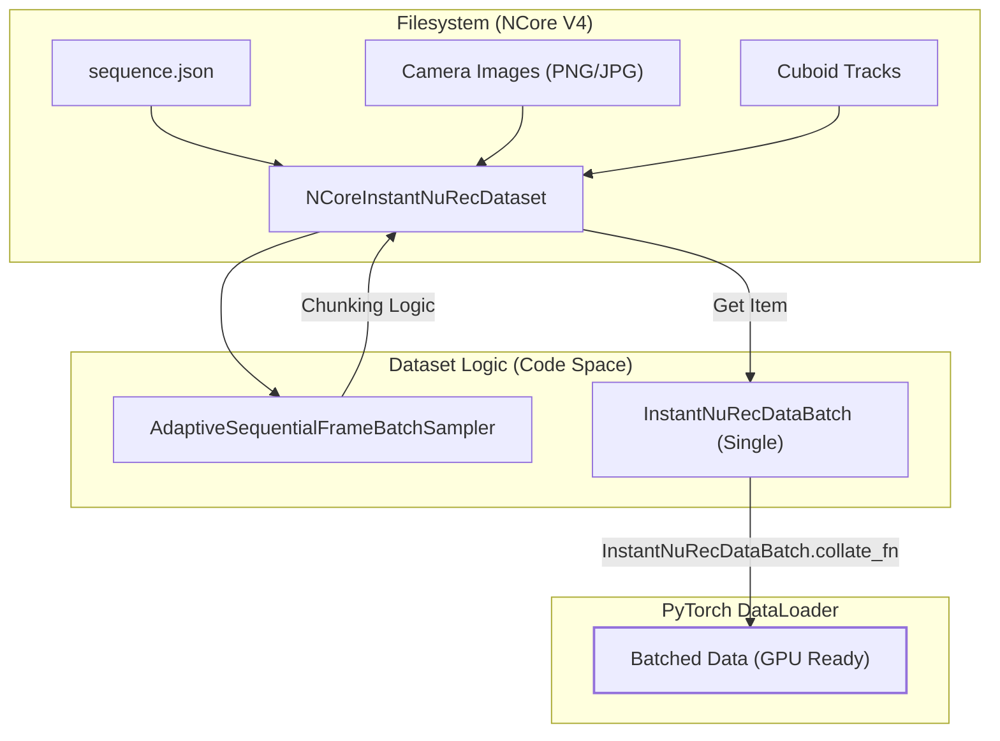
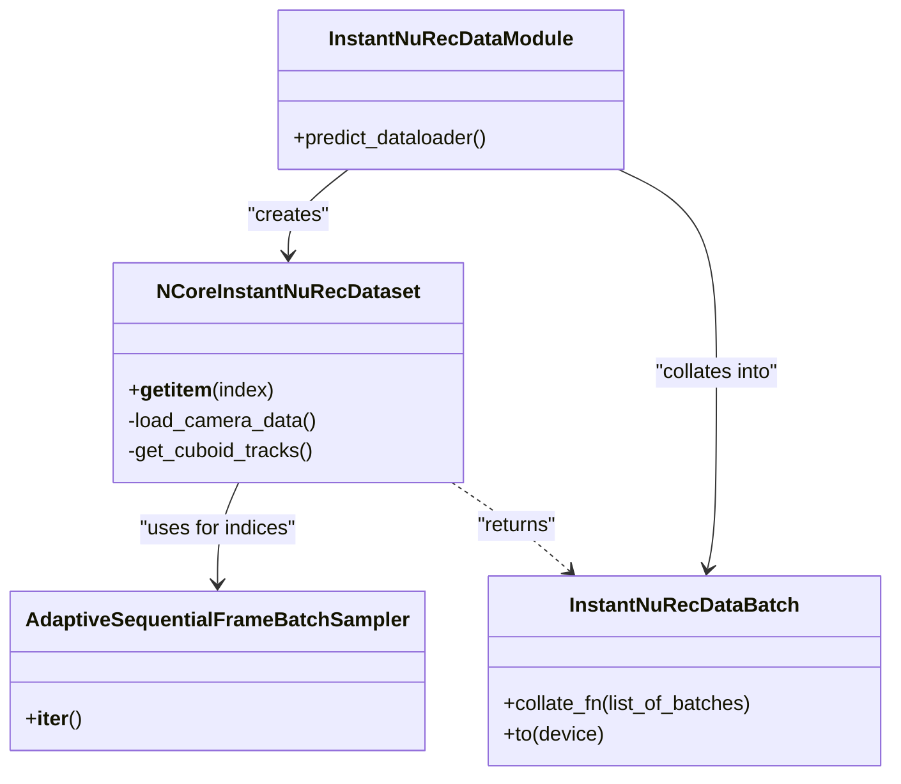

<!-- source: DeepWiki mcp.deepwiki.com · repo NVIDIA/instant-nurec · page 3 Data Pipeline · fetched 2026-10-26 -->

# Data Pipeline

Relevant source files

The following files were used as context for generating this wiki page:

- [instant_nurec/datasets/__init__.py](instant_nurec/datasets/__init__.py)
- [instant_nurec/datasets/datamodule.py](instant_nurec/datasets/datamodule.py)

The **Data Pipeline** in InstantNuRec is responsible for transforming raw NCore V4 driving logs into structured, time-chunked batches ready for the JIT-loaded Kelvin model. This process involves high-resolution image loading, sensor calibration parsing, vehicle trajectory reconstruction, and 3D object track processing.

The pipeline is centered around the `InstantNuRecDataModule` [instant_nurec/datasets/datamodule.py:23-23](), which orchestrates the dataset instantiation and provides the `DataLoader` [instant_nurec/datasets/datamodule.py:42-59]() used during the inference loop.

### System Flow: From Log to Batch

The following diagram illustrates how the data pipeline bridges the gap between raw filesystem data and the `InstantNuRecDataBatch` used by the model.

**Data Ingestion and Collation Flow**

Sources: [instant_nurec/datasets/datamodule.py:46-59](), [instant_nurec/utils/batch.py:20-20]()

---

### NCore V4 Dataset Loader
The core of the ingestion logic resides in `NCoreInstantNuRecDataset` [instant_nurec/datasets/instantnurec_ncore.py](). It parses the NCore V4 sequence format, which typically includes:
*   **Sensor Calibrations**: Intrinsics and extrinsics for multiple cameras (e.g., FTheta or Pinhole models).
*   **Rig Trajectories**: The ego-vehicle's path through world space.
*   **Cuboid Tracks**: 3D bounding boxes for dynamic objects in the scene.

The dataset ensures that all spatial data is aligned and that images are resized to the dimensions required by the model (`frame_width`, `frame_height`) [instant_nurec/datasets/datamodule.py:48-49]().

For details, see [NCore V4 Dataset Loader](#3.1).

---

### Frame Sampling and Batch Structures
Because driving logs can be long, the pipeline uses an `AdaptiveSequentialFrameBatchSampler` to divide a continuous clip into manageable "time-chunks." Each chunk contains a fixed number of frames (`n_frames_per_sample`) [instant_nurec/datasets/datamodule.py:34-34]().

Data is encapsulated in a hierarchy of dataclasses:
1.  `InstantNuRecDataBatch`: The primary container for images, poses, and sensor metadata [instant_nurec/utils/batch.py:20-20]().
2.  `DataAndRenderingBatch`: A wrapper used during the system's predict step.
3.  `RenderingData`: Specific tensors required for the Gaussian Splatting rasterization.

The `InstantNuRecDataBatch.collate_fn` [instant_nurec/datasets/datamodule.py:58-58]() is responsible for merging individual samples into a single batch, handling the padding of tracks and the concatenation of temporal sequences.

For details, see [Frame Sampling and Batch Structures](#3.2).

---

### Cuboid Tracks and Dynamic Object Handling
A critical component of the pipeline is the extraction and processing of 3D object tracks. These "Cuboids" represent other vehicles or pedestrians in the scene. The pipeline:
*   Loads tracks from the NCore sequence.
*   Extrapolates positions for objects that enter or exit the sensor frustum during a time-chunk.
*   Classifies objects as static or dynamic based on their motion profiles.

This data is used by the model to generate dynamic masks, ensuring that moving objects are handled by the dynamic layers of the Gaussian primitives rather than being "baked" into the static background.

For details, see [Cuboid Tracks and Dynamic Object Handling](#3.3).

### Code Entities and Relationships

The following diagram maps the natural language concepts of the data pipeline to the specific classes and methods in the codebase.

**Data Pipeline Entity Map**

Sources: [instant_nurec/datasets/datamodule.py:23-59](), [instant_nurec/utils/batch.py:20-20]()

| Component | Responsibility | Source |
| :--- | :--- | :--- |
| **DataModule** | High-level orchestration and DataLoader creation. | [instant_nurec/datasets/datamodule.py]() |
| **Dataset** | Parsing NCore JSONs and loading raw image/track data. | [instant_nurec/datasets/instantnurec_ncore.py]() |
| **Sampler** | Logic for splitting clips into temporal chunks. | [instant_nurec/datasets/samplers.py]() |
| **DataBatch** | Tensor container and GPU transfer logic. | [instant_nurec/utils/batch.py]() |

**Sources:**
* [instant_nurec/datasets/datamodule.py:23-59]()
* [instant_nurec/utils/batch.py:20-20]()
* [instant_nurec/datasets/instantnurec_ncore.py:1-20]() (implied structure)

---

