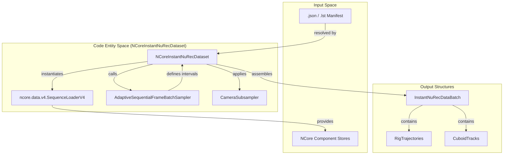
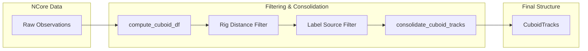

<!-- source: DeepWiki mcp.deepwiki.com · repo NVIDIA/instant-nurec · page 3.1 NCore V4 Dataset Loader · fetched 2026-10-26 -->

# NCore V4 Dataset Loader

Relevant source files

The following files were used as context for generating this wiki page:

- [instant_nurec/datasets/instantnurec_base.py](instant_nurec/datasets/instantnurec_base.py)
- [instant_nurec/datasets/instantnurec_ncore.py](instant_nurec/datasets/instantnurec_ncore.py)
- [instant_nurec/datasets/utils.py](instant_nurec/datasets/utils.py)
- [instant_nurec/ncore_input.py](instant_nurec/ncore_input.py)
- [instant_nurec/utils/ncore_utils.py](instant_nurec/utils/ncore_utils.py)

The `NCoreInstantNuRecDataset` is the primary entry point for ingesting NCore V4 driving-log data into the InstantNuRec inference pipeline. It handles the complexities of parsing sequence metadata, synchronizing multi-sensor camera streams, interpolating ego-vehicle trajectories, and extracting 3D cuboid tracks for dynamic object handling.

## Overview and Purpose

The dataset loader is responsible for transforming raw NCore V4 data stores into structured `InstantNuRecDataBatch` objects. It performs several critical transformations:
1.  **Temporal Chunking**: Dividing long driving sequences into smaller, overlapping time-chunks suitable for the Kelvin model's memory constraints.
2.  **Sensor Normalization**: Subsampling high-resolution camera frames and intrinsics to a fixed model resolution (e.g., 960x600).
3.  **Coordinate Alignment**: Computing SE3 transformations between the vehicle rig, world frame, and individual camera sensors across rolling-shutter time intervals.
4.  **Dynamic Filtering**: Identifying and tracking moving objects (pedestrians, vehicles) to facilitate dynamic mask generation.

### System Mapping: Data Loading Flow

The following diagram bridges the high-level data concepts to the specific code entities involved in the loading process.

**Data Loading Entity Map**

Sources: `[instant_nurec/datasets/instantnurec_ncore.py:69-136]()`, `[instant_nurec/ncore_input.py:31-77]()`, `[instant_nurec/utils/ncore_utils.py:144-159]()`

---

## Sequence Parsing and Loader Initialization

The loading process begins by resolving the `--ncore-path` argument via `resolve_ncore_paths`, which handles both single `.json` metadata files and `.lst` manifest files [instant_nurec/ncore_input.py:31-36](). 

Each sequence is parsed using `parse_sequence_meta_file` to extract the `sequence_id`, the total `time_range_us`, and the locations of the component stores [instant_nurec/utils/ncore_utils.py:113-141](). The `NCoreInstantNuRecDataset` then initializes an `ncore.data.v4.SequenceLoaderV4` to interface with the underlying data [instant_nurec/utils/ncore_utils.py:153-159]().

### Camera Subsampling
To ensure consistent input sizes for the Kelvin model, the `CameraSubsampler` performs center-cropping and resizing. It scales camera intrinsics (focal length, principal points) and applies nearest-neighbor or bilinear interpolation to image data based on the data type [instant_nurec/datasets/instantnurec_base.py:34-133]().

| Function | Responsibility |
| :--- | :--- |
| `_compute_pixel_rect` | Calculates the scale factor and crop offsets for target resolution [instant_nurec/datasets/instantnurec_base.py:47-61](). |
| `apply_camera_parameters` | Transforms `ConcreteCameraModelParametersUnion` using the calculated scale and offset [instant_nurec/datasets/instantnurec_base.py:63-73](). |
| `apply_frame_data` | Resizes RGB or semantic frames, using `antialias=True` for floating-point data [instant_nurec/datasets/instantnurec_base.py:93-133](). |

Sources: `[instant_nurec/datasets/instantnurec_base.py:34-133]()`, `[instant_nurec/utils/ncore_utils.py:113-159]()`

---

## Rig Trajectories and Pose Computation

The dataset loader builds a `RigTrajectories` object for every batch. This object encapsulates the ego-vehicle's motion within the chunk's time interval.

1.  **Interpolation**: Since camera frames and ego-poses are rarely perfectly synchronized, the loader evaluates the pose graph at specific timestamps [instant_nurec/datasets/instantnurec_ncore.py:120-123]().
2.  **Rolling Shutter**: For sensors with rolling shutter, the dataset prepares data for `image_points_to_world_rays_shutter_pose`, which interpolates the rig pose between the start and end of the frame exposure.
3.  **Coordinate Systems**: All poses are normalized relative to a "base" world frame computed at the start of the sequence to maintain numerical stability.

Sources: `[instant_nurec/datasets/instantnurec_ncore.py:120-123]()`, `[instant_nurec/utils/types.py:49-49]()`

---

## Cuboid Track Processing

Dynamic objects are handled via `CuboidTracks`. The loader filters and consolidates raw NCore observations into smooth trajectories.

**Cuboid Extraction Logic**

### Key Processing Steps
- **Observation Querying**: `compute_cuboid_df` fetches all cuboid observations within the chunk's `HalfClosedInterval` and sorts them by `track_id` and `timestamp_us` [instant_nurec/datasets/utils.py:31-60]().
- **Rig Proximity Filtering**: Observations too close to the rig center (e.g., the ego-vehicle itself) are discarded using `track_min_centroid_rig_dist_m` [instant_nurec/datasets/utils.py:136-139]().
- **Label Validation**: The loader filters tracks based on a list of `UNCONDITIONALLY_DYNAMIC_LABELS` (e.g., "pedestrian", "bicycle") to ensure only relevant moving objects are processed [instant_nurec/datasets/instantnurec_ncore.py:74-88]().
- **Consolidation**: `consolidate_cuboid_tracks` gathers per-observation poses into a dictionary indexed by `track_id`, including dimensions and class IDs [instant_nurec/datasets/utils.py:63-86]().

Sources: `[instant_nurec/datasets/utils.py:31-150]()`, `[instant_nurec/datasets/instantnurec_ncore.py:74-88]()`

---

## Batch Assembly

The final output of the loader is an `InstantNuRecDataBatch`. This object is a collation of multiple dataclasses that organize the data for the GPU.

### InstantNuRecDataBatch Structure

| Component | Class / Type | Description |
| :--- | :--- | :--- |
| **Metadata** | `FrameMeta` | Sequence IDs and global timestamps. |
| **Visual Data** | `DataAndRenderingBatch` | RGB images, depth maps, and semantic masks. |
| **Geometry** | `RigTrajectories` | Ego-motion SE3 matrices. |
| **Dynamic Objects** | `CuboidTracks` | Bounding box trajectories for moving objects. |
| **Labels** | `CameraFrameLabels` | Per-frame semantic and instance information. |

The assembly process uses `to_torch` to move NumPy arrays into PyTorch tensors and applies `consolidate_cuboid_tracks` to finalize the dynamic object representation before the batch is passed to the `AdaptiveSequentialFrameBatchSampler` for final collation.

Sources: `[instant_nurec/utils/batch.py:39-45]()`, `[instant_nurec/datasets/instantnurec_ncore.py:39-50]()`

---

