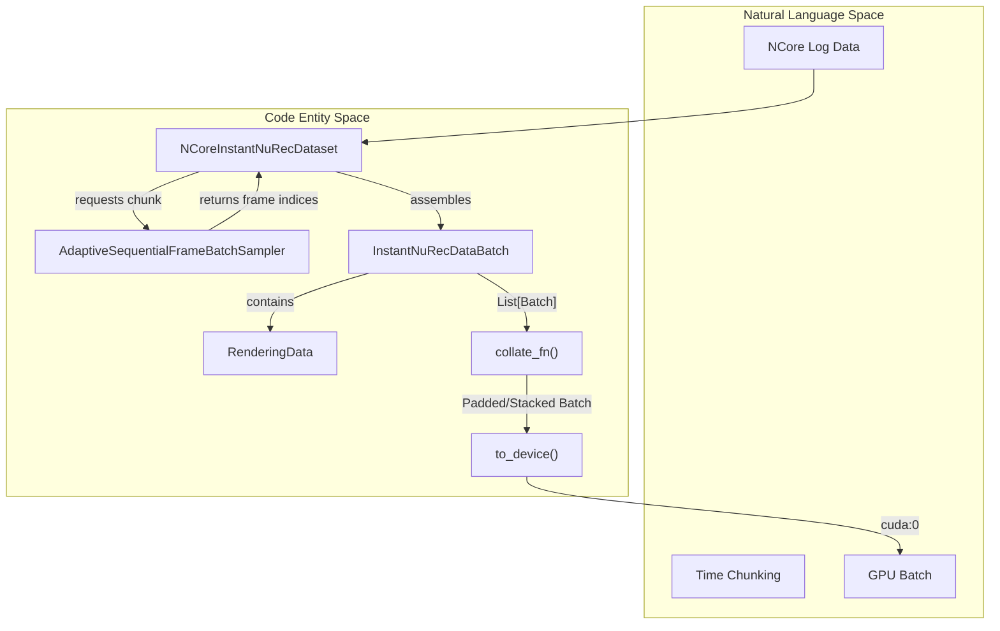
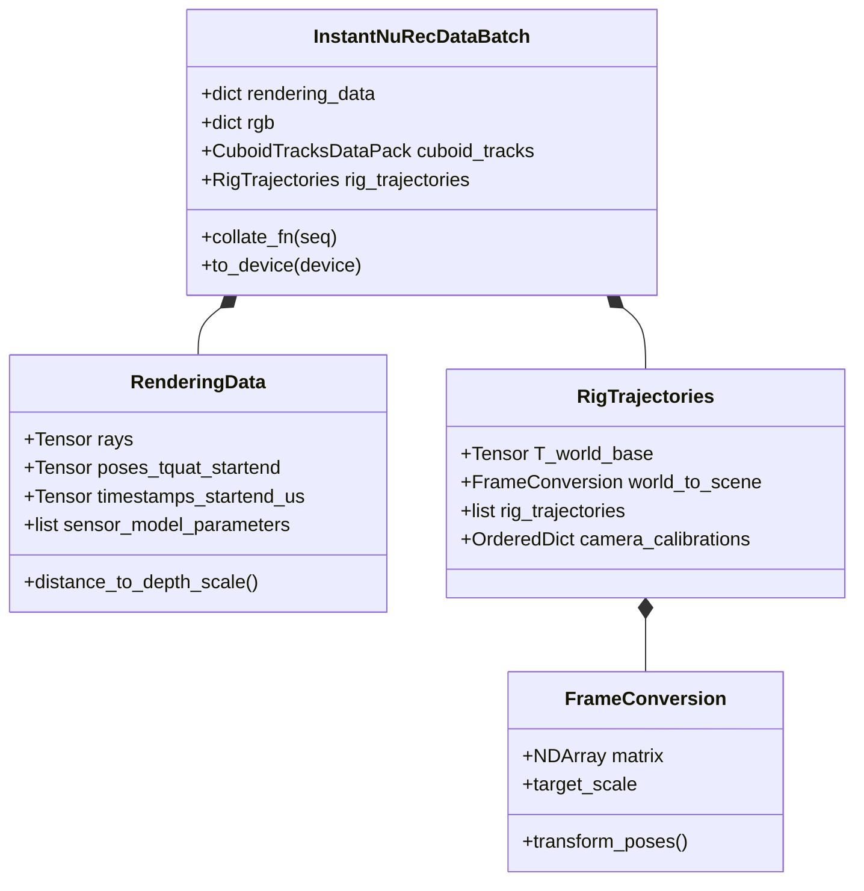

<!-- source: DeepWiki mcp.deepwiki.com · repo NVIDIA/instant-nurec · page 3.2 Frame Sampling and Batch Structures · fetched 2026-10-26 -->

# Frame Sampling and Batch Structures

Relevant source files

The following files were used as context for generating this wiki page:

- [instant_nurec/datasets/samplers.py](instant_nurec/datasets/samplers.py)
- [instant_nurec/utils/batch.py](instant_nurec/utils/batch.py)
- [instant_nurec/utils/types.py](instant_nurec/utils/types.py)

This page details how InstantNuRec partitions long video sequences into manageable time-chunks, the hierarchical dataclass structures used to represent this data, and the mechanism for collating and transferring batches to the GPU for inference.

## Adaptive Sequential Frame Sampling

The `AdaptiveSequentialFrameBatchSampler` is responsible for dividing a sequence into a set of chunks. It ensures that the temporal gap between sampled frames within a chunk does not exceed a configured threshold, maintaining the density required for high-quality Gaussian Splatting reconstruction.

### Chunking Logic
The sampler calculates the number of chunks ($N_{chunks}$) required to cover the total timespan of the sequence while respecting the `max_frame_gap_timestamp_us` constraint [instant_nurec/datasets/samplers.py:81-83]().

1.  **Total Timespan**: Determined by the union of all camera time intervals [instant_nurec/datasets/samplers.py:79-81]().
2.  **Max Chunk Timespan**: Calculated as `max_frame_gap_timestamp_us * n_frames_per_sample` [instant_nurec/datasets/samplers.py:82]().
3.  **Adaptive Gapping**: The actual frame gap is calculated as `sequence_total_timespan / (n_chunks * n_frames_per_sample)` to ensure equal distribution across the sequence [instant_nurec/datasets/samplers.py:108]().

If the number of required chunks exceeds the user-defined `--max-chunks` (`n_samples_per_sequence`), the sampler logs a warning and drops trailing chunks [instant_nurec/datasets/samplers.py:85-103]().

### Frame Selection
For a given `sample_idx` (chunk index), the sampler generates a set of reference timestamps [instant_nurec/datasets/samplers.py:110-113](). It then performs a nearest-neighbor search using `get_closest_frame_index` against the actual hardware timestamps of each camera [instant_nurec/datasets/samplers.py:116-123]().

**Sources:** [instant_nurec/datasets/samplers.py:47-123](), [instant_nurec/config_schema/dataset.py:22-22]()

## Data Hierarchy and Batch Structures

InstantNuRec uses a nested dataclass hierarchy to manage the complexity of multi-camera, time-varying data.

### 1. InstantNuRecDataBatch
The top-level container produced by the dataset. It encapsulates all information required for a single inference step (one chunk).

| Field | Type | Description |
| :--- | :--- | :--- |
| `rendering_data` | `dict[str, RenderingData]` | Per-camera rendering information (rays, poses). |
| `rgb` | `dict[str, torch.Tensor]` | Input images for each camera. |
| `cuboid_tracks` | `CuboidTracksDataPack` | 3D bounding box tracks for dynamic objects. |
| `rig_trajectories` | `RigTrajectories` | Ego-vehicle motion and sensor calibrations. |

**Sources:** [instant_nurec/utils/batch.py:204-219]()

### 2. RenderingData
Contains the geometric primitives necessary for the rendering engine. It handles the transformation from sensor space to scene space.

*   **Rays**: Pre-computed ray origins and directions (B, H, W, 6) [instant_nurec/utils/batch.py:91-91]().
*   **Rolling Shutter**: Includes `rays_timestamps_us` and `timestamps_startend_us` to account for CMOS sensor readout timing [instant_nurec/utils/batch.py:94-95]().
*   **Depth Scaling**: Provides `distance_to_depth_scale` to convert radial distance to Z-buffer depth [instant_nurec/utils/batch.py:124-139]().

**Sources:** [instant_nurec/utils/batch.py:75-140]()

### 3. RigTrajectories
A shared structure containing the coordinate system transformations and sensor calibrations.

*   **world_to_scene**: A `FrameConversion` object that defines the scale and shift from NCore world coordinates to the local inference volume [instant_nurec/utils/types.py:146-146]().
*   **camera_calibrations**: An `OrderedDict` mapping camera IDs to their intrinsics and extrinsics [instant_nurec/utils/types.py:185-185]().

**Sources:** [instant_nurec/utils/types.py:139-186]()

## Data Flow: From Loader to GPU

The following diagram illustrates how raw NCore data is transformed into the `InstantNuRecDataBatch` and moved to the GPU device.

### Data Flow and Entity Mapping

**Sources:** [instant_nurec/datasets/samplers.py:47-47](), [instant_nurec/utils/batch.py:204-204](), [instant_nurec/utils/batch.py:221-221](), [instant_nurec/utils/batch.py:238-238]()

## Collation and Device Transfer

Because the inference system expects batched tensors (even if Batch Size = 1), a custom collation mechanism is used to handle the complex nested structures.

### Collation Process
The `collate_fn` is implemented recursively across the dataclass hierarchy:
1.  **Recursive Traversal**: The function iterates through dataclass fields using `fields()` [instant_nurec/utils/batch.py:35-35]().
2.  **Special Handling**: 
    *   `torch.Tensor` objects are stacked or concatenated.
    *   `dict` and `list` objects are merged key-wise [instant_nurec/utils/batch.py:221-236]().
    *   `RenderingData` has a specialized `collate_fn` to handle `None` values in optional fields like `rays_timestamps_us` [instant_nurec/utils/batch.py:141-158]().

### GPU Migration
The `to_device` method recursively moves all tensors within the `InstantNuRecDataBatch` to the target `torch.device`. It specifically avoids moving CPU-only metadata (like `timestamps_startend_us_cpu`) to prevent unnecessary synchronization [instant_nurec/utils/batch.py:171-187](), [instant_nurec/utils/batch.py:238-251]().

**Sources:** [instant_nurec/utils/batch.py:141-187](), [instant_nurec/utils/batch.py:221-251]()

## Batch Structure Class Diagram

This diagram shows the relationship between the primary data structures used during the sampling and batching phase.

**Sources:** [instant_nurec/utils/batch.py:75-75](), [instant_nurec/utils/batch.py:204-204](), [instant_nurec/utils/types.py:52-52](), [instant_nurec/utils/types.py:139-139]()

---

