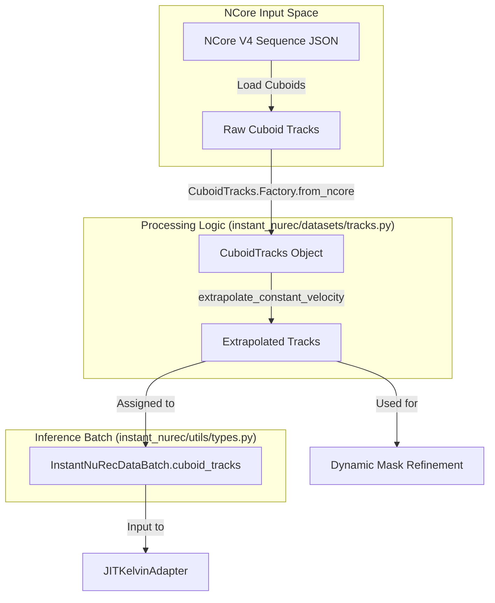
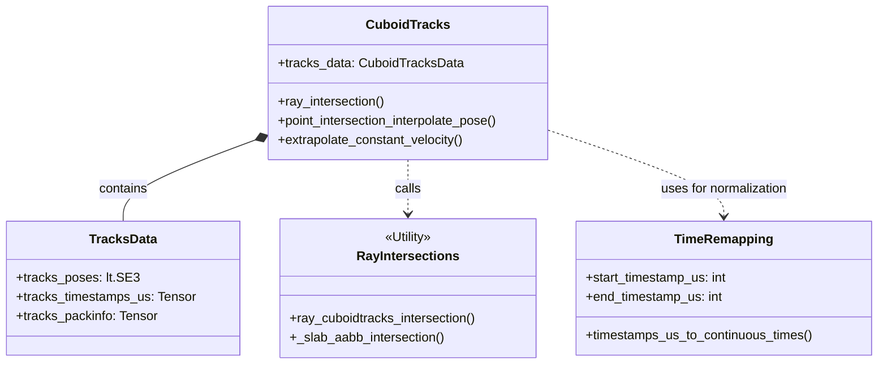

<!-- source: DeepWiki mcp.deepwiki.com · repo NVIDIA/instant-nurec · page 3.3 Cuboid Tracks and Dynamic Object Handling · fetched 2026-10-26 -->

# Cuboid Tracks and Dynamic Object Handling

Relevant source files

The following files were used as context for generating this wiki page:

- [instant_nurec/datasets/ray_intersections.py](instant_nurec/datasets/ray_intersections.py)
- [instant_nurec/datasets/tracks.py](instant_nurec/datasets/tracks.py)
- [instant_nurec/utils/motion.py](instant_nurec/utils/motion.py)
- [instant_nurec/utils/types.py](instant_nurec/utils/types.py)

The `instant_nurec` system handles dynamic objects by ingesting 3D bounding-box tracks (CuboidTracks) from NCore V4 data. These tracks are used to classify scene regions as dynamic or static, extrapolate object motion beyond observed frames, and refine the dynamic masks used during the Gaussian Splatting inference process.

## CuboidTracks Representation

Tracks are managed by the `Tracks` and `CuboidTracks` classes, which store time-dependent poses and dimensions on the GPU for efficient intersection testing and interpolation.

*   **`Tracks`**: A base class managing a packed representation of SE3 poses and timestamps for multiple objects. It uses `TracksData` for storage `[instant_nurec/datasets/tracks.py:40-46]()`.
*   **`CuboidTracks`**: Extends `Tracks` to include 3D extents (dimensions) for each track, enabling ray-cuboid and point-cuboid intersection tests `[instant_nurec/datasets/tracks.py:255-263]()`.
*   **Data Structure**: Tracks are stored in a "packed" format where all poses for all tracks are concatenated into a single tensor, with a `tracks_packinfo` tensor storing the `[start_index, count]` for each track `[instant_nurec/utils/types.py:270-280]()`.

### Track Classification
Tracks are classified using `TrackFlags`, which determine how the model treats the space occupied by the cuboid:
*   **`DYNAMIC`**: Objects that are moving or capable of motion.
*   **`STATIC`**: Stationary objects (e.g., parked cars) that should be treated as part of the static background.
*   **`MOVABLE`**: A hybrid state used during inference to indicate potential motion.

Sources: `[instant_nurec/datasets/tracks.py:40-81]()`, `[instant_nurec/datasets/tracks.py:255-280]()`, `[instant_nurec/utils/types.py:250-285]()`.

## Data Flow: NCore to Inference

The following diagram illustrates how track data is processed from the raw NCore input into the `InstantNuRecDataBatch` used by the model.

### Track Loading and Processing Pipeline

Sources: `[instant_nurec/datasets/tracks.py:321-350]()`, `[instant_nurec/utils/types.py:330-350]()`.

## Intersection and Interpolation

To determine if a pixel or a 3D point belongs to a dynamic object, the system performs high-performance GPU-based tests.

### Ray-Cuboid Intersection
Used to determine if a camera ray hits a dynamic object. This is implemented in `ray_cuboidtracks_intersection` using the "slab method" in the cuboid's local frame `[instant_nurec/datasets/ray_intersections.py:60-71]()`.
1.  **Interpolation**: The track's pose is interpolated to the ray's exact timestamp using SLERP for rotations and linear interpolation for translations `[instant_nurec/datasets/ray_intersections.py:140-148]()`.
2.  **Local Transformation**: The ray is transformed into the cuboid's coordinate system `[instant_nurec/datasets/ray_intersections.py:151-157]()`.
3.  **Slab Test**: A standard AABB intersection test is performed against the cuboid's half-dimensions `[instant_nurec/datasets/ray_intersections.py:34-57]()`.

### Point-Cuboid Intersection
Used to associate 3D points (Gaussians) with specific tracks.
*   **`point_intersection_interpolate_pose`**: Checks if a 3D point is inside any cuboid at a given timestamp. It returns the index of the intersecting track and the interpolated pose `[instant_nurec/datasets/tracks.py:423-435]()`.

Sources: `[instant_nurec/datasets/ray_intersections.py:16-57]()`, `[instant_nurec/datasets/ray_intersections.py:60-170]()`, `[instant_nurec/datasets/tracks.py:423-450]()`.

## Dynamic Mask Refinement

During inference, the `JITKelvinAdapter` uses the loaded `CuboidTracks` to refine the dynamic mask output by the Kelvin model.

### Warp Points Logic
The function `warp_points_with_cuboid_tracks` is the primary utility for moving points between different time frames based on object motion `[instant_nurec/utils/motion.py:98-105]()`.

| Step | Operation | Code Entity |
| :--- | :--- | :--- |
| 1 | **Association** | `dynamic_tracks.point_intersection_interpolate_pose` `[instant_nurec/utils/motion.py:140]()` |
| 2 | **Fallback** | Uses `aux_tracks_idx` (from ray-intersection) if point test fails `[instant_nurec/utils/motion.py:143-144]()` |
| 3 | **Inverse Transform** | Compute `inv_current_pose` at source timestamp `[instant_nurec/utils/motion.py:157-160]()` |
| 4 | **Forward Transform** | Apply `target_pose * inv_current_pose` to warp point to target time `[instant_nurec/utils/motion.py:164-169]()` |

### Track Extrapolation
Since NCore tracks may not cover the entire duration of a video clip, `CuboidTracks.extrapolate_constant_velocity` is used to extend tracks at the start or end of their lifecycle `[instant_nurec/datasets/tracks.py:532-540]()`. It calculates velocity from the first/last two available poses and creates new poses at the requested boundary timestamps `[instant_nurec/datasets/tracks.py:575-595]()`.

Sources: `[instant_nurec/utils/motion.py:98-170]()`, `[instant_nurec/datasets/tracks.py:532-600]()`.

## Technical Entity Mapping

The following diagram maps the logical concepts of dynamic handling to the specific classes and functions in the codebase.

### Entity Relationship Diagram

Sources: `[instant_nurec/datasets/tracks.py:255-263]()`, `[instant_nurec/utils/types.py:270-285]()`, `[instant_nurec/utils/motion.py:29-35]()`, `[instant_nurec/datasets/ray_intersections.py:16-25]()`.

---

