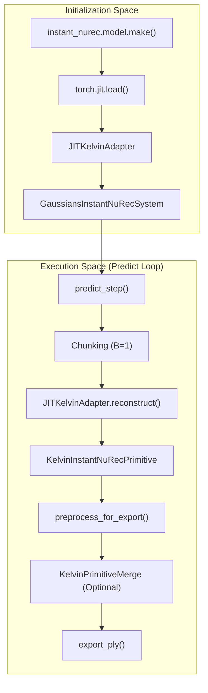
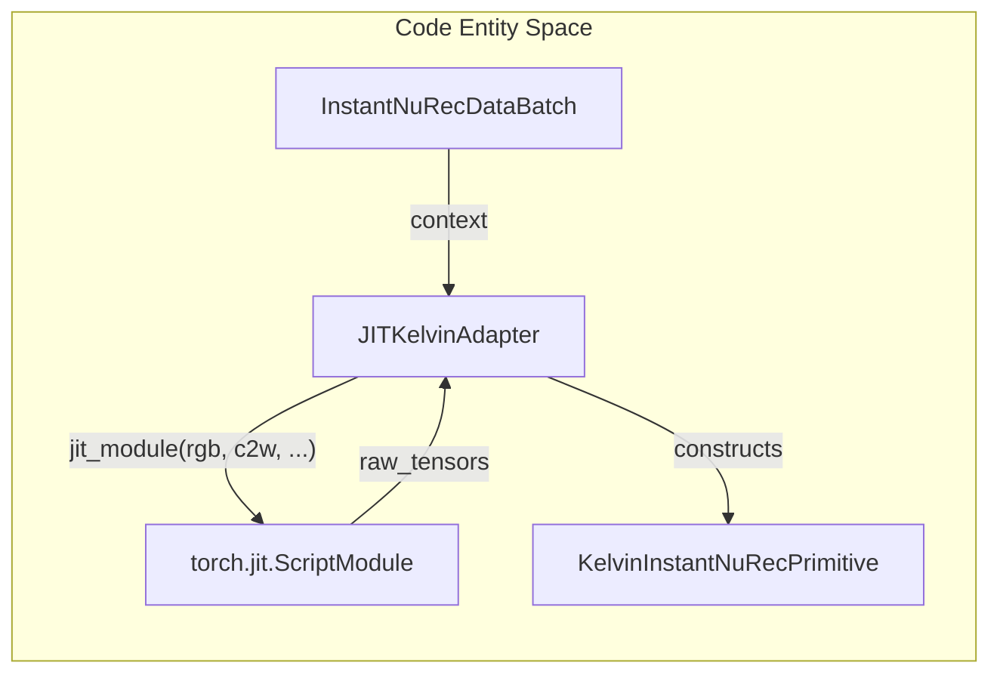

<!-- source: DeepWiki mcp.deepwiki.com · repo NVIDIA/instant-nurec · page 4 Model and Inference · fetched 2026-10-26 -->

# Model and Inference

Relevant source files

The following files were used as context for generating this wiki page:

- [instant_nurec/model/__init__.py](instant_nurec/model/__init__.py)
- [instant_nurec/model/system.py](instant_nurec/model/system.py)

The **Model and Inference** subsystem handles the transition from raw multi-view sensor data to structured 3D Gaussian primitives. At its core, InstantNuRec utilizes a pre-trained model (internally referred to as "Kelvin") distributed as a TorchScript JIT module. This model is wrapped in an adapter that manages tensor shapes, dynamic masking, and the conversion of raw network outputs into high-level primitive objects.

The inference process is orchestrated by the `GaussiansInstantNuRecSystem`, which manages the prediction loop, chunking, and final export to 3DGS-compatible PLY files.

### High-Level Model Workflow

The following diagram illustrates the data flow from the JIT model loading to the generation of 3D primitives.

**Model Inference Data Flow**

Sources: [instant_nurec/model/__init__.py:114-165](), [instant_nurec/model/system.py:42-138]()

---

## JIT Kelvin Adapter

The `JITKelvinAdapter` serves as the primary interface to the `torch.jit.ScriptModule`. Because the underlying model has strict requirements regarding input dimensions (Height, Width, and number of views), the adapter performs extensive validation during initialization.

Key responsibilities include:
*   **Input Extraction:** Extracting `rgb`, `c2w`, `fov`, and `rays` from the `InstantNuRecDataBatch`.
*   **Dynamic Masking:** Computing masks by combining semantic argmax results from the model with cuboid-track intersections to separate static and dynamic Gaussians.
*   **Primitive Packaging:** Taking the resulting tensors (positions, densities, SH coefficients, etc.) and instantiating `KelvinInstantNuRecPrimitive` objects.

For details on tensor shapes and mask logic, see **[JIT Kelvin Adapter (#4.1)]**.

**Model Component Mapping**

Sources: [instant_nurec/model/__init__.py:136-137](), [instant_nurec/model/system.py:62-63]()

---

## Predict Loop and System

The `GaussiansInstantNuRecSystem` is a `torch.nn.Module` designed specifically for inference. It encapsulates the pre-trained model and provides the logic for processing long sequences by breaking them into manageable temporal chunks.

### The Predict Step
The `predict_step` method is the main driver for inference:
1.  **Chunking:** It iterates over the input batch with a hardcoded `_CHUNK_SIZE = 1`, as the model is optimized for single-batch reconstruction [instant_nurec/model/system.py:69-75]().
2.  **Forward Pass:** Calls the adapter's `reconstruct` method to generate primitives [instant_nurec/model/system.py:63-63]().
3.  **Preprocessing:** Invokes `preprocess_for_export` on each primitive to handle color transformations and coordinate system alignments [instant_nurec/model/system.py:80-82]().
4.  **Merging:** If enabled in `PredictConfig`, it uses `KelvinPrimitiveMerge` to fuse multiple chunk-wise primitives into a single global scene [instant_nurec/model/system.py:89-92]().

### PLY Export
After prediction, `on_predict_batch_end` handles the writing of the final 3DGS PLY files to the output directory defined in the `InstantNuRecConfig` [instant_nurec/model/system.py:100-137]().

For details on the system implementation and export logic, see **[Predict Loop and System (#4.2)]**.

| Component | Responsibility |
| :--- | :--- |
| `instant_nurec.model.make` | Factory function that resolves the `.pt` file and builds the system [instant_nurec/model/__init__.py:114-165](). |
| `GaussiansInstantNuRecSystem` | Manages the high-level inference lifecycle and memory cleanup [instant_nurec/model/system.py:42-98](). |
| `InstantNuRecDataModule` | Handles data loading specifically sized for the model's expected resolution [instant_nurec/model/__init__.py:158-163](). |

Sources: [instant_nurec/model/__init__.py:114-165](), [instant_nurec/model/system.py:42-138]()

---

