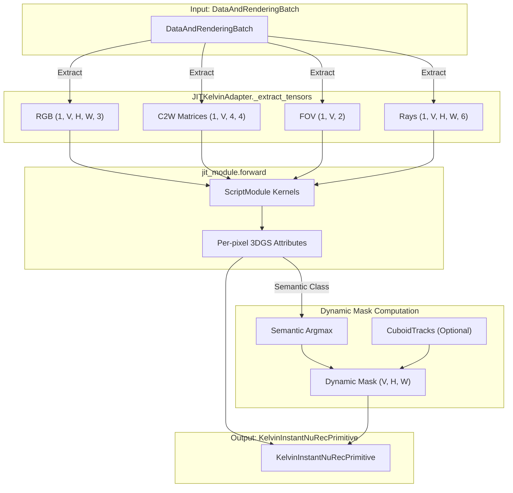
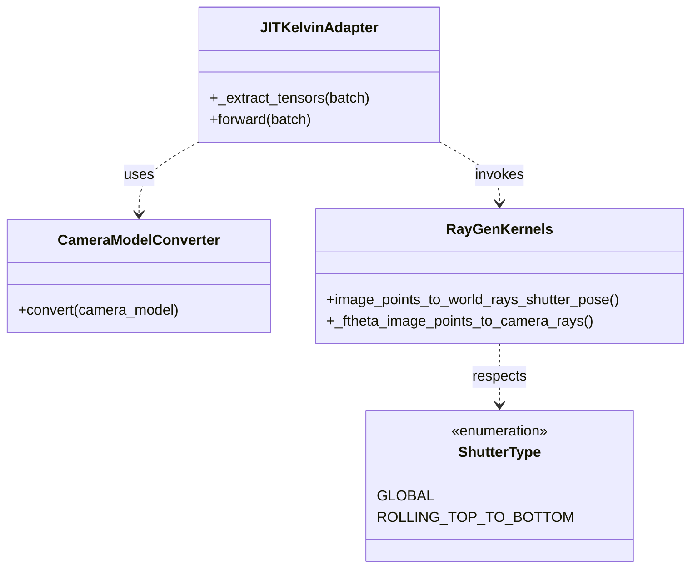

<!-- source: DeepWiki mcp.deepwiki.com · repo NVIDIA/instant-nurec · page 4.1 JIT Kelvin Adapter · fetched 2026-10-26 -->

# JIT Kelvin Adapter

Relevant source files

The following files were used as context for generating this wiki page:

- [instant_nurec/model/jit_adapter.py](instant_nurec/model/jit_adapter.py)
- [instant_nurec/utils/sensor.py](instant_nurec/utils/sensor.py)
- [instant_nurec/utils/sensors/__init__.py](instant_nurec/utils/sensors/__init__.py)
- [instant_nurec/utils/sensors/kernel_types.py](instant_nurec/utils/sensors/kernel_types.py)
- [instant_nurec/utils/sensors/ncore_sensors_converters.py](instant_nurec/utils/sensors/ncore_sensors_converters.py)
- [instant_nurec/utils/sensors/ray_gen.py](instant_nurec/utils/sensors/ray_gen.py)
- [instant_nurec/utils/sensors/sensors.py](instant_nurec/utils/sensors/sensors.py)

The `JITKelvinAdapter` is a specialized `torch.nn.Module` wrapper designed to interface with the `torch.jit.ScriptModule` loaded from the pretrained `instant_nurec.pt` model. Its primary responsibilities include extracting and validating input tensors from data batches, performing dynamic mask refinement using semantic segmentation and cuboid tracks, and packaging the model's per-pixel outputs into the `KelvinInstantNuRecPrimitive` format used for 3D Gaussian Splatting (3DGS) export [instant_nurec/model/jit_adapter.py:16-24]().

## System Architecture and Data Flow

The adapter acts as the bridge between the high-level `GaussiansInstantNuRecSystem` and the low-level JIT-compiled kernels. It handles the transformation of NCore-standard camera parameters into the specific tensor formats expected by the Kelvin decoder.

### Data Flow Diagram: Batch to Primitive
The following diagram illustrates how the adapter transforms a `DataAndRenderingBatch` into a `KelvinInstantNuRecPrimitive`.

**Adapter Transformation Pipeline**

**Sources:** [instant_nurec/model/jit_adapter.py:99-131](), [instant_nurec/model/jit_adapter.py:133-147]()

## Tensor Extraction and Validation

The `_extract_tensors` method performs the heavy lifting of preparing the model's context [instant_nurec/model/jit_adapter.py:99-101]().

### Input Validation
Upon initialization, the adapter reads expected dimensions from the JIT module's `static_core` [instant_nurec/model/jit_adapter.py:66-70](). Before inference, `_validate_input_shape` ensures the incoming RGB tensor matches these expected dimensions (Batch, Views, Height, Width) [instant_nurec/model/jit_adapter.py:77-87]().

### Geometric Transformations
The adapter performs several critical geometric adjustments:
*   **Scene Rescaling:** Camera-to-world (c2w) translation vectors are scaled by `self.scene_rescale` to align the NCore world coordinates with the model's internal coordinate system [instant_nurec/model/jit_adapter.py:111-112]().
*   **FOV Calculation:** The adapter converts complex camera models into simple pinhole parameters using `to_simple_pinhole_model_parameters` to derive the Field of View (FOV) for the model [instant_nurec/utils/sensor.py:23-36](), [instant_nurec/model/jit_adapter.py:114-123]().
*   **Pose Extraction:** It uses `tquat_to_se3_matrix` to convert translation-quaternion poses into $4 \times 4$ SE(3) matrices [instant_nurec/model/jit_adapter.py:109-110]().

**Sources:** [instant_nurec/model/jit_adapter.py:66-70](), [instant_nurec/model/jit_adapter.py:109-123](), [instant_nurec/utils/sensor.py:23-65]()

## Dynamic Mask Computation

A key feature of the `JITKelvinAdapter` is the `_compute_dynamic_mask` function, which determines which Gaussians belong to dynamic objects versus the static background [instant_nurec/model/jit_adapter.py:133-139]().

### Refinement Logic
The mask is computed through a tiered approach:
1.  **Semantic Baseline:** If no cuboid tracks are provided, the mask is purely based on whether the model's semantic argmax equals `KelvinSemanticClass.MOVABLE` [instant_nurec/model/jit_adapter.py:152-153]().
2.  **Cuboid Intersection:** When `CuboidTracks` are available, the adapter performs point-cuboid intersection. Points predicted as "movable" by the semantic head are verified against known 3D bounding boxes [instant_nurec/model/jit_adapter.py:163-168]().
3.  **Ray Fallback:** If a point is semantically movable but does not intersect a cuboid, a ray-cuboid intersection test is performed to capture points that might have been misaligned in depth [instant_nurec/model/jit_adapter.py:163-172]().

**Sources:** [instant_nurec/model/jit_adapter.py:133-172](), [instant_nurec/datasets/tracks.py:1-20]()

## Output Packaging

The final step of the adapter is to package the raw tensors into a `KelvinInstantNuRecPrimitive`. This primitive structure is required for subsequent chunk merging and PLY export.

### Layer Assembly
The adapter populates two primary layers within the primitive:
*   **Static Layer:** Contains the standard 3DGS parameters (XYZ, RGB, Opacity, Scaling, Rotation) and the refined semantic classes [instant_nurec/primitives/kelvin_primitive.py:39-40]().
*   **Dynamic Layer:** While the JIT model primarily produces static Gaussians, the adapter fills dynamic layer slots with zero placeholders to satisfy the downstream `KelvinPrimitiveMerge` logic [instant_nurec/model/jit_adapter.py:20-23]().

### Class Mapping
The semantic output of the JIT module is mapped to the `KelvinSemanticClass` enum, which includes categories like `BACKGROUND`, `MOVABLE`, and `VEHICLE` [instant_nurec/primitives/kelvin_primitive.py:38]().

**Sources:** [instant_nurec/model/jit_adapter.py:16-24](), [instant_nurec/primitives/kelvin_primitive.py:35-40]()

## Implementation Details

### Ray Generation
The adapter relies on `instant_nurec/utils/sensors/ray_gen.py` for generating world-space rays. It supports FTheta projection models and handles rolling-shutter compensation by interpolating poses based on per-pixel timestamps [instant_nurec/utils/sensors/ray_gen.py:18-25]().

**Ray Generation Component Mapping**

**Sources:** [instant_nurec/utils/sensors/ray_gen.py:16-40](), [instant_nurec/utils/sensors/ncore_sensors_converters.py:62-69](), [instant_nurec/model/jit_adapter.py:106-107]()

---

