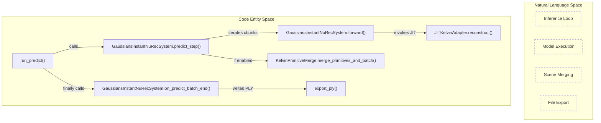
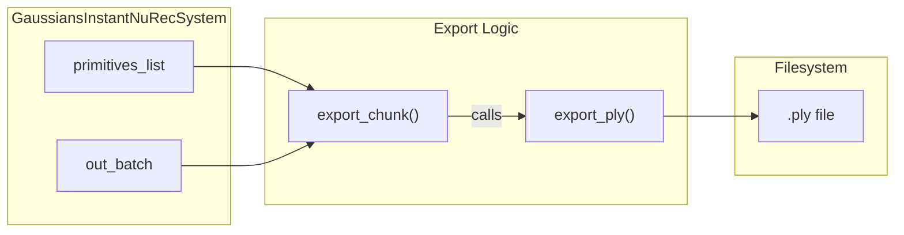

<!-- source: DeepWiki mcp.deepwiki.com · repo NVIDIA/instant-nurec · page 4.2 Predict Loop and System · fetched 2026-10-26 -->

# Predict Loop and System

Relevant source files

The following files were used as context for generating this wiki page:

- [instant_nurec/model/system.py](instant_nurec/model/system.py)
- [instant_nurec/predict/run.py](instant_nurec/predict/run.py)

The `GaussiansInstantNuRecSystem` serves as the primary execution engine for the InstantNuRec inference pipeline. It manages the transition from batched sensor data to exported 3D Gaussian Splatting (3DGS) primitives by orchestrating model execution, primitive preprocessing, optional scene merging, and final PLY serialization.

## Execution Flow Overview

The prediction process is triggered by `run_predict` in `instant_nurec/predict/run.py`, which iterates over the dataloader and invokes the system's core logic. Because the underlying Kelvin model is optimized for single-chunk inference, the system implements an internal loop to process large batches (clips) in discrete steps.

### High-Level Sequence

1.  **Batch Preparation**: The system ensures rendering data (rays, masks) is computed and moved to the target GPU.
2.  **Chunked Inference**: The system iterates through the batch with a fixed chunk size of 1, calling the model's reconstruction logic.
3.  **Primitive Preprocessing**: Each resulting primitive is transformed and prepared for export (e.g., world-space alignment).
4.  **Merging (Optional)**: If configured, per-chunk primitives are merged into a unified scene representation.
5.  **Export**: The resulting primitives are written to `.ply` files compatible with 3DGS viewers.

### System Predict Logic

The following diagram illustrates the relationship between the execution loop and the code entities involved in the prediction step.

**Prediction Loop and Entity Mapping**

**Sources:** [instant_nurec/predict/run.py:38-53](), [instant_nurec/model/system.py:65-98]()

---

## The Predict Step

The `predict_step` method handles the heavy lifting of processing a `InstantNuRecDataBatch`. While the dataloader might provide a batch representing a long sequence, the model requires processing in smaller temporal windows.

### Chunked Iteration
The system uses a hardcoded `_CHUNK_SIZE = 1` [instant_nurec/model/system.py:69](). It slices the input `batch` and calls `self.forward(batch_chunk)` for each slice [instant_nurec/model/system.py:75-76]().

### Forward and Preprocessing
The `forward` method prepares the model context and invokes `reconstruct` [instant_nurec/model/system.py:57-63](). Immediately after inference, the system calls `preprocess_for_export` on the resulting primitive [instant_nurec/model/system.py:80-82](). This step typically involves:
*   Applying rig trajectories to move Gaussians into world space.
*   Applying any necessary color or rigid transformations defined in the export configuration.

### Memory Management
Given the high memory footprint of 3D Gaussian primitives, the system explicitly triggers garbage collection and clears the CUDA cache after the chunked loop completes [instant_nurec/model/system.py:94-96]().

**Sources:** [instant_nurec/model/system.py:42-98]()

---

## Primitive Merging and Export

Once all chunks in a batch are processed, the system can optionally merge them into a single global primitive.

### KelvinPrimitiveMerge
If `self.predict_config.primitive_merge.enabled` is True, the system instantiates a `KelvinPrimitiveMerge` object [instant_nurec/model/system.py:89-91](). This component:
1.  Assembles the list of per-chunk primitives.
2.  Handles overlapping regions between chunks.
3.  Returns a single `merged_primitive` and an updated batch metadata object.

### PLY Serialization
The `on_predict_batch_end` hook is responsible for the final filesystem output.

**Data Flow: From Primitives to Disk**

The export path is constructed using the `sequence_id` from the batch metadata [instant_nurec/model/system.py:113-119](). If merging was disabled, the system appends a `_chunk{idx}` suffix to the filename to prevent overwriting [instant_nurec/model/system.py:131]().

**Sources:** [instant_nurec/model/system.py:100-137](), [instant_nurec/predict/export_ply.py:1-125]()

---

## Implementation Details

### Key Methods

| Method | Role | File Reference |
| :--- | :--- | :--- |
| `forward` | Wraps the JIT model call and handles cuboid track unpacking. | [instant_nurec/model/system.py:57-63]() |
| `predict_step` | Orchestrates chunked inference, preprocessing, and merging. | [instant_nurec/model/system.py:65-98]() |
| `on_predict_batch_end` | Iterates through resulting primitives and triggers PLY export. | [instant_nurec/model/system.py:100-137]() |
| `run_predict` | Main entry point that sets up the device and drives the dataloader loop. | [instant_nurec/predict/run.py:38-53]() |

### Data Structures
*   **InstantNuRecDataBatch**: The primary container for sensor data, rig trajectories, and cuboid tracks [instant_nurec/utils/batch.py:1-50]().
*   **BaseInstantNuRecPrimitive**: The interface for the 3DGS data generated by the model [instant_nurec/primitives/base.py:1-30]().

**Sources:** [instant_nurec/model/system.py:42-137](), [instant_nurec/predict/run.py:1-53]()

---

