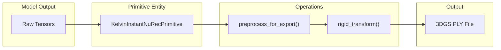

<!-- source: DeepWiki mcp.deepwiki.com · repo NVIDIA/instant-nurec · page 5 Gaussian Primitives · fetched 2026-10-26 -->

# Gaussian Primitives

<details>
<summary>Relevant source files</summary>

The following files were used as context for generating this wiki page:

- [instant_nurec/primitives/__init__.py](instant_nurec/primitives/__init__.py)
- [instant_nurec/primitives/base.py](instant_nurec/primitives/base.py)

</details>


Gaussian Primitives represent the fundamental 3D representation used in InstantNuRec for scene reconstruction. Based on the 3D Gaussian Splatting (3DGS) paradigm, these primitives encapsulate spatial, appearance, and temporal properties extracted from the model's latent space. The system uses a hierarchical approach to manage these primitives, separating the abstract interface from the specific implementation used by the Kelvin model.

### Primitive Hierarchy

All reconstructed primitives in the system inherit from a common base class that defines the lifecycle of a primitive from inference to export. This hierarchy ensures that the `GaussiansInstantNuRecSystem` can handle different model outputs through a unified interface for transformations and preprocessing.

#### Base Primitive Interface
The `BaseInstantNuRecPrimitive` [instant_nurec/primitives/base.py:28-31]() is an abstract class defining the mandatory operations for any renderable primitive:
*   **Device Management**: Tracking the GPU device where primitive tensors reside [instant_nurec/primitives/base.py:34-34]().
*   **Rigid Transformation**: Applying SE3 transformations to the primitive geometry [instant_nurec/primitives/base.py:37-37]().
*   **Preprocessing**: Filtering and masking primitives (e.g., density or sky masking) based on a context batch before they are exported or merged [instant_nurec/primitives/base.py:40-50]().

#### Kelvin Implementation
The primary implementation used in the current pipeline is the `KelvinInstantNuRecPrimitive`. It extends the base class to support specific Kelvin architecture features, including decoupled static and dynamic layers, and semantic classification.

**Sources:** [instant_nurec/primitives/base.py:16-54]()

### Data Flow and Code Entity Mapping

The following diagram illustrates how the abstract `BaseInstantNuRecPrimitive` is realized in the codebase and how it interacts with the system configuration and data batches.

**Diagram: Primitive Class Relationship**
```mermaid
graph TD
    subgraph "Interface Space"
        BASE["BaseInstantNuRecPrimitive"]
    end

    subgraph "Implementation Space"
        KELVIN["KelvinInstantNuRecPrimitive"]
    end

    subgraph "Context Entities"
        BATCH["DataAndRenderingBatch"]
        CONFIG["PrimitiveExportPreprocessConfig"]
        TRAJ["RigTrajectories"]
    end

    BASE <|-- KELVIN
    
    KELVIN -- "uses" --> BATCH
    KELVIN -- "configured by" --> CONFIG
    KELVIN -- "transformed by" --> TRAJ

    style BASE stroke-width:2px
    style KELVIN stroke-width:2px
```
**Sources:** [instant_nurec/primitives/base.py:23-45]()

### Lifecycle of a Primitive

The lifecycle of a Gaussian primitive within InstantNuRec follows a specific sequence from generation to the final PLY file.

1.  **Generation**: The `JITKelvinAdapter` executes the model and packages the raw tensor outputs into a `KelvinInstantNuRecPrimitive` instance.
2.  **Preprocessing**: The `preprocess_for_export` [instant_nurec/primitives/base.py:40-45]() method is called to perform per-chunk filtering. This includes applying masks for sky, road, or low-density regions.
3.  **Transformation/Merging**: If multiple chunks are processed, `rigid_transform` [instant_nurec/primitives/base.py:37-37]() is used to align primitives into a global coordinate system.
4.  **Export**: The primitives are converted into the standard 3DGS PLY format, involving coordinate transformations and activation inversions.

**Diagram: Primitive Processing Pipeline**

**Sources:** [instant_nurec/primitives/base.py:33-53]()

### Detailed Sub-Topics

For technical details on specific aspects of the Gaussian Primitive system, refer to the following child pages:

*   **[KelvinInstantNuRecPrimitive](#5.1)**: Detailed reference for the Kelvin-specific implementation, including its static and dynamic layers, semantic classes, and how it handles keyframe timestamps.
*   **[Primitive Merging and Voxelization](#5.2)**: Explains how primitives from different time-chunks are assembled into a single scene, including color alignment and the KL-optimal voxelization algorithm.
*   **[PLY Export](#5.3)**: Technical details on the conversion process from internal primitive structures to the industry-standard 3DGS PLY format, including spherical harmonics conversion.

**Sources:** [instant_nurec/primitives/base.py:1-54]()

---

