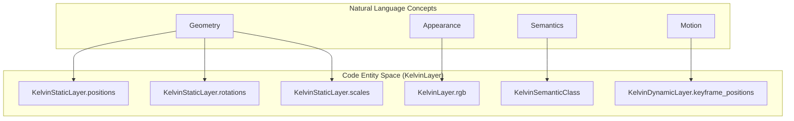
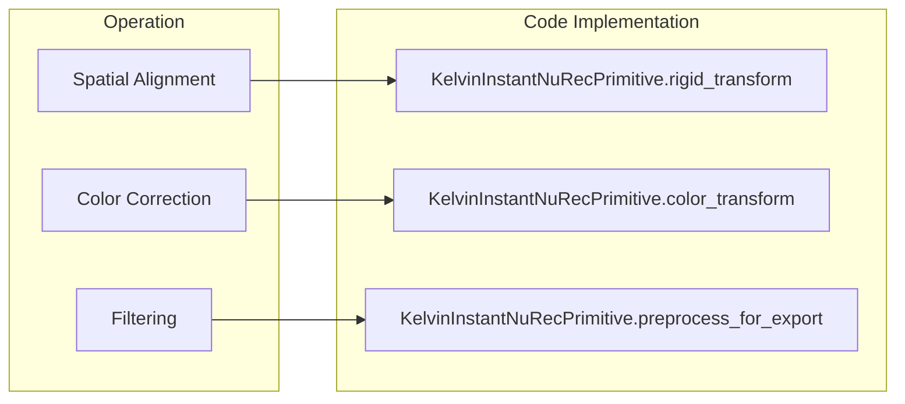
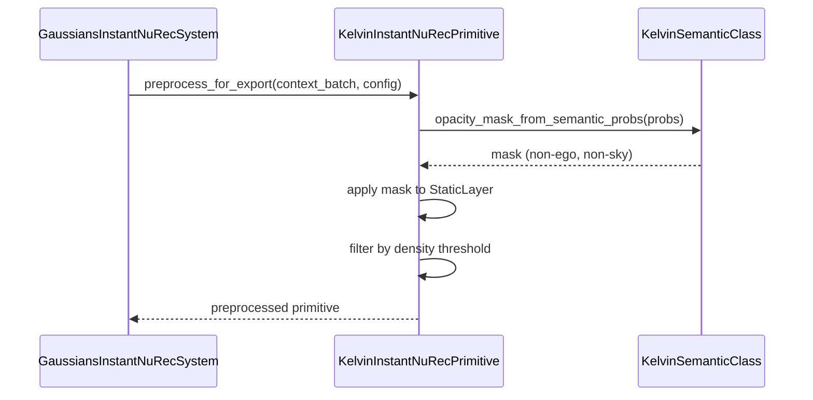

<!-- source: DeepWiki mcp.deepwiki.com · repo NVIDIA/instant-nurec · page 5.1 KelvinInstantNuRecPrimitive · fetched 2026-10-26 -->

# KelvinInstantNuRecPrimitive

Relevant source files

The following files were used as context for generating this wiki page:

- [instant_nurec/primitives/base.py](instant_nurec/primitives/base.py)
- [instant_nurec/primitives/kelvin_primitive.py](instant_nurec/primitives/kelvin_primitive.py)

The `KelvinInstantNuRecPrimitive` is the primary data structure used to represent 3D Gaussian Splatting (3DGS) reconstructions within the InstantNuRec system. It encapsulates both static geometry and dynamic temporal keyframes, providing a unified interface for rigid transformations, semantic filtering, and export preprocessing.

## Primitive Structure and Layers

The primitive is organized into two primary layers: a **Static Layer** containing geometric and appearance attributes, and a **Dynamic Layer** containing temporal trajectories for moving objects.

### KelvinStaticLayer
The `KelvinStaticLayer` stores the fundamental 3DGS attributes that define the appearance and shape of the reconstruction.

| Attribute | Shape | Type | Description |
| :--- | :--- | :--- | :--- |
| `positions` | `[N, 3]` | `float32` | XYZ coordinates in the primitive's local space. |
| `densities` | `[N, 1]` | `float32` | Opacity/density values for each Gaussian. |
| `rotations` | `[N, 4]` | `float32` | Unit quaternions in `wxyz` format. |
| `scales` | `[N, 3]` | `float32` | XYZ scale factors. |
| `rgb` | `[N, 3]` | `float32` | Diffuse color values. |
| `semantic_class` | `[N, 1]` | `uint8` | Optional semantic ID (see `KelvinSemanticClass`). |
| `normals` | `[N, 3]` | `float32` | Optional world-space surface unit vectors. |

Sources: [instant_nurec/primitives/kelvin_primitive.py:116-128](), [instant_nurec/primitives/kelvin_primitive.py:64-75]()

### KelvinDynamicLayer
The `KelvinDynamicLayer` enables temporal modeling by storing positions at specific keyframes.
*   **`keyframe_positions`**: `[N, K, 3]` tensor representing XYZ coordinates for $N$ Gaussians across $K$ keyframes. [instant_nurec/primitives/kelvin_primitive.py:177-180]()
*   **`keyframe_timestamps_us`**: `[K]` tensor of timestamps in microseconds corresponding to the keyframes. [instant_nurec/primitives/kelvin_primitive.py:181-181]()

### KelvinSemanticClass
The system uses an `IntEnum` to categorize Gaussians based on their semantic context. This is critical for filtering "ego" (the vehicle itself) and "sky" during the export process.

| Enum Member | Value | Description |
| :--- | :--- | :--- |
| `OTHERS` | 0 | Unclassified background. |
| `EGO` | 1 | Parts of the ego-vehicle. |
| `SKY` | 2 | Skybox/distant environment. |
| `ROAD` | 3 | Drivable surface. |
| `MOVABLE` | 4 | Dynamic objects (cars, pedestrians). |

Sources: [instant_nurec/primitives/kelvin_primitive.py:42-49]()

## System Entity Mapping

The following diagrams illustrate how natural language concepts map to specific code entities within the Kelvin primitive implementation.

### Data Layer Mapping
"Natural Language Space" to "Code Entity Space" mapping for Gaussian attributes.

Sources: [instant_nurec/primitives/kelvin_primitive.py:64-185]()

### Transform and Preprocess Flow
Mapping of operations performed on primitives during the inference pipeline.

Sources: [instant_nurec/primitives/kelvin_primitive.py:255-334]()

## Implementation Details

### Rigid Transformations
The `rigid_transform` method applies a $4 \times 4$ SE3 matrix to the primitive. It updates the static positions and normals via matrix multiplication and rotates the quaternions using `quat_mult_xyzw`. 

For dynamic layers, the transformation is applied to all keyframe positions:
`positions = (self.positions @ T_new[:3, :3].T) + T_new[:3, 3]`
Sources: [instant_nurec/primitives/kelvin_primitive.py:144-149](), [instant_nurec/primitives/kelvin_primitive.py:192-198]()

### Color Transformations
The `color_transform` method applies an affine transformation to the RGB values: $RGB_{new} = RGB \cdot \text{gain} + \text{bias}$. This is primarily used during chunk merging to align exposure across different time segments.
Sources: [instant_nurec/primitives/kelvin_primitive.py:270-274]()

### Preprocessing for Export
The `preprocess_for_export` function is a critical step before saving to PLY. It performs the following:
1.  **Semantic Masking**: Uses `KelvinSemanticClass.opacity_mask_from_semantic_probs` to remove "ego" and "sky" Gaussians by setting their opacity to zero or filtering them out. [instant_nurec/primitives/kelvin_primitive.py:52-60]()
2.  **Density Filtering**: Removes low-density Gaussians that do not contribute significantly to the scene. [instant_nurec/primitives/kelvin_primitive.py:317-318]()
3.  **Sky Rotation**: If a sky cubemap is present, it is rotated to align with the world frame using `rotate_sky_cubemap`. [instant_nurec/primitives/kelvin_primitive.py:330-332]()

Sources: [instant_nurec/primitives/kelvin_primitive.py:276-334]()

### Data Flow: Forward to Primitive
When the `JITKelvinAdapter` receives output from the TorchScript model, it packages the raw tensors into the `KelvinInstantNuRecPrimitive`.

1.  **Static Data**: Extracted from model outputs (e.g., `gs_pos`, `gs_opacity`, `gs_rot`).
2.  **Dynamic Data**: If the model provides temporal offsets, these are converted into `keyframe_positions` relative to the chunk's timestamps.
3.  **Semantics**: The model's semantic logits are converted to `KelvinSemanticClass` IDs via `argmax`.

Sources: [instant_nurec/primitives/kelvin_primitive.py:220-253]()

---

