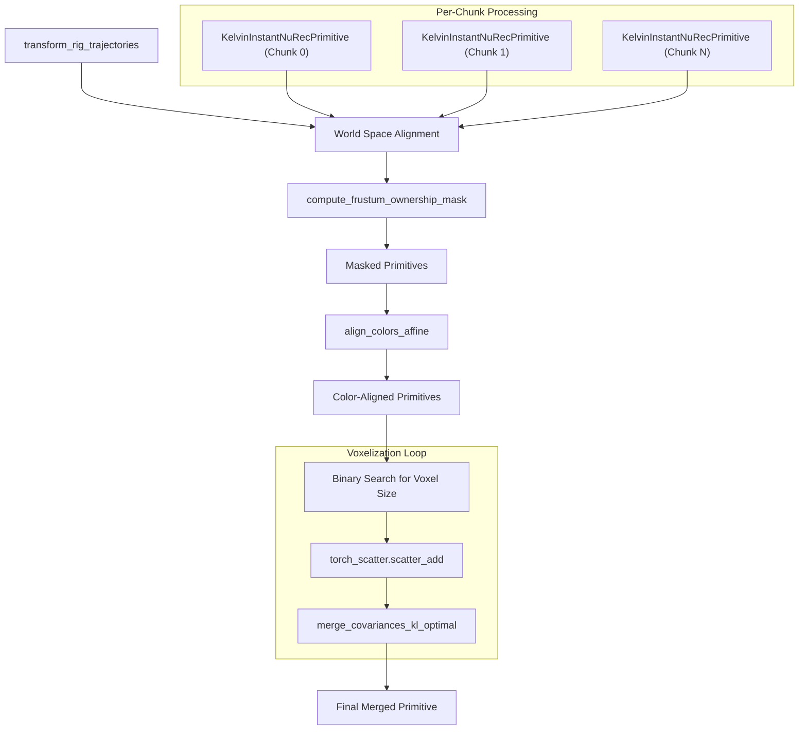
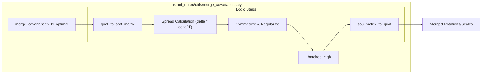

<!-- source: DeepWiki mcp.deepwiki.com · repo NVIDIA/instant-nurec · page 5.2 Primitive Merging and Voxelization · fetched 2026-10-26 -->

# Primitive Merging and Voxelization

Relevant source files

The following files were used as context for generating this wiki page:

- [instant_nurec/predict/primitive_merge.py](instant_nurec/predict/primitive_merge.py)
- [instant_nurec/utils/gaussians/__init__.py](instant_nurec/utils/gaussians/__init__.py)
- [instant_nurec/utils/gaussians/utils.py](instant_nurec/utils/gaussians/utils.py)
- [instant_nurec/utils/merge_covariances.py](instant_nurec/utils/merge_covariances.py)

The `KelvinPrimitiveMerge` system is responsible for aggregating the outputs of the JIT Kelvin model from multiple time-chunks into a single, coherent 3D scene. This process involves resolving overlaps between chunks, aligning color variations caused by auto-exposure, and performing a memory-efficient voxelization to reduce the total Gaussian count while preserving visual quality.

## Merging Workflow

The merging process is triggered within the `GaussiansInstantNuRecSystem.predict_step` when the `merge` flag is enabled in the `PrimitiveMergeConfig`. It follows a sequential pipeline:

1.  **Coordinate Alignment**: All per-chunk primitives are transformed into a common world coordinate system using the `RigTrajectories` provided in the batch.
2.  **Frustum Ownership Masking**: Overlapping Gaussians from different chunks are filtered based on their proximity to the camera that originally "saw" them.
3.  **Affine Color Alignment**: Global color shifts between chunks are corrected to ensure visual consistency.
4.  **Voxelization**: A bracketed binary search algorithm finds the optimal voxel size to meet a target Gaussian count, followed by a KL-optimal parameter merge.

### Camera Frustum Ownership

To prevent redundant geometry in overlapping regions, `instant_nurec` uses a frustum-based ownership strategy. For every Gaussian in chunk $i$, the system checks if it is "closer" to the cameras of chunk $i$ than to any other chunk $j$.

The `CameraFrustum` class [instant_nurec/predict/primitive_merge.py:41-44]() implements the `in_frustum` check [instant_nurec/predict/primitive_merge.py:49-67]() by projecting world-space positions into the sensor's local frame and comparing them against the camera model's boundaries.

The `compute_frustum_ownership_mask` function [instant_nurec/predict/primitive_merge.py:130-146]() calculates distances for each Gaussian to all available camera centers. If a Gaussian is significantly closer to a camera in a different chunk, it is masked out to avoid duplication.

Sources: [instant_nurec/predict/primitive_merge.py:41-67](), [instant_nurec/predict/primitive_merge.py:130-146]()

## Affine Color Alignment

Because the Kelvin model is run on individual chunks, the resulting colors can vary due to differences in exposure or lighting conditions across the sequence. The `align_colors_affine` function [instant_nurec/predict/primitive_merge.py:197-200]() solves this by finding an affine transformation (gain and bias) that minimizes the color difference in overlapping regions.

The alignment uses a least-squares approach to compute a global scale and offset for the RGB values of each chunk relative to a reference (usually the first chunk).

Sources: [instant_nurec/predict/primitive_merge.py:197-200]()

## KL-Optimal Voxelization

The most computationally intensive part of the merge is the voxelization, which reduces the number of Gaussians while maintaining the spatial distribution.

### Voxel Search Algorithm
The system uses a **bracketed binary search** to find the voxel size that results in a target number of Gaussians (`target_n_gaussians`). 
1.  It starts with a range $[0, 1.0]$ meters.
2.  In each iteration, it computes the number of unique voxels produced by a candidate size.
3.  The search terminates when the count is within a tolerance or the maximum iterations are reached.

### Parameter Merging
Once voxels are defined, Gaussians within the same voxel are merged using a **KL-optimal (moment-matched)** approach in `merge_covariances_kl_optimal` [instant_nurec/utils/merge_covariances.py:46-70]().

| Parameter | Merging Strategy |
| :--- | :--- |
| **Position** | Weighted average of means [instant_nurec/utils/merge_covariances.py:52-66]() |
| **Covariance** | Weighted sum of per-Gaussian covariances + spread of means (moment matching) [instant_nurec/utils/merge_covariances.py:94-105]() |
| **Rotation** | Eigendecomposition of the merged covariance matrix [instant_nurec/utils/merge_covariances.py:127-141]() |
| **Scale** | Square root of eigenvalues from the merged covariance [instant_nurec/utils/merge_covariances.py:129-130]() |
| **Density** | Sum of densities (max-clamped) |
| **Color** | Weighted average of RGB/Features |

The covariance merge specifically handles the "spread" term $\delta_i \delta_i^T$ [instant_nurec/utils/merge_covariances.py:102](), ensuring that the merged Gaussian covers the volume previously occupied by the group of smaller Gaussians.

Sources: [instant_nurec/utils/merge_covariances.py:46-143](), [instant_nurec/predict/primitive_merge.py:255-270]()

## Implementation Diagrams

### Data Flow: Chunk to Merged Scene
This diagram illustrates how per-chunk `KelvinInstantNuRecPrimitive` objects are processed by `KelvinPrimitiveMerge`.

Sources: [instant_nurec/predict/primitive_merge.py:255-270](), [instant_nurec/utils/merge_covariances.py:105-111]()

### Code Entity Relationship: Covariance Merging
This diagram maps the mathematical concepts of KL-optimal merging to the specific functions and tensors in `merge_covariances.py`.

Sources: [instant_nurec/utils/merge_covariances.py:33-143]()

## Key Functions and Classes

### `KelvinPrimitiveMerge`
The primary class orchestrating the merge logic. It holds the `PrimitiveMergeConfig` which defines the `target_n_gaussians` and distance thresholds.

### `CameraFrustum`
*   **Definition**: [instant_nurec/predict/primitive_merge.py:41]()
*   **Role**: Provides geometric utilities to determine if a point in 3D space is within the field of view of a specific camera at a specific time.

### `merge_covariances_kl_optimal`
*   **Definition**: [instant_nurec/utils/merge_covariances.py:46]()
*   **Role**: Implements the mathematical core of voxelization. It converts rotations and scales into covariance matrices, aggregates them using `torch_scatter` [instant_nurec/utils/merge_covariances.py:110](), and then uses `torch.linalg.eigh` [instant_nurec/utils/merge_covariances.py:36]() to decompose the merged result back into the 3DGS-compatible rotation (quaternion) and scale format.

### `_batched_eigh`
*   **Definition**: [instant_nurec/utils/merge_covariances.py:33]()
*   **Role**: A wrapper around `torch.linalg.eigh` that handles massive GPU batches by chunking them to avoid `cusolver` internal limits [instant_nurec/utils/merge_covariances.py:28-30]().

Sources: [instant_nurec/predict/primitive_merge.py:41-76](), [instant_nurec/utils/merge_covariances.py:33-143]()

---

