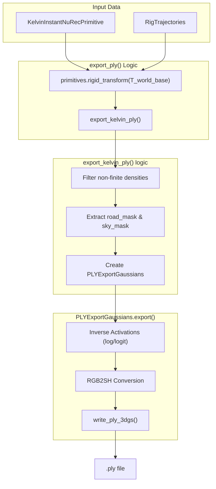
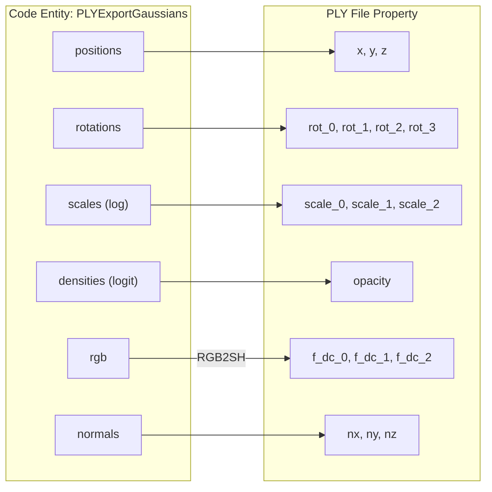

<!-- source: DeepWiki mcp.deepwiki.com · repo NVIDIA/instant-nurec · page 5.3 PLY Export · fetched 2026-10-26 -->

# PLY Export

Relevant source files

The following files were used as context for generating this wiki page:

- [instant_nurec/predict/export_ply.py](instant_nurec/predict/export_ply.py)
- [instant_nurec/utils/gaussians/utils.py](instant_nurec/utils/gaussians/utils.py)

The PLY export pipeline in InstantNuRec is responsible for converting internal Gaussian primitives into a standard 3D Gaussian Splatting (3DGS) PLY format. This process involves transforming coordinates from the local base frame to the world frame, filtering invalid data, applying inverse activations to match 3DGS parameter expectations, and encoding color as Spherical Harmonics (SH).

## Overview and Data Flow

The primary entry point for exporting data is the `export_ply` function in `instant_nurec/predict/export_ply.py`. It coordinates the transformation of `KelvinInstantNuRecPrimitive` objects into a format suitable for downstream consumption, such as NuRec SO (Scene Optimization).

### Coordinate Transformation
Before any data processing occurs, the primitives are transformed into world space. The system uses the `rig_trajectories.T_world_base` matrix to move all Gaussian positions and orientations from the local rig frame to the global coordinate system [instant_nurec/predict/export_ply.py:107-112](). This is performed using the `rigid_transform` method of the primitive class [instant_nurec/predict/export_ply.py:110-112]().

### PLY Generation Pipeline
The following diagram illustrates the flow from raw primitives to the final file on disk.

**Diagram: PLY Export Logic Flow**

Sources: [instant_nurec/predict/export_ply.py:75-116](), [instant_nurec/utils/gaussians/utils.py:40-89]()

## Technical Implementation Details

### Filtering and Semantic Extraction
The `export_kelvin_ply` function performs data sanitization and semantic mapping:
1.  **Non-finite Filtering**: It identifies Gaussians with non-finite (NaN or Inf) density values using `torch.isfinite` and removes them from the export set [instant_nurec/predict/export_ply.py:79-82]().
2.  **Semantic Masks**: If semantic class information is available in the static layer, it extracts `road_mask` and `sky_mask`.
    *   `road_mask` is derived where `semantic_class == KelvinSemanticClass.ROAD` [instant_nurec/predict/export_ply.py:88]().
    *   `sky_mask` is derived where `semantic_class == KelvinSemanticClass.SKY` [instant_nurec/predict/export_ply.py:89]().

### Inverse Activations and SH Conversion
The `PLYExportGaussians.export` method prepares the raw tensor data for the 3DGS format, which expects parameters in their pre-activated state [instant_nurec/predict/export_ply.py:44-50]().

| Attribute | Internal State | Export Transformation | Inverse Formula |
| :--- | :--- | :--- | :--- |
| **Scale** | Activated (Positive) | Log-scale | `log(x)` [instant_nurec/predict/export_ply.py:51]() |
| **Density** | Activated (0-1) | Logit-density | `log(x / (1 - x))` [instant_nurec/predict/export_ply.py:52]() |
| **Color** | RGB [0, 1] | Spherical Harmonics (DC) | `(rgb - 0.5) / 0.28209...` [instant_nurec/utils/gaussians/utils.py:31-38]() |

The `RGB2SH` utility specifically converts the RGB values into the 0-th order SH coefficient (`f_dc`) [instant_nurec/utils/gaussians/utils.py:36-38]().

### Writing the PLY File
The `write_ply_3dgs` function uses the `point_cloud_utils` (pcu) library to construct a mesh object and populate its vertex data [instant_nurec/utils/gaussians/utils.py:59-60]().

**Entity Mapping: Code Attributes to PLY Properties**

Sources: [instant_nurec/utils/gaussians/utils.py:60-84](), [instant_nurec/predict/export_ply.py:62-72]()

## Key Functions and Classes

### `PLYExportGaussians`
A dataclass used to hold the processed Gaussian parameters before they are written to disk [instant_nurec/predict/export_ply.py:33-42](). It encapsulates the `export` method which handles the final conversion logic.

### `write_ply_3dgs`
A utility function that maps PyTorch tensors to the specific naming convention used by standard 3DGS viewers (e.g., `f_dc_` for colors, `opacity` for density, and `rot_` for quaternions) [instant_nurec/utils/gaussians/utils.py:40-89](). It also supports `custom_attributes`, allowing the inclusion of `road_mask` and `sky_mask` in the PLY file [instant_nurec/utils/gaussians/utils.py:83-84]().

### `export_ply`
The high-level orchestrator that accepts a `KelvinInstantNuRecPrimitive`, applies the rig-to-world transform, and triggers the export sequence [instant_nurec/predict/export_ply.py:103-116]().

Sources:
*   `instant_nurec/predict/export_ply.py`
*   `instant_nurec/utils/gaussians/utils.py`

---

