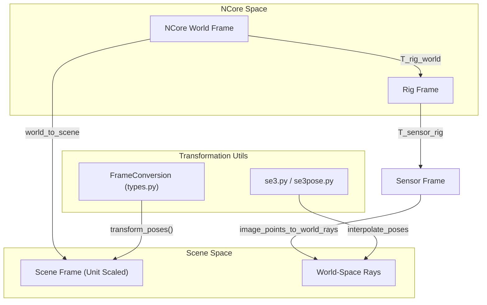
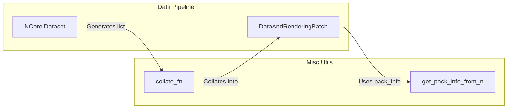

<!-- source: DeepWiki mcp.deepwiki.com · repo NVIDIA/instant-nurec · page 6 Utility Library · fetched 2026-10-26 -->

# Utility Library

Relevant source files

The following files were used as context for generating this wiki page:

- [instant_nurec/utils/__init__.py](instant_nurec/utils/__init__.py)
- [instant_nurec/utils/misc.py](instant_nurec/utils/misc.py)
- [instant_nurec/utils/types.py](instant_nurec/utils/types.py)

The `instant_nurec/utils/` package provides the mathematical and geometric foundation for the InstantNuRec inference pipeline. It handles coordinate system transformations, SE(3) Lie algebra operations, sensor modeling for various camera types, and specialized tensor operations for batched data processing.

### System Overview

The utility library bridges the gap between raw NCore data (world-space trajectories, raw camera parameters) and the internal representations required by the Kelvin model (scene-space rays, interpolated poses).

#### Data Flow and Coordinate Systems
The following diagram illustrates how the utility library manages the transformation of data through various coordinate spaces:

**Coordinate Transformation Flow**

**Sources:** [instant_nurec/utils/types.py:52-136](), [instant_nurec/utils/sensors.py:236-258]()

---

### Core Utility Groups

#### [Geometry and SE3 Math](#6.1)
This module provides robust implementations for 3D transformations. It includes Shepperd's method for numerically stable matrix-to-quaternion conversion and a dedicated `SE3` class for handling pose groups. These utilities ensure that camera extrinsics and rig trajectories are handled without gimbal lock or precision loss.

*   **Key Entities:** `se3_matrix_to_tquat`, `tquat_to_se3_matrix`, `se3pose_from_matrix`, and the `SE3` class.
*   **Purpose:** Converting between 4x4 transformation matrices and translation+quaternion (tquat) representations.
*   **Details:** See [Geometry and SE3 Math](#6.1).

#### [Sensor Models and Ray Generation](#6.2)
InstantNuRec supports multiple camera models, including Pinhole and FTheta (fisheye). The `CameraModelConverter` transforms NCore-specific camera parameters into a unified format for the model. A critical feature is the `image_points_to_world_rays_shutter_pose` function, which accounts for rolling shutter effects by interpolating poses across the image exposure time.

*   **Key Entities:** `CameraModelConverter`, `image_points_to_world_rays_shutter_pose`, `FThetaCameraModel`.
*   **Purpose:** Generating normalized rays and handling lens distortion/projection.
*   **Details:** See [Sensor Models and Ray Generation](#6.2).

#### [Trajectory and Packed Operations](#6.3)
To handle long sequences, the system processes data in "chunks." These utilities manage the merging of trajectories across chunk boundaries and provide high-performance "packed" tensor operations. This allows the system to handle variable numbers of Gaussians or points efficiently on the GPU.

*   **Key Entities:** `RigTrajectories`, `get_pack_info_from_n`, `linstep_interleave`.
*   **Purpose:** Trajectory interpolation, chunk merging, and efficient batching of variable-length data.
*   **Details:** See [Trajectory and Packed Operations](#6.3).

---

### Miscellaneous Helpers

The library includes several low-level helpers in `instant_nurec/utils/misc.py` and `instant_nurec/utils/types.py` for data manipulation and type safety.

| Function / Class | File | Purpose |
| :--- | :--- | :--- |
| `collate_fn` | [instant_nurec/utils/misc.py:87-109]() | Custom collator for nested dataclasses and tensors, used in data loading. |
| `FrameConversion` | [instant_nurec/utils/types.py:52-136]() | Handles scale-aware transformations between world and scene frames. |
| `HalfClosedInterval` | [instant_nurec/utils/types.py:32-48]() | Represents `[start, end)` time intervals for chunking logic. |
| `get_pack_info_from_n` | [instant_nurec/utils/misc.py:35-45]() | Computes offsets and counts for packed tensor representations. |

**Code Entity Mapping**

**Sources:** [instant_nurec/utils/misc.py:35-109]()

**Sources:**
- [instant_nurec/utils/misc.py:1-137]()
- [instant_nurec/utils/types.py:1-191]()
- [instant_nurec/utils/sensors.py:1-258]()

---

