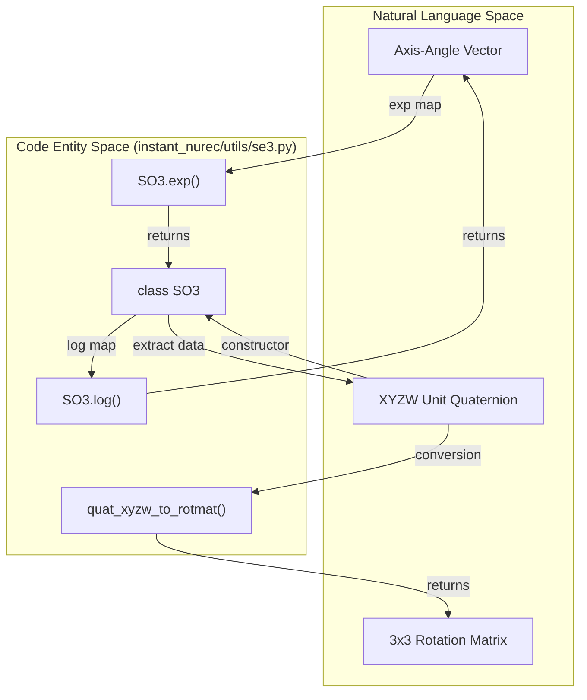
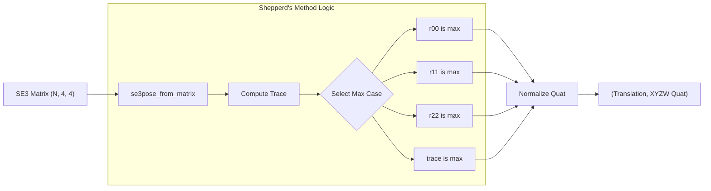

<!-- source: DeepWiki mcp.deepwiki.com · repo NVIDIA/instant-nurec · page 6.1 Geometry and SE3 Math · fetched 2026-10-26 -->

# Geometry and SE3 Math

Relevant source files

The following files were used as context for generating this wiki page:

- [instant_nurec/utils/geometry.py](instant_nurec/utils/geometry.py)
- [instant_nurec/utils/se3.py](instant_nurec/utils/se3.py)

This page provides a technical reference for the geometry and Special Euclidean group (SE3) mathematics utilities used throughout InstantNuRec. These utilities handle transformations between coordinate systems, pose representation conversions, and rigid body kinematics.

The codebase relies on a custom implementation of SE3/SO3 logic in `instant_nurec/utils/se3.py` to avoid dependency conflicts with `lietorch` while maintaining a compatible API [instant_nurec/utils/se3.py:16-50]().

## SE3 and SO3 Representations

The system primarily uses two formats for 3D transformations:
1.  **4x4 Matrices**: Standard homogeneous transformation matrices.
2.  **7D T-Quat Vectors**: Represented as `[tx, ty, tz, qx, qy, qz, qw]`, where `t` is translation and `q` is a unit quaternion in XYZW convention [instant_nurec/utils/se3.py:27-38]().

### SE3 Class Logic
The `SE3` class in `utils/se3.py` acts as a shim for `lietorch.SE3`. It supports batch operations, inversion, and composition [instant_nurec/utils/se3.py:195-257]().

| Method / Property | Description | Source |
| :--- | :--- | :--- |
| `SE3.InitFromVec(data)` | Constructs SE3 from a `(..., 7)` tensor. | [instant_nurec/utils/se3.py:202-204]() |
| `inv()` | Returns the inverse transformation. | [instant_nurec/utils/se3.py:213-217]() |
| `__mul__` | Handles composition (`SE3 * SE3`) or point transformation (`SE3 * Tensor(..., 3)`). | [instant_nurec/utils/se3.py:228-235]() |
| `vec()` | Returns the underlying 7D tensor. | [instant_nurec/utils/se3.py:206-207]() |

### SO3 Class Logic
The `SO3` class manages rotations using unit quaternions. It includes exponential and logarithmic maps for Lie algebra operations [instant_nurec/utils/se3.py:115-158]().

**Entity Mapping: Rotation Math**

Sources: [instant_nurec/utils/se3.py:98-158]()

## Geometry Utilities

The `instant_nurec/utils/geometry.py` module contains functional primitives for matrix manipulation and robust pose decomposition.

### Transformation Conversions

*   **`se3_matrix_inverse`**: Computes the inverse of a 4x4 SE3 matrix. It optimizes the calculation by transposing the 3x3 rotation component $R^T$ and calculating the new translation as $-R^T t$ [instant_nurec/utils/geometry.py:27-53]().
*   **`se3_matrix_to_tquat`**: Extracts the translation vector and converts the rotation sub-matrix to an XYZW quaternion [instant_nurec/utils/geometry.py:56-84]().
*   **`tquat_to_se3_matrix`**: The inverse operation, assembling a 4x4 matrix from a 7D vector [instant_nurec/utils/geometry.py:214-235]().

### Shepperd's Method for Pose Decomposition
The function `se3pose_from_matrix` implements **Shepperd's method** to decompose an SE3 matrix into a translation and a quaternion [instant_nurec/utils/geometry.py:87-144]().

Implementation details:
1.  **Precision**: Computes internally using `float64` to maintain numerical stability before casting back to the input's original dtype [instant_nurec/utils/geometry.py:107]().
2.  **Case Selection**: Uses a four-case logic based on the trace and diagonal elements of the rotation matrix to avoid division by small numbers [instant_nurec/utils/geometry.py:114-117]().
3.  **Normalization**: Performs a final safe normalization of the quaternion to ensure it lies on the unit hypersphere [instant_nurec/utils/geometry.py:142-143]().

**Data Flow: Matrix to T-Quat Conversion**

Sources: [instant_nurec/utils/geometry.py:87-144]()

## Core Mathematical Functions

### Quaternion Operations
*   **`quat_mult_xyzw`**: Performs Hamilton product of two quaternions in XYZW order. It is implemented to be compatible with `torch.compile` [instant_nurec/utils/geometry.py:194-211]().
*   **`quat_xyzw_slerp`**: Performs Spherical Linear Interpolation between two unit quaternions. It mirrors the `ncore` implementation and includes a shortest-arc check by flipping the sign of the target quaternion if the dot product is negative [instant_nurec/utils/se3.py:76-95]().

### SO3 Matrix Conversion
The function `so3_matrix_to_quat` converts a 3x3 rotation matrix to a quaternion. Similar to Shepperd's method, it uses a decision matrix based on the diagonal and trace to select the most numerically stable calculation path [instant_nurec/utils/geometry.py:147-191]().

Sources:
- `instant_nurec/utils/geometry.py` [27-53](), [56-84](), [87-144](), [147-191](), [194-211](), [214-235]()
- `instant_nurec/utils/se3.py` [16-50](), [76-95](), [98-158](), [195-257]()

---

