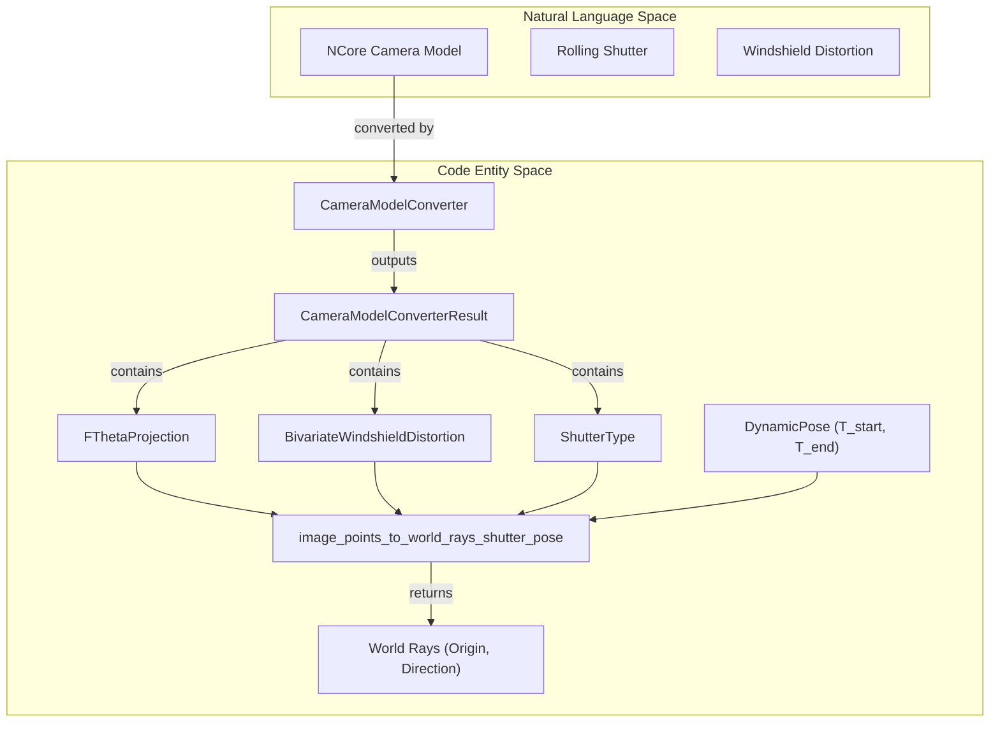
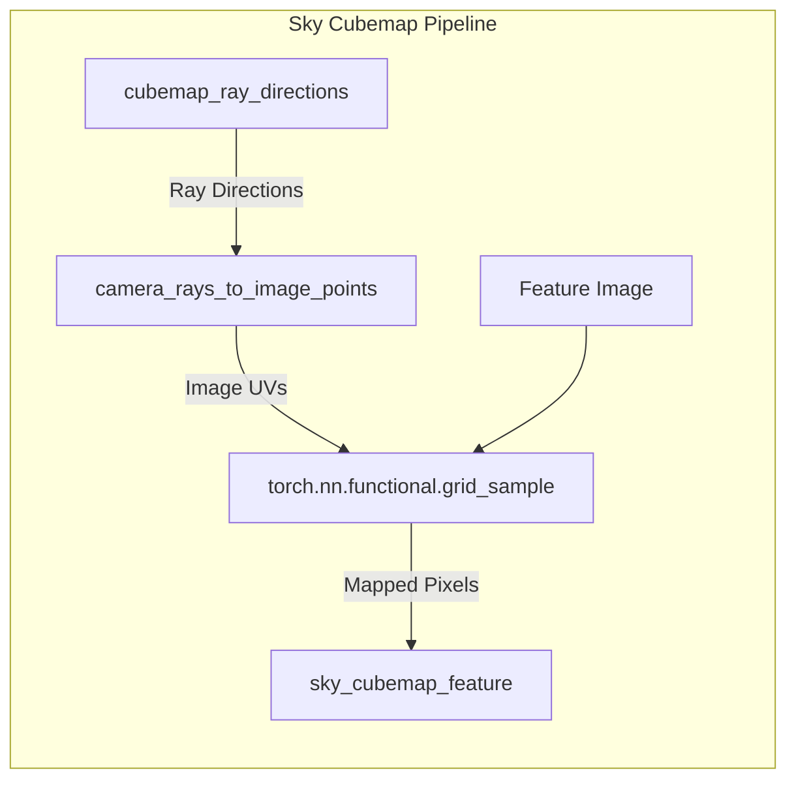

<!-- source: DeepWiki mcp.deepwiki.com · repo NVIDIA/instant-nurec · page 6.2 Sensor Models and Ray Generation · fetched 2026-10-26 -->

# Sensor Models and Ray Generation

Relevant source files

The following files were used as context for generating this wiki page:

- [instant_nurec/utils/cubemap.py](instant_nurec/utils/cubemap.py)
- [instant_nurec/utils/sensor.py](instant_nurec/utils/sensor.py)
- [instant_nurec/utils/sensors/kernel_types.py](instant_nurec/utils/sensors/kernel_types.py)
- [instant_nurec/utils/sensors/ncore_sensors_converters.py](instant_nurec/utils/sensors/ncore_sensors_converters.py)
- [instant_nurec/utils/sensors/ray_gen.py](instant_nurec/utils/sensors/ray_gen.py)
- [instant_nurec/utils/sensors/sensors.py](instant_nurec/utils/sensors/sensors.py)

This section describes the representation of camera models and the implementation of pure-PyTorch kernels for world-space ray generation. InstantNuRec supports complex sensor models, including F-Theta projection and bivariate windshield distortion, while accounting for rolling-shutter effects through per-pixel pose interpolation.

## Camera Model Representation

The system primarily utilizes the **F-Theta** camera model for input data. While the underlying NCore framework supports various models, InstantNuRec focuses on F-Theta and Pinhole models for efficiency in the Kelvin-based inference pipeline.

### Supported Models and Components
*   **FThetaProjection**: Represents the projection parameters including principal points, forward/backward polynomials, and the affine transformation matrix $A$ [instant_nurec/utils/sensors/kernel_types.py:29-37]().
*   **BivariateWindshieldDistortion**: An external distortion model that applies high-order polynomial corrections to camera rays, often used for cameras mounted behind curved glass [instant_nurec/utils/sensors/kernel_types.py:72-81]().
*   **ShutterType**: An enumeration defining the rolling shutter readout direction (e.g., `ROLLING_TOP_TO_BOTTOM`) or `GLOBAL` shutter [instant_nurec/utils/sensors/kernel_types.py:32-39]().

### Camera Model Conversion
The `CameraModelConverter` class acts as the bridge between NCore's complex `CameraModel` objects and the lightweight, tensor-based structures required by the GPU kernels.

| Function | Role |
| :--- | :--- |
| `CameraModelConverter.convert` | Orchestrates the conversion of projection, distortion, and shutter parameters [instant_nurec/utils/sensors/ncore_sensors_converters.py:66-103](). |
| `_convert_ftheta` | Extracts F-Theta coefficients and reference polynomial types [instant_nurec/utils/sensors/ncore_sensors_converters.py:106-126](). |
| `_convert_external_distortion` | Identifies and converts bivariate windshield parameters if present [instant_nurec/utils/sensors/ncore_sensors_converters.py:129-174](). |
| `to_simple_pinhole_model_parameters` | Converts any model to a simplified pinhole for specific export paths [instant_nurec/utils/sensor.py:23-65](). |

**Sources:** [instant_nurec/utils/sensors/kernel_types.py:23-100](), [instant_nurec/utils/sensors/ncore_sensors_converters.py:62-174](), [instant_nurec/utils/sensor.py:23-65]()

## Ray Generation and Shutter Compensation

Ray generation in InstantNuRec is performed using pure-PyTorch kernels to allow for JIT compilation and efficient GPU execution. The primary entry point is `image_points_to_world_rays_shutter_pose`.

### Implementation Flow: Image Points to World Rays
1.  **Relative Frame Times**: For each pixel $(x, y)$, a relative time $t \in [0, 1]$ is calculated based on the `ShutterType` and image resolution [instant_nurec/utils/sensors/ray_gen.py:132-153]().
2.  **Inverse Projection**: Image points are converted to camera-frame rays using the F-Theta inverse projection. This involves evaluating the backward polynomial or using Newton's method to invert the forward polynomial [instant_nurec/utils/sensors/ray_gen.py:73-114]().
3.  **External Distortion**: If a windshield model is present, the camera-frame rays are transformed to account for refraction/distortion [instant_nurec/utils/sensors/kernel_types.py:191-205]().
4.  **Pose Interpolation**: For rolling shutter cameras, the world-space pose is interpolated between the start-of-frame pose ($T_{start}$) and end-of-frame pose ($T_{end}$) using the per-pixel relative time $t$ [instant_nurec/utils/sensors/ray_gen.py:321-330]().
5.  **World Transformation**: The camera-frame rays are multiplied by the interpolated rotation matrices to produce final world-space directions [instant_nurec/utils/sensors/ray_gen.py:332-333]().

### Data Flow: Sensor to Rays
This diagram illustrates how NCore sensor objects are converted and processed to generate rays.

**Sources:** [instant_nurec/utils/sensors/ray_gen.py:263-335](), [instant_nurec/utils/sensors/kernel_types.py:191-205](), [instant_nurec/utils/sensors/ncore_sensors_converters.py:98-103]()

## Forward Projection and Cubemaps

The utility `camera_rays_to_image_points` performs the inverse operation (world/camera rays to image UVs). This is primarily used in `unproject_to_sky_cubemap` to map image pixels onto a 6-faced sky texture.

### Sky Cubemap Unprojection
The `unproject_to_sky_cubemap` function iterates through camera views, generates directions for each cubemap face using `cubemap_ray_directions`, and samples the image features at the projected locations [instant_nurec/utils/cubemap.py:48-102]().

### Key Functions
*   **`_ftheta_camera_rays_to_image_points`**: Projects 3D camera rays onto the 2D image plane using F-Theta polynomials [instant_nurec/utils/sensors/ray_gen.py:178-223]().
*   **`cubemap_ray_directions`**: Generates a standard set of directions for the 6 faces of a cubemap (+X, -X, -Y, +Y, +Z, -Z) [instant_nurec/utils/cubemap.py:27-44]().
*   **`rotate_sky_cubemap`**: Allows rotating the entire environment map by a 3x3 rotation matrix, useful for aligning sky features across different coordinate systems [instant_nurec/utils/cubemap.py:105-127]().

**Sources:** [instant_nurec/utils/cubemap.py:27-102](), [instant_nurec/utils/sensors/ray_gen.py:178-223](), [instant_nurec/utils/sensors/ray_gen.py:226-260]()

---

