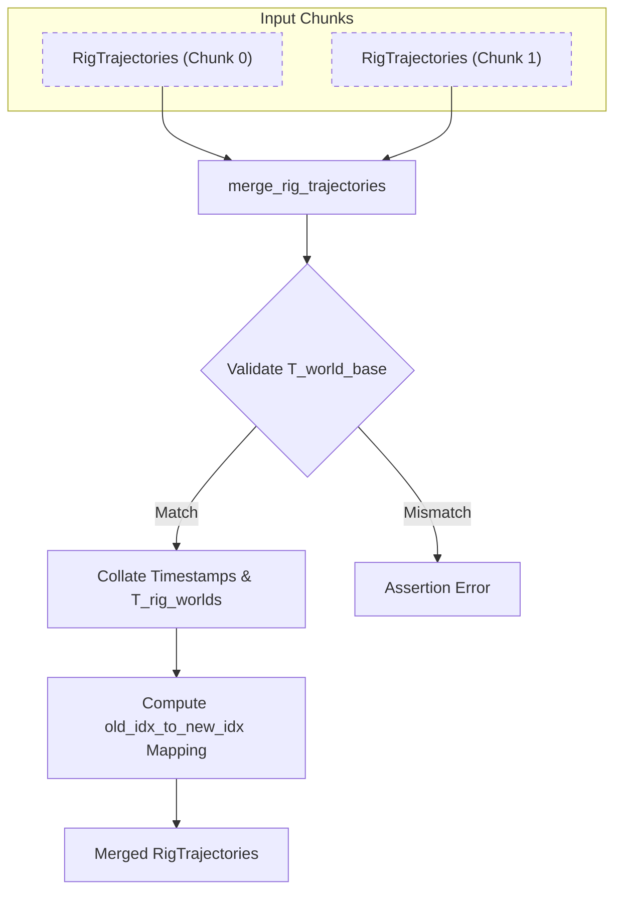
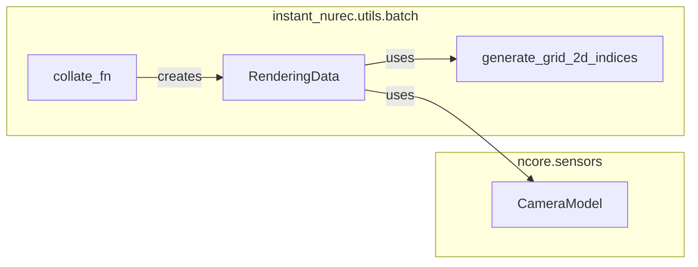

<!-- source: DeepWiki mcp.deepwiki.com · repo NVIDIA/instant-nurec · page 6.3 Trajectory and Packed Operations · fetched 2026-10-26 -->

# Trajectory and Packed Operations

Relevant source files

The following files were used as context for generating this wiki page:

- [instant_nurec/utils/batch.py](instant_nurec/utils/batch.py)
- [instant_nurec/utils/files.py](instant_nurec/utils/files.py)
- [instant_nurec/utils/nn_extensions.py](instant_nurec/utils/nn_extensions.py)
- [instant_nurec/utils/packed_ops.py](instant_nurec/utils/packed_ops.py)
- [instant_nurec/utils/trajectory.py](instant_nurec/utils/trajectory.py)

This section details the utility library for handling temporal data, spatial transformations of rig trajectories, and specialized tensor operations for packed data structures. These utilities are primarily consumed by the data loading pipeline and the inference system to manage multi-chunk synchronization and efficient batch processing.

## Rig Trajectory Management

The system represents vehicle and sensor motion through `RigTrajectories`. These utilities allow for transforming these trajectories across different coordinate systems and merging multiple temporal chunks into a unified global trajectory.

### Merging and Transformation
When processing long sequences divided into chunks, `merge_rig_trajectories` is used to assemble a continuous motion profile. It reconciles timestamps and ensures that the base coordinate system (`T_world_base`) remains consistent across all merged segments.

Key operations include:
*   **Timestamp Reconciliation**: Deduplicating and sorting timestamps across chunk boundaries [instant_nurec/utils/trajectory.py:86-101]().
*   **Coordinate Alignment**: Validating that all chunks share the same `T_world_base` within a tolerance (1e-3) before merging [instant_nurec/utils/trajectory.py:131-134]().
*   **Index Mapping**: Generating a mapping from local chunk frame indices to the new global indices in the merged trajectory [instant_nurec/utils/trajectory.py:151-160]().

The `transform_rig_trajectories` function applies a global SE3 transform to the trajectory. To ensure geo-positioning is unaffected, it updates the `T_rig_worlds` measurements and applies the inverse transform to the `T_world_base` [instant_nurec/utils/trajectory.py:33-49]().

### Trajectory Logic Flow
The following diagram illustrates how multiple `RigTrajectories` are unified.

**Rig Trajectory Merging Logic**

**Sources:** [instant_nurec/utils/trajectory.py:53-141](), [instant_nurec/utils/trajectory.py:28-49]()

---

## Packed Tensor Operations

The `packed_ops` module provides high-performance operations for "packed" tensors—flat tensors containing multiple variable-length sequences partitioned by a `pack_infos` tensor (containing `start_offset` and `count`).

### linstep_interleave
This function generates an interleaved sequence similar to `torch.arange` but executed per-pack in a vectorized manner. For each pack $p$, it produces $num\_steps[p]$ values starting from $start[p]$ with a specified $step\_size$ [instant_nurec/utils/packed_ops.py:30-49]().

**Implementation Strategy**:
1.  Compute cumulative sums of `num_steps` to find pack boundaries [instant_nurec/utils/packed_ops.py:67-68]().
2.  Use `torch.repeat_interleave` to create per-element start values and step indices [instant_nurec/utils/packed_ops.py:69-73]().
3.  Calculate final values: $start + (within \times step\_size)$ [instant_nurec/utils/packed_ops.py:76-77]().

### packed_searchsorted_indexed_vals
Performs a lower-bound binary search across packed bins. It avoids Python loops by shifting each pack's values into a globally unique range, allowing a single `torch.searchsorted` call to handle all packs simultaneously [instant_nurec/utils/packed_ops.py:80-106]().

**Global Shift Strategy**:
1.  Determine a `bin_range` large enough to separate all packs [instant_nurec/utils/packed_ops.py:114]().
2.  Apply `shifted_bins = bins + bin_range * pack_idx` [instant_nurec/utils/packed_ops.py:119]().
3.  Perform search and clamp results to the original pack boundaries [instant_nurec/utils/packed_ops.py:122-129]().

**Sources:** [instant_nurec/utils/packed_ops.py:1-130]()

---

## Batch Collation and Rendering Data

The `RenderingData` dataclass serves as the primary container for camera-related tensors during the inference forward pass.

### RenderingData Structure
| Field | Type | Description |
| :--- | :--- | :--- |
| `rays` | `torch.Tensor` | Ray origins/directions (B, H, W, 6) [instant_nurec/utils/batch.py:91]() |
| `poses_tquat_startend` | `torch.Tensor` | Start/End poses in T+Quat (B, 2, 7) [instant_nurec/utils/batch.py:93]() |
| `timestamps_startend_us` | `torch.Tensor` | Start/End timestamps in microseconds (B, 2) [instant_nurec/utils/batch.py:94]() |
| `sensor_model_parameters`| `list` | Parameters for `CameraModel` reconstruction [instant_nurec/utils/batch.py:92]() |

### Depth Scaling
`RenderingData` includes a lazy-loaded `distance_to_depth_scale` property. It uses the `CameraModel` to compute the Z-component of camera-space rays, which is required to convert between radial distance and planar depth [instant_nurec/utils/batch.py:124-139]().

### Collation Logic
The `collate_fn` handles the aggregation of individual `RenderingData` objects into a batched object. It ensures that GPU tensors are moved to the target device while maintaining CPU copies of timestamps to avoid expensive `.item()` calls during synchronization [instant_nurec/utils/batch.py:142-160]().

**Code Entity Association: Data Flow**

**Sources:** [instant_nurec/utils/batch.py:75-160](), [instant_nurec/utils/batch.py:52-71]()

---

## NN Extensions and File Utilities

### TypedModuleList
To improve type safety in the model definition, `TypedModuleList` extends `nn.ModuleList` with generics. This allows static analysis tools (like mypy) to verify the types of modules stored in lists, which is otherwise lost in standard PyTorch [instant_nurec/utils/nn_extensions.py:32-65]().

### Universal Path Handling
The `parse_universal_path` utility ensures compatibility between local filesystems and remote storage by wrapping paths in `UPath`. It specifically handles the `file://` protocol prefix required by `ncore` writers for local write operations [instant_nurec/utils/files.py:19-27]().

**Sources:** [instant_nurec/utils/nn_extensions.py:22-65](), [instant_nurec/utils/files.py:1-27]()

---

