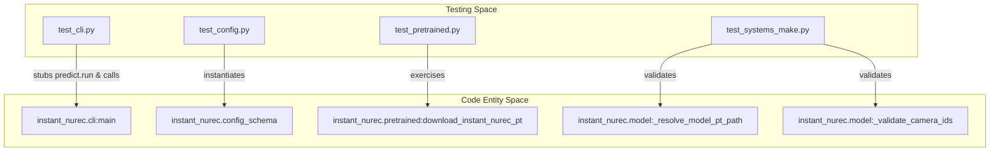
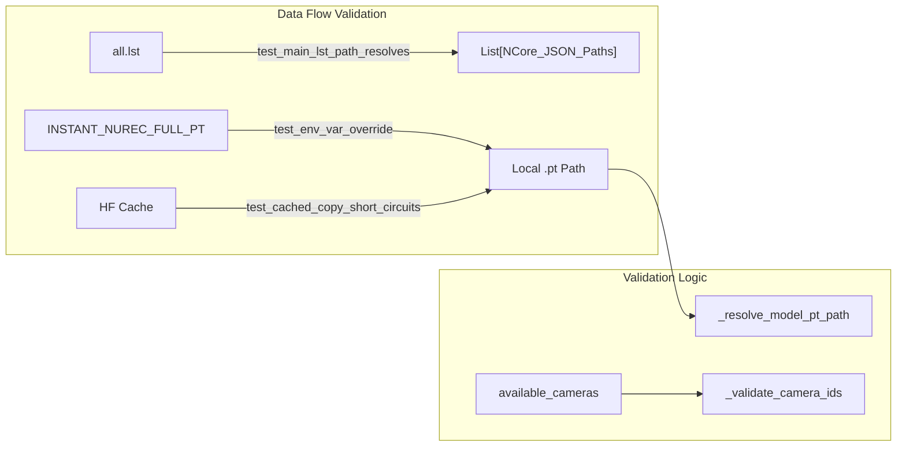

<!-- source: DeepWiki mcp.deepwiki.com · repo NVIDIA/instant-nurec · page 7 Testing · fetched 2026-10-26 -->

# Testing

Relevant source files

The following files were used as context for generating this wiki page:

- [conftest.py](conftest.py)
- [tests/__init__.py](tests/__init__.py)
- [tests/test_cli.py](tests/test_cli.py)
- [tests/test_config.py](tests/test_config.py)
- [tests/test_pretrained.py](tests/test_pretrained.py)
- [tests/test_systems_make.py](tests/test_systems_make.py)

This page provides an overview of the test suite for the InstantNuRec codebase. The project uses `pytest` for unit testing and branch coverage verification. The suite is designed to validate core inference logic, configuration schemas, data loading pipelines, and mathematical utilities.

The repository root contains a `conftest.py` file which ensures that the in-tree `instant_nurec` package is correctly resolved during test collection without requiring an editable install [conftest.py:16-27]().

## Test Suite Structure

The tests are organized into a flat directory structure under `tests/`. They generally follow a naming convention that maps directly to the module they cover (e.g., `tests/test_cli.py` covers `instant_nurec/cli.py`).

### Test Categories

| Category | Description | Key Files |
| :--- | :--- | :--- |
| **CLI & Config** | Validates command-line argument parsing and Pydantic schema constraints. | `test_cli.py`, `test_config.py` |
| **Model & System** | Tests for JIT model loading, pretrained model resolution, and system initialization. | `test_pretrained.py`, `test_systems_make.py`, `test_jit_adapter.py` |
| **Primitives** | Validates 3D Gaussian Splatting logic, including merging and PLY export. | `test_kelvin_primitive.py`, `test_primitive_merge.py` |
| **Data & Utils** | Extensive tests for NCore dataset loading, SE3 math, and sensor models. | `test_ncore_input.py`, `test_se3pose.py`, `test_geometry.py` |

## Code to Test Mapping

The following diagram illustrates how specific test entities interact with and validate the core system components.

### System Validation Map

Sources: [tests/test_cli.py:16-22](), [tests/test_config.py:16-17](), [tests/test_pretrained.py:16-16](), [tests/test_systems_make.py:16-22]()

## Execution and Requirements

Tests can be executed using standard `pytest` commands from the repository root.

*   **CPU-Only Testing:** Many tests (CLI, Config, Pretrained, Math Utils) are designed to run on CPU-only environments by stubbing out GPU-dependent paths [tests/test_cli.py:19-21]().
*   **Environment Variables:** The test suite respects `INSTANT_NUREC_FULL_PT` for local model resolution tests [tests/test_pretrained.py:40-45]().
*   **Dependencies:** Tests for pretrained model downloading require `huggingface_hub`, though this is mocked in the unit tests to allow offline execution [tests/test_pretrained.py:129-143]().

### Configuration Testing
The `test_config.py` file ensures that the Pydantic schemas enforce strict validation rules, such as:
*   Rejecting negative values for physical parameters like `frustum_ownership_max_diff_m` [tests/test_config.py:66-69]().
*   Ensuring `voxel_size` and `target_n_gaussians` are positive [tests/test_config.py:78-101]().
*   Verifying that configuration objects remain hashable for caching purposes [tests/test_config.py:204-205]().

## Module Coverage Details

For a detailed breakdown of specific test files and the logic they verify, see the following child pages:

### [Unit Tests: Core Modules](#7.1)
Covers the primary inference components.
*   **CLI:** Validates that `.lst` manifest files resolve to absolute paths [tests/test_cli.py:168-188]().
*   **Pretrained:** Tests the logic for downloading `instant_nurec.pt` from Hugging Face Hub vs. local environment overrides [tests/test_pretrained.py:40-65]().
*   **System Make:** Tests camera ID validation logic against NCore sequence JSONs [tests/test_systems_make.py:85-115]().

### [Unit Tests: Data and Utility Modules](#7.2)
Covers the extensive utility library and data ingestion pipeline.
*   **Geometry/SE3:** Rigorous validation of transformation matrices and pose interpolation.
*   **NCore Input:** Validates parsing of sequence JSONs and cuboid track handling.
*   **Math Utils:** Tests for packed operations and neural network extensions.

### Test Logic Flow

Sources: [tests/test_cli.py:168-177](), [tests/test_pretrained.py:40-52](), [tests/test_pretrained.py:104-113](), [tests/test_systems_make.py:40-115]()

---

