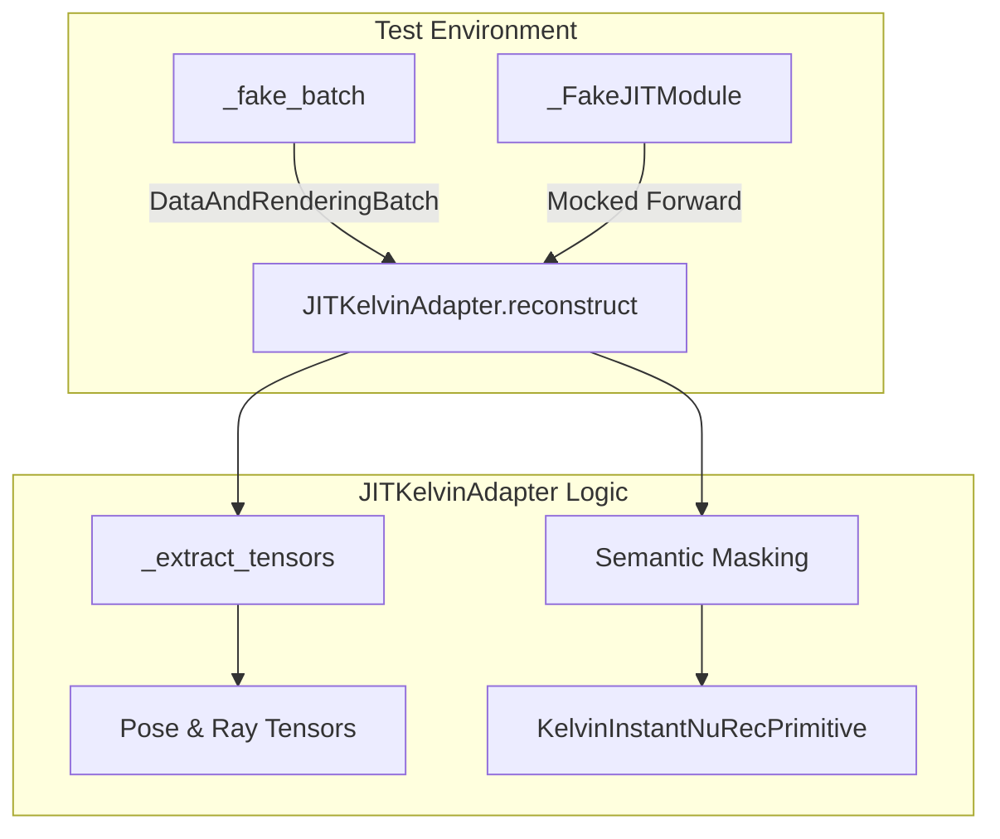
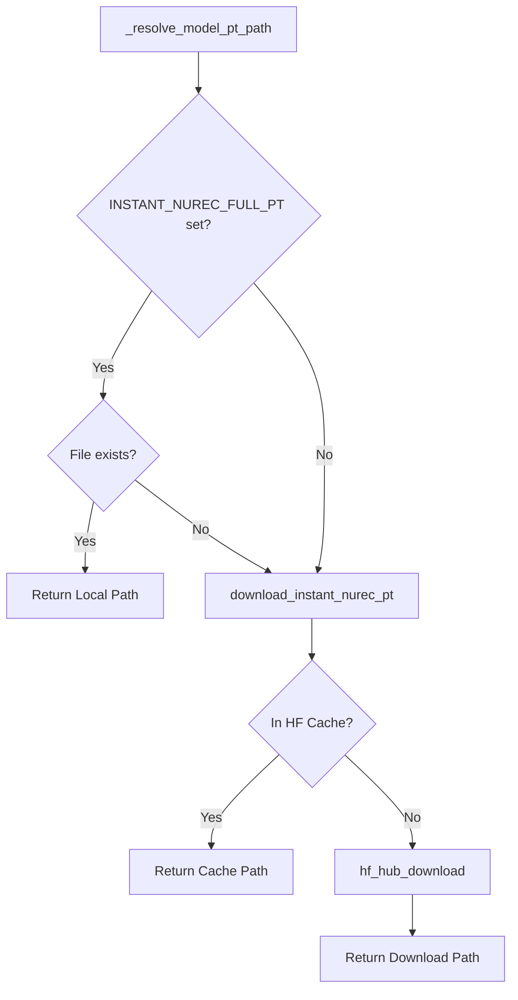

<!-- source: DeepWiki mcp.deepwiki.com · repo NVIDIA/instant-nurec · page 7.1 Unit Tests: Core Modules · fetched 2026-10-26 -->

# Unit Tests: Core Modules

Relevant source files

The following files were used as context for generating this wiki page:

- [tests/test_cli.py](tests/test_cli.py)
- [tests/test_config.py](tests/test_config.py)
- [tests/test_jit_adapter.py](tests/test_jit_adapter.py)
- [tests/test_kelvin_primitive.py](tests/test_kelvin_primitive.py)
- [tests/test_pretrained.py](tests/test_pretrained.py)
- [tests/test_primitive_merge.py](tests/test_primitive_merge.py)
- [tests/test_system_export_banner.py](tests/test_system_export_banner.py)
- [tests/test_systems_make.py](tests/test_systems_make.py)

This page details the unit test suite for the core inference modules of InstantNuRec. These tests focus on the JIT adapter, primitive data structures, merging logic, pretrained model resolution, and the CLI entry point.

## Overview and Purpose

The core module tests ensure the integrity of the inference pipeline without requiring a full GPU environment in many cases. They use stubs and mocks to exercise shape validation, data flow, and algorithmic correctness (such as voxelization and model path resolution).

| Test File | Focus Area | Key Components Tested |
| :--- | :--- | :--- |
| `test_jit_adapter.py` | Model I/O | `JITKelvinAdapter`, Tensor extraction, Masking |
| `test_kelvin_primitive.py` | Data Structures | `KelvinStaticLayer`, KL-optimal voxelization |
| `test_primitive_merge.py` | Post-processing | `KelvinPrimitiveMerge`, Iterative voxelization search |
| `test_pretrained.py` | Model Management | `huggingface_hub` integration, Environment overrides |
| `test_cli.py` | Interface | `argparse` validation, Config construction |
| `test_systems_make.py` | Factory Logic | `GaussiansInstantNuRecSystem` initialization helpers |

Sources: [tests/test_jit_adapter.py:16-20](), [tests/test_cli.py:16-22](), [tests/test_systems_make.py:16-22]()

---

## JIT Adapter and Tensor Extraction

The `test_jit_adapter.py` suite validates the `JITKelvinAdapter`, which acts as the bridge between the raw `torch.jit.ScriptModule` and the high-level `GaussiansInstantNuRecSystem`.

### Implementation Details
The tests utilize a `_FakeJITModule` [tests/test_jit_adapter.py:50-58]() to simulate model outputs (XYZ, rotations, scales, densities, RGB, semantics, and normals) without a GPU. This allows for verifying the adapter's logic for:
*   **Semantic Masking**: Ensuring that pixels classified as `KelvinSemanticClass.MOVABLE` are correctly filtered out of the static layer and optionally handled via cuboid tracks [tests/test_jit_adapter.py:180-185]().
*   **Coordinate Rescaling**: Verifying that the `scene_rescale_buffer` is applied to output positions [tests/test_jit_adapter.py:84-97]().
*   **Tensor Flattening**: Validating that per-pixel outputs from multiple cameras ($V \times H \times W$) are correctly gathered into flattened primitives.

### Data Flow: Batch to Adapter
The following diagram illustrates how the test stubs the data flow into the adapter.

**Diagram: Adapter Input Mocking**

Sources: [tests/test_jit_adapter.py:50-81](), [tests/test_jit_adapter.py:100-139](), [tests/test_jit_adapter.py:162-178]()

---

## Kelvin Primitive and Voxelization

The `test_kelvin_primitive.py` file focuses on the `KelvinStaticLayer.voxelize` method, which implements a KL-optimal merging algorithm for co-located Gaussians.

### Key Logic Tested
*   **Weighted Averaging**: When multiple Gaussians fall into the same voxel, their positions, densities, and RGB values are merged using a softmax-weighted average based on a confidence tensor [tests/test_kelvin_primitive.py:113-124]().
*   **Semantic Consistency**: The merged voxel inherits the semantic class of the highest-confidence input Gaussian [tests/test_kelvin_primitive.py:78-89]().
*   **Normal Renormalization**: Merged normals are re-normalized to unit length [tests/test_kelvin_primitive.py:90-97]().

Sources: [tests/test_kelvin_primitive.py:48-56](), [tests/test_kelvin_primitive.py:57-69]()

---

## Primitive Merging: Iterative Search

`test_primitive_merge.py` covers the `KelvinPrimitiveMerge` class, specifically the iterative search for an optimal voxel size to hit a target Gaussian count.

### Iterative Search Logic
The method `_maybe_voxelize_static_layer` performs a bracketed search [tests/test_primitive_merge.py:76-82]():
1.  **Halving**: If the Gaussian count is below 90% of the target, the `voxel_size` is halved to increase granularity [tests/test_primitive_merge.py:133-154]().
2.  **Doubling**: If the count exceeds the target, the `voxel_size` is doubled to collapse more Gaussians [tests/test_primitive_merge.py:111-132]().
3.  **Convergence**: The search stops when the count is within the $[0.9 \times \text{target}, \text{target}]$ range or the maximum iterations are reached.

Sources: [tests/test_primitive_merge.py:84-95](), [tests/test_primitive_merge.py:96-110]()

---

## Pretrained Model Resolution

The `test_pretrained.py` and `test_systems_make.py` files ensure that the system can reliably locate the `instant_nurec.pt` weights.

### Resolution Hierarchy
The tests verify the following priority [tests/test_pretrained.py:16-17]():
1.  **Environment Variable**: If `INSTANT_NUREC_FULL_PT` is set to a valid path, it is used immediately [tests/test_pretrained.py:40-51]().
2.  **Local Cache**: The `huggingface_hub.try_to_load_from_cache` helper is checked [tests/test_pretrained.py:104-114]().
3.  **Remote Download**: If not found locally, `hf_hub_download` is invoked [tests/test_pretrained.py:54-65]().

**Diagram: Model Resolution Flow**

Sources: [tests/test_pretrained.py:40-51](), [tests/test_pretrained.py:104-114](), [tests/test_systems_make.py:40-45]()

---

## CLI and Configuration

The `test_cli.py` suite ensures that command-line arguments are correctly mapped to the `InstantNuRecConfig` Pydantic model.

### Validated Behaviors
*   **Default Values**: Verifies that `--merge` defaults to `False` [tests/test_cli.py:52-56]() and `--n-gaussians` defaults to 2,000,000 [tests/test_cli.py:58-65]().
*   **Path Resolution**: Tests that `.lst` manifest files are correctly expanded into absolute paths for the dataset loader [tests/test_cli.py:168-188]().
*   **Error Handling**: Confirms that the parser rejects invalid log levels [tests/test_cli.py:124-130]() and missing required arguments like `--ncore-path` [tests/test_cli.py:132-136]().

### Configuration Validation
`test_config.py` provides branch coverage for the Pydantic schemas, ensuring that:
*   Negative values for `frustum_ownership_max_diff_m` or `voxel_size` raise `ValidationError` [tests/test_config.py:66-69](), [tests/test_config.py:83-86]().
*   The `BaseConfigSchema` is hashable for use in cached lookups [tests/test_config.py:204-206]().

Sources: [tests/test_cli.py:52-115](), [tests/test_config.py:50-112]()

---

