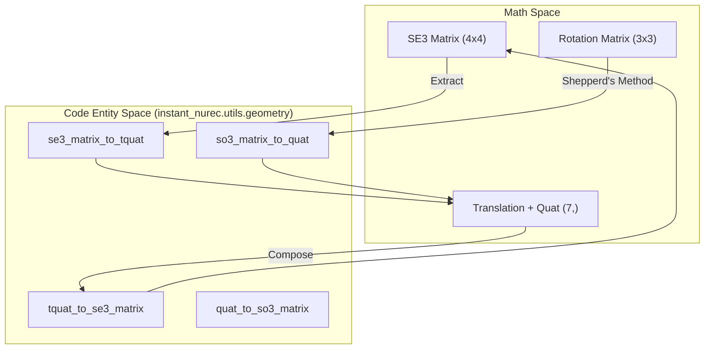
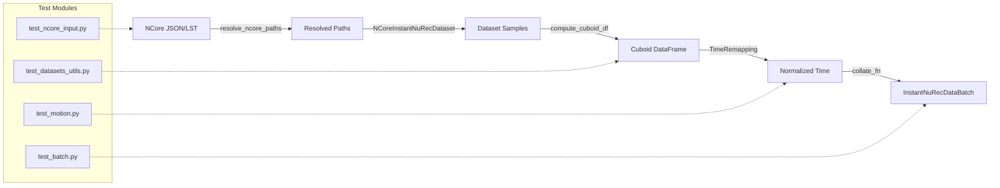

<!-- source: DeepWiki mcp.deepwiki.com · repo NVIDIA/instant-nurec · page 7.2 Unit Tests: Data and Utility Modules · fetched 2026-10-26 -->

# Unit Tests: Data and Utility Modules

Relevant source files

The following files were used as context for generating this wiki page:

- [tests/test_batch.py](tests/test_batch.py)
- [tests/test_bivariate_windshield.py](tests/test_bivariate_windshield.py)
- [tests/test_cubemap.py](tests/test_cubemap.py)
- [tests/test_datasets_utils.py](tests/test_datasets_utils.py)
- [tests/test_files.py](tests/test_files.py)
- [tests/test_gaussians_utils.py](tests/test_gaussians_utils.py)
- [tests/test_geometry.py](tests/test_geometry.py)
- [tests/test_merge_covariances.py](tests/test_merge_covariances.py)
- [tests/test_misc.py](tests/test_misc.py)
- [tests/test_motion.py](tests/test_motion.py)
- [tests/test_ncore_input.py](tests/test_ncore_input.py)
- [tests/test_ncore_sensors_converters.py](tests/test_ncore_sensors_converters.py)
- [tests/test_ncore_utils.py](tests/test_ncore_utils.py)
- [tests/test_nn_extensions.py](tests/test_nn_extensions.py)
- [tests/test_packed_ops.py](tests/test_packed_ops.py)
- [tests/test_samplers.py](tests/test_samplers.py)
- [tests/test_se3pose.py](tests/test_se3pose.py)
- [tests/test_sensors.py](tests/test_sensors.py)
- [tests/test_tracks.py](tests/test_tracks.py)
- [tests/test_types.py](tests/test_types.py)

This section provides a detailed technical reference for the unit tests covering the data pipeline, geometry, sensor models, and mathematical utilities. These tests ensure the correctness of the foundational components that support the Kelvin inference engine and the NCore data ingestion process.

## Overview and Scope

The utility and data tests focus on verifying the "bottom-half" of the InstantNuRec stack. Because many dependencies (such as `ncore.data`, `ncore.sensors`, and `point_cloud_utils`) involve compiled C++ extensions or specialized hardware environments, the test suite extensively uses `unittest.mock` and `sys.modules` shimming to exercise logic in CPU-only CI environments.

### Core Test Categories
1.  **Data Structures**: Validation of `RenderingData`, `DataBatch`, and collation logic.
2.  **Geometry & Math**: SE3/SO3 transformations, quaternion math, and covariance merging.
3.  **Sensors & Ray Generation**: F-Theta and Bivariate Windshield models, rolling shutter interpolation, and cubemap sampling.
4.  **Dataset Utilities**: NCore path resolution, cuboid track extrapolation, and adaptive frame sampling.

---

## Data and Batching Tests

These tests exercise the lifecycle of data as it moves from the dataset loader into the GPU-bound model.

### Batch Collation and Structure
`tests/test_batch.py` focuses on the `RenderingData` and `DataBatch` dataclasses defined in `instant_nurec.utils.batch`. It ensures that the `collate_fn` correctly merges multiple frames into a single tensor-backed batch and that the `.to(device)` method correctly migrates all nested tensors.

**Key Components Tested:**
*   **`generate_grid_2d_indices`**: Verifies the creation of pixel coordinate grids for ray generation [tests/test_batch.py:134-143]().
*   **`RenderingData` Validation**: Ensures `__post_init__` catches shape mismatches in rays and poses [tests/test_batch.py:165-197]().
*   **Collation Logic**: Tests the recursive `collate_fn` which handles nested dataclasses and tensors [tests/test_batch.py:255-275]().

### NCore Input Resolution
`tests/test_ncore_input.py` validates the CLI's ability to resolve data paths from `.json` (single sequence) and `.lst` (manifest) files.

**Resolution Logic Flow:**
1.  **Single JSON**: Verifies absolute, relative, and tilde-expanded paths [tests/test_ncore_input.py:55-79]().
2.  **LST Manifests**: Ensures the parser correctly handles comments (`#`), blank lines, and paths relative to the `.lst` file's location rather than the CWD [tests/test_ncore_input.py:106-121]().

Sources: `[tests/test_batch.py]()`, `[tests/test_ncore_input.py]()`

---

## Geometry and Math Utilities

The geometry tests ensure that coordinate frame transformations (Rig $\leftrightarrow$ World $\leftrightarrow$ Camera) are numerically stable and follow the expected conventions.

### SE3 and Quaternion Math
`tests/test_geometry.py` provides branch coverage for `instant_nurec.utils.geometry`.

| Function | Test Case | Purpose |
| :--- | :--- | :--- |
| `se3_matrix_inverse` | `test_se3_matrix_inverse_inverts_rotation_and_translation` | Validates $T^{-1}$ for 4x4 matrices [tests/test_geometry.py:75-87](). |
| `so3_matrix_to_quat` | `test_so3_to_quat_identity_is_w_unit` | Verifies XYZW quaternion convention (identity = [0,0,0,1]) [tests/test_geometry.py:176-180](). |
| `tquat_to_se3_matrix` | `test_se3_to_tquat_round_trip_preserves_pose` | Ensures SE3 $\leftrightarrow$ [Translation, Quat] round-trip consistency [tests/test_geometry.py:131-142](). |

### Covariance Merging (KL-Optimal)
`tests/test_merge_covariances.py` covers the mathematical implementation of the Gaussian voxelization algorithm.
*   **`_batched_eigh`**: Tests the chunking logic used to compute Eigen decompositions on large CUDA tensors to avoid memory overflow [tests/test_merge_covariances.py:60-77]().
*   **`merge_covariances_kl_optimal`**: Verifies that merging two Gaussians at different positions results in a scale increase that accounts for the spatial variance [tests/test_merge_covariances.py:113-130]().

### Mathematical Mapping: Code to Entity Space

Title: Geometry Utility Mapping

Sources: `[tests/test_geometry.py]()`, `[tests/test_merge_covariances.py]()`, `[instant_nurec/utils/geometry.py]()`

---

## Sensor Models and Ray Generation

The sensor tests verify the projection and distortion models used to transform 2D image points into 3D world rays.

### F-Theta and Bivariate Windshield Models
`tests/test_bivariate_windshield.py` and `tests/test_ncore_sensors_converters.py` validate the complex camera models used in autonomous driving rigs.

*   **Polynomial Validation**: `test_clip_windshield_distorts_like_nre_reference` compares the in-tree torch implementation against known reference values for windshield distortion [tests/test_bivariate_windshield.py:192-211]().
*   **Converter Dispatch**: `CameraModelConverter.convert` is tested to ensure it correctly maps NCore model types (FTheta, Bivariate) to the internal `kernel_types` dataclasses [tests/test_ncore_sensors_converters.py:199-210]().

### Cubemap Handling
`tests/test_cubemap.py` ensures that sky cubemaps (used for background rendering) are correctly sampled and rotated.
*   **`cubemap_ray_directions`**: Verifies that rays generated for the 6 faces of a cubemap align with the dominant axes (+X, -X, +Y, -Y, +Z, -Z) [tests/test_cubemap.py:110-138]().
*   **`rotate_sky_cubemap`**: Ensures that rotating a constant-color cubemap remains invariant, and that identity rotations recover the input [tests/test_cubemap.py:156-171]().

Sources: `[tests/test_bivariate_windshield.py]()`, `[tests/test_ncore_sensors_converters.py]()`, `[tests/test_cubemap.py]()`

---

## Dataset and Motion Utilities

These tests cover the logic for handling time-series data and object tracks.

### Cuboid Track Processing
`tests/test_datasets_utils.py` validates the processing of 3D bounding boxes (cuboids).
*   **`compute_cuboid_df`**: Tests the conversion of raw NCore observations into a Pandas DataFrame, including the handling of missing rig poses [tests/test_datasets_utils.py:202-205]().

### Time Remapping and Warping
`tests/test_motion.py` exercises the `TimeRemapping` class, which handles the normalization of timestamps across different camera sensors.
*   **Frame Gap Computation**: `test_compute_frame_gap_first_frame_backfilled_from_next` ensures that the temporal gap for the first frame of a sequence is correctly estimated by looking forward [tests/test_motion.py:106-122]().
*   **Continuous Time Mapping**: Validates the linear mapping of microsecond timestamps to a $[0, 1]$ range for model input [tests/test_motion.py:128-136]().

### Data Flow: NCore to Model Batch

Title: Data Ingestion and Processing Flow

Sources: `[tests/test_datasets_utils.py]()`, `[tests/test_motion.py]()`, `[tests/test_ncore_input.py]()`

---

## Miscellaneous Utilities

*   **File I/O**: `tests/test_files.py` validates `parse_universal_path`, ensuring that local paths are correctly prefixed with `file://` for NCore compatibility while S3/HTTPS paths remain untouched [tests/test_files.py:30-58]().
*   **PLY Export**: `tests/test_gaussians_utils.py` mocks `point_cloud_utils` to verify that `write_ply_3dgs` correctly maps internal tensors (albedo, scales, rotations) to the standard 3DGS PLY vertex attributes [tests/test_gaussians_utils.py:121-144]().
*   **Misc Helpers**: `tests/test_misc.py` covers generic helpers like `to_torch` (NumPy to Torch conversion) and `unpack_optional` [tests/test_misc.py:80-123]().

Sources: `[tests/test_files.py]()`, `[tests/test_gaussians_utils.py]()`, `[tests/test_misc.py]()`

---

